<h1 class="title">Commander 软件设计</h1>

<p class="subtitle">v1_1 · 20261031</p>

<style>
body {
  font-family: "Microsoft YaHei";
  font-size: 16px;
  line-height: 1.75;
  color: #24292f;
}
.title {
  font-family: "Microsoft YaHei";
  font-size: 32px;
  line-height: 1.30;
  font-weight: 700;
  text-align: center;
}
.subtitle {
  font-family: "Microsoft YaHei";
  font-size: 18px;
  line-height: 1.50;
  font-weight: 400;
  text-align: center;
}
h1 {
  font-family: "Microsoft YaHei";
  font-size: 28px;
  line-height: 1.40;
  font-weight: 700;
}
h2 {
  font-family: "Microsoft YaHei";
  font-size: 22px;
  line-height: 1.40;
  font-weight: 700;
}
h3 {
  font-family: "Microsoft YaHei";
  font-size: 18px;
  line-height: 1.50;
  font-weight: 700;
}
h4 {
  font-family: "Microsoft YaHei";
  font-size: 16px;
  line-height: 1.50;
  font-weight: 700;
}
p, li {
  font-family: "Microsoft YaHei";
  font-size: 16px;
  line-height: 1.75;
}
.figure-caption,
.formula-caption {
  font-family: "Microsoft YaHei";
  font-size: 14px;
  line-height: 1.50;
  font-weight: 600;
  text-align: center;
  margin: 0.65em 0 0.35em 0;
}
.table-caption {
  font-family: "Microsoft YaHei";
  font-size: 13px;
  line-height: 1.40;
  font-weight: 500;
  text-align: center;
  margin: 0.65em 0 0.35em 0;
}
.mermaid,
.mermaid text,
.mermaid .label {
  font-family: "Microsoft YaHei" !important;
  font-size: 14px !important;
  line-height: 1.20;
}
table {
  width: 100%;
  border-collapse: collapse;
  font-family: "Microsoft YaHei";
  font-size: 13px;
  line-height: 1.45;
}
table th,
table th p,
table th li {
  font-family: "Microsoft YaHei";
  font-size: 13px;
  line-height: 1.40;
  font-weight: 600;
}
table td,
table td p,
table td li,
table td strong,
table td b {
  font-family: "Microsoft YaHei";
  font-size: 13px;
  line-height: 1.45;
  font-weight: 400;
}
table th,
table td {
  padding: 0.40em 0.60em;
  vertical-align: top;
}
code, pre {
  font-family: "Cascadia Code";
  font-size: 14px;
  line-height: 1.50;
}
p code, li code, td code {
  color: #24292f;
  background: #f3f4f6;
  padding: 0.08em 0.28em;
  border-radius: 3px;
}
pre {
  color: #c9d1d9;
  background: #0d1117;
  padding: 1em;
  border-radius: 6px;
  overflow-x: auto;
}
pre code {
  color: inherit;
  background: transparent;
  padding: 0;
}
.hljs-comment, .hljs-quote,
.token.comment, .token.prolog, .token.doctype, .token.cdata {
  color: #8b949e;
  font-style: italic;
}
.hljs-keyword, .hljs-selector-tag, .hljs-literal,
.token.keyword, .token.boolean { color: #ff7b72; }
.hljs-string, .hljs-doctag, .hljs-regexp,
.token.string, .token.char, .token.regex { color: #a5d6ff; }
.hljs-number, .token.number { color: #79c0ff; }
.hljs-title, .hljs-function, .token.function { color: #d2a8ff; }
.hljs-title.class_, .hljs-type, .hljs-built_in,
.token.class-name, .token.builtin { color: #ffa657; }
.hljs-variable, .hljs-attr, .hljs-property,
.token.variable, .token.property, .token.attr-name { color: #7ee787; }
.hljs-operator, .hljs-punctuation,
.token.operator, .token.punctuation { color: #c9d1d9; }
</style>

---

## 目录

1. [文档约定](#1-文档约定)  
2. [软件设计指导原则与编制方法](#2-软件设计指导原则与编制方法)  
3. [软件需求](#3-软件需求)  
4. [用例视图](#4-用例视图)  
5. [逻辑视图](#5-逻辑视图)  
6. [进程视图](#6-进程视图)  
7. [开发视图](#7-开发视图)  
8. [物理视图（部署视图）](#8-物理视图部署视图)  
9. [gRPC 接口契约](#9-grpc-接口契约)  
10. [SQLite 持久化与恢复](#10-sqlite-持久化与恢复)  
11. [配置与热重载](#11-配置与热重载)  
12. [命令审计与 JetStream 可靠发布](#12-命令审计与-jetstream-可靠发布)  
13. [安全、可观测性与运行指标](#13-安全可观测性与运行指标)  
14. [测试体系、物理组织与验收](#14-测试体系物理组织与验收)  

---


# 1. 文档约定

本章是全文的固定排版与表达规范。文档修订、补充和派生版本均应遵守本章，不再根据个人习惯调整字体、字号、行距、图题、表题、公式或代码样式。

本文开头的 `<style>...</style>` 是 HTML `style` 元素，其中包含内部 CSS 样式表，本文简称为 CSS 样式块。第 1.1～1.4 节规定目标样式；CSS 样式块通过 `h1`、`h2`、`p`、`table`、`th`、`td`、`pre`、`code` 等选择器，将规范应用到 Markdown 渲染后生成的 HTML 元素。

## 1.1 字体约定

<p class="table-caption">表 1-1 文档字体与排版规范</p>

| 文档元素 | 字体 | 字号 | 行间距/行高 | 字重 | 对齐方式 |
|---|---|---:|---:|---:|---|
| 文档标题 | Microsoft YaHei | 32 px | 1.30 | 700 | 居中 |
| 文档副标题 | Microsoft YaHei | 18 px | 1.50 | 400 | 居中 |
| 一级标题 | Microsoft YaHei | 28 px | 1.40 | 700 | 左对齐 |
| 二级标题 | Microsoft YaHei | 22 px | 1.40 | 700 | 左对齐 |
| 三级标题 | Microsoft YaHei | 18 px | 1.50 | 700 | 左对齐 |
| 四级标题 | Microsoft YaHei | 16 px | 1.50 | 700 | 左对齐 |
| 正文 | Microsoft YaHei | 16 px | 1.75 | 400 | 左对齐 |
| 图题 | Microsoft YaHei | 14 px | 1.50 | 600 | 居中 |
| 图内文字 | Microsoft YaHei | 14 px | 1.20 | 400 | 按图形布局 |
| 表题 | Microsoft YaHei | 13 px | 1.40 | 500 | 居中 |
| 表头 | Microsoft YaHei | 13 px | 1.40 | 600 | 左对齐 |
| 表格正文 | Microsoft YaHei | 13 px | 1.45 | 400 | 左对齐 |
| 公式题 | Microsoft YaHei | 14 px | 1.50 | 600 | 居中 |
| 代码文字 | Cascadia Code | 14 px | 1.50 | 400 | 左对齐 |

以上规范已经通过本文开头的 CSS 样式块固定。其中，正文为 `16 px`；表题、表头和表格正文均为 `13 px`。表头字重为 `600`，低于标题字重；表格正文行高为 `1.45`，因此表格在字号、字重和行距上均明显弱于正文。英文业务对象、数据库对象和程序标识符仍按所在文本元素的字号排版，但使用行内代码形式，例如 `Asset`、`Connection`、`task_id`。

## 1.2 绘图约定

1. 上下文图、第 0 层及更深层 DFD、总体流程图和关系流程图统一使用 Mermaid。
2. 每一个 Mermaid 图都必须在 Mermaid 代码块第一行加入初始化配置，统一只设置 `useMaxWidth: true`。初始化配置格式为：

```text
%%{init: {"<Mermaid 图类型配置域>": {"useMaxWidth": true}}}%%
```

其中 `<Mermaid 图类型配置域>` 必须根据实际 Mermaid 图类型替换，不得固定写成 `flowchart`，也不得使用与实际图类型不匹配的配置域。

<p class="table-caption">表 1-2 Mermaid 图类型与初始化配置</p>

| Mermaid 图类型 | 图声明 | 第一行初始化配置 |
|---|---|---|
| Flowchart | `flowchart TB/LR/...` | `%%{init: {"flowchart": {"useMaxWidth": true}}}%%` |
| Sequence Diagram | `sequenceDiagram` | `%%{init: {"sequence": {"useMaxWidth": true}}}%%` |
| State Diagram | `stateDiagram-v2` | `%%{init: {"state": {"useMaxWidth": true}}}%%` |
| Class Diagram | `classDiagram` | `%%{init: {"class": {"useMaxWidth": true}}}%%` |
| ER Diagram | `erDiagram` | `%%{init: {"er": {"useMaxWidth": true}}}%%` |

若后续使用其他 Mermaid 图类型，也必须遵守同一规则：

```text
实际图类型
    ↓
确定该图类型对应的 Mermaid 配置域
    ↓
第一行写入：
%%{init: {"对应配置域": {"useMaxWidth": true}}}%%
```

不得额外加入 `wrap` 等非统一配置；如确有特殊需要，应在对应图的局部设计说明中单独论证。

3. 每张图必须有图编号和图题，编号采用“章节号-本章图序号”，例如“图 7-2”。
4. 图题必须使用普通图题样式，不得使用 Markdown 标题。统一写法为：

```html
<p class="figure-caption">图 1-1 图题</p>
```

## 1.3 公式约定

1. 行内公式使用单美元符号，例如 `$E_1$`。
2. 独立公式使用双美元符号，例如：

```text
$$
\mathrm{Entity}=E_1\land(E_2\lor E_3\lor E_4)\land E_5
$$
```

3. 正式公式不得放入代码块。
4. 不使用 `\[` 与 `\]` 作为公式定界符。
5. 变量下标统一写成 `E_1`、`R_1`；逻辑“与”和“或”统一写成 `\land`、`\lor`。
6. 公式必须使用 LaTeX，不使用普通文本模拟数学符号。
7. 需要编号的公式使用“式（章节号-本章公式序号）”，式题采用普通公式题样式：

```html
<p class="formula-caption">式（8-1）实体判断逻辑</p>
```

## 1.4 代码约定

1. 多行代码必须使用带语言标识的围栏代码块，例如 `python`、`sql`、`json`、`yaml`、`mermaid` 或 `text`。
2. 单个标识符、字段名、命令和短代码使用行内代码，例如 `PRIMARY KEY`、`Connection`。
3. 伪代码必须明确标记为 `text` 或在正文中说明“以下为伪代码”；不得使读者误认为它可以直接运行。
4. 代码块统一使用深色背景，颜色为 `#0D1117`；普通代码文字颜色为 `#C9D1D9`。
5. 语法高亮统一采用表 1-3 的配色。Markdown 渲染器应使用 Highlight.js 或 Prism 可识别的语言标识；渲染器不支持高亮时，至少保留代码背景色和普通代码文字颜色。

<p class="table-caption">表 1-3 代码语法高亮配色</p>

| 语法元素 | 颜色 | 十六进制 |
|---|---|---|
| 代码背景 | 深黑蓝 | `#0D1117` |
| 普通文字、运算符和标点 | 浅灰 | `#C9D1D9` |
| 注释 | 灰色 | `#8B949E` |
| 关键字和布尔值 | 红色 | `#FF7B72` |
| 字符串和正则表达式 | 浅蓝 | `#A5D6FF` |
| 数值 | 蓝色 | `#79C0FF` |
| 函数名 | 紫色 | `#D2A8FF` |
| 类型、类名和内置对象 | 橙色 | `#FFA657` |
| 变量、属性和字段 | 绿色 | `#7EE787` |


---


# 2. 软件设计指导原则与编制方法

本章规定本设计书的编制准则，不是特定系统的内部实现说明，也不要求按传统瀑布流程开发。后续章节必须以需求为依据；非适用事项应注明理由，不机械增加模块或抽象。

## 2.1 总则

本节规定软件设计书的编制原则、设计深度和工作流程。软件设计以需求为依据，以架构视图组织设计内容，以明确的行为与接口契约约束实现，并通过测试与验收验证设计目标。优先采用简单、安全、高效的方案，避免无依据的功能扩展和过度设计。

### 2.1.1 需求驱动原则

软件设计必须来源于已确认的需求，不应从技术方案反向编造需求。

<p class="table-caption">表 2-1 需求驱动设计要求</p>

| 设计要求 | 具体规定 |
|---|---|
| 需求依据 | 关键功能、技术机制和质量约束应能够追溯至需求 |
| 设计范围 | 不擅自增加功能或扩大系统职责 |
| 需求分解 | 原始需求与分类需求保持完整、一致 |
| 设计取舍 | 同样满足需求时，优先选择职责更少、依赖更少的方案 |
| 需求变更 | 新增或改变系统行为时，先核对需求，再修订相关设计 |

### 2.1.2 职责与边界明确原则

系统及组件必须具有清晰的职责、依赖方向和状态所有权。

<p class="table-caption">表 2-2 职责与边界设计要求</p>

| 设计要求 | 具体规定 |
|---|---|
| 系统边界 | 明确本系统负责什么、不负责什么 |
| 组件职责 | 重要职责有明确的负责组件，避免重复承担 |
| 状态所有权 | 关键状态具有明确的权威来源和修改责任 |
| 接口边界 | 区分内部接口、对外接口与外部依赖 |
| 依赖控制 | 避免循环依赖和不必要的跨层访问 |
| 简单性 | 不因假设性的扩展需要增加抽象、兼容层或冗余实现 |

### 2.1.3 行为与契约确定原则

设计应消除影响正确性的重要歧义，但不规定无关的私有方法。

<p class="table-caption">表 2-3 行为与契约设计要求</p>

| 设计对象 | 必须明确的内容 |
|---|---|
| 业务操作 | 触发条件、输入、反馈、业务输出及处理规则 |
| 接口 | 参数、类型、返回值、错误、超时及版本语义 |
| 状态 | 状态定义、转换条件、终态与非法转换 |
| 数据 | 数据结构、约束、所有权、一致性与生命周期 |
| 并发操作 | 执行顺序、同步条件、互斥范围与竞争裁决 |
| 异常操作 | 失败条件、处理结果、恢复行为及禁止行为 |

同一契约应有唯一的规范定义位置，其他章节通过引用关联，不重复规定矛盾规则。

### 2.1.4 资源与异步操作安全原则

异步操作的业务结果、底层执行活动和资源生命周期必须分别判断。

<p class="table-caption">表 2-4 异步操作与资源管理原则</p>

| 概念 | 定义及设计要求 |
|---|---|
| 操作逻辑终结 | 业务层已形成最终处理结果，不代表底层活动已经结束 |
| 底层 I/O 安全结束 | 有可信证据表明相关 I/O 不再继续执行或产生新的相关资源访问 |
| 安全隔离 | 通过可验证措施，使未结束操作无法与后续操作发生有害冲突 |
| 资源所有权 | 明确谁创建、持有、跟踪和释放资源 |
| 资源安全释放 | 满足安全结束或可信隔离条件后，才允许释放或复用可能产生冲突的资源 |

核心原则：操作超时不等于底层 I/O 结束；未确认 I/O 安全结束或隔离前，不得释放可能引发冲突操作的执行资源。

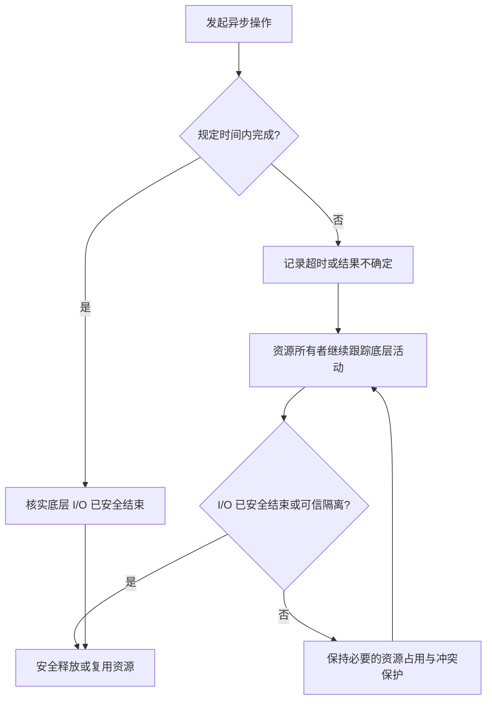

<p class="figure-caption">图 2-1 异步操作超时与资源安全释放流程</p>

对异步操作应区分超时、取消、异常和正常结束；不能仅凭调用方返回、Future/Task 取消或连接状态判断底层 I/O 已安全结束。

### 2.1.5 性能与资源有界原则

性能设计围绕明确的负载与质量要求展开，而不是无依据地增加并发或缓存。

<p class="table-caption">表 2-5 性能与资源有界设计要求</p>

| 设计要求 | 具体规定 |
|---|---|
| 负载模型 | 明确请求规模、并发规模、数据量及运行条件 |
| 容量约束 | 队列、线程、Task、连接、缓存及存储资源应有合理边界 |
| 背压 | 资源不足时明确等待、拒绝、丢弃或降级策略及适用条件 |
| 缓存 | 明确缓存用途、权威数据来源、失效与容量策略 |
| 性能指标 | 明确时延、吞吐、资源占用及测量口径 |
| 性能取舍 | 不得以违反正确性、安全性和可靠性约束换取性能 |

### 2.1.6 故障可控与恢复原则

设计应覆盖正常运行及合理预期的异常场景，明确故障影响范围和恢复条件。

<p class="table-caption">表 2-6 故障与恢复设计要求</p>

| 设计要求 | 具体规定 |
|---|---|
| 故障识别 | 明确可能的超时、通信失败、存储失败、任务异常和进程崩溃 |
| 故障隔离 | 限制故障传播，避免无关组件或资源被错误影响 |
| 状态可信 | 不将未知状态解释为确定成功或失败 |
| 重试与恢复 | 明确允许重试的条件，禁止可能产生危险副作用的盲目重试 |
| 持久化恢复 | 规定异常中断后的数据一致性及状态恢复规则 |
| 生命周期 | 明确启动、就绪、运行、关闭和重启期间的异常处理 |
| 失效行为 | 无法恢复时应有明确的降级、阻塞或停止服务条件 |

### 2.1.7 横切能力非侵入式原则

日志、审计、指标、追踪、权限校验等横切能力应与核心业务逻辑分离，优先通过统一的边界组件、装饰器、中间件或独立服务实现，不应将重复的技术处理流程散布在业务代码中。非侵入式不等于隐藏业务约束：凡影响业务准入、执行结果、事务一致性或故障处理的规则，必须在业务契约中明确，并保留必要的显式调用点。

<p class="table-caption">表 2-7 横切能力非侵入式设计要求</p>

| 设计要求 | 具体规定 |
|---|---|
| 职责分离 | 业务组件负责业务规则与状态转换；横切组件负责统一的记录、采集、校验与传输机制 |
| 边界统一 | 在服务入口、应用服务边界、消息发布边界等明确位置接入横切能力，避免各业务分支重复编排 |
| 最小侵入 | 不为记录日志、采集指标或传播追踪上下文而改变业务方法的核心控制流程和返回语义 |
| 审计正确性 | 审计事件的业务含义及产生时机由业务契约定义；持久化、投递、重试等通用机制与业务处理解耦，同时保证要求的一致性 |
| 故障影响 | 明确横切能力故障时的阻断、降级或重试规则；不得默认其失败不会影响业务，也不得默默吞掉必须处理的错误 |
| 可读性与验证 | 业务代码能够直接体现主流程；横切处理可独立测试，端到端测试验证其与业务契约一致 |

不为追求形式上的非侵入而引入复杂框架或过多抽象；简单、清晰的显式边界优先于难以追踪的隐式执行机制。

### 2.1.8 公共能力复用与冗余控制原则

优先使用符合需求的标准库、成熟软件包、现有工具及公共组件；相同且稳定的职责才提炼为公共能力，不重复发明、不为假设性扩展提前设计框架。

<p class="table-caption">表 2-8 公共能力复用与冗余控制要求</p>

| 设计要求 | 具体规定 |
|---|---|
| 复用优先 | 先评估现成组件是否满足功能、安全、性能及维护要求，再决定是否自行实现。 |
| 提炼公共职责 | 多模块存在稳定相同的职责时统一实现；业务规则留在所属业务模块。 |
| 控制依赖 | 核查成熟度、许可证、版本、安全维护及引入成本。 |
| 控制抽象 | 避免仅为减少少量重复而引入复杂框架或多层转发。 |
| 清理冗余 | 统一能力落地后删除重复、废弃和不必要的兼容实现。 |

### 2.1.9 图表表达与设计一致性原则

设计优先使用合适的图形和表格表达结构、流程、时序、状态及约束，图表不能代替必要的精确定义。

<p class="table-caption">表 2-9 图表表达与一致性设计要求</p>

| 设计要求 | 具体规定 |
|---|---|
| 视图完整 | 使用 4+1 架构视图组织系统设计，覆盖适用内容 |
| 图形选择 | 根据表达目的选择结构图、状态图、时序图、活动图等 |
| 图表一致 | 图形、表格和正文不得相互矛盾 |
| 跨章节一致 | 同一接口、状态、参数及资源规则保持一致 |
| 设计深度 | 明确影响系统行为的契约，允许自主选择内部实现细节 |
| 可验证性 | 关键设计要求应能够对应测试条件与验收证据 |

### 2.1.10 软件设计工作流程

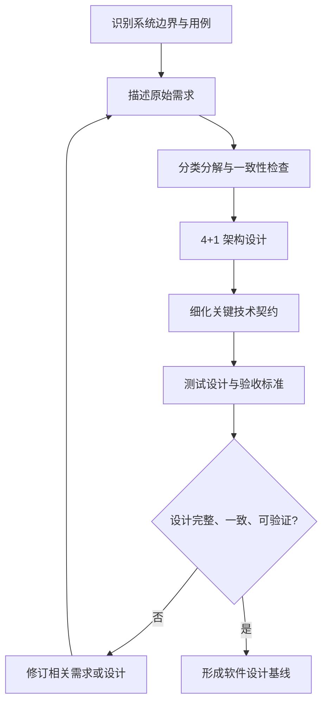

<p class="figure-caption">图 2-2 软件设计编制流程</p>

工作流程允许迭代，不要求传统瀑布式阶段。发现缺口或冲突时直接修订相关需求、架构视图或契约，不通过追加覆盖性条款解决。

## 2.2 需求体系及描述规范

需求采用“识别用例 → 逐条描述原始需求 → 分类分解 → 总分一致性检查”的方法。用例应从外部使用者及运行场景出发，覆盖适用的部署、启动、正常使用、配置、运维、正常关闭、重启及异常恢复过程；不局限于业务 RPC，也不将内部技术机制机械列为用例。用例识别属于需求分析，第 4 章用例视图负责表达参与者、边界及用例关系。

<p class="table-caption">表 2-10 原始需求描述字段</p>

| 字段 | 描述要求 |
|---|---|
| 编号 | 唯一原始需求标识，例如 `UR-01` |
| 名称 | 准确概括使用者需要的能力或运行场景 |
| 请求方（Requester） | 发起操作的外部系统、服务或接口，如 CLI、gRPC 客户端、进程管理系统；不要求是自然人 |
| 输入（Input） | 请求方向本系统提供的数据、参数和信息 |
| 反馈（Response） | 本系统返回请求方的确认、状态、结果及错误信息 |
| 目标方（Destination） | 接收本系统业务输出的外部系统、消息中间件或现场设备；没有时标记“不适用” |
| 业务输出（Output） | 本系统发往目标方的数据、消息或控制指令；没有时标记“不适用” |
| 业务规则（Business Rules） | 正常与异常业务处理、前置条件、执行顺序及结果判定 |
| 约束（Constraints） | 性能、可靠性、安全和横切能力的要求，尤其审计；描述应独立于具体技术实现 |

反馈与业务输出必须分开：反馈面向请求方，业务输出面向目标方；请求方与目标方可有多个，且请求方断连不必然撤销已接受的业务操作。

<p class="table-caption">表 2-11 分类需求体系与描述重点</p>

| 类别 | 核心问题 | 典型要求 |
|---|---|---|
| 功能需求（Functionality） | 系统提供什么行为 | 对外能力、业务流程、业务规则、输入输出与状态反馈 |
| 性能需求（Performance） | 运行速度与资源上限 | 时延、吞吐、并发、调度、公平性、容量、背压、资源消耗、扩展能力 |
| 可靠性需求（Reliability） | 故障时如何保持正确与恢复 | 容错、超时、重试、请求关联、事务、持久化、故障恢复、可用性、未结束操作的资源管理 |
| 安全需求（Safety & Security） | 如何防止危险或非法控制 | 控制权、互锁、失效安全、认证、授权、通信及数据安全 |
| 横切能力（Cross-cutting Concerns） | 如何观测、管理与追责 | 审计（操作证据、可靠投递、完整性、追溯）、日志、指标、追踪、配置、版本、可测试性、可维护性 |

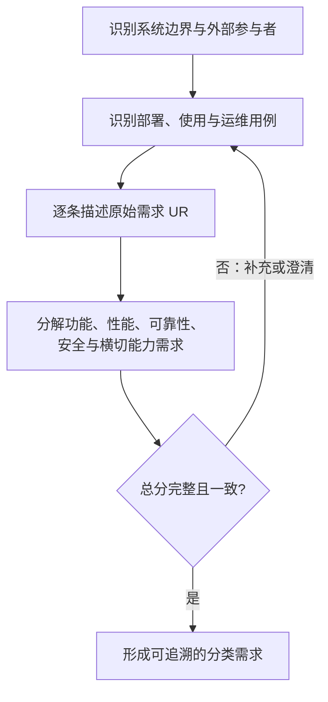

<p class="figure-caption">图 2-3 需求识别、分解与一致性检查流程</p>

分类需求必须从原始需求的输入、反馈、业务输出、规则和约束中推导，不得遗漏、矛盾或未经确认增加能力；多条原始需求的共同约束可以合并，但必须保留来源编号。每条分类需求应给出可核验条件，性能要求还需明确测量口径，不虚构现场阈值。审计应独立于普通日志定义，不得以运行日志代替审计证据。

需求分类与设计专题是不同维度：启动、正常关闭、重启及 Reload 属于跨需求的运行生命周期设计，统一在进程视图展开；相应行为和质量约束分别由原始需求及分类需求追溯。

## 2.3 4+1 架构视图：内涵、外延与表达规范

<p class="table-caption">表 2-12 4+1 架构视图的职责与成果</p>

| 视图 | 关注范围 | 主要成果 | 不应混淆 |
|---|---|---|---|
| 用例视图（+1） | 参与者、系统边界、典型/异常场景 | 系统上下文、用例、业务流程 | 不负责线程调度 |
| 逻辑视图（Logical） | 组件职责、模型、接口、状态规则、依赖 | 组件图、类/数据关系、状态图 | 不等于源码目录树 |
| 进程视图（Process） | 进程、线程、Event Loop、Task、协作、生命周期、同步、并发、资源、背压、缓存、故障恢复 | 运行结构图、任务所有权表、时序/状态/活动图、资源预算 | Task 不等于 OS 线程；图名须区分标准 UML 与示意图 |
| 开发视图（Development） | 软件模块边界、层次、静态依赖、公共契约与复用关系 | 模块图、依赖图、模块职责表 | 不描述真实并发拓扑，也不列现有代码修改清单 |
| 物理视图（Physical/Deployment） | 节点、进程部署、存储、网络、控制权和现场外部依赖 | 部署图、网络/故障域/外部依赖表 | 不是现场设备内部物理结构模型 |

### 2.3.1 用例视图的场景编写规范

用例以参与者的完整业务目标为单位组织，而非以原始需求、RPC 或内部模块为单位逐条改名。一项用例可以关联多项原始需求；一项原始需求也可以由多个业务场景共同覆盖。用例视图回答“在具体业务场景中系统如何工作”，不代替逻辑视图、进程视图和数据设计。

<p class="table-caption">表 2-13 业务场景用例的必备描述要素</p>

| 要素 | 编写规定 |
|---|---|
| 用例身份与目标 | 给出唯一编号、业务场景名称及参与者要达成的可观察目标；名称使用业务活动，不使用内部机制命名 |
| 参与者与触发条件 | 列明实际发起操作的外部角色；内部定时任务、恢复及发布等自动步骤不得虚构外部参与者 |
| 前置条件 | 列明系统就绪、授权、配置或数据存在等必要条件；不得混入未确认的实现假设 |
| 主业务流程 | 以 Mermaid 业务活动图（flowchart）为主要表达，覆盖触发、校验、关键处理、反馈及后置结果；以判断节点表达重要分支，避免大段编号文字复述 |
| 分支与异常流程 | 在活动图中呈现影响业务结果的主要异常出口；罕见或不宜展开的异常在简明说明表中概括，避免为了完整而画出所有技术异常 |
| 后置条件 | 明确成功和失败之后的业务状态、外部可见结果、未完成事项及后续查询方式 |
| 需求追溯 | 标明相关 UR；核对全部 UR 在真实场景中得到覆盖，但不要求 UR 与 UC 一一对应 |

跨用例共享的内部机制（如存储、审计发布和调度）应作为相关业务流程中的自动步骤或支撑行为描述；只有存在独立业务目标时才另立用例。应避免将一串 gRPC 方法名或 CRUD 操作直接当作完整用例，也不得在用例章节展开线程、锁、表结构及类方法等实现细节。

用例的正文采用“一张业务活动图 + 一张简明用例说明表”的表达形式。活动图包含主路径、必要判断以及重要异常分支；图中节点使用业务动作，不展开展示内部类、锁和数据库事务。说明表只填写参与者、业务目标、前置条件、主要异常、后置条件及关联需求。业务分支已在图中完整表达时，不再重复书写大段“主业务流程”和“异常流程”；复杂跨参与者消息时序可在独立小节补充时序图。图题和表题按文档约定独立编号。

进程视图应按四个设计专题组织，而不是按需求类别重复划分：

<p class="table-caption">表 2-14 进程视图的四类设计专题</p>

| 专题 | 必须明确的设计对象 | 推荐表达 |
|---|---|---|
| 运行时结构 | 进程、线程、Event Loop、Task、线程池、组件与资源所有权 | 分层运行结构图、Task 职责表 |
| 运行生命周期（Runtime Lifecycle） | 启动、初始化、就绪、运行、Reload、正常关闭、重启及其阶段转换 | 生命周期状态图、启动/关闭/Reload 时序图 |
| 并发与资源管理 | Task 协作、队列、通知、同步、调度、容量限额、背压、缓存及释放 | 任务协作时序图、资源与背压策略表 |
| 异常与恢复 | 超时、取消、故障隔离、未收敛 I/O、崩溃恢复与降级 | 故障状态图、异常裁决矩阵 |

各专题共享同一运行模型，明确创建者、所有者、同步关系和退出条件；不因分节而重复定义状态或资源。生命周期是进程视图的独立设计专题，不是第六类需求。

图表仅使用其可准确表达的语义：结构关系用 Mermaid Flowchart；行为交互用 Sequence Diagram；状态约束用 State Diagram；条件控制用活动/流程图。图题说明对象、范围及图类型。关键质量属性贯穿各视图，不能只写在单独的“非功能要求”段落。

## 2.4 测试设计方法、组织及验收规范

测试设计以测试层级组织物理目录，以 Marker 描述测试层级、测试专题与运行场景。测试文件名应清楚表达验证对象或行为；测试文件及其标记、验证说明统一登记在测试矩阵中。需求、用例及重要技术契约必须能追溯到实际测试，不为同一目的建立重复测试体系。

<p class="table-caption">表 2-15 测试层级与目录规范</p>

| 层级 Marker | 物理目录 | 验证范围 |
|---|---|---|
| `unit` | `unit/` | 状态转换、业务规则、纯逻辑，无外部服务依赖 |
| `component` | `component/` | 单组件职责及其可控依赖 |
| `integration` | `integration/` | 组件之间及真实外部依赖的接口协作 |
| `system` | `system/` | 独立进程、完整业务场景及端到端行为 |

<p class="table-caption">表 2-16 测试 Marker 与矩阵编制规范</p>

| 事项 | 规范 |
|---|---|
| 层级 Marker | 每项测试必须且仅属于 `unit`、`component`、`integration`、`system` 之一，与目录对应 |
| 专题 Marker | 标识可靠性、安全、性能等验证主题，可与层级及场景 Marker 叠加；无专项主题时可为空 |
| 场景 Marker | 标识并发、超时、恢复、负载、现场等执行条件或情境；有相应场景时标记 |
| 测试矩阵 | 至少包含“测试文件名、层级 Marker、专题 Marker、场景 Marker、测试说明”五列；每项重要测试应有可定位的文件归属 |
| 标记粒度 | 标记以具体测试函数或类为准；同文件可包含不同专题与场景，矩阵列出涉及的 Marker |
| 运行条件 | 通过 Fixture 和环境准备明确外部依赖；现场专用测试与常规回归分离，未执行不视为通过 |
| 执行规则 | 提供按目录、Marker 及其布尔组合的 pytest 命令；所有 Marker 在项目配置中注册 |
| 可追溯性 | 测试说明与需求、用例或技术契约对应；行为变更时同步检查测试及矩阵 |
| 验收证据 | 保留运行环境、命令、实际结果、指标和未验证项，禁止把设计目标当作测试结果 |

目录划分测试层级，专题与场景通过 Marker 横向组合；可靠性测试不单独设第五类目录。测试矩阵用于定位和筛选测试，不预设每个实现文件必须存在，也不要求每个文件仅能有一种测试场景。

# 3. 软件需求

本章先完整描述各运行场景的原始需求（UR），再从其业务规则与约束中提取分类需求（FR、PR、RR、SR、CR）。分类需求不新增未获确认的业务能力；数值阈值未确定时保留可测量指标，不将待测量值视为已满足的验收标准。

## 3.1 原始需求

原始需求覆盖部署与运行生命周期、控制使用、状态与配置管理、审计及异常恢复。请求方可以是外部系统，也可以是系统内部事件触发者；业务输出与返回请求方的反馈分别描述。

<p class="table-caption">表 3-1 原始需求索引</p>

| 编号 | 名称 | 请求方 |
|---|---|---|
| UR-01 | 启动服务 | 进程管理系统 |
| UR-02 | 正常关闭服务 | 进程管理系统 |
| UR-03 | 重启服务 | 进程管理系统 |
| UR-04 | 单点控制 | gRPC 客户端（Orca、Gateway 等） |
| UR-05 | 批量控制 | gRPC 客户端 |
| UR-06 | 查询命令结果 | gRPC 客户端 |
| UR-07 | 查询服务基本信息 | CLI、gRPC 客户端 |
| UR-08 | 查询服务运行状态 | CLI、gRPC 客户端 |
| UR-09 | 查询设备列表 | CLI、gRPC 客户端 |
| UR-10 | 查询设备详情 | CLI、gRPC 客户端 |
| UR-11 | 热重载设备配置 | gRPC 调用方 |
| UR-12 | 查询配置状态 | gRPC 调用方 |
| UR-13 | 本地命令与审计记录管理 | 内部命令状态变化（自动触发） |
| UR-14 | 发布命令审计事件 | 内部已持久化审计事件（自动触发） |
| UR-15 | 异常退出后恢复服务 | 进程管理系统（异常重启触发） |

### 3.1.1 UR-01 启动服务

<p class="table-caption">表 3-2 UR-01 启动服务</p>

| 字段 | 描述 |
|---|---|
| 编号 | UR-01 |
| 名称 | 启动服务 |
| 请求方 | 进程管理系统 |
| 输入 | 启动请求、已部署配置及运行环境 |
| 反馈 | 启动结果、就绪状态或失败原因 |
| 目标方 | 不适用 |
| 业务输出 | 不适用（启动不主动写入设备） |
| 业务规则 | 校验配置与运行依赖；恢复历史命令；满足准入条件后开放命令接口；启动失败不得错误报告就绪 |
| 约束 | 恢复期间不得重复现场写入；单实例控制权唯一；配置文件缺失、格式或版本不兼容、模板引用失效、数据库不可用时不得就绪或接受命令，并报告明确原因；启动本身不生成命令审计。 |

### 3.1.2 UR-02 正常关闭服务

<p class="table-caption">表 3-3 UR-02 正常关闭服务</p>

| 字段 | 描述 |
|---|---|
| 编号 | UR-02 |
| 名称 | 正常关闭服务 |
| 请求方 | 进程管理系统 |
| 输入 | 停止信号、关闭期限 |
| 反馈 | 退出状态、未完成工作和异常信息 |
| 目标方 | 不适用 |
| 业务输出 | 不适用 |
| 业务规则 | 停止接受新命令；未开始的命令按规则终结；已发起的操作等待安全结束；处理既有待发布审计事件至规定关闭期限，关闭存储资源；关闭本身不生成审计事件 |
| 约束 | 停止阶段有界等待并报告超时；底层 I/O 未安全结束或可信隔离前不得释放冲突资源；关闭期限届满时对无法收敛 I/O 保持设备阻塞及必要资源所有权，不得假定取消成功，不得以正常安全退出掩盖未结束执行；终态与待投递事件先可靠落盘。 |

### 3.1.3 UR-03 重启服务

<p class="table-caption">表 3-4 UR-03 重启服务</p>

| 字段 | 描述 |
|---|---|
| 编号 | UR-03 |
| 名称 | 重启服务 |
| 请求方 | 进程管理系统 |
| 输入 | 进程管理系统发出的重启请求；磁盘上的完整配置文件集合及本地持久化状态 |
| 反馈 | 重启后的运行状态、恢复结果和告警 |
| 目标方 | 不适用 |
| 业务输出 | 不适用 |
| 业务规则 | 先完成停止流程，再启动新的服务进程；重新读取并校验全部依赖配置文件，按新文件内容运行；不得因重启再次执行已接受命令 |
| 约束 | 配置缺失、schema_version 不兼容、引用版本不匹配或数据库故障时拒绝就绪；不得因进程重启重复控制；跨进程控制权和旧 I/O 隔离未证实前拒绝可能冲突的操作。 |

### 3.1.4 UR-04 单点控制

<p class="table-caption">表 3-5 UR-04 单点控制</p>

| 字段 | 描述 |
|---|---|
| 编号 | UR-04 |
| 名称 | 单点控制 |
| 请求方 | gRPC 客户端（Orca、Gateway 等） |
| 输入 | device_id、point_id、目标值、可选有效期及超时 |
| 反馈 | Commander 生成的 request_id、command_id 和已接受状态；执行结果通过查询接口获取 |
| 目标方 | 现场 PLC |
| 业务输出 | 向指定可写测点发送一次控制写入 |
| 业务规则 | 校验已认证调用方权限、设备、点位及设定值；接受时由 Commander 生成 request_id 和 command_id 并持久化，再按设备 FIFO 执行；排队超时或有效期届满后不再写入；可能已发出但结果无法确认的写入终结 UNKNOWN。 |
| 约束 | 排队期限从首次接受时起算并覆盖设备 FIFO 与全局额度等待，执行期限从实际开始写入起算，有效期以请求中规定的绝对截止时间为准；同一时刻以持久化的终态裁决为准，已终结不再执行；RPC 超时或取消不撤销已接受命令；不能自动重试结果未知的写入；资源与审计留存有界。 |

### 3.1.5 UR-05 批量控制

<p class="table-caption">表 3-6 UR-05 批量控制</p>

| 字段 | 描述 |
|---|---|
| 编号 | UR-05 |
| 名称 | 批量控制 |
| 请求方 | gRPC 客户端 |
| 输入 | 有序控制项目列表（每项包含设备、点位、目标值及可选超时/有效期） |
| 反馈 | Commander 生成的 request_id、与输入逐项对应的 command_id 和已接受状态，或整批拒绝原因；最终逐点结果由查询接口返回 |
| 目标方 | 现场 PLC（可涉及多个设备） |
| 业务输出 | 分别向各目标测点发送控制写入 |
| 业务规则 | 整批校验并原子接受，Commander 为整批生成 request_id、为各点生成 command_id；按设备 FIFO 执行，合格时优先 write_many，不支持时顺序 write_one；跨设备不保证原子性；按协议实际可确认的粒度记录每点结果，部分成功与整体失败如实报告，无法判定的点标记 UNKNOWN，不自动重试可能已写入的点。 |
| 约束 | 每次接受的批量请求及其子命令身份稳定；单设备不能跨其他已排队命令合并；各子命令的排队期限、执行期限和有效期独立判定，RPC 断开不撤销已接受命令；任一操作超时不代表底层 I/O 已结束；批量容量、整体接收与逐点结果均须可核验。 |

### 3.1.6 UR-06 查询命令结果

<p class="table-caption">表 3-7 UR-06 查询命令结果</p>

| 字段 | 描述 |
|---|---|
| 编号 | UR-06 |
| 名称 | 查询命令结果 |
| 请求方 | gRPC 客户端 |
| 输入 | command_id，或服务端生成的 request_id（单点或批量请求）；二者至少提供其一 |
| 反馈 | 命令或整批子命令的完整请求信息、最新状态、结果、错误及相关时间；保证期内无匹配返回 NOT_FOUND；标识冲突返回明确错误 |
| 目标方 | 不适用 |
| 业务输出 | 不适用 |
| 业务规则 | 通过 command_id 查询单命令；通过 Commander 生成的 request_id 查询单点或整批请求的命令 ID 与结果；响应丢失且未取得任何编号时不保证找回原请求；读取本地已保存事件并还原，不访问现场设备。 |
| 约束 | 终态不可擅自改写；保留期限内的历史结果可跨重启查询；记录清理后返回 NOT_FOUND；查询应受授权控制 |

### 3.1.7 UR-07 查询服务基本信息

<p class="table-caption">表 3-8 UR-07 查询服务基本信息</p>

| 字段 | 描述 |
|---|---|
| 编号 | UR-07 |
| 名称 | 查询服务基本信息 |
| 请求方 | gRPC 调用方 |
| 输入 | 查询请求 |
| 反馈 | 服务标识、软件版本、启动信息及当前实际生效的全部依赖配置文件清单（路径或逻辑标识、schema_version、file_version） |
| 目标方 | 不适用 |
| 业务输出 | 不适用 |
| 业务规则 | 返回当前服务实例的基本身份信息和当前实际生效的配置文件版本；不能把磁盘上尚未生效的版本报告为生效版本 |
| 约束 | 不得为查询触发设备连接；敏感信息按权限过滤 |

### 3.1.8 UR-08 查询服务运行状态

<p class="table-caption">表 3-9 UR-08 查询服务运行状态</p>

| 字段 | 描述 |
|---|---|
| 编号 | UR-08 |
| 名称 | 查询服务运行状态 |
| 请求方 | gRPC 调用方 |
| 输入 | 查询请求 |
| 反馈 | 进程存活/业务就绪、设备阻塞数、在途 I/O、设备与全局队列积压、存储已用/上限与预留空间、未确认审计事件数、最老待投递事件等待时长、发布失败/恢复告警 |
| 目标方 | 不适用 |
| 业务输出 | 不适用 |
| 业务规则 | 区分进程存活、业务可用与外部依赖状态；统计口径明确 |
| 约束 | 查询不触发现场 I/O；统计及健康状态不得虚报 |

### 3.1.9 UR-09 查询设备列表

<p class="table-caption">表 3-10 UR-09 查询设备列表</p>

| 字段 | 描述 |
|---|---|
| 编号 | UR-09 |
| 名称 | 查询设备列表 |
| 请求方 | gRPC 调用方 |
| 输入 | 筛选条件、分页参数 |
| 反馈 | 设备列表、状态摘要及下一页标识 |
| 目标方 | 不适用 |
| 业务输出 | 不适用 |
| 业务规则 | 返回服务配置管理的设备；支持筛选与分页 |
| 约束 | 只读查询；地址与敏感字段依权限可见；不得主动连接设备 |

### 3.1.10 UR-10 查询设备详情

<p class="table-caption">表 3-11 UR-10 查询设备详情</p>

| 字段 | 描述 |
|---|---|
| 编号 | UR-10 |
| 名称 | 查询设备详情 |
| 请求方 | gRPC 调用方 |
| 输入 | device_id |
| 反馈 | 设备协议、连接、执行、阻塞、错误、生效配置状态，以及当前生效点表中配置为允许写入的测点信息（标识、数据类型及已配置的写入约束）；不返回只读/查询点 |
| 目标方 | 不适用 |
| 业务输出 | 不适用 |
| 业务规则 | 返回指定设备详情及该设备当前生效配置中的可写入测点清单；清单仅来自已加载配置，不执行现场读取；设备不存在给出明确错误 |
| 约束 | 不得主动连接设备；只列出明确标记为可写的测点，不包含只读点或仅查询点；敏感地址按权限过滤；状态来源清晰 |

### 3.1.11 UR-11 热重载设备配置

<p class="table-caption">表 3-12 UR-11 热重载设备配置</p>

| 字段 | 描述 |
|---|---|
| 编号 | UR-11 |
| 名称 | 热重载设备配置 |
| 请求方 | gRPC 调用方 |
| 输入 | 配置校验请求或热重载请求；以磁盘候选配置为对象 |
| 反馈 | 请求状态、受影响设备及应用结果、失败原因 |
| 目标方 | 不适用 |
| 业务输出 | 不适用 |
| 业务规则 | 独立配置校验请求只读校验候选文件并返回错误位置与原因；热重载必须重新读取并校验候选文件，复用通用配置校验能力；除 commander.yaml 外的依赖配置文件均可热重载；逐设备先停止新执行准入、等待受影响 I/O 安全结束或可信隔离，再原子切换该设备配置；失败设备保留旧生效配置或保持阻塞，其他设备独立报告；不得通过热重载修改 commander.yaml 的服务级设置；不存热重载请求历史、不生成命令审计。 |
| 约束 | 不允许热重载时更换正在执行命令使用的设备、点位或连接语义；删除设备必须待在途 I/O 安全结束并处置待执行命令；新增设备校验通过才开放准入；逐设备真实生效版本独立可见，不使用全局 revision；候选配置与已生效配置必须可区分。 |

### 3.1.12 UR-12 查询配置状态

<p class="table-caption">表 3-13 UR-12 查询配置状态</p>

| 字段 | 描述 |
|---|---|
| 编号 | UR-12 |
| 名称 | 查询配置状态 |
| 请求方 | gRPC 调用方 |
| 输入 | 设备筛选、是否包含设备级详情 |
| 反馈 | 当前磁盘候选配置与实际生效文件的版本清单、整体/设备级应用状态和错误 |
| 目标方 | 不适用 |
| 业务输出 | 不适用 |
| 业务规则 | 以文件标识、schema_version、file_version 展示候选与实际生效配置；部分失败时如实展示设备差异及是否需要重启，不使用全局 revision |
| 约束 | 只读；不得将部分生效误报为全局成功 |

### 3.1.13 UR-13 本地命令与审计记录管理

<p class="table-caption">表 3-14 UR-13 本地命令与审计记录管理</p>

| 字段 | 描述 |
|---|---|
| 编号 | UR-13 |
| 名称 | 本地命令与审计记录管理 |
| 请求方 | 内部命令接收、状态变化与查询流程（自动触发） |
| 输入 | 仅控制命令的服务端 request_id、command_id、规范化请求、命令状态及结果，以及对应命令审计事件和投递确认；不包含配置热重载请求或状态 |
| 反馈 | 存储成功或失败、查询可用性及容量告警（通过操作结果和运行状态反馈） |
| 目标方 | 不适用（本地存储属于本系统内部资源） |
| 业务输出 | 不适用 |
| 业务规则 | 控制命令首次 ACCEPTED 事件完整保存可信调用方、请求身份、设备、目标变量和下发值；后续只追加状态/结果增量事件；单表同时支持命令查询、故障恢复及未发布事件；不重复存储可通过配置版本取得的设备/测点属性；按整条命令事件组清理，不记录启动、关闭、热重载事件。 |
| 约束 | 本地最大存储容量、终态预留容量、查询保留期、清理周期和告警水位均须可配置；按最早符合条件的完整命令组优先清理，只有终态、全部相关事件已发布确认、超过查询保留期时才可删除；未终结命令、未确认投递或查询保留期内的记录不可覆盖或提前删除；无法安全清理或达到准入阈值时拒绝新命令并告警，同时保障已接收命令终结与审计落盘。 |

### 3.1.14 UR-14 发布命令审计事件

<p class="table-caption">表 3-15 UR-14 发布命令审计事件</p>

| 字段 | 描述 |
|---|---|
| 编号 | UR-14 |
| 名称 | 发布命令审计事件 |
| 请求方 | 本地已持久化审计事件（自动触发） |
| 输入 | 仅已持久化的命令 ACCEPTED、状态变化及最终结果增量事件，含稳定 event_id、事件顺序、可信调用方、设备/测点、设定值（首次事件）及状态/结果（后续事件） |
| 反馈 | 消息中间件的发布确认或失败状态；运行状态可查询积压与错误 |
| 目标方 | JetStream 审计消息服务 |
| 业务输出 | 向消息中间件发送命令接收、状态变化及执行结果事件，供下游长期/永久存储 |
| 业务规则 | 事件先在本地可靠记录，再异步发布；同一命令按事件序号顺序发布；发布确认不代表下游已永久保存，后者属于下游系统职责 |
| 约束 | 发布失败保留并按有界退避持续重试；未获 JetStream 发布确认绝不删除；按每条命令顺序发布，重复投递用 event_id 识别；积压量、最老积压时间及存储占用达到配置告警水位时报警，触及安全准入容量上限时拒绝新控制命令；消息中间件成功确认不代表下游已完成永久保存。 |

### 3.1.15 UR-15 异常退出后恢复服务

<p class="table-caption">表 3-16 UR-15 异常退出后恢复服务</p>

| 字段 | 描述 |
|---|---|
| 编号 | UR-15 |
| 名称 | 异常退出后恢复服务 |
| 请求方 | 进程管理系统（异常重启触发） |
| 输入 | 本地持久化的统一命令事件及磁盘配置文件集合 |
| 反馈 | 恢复结果、业务就绪状态、异常阻塞及告警 |
| 目标方 | 不适用 |
| 业务输出 | 不适用 |
| 业务规则 | 重新加载并校验配置，核实完整事件和发布状态；未实际开始写入者按规则终结，可能已写入者保守终结 UNKNOWN；不重新发出旧写入；恢复未确认审计事件；对于旧配置下未安全结束的 I/O，隔离或维持相应设备阻塞后才允许在新配置下执行。 |
| 约束 | 旧进程的 I/O 和设备控制权未确认安全结束/隔离前不得新建冲突写入；配置版本失配、引用失效或存储不可用不得就绪；UNKNOWN 不因晚到确认自动改写。 |

## 3.2 功能需求

<p class="table-caption">表 3-17 功能需求</p>

| 编号 | 需求 | 可验证要求 | 来源原始需求 |
|---|---|---|---|
| FR-01 | 启动、停止与重启 | 启动时校验配置、依赖及恢复状态后才就绪；停止时拒绝新命令并处置在途操作；重启先停止再重新读取全部配置文件，不沿用旧配置快照 | UR-01、UR-02、UR-03 |
| FR-02 | 单点控制 | 接收设备、可写点、目标值及可选时间约束；Commander 生成 command_id，返回接收或拒绝结果并调度一次写入 | UR-04 |
| FR-03 | 批量控制 | 整批校验并原子接受，逐项分配 command_id；按照设备 FIFO 执行；具备条件时优先 write_many，不支持时按序 write_one；返回逐项状态，跨设备不承诺原子执行 | UR-05 |
| FR-04 | 命令结果查询 | 支持按 command_id 查询，或按服务端 request_id 查询单点/批量全部子命令；返回初始请求和最新状态，未留存则 NOT_FOUND；不访问现场设备 | UR-04、UR-05、UR-06、UR-13 |
| FR-05 | 服务基本信息查询 | 返回服务标识、软件版本、启动信息及当前实际生效的全部依赖文件标识、schema_version、file_version；不把未生效的磁盘文件标记为生效 | UR-07 |
| FR-06 | 运行状态查询 | 返回进程与业务就绪、命令及执行资源、阻塞、存储容量、审计积压和故障状态；区分存活与可用 | UR-08 |
| FR-07 | 设备列表查询 | 返回已配置设备、状态摘要、筛选与分页结果；不主动连接现场设备 | UR-09 |
| FR-08 | 设备详情查询 | 按 device_id 返回设备连接、执行、阻塞、错误及配置状态；列出当前生效点表中全部配置为可写的点标识、类型及写入约束；排除只读和仅查询点 | UR-10 |
| FR-09 | 设备配置热重载 | 允许设备实例增删、连接参数、可写点表/约束及模板引用逐设备热更新；受影响设备在旧 I/O 安全结束或隔离后切换，失败保持旧版本或阻塞；commander.yaml 必须重启；不保留操作历史或命令审计 | UR-11 |
| FR-10 | 配置状态查询 | 返回磁盘候选和当前生效的配置文件标识、schema_version、file_version，逐设备显示应用结果、差异及是否需要重启；不使用全局 revision | UR-12 |
| FR-11 | 本地命令记录管理 | 原子追加已接受命令的首次事件，并以增量事件记录状态和结果；仅保留控制命令及其审计事件，供查询和恢复；按安全清理规则有限留存 | UR-04、UR-05、UR-06、UR-13 |
| FR-12 | 命令审计发布 | 直接将本地追加的命令事件（接受、状态变化和终结）按命令顺序向 JetStream 发布，并维护发布确认及待补发状态 | UR-13、UR-14 |
| FR-13 | 异常退出后恢复 | 重载配置并核对本地存储，恢复命令和待发布事件；未开始写入者按规则终结，可能已发送者终结为 UNKNOWN，不自动重发旧命令 | UR-15 |

## 3.3 性能需求

<p class="table-caption">表 3-18 性能需求</p>

| 编号 | 需求 | 可验证要求 | 来源原始需求 |
|---|---|---|---|
| PR-01 | 控制与查询响应 | 分别统计接收持久化、排队、连接、写入、结果查询的耗时；按指定负载报告分布，不能用协议写入耗时代替端到端耗时 | UR-04、UR-05、UR-06 |
| PR-02 | 有界执行容量 | 限定未完成命令数、设备排队数和全局在途 I/O 并发；同设备保持顺序，不同设备可在容量范围内并发 | UR-04、UR-05 |
| PR-03 | 本地存储容量 | 明确统一命令事件、查询索引及待发布事件的空间上限和保留期限；容量不足且不能安全清理时拒绝新控制请求 | UR-04、UR-05、UR-13、UR-14 |
| PR-04 | 批写效率 | 在相同设备、执行顺序和协议能力条件下优先 write_many；不满足条件时顺序 write_one，不因合并而改变 FIFO | UR-05 |
| PR-05 | 生命周期耗时 | 测量启动就绪、正常停止、重启恢复及异常恢复的耗时和未收敛资源数量 | UR-01、UR-02、UR-03、UR-15 |

设计与验收基准硬件为普通台式机：6 核 CPU、16 GiB 内存、512 GB NVMe SSD、Linux；Commander、SQLite 与 NATS 可同机部署。设计负载为 100 台可控设备、每台 10 Hz、每批最多 10 点，持续 1,000 批次/s、最多 10,000 点/s。以下数值是设计目标，均非已验证测试结果。

<p class="table-caption">表 3-19 性能及本地存储数值基线</p>

| 指标 | 设计值 | 验收口径与边界 |
|---|---|---|
| 控制请求接收响应 | P99 ≤ 100 ms | 从 RPC 到持久化接受反馈；不包含设备排队及协议写入 |
| 命令结果查询 | P99 ≤ 100 ms | 本地已保留数据的单次查询 |
| 基本信息与设备详情查询 | P99 ≤ 200 ms | 不触发现场 I/O |
| 审计事件发布确认 | P99 ≤ 1 s | NATS 正常运行、无历史积压时，从本地提交至 JetStream 确认 |
| 单设备在途 I/O | 1 | 未安全结束或隔离前不得释放同设备执行资源 |
| 全局在途 I/O | 100 | 包括超时后仍未安全结束的底层 I/O |
| 单设备等待队列 | 最多 10 批次 | 超出容量拒绝新控制请求；还需服从时间有效期 |
| 全局等待队列 | 最多 1,000 批次 | 与单设备队列约束共同生效 |
| 单批最大控制点数 | 10 点 | 批量控制请求上限 |
| 本地命令事件容量上限 | 64 GiB | 包含 SQLite 主库、索引及相关本地落盘开销；磁盘剩余空间另须满足安全要求 |
| 终结与恢复预留容量 | 6.4 GiB | 从 64 GiB 预算预留，不用于新请求准入 |
| 新命令准入停止阈值 | 90% | 达到阈值先安全清理；不足时拒绝新请求 |
| 容量预警阈值 | 80% | 持续监控并告警 |
| 已终结命令查询保留期 | 1,800 s（30 min） | 自终结起算；相关事件均发布确认后才允许按完整命令组删除 |
| 请求查询保留期 | 1,800 s（30 min） | 自请求首次接受起算；不承诺基于服务端编号实现客户端自动去重 |
| 安全清理周期 | 60 s | 按最早符合条件的完整命令事件组分批清理 |
| 启动就绪目标 | ≤ 10 s | 本地配置、存储正常；不要求全部现场设备预连接 |
| 正常关闭目标 | ≤ 10 s | 不以强制终止未收敛 I/O 达成指标 |

控制执行端到端时延受排队、连接和现场协议写入影响，不以接收响应 P99 代替；现场写入性能须单独验收。按满载 10,000 点/s 和 30 分钟计算，最多约 1,800 万个点级命令，实际事件数、SQLite 索引和写入压力取决于业务状态变化及记录大小。64 GiB 为目标硬件上的设计预算，持续吞吐及实际存储行大小必须通过性能验收确认，不保证所有协议环境都能达到上述持续吞吐；无法安全清理时必须拒绝新请求，不得覆盖未终结或未发布事件。

## 3.4 可靠性需求

<p class="table-caption">表 3-20 可靠性需求</p>

| 编号 | 需求 | 可验证要求 | 来源原始需求 |
|---|---|---|---|
| RR-01 | 接受与持久化一致性 | 只有命令身份和请求内容可靠持久化后才确认接受；失败或提交结果不明时不得继续进行不安全的现场写入 | UR-04、UR-05、UR-13 |
| RR-02 | 控制请求标识 | Commander 为每个已接受请求生成 request_id、为每个控制点生成 command_id；不依赖调用方提交请求编号去重；重复提交视为新请求 | UR-04、UR-05、UR-13 |
| RR-03 | 单设备顺序与批量结果 | 同设备按接受顺序执行；write_many 仅用于不跨越其他已排队命令的合格项目；不能确认逐点结果时不得将批量整体响应推断为逐点成功 | UR-04、UR-05 |
| RR-04 | 不确定结果 | 已可能发送但无法确认的写入终结为 UNKNOWN；协议写入确认不代表现场目标达到；终态不能因迟到结果自动改写 | UR-04、UR-05、UR-06、UR-15 |
| RR-05 | 在途 I/O 与资源安全 | 超时或调用取消不等于底层 I/O 结束；安全结束或可信隔离前，维持可能导致冲突操作的资源保护；停止和恢复均遵守该规则 | UR-02、UR-04、UR-05、UR-15 |
| RR-06 | 配置一致性 | 启动、重启、恢复和热重载需先完成相关配置校验；正在执行的操作不混用新旧配置；热重载部分失败时逐设备报告实际生效状态 | UR-01、UR-03、UR-11、UR-12、UR-15 |
| RR-07 | 有限留存与清理 | 配置容量、查询期限、清理间隔、告警水位与终态预留；最早符合条件的完整命令组优先清理，仅终结、全事件发布确认且查询期限均届满时删除；空间不足拒绝新命令但保护既有终结及补发 | UR-06、UR-13、UR-14 |
| RR-08 | 审计可靠投递 | 本地事件先于发布；同命令按事件顺序发布；未确认事件保留并按有界退避重试，event_id 稳定便于下游去重；消息积压、最老待发布时间与容量水位影响报警及新命令准入 | UR-13、UR-14、UR-15 |
| RR-09 | 停止与异常恢复 | 正常关闭停止准入并安全处置在途命令；异常退出后不自动重发可能发生现场副作用的旧写入，恢复失败不得报告业务就绪 | UR-01、UR-02、UR-03、UR-15 |

## 3.5 安全需求

<p class="table-caption">表 3-21 安全需求</p>

| 编号 | 需求 | 可验证要求 | 来源原始需求 |
|---|---|---|---|
| SR-01 | 请求身份与授权 | gRPC 采用 mTLS 验证客户端证书；从证书可信身份映射 caller_id，并按 commander.yaml 中 control/query/reload 权限授权；认证失败与权限不足分别返回 UNAUTHENTICATED、PERMISSION_DENIED；不得信任自报 caller_id；控制前复核设备、点位、数据类型、目标值及有效期约束 | UR-04、UR-05、UR-11 |
| SR-02 | 设备写入保护 | 只允许向生效配置声明可写的测点写入；同设备 FIFO、批量调用及热重载不得产生冲突现场操作 | UR-04、UR-05、UR-10、UR-11 |
| SR-03 | 不确定执行的安全策略 | 状态未知时不自动重试可能已发送的写入；底层 I/O 未安全结束或隔离前不得释放冲突资源 | UR-02、UR-04、UR-05、UR-15 |
| SR-04 | 控制实例唯一性 | 启动、重启及异常恢复期间，不能在现场控制权不确定时接受可能冲突的写入 | UR-01、UR-03、UR-15 |
| SR-05 | 查询信息保护 | 服务、设备列表与详情中的地址和其他敏感信息按请求方权限过滤；查询不得触发现场读取或连接 | UR-07、UR-09、UR-10 |

## 3.6 横切能力需求

<p class="table-caption">表 3-22 横切能力需求</p>

| 编号 | 需求 | 可验证要求 | 来源原始需求 |
|---|---|---|---|
| CR-01 | 命令审计内容 | 仅控制命令的接受、状态变化和终结产生业务审计，包含 request_id、command_id、目标设备/点、目标值、状态、结果及时间；启动、关闭、热重载不产生该类事件 | UR-01、UR-02、UR-04、UR-05、UR-11、UR-13 |
| CR-02 | 审计投递与追踪 | 在统一命令事件记录中保存稳定事件标识、待投递状态及确认结果；向 JetStream 发布命令增量事件，支持重投去重及积压监测；下游负责长期保存 | UR-08、UR-13、UR-14、UR-15 |
| CR-03 | 运行状态与诊断 | 提供进程存活、业务就绪、阻塞设备数、在途 I/O、队列积压、存储水位与预留、未确认事件数及最老积压时长、恢复结果和错误原因；日志与命令通过 request_id、command_id 关联 | UR-01、UR-03、UR-04、UR-06、UR-08、UR-13、UR-15 |
| CR-04 | 配置文件版本可追踪 | 展示每个实际生效依赖文件的标识、schema_version、file_version；对候选文件及逐设备热重载结果单独报告，不使用全局 revision，不持久化热重载请求历史 | UR-03、UR-07、UR-11、UR-12 |
| CR-05 | 非侵入式实现 | 日志、审计投递、指标等通用机制在边界或专用组件实现；业务逻辑只声明必需的业务事件和失败策略，不在每个业务路径重复投递与监控逻辑 | UR-04、UR-05、UR-08、UR-13、UR-14 |

## 3.7 总—分一致性检查结果

<p class="table-caption">表 3-23 原始需求与分类需求追溯结果</p>

| 原始需求 | 功能 FR | 性能 PR | 可靠性 RR | 安全 SR | 横切 CR | 结果 |
|---|---|---|---|---|---|---|
| UR-01 启动 | FR-01 | PR-05 | RR-06、RR-09 | SR-04 | CR-01、CR-03 | 已覆盖 |
| UR-02 关闭 | FR-01 | PR-05 | RR-05、RR-09 | SR-03 | CR-01 | 已覆盖 |
| UR-03 重启 | FR-01 | PR-05 | RR-06、RR-09 | SR-04 | CR-03、CR-04 | 已覆盖 |
| UR-04 单点 | FR-02、FR-11 | PR-01、PR-02、PR-03 | RR-01～RR-05 | SR-01～SR-03 | CR-01、CR-03、CR-05 | 已覆盖 |
| UR-05 批量 | FR-03、FR-11 | PR-01～PR-04 | RR-01～RR-05 | SR-01～SR-03 | CR-01、CR-05 | 已覆盖 |
| UR-06 结果查询 | FR-04 | PR-01 | RR-04、RR-07 | — | CR-03 | 已覆盖 |
| UR-07 基本信息 | FR-05 | — | — | SR-05 | CR-04 | 已覆盖 |
| UR-08 运行状态 | FR-06 | — | — | — | CR-02、CR-03、CR-05 | 已覆盖 |
| UR-09 设备列表 | FR-07 | — | — | SR-05 | — | 已覆盖 |
| UR-10 设备详情 | FR-08 | — | — | SR-02、SR-05 | — | 已覆盖 |
| UR-11 热重载 | FR-09 | — | RR-06 | SR-01、SR-02 | CR-01、CR-04 | 已覆盖 |
| UR-12 配置查询 | FR-10 | — | RR-06 | — | CR-04 | 已覆盖 |
| UR-13 本地记录 | FR-04、FR-11、FR-12 | PR-03 | RR-01、RR-02、RR-07、RR-08 | — | CR-01～CR-03、CR-05 | 已覆盖 |
| UR-14 审计发布 | FR-12 | PR-03 | RR-07、RR-08 | — | CR-02、CR-05 | 已覆盖 |
| UR-15 异常恢复 | FR-13 | PR-05 | RR-04～RR-06、RR-08、RR-09 | SR-03、SR-04 | CR-02～CR-04 | 已覆盖 |

<p class="table-caption">表 3-24 一致性检查结论</p>

| 检查项 | 结果 |
|---|---|
| UR 覆盖 | 15/15 项至少关联一条分类需求，无遗漏 |
| 分类需求来源 | FR 13 项、PR 5 项、RR 9 项、SR 5 项、CR 5 项，均标注 UR 来源 |
| 控制标识 | UR-04/05 的 request_id、command_id 均由 Commander 生成；caller_id 由 mTLS 认证身份映射 |
| 热重载边界 | 不热重载 commander.yaml；不记录热重载请求历史、不生成命令业务审计 |
| 设备详情点表 | 仅返回当前生效配置中的可写点及其写入约束，无只读/查询点 |
| 审计与存储 | 本地有限留存供查询/恢复/补发；JetStream 负责可靠投递，下游负责长期保存 |
| 配置版本 | 以各文件 schema_version、file_version 标识当前生效版本，不使用全局 revision |
| 设计负载 | 100 台、每台 10 Hz、每批最多 10 点，目标 1,000 批次/s 和 10,000 点/s；尚未实测 |
| 数值目标与验证状态 | 已确定普通台式机基准下的响应 P99、64 GiB 容量、30 分钟查询保留、队列及 I/O 上限；指标尚未实测，现场协议时延须单独验证 |

检查结论：15/15 项 UR 已建立分类需求追溯；补齐服务端请求标识、查询保留期限、逐点未知结果、热重载字段边界、事件完整性与清理准入约束。已设定数值性能、容量和留存期限目标；尚未完成实测验证。

# 4. 用例视图

## 4.1 系统边界与参与者

Commander 面向两类外部交互入口：操作系统终端（Terminal）负责启动、停止与重启服务进程；gRPC 调用方负责控制、查询及设备配置热重载。不同业务系统、Web 和诊断 CLI 只要通过 gRPC 接口访问 Commander，均归入同一“gRPC 调用方”类别。现场设备、SQLite、NATS JetStream 及下游审计存储是外部依赖或业务输出目的地，不额外建模为发起用例的参与者。

<p class="figure-caption">图 4-1 Commander 系统边界与外部交互</p>

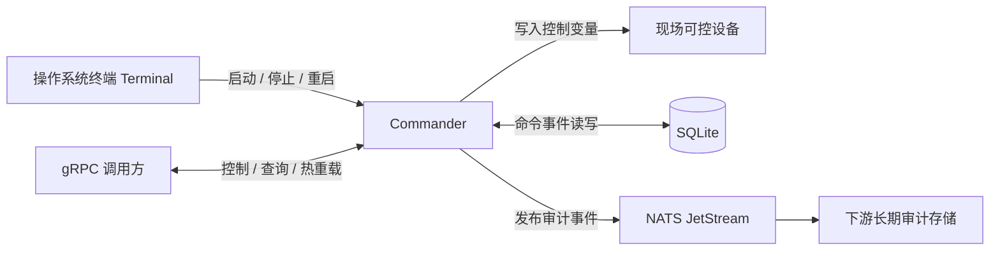

<p class="table-caption">表 4-1 外部交互角色及边界</p>

| 类别 | 交互方式 | 职责及边界 |
|---|---|---|
| 操作系统终端 | 进程启动、停止、重启命令 | 触发服务生命周期；异常退出后的恢复是后续启动过程的内部处理 |
| gRPC 调用方 | 对外 gRPC 契约 | 发起控制、结果和配置查询、设备查询、热重载；调用方身份由可信认证上下文确定 |
| 现场设备与协议适配器 | 外部执行依赖 | 提供协议层写入结果，不能将通信成功误认为物理控制目标达成 |
| SQLite | 本地持久化依赖 | 追加命令事件、查询状态、保存发布确认元数据；不作永久历史库 |
| NATS JetStream 与下游系统 | 外部事件投递目的地 | 接收命令审计事件；下游负责长期保存，不是 Commander 用例发起者 |

## 4.2 业务场景与完整用例

本节按第 2.3.1 节的通用规范组织。用例描述实际业务目标及端到端过程，不要求与第 3.1 节原始需求一一对应。自动审计发布、本地事件维护属于相关业务场景的共同支撑步骤，不虚构独立的外部请求方。

<p class="table-caption">表 4-2 场景用例与冻结需求映射</p>

| 用例 | 完整业务场景 | 参与者 | 涉及原始需求 |
|---|---|---|---|
| UC-01 | 服务首次启动并进入就绪状态 | 操作系统终端 | UR-01、UR-07、UR-08、UR-13、UR-14 |
| UC-02 | 下发单点或批量控制并取得结果 | gRPC 调用方 | UR-04、UR-05、UR-06、UR-13、UR-14 |
| UC-03 | 查询设备及可写变量 | gRPC 调用方 | UR-09、UR-10 |
| UC-04 | 查询服务基本信息、运行状态及配置状态 | gRPC 调用方 | UR-07、UR-08、UR-12 |
| UC-05 | 修改设备配置并热重载 | gRPC 调用方 | UR-11、UR-12 |
| UC-06 | 服务正常停止 | 操作系统终端 | UR-02、UR-13、UR-14 |
| UC-07 | 重启服务并按新配置运行 | 操作系统终端 | UR-03、UR-01、UR-15 |
| UC-08 | 异常退出后的重新启动与恢复 | 操作系统终端（重新启动时） | UR-15、UR-01、UR-13、UR-14 |

### 4.2.1 UC-01 服务首次启动并进入就绪状态

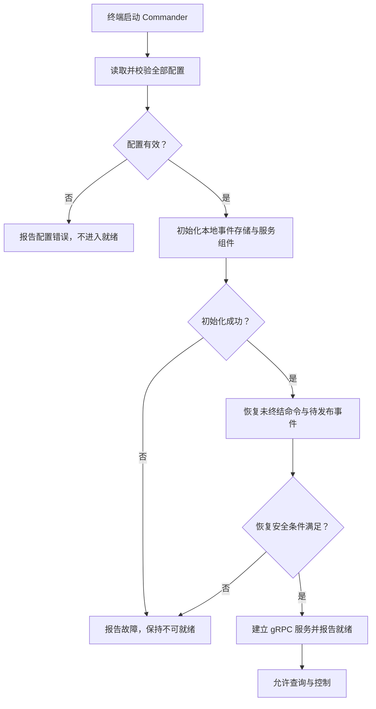

<p class="figure-caption">图 4-2 UC-01 服务首次启动并进入就绪状态业务活动图</p>

<p class="table-caption">表 4-3 UC-01 业务场景说明</p>

| 要素 | 内容 |
|---|---|
| 参与者与目标 | 操作系统终端发起启动，使 Commander 根据现有配置建立可信的本地运行状态并对 gRPC 请求提供服务。 |
| 前置条件 | 进程可启动；指定配置目录与本地持久化路径可访问。 |
| 主要异常 | 关键配置缺失或不兼容、存储不可用、恢复安全条件不满足、mTLS 证书无效或监听端口被占用时不得报告业务就绪；返回明确故障并保持安全状态。 |
| 后置条件 | 服务就绪，或者明确处于失败/不可就绪状态；启动行为本身不生成命令业务审计事件。 |
| 关联需求 | UR-01、UR-07、UR-08、UR-13、UR-14 |

### 4.2.2 UC-02 下发控制指令并获取执行结果

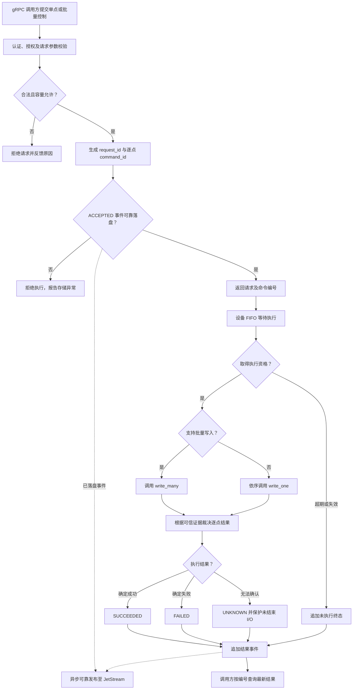

<p class="figure-caption">图 4-3 UC-02 下发控制指令并获取执行结果业务活动图</p>

<p class="table-caption">表 4-4 UC-02 业务场景说明</p>

| 要素 | 内容 |
|---|---|
| 参与者与目标 | gRPC 调用方提交单点或批量设定值，获知接收身份，并在后续查询中取得逐点命令结果。 |
| 前置条件 | Commander 已就绪；调用方获授权；目标设备与可写点属于当前生效配置。 |
| 主要异常 | mTLS 认证失败或控制权限不足直接拒绝；接受前参数、配置或容量校验失败则拒绝、不产生已接受命令；排队超时或有效期届满按未执行终结；现场写入结果不确定时标记 `UNKNOWN`，不盲目重试；RPC 断连不撤销已接受命令；若接受响应丢失且未取得编号，重新提交视为新请求，不承诺自动去重；SQLite 接受事务结果不明时不得执行现场写入；JetStream 故障时保留未确认事件重试；批量整体与逐点结果不得相互冒认。 |
| 后置条件 | 已接受命令有可还原的最新状态、调用方与目标引用及审计投递状态；未结束 I/O 保持必要的资源保护，不因逻辑终结直接释放。 |
| 关联需求 | UR-04、UR-05、UR-06、UR-13、UR-14 |

### 4.2.3 UC-03 查询设备及可写变量

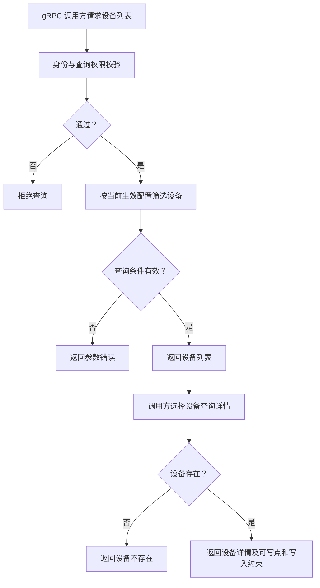

<p class="figure-caption">图 4-4 UC-03 查询设备及可写变量业务活动图</p>

<p class="table-caption">表 4-5 UC-03 业务场景说明</p>

| 要素 | 内容 |
|---|---|
| 参与者与目标 | gRPC 调用方定位可控设备，并读取其可写点标识及写入约束，为后续控制选择合法目标。 |
| 前置条件 | 服务可提供配置查询，调用方具有查询权限。 |
| 主要异常 | 认证失败、设备不存在、参数或分页条件错误、权限不足时返回相应错误；配置正在切换时，以明确的生效配置快照响应，不混合不同版本。 |
| 后置条件 | 调用方获得当前可控范围；整个流程不触发现场读取、写入或连接建立。 |
| 关联需求 | UR-09、UR-10 |

### 4.2.4 UC-04 查询服务信息与运行状态

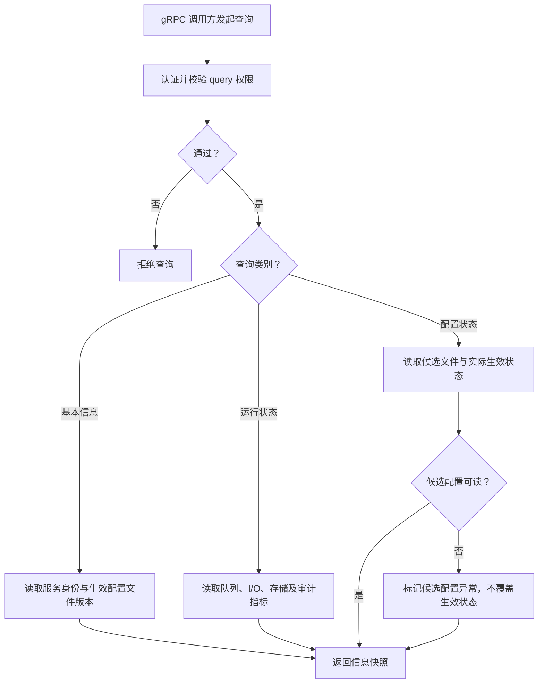

<p class="figure-caption">图 4-5 UC-04 查询服务信息与运行状态业务活动图</p>

<p class="table-caption">表 4-6 UC-04 业务场景说明</p>

| 要素 | 内容 |
|---|---|
| 参与者与目标 | gRPC 调用方了解服务身份、当前生效配置、运行容量及待处理异常，以支持运维判断。 |
| 前置条件 | gRPC 查询入口可用，调用方具有相应查询权限。 |
| 主要异常 | 认证或查询授权失败时拒绝；候选文件不可读取或不合法时明确报告，不能覆盖生效版本信息；不可观测指标应标记不可用，不虚构正常值。 |
| 后置条件 | 返回可供判断的当前快照；查询不变更配置，也不产生命令审计事件。 |
| 关联需求 | UR-07、UR-08、UR-12 |

### 4.2.5 UC-05 修改设备配置并热重载

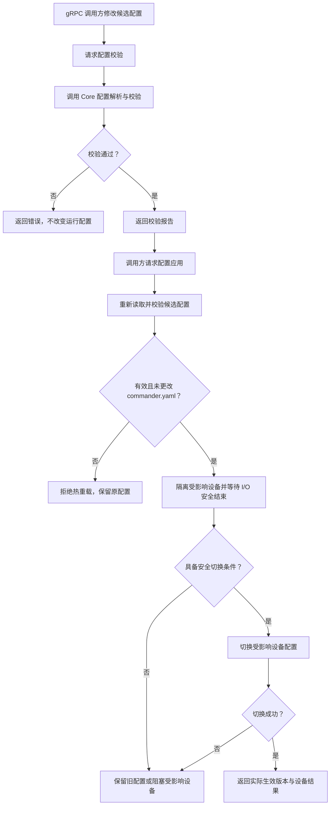

<p class="figure-caption">图 4-6 UC-05 修改设备配置并热重载业务活动图</p>

<p class="table-caption">表 4-7 UC-05 业务场景说明</p>

| 要素 | 内容 |
|---|---|
| 参与者与目标 | gRPC 调用方完成候选配置校验，并在运行期间应用 `commander.yaml` 之外的有效配置变更。 |
| 前置条件 | Commander 已运行；候选文件可访问；调用方具备 reload 权限。 |
| 主要异常 | 认证或授权失败直接拒绝；校验不通过时返回错误位置与原因；候选文件在两次操作间变化，以配置应用阶段的重新校验结果为准；旧 I/O 无法安全结束、配置应用失败或并发热重载冲突时，受影响设备保留旧配置或阻塞并报告，不宣称全部成功。 |
| 后置条件 | 实际生效配置与反馈一致；配置校验与热重载不产生命令审计事件。 |
| 关联需求 | UR-11、UR-12 |

### 4.2.6 UC-06 服务正常停止

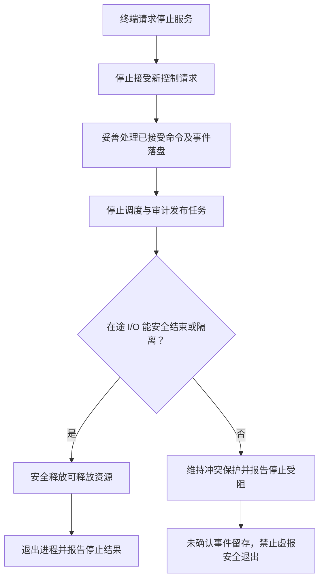

<p class="figure-caption">图 4-7 UC-06 服务正常停止业务活动图</p>

<p class="table-caption">表 4-8 UC-06 业务场景说明</p>

| 要素 | 内容 |
|---|---|
| 参与者与目标 | 操作系统终端要求服务停止，使现有命令得到妥善终结或安全保护，并释放能够安全释放的资源。 |
| 前置条件 | Commander 进程正在运行。 |
| 主要异常 | 关闭期限到达时不能假定在途 I/O 已安全结束；必须按资源所有权和安全隔离规则处理，且不得丢弃未终结命令或未确认审计事件。 |
| 后置条件 | 进程安全退出或明确报告无法安全完成的停止条件；停止操作本身不产生命令业务审计。 |
| 关联需求 | UR-02、UR-13、UR-14 |

### 4.2.7 UC-07 重启服务并加载新配置

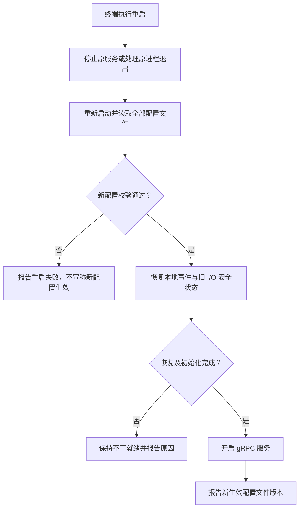

<p class="figure-caption">图 4-8 UC-07 重启服务并加载新配置业务活动图</p>

<p class="table-caption">表 4-9 UC-07 业务场景说明</p>

| 要素 | 内容 |
|---|---|
| 参与者与目标 | 操作系统终端要求重启 Commander，使服务重新读取全部配置并按新版本运行。 |
| 前置条件 | 当前服务运行或已停止；新的配置文件已经放置到指定位置。 |
| 主要异常 | 新配置校验失败、服务初始化失败或历史 I/O 安全边界不满足时拒绝宣称就绪；不得默认沿用旧版本冒充新版本。 |
| 后置条件 | 服务按新配置就绪，或明确失败；重启操作本身不产生命令业务审计。 |
| 关联需求 | UR-03、UR-01、UR-15 |

### 4.2.8 UC-08 异常退出后的恢复

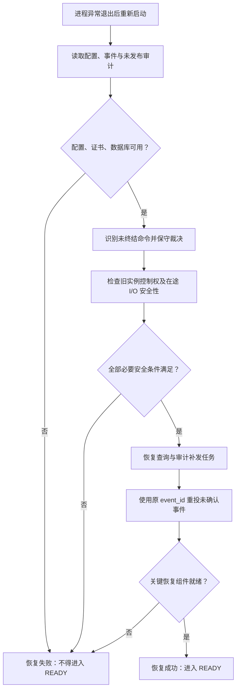

<p class="figure-caption">图 4-9 UC-08 异常退出后的恢复业务活动图</p>

<p class="table-caption">表 4-10 UC-08 业务场景说明</p>

| 要素 | 内容 |
|---|---|
| 参与者与目标 | 服务异常退出后，操作系统终端重新启动 Commander；恢复本地可查询结果与未发布事件，同时避免旧写入副作用。 |
| 前置条件 | 存在异常中断后遗留的本地持久化记录或未确认审计事件。 |
| 主要异常 | 存储损坏、配置不兼容、旧实例隔离无法确认或设备执行安全条件不满足时恢复失败；不得用旧配置含义覆盖当前配置，亦不能将未知命令改判成功；发布确认丢失时允许凭稳定 event_id 重投并由下游去重。 |
| 后置条件 | 恢复成功则进入 READY 并提供查询与审计补发；恢复失败不得进入 READY，报告明确原因。 |
| 关联需求 | UR-15、UR-01、UR-13、UR-14 |

## 4.3 控制用例的主要交互

单点和批量控制共用“验证 → 原子接受并持久化 → 队列调度 → 现场写入 → 结果增量落盘”的主路径。请求接受与现场执行相互独立；调用方断连不取消已接受的命令。拒绝发生在持久化接受之前，不能虚构 command_id 或已接受审计事件。

<p class="figure-caption">图 4-10 控制请求接受、执行与审计的典型时序</p>

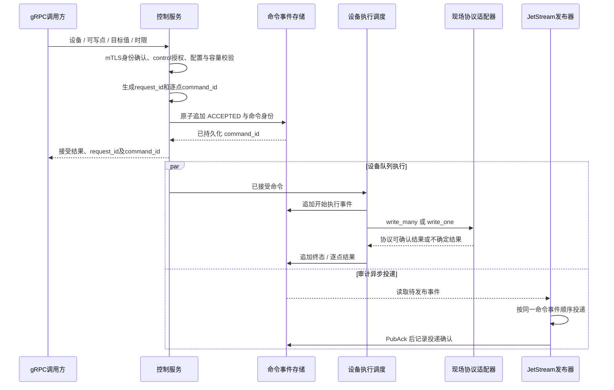

<p class="table-caption">表 4-11 控制用例关键分支与异常结果</p>

| 场景 | 处理及对外结果 | 对应约束 |
|---|---|---|
| RPC 接受响应丢失，调用方未得到编号 | 不承诺查询找回或自动去重；重新提交视为新控制请求 | UR-04～UR-06 |
| SQLite 接受提交状态不确定 | 不进入现场执行；先核实本地接受事实 | UR-04、UR-05、UR-13 |
| 参数、权限、容量或配置校验不通过 | 接受前拒绝，无控制写入 | UR-04、UR-05 |
| 整批输入部分无效 | 整批拒绝，不接受任何子命令 | UR-05 |
| 同设备连续合格点写入 | 优先一次 write_many；协议不支持则按 FIFO 顺序 write_one | UR-05 |
| 批量部分结果不确定 | 按实际证据逐点报告；无法确认的点为 UNKNOWN | UR-05 |
| 排队期限或有效期在写入前届满 | 终结为确定未执行的失败；不执行现场写入 | UR-04、UR-05 |
| 写入可能已发出但确认丢失 | 记录 UNKNOWN，不盲目重试；维持未安全结束 I/O 的冲突保护 | UR-04、UR-05 |
| RPC 取消或响应丢失 | 已接受命令继续处理；已获得编号时可以查询；未获得编号时重发属于新请求 | UR-04～UR-06 |

## 4.4 用例覆盖检查

<p class="table-caption">表 4-12 用例覆盖及边界检查结果</p>

| 检查内容 | 结果 |
|---|---|
| UR 到 UC 映射 | 8 个完整场景覆盖 UR-01～UR-15，15/15 覆盖；无一一对应假设 |
| 对外查询行为 | UC-02 的结果查询、UC-03 和 UC-04；均不得触发现场读写 |
| 控制接受与可靠存储 | UC-02；接受确认以首次事件可靠提交为前提 |
| 异步审计链路 | UC-02 产生事件，UC-01、UC-06～UC-08 处理恢复与补发；JetStream 确认与下游永久保存明确分界 |
| 热重载非审计边界 | UC-05 不生成命令审计或热重载操作历史 |
| 生命周期边界 | UC-01、UC-06～UC-08 不向现场重发历史控制指令 |

# 5. 逻辑视图

本章只规定逻辑组件的职责、依赖、核心协作、状态语义和错误分类。运行时 Task、并发同步、SQLite 事务、配置文件切换和 JetStream 确认的实现机制，分别由第 6、10～12 章规定，不在此重复。

## 5.1 逻辑组件、职责与依赖

<p class="figure-caption">图 5-1 逻辑组件分层及主要依赖</p>

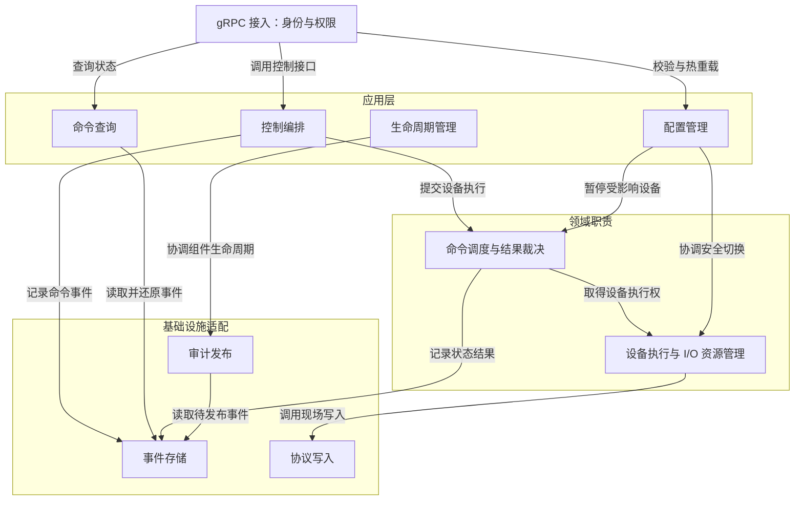

<p class="table-caption">表 5-1 逻辑职责及关键边界</p>

| 逻辑组件 | 职责 | 不承担的职责 |
|---|---|---|
| gRPC 接入 | mTLS 身份识别、权限检查和输入输出转换 | 现场 I/O、命令状态直接修改 |
| 控制编排 | 接受条件、服务端生成请求与命令编号、命令提交 | 管理底层 I/O 线程 |
| 命令调度与结果裁决 | 设备 FIFO、执行资格及可信证据的业务裁决 | 将超时当作安全结束 |
| 设备执行与 I/O 管理 | 会话、执行权、阻塞及安全结束事实 | 决定命令业务终态 |
| 事件存储与查询 | 追加事实、还原当前命令状态、支持查询 | 发出现场控制 |
| 配置管理 | 使用 Core 校验能力，管理生效配置及安全切换 | 重造通用校验器 |
| 审计发布 | 将同一批业务事件可靠投递到消息中间件 | 重新定义业务审计事实 |
| 生命周期管理 | 服务就绪、启动、停止及组件监督 | 替代设备调度器裁决命令 |

## 5.2 关键业务协作

<p class="figure-caption">图 5-2 命令控制、查询与审计协作关系</p>

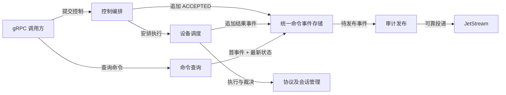

命令接受后立即回复服务端生成的编号，不等待现场写入终结；查询与审计均依赖同一事件事实来源。配置校验与热重载由配置应用协调，调用 Core 的既有校验能力，具体运行时切换机制见第 6 章，配置文件契约见第 11 章。

## 5.3 状态机与状态转换责任

箭头标注格式统一为“触发条件 / 负责模块”。状态转换裁决与事件持久化是不同职责，相关细节见第 6、10 章。

<p class="figure-caption">图 5-3 命令状态机及转换责任</p>

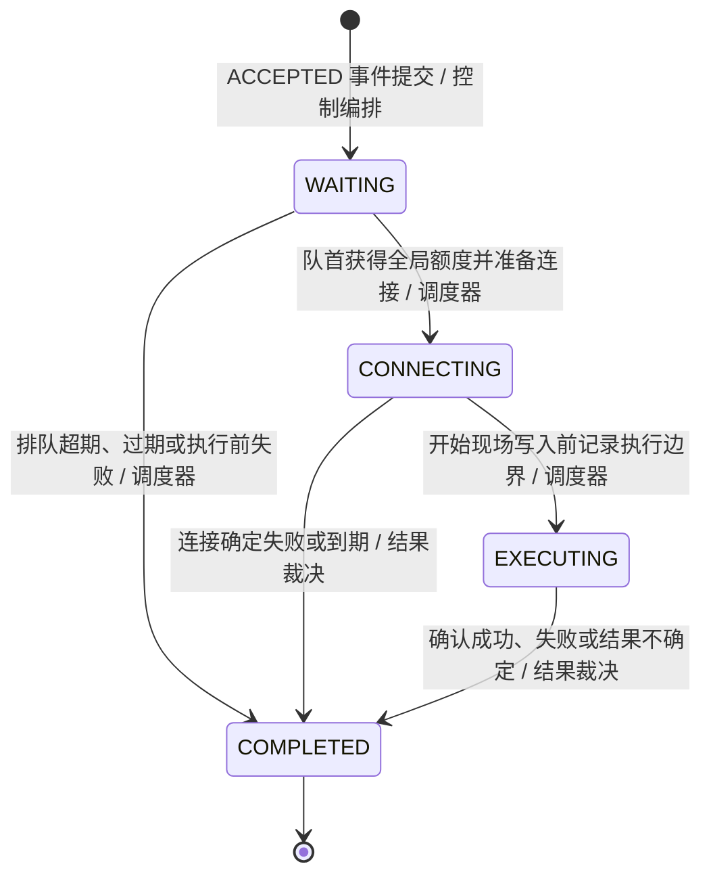

<p class="figure-caption">图 5-4 设备执行状态机及转换责任</p>

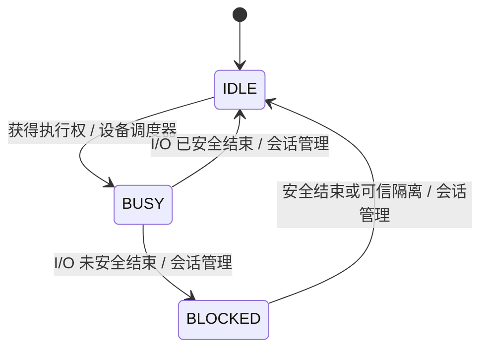

<p class="figure-caption">图 5-5 底层 I/O 状态机及转换责任</p>

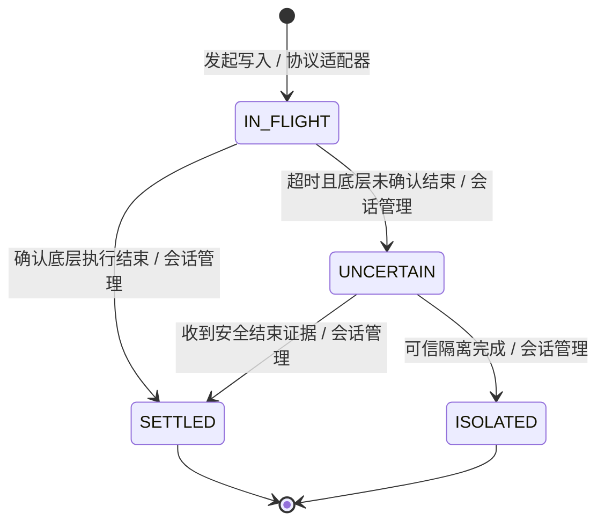

命令的持久化阶段与 RPC 状态枚举使用统一映射：`ACCEPTED` 事件对应 `WAITING`；阶段事件 `CONNECTING/EXECUTING` 对应同名非终态；所有终结事件采用 `COMPLETED`，以 `outcome=CONFIRMED_SUCCESS/CONFIRMED_FAILURE/UNKNOWN` 判别结果。排队超时、指令过期、执行前确定失败采用 `COMPLETED + CONFIRMED_FAILURE`，并通过 `error_code=QUEUE_TIMEOUT/EXPIRED/PRE_EXECUTION_FAILED` 区分原因；没有独立的 `EXPIRED` RPC 状态。终态不可再改变。`UNKNOWN` 是命令业务结果；`UNCERTAIN` 是底层 I/O 尚不确定安全结束的运行状态，两者不得混用。进程退出后不能假定原 Task 或锁仍然存在。

## 5.4 错误分类与语义

<p class="table-caption">表 5-2 错误大类、小类及含义</p>

| 大类 | 小类 | 含义 |
|---|---|---|
| 请求 | 参数无效、目标不存在、目标不可写 | 请求无法构成合法控制或查询 |
| 安全 | 认证失败、权限不足 | 调用方身份未获确认，或无权执行该操作 |
| 准入调度 | 队列满、排队超时、命令过期 | 无执行资格或有效期限已届满 |
| 设备会话 | 连接失败、设备阻塞 | 无法建立连接，或仍存在未安全结束的 I/O |
| 协议执行 | 确认写入失败、执行结果不确定 | 现场写入失败有证据，或可能写入但结果不可确认 |
| 本地存储 | 提交失败、容量不足、状态恢复异常 | 无法可靠接受、终结、查询或恢复命令事件 |
| 审计投递 | 发布失败、确认丢失、积压 | 事件尚未确认传递，不能解释成现场写入失败 |
| 配置 | 配置无效、变更不允许、切换失败 | 候选配置不合法，涉及只能重启的内容，或设备无法安全切换 |
| 服务 | 未就绪、正在停止、旧实例未隔离 | 当前服务不能安全接收或执行控制 |

错误类别不直接等于命令终态。错误码与 gRPC 状态的映射在第 9 章定义；本章仅规定逻辑语义。

# 6. 进程视图

本章说明运行时执行单元的实际结构、生命周期、并发与竞态处理，不重复第五章的业务状态机。流程图和时序图中的 Task、线程分别对应不同执行上下文，普通应用组件不默认具有独立 Task。

## 6.1 进程、事件循环、Task 与线程

<p class="figure-caption">图 6-1 Commander 运行执行单元</p>

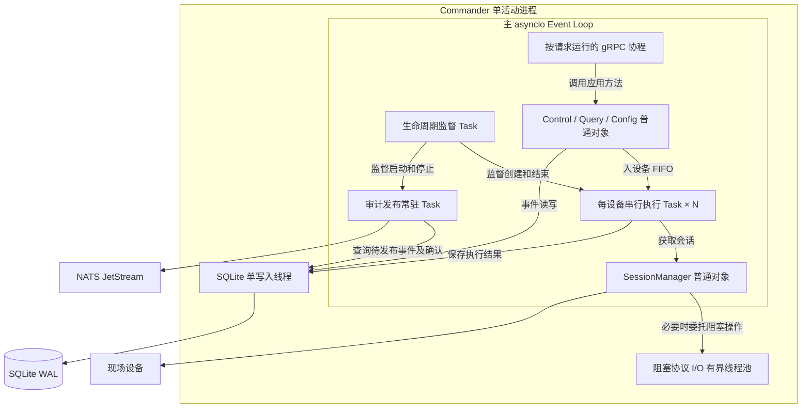

<p class="table-caption">表 6-1 运行对象及执行方式</p>

| 运行对象 | 执行方式 | 重要约束 |
|---|---|---|
| gRPC 请求 | 主 Loop 中的请求协程 | 请求结束不自动取消已接受的业务命令 |
| Control、Query、Config | 普通应用对象 | 按 RPC 或管理流程调用，不为每个组件创建常驻 Task |
| 设备 FIFO 执行者 | 每设备至多一个活动执行 Task | 不同设备并行，同一设备串行；可按设备生命周期创建/回收 |
| SessionManager | 普通共享管理对象 | 跟踪会话及在途 I/O，维护设备阻塞状态 |
| SQLite Repository | 单写入线程或等效单写入执行上下文 | 序列化写入，避免占用 Event Loop；不在事务内做网络调用 |
| 审计发布 | 常驻异步 Task | 有界并发发送、失败重试，不修改命令业务结果 |
| Runtime Supervisor | 监督任务或结构化并发作用域 | 管理后台执行单元的生命周期与意外终止 |
| 阻塞协议调用 | 按需使用有界线程池 | I/O 线程结束不天然等于设备侧安全结束 |

## 6.2 服务运行生命周期与资源管理

<p class="figure-caption">图 6-2 服务启动及异常恢复流程</p>

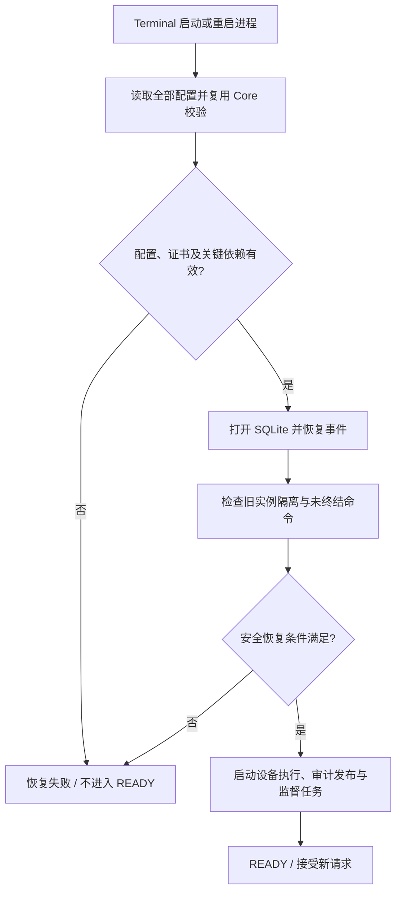

<p class="figure-caption">图 6-3 正常停止与资源关闭流程（不能安全退出时明确失败）</p>

```mermaid
%%{init: {"flowchart": {"useMaxWidth": true}}}%%
flowchart TD
  A["Terminal 请求停止"] --> B["停止新控制准入"]
  B --> C["终结未发起写入的队列命令"]
  C --> D["跟踪已发起的在途 I/O"]
  D --> E{"底层 I/O 可安全结束或隔离?"}
  E -->|否| F["报告停止受阻 / 继续保有进程内资源"]
  F --> D
  E -->|是| G["提交必要终态并处理待发布审计"]
  G --> H["结束后台 Task、关闭连接和数据库"]
  H --> I["正常退出"]
```

重启是旧进程停止后由新进程重新读取配置并执行启动流程；不能将旧 Task、线程锁或连接资源视为跨进程保留。设备配置热重载只切换受影响设备，不重载 `commander.yaml`；其配置有效性由第 11 章规定。

## 6.3 并发与资源竞争：典型场景

### 6.3.1 多设备并发与同设备 FIFO

<p class="figure-caption">图 6-4 两台设备并发、同设备顺序执行</p>

```mermaid
%%{init: {"sequence": {"useMaxWidth": true}}}%%
sequenceDiagram
  participant A as 设备 A Task
  participant B as 设备 B Task
  participant G as 全局额度
  participant P as 协议执行
  par 设备 A：A1 然后 A2
    A->>G: A1 为队首，申请额度
    G-->>A: 取得额度
    A->>P: 写入 A1
    P-->>A: 结果及 I/O 安全结束
    A->>G: 释放 A1 额度
    A->>G: A2 成为队首，申请额度
    G-->>A: 取得额度
    A->>P: 写入 A2
    P-->>A: 结果及 I/O 安全结束
    A->>G: 释放 A2 额度
  and 设备 B：B1 可并行
    B->>G: B1 为队首，申请额度
    G-->>B: 取得额度
    B->>P: 写入 B1
    P-->>B: 结果及 I/O 安全结束
    B->>G: 释放 B1 额度
  end
```

同设备 A2 不得越过 A1；设备 B 可与 A 并行，全部在途 I/O 共用最多 100 个额度。

### 6.3.2 FIFO 队首与全局额度竞争

<p class="figure-caption">图 6-5 队首等待全局额度及到期裁决</p>

```mermaid
%%{init: {"sequence": {"useMaxWidth": true}}}%%
sequenceDiagram
  participant D as 设备执行 Task
  participant G as 全局额度
  participant R as 事件存储
  D->>D: 成为设备 FIFO 队首
  D->>G: 申请额度（受共同排队期限约束）
  alt 排队期限届满
    D->>R: 追加 COMPLETED（error_code=EXPIRED），移出 FIFO
  else 获得额度且仍未到期
    G-->>D: 授予额度
    D->>D: 复查有效期、配置和执行资格
    D->>R: 记录可能执行边界
    D->>D: 进入现场执行
  end
```

单设备最多 10 批、全局最多 1000 批。排队期限覆盖设备队列与全局额度等待；获得额度后仍需最后检查有效期。

## 6.4 并发竞争与故障处理：典型场景

### 6.4.1 RPC 断开，但命令已接受

<p class="figure-caption">图 6-6 接受提交与 RPC 断开竞争</p>

```mermaid
%%{init: {"sequence": {"useMaxWidth": true}}}%%
sequenceDiagram
  participant C as gRPC 调用方
  participant S as 控制服务
  participant R as SQLite Repository
  participant D as 设备执行 Task
  C->>S: 提交控制请求
  S->>R: 追加 ACCEPTED
  R-->>S: 提交成功
  Note over C,S: gRPC 断开或响应丢失
  S->>D: 继续调度已接受命令
  Note over D: 断开不撤销命令；重新提交视为新请求
```

### 6.4.2 排队过期与执行资格竞争

<p class="figure-caption">图 6-7 队首到期时禁止现场写入</p>

```mermaid
%%{init: {"sequence": {"useMaxWidth": true}}}%%
sequenceDiagram
  participant D as 设备执行 Task
  participant G as 全局额度
  participant R as Repository
  D->>G: 等待额度
  G-->>D: 额度可用
  D->>D: 复核排队期限与命令有效期
  alt 已过期
    D->>R: 追加 COMPLETED（error_code=EXPIRED）
    D->>G: 释放未使用额度
  else 仍有效
    D->>R: 追加可能执行事件
    D->>D: 发起现场 I/O
  end
```

### 6.4.3 现场写入完成，但终态保存失败

<p class="figure-caption">图 6-8 结果持久化失败时禁止重复写入</p>

```mermaid
%%{init: {"sequence": {"useMaxWidth": true}}}%%
sequenceDiagram
  participant D as 设备执行 Task
  participant P as 协议适配器
  participant R as Repository
  D->>P: 写入控制值
  P-->>D: 明确执行结果
  D->>R: 追加终态事件
  R-->>D: 写入失败或提交不确定
  Note over D: 保存可用结果证据并对账重试终态持久化
  Note over D,P: 不重复现场写入，不推进冲突命令
```

### 6.4.4 I/O 超时但底层执行未结束

<p class="figure-caption">图 6-9 命令 UNKNOWN 与设备阻塞的分离</p>

```mermaid
%%{init: {"sequence": {"useMaxWidth": true}}}%%
sequenceDiagram
  participant D as 设备执行 Task
  participant S as SessionManager
  participant P as 协议适配器
  participant R as Repository
  D->>P: 发起写入
  Note over D,P: 业务执行期限届满
  D->>R: 追加 UNKNOWN 终态
  D->>S: 标记设备 BLOCKED，继续持有必要额度
  S->>P: 跟踪原 I/O 是否安全结束
  P-->>S: 可信安全结束或隔离证据
  S-->>D: 解除 BLOCKED、释放额度
  Note over D,R: UNKNOWN 仍为最终业务结果，不回写成功
```

### 6.4.5 热重载与设备执行竞争

<p class="figure-caption">图 6-10 受影响设备暂停与安全切换</p>

```mermaid
%%{init: {"sequence": {"useMaxWidth": true}}}%%
sequenceDiagram
  participant C as 配置服务
  participant D as 受影响设备 Task
  participant S as SessionManager
  participant U as 未受影响设备 Task
  C->>C: 调用 Core 重新校验候选配置
  C->>D: 暂停新执行
  par 受影响设备
    D->>S: 等待 I/O 安全结束或隔离
    S-->>D: 可安全切换
    C->>S: 切换设备配置及会话
    C->>D: 恢复执行
  and 未受影响设备
    U->>U: 保持原有执行，不受暂停影响
  end
```

# 7. 开发视图

本章规定目标生产代码的物理目录、主要模块和依赖边界。目录为目标设计，不代表目前仓库已有全部文件；实际落地应以对应职责为准，不为目录形式增设空类或多余抽象。`core` 与 `contracts` 的现有公共能力优先复用。

## 7.1 目标代码目录

```text
src/
├── commander/
│   ├── __init__.py
│   ├── domain/
│   │   ├── command.py             # 命令状态及结果裁决规则
│   │   ├── execution.py           # 设备执行与安全结束规则
│   │   └── errors.py              # 业务错误语义
│   ├── application/
│   │   ├── control.py             # 命令接受与执行编排
│   │   ├── dispatcher.py          # 每设备 FIFO 与全局额度
│   │   ├── query.py               # 命令事件还原与查询
│   │   ├── config.py              # 配置校验协调及热重载
│   │   ├── session.py             # 设备会话、资源所有权
│   │   ├── audit.py               # 审计事件发布调度
│   │   └── runtime.py             # 服务生命周期监督
│   └── infrastructure/
│       ├── grpc_server.py         # 契约确认后实现；本阶段不编码
│       ├── event_repository.py    # SQLite command_events 存取
│       ├── audit_publisher.py     # NATS JetStream 适配
│       └── protocol_bridge.py     # 对接 Core 协议写入/安全结束
├── contracts/                       # 独立维护的正式 proto；本阶段不修改
└── core/                           # 复用已有配置与协议公共能力
```

该目录树列出主要目标模块，辅助类型和必要文件可根据职责合理合并；不要求每项职责独立形成一个类。通用 Schema 校验、协议编解码、日志与指标不在 Commander 下重复实现。

## 7.2 生产模块职责与对应测试

<p class="table-caption">表 7-1 生产模块及主要测试责任文件</p>

| 目标模块 | 主要职责 | 对应主要测试文件 |
|---|---|---|
| `domain/command.py` | 命令状态转换与终态裁决 | `unit/test_command_state.py` |
| `domain/execution.py` | 设备及 I/O 安全边界 | `unit/test_execution_state.py` |
| `application/control.py` | 接受、编号、事件落盘及异步调度 | `component/test_control.py` |
| `application/dispatcher.py` | 同设备 FIFO、全局额度、批量写入 | `component/test_dispatcher.py` |
| `application/query.py` | 结果查询与事件还原 | `component/test_query.py` |
| `application/config.py` | Core 校验、Reload 与版本报告 | `component/test_config.py` |
| `application/session.py` | I/O 所有权与设备阻塞 | `component/test_session.py` |
| `application/runtime.py` | 启停、异常恢复、监督 | `system/test_lifecycle.py` |
| `infrastructure/grpc_server.py`（契约确认后） | 认证授权与 gRPC 契约 | `integration/test_grpc.py` |
| `infrastructure/event_repository.py` | 追加事件、事务、清理 | `component/test_repository.py` |
| `infrastructure/audit_publisher.py` | 可靠投递、PubAck 与重试 | `integration/test_nats_audit.py` |
| `infrastructure/protocol_bridge.py` | 协议写入与 I/O 完成证据 | `integration/test_protocol.py` |

## 7.3 依赖方向

<p class="figure-caption">图 7-1 源码模块依赖及公共能力复用</p>

```mermaid
%%{init: {"flowchart": {"useMaxWidth": true}}}%%
flowchart TB
  GRPC["Commander gRPC 接入"] -->|"调用业务用例"| APP["Commander Application"]
  APP -->|"调用状态规则"| DOM["Commander Domain"]
  APP -->|"使用基础设施边界"| INF["Commander Infrastructure"]
  INF -->|"复用配置与协议能力"| CORE["Core 公共组件"]
  GRPC -->|"使用类型化契约"| CONTRACT["contracts/ 正式 proto（待确认）"]
  INF -->|"调用外部服务"| EXT["SQLite / JetStream / 现场设备"]
```

## 7.4 公共能力与非侵入式横切机制

<p class="table-caption">表 7-2 复用与依赖约束</p>

| 能力 | 设计要求 |
|---|---|
| YAML、Schema、领域配置校验 | 使用 Core 现有能力；Commander 仅判断本服务的切换安全性 |
| ADS / IEC104 / Modbus | 使用 Core 协议适配器；仅补足本服务需要的安全结束契约，不重造协议栈 |
| gRPC / TLS | 使用成熟 gRPC 库和拦截器；授权逻辑在边界集中实现 |
| SQLite、NATS | 使用成熟驱动，集中在基础设施模块管理事务与网络确认 |
| 审计、日志、指标、追踪 | 统一由边界、中间件或适配器实施；业务组件只提供必要语义数据 |
| 模块依赖 | 不从 Domain 反向依赖 Application、gRPC、SQLite、NATS；避免循环导入和无职责抽象 |

# 8. 物理视图（部署视图）

<p class="figure-caption">图 8-1 Commander 单活动实例部署与外部链路</p>

```mermaid
%%{init: {"flowchart": {"useMaxWidth": true}}}%%
flowchart LR
  T["操作系统终端"] -->|start/stop/restart| CMD["Commander 进程"]
  G["gRPC 调用方"] <-->|mTLS：控制/查询/校验/Reload| CMD
  CMD -->|ADS / IEC104 / Modbus| P["现场控制设备"]
  CMD <-->|WAL 事件/查询| DB[("本地 SQLite")]
  CMD -->|稳定 event_id / PubAck| JS["NATS JetStream"]
  JS -->|由下游消费并长期留存| LONG["下游审计库"]
```

<p class="table-caption">表 8-1 部署前提及故障影响</p>

| 对象 | 部署要求 | 故障处理边界 |
|---|---|---|
| 计算资源 | 验收参考：6 核、16 GiB、512 GB NVMe SSD、Linux | 100 台、10 Hz、每批 10 点为设计负载，不是实测承诺 |
| 实例与控制域 | 一个现场控制域仅一个有效写入者；进程身份和持久化卷稳定 | 数据库锁只约束共享同一文件的进程；不能证明跨主机 PLC 物理互斥 |
| SQLite | 本地持久化磁盘、WAL 与足额可用空间；按权限限制访问 | 数据库不可写时停止新控制准入，不能丢弃未确认事件 |
| gRPC 安全 | 服务端证书、可信客户端 CA 和调用方授权映射 | 未认证或证书非法拒绝访问；密钥不得入日志和配置明文 |
| 现场协议网络 | 明确防火墙、路由与设备访问权限 | 设备断连不等于命令确定失败；可能已写入时 UNKNOWN |
| JetStream | 可访问目标 stream/subject；下游可靠消费自行部署 | Publisher 获得 PubAck 才标记确认；不宣称下游已永久存储 |
| 停机/接管 | 操作系统服务管理与现场隔离规程 | 强制终止或跨主机接管必须重新确认控制权，禁止盲目写入 |

# 9. gRPC Server 适配设计（契约待定）

## 9.1 职责与边界

Commander 仅负责实现 gRPC Server，**不定义、不修改、不复制 Protobuf 契约**。对外 Service、RPC、请求与响应字段、枚举及错误映射，以用户后续更新的 `contracts/` 内正式 `.proto` 为唯一依据。本版不指定 Service 数量、RPC 数量、方法名称、字段号、消息结构或 gRPC 状态码映射。现有历史 proto 不作为本轮实施依据。

| 项目 | 设计约束 | 开发状态 |
|---|---|---|
| 契约来源 | `contracts/` 中最终确认的 proto；由外部独立维护 | 待用户通知 |
| Commander 职责 | gRPC Server 注册、请求映射、身份认证、权限校验、调用应用服务、响应映射、异常处理与生命周期 | 后续开发 |
| 内部业务 | 设备控制、命令查询、配置管理、状态查询、审计及恢复通过应用层提供，不依赖 proto 类型 | 先行开发 |
| 安全机制 | 保留本设计书 mTLS 和可信身份授权要求；具体拦截器接入与错误映射在契约确认后完成 | 框架要求已确定，接口绑定待定 |
| 依赖方向 | Infrastructure gRPC Adapter → Application；Domain、Application 不导入 protobuf 生成代码 | 强制约束 |
| 契约改动 | proto 以 `contracts/` 最终文件为准，不另建 Commander 本地 proto，不保留历史兼容服务 | 强制约束 |

## 9.2 后续 gRPC Server 开发需求

**GR-01：gRPC Server 实现。** 在用户通知 proto 更新完成后，从 `contracts/` 读取正式契约，实现对应 Server 端接口。将传输消息映射为 Commander 应用层输入/输出，落实认证授权、参数校验、调用取消与截止时间、错误处理、生命周期及可观测性。不得改变命令持久化先于接受响应、未知结果不可自动重试、查询不触发现场写入等业务不变量。

**GR-02：契约符合性验证。** 用正式 proto 的生成代码进行编译、Server 注册、请求/响应映射、mTLS 权限与异常场景测试；验证应用层不依赖 proto，检查生成文件路径及调用方影响。任何与设计书原业务需求冲突的 proto 约定，先报告差异，不擅自改写契约。

**GR-03：配置和设备管理的传输适配。** 对应业务能力在应用层先完成；正式 RPC 入口、输入输出类型、状态与错误映射在 proto 确认后再定。此阶段不推断或预留 RPC 名称。

## 9.3 开发阶段与交付门槛

| 阶段 | 工作内容 | 完成条件 |
|---|---|---|
| A：非 gRPC 业务实现 | Domain、Application、SQLite、JetStream、设备协议桥接、生命周期、配置读取及安全热更新 | 应用层直接调用测试通过；不依赖 proto |
| B：契约等待 | 等待用户明确通知 `contracts/` 已更新 | 不提前编码 gRPC Server |
| C：Server 对接 | 读取最新 proto，实现 Server 端传输适配与 mTLS 权限检查 | 契约及集成测试通过 |
| D：独立验收 | 由独立 Claude Code 执行静态检查和相关测试 | 审核报告确认后再决定合并 |

第 3—8、10—14 章规定的业务能力及非功能需求继续有效；本章只调整传输层契约的确定时机，不删减 Commander 业务范围。

# 10. SQLite 持久化与恢复

## 10.1 追加式命令事件模型

Commander 本地只使用 `command_events` 一张命令业务表，兼做当前状态重建、短期查询和待发布审计事件。首条 `ACCEPTED` 保存控制请求本身；后续仅追加状态变化。业务字段不可修改，发布确认作为可更新传输元数据；`repository_meta` 只保存仓储版本等技术元信息，不构成第二份命令业务记录。

```sql
PRAGMA journal_mode = WAL;
PRAGMA synchronous = FULL;
CREATE TABLE IF NOT EXISTS command_events (
    event_seq INTEGER PRIMARY KEY,
    event_id TEXT NOT NULL UNIQUE,
    command_id TEXT NOT NULL,
    event_type TEXT NOT NULL CHECK (
        event_type IN ('ACCEPTED', 'CONNECTING', 'EXECUTING', 'COMPLETED')
    ),
    occurred_at TEXT NOT NULL,
    request_id TEXT,
    caller_id TEXT,
    operator_id TEXT,
    trace_id TEXT,
    device_id TEXT,
    point_id TEXT,
    requested_value BLOB,
    config_reference TEXT,
    receive_seq INTEGER,
    state TEXT NOT NULL,
    outcome TEXT,
    error_code TEXT,
    error_message TEXT,
    duration_ms INTEGER,
    detail_json TEXT,
    publish_state TEXT NOT NULL DEFAULT 'PENDING'
        CHECK (publish_state IN ('PENDING', 'PUBLISHED')),
    published_at TEXT,
    attempts INTEGER NOT NULL DEFAULT 0,
    CHECK (event_type <> 'ACCEPTED' OR (
        request_id IS NOT NULL AND caller_id IS NOT NULL
        AND device_id IS NOT NULL AND point_id IS NOT NULL
        AND requested_value IS NOT NULL AND receive_seq IS NOT NULL
    ))
);
CREATE UNIQUE INDEX IF NOT EXISTS ce_accept_once
    ON command_events(command_id) WHERE event_type = 'ACCEPTED';
CREATE UNIQUE INDEX IF NOT EXISTS ce_terminal_once
    ON command_events(command_id) WHERE event_type = 'COMPLETED';
CREATE INDEX IF NOT EXISTS ce_command_seq
    ON command_events(command_id, event_seq DESC);
CREATE INDEX IF NOT EXISTS ce_request_query
    ON command_events(request_id, event_seq) WHERE event_type = 'ACCEPTED';
CREATE INDEX IF NOT EXISTS ce_pending_publish
    ON command_events(event_seq) WHERE publish_state = 'PENDING';
CREATE INDEX IF NOT EXISTS ce_device_order
    ON command_events(device_id, receive_seq) WHERE event_type = 'ACCEPTED';
```

接受整批请求前必须检查每项参数、目标设备状态、单设备与全局队列容量，并在同一 Repository 写事务中原子追加全部 `ACCEPTED`；任何子项失败则整批不入队、不执行。接收响应仅在事务明确提交成功后返回。以每个设备为单位将批内控制点保留输入顺序排入 FIFO；仅合并同一批内、同一设备、连续处于队首且满足同一执行时限的控制项；跨设备各自串行、可并行，不能跨越其他已接受命令。`write_many` 的返回结果仅按协议能证明的粒度裁决；若驱动不支持该接口则依序 `write_one`，不得因为批写失败而再次自动顺序下发可能已经写入的控制点。

`event_seq` 与 `receive_seq` 由唯一 Repository 写入者按提交顺序分配；每条事件 `event_id` 固定。批量单个 `request_id` 关联多个 `command_id`，每点首次事件提供独立的设备、点与控制值；不存配置已有的设备名、点名、地址、单位和协议属性。若旧版配置无法按文件版本检索，则历史记录只承诺 ID 与控制值可追溯。

## 10.2 事务与查询

<p class="table-caption">表 10-1 事务类型及一致性后置条件</p>

| 事务 | 写入行为 | 后置条件 |
|---|---|---|
| T1 接受 | 在同一事务中为整批每点写 `ACCEPTED` | 全部接受或全部不接受；返回 ID 前确认提交成功 |
| T2 开始 | 连接可先发生；在首次可能产生现场写入前必须明确提交 `EXECUTING` | 已提交 T2 的命令崩溃恢复不得重复写现场 |
| T3 终结 | 每命令追加唯一 `COMPLETED` 与真实 outcome | 对外查询终态不可修改；下一冲突命令必须等待安全资源条件 |
| TP 发布确认 | 仅更新投递元数据 `publish_state/published_at/attempts` | 审计业务事实不变；无确认不删除 |
| TC 清理 | 按 `command_id` 删除全部符合资格的事件 | 不留残缺首事件；不清理未终态、未确认或保留期内的数据 |

命令查询按 `ACCEPTED` + 后续阶段事件顺序合成，不依赖“最后一行包含所有字段”的假设。单次查询不启动现场 I/O。提交 ACK 丢失时优先核对数据库唯一证据：T1 不能不明不白执行；T2 提交结果不明则保守认为可能已写；T3 只重做本地持久化不重发现场指令。数据库不可用时停止新准入，不得用内存结果冒充已落盘事实。

## 10.3 本地有限存储、过期和容量门禁

<p class="table-caption">表 10-2 本地容量与保留默认基线</p>

| 参数 | 默认值 | 作用 |
|---|---|---|
| `max_storage_bytes` | 64 GiB | SQLite 及相关本地落盘开销的容量预算 |
| `reserved_storage_bytes` | 6.4 GiB | 保护已接收命令终结与恢复写入 |
| `retention_seconds` | 1800 | 已终结命令查询自终结时起保留 30 min |
| `cleanup_interval_seconds` | 60 | 定期执行有界批次清理 |
| `storage_warning_ratio` | 0.80 | 达水位告警 |
| `admission_stop_ratio` | 0.90 | 清理后仍达阈值时停止新控制准入 |

清理采用“已终态、相关全部事件均已获 JetStream PubAck、超过命令查询保留期”的交集条件，按最早符合条件的完整 `command_id` 组删除。以 `request_id` 查询的全部子命令应至少在请求首次接受后 1800 秒内可用；每条子命令还须自其终态产生后至少保留 1800 秒。为避免请求查询出现残缺批次，同一 `request_id` 的所有子命令均满足终态、PubAck 与各自保留期限后才允许整批清理。已终结、已发布但未过期的记录不得因容量压力提前覆盖；未终结与未发布事件无论积压多久均不得直接删除。SQLite `DELETE` 只回收数据库内部可复用页，不保证主数据库文件立即缩小；容量预算同时计入主库、`-wal`、`-shm` 与必要临时文件。优先使用已回收页复用和有界 WAL checkpoint，不在正常控制路径中执行阻塞式全库 `VACUUM`。容量门禁按保守实际占用与预计待终结事件空间计算，达到 90% 即停止新准入；6.4 GiB 为逻辑预留预算，不等同操作系统强制保留磁盘空间，部署必须另行保证剩余可写空间。容量已不足以持久化终态时持续阻止新准入、保留内存中的执行证据并报告严重故障，不能声称保证已经落盘。

清理无法回收足够空间时，拒绝新控制请求并发告警。此规则保证安全与短期查询，不能保证在 JetStream 长期故障且磁盘耗尽时继续接收命令。

## 10.4 重启恢复及资源保守原则

<p class="figure-caption">图 10-1 命令事件恢复与审计补发</p>

```mermaid
%%{init: {"flowchart": {"useMaxWidth": true}}}%%
flowchart TD
  A["启动：检查 SQLite 及 WAL"] --> B["按 command_id 扫描最近事件"]
  B --> C{"命令已有 COMPLETED？"}
  C -->|是| F["保留终态，不重发写入"]
  C -->|否| D{"已存在 T2 执行边界？"}
  D -->|是| E["追加 UNKNOWN 终态；不重写 PLC"]
  D -->|否| G["按关闭/恢复规则终结未开始命令"]
  E --> H["读取 PENDING 事件"]
  G --> H
  F --> H
  H --> I["按 event_seq 恢复 JetStream 发布"]
```

在进程崩溃后，即使事务记录已经一致，也不能凭 SQLite 判断旧进程或现场写入物理上已结束；单活动实例与现场隔离是重新开放设备控制的必要条件。

# 11. 配置设计

## 11.1 配置文件体系

Commander 需要以下配置文件；通用配置解析、结构及引用校验复用 Core，不另行实现。配置文件使用 `schema_version` 与 `file_version` 标识结构版本和文件版本，不采用全局 `revision`。

- `commander.yaml`：Commander 服务配置，包含 gRPC、mTLS 与调用方权限、调度、SQLite、审计发布、超时和停机参数；仅在启动或重启时生效。
- 设备实例配置文件：设备实例、连接地址、启用状态、型号及模板引用；允许校验后热重载。
- 设备模板和点表文件：设备型号、协议选项、可写测点及写入约束；允许校验后热重载。

加载入口为独立的服务配置路径（`commander.yaml`）和 Core 设备配置根目录；启动时分别加载，再由设备引用建立有效配置快照。文件缺失、引用失效、版本不兼容或校验失败均不得进入可控制状态。`commander.yaml` 结构由 Commander 校验；设备、模板及点表的通用结构与引用由 Core 校验，Commander 只补充可写性、服务特有约束和安全切换判断。Core 第一阶段已提供共享配置加载、版本校验与设备模板解析；Commander 应复用新 Core 公共接口，不恢复旧的 `YamlConfigAdapter`。设备配置的实际文件名称和目录以 Core 的统一配置契约为准，不在本章虚构第二种结构。

若 `commander.yaml` 磁盘内容与启动时快照发生变化，应用层配置校验应报告需要重启，配置应用不得将服务级变更标记为已生效；不因服务级配置尚待重启而阻止独立、合法的设备配置热更新。热重载按受影响设备报告应用结果，失败设备沿用旧生效快照或安全阻塞，无关设备继续工作。读取候选文件过程中如发生并发改写，应拒绝该不一致候选快照，不允许混用不同版本文件。

配置校验和配置应用的业务流程见第 4 章；运行时安全切换见第 6 章。实际生效文件及版本由应用层维护，后续通过第 9 章的 Server 适配对外提供，不能把磁盘候选版本误认为生效版本。

## 11.2 commander.yaml 完整示例

以下为目标配置格式的完整示例。注释说明字段含义、取值范围与默认值；实际部署需替换证书路径、服务地址、调用方身份及存储路径。所有字段属于服务级配置，修改后须重启 Commander 生效。

```yaml
# Commander 服务配置：只在启动或重启时加载，不支持热重载。
schema_version: 1        # 配置结构版本；正整数，目标格式版本为 1
file_version: 1          # 配置文件版本；正整数，每次正式发布新内容时递增

grpc:
  listen_host: "0.0.0.0"  # gRPC 绑定地址；可填本机 IP、127.0.0.1 或 0.0.0.0（所有网卡）
  listen_port: 50052     # gRPC 端口；1～65535
  max_active_rpcs: 256   # 同时处理的 RPC 上限；正整数，默认 256

security:
  # 唯一认证方式：mTLS；不使用 Token 或在业务请求中指定 caller_id。
  ca_cert: "/etc/wind-hub/certs/ca.pem"                # 信任的客户端证书签发 CA 文件
  server_cert: "/etc/wind-hub/certs/commander.pem"     # 服务端证书文件
  server_key: "/etc/wind-hub/certs/commander.key"      # 服务端私钥文件；内容禁止写日志
  callers:                                             # 合法调用方列表；可为多个，caller_id 与证书身份均须唯一
    - caller_id: "ems"                                 # 审计用的可信调用方标识；非空唯一字符串
      certificate_identity: "spiffe://wind-hub/ems"    # 客户端证书 URI SAN；精确匹配，必须验证 Python gRPC 实际可提取该字段
      permissions: [control, query]                     # 可选值：control（下发控制）、query（查询）、reload（配置校验/热重载）
    - caller_id: "maintenance"
      certificate_identity: "spiffe://wind-hub/maintenance"
      permissions: [query, reload]                      # 未列入该调用方权限的操作一律拒绝

dispatcher:
  max_concurrency: 100        # 全局在途设备 I/O 额度；正整数，默认 100
  max_pending_per_device: 10  # 单设备最大等待批次数；正整数，默认 10
  max_pending_global: 1000    # 全局最大等待批次数；正整数，默认 1000
  max_batch_size: 10          # 每个批量请求最多写入的变量数；正整数，默认 10
  # 同设备 FIFO 串行执行；只有设备队首才能竞争全局 I/O 额度。

repository:
  sqlite_path: "/var/lib/wind-hub/commander/events.db"  # 单表追加式事件数据库的本地文件路径
  max_storage_bytes: 68719476736        # 总容量上限，字节；默认 64 GiB，正整数
  reserved_storage_bytes: 6871947674    # 终态落盘及恢复预留，字节；约 6.4 GiB，必须小于总上限
  retention_seconds: 1800               # 已终结且全部事件已确认发布的命令组最短本地保留时间；默认 30 分钟
  cleanup_interval_seconds: 60          # 过期清理扫描周期，秒；正整数，默认 60
  storage_warning_ratio: 0.80           # 容量预警比例；0～1 之间，默认 0.80
  admission_stop_ratio: 0.90            # 停止新控制准入比例；0～1 之间，默认 0.90
  # 约束：0 < storage_warning_ratio < admission_stop_ratio < 1。
  # 仅按时间先后删除满足清理条件的完整命令事件组；不得覆盖未终结命令或未确认发布事件。
  # 容量不足时停止新控制准入，保留已接受命令终结和审计事件落盘所需空间。

audit:
  nats_servers:                         # 一个或多个 NATS 服务地址；URL 列表，不得为空
    - "nats://127.0.0.1:4222"
  stream: "COMMAND_AUDIT"              # JetStream Stream 名称；非空字符串
  subject: "windhub.commander.audit"  # JetStream 发布 Subject；须与 Stream 绑定规则匹配
  retry_base_ms: 100                    # 发布失败初次重试间隔，毫秒；正整数，建议默认 100
  retry_max_ms: 5000                    # 最大重试间隔，毫秒；正整数，建议默认 5000
  # 约束：retry_base_ms <= retry_max_ms；只有收到 JetStream PubAck 才能标记已发布。

timeouts:
  queue_default_ms: 1000  # 默认排队期限，毫秒；正整数，建议默认 1000
  write_default_ms: 500   # 单次现场写入等待上限，毫秒；正整数，建议默认 500
  connect_ms: 3000        # 设备连接建立超时，毫秒；正整数，建议默认 3000
  # 超时不等于底层 I/O 安全结束；未安全结束或隔离前不得释放冲突资源。

shutdown:
  grace_seconds: 10       # 正常停止的宽限时间，秒；正整数，默认 10
  # 到达宽限时间不代表可以强行释放未结束 I/O。
```

# 12. 命令审计与 JetStream 可靠发布

## 12.1 审计事件最小信息

审计是命令增量事件的外部传播，而不是另一套命令记录。首个 `ACCEPTED` 保存可信 `caller_id`、服务端生成的 `request_id`/`command_id`、设备及可写点 ID、下发值和时间；状态事件只记变化内容。设备名称、变量名称、数据类型、单位、地址等可从配置得到的信息不重复写入。历史配置不可检索时，不得宣称审计可还原当时的名称、工程单位或协议地址。

<p class="table-caption">表 12-1 审计字段的最小要求</p>

| 事件类型 | 必要信息 | 不重复的信息 |
|---|---|---|
| ACCEPTED | `event_id/event_seq`、`request_id/command_id`、可信 `caller_id`、`device_id/point_id`、设定值、接受时间 | 配置中已有设备名称、点名称、协议地址 |
| CONNECTING/EXECUTING | `event_id/event_seq`、`command_id`、状态和时间 | 完整复制首次控制目标 |
| COMPLETED | `event_id/event_seq`、`command_id`、结果（成功、失败、UNKNOWN）、错误信息、结束时间 | 已记录的静态请求字段 |
| 投递元数据 | `publish_state`、`published_at`、`attempts` | 不作为新审计事实，不允许修改历史事件载荷 |

## 12.2 发布、去重与积压

<p class="figure-caption">图 12-1 本地事件发布和确认闭环</p>

```mermaid
%%{init: {"flowchart": {"useMaxWidth": true}}}%%
flowchart LR
  A["SQLite 已持久化事件"] -->|读取 PENDING 事件| B["AuditPublisher"]
  B -->|稳定 event_id / 按序| C["JetStream"]
  C -->|PubAck| D["SQLite 更新发布确认"]
  B -->|断链或无 PubAck| E["退避后重试同一 event_id"]
  E --> B
  C -->|下游订阅| F["长期审计存储"]
```

<p class="table-caption">表 12-2 发布失败的处理契约</p>

| 故障 | 处理 |
|---|---|
| NATS 连接失败/超时 | 保留 PENDING，按有界退避重试，不阻塞已接受命令的现场执行 |
| PubAck 丢失或数据库确认更新失败 | 原 `event_id` 原载荷可重复投递；下游必须据稳定 ID 去重 |
| 同一命令的事件顺序 | 首先确保 ACCEPTED 事件具备可恢复的发布顺序，再发布后续事件；不同命令可并发发布但须有界 |
| 长时间积压 | 提供待发布数量、最老等待时间、存储水位告警；达容量门禁拒绝新控制 |
| 下游长期存储失败 | 不将 JetStream PubAck 宣称为下游永久落库；下游自身负责消费确认与保留 |

审计事件只包括控制命令的接收和状态变化；启动、关闭和热重载等流程使用运行日志，不产生命令业务审计。

# 13. 安全、可观测性与运行指标

## 13.1 身份认证和最小权限

gRPC 强制 mTLS；使用已验证客户端证书身份（URI SAN）精确映射 `commander.yaml` 的 `caller_id`，再检查 `control/query/reload` 权限。不得把客户端自行填写的 metadata、`operator_id` 或 `trace_id` 当作合法身份。认证失败或证书身份未获映射返回 UNAUTHENTICATED；已认证但权限不足返回 PERMISSION_DENIED。授权变化需重启生效；敏感设备地址和证书私钥不得在无权限的查询或日志中泄露。

## 13.2 控制操作安全

写入必须位于当前已生效可写点表，符合配置范围和类型约束；已排队命令在执行前复核写权限与配置代，禁止热重载后按错误的旧点表解释控制值。无法确认结果时使用 UNKNOWN；设备阻塞条件只能凭安全结束或可信隔离证据解除。操作超时不等于底层 I/O 结束。

## 13.3 结构化观测与容量指标

<p class="table-caption">表 13-1 最小监控指标及意义</p>

| 指标 | 含义与告警用途 |
|---|---|
| `control_accepted_total`、终态分类计数 | 控制请求接受速率与成功、失败、UNKNOWN 的数量 |
| `control_accept_latency_ms`、`result_query_latency_ms` | 以 P99 对照第 3.3 节目标；区分接收与实际写入时延 |
| `device_queue_depth`、`pending_global` | 单设备及全局排队压力；超出门限前告警 |
| `io_inflight`、`blocked_devices` | 包括超时后未安全结束的 I/O；检测额度长期占用 |
| `repository_used_bytes`、`repository_writable` | SQLite 主库、WAL 及相关空间；80% 告警、90% 准入限制 |
| `audit_pending_count`、`audit_oldest_age_ms` | JetStream 积压量和年龄，识别不可持续发布 |
| `config_apply_failures`、`service_ready` | 设备配置热重载失败和业务就绪状态，不能以进程存活代替业务就绪 |

日志使用结构化字段 `timestamp/level/component/event/command_id/device_id/error_code`；可记录有可信来源的 `caller_id`、`trace_id`，不得记录私钥或未脱敏凭据。指标、日志、追踪由统一边界组件实现，业务状态仍以事件仓储和实际 I/O 为权威。

## 13.4 现场控制权边界

单活动实例要求控制域仅有一个可写 Commander：同机应通过单实例服务管理与数据库锁避免并存，跨主机切换必须具备独立的控制权隔离手段。没有跨主机控制域仲裁条件时，不设计自动接管；运维确认旧实例已停止、旧在途 I/O 不再可能对相同目标造成冲突后才允许新实例进入 READY。无法确认时恢复失败而不是降级开放写入。

SQLite 文件独占不能证明其他主机没有控制同一 PLC。现场需要单活动实例及可验证的接管/隔离流程；不可证明时禁止对相同控制域重新开放写入。该限制是部署安全前提，不得用内存锁、`Task.done()` 或连接关闭推断其已经满足。

# 14. 测试体系与验收

本章规定测试的物理目录、Marker、测试矩阵与执行规则。表内文件为目标测试归属；实施时可按职责拆分，但必须同步更新矩阵。测试代码的实际存在与执行结果须另行核实。

## 14.1 测试目录与分层

```text
tests/commander/
├── unit/
├── component/
├── integration/
├── system/
└── conftest.py
```

四个目录分别对应 `unit`、`component`、`integration`、`system` 层级 Marker。可靠性、安全、性能、现场等属于跨层级的验证专题或场景，使用 Marker 组合，不建立额外的 `reliability/` 目录。公共 Fixture 仅放置确有复用价值的测试依赖；测试数据由相关测试就近维护。

## 14.2 Marker 定义

<p class="table-caption">表 14-1 测试标记分类</p>

| 类型 | Marker | 定义 |
|---|---|---|
| 层级 | `unit`、`component`、`integration`、`system` | 必选且互斥，与测试目录一一对应 |
| 专题 | `reliability`、`security`、`performance` | 按可靠性、安全性、性能验证需要叠加；普通功能测试可不标记专题 |
| 场景 | `normal`、`exception`、`concurrency`、`timeout`、`recovery`、`storage`、`load`、`field` | 说明测试的业务或故障场景，可按需组合；现场测试须标记 `field` |

同一文件允许包含不同场景的测试；具体 Marker 应在测试函数或测试类上准确声明。矩阵中的多值表示该文件覆盖的标记集合，并不代表所有函数都同时拥有全部标记。

## 14.3 测试矩阵

<p class="table-caption">表 14-2 测试文件、层级、专题与场景矩阵</p>

| 测试文件名 | 层级 Marker | 专题 Marker | 场景 Marker | 测试说明 |
|---|---|---|---|---|
| `test_command_state.py` | `unit` | `reliability` | `normal`、`exception` | 命令状态合法转换、终态不变及非法转换 |
| `test_execution_state.py` | `unit` | `reliability` | `timeout`、`recovery` | 设备阻塞及 I/O 安全结束的状态规则 |
| `test_admission.py` | `unit` | — | `normal`、`exception` | 控制参数、有效期、容量准入约束 |
| `test_error_classification.py` | `unit` | — | `exception` | 错误分类、确定失败与未知结果的区分 |
| `test_control.py` | `component` | `security` | `normal`、`exception` | 服务端编号、接受语义、拒绝路径与权限边界 |
| `test_dispatcher.py` | `component` | `reliability` | `concurrency`、`timeout` | 同设备 FIFO、全局额度、排队期限竞争 |
| `test_session.py` | `component` | `reliability` | `timeout`、`recovery` | I/O 取消、未结束资源所有权、解除阻塞 |
| `test_repository.py` | `component` | `reliability` | `storage`、`exception` | 事件追加、最新状态查询、过期与容量保护 |
| `test_query.py` | `component` | — | `normal`、`exception` | 命令状态还原、设备可写点和基本信息查询 |
| `test_config.py` | `component` | `reliability` | `normal`、`exception` | 复用 Core 配置校验、热重载条件及失败保留 |
| `test_audit.py` | `component` | `reliability` | `timeout`、`recovery` | 审计事件选择、发布重试与积压处理 |
| `test_auth.py` | `component` | `security` | `normal`、`exception` | 证书身份到 caller_id 的映射及操作授权 |
| `test_grpc.py`（后续阶段） | `integration` | `security` | `normal`、`exception` | 按 `contracts/` 正式 proto 验证 Server、真实 mTLS 与授权拒绝 |
| `test_sqlite.py` | `integration` | `reliability` | `storage`、`recovery` | 真实事务、提交失败、数据库重开及恢复 |
| `test_nats_audit.py` | `integration` | `reliability` | `timeout`、`recovery` | JetStream 断连、PubAck 丢失、重投与去重 |
| `test_protocol.py` | `integration` | `reliability` | `normal`、`exception` | `write_many` 优先、`write_one` 降级及逐点结果 |
| `test_hot_reload.py` | `integration` | `reliability` | `concurrency`、`exception` | 配置校验后变更、重新校验、在途 I/O 与热重载竞争 |
| `test_lifecycle.py` | `system` | `reliability` | `normal`、`exception` | UC-01/06/07 启动、停止、重启及失败路径 |
| `test_control_flow.py` | `system` | — | `normal`、`exception` | UC-02 异步接受、设备写入及结果查询 |
| `test_query.py` | `system` | — | `normal`、`exception` | UC-03/04 设备、可写点、服务及配置状态查询 |
| `test_concurrency.py` | `system` | `reliability` | `concurrency`、`timeout` | 多设备并发、同设备串行、过期与额度竞争 |
| `test_crash_recovery.py` | `system` | `reliability` | `recovery`、`exception` | UC-08 进程崩溃、历史命令与安全恢复判定 |
| `test_capacity.py` | `system` | `reliability` | `storage`、`load` | 本地容量、保留期、清理、审计积压与准入保护 |
| `test_performance.py` | `system` | `performance` | `load` | 100 台设备、10 Hz、批量 10 点及响应 P99 |
| `test_field_protocol.py` | `system` | `reliability` | `field` | 授权现场窗口下真实设备写入、超时与安全结束 |

可靠性测试已分配在四个层级中，重点涵盖 RPC 断连、I/O 未安全结束、SQLite 故障、JetStream 重投、热重载竞争、崩溃恢复、容量耗尽与高并发期限竞争。具体故障注入及预期结果应由对应测试函数断言，不再单列重复的可靠性文件清单。

## 14.4 测试执行规则

<p class="table-caption">表 14-3 测试执行场景与选择命令</p>

| 执行场景 | 测试范围 | 执行命令 |
|---|---|---|
| 日常开发 | Unit 与 Component，排除现场依赖 | `pytest tests/commander -m "(unit or component) and not field"` |
| 集成改动 | Integration | `pytest tests/commander -m integration` |
| 完整业务变更 | System，排除现场 | `pytest tests/commander -m "system and not field"` |
| 可靠性专项 | 全层级可靠性，排除现场 | `pytest tests/commander -m "reliability and not field"` |
| 特定故障场景 | 组件级可靠性超时 | `pytest tests/commander -m "component and reliability and timeout"` |
| 安全专项 | 所有安全测试 | `pytest tests/commander -m security` |
| 性能验收 | 性能负载测试 | `pytest tests/commander -m performance` |
| 现场联调 | 需授权的真实设备测试 | `pytest tests/commander -m field` |
| 非现场全量 | 全部非现场测试 | `pytest tests/commander -m "not field"` |

项目统一注册上述 Marker；按层级目录给测试附加层级 Marker，专题及场景由测试显式声明。部分分组依赖真实中间件或独立进程，运行前必须满足环境前提；未执行的测试不得统计为通过。

## 14.5 覆盖与验收要求

<p class="table-caption">表 14-4 设计指标及验收证据</p>

| 验收对象 | 设计目标 | 验收证据 |
|---|---|---|
| 控制负载 | 100 台 × 每台 10 Hz × 每批最多 10 点，合计 1000 批/s、10000 点/s | 请求吞吐、批大小、队列分布及失败率 |
| 接受响应 | P99 ≤100 ms，不含现场执行时延 | SQLite 接受提交到 RPC 响应的时延分布 |
| 命令结果查询 | P99 ≤100 ms | 最新事件状态还原查询分布 |
| 设备与服务查询 | P99 ≤200 ms | 配置切换及正常查询负载下的时延 |
| 审计确认 | JetStream 正常时 P99 ≤1 s | 事件落盘到 PubAck 的时延 |
| 执行并发 | 同设备在途 I/O ≤1；全局 ≤100 | 高负载、超时、取消下的额度与阻塞证据 |
| 本地存储 | 64 GiB 上限、6.4 GiB 预留、30 min 命令结果保留与请求查询期限、60 s 清理、80%/90% 阈值 | SQLite/WAL/索引占用、清理与拒绝准入证据 |
| 生命周期与恢复 | 正常启动目标 ≤10 s；正常安全停止目标 ≤10 s；异常恢复必须有成功或失败结论 | 进程日志、恢复状态、外部依赖及未验证条件 |

每个 UC、UR 及关键技术契约应能在测试矩阵中定位到相应文件或测试函数；必要时在测试用例中附需求编号。验收报告应记录软硬件环境、依赖版本、命令、通过/失败/未运行数量、实测指标与限制，不得把设计指标当作已通过结果。现场控制能力与 100 ms 调度周期是否兼容须独立实测确认。
