<h1 class="title">wind-hub IEC104 Adapter 全新技术设计书</h1>

<p class="subtitle">v0_6 · 20261027</p>

<style>
body {
  font-family: "Microsoft YaHei";
  font-size: 16px;
  line-height: 1.75;
  color: #24292f;
}
.title {
  font-family: "Microsoft YaHei";
  font-size: 32px;
  line-height: 1.30;
  font-weight: 700;
  text-align: center;
}
.subtitle {
  font-family: "Microsoft YaHei";
  font-size: 18px;
  line-height: 1.50;
  font-weight: 400;
  text-align: center;
}
h1 {
  font-family: "Microsoft YaHei";
  font-size: 28px;
  line-height: 1.40;
  font-weight: 700;
}
h2 {
  font-family: "Microsoft YaHei";
  font-size: 22px;
  line-height: 1.40;
  font-weight: 700;
}
h3 {
  font-family: "Microsoft YaHei";
  font-size: 18px;
  line-height: 1.50;
  font-weight: 700;
}
h4 {
  font-family: "Microsoft YaHei";
  font-size: 16px;
  line-height: 1.50;
  font-weight: 700;
}
p, li {
  font-family: "Microsoft YaHei";
  font-size: 16px;
  line-height: 1.75;
}
.figure-caption,
.formula-caption {
  font-family: "Microsoft YaHei";
  font-size: 14px;
  line-height: 1.50;
  font-weight: 600;
  text-align: center;
  margin: 0.65em 0 0.35em 0;
}
.table-caption {
  font-family: "Microsoft YaHei";
  font-size: 13px;
  line-height: 1.40;
  font-weight: 500;
  text-align: center;
  margin: 0.65em 0 0.35em 0;
}
.mermaid,
.mermaid text,
.mermaid .label {
  font-family: "Microsoft YaHei" !important;
  font-size: 14px !important;
  line-height: 1.20;
}
table {
  width: 100%;
  border-collapse: collapse;
  font-family: "Microsoft YaHei";
  font-size: 13px;
  line-height: 1.45;
}
table th,
table th p,
table th li {
  font-family: "Microsoft YaHei";
  font-size: 13px;
  line-height: 1.40;
  font-weight: 600;
}
table td,
table td p,
table td li {
  font-family: "Microsoft YaHei";
  font-size: 13px;
  line-height: 1.45;
  font-weight: 400;
}
table th,
table td {
  padding: 0.40em 0.60em;
  vertical-align: top;
}
code, pre {
  font-family: "Cascadia Code";
  font-size: 14px;
  line-height: 1.50;
}
p code, li code, td code {
  color: #24292f;
  background: #f3f4f6;
  padding: 0.08em 0.28em;
  border-radius: 3px;
}
pre {
  color: #c9d1d9;
  background: #0d1117;
  padding: 1em;
  border-radius: 6px;
  overflow-x: auto;
}
pre code {
  color: inherit;
  background: transparent;
  padding: 0;
}
.hljs-comment, .hljs-quote,
.token.comment, .token.prolog, .token.doctype, .token.cdata {
  color: #8b949e;
  font-style: italic;
}
.hljs-keyword, .hljs-selector-tag, .hljs-literal,
.token.keyword, .token.boolean { color: #ff7b72; }
.hljs-string, .hljs-doctag, .hljs-regexp,
.token.string, .token.char, .token.regex { color: #a5d6ff; }
.hljs-number, .token.number { color: #79c0ff; }
.hljs-title, .hljs-function, .token.function { color: #d2a8ff; }
.hljs-title.class_, .hljs-type, .hljs-built_in,
.token.class-name, .token.builtin { color: #ffa657; }
.hljs-variable, .hljs-attr, .hljs-property,
.token.variable, .token.property, .token.attr-name { color: #7ee787; }
.hljs-operator, .hljs-punctuation,
.token.operator, .token.punctuation { color: #c9d1d9; }
</style>

---

## 目录

1. 文档约定
2. 文档定位与范围
3. 功能与协议用例
4. 共享契约及跨协议修改
5. 架构、职责与资源所有权
6. 生命周期与 Watchdog 恢复
7. 请求关联、并发及超时隔离
8. 业务交互与确认状态机
9. 监听、数据解码及测点映射
10. 配置与更新事务
11. 关联模块变更审查与迁移
12. 安全约束、验证矩阵与门禁
13. 实施边界与未验证事项

---

# 1. 文档约定

本章是全文的固定排版与表达规范。文档修订、补充和派生版本均应遵守本章，不再根据个人习惯调整字体、字号、行距、图题、表题、公式或代码样式。

本文开头的 `<style>...</style>` 是 HTML `style` 元素，其中包含内部 CSS 样式表，本文简称为 **CSS 样式块**。第 1.1～1.4 节规定目标样式；CSS 样式块通过 `h1`、`h2`、`p`、`table`、`th`、`td`、`pre`、`code` 等选择器，将规范应用到 Markdown 渲染后生成的 HTML 元素。

## 1.1 字体约定

<p class="table-caption">表 1-1 文档字体与排版规范</p>

| 文档元素 | 字体 | 字号 | 行间距/行高 | 字重 | 对齐方式 |
|---|---|---:|---:|---:|---|
| 文档标题 | Microsoft YaHei | 32 px | 1.30 | 700 | 居中 |
| 文档副标题 | Microsoft YaHei | 18 px | 1.50 | 400 | 居中 |
| 一级标题 | Microsoft YaHei | 28 px | 1.40 | 700 | 左对齐 |
| 二级标题 | Microsoft YaHei | 22 px | 1.40 | 700 | 左对齐 |
| 三级标题 | Microsoft YaHei | 18 px | 1.50 | 700 | 左对齐 |
| 四级标题 | Microsoft YaHei | 16 px | 1.50 | 700 | 左对齐 |
| 正文 | Microsoft YaHei | 16 px | 1.75 | 400 | 左对齐 |
| 图题 | Microsoft YaHei | 14 px | 1.50 | 600 | 居中 |
| 图内文字 | Microsoft YaHei | 14 px | 1.20 | 400 | 按图形布局 |
| 表题 | Microsoft YaHei | 13 px | 1.40 | 500 | 居中 |
| 表头 | Microsoft YaHei | 13 px | 1.40 | 600 | 左对齐 |
| 表格正文 | Microsoft YaHei | 13 px | 1.45 | 400 | 左对齐 |
| 公式题 | Microsoft YaHei | 14 px | 1.50 | 600 | 居中 |
| 代码文字 | Cascadia Code | 14 px | 1.50 | 400 | 左对齐 |

以上规范已经通过本文开头的 CSS 样式块固定。其中，正文为 `16 px`；表题、表头和表格正文均为 `13 px`。表头字重为 `600`，低于标题字重；表格正文行高为 `1.45`，因此表格在字号、字重和行距上均明显弱于正文。英文业务对象、数据库对象和程序标识符仍按所在文本元素的字号排版，但使用行内代码形式，例如 `Asset`、`Connection`、`task_id`。

## 1.2 绘图约定

1. 上下文图、第 0 层及更深层 DFD、总体流程图和关系流程图统一使用 Mermaid。
2. 每一个 Mermaid 图都必须在 Mermaid 代码块第一行加入初始化配置，统一只设置 `useMaxWidth: true`。初始化配置格式为：

```text
%%{init: {"<Mermaid 图类型配置域>": {"useMaxWidth": true}}}%%
```

其中 `<Mermaid 图类型配置域>` 必须根据实际 Mermaid 图类型替换，不得固定写成 `flowchart`，也不得使用与实际图类型不匹配的配置域。

<p class="table-caption">表 1-2 Mermaid 图类型与初始化配置</p>

| Mermaid 图类型 | 图声明 | 第一行初始化配置 |
|---|---|---|
| Flowchart | `flowchart TB/LR/...` | `%%{init: {"flowchart": {"useMaxWidth": true}}}%%` |
| Sequence Diagram | `sequenceDiagram` | `%%{init: {"sequence": {"useMaxWidth": true}}}%%` |
| State Diagram | `stateDiagram-v2` | `%%{init: {"state": {"useMaxWidth": true}}}%%` |
| Class Diagram | `classDiagram` | `%%{init: {"class": {"useMaxWidth": true}}}%%` |
| ER Diagram | `erDiagram` | `%%{init: {"er": {"useMaxWidth": true}}}%%` |

若后续使用其他 Mermaid 图类型，也必须遵守同一规则：

```text
实际图类型
    ↓
确定该图类型对应的 Mermaid 配置域
    ↓
第一行写入：
%%{init: {"对应配置域": {"useMaxWidth": true}}}%%
```

不得额外加入 `wrap` 等非统一配置；如确有特殊需要，应在对应图的局部设计说明中单独论证。

3. 每张图必须有图编号和图题，编号采用“章节号-本章图序号”，例如“图 7-2”。
4. 图题必须使用普通图题样式，不得使用 Markdown 标题。统一写法为：

```html
<p class="figure-caption">图 7-2 图题</p>
```

## 1.3 公式约定

1. 行内公式使用单美元符号，例如 `$E_1$`。
2. 独立公式使用双美元符号，例如：

```text
$$
\mathrm{Entity}=E_1\land(E_2\lor E_3\lor E_4)\land E_5
$$
```

3. 正式公式不得放入代码块。
4. 不使用 `\[` 与 `\]` 作为公式定界符。
5. 变量下标统一写成 `E_1`、`R_1`；逻辑“与”和“或”统一写成 `\land`、`\lor`。
6. 公式必须使用 LaTeX，不使用普通文本模拟数学符号。
7. 需要编号的公式使用“式（章节号-本章公式序号）”，式题采用普通公式题样式：

```html
<p class="formula-caption">式（8-1）实体判断逻辑</p>
```

## 1.4 代码约定

1. 多行代码必须使用带语言标识的围栏代码块，例如 `python`、`sql`、`json`、`yaml`、`mermaid` 或 `text`。
2. 单个标识符、字段名、命令和短代码使用行内代码，例如 `PRIMARY KEY`、`Connection`。
3. 伪代码必须明确标记为 `text` 或在正文中说明“以下为伪代码”；不得使读者误认为它可以直接运行。
4. 代码块统一使用深色背景，颜色为 `#0D1117`；普通代码文字颜色为 `#C9D1D9`。
5. 语法高亮统一采用表 1-2 的配色。Markdown 渲染器应使用 Highlight.js 或 Prism 可识别的语言标识；渲染器不支持高亮时，至少保留代码背景色和普通代码文字颜色。

<p class="table-caption">表 1-2 代码语法高亮配色</p>

| 语法元素 | 颜色 | 十六进制 |
|---|---|---|
| 代码背景 | 深黑蓝 | `#0D1117` |
| 普通文字、运算符和标点 | 浅灰 | `#C9D1D9` |
| 注释 | 灰色 | `#8B949E` |
| 关键字和布尔值 | 红色 | `#FF7B72` |
| 字符串和正则表达式 | 浅蓝 | `#A5D6FF` |
| 数值 | 蓝色 | `#79C0FF` |
| 函数名 | 紫色 | `#D2A8FF` |
| 类型、类名和内置对象 | 橙色 | `#FFA657` |
| 变量、属性和字段 | 绿色 | `#7EE787` |

---

# 2. 文档定位与范围

## 2.1 编码依据及设计状态

- 仓库：`luoshaozhuo/wind-hub`，已核对 `main@8b6f654ab23dad3899e7016b26b3b5412689d5a4`。
- 结构基准：《wind-hub ADSDriver 全新设计书》v0_3；仅借鉴宏观 Driver / Session / 第三方 Connection 分层，不照搬 ADS 同步线程模型。
- 本文是 **Clean Rewrite 设计方案**，描述目标实现而非现行 IEC104 代码。旧 IEC104 私有流程、锁与兼容路径不作为约束。
- 第 1 章原样保留自 v0_1。独立《报告模板.md》《符号体系.md》《软件系统建模图形与表达规范.md》《Python代码规范.md》原件尚未取得；本版不能声明对这些原件完全符合。

## 2.2 目标、约束与非目标

| 类别 | 设计边界 |
|---|---|
| 目标 | IEC104 客户端；主动读取；Direct/SBO 写入；普通/电度量只读召唤；自发上送监听；可观测生命周期 |
| 强制 | 单一 `ProtocolPort` + `capabilities()`；一个 Session 仅一个接收循环；`write_one()` 唯一控制入口 |
| 安全 | `UNKNOWN` 不自动重发；关闭未确认不重连；Watchdog 恢复持续性业务而不重放一次性写入 |
| 非目标 | IEC104 Server、自行实现 APCI、时钟同步、伪远程订阅、自动总召、冻结/复位计数器、隐式业务缓存 |

## 2.3 外部用例关系

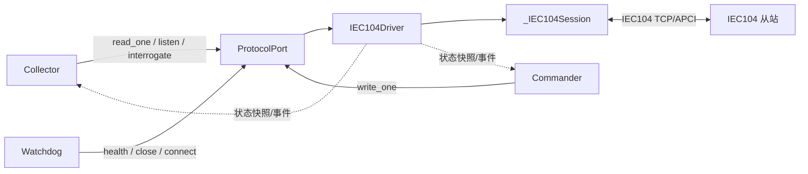
<p class="figure-caption">图 2-1 IEC104 适配器上下文</p>

# 3. 功能与协议用例

## 3.1 能力约定

| `ProtocolPort` 方法 | IEC104 行为 | 能力发现 |
|---|---|---|
| `connect/close/is_open/health` | 建立、关闭、检测物理/应用层连接 | 基础契约 |
| `read_one` | `C_RD_NA_1`，必须关联本次请求 | `READ`（配置/互操作性支持时） |
| `write_one` | Type ID 决定编码；Direct/SBO 决定阶段 | `WRITE` |
| `interrogate` | 站/组/计数器读取；ACT_TERM 完成 | `INTERROGATE` |
| `listen` | 仅本地登记和分发 | `LISTEN` |
| `subscribe` | 明确不支持（不是本地监听） | 不声明 `SUBSCRIBE` |
| `read_many/write_many` | 不使用逐点循环冒充协议原生批量 | 不声明无真实能力的项 |
| `runtime_state/observe_events` | 当前状态及变化，所有 Driver 实现 | 基础契约，无新能力开关 |

`connect()` 不触发总召、订阅或业务任务；`listen()` 不发网络报文，不启动独立网络接收任务。`capabilities()` 是客户端唯一能力发现入口，不引入多个子 Port 或 `isinstance()` 能力检测。

## 3.2 报文用例与完成依据

| 操作 | 请求 | 核心关联证据 | 完成条件 |
|---|---|---|---|
| 主动读取 | `C_RD_NA_1`, COT=5 | CA、IOA、COT=5、允许的监视 Type ID | 本次有效监视响应 |
| Direct 写入 | `C_*`, COT=6, S/E=0 | CA、IOA、Type ID、COT、否定标志、阶段 | 配置要求的确认充分 |
| SBO | SELECT → EXECUTE | 同一操作、同一值及限定词、阶段确认 | EXECUTE 的规定确认充分 |
| 站/组召唤 | `C_IC_NA_1`, QOI | CA、召唤种类、限定词、COT | ACT_TERM |
| 电度量读取召唤 | `C_CI_NA_1`, QCC（FRZ=0） | CA、QCC、计数数据 COT | ACT_TERM |
| 自发上送 | 从站监视 ASDU | 已配置地址/类型 | 分发给本地 Listener |

# 4. 共享契约及跨协议修改

## 4.1 单一 ProtocolPort

保留原读写返回类型与 `ProtocolWriteResult` 的三值安全语义；新增统一状态查询及事件观察。召唤请求采用明确的种类与组号，避免同一 `qualifier` 在 QOI、QCC 间出现歧义。

```python
# 接口定义草案；泛型/导入按仓库既有 ProtocolPort 约束实现。
@dataclass(frozen=True, slots=True)
class InterrogationRequest:
    kind: Literal["station", "counter"] = "station"
    common_address: int | None = None
    group: int | None = None

class ProtocolPort(Protocol[TPoint]):
    def capabilities(self) -> frozenset[ProtocolCapability]: ...
    def runtime_state(self) -> ProtocolRuntimeState: ...
    def observe_events(self, callback: ProtocolEventCallback) -> ProtocolEventHandle: ...
    async def interrogate(self, request: InterrogationRequest) -> tuple[ProtocolSample, ...]: ...
```

`ProtocolEventCallback` 为异步事件回调类型；`ProtocolEventHandle.close()` 异步且幂等，句柄归注册者所有。`ProtocolPort` 同时保留既有 `connect/close/is_open/health/read_one/read_many/write_one/write_many/update_point_table/subscribe/listen`；不支持能力仍以 `ProtocolCapabilityError` 拒绝，不删除方法。`interrogate` 为破坏性变更，所有调用方、Fake、测试、配置和 API 导出同步修订，无兼容重载。

## 4.2 运行状态最小契约

```python
# 字段契约示意：枚举名称为规范性定义，业务字段不可依赖 message 文本解析。
class ProtocolLifecycleState(StrEnum):
    DISCONNECTED = "disconnected"
    CONNECTING = "connecting"
    CONNECTED = "connected"
    CLOSING = "closing"
    FAULTED = "faulted"

class ProtocolOperationState(StrEnum):
    QUEUED = "queued"
    RUNNING = "running"
    SUCCEEDED = "succeeded"
    FAILED = "failed"
    UNKNOWN = "unknown"
    CANCELLED = "cancelled"

@dataclass(frozen=True, slots=True)
class ProtocolOperationEvent:
    driver_id: str
    sequence: int
    operation_id: str
    operation: ProtocolOperation
    state: ProtocolOperationState
    timestamp: datetime
    phase: str | None = None
    point_id: str | None = None
    message: str | None = None

@dataclass(frozen=True, slots=True)
class ProtocolRuntimeState:
    driver_id: str
    lifecycle: ProtocolLifecycleState
    active_operations: tuple[ProtocolOperationEvent, ...]
    dropped_events: int = 0
    message: str | None = None
```

每次调用在 Driver 内生成 `operation_id`（UUID），不向所有读写方法增加 `context` 参数；SBO 所有阶段使用同一 ID。需要操作级实时关联的上层可结合点、Driver 与本次操作事件观察；**自动生成的 ID 在方法执行期间无法直接供调用方索引，本限制不得在文档中伪装为已解决**。事件接口是观测通道，不是可靠控制审计和命令幂等键。

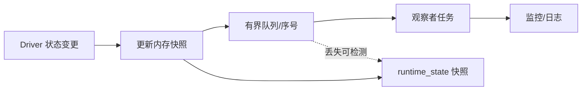
<p class="figure-caption">图 4-1 状态快照与事件通知边界</p>

事件回调不在网络接收任务中等待；事件丢失计数与序号缺口可供观察端重新查询当前状态。普通读取默认不发布冗余成功阶段；控制关键阶段/终态必须提交观察通道，但持久可靠审计仍由上层保证。`driver.close()` 不销毁观察者注册；句柄由所属上层生命周期注销。`CANCELLED` 仅用于可证明未发送的操作；已发送写入且结果不明为 `UNKNOWN`。

# 5. 架构、职责与资源所有权

## 5.1 类结构

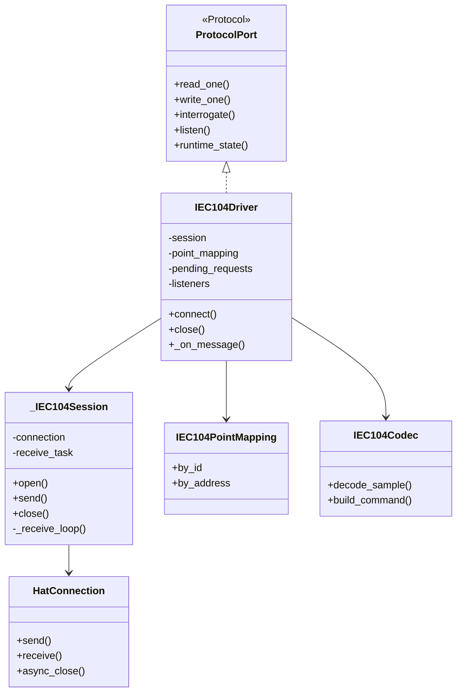
<p class="figure-caption">图 5-1 IEC104 Adapter 类职责结构</p>

## 5.2 职责边界

| 对象 | 所有权及职责 | 明确排除 |
|---|---|---|
| Driver | 生命周期决策、点表、请求登记、语义确认、监听路由、运行状态 | TCP/APCI、自动重连、缓存采样 |
| Session | 唯一连接对象、接收 Task、资源收敛、异步发送/接收、断线通知 | CA/IOA/COT 业务解析、SBO、点表 |
| hat | TCP/APCI/STARTDT、帧收发、k/w/t1/t2/t3 | 风电场设备语义 |
| Codec | 监视数据、命令、时间、品质的纯转换 | 请求匹配和网络 I/O |
| Mapping | 配置校验、point_id 与协议地址索引 | 在途请求和 Session 资源 |

仅保留 `driver.py/session.py/codec.py/mapping.py/config.py` 和必要包导出。三种在途请求数据结构保留为 Driver 私有记录，不新增 ReadManager、ControlManager、通用 TransactionEngine。IEC104 原生 asyncio，不引入 ADS `to_thread` 或跨线程锁。

## 5.3 单接收及无阻塞分发

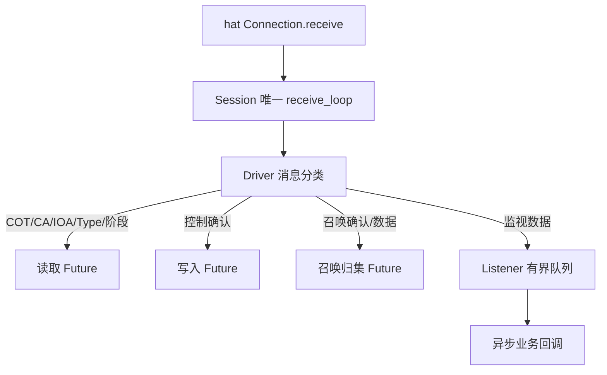
<p class="figure-caption">图 5-2 唯一接收循环与业务分发</p>

Session 调用 `connection.receive()` 的位置只有一个。Driver 先同步分类、完成请求关联，再将合适的监视样本非阻塞投递本地监听者；慢回调及回调异常不阻塞 ACT_CON/ACT_TERM。


## 5.4 Session 并发模型与资源所有权

Session 独占一条高层 `hat.drivers.iec104.Connection`。仅 `_receive_loop()` 消费 `receive()`；多个业务协程可申请 `send()`，但**首版在 Session 内用发送锁串行化提交**，不持锁等待 ACT_CON、ACT_TERM 或其他业务完成。此为对第三方并发语义尚未完成实测前的保守约束，编码阶段应在锁定版本下核验。

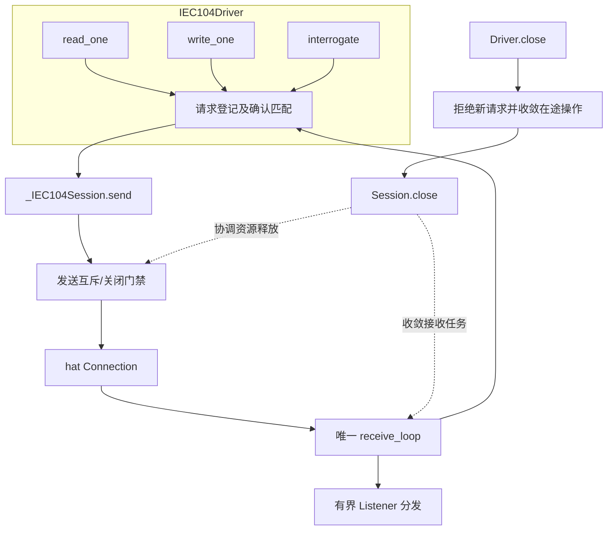
<p class="figure-caption">图 5-3 Session 并发模型及单一资源所有权</p>

| 竞争 | 强制不变量 | 实现位置 |
|---|---|---|
| 并发发送 | 每次 `send` 调用完整提交或明确报告不确定；不等待业务确认 | Session 发送门禁 |
| 发送与关闭 | 关闭开始后拒绝新发送；已进入底层发送的请求先判定交付不确定性，再统一清理 | Session + Driver |
| 收包与关闭 | 唯一接收协程退出；不由回调再次等待自身关闭 | Session |
| 断线与主动关闭 | 一个清理工作和同一完成结果，禁止重复关闭/孤儿连接 | Driver 生命周期 |
| 关闭超时 | 保留尚未确认结束的清理任务，状态 FAULTED；不得用取消 Future 替代物理关闭 | Driver |

`Connection`、接收 Task 和关闭收敛任务由 Session 持有；Driver 仅持 Session 引用。一次 Session 不复用。**Session.close() 不以“发起了关闭”为完成条件，而以底层资源释放已确认作为完成条件**。`Connection` 回调不得在关闭路径中同步反入获取同一生命周期锁。所有共享状态的同步更改应避免在两次 `await` 之间暴露半更新结果。

## 5.5 对齐 ADS 的 Session 所有权与关闭原则

ADS 和 IEC104 统一使用一次性 Session：业务操作取得 Session 后持有该引用，不切换到重连后的实例；`connect/close/isolate` 通过 Driver 生命周期锁串行；物理关闭确认之前禁止重连。IEC104 因接收与发送分离，Future 必须由唯一接收循环关联响应，不能把业务等待包裹在发送锁内。

- 业务直接调用 `session.send([message])`；Session 自身检查关闭状态，Driver 不保留重复的 `_send` 包装。
- `_isolate(session)` 在取得生命周期锁后检查原 Session 身份，避免旧请求关闭新连接；删除锁外重复身份检查。
- `_dispatch(session)` 与 `_disconnect(session)` 验证接收来源 Session，拒绝旧连接回调污染当前请求表。
- 同点互斥锁只约束同点读写；同 CA 的总召单独持有站召锁。控制不获取站召锁，总召与不同测点的控制允许并发。等待锁后先确认原 Session 可用，再登记 Future。
- 关闭时结束在途 Future，并协调发送锁、接收任务、底层 Connection 完整释放；已发控制不可由恢复流程自动重传。

# 6. 生命周期与 Watchdog 恢复

## 6.1 Driver 五态

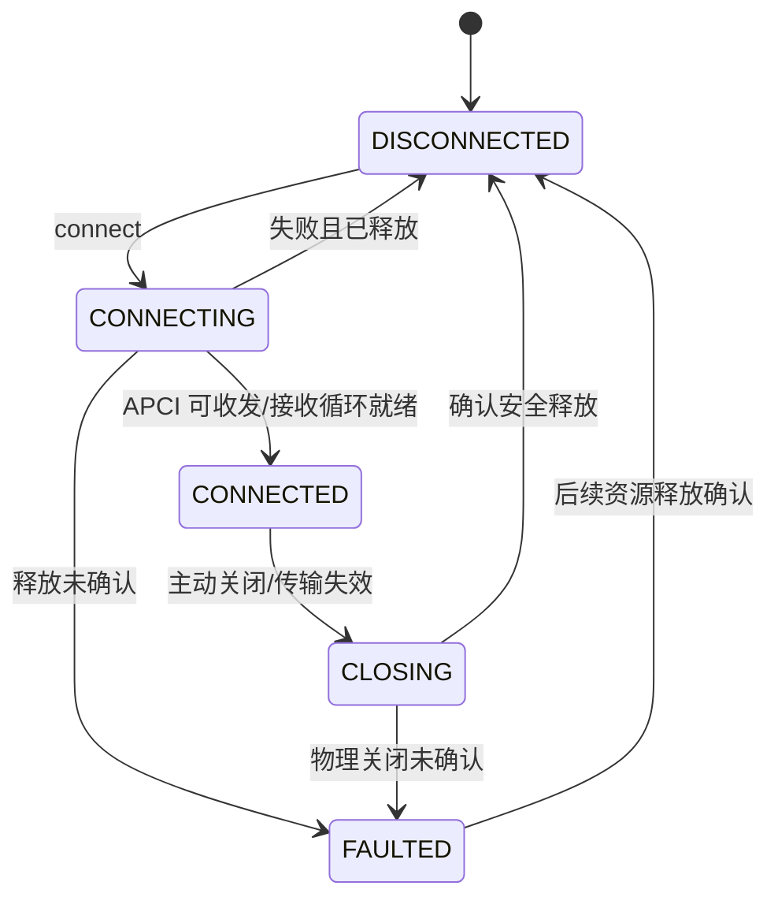
<p class="figure-caption">图 6-1 Driver 生命周期状态机</p>

`FAULTED` 专指资源收敛未确认的危险状态，非所有业务错误的统一归类。Session 一次性使用；绝不在旧物理关闭结果不确定时创建新 Session。

## 6.2 连接及关闭时序

```mermaid
%%{init: {"sequence": {"useMaxWidth": true}}}%%
sequenceDiagram
  participant A as 应用/Watchdog
  participant D as Driver
  participant S as Session
  participant H as hat Connection
  A->>D: connect()
  D->>D: CONNECTING
  D->>S: open()
  S->>H: connect + STARTDT
  H-->>S: 收发可用
  S->>S: 启动唯一 receive_loop
  S-->>D: open 完成
  D->>D: CONNECTED
  A->>D: close()
  D->>D: CLOSING; 禁止新请求
  D->>D: 在途操作按证据收敛
  D->>S: close()
  S->>H: async_close()
  H-->>S: 物理释放确认
  S-->>D: 接收任务已收敛
  D->>D: DISCONNECTED
```
<p class="figure-caption">图 6-2 建连与安全关闭时序</p>

生命周期操作通过一套锁/单飞任务收敛 `connect/close` 并发；普通读写不长时间持有生命周期锁。重复 `close()` 共享同一次清理结果，未完成不返回“已关闭”。Session 失效主动通知 Driver，Driver 不在读路径上自重连。hat `connect()` 是否已包含 STARTDT 确认，按项目实际依赖版本核实；不能只凭 TCP 已打开设置 CONNECTED。

## 6.3 业务任务恢复边界

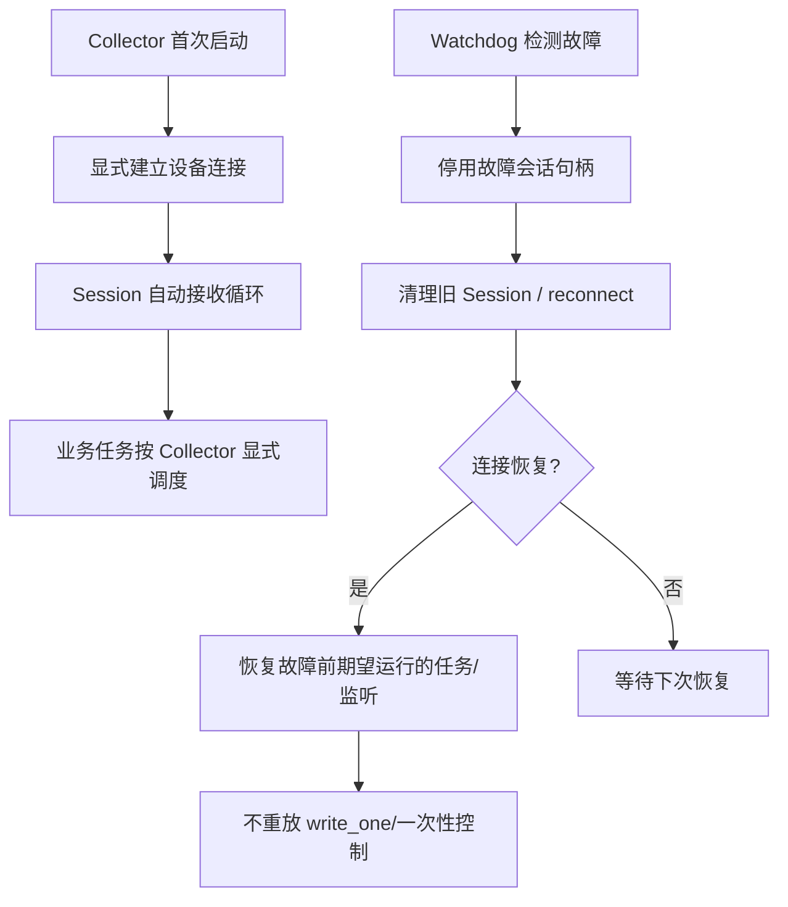
<p class="figure-caption">图 6-3 冷启动与 Watchdog 恢复的差异</p>

`WatchdogUseCase` 已具备 `on_success` 与恢复重试入口，应复用而非新建恢复管理器。期望运行状态的唯一权威在 Collector，而非 Driver。用户显式停用的任务不恢复；首次启动不由 Driver 启动业务任务。`listen()` 句柄是否需要重建取决于 Driver 监听注册生命周期：连接无效时缓存的**本地注册**可保留，但上层采集句柄恢复必须幂等且不得重复回调。


## 6.4 关闭的可执行次序

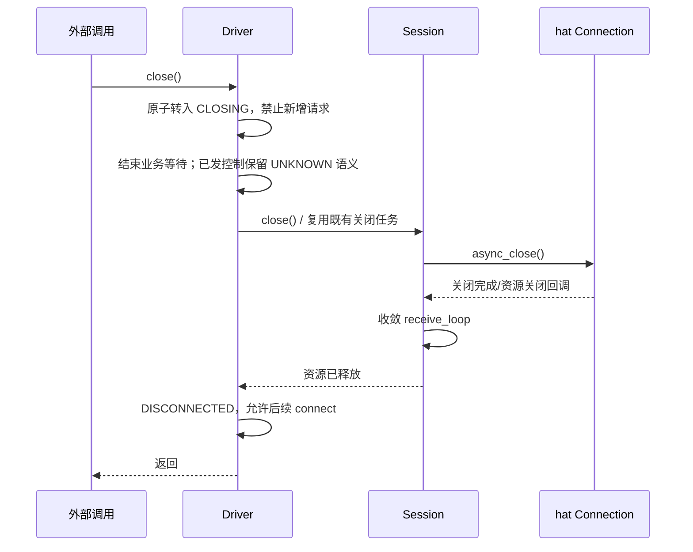
<p class="figure-caption">图 6-4 关闭、在途请求与物理资源收敛</p>

主动关闭和接收任务自然结束都走统一收敛入口。`connect()` 期间收到 `close()`，不得使进行中的连接在 close 返回后重新暴露；需要持有当代 Session 的身份/代次并等待所有权交接。超时发生于 `close()` 外围时，底层清理必须仍可追踪，直至完成；在此之前禁止新连接。

## 6.5 Collector 期望状态与故障恢复

TaskRuntime 对每个实例区分 **期望状态** `desired_running` 和 **当前执行状态** `RUNNING/STOPPED`，二者不能共用。期望状态仅由用户/控制面显式 start、stop 或任务删除/重配置改变。因断线或恢复失败导致实际 STOPPED，不撤销期望 RUNNING。

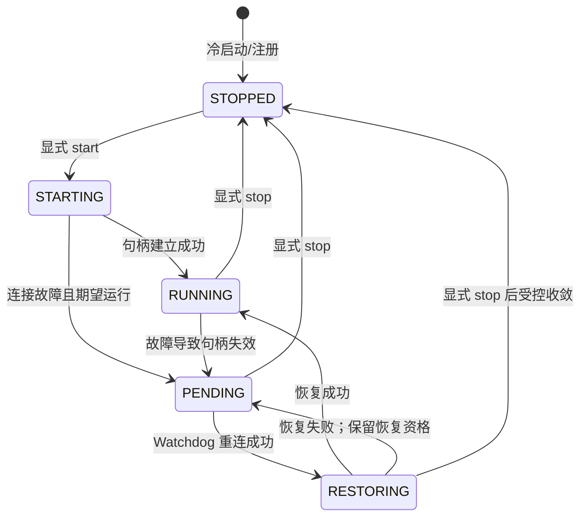
<p class="figure-caption">图 6-5 Collector 任务实际执行状态与恢复资格</p>

Watchdog 保留现有 `on_success`，TaskRuntime 负责按设备恢复期望 RUNNING 的采集实例。POLL 句柄仍健康时可以继续复用；若句柄已失效，应受控重建，保证每实例最多一个活跃句柄。SUBSCRIBE/LISTEN 必须重建有效推送句柄。单实例恢复失败不应阻断其他实例恢复，也不得擦除恢复意图；`stop_instance()` 与恢复串行、删除旧代任务后不得复活。**Watchdog 绝不重放一次性 `write_one()` 控制。**

# 7. 请求关联、并发及超时隔离

## 7.1 在途请求结构

| 业务 | 关联域 | Driver 私有请求数据 | 串行规则 |
|---|---|---|---|
| Read | `(CA, IOA)` | 点映射快照、Future、预期监视类型、发送状态 | 同键排队 |
| Direct/SBO | `(CA, IOA)` + Type ID/阶段校验 | 值、限定词、阶段、确认记录、Future | 同点禁止重叠；同 CA SBO 默认串行 |
| 召唤 | `CA` | kind、QOI/QCC、阶段、归集样本、Future | 同 CA 普通/电度量召唤串行 |

并发资格由一次性请求登记及按键异步锁协调。不要自制无限队列；同一关联域的锁只覆盖操作生命周期，传输收发仍由 Session 完成。读与写只在响应类型/COT 确保不会歧义时交叠；不能假设所有从站能正确回显 OA/限定词。

## 7.2 匹配优先级与隔离

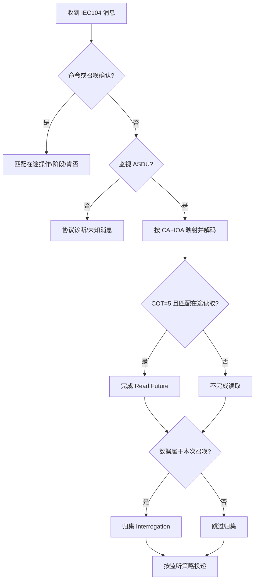
<p class="figure-caption">图 7-1 响应关联与监听分发</p>

不可按裸 IOA 关联跨站点；读取不接受 COT=3 自发数据，也不接受 COT=20～41 召唤数据。控制确认检查 Type ID、CA、IOA、S/E/值/限定词（设备确实回显的字段）与当前阶段；从站无法唯一回显时提高串行范围。Listener 数据是否交付由其登记点集及允许的监视 COT 策略控制，**控制/召唤确认永不作为 ProtocolSample 传给 Listener**。

## 7.3 发送状态及超时结局

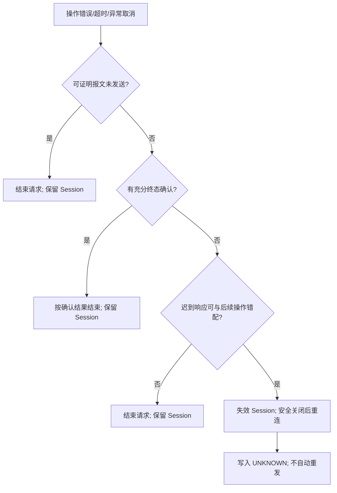
<p class="figure-caption">图 7-2 失败类型与 Session 收敛判定</p>

业务超时不等于物理连接必坏；但请求已发且无法排除迟到响应错配，首版采用整条 Session 隔离。旧连接迟到帧不得进入新 Session 请求登记。异常 `CancelledError` 仅在非正常路径防御；`asyncio` 取消发送 Task 不等于报文未发出。请求登记和物理关闭结果分别追踪，避免“Future 已取消”冒充“TCP 资源已释放”。

## 7.3.1 会话跨代隔离与 Future 清理

主动读取、控制和总召遵循先登记 Future、再发送报文、接收循环匹配响应、最后清理登记的顺序。发送成功不代表业务完成。匹配依据包括当前 Session、完整 CA/IOA、消息类别/COT 及 Type ID 或控制阶段。

`_read`、`_control`、`_interrogation` 的 `finally` 必须以对象身份确认登记仍属本次操作后再删除；旧 Session 操作不得删除重连后同键请求。超时/取消且迟到应答可能错配时隔离原 Session，确认关闭后才允许重连。明确拒绝且结果终结的请求不应无条件拆除健康连接，需按协议结果分类。

## 7.4 生命周期竞争判定

| 竞争场景 | 必须结果 |
|---|---|
| 双 `connect()` | 单次物理建链，等相同结局 |
| 双 `close()` | 单次物理关闭，不提前宣布完成 |
| `connect()` 与 `close()` | 关闭优先收敛建链后释放，不能遗留孤儿 Connection |
| 读写与 `close()` | 禁止新请求；旧请求按“是否已发”准确结束 |
| 接收循环故障与 `close()` | 同一次资源关闭；不交叉构建新 Session |
| 旧 Session 关闭未确认 | `FAULTED`，禁止 connect；Watchdog 后续重试清理 |


## 7.5 登记—发送—响应的线性化约束

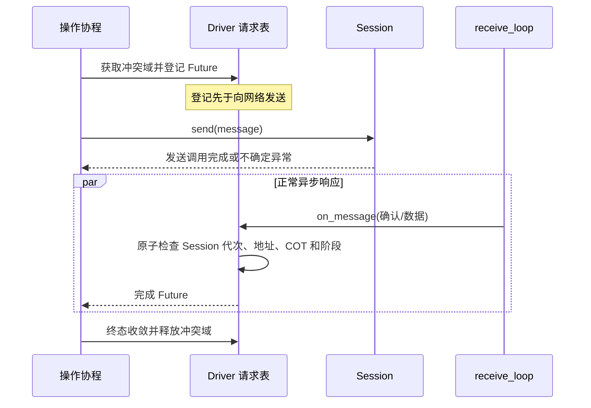
<p class="figure-caption">图 7-3 请求登记、发送和接收的竞态防护</p>

- 登记必须发生在 `Session.send()` 前，避免快速响应先于 Future 创建。
- 同一冲突域从登记到终态收敛被单次操作独占；SBO 的 SELECT 和 EXECUTE 不释放该域。
- 接收分发不 `await` 外部回调；只有匹配当前 Session 代次且符合协议字段/阶段的响应才能完成请求。
- 发送失败分为**确定未提交**与**可能已经提交**；后者不能自动重发，写入返回 UNKNOWN。
- 已发请求超时后，若迟到应答可能错配，先失效整条 Session，再允许同键后续请求；不能只移除 Future。
- 锁、Future、在途请求三者必须在单一 `try/finally` 收敛流程中释放；异常清理不能掩盖 UNKNOWN。

## 7.6 并发冲突域

| 同时发生的操作 | 允许关系 | 依据 |
|---|---|---|
| 同 CA/IOA 的两个读取 | 串行 | C_RD 响应无事务号 |
| 不同 CA/IOA 的读取 | 可并行 | 响应可由完整地址关联 |
| 同 CA/IOA 的两个命令 | 串行 | 控制确认无业务事务号 |
| 同 CA 的多个 SBO | 不同测点可并行，同点串行 | 默认按 (CA, IOA) 互斥；若设备要求整站选择互斥，由设备互操作约束另行处理 |
| 同 CA 的普通/电度量召唤 | 串行 | 避免不同 QOI/QCC 归集混淆 |
| 读取与控制 | 不同测点可并行；同点串行 | 点表每个 (CA, IOA) 仅对应一个 Type ID，监视点与控制点区分 |
| 同 CA 总召与控制 | 并行 | 总召按 CA 锁串行；控制仅持有其测点锁，响应按消息类型及 COT 区分 |
| `listen` 与业务操作 | 并行 | 监听不消费请求 Future |
| `close` 与任意业务 | close 优先禁止新业务并收敛在途请求 | 生命周期所有权 |

# 8. 业务交互与确认状态机

## 8.1 主动读取

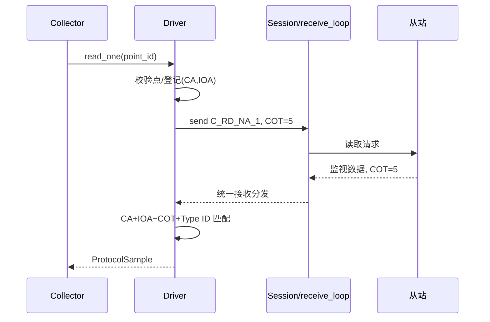
<p class="figure-caption">图 8-1 主动读取时序</p>

不支持 `C_RD_NA_1` 的站不宣称该能力；不能以缓存/监听最近值伪装读取。不同 IOA 可并发；同键超时后防止迟到响应错配。

## 8.2 Direct 与 SBO 控制

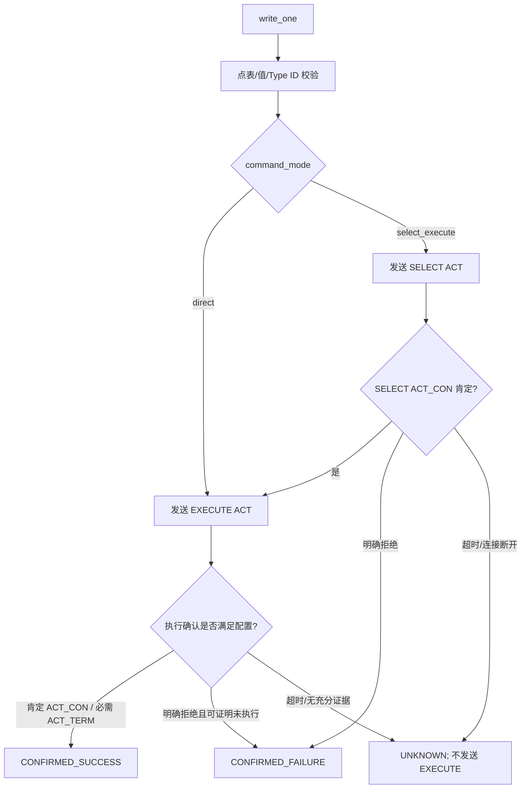
<p class="figure-caption">图 8-2 Direct/SBO 控制决策</p>

适配命令 Type ID：`C_SC_NA_1`、`C_DC_NA_1`、`C_RC_NA_1`、`C_SE_NA_1/NB_1/NC_1`、`C_BO_NA_1`；可选带 CP56Time2a 的命令须先按锁定 hat 版本实证支持。`write_one` 是唯一控制入口，不增加 separate `single_command/setpoint` 接口。

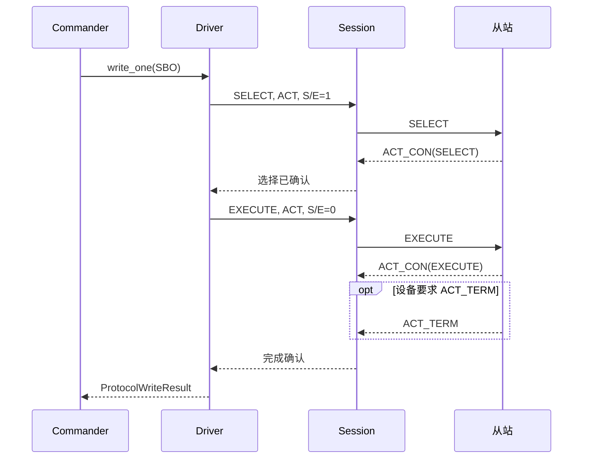
<p class="figure-caption">图 8-3 SBO 正常协议交互</p>

## 8.3 SBO 中断、DEACT 与安全结果

| 失败位置 | 是否发送 EXECUTE | 是否尝试 DEACT | 返回判定 |
|---|---|---|---|
| 参数校验不通过 | 否 | 否 | `CONFIRMED_FAILURE` |
| SELECT 明确否定 | 否 | 否 | `CONFIRMED_FAILURE` |
| SELECT 超时/断线 | 否 | 首版不盲发 | `UNKNOWN`（选择状态未知） |
| SELECT 已肯定、尚未 EXECUTE、主动放弃 | 否 | 设备明确支持才发送 | DEACT 已确认且能证明未执行则失败；否则 UNKNOWN |
| EXECUTE 明确拒绝 | 已尝试 | 不按回滚处理 | 仅拒绝证据充分时 `CONFIRMED_FAILURE` |
| EXECUTE 已发但响应/ACT_TERM 超时 | 已尝试 | 不发送作为回滚 | `UNKNOWN` |

DEACT（COT=8）与 DEACT_CON（COT=9）是放弃选择过程的可选协议语义，不可撤销已执行设备动作。`CONFIRMED_SUCCESS` 是配置确认级别的协议完成，不是监视点证实的物理到位；实际反馈独立核验。同站 SBO 默认串行；确认无歧义且设备声明多选择能力时才开放按 IOA 并发。Watchdog 恢复不重放任一控制命令。

## 8.4 普通及电度量召唤

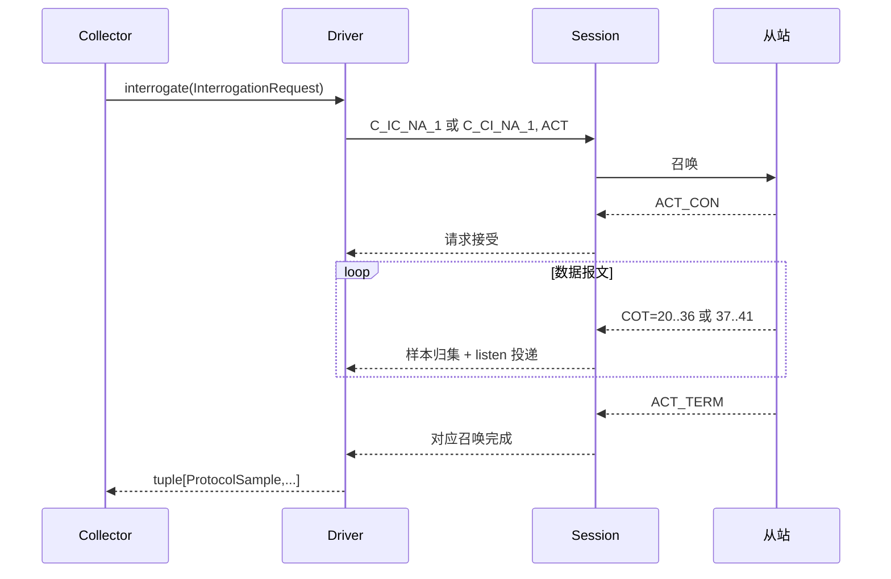
<p class="figure-caption">图 8-4 召唤数据归集与监听共存</p>

| `InterrogationRequest` | 协议编码 | 副作用限制 |
|---|---|---|
| `station, group=None` | `C_IC_NA_1`, QOI=20 | 站总召 |
| `station, group=1..16` | QOI=21..36 | 组召 |
| `counter, group=None` | `C_CI_NA_1`, QCC 全计数器读取 | FRZ=0 |
| `counter, group=1..4` | QCC 对应计数器组 | FRZ=0 |

召唤以本次匹配的 ACT_TERM 正常完成，不以 ACT_CON 或点表覆盖数量代替完成。归集只包含本次、已配置及合法类型的样本，重复地址采用最后一次值（按接收次序）；未收到 ACT_TERM 不成功返回部分数据。计数器冻结、冻结并复位、复位均不开放。同 CA 任何两种召唤不重叠。


## 8.5 控制结果证据分级

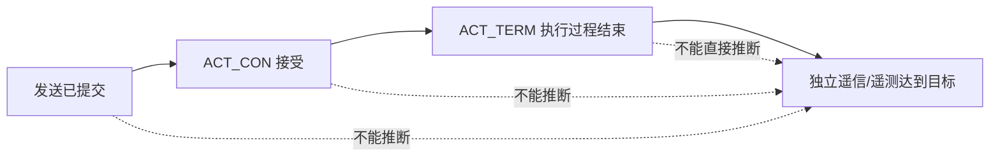
<p class="figure-caption">图 8-5 IEC104 协议确认与现场到位证明的边界</p>

| 证据 | `write_one()` 的意义 | 归属 |
|---|---|---|
| 仅发送完成 | 非执行确认；不能单独报成功 | Session |
| ACT_CON 肯定 | 从站接受激活；若点明确配置此级为协议终态，才允许返回协议确认成功 | Driver |
| ACT_TERM 肯定 | 从站报告激活过程终止；若配置要求此级则必须等待 | Driver |
| 遥信/遥测反馈 | 判断物理设备是否真正达到目标状态 | Commander/业务闭环 |

`ProtocolWriteResult.CONFIRMED_SUCCESS` 只能严格解释为**满足该测点配置的协议确认条件**。既有文档若写成“实际设备执行已确认”，须同步修正注释及上层用法；若业务确需现场到位保证，由独立反馈点建立闭环，不得在 IEC104 Driver 内隐式等待。收到否定 ACT_CON 只证明对端拒绝该激活；已经进入执行阶段的异常确认不能不加区分地认定现场未动作。UNKNOWN 不自动重试、不因 Watchdog 恢复而重放。

# 9. 监听、数据解码及测点映射

## 9.1 测点索引

`point_id → (CA, IOA, Type ID)` 与 `(CA, IOA) → point_id` 构成双向索引；监视与命令确认分别走消息类别路由，同 CA/IOA 的控制确认不能误作监视样本。点表拒绝重复且不可区分的地址映射；可读点校验监视 Type ID，可写点要求已支持的命令 Type ID。未知地址不发送给业务监听。

## 9.2 统一解码流程

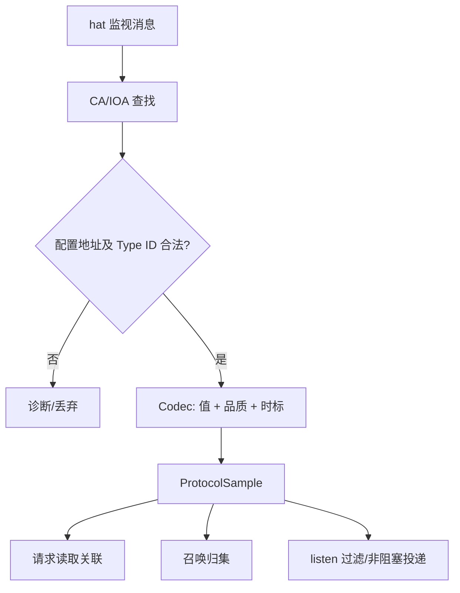
<p class="figure-caption">图 9-1 监视 ASDU 到业务样本的转换</p>

| 数据类型 | Python 类型 | 关键保留信息 |
|---|---|---|
| `M_SP_*` / `M_DP_*` | `bool` / `int` | 双点特殊/中间状态不抹平 |
| `M_ST_*` / `M_BO_*` | `int` | transient、变更位图 |
| `M_ME_NA/NB/NC_*` | `float/int/float` | 原生数值、原生品质 |
| `M_IT_*` | `int` | 计数器序号、溢出/调整标志 |

Codec 不隐式进行工程量换算。IV→BAD；NT、SB、BL、OV→UNCERTAIN；多个标志取最严重质量；原始品质保留 `protocol_metadata`。畸形 ASDU 不生成虚假样本；属于在途读取的坏编码必须使请求显式失败，自发数据解码失败仅记诊断且隔离 Listener。

## 9.3 时间戳

CP56Time2a 不携带时区：设备时区在 Connection 配置明确，转换为 UTC；缺失或无效时使用**同一次接收时刻** UTC，标记 `timestamp_source=local`。`device_time` 仅在可合法解码设备时标时保存；设备时标无效原因留在协议诊断元数据。不依赖采集服务器当地时区，不把时间 IV 与数据品质 IV 混同。所有样本保留 `receive_time`，用于分辨网络到达与设备采样。

## 9.4 listen 生命周期

`listen(point_ids, callback)` 本地登记，空集合表示全部配置点；不启动第二接收循环，不执行 `C_RD`、总召或远程订阅。每个 Listener 持有有界缓冲/独立消费任务；关闭句柄后不再投递。数据 COT 允许范围明确指定：自发/召唤监视数据可投递，控制确认不可投递；是否投递请求读取响应应作为一致的 Adapter 策略固定并覆盖测试。Listener 对象生命周期与 Session 分离，断线与重连不隐式复制多个回调注册。


## 9.5 Listener 分发与注销

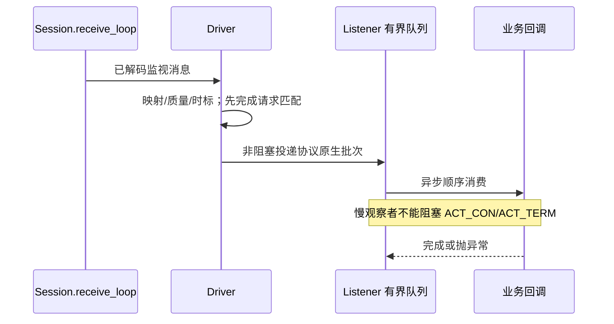
<p class="figure-caption">图 9-3 接收与业务回调隔离</p>

`listen(point_ids, callback)` 只注册本地过滤器；空点集按 Port 契约表示全点表。每个 Listener 有有界队列和一个消费任务，保持该监听者内部批次顺序；不得为每条样本启动独立任务。控制确认及非法地址不交付 Listener，监视数据按点表和 COT 路由；同一批次可以同时参与读取/召唤与监听。回调异常应隔离、计数并按运行诊断上报。

**溢出策略**：不得无限积压，也不得把事件观察通道的“可丢失中间状态”策略直接套用到采集数据。首版建议 Listener 队列满时标记该 Listener 数据完整性已破坏、报告明确错误并停止其投递，由上层按采集恢复机制重建；不得静默丢弃后继续报告正常。`handle.close()` 幂等，关闭后不再接收新批次，并等待已开始回调收敛；Driver/Session 意外断开与观察者生命周期相互区分，避免回调泄漏。

# 10. 配置与更新事务

## 10.1 连接参数契约

```yaml
# configs/device_models.yaml：IEC104 protocol_options
protocol_options:
  k: 12
  w: 8
  t0: 5.0
  t1: 5.0
  t2: 1.0
  t3: 10.0
  read_timeout: 2.0
  command_timeout: 3.0
  interrogation_timeout: 5.0
  timezone: Asia/Shanghai
```

| 约束 | 规则 |
|---|---|
| 连接 | host/port 属于既有 endpoint；禁止重复配置 |
| CA | 每个 IEC104 点的 `address.ca` 必填，删除 `common_addresses/default_ca` |
| 召唤 CA | 未指定 CA 时从已加载点表推导 CA 集合；明确指定时使用该 CA |
| APCI | `k=12,w=8,t0=5,t1=5,t2=1,t3=10`；`w<=k`、`t2<=t1` |
| 业务等待 | `read_timeout=2s`，`command_timeout=3s` 每阶段，`interrogation_timeout=5s` 每 CA |
| 时间戳 | `timezone` 可选；未配置时使用接收时间 |

`t0` 控制建连及 STARTDT 等待；`t1` 是 APCI 传输确认超时；`t2` 控制延迟确认；`t3` 是空闲链路 TESTFR 周期。业务超时与 `t1` 分开，不限制 10 Hz 自发上送频率。大量点召唤可提高 `interrogation_timeout`。

## 10.2 点表扩展

```yaml
# points.yaml 点定义中 address 示例；配置加载后进入 Point.ext
address:
  ca: 1
  ioa: 2001
  type_id: C_SE_NC_1
  command_mode: select_execute
  confirmation: act_term
```

`command_mode=direct|select_execute`；`confirmation=act_con|act_term`，以具体设备互操作声明和真实确认能力为准。若规定 ACT_TERM 为必须但设备不提供，则操作不得伪造成功；配置在部署前校验。对可写点的值类型、范围、限定词及带时标控制支持应按 Type ID 预检，而非传输后失败。

## 10.3 热更新一致性

```mermaid
%%{init: {"flowchart": {"useMaxWidth": true}}}%%
flowchart TD
  A[接收新点表] --> B[解析全部映射并校验]
  B --> C{合法?}
  C -->|否| X[拒绝; 旧表不变]
  C -->|是| D{与在途请求的地址/语义冲突?}
  D -->|是| Y[拒绝或先收敛在途操作]
  D -->|否| E[原子替换双向索引]
  E --> F[新请求使用新映射]
  F --> G[旧在途按固定快照结束]
```
<p class="figure-caption">图 10-1 点表热更新事务</p>

连接 endpoint、APCI、设备时区变化须关闭旧 Session 后重新连接；不得在 `update_point_table()` 中隐式重连。监听点集变化与映射快照切换需要同步处理，避免旧 Listener 使用新地址产生误投递。


## 10.4 点配置有效组合矩阵

| 测点 | Type ID | `command_mode` | `confirmation` | 规则 |
|---|---|---|---|---|
| 监视数据 | 已实现的 `M_*` | 不允许 | 不允许 | 收报类型须与声明/允许类型匹配 |
| Direct 遥控/遥调 | 支持的 `C_*` | `direct` | `act_con` 或 `act_term` | 根据从站声明显式选择确认级别 |
| SBO 遥控/遥调 | 支持 S/E 的 `C_*` | `select_execute` | `act_con` 或 `act_term` | SELECT 须先收到肯定确认；确认策略仅作用 EXECUTE |
| 不支持的时标命令 | `C_*_TA/TB/TC_*` | 任意 | 任意 | hat 编解码/互操作性未验证前配置即拒绝 |
| 不支持的类型 | 其他 | 任意 | 任意 | 配置校验阶段拒绝 |

约束以真实实现的 Type ID 白名单为准；**不能把 IEC104 标准存在的 Type ID 误当作本 Adapter 已实现的类型**。命令模式和确认方式必须能被设备互操作性说明支持。读取能力同样需核查站端是否实现 `C_RD_NA_1`。时区字段是对 CP56Time2a 的解释规则，不能依赖运行主机系统时区。

# 11. 关联模块变更审查与迁移

## 11.1 调用依赖

```mermaid
%%{init: {"flowchart": {"useMaxWidth": true}}}%%
flowchart TB
  P[ProtocolPort / protocol_contract] --> D[IEC104 Driver / Session]
  P --> A[ADSDriver]
  P --> M[ModbusDriver]
  P --> C[Collector / DeviceSession]
  P --> R[Commander / DeviceSession]
  D --> F[ProtocolRegistry / 装配]
  D --> Y[Config / 点表]
  C --> W[WatchdogUseCase / 恢复回调]
  R --> X[Dispatcher / WriteOutcome / 审计]
  F --> T[测试 Fake / Contract / E2E]
  A --> T
  M --> T
  Y --> T
```
<p class="figure-caption">图 11-1 共享契约影响面</p>

## 11.2 生产模块修改契约

| 模块（已有路径） | 需要执行的修改或核查 | 禁止扩展 |
|---|---|---|
| `core/application/port/protocol.py` | 新事件与快照入口、明确 `InterrogationRequest` 签名；保留其余 Protocol 方法 | 拆分多 Port |
| `core/application/protocol_contract.py` | 不可变状态/事件、句柄/回调类型；导出与数据结果语义 | 修改 `WriteOutcome` 安全含义 |
| `core/infrastructure/protocol/iec104/` | 清除旧实现，全新 Driver/Session/Codec/Mapping/Config；消除旧锁与状态适配残留 | 旧实现兼容层 |
| `core/infrastructure/protocol/ads/driver.py` | 统一状态/事件，追踪连接和真实操作阶段；复用现有 AMS 同步资源机制 | 借机重构 pyads 或锁 |
| `core/infrastructure/protocol/modbus/driver.py` | 同一状态契约，真实连接/请求/响应阶段；无伪 SBO | 借机重构 pymodbus 交易流程 |
| `core/application/protocol_registry.py` + 包导出 | 工厂构造、协议类型、`__init__`、 capability 契约 | 创建另一套注册框架 |
| `collector/assembly.py`、`commander/assembly.py` | driver 装配、配置注入、事件观察句柄所有权 | 业务自动启动逻辑塞给 Driver |
| `collector/application/session.py` | listen 注册/注销、点表变更、Capability 判断 | `listen` 冒充 `subscribe` |
| `collector/application/device_runtime.py` | 看期望任务状态与重连恢复作用域、资源失效窗口 | 重写 Watchdog |
| `collector/application/runtime.py` | 验证冷启动/故障恢复/人工停用/热更新的任务差异 | 断线后重放控制 |
| `core/application/watchdog.py` | 复用现有 `on_success`、`_pending_restore`，核对 close 未完成后的重试判定 | 新建 Watchdog 控制器 |
| `commander/application/session.py`、`runtime.py`、Dispatcher | 一次性写入结果、超时 UNKNOWN 与重连不重放 | 将成功 ACT_CON 等同遥信到位 |
| YAML schema / Web / CLI / tests | `interrogate` 新签名、字段可见性、配置样例、错误提示及测试 | 只改 Driver 留调用旧契约 |

已实际查阅：`WatchdogUseCase` 有 `on_success`/`on_connected` 与 `_pending_restore`；Collector `DeviceRuntime` 持有设备会话和 Watchdog；`Commander` 装配注册三种 Driver；`ModbusDriver` 使用 asyncio Lock 且关闭自动后台重连。**尚未逐行审完所有间接调用、动态调用及前端配置入口，迁移前须实际完成全仓 grep/调用图复查。**

## 11.3 变更范围与迁移顺序

```mermaid
%%{init: {"flowchart": {"useMaxWidth": true}}}%%
flowchart LR
  A[冻结共享接口/配置] --> B[同步 ADS+Modbus 最小适配]
  B --> C[新 IEC104 Codec/Mapping/Session/Driver]
  C --> D[Collector+Commander+Watchdog 接口迁移]
  D --> E[删除旧实现和旧引用]
  E --> F[静态门禁 + Claude 独立测试]
```
<p class="figure-caption">图 11-2 生产改造依赖顺序</p>

对 `interrogate()` 和 `ProtocolPort` 的变更须在同一分支原子提交；同时检查工厂、调用者、Fixture、文档和 CI。任何旧签名、旧配置、旧私有符号不可无理由保留。

## 11.4 已定位的测试改造清单

| 路径 | 必须覆盖的风险 |
|---|---|
| `tests/support/iec104_hat_fake.py` | 新单 receive 循环、关闭完成/断线事件、迟到报文 |
| `tests/unit/core/protocol/iec104/` | CA/IOA/Type/COT、Codec 品质/时区、SBO 各阶段 |
| `tests/unit/core/test_iec104_timeout_isolation.py` | 同键重入、迟到响应、未知结果、旧 Session 隔离 |
| `tests/reliability/core/test_iec104_reliability.py` | 并发 connect/close、残留任务、拒绝新建链 |
| `tests/system/e2e/core/test_iec104_config_to_wire.py` | 配置到真实编码、确认与监听 |
| `tests/contract/core/test_protocol_registry.py` | 单 Port、capabilities、状态及事件基本契约 |
| Collector/Commander 回归 | 冷启动与恢复区分、用户停用不恢复、不重放写入 |
| ADS/Modbus 回归 | 共享事件接口加入后通信语义不回退 |

# 12. 安全约束、验证矩阵与门禁

## 12.1 不可违反的设计不变量

| ID | 约束 |
|---|---|
| I01 | 一个 Session 只有一个 `receive()` 调用循环 |
| I02 | Driver 不隐式总召、重连、订阅或缓存替代读取 |
| I03 | 已发控制且确认不足只能 UNKNOWN，不自动重发 |
| I04 | 旧 Session 物理释放未确认禁止新建链 |
| I05 | SBO SELECT/EXECUTE/DEACT 的肯否及阶段不互串 |
| I06 | 同 CA 召唤串行、同 CA SBO 默认串行 |
| I07 | ACT_CON 不能代替要求 ACT_TERM 的操作终态 |
| I08 | 自发和召唤数据不冒充 read_one 的本次响应 |
| I09 | Listener 回调不阻塞统一接收循环 |
| I10 | Watchdog 不重放一次性控制；只恢复期望运行的持续任务 |
| I11 | `capabilities()` 为唯一能力发现入口 |
| I12 | 修改 Port 同步检查全部 Driver、调用方、配置、Fake、测试、导出 |

## 12.2 状态与结果判定矩阵

| 事实 | 读取/召唤 | 写入结果 | Session |
|---|---|---|---|
| 本地校验失败 | 抛明确异常 | `CONFIRMED_FAILURE` | 保留 |
| 明确否定确认 | 抛明确异常 | 证据足够则 `CONFIRMED_FAILURE` | 保留 |
| 发送前取消 | 取消异常 | 可证明未发可取消 | 保留 |
| 发送后无充分确认 | 抛异常，不正常返回部分召唤 | `UNKNOWN` | 有错配风险时隔离 |
| TCP/APCI 中断 | 抛连接错误 | 未确认执行则 `UNKNOWN` | 清理/FAULTED |
| 控制完整肯定确认 | 不适用 | `CONFIRMED_SUCCESS`（仅协议级） | 保留 |

## 12.3 分层验收与质量职责

```mermaid
%%{init: {"flowchart": {"useMaxWidth": true}}}%%
flowchart LR
  A[接口+配置静态审查] --> B[Codec/Mapping 单元]
  B --> C[Session/Driver 组件]
  C --> D[Collector/Commander 集成]
  D --> E[断线/迟到/关闭可靠性]
  E --> F[ADS/Modbus 回归]
  F --> G[独立验收与合并决策]
```
<p class="figure-caption">图 12-1 验收层次</p>

ChatGPT 负责生产设计/代码/缺陷修复，提交前执行 Ruff Lint、Ruff Format、项目 Mypy/Pyright、Import Linter 等静态检查，不用忽略掩盖问题；无法执行须逐项记录。会话外独立 Claude Code 负责测试、Fixture、独立审查、规范静态检查与复测；最终合并由 ChatGPT 根据验收结果执行。未经检查不能声称编码完成。

# 13. 实施与验证基线

## 13.1 阶段与交付

| 阶段 | 交付与准入 |
|---|---|
| A：协议库实证 | 在仓库锁定 `hat-drivers==0.10.10` 的 Python 3.11 环境实测高层 `iec104.Connection` 的连接使能、收发消息、关闭、异常断链；无法实测时不得冻结该层 API 的具体实现 |
| B：共享接口 | 一次修改 `ProtocolPort`、contract、ADS/Modbus 最小实现及全部 Fake/调用方，统一 `InterrogationRequest` 签名 |
| C：IEC104 Clean Rewrite | 重写 config、mapping、codec、session、driver，删除旧 APCI Encoder/Listener 兼容实现，不增加废弃兼容层 |
| D：运行时集成 | 修复 Collector 恢复意图；保持冷启动 STOPPED，恢复期望 RUNNING；核对 Commander、Watchdog、装配和配置 |
| E：质量验收 | ChatGPT 执行 Ruff Lint、Ruff Format、类型检查、Import Linter 等生产代码静态门禁；会话外 Claude Code 负责独立测试、Fixture、评审及复测 |
| F：合并 | 全部相关门禁和审查结论满足要求后由 ChatGPT 执行最终合并 |

## 13.2 已取得的证据与限制

| 内容 | 可确认结论 | 尚未验证 |
|---|---|---|
| 仓库依赖 | `pyproject.toml` 声明 `hat-drivers=^0.10.10`；`poetry.lock` 锁定 `0.10.10` | 当前运行环境中该 wheel 的真实 API 及线程/asyncio 行为 |
| 高层接口 | 官方文档描述 `iec104.Connection.send/receive` 等高层消息 API | 锁定版本 `send()` 并发、使能回调、`async_close()`、`receive()` 异常语义 |
| Collector 冷启动 | `CollectorRuntime.start()` 连接设备、启动 Sink、登记 STOPPED 实例 | 完整部署链路/控制面回归 |
| Watchdog 恢复 | 现有 `on_success` 已连接 `TaskRuntime.restore_subscriptions()` | 失败恢复的幂等性、人工 stop 竞争、热更新旧代回收 |
| 已知恢复缺口 | 当前恢复前改 RUNNING 为 STOPPED，失败后可能失去下轮恢复资格 | 独立测试证明修复有效 |
| 控制协议 | IEC104 定义 ACT_CON、ACT_TERM、SBO、DEACT | 具体从站的确认模式、DEACT 支持、OA 回显及物理到位 |
| QCC | 标准定义计数器召唤与 FRZ | hat 0.10.10 编解码往返及从站实现 |
| 配置归属 | `ConnectionEndpoint`、`ProtocolOptions`、`Point.ext` | 新字段被现有 Schema/加载器完整消费及正确热更 |
| 文档规范 | 保留原文第 1 章、沿用 ADS v0.3 可用约定 | 四份独立规范原件尚未获得，不能声称完全一致 |

## 13.3 模块变更闭环

```mermaid
%%{init: {"flowchart": {"useMaxWidth": true}}}%%
flowchart TB
    P[ProtocolPort / protocol_contract] --> A[ADS / Modbus 最小同步]
    P --> I[IEC104 Clean Rewrite]
    I --> C[Collector Session / TaskRuntime]
    I --> M[Commander 控制调用]
    C --> W[Watchdog on_success 恢复链]
    A --> T[合同/Fake/测试/配置/注释]
    M --> T
    W --> T
    I --> T
    T --> Q[静态门禁 + Claude 独立验证]
```
<p class="figure-caption">图 13-1 共享接口修改及全调用链验收</p>

变更必须检查 `core/application/port/protocol.py`、`protocol_contract.py`、IEC104/ADS/Modbus Driver、`collector/application/session.py`、`task_runtime.py`、`device_runtime.py`、`runtime.py`、Commander、ProtocolRegistry、配置加载、文档样例、全部测试及 Fixture。`interrogate()` 从旧参数签名更改为 `InterrogationRequest` 时，调用方与“不支持该能力”的 Driver 必须同时更新。对 `ProtocolWriteResult` 的协议级成功定义变更，应同步审查 Commander 的结果解释及审计措辞。

## 13.4 关键验收矩阵

| 维度 | 必验场景 | 通过条件 |
|---|---|---|
| Session | 并发 send/close、receive 异常、关闭超时后重连 | 无孤儿连接；旧资源未释放不建新连接 |
| 关联 | 先响应后 send 返回、同点并发、迟到 ACT_CON/ACT_TERM | 不丢早到响应、不发生跨操作错配 |
| 控制 | Direct、SBO、SELECT 拒绝、EXECUTE 超时、DEACT 结果 | 三值结果准确；UNKNOWN 不自动重放 |
| 召唤 | 总召、组召、计数器只读、部分数据、缺 ACT_TERM | 未完整终止不得报告正常成功 |
| 监听 | 并发上送/读取/总召、慢回调、溢出、注销 | 收包循环不阻塞；数据缺口显式可见 |
| Collector | 冷启动、Watchdog 恢复、恢复失败、人工停止、任务热更 | 首次不自动启动；仅恢复期望运行的任务，失败可重试 |
| 配置 | 未知字段、非法组合、时区、热更新期间在途控制 | 加载即拒绝非法配置；无新旧映射错配 |
| 跨协议 | ADS/Modbus 状态契约与原通信行为 | 契约完整且不引入额外业务副作用 |

## 13.5 最终未关闭的验证项

1. 在实际仓库环境安装并检查 `hat-drivers==0.10.10` 高层 API、收发及关闭语义，记录依赖版本和实测输出。
2. 使用独立模拟站及目标从站互操作性声明核定支持的 Type ID、Direct/SBO、DEACT、ACT_CON/ACT_TERM、QOI/QCC、时间戳处理。
3. 完成全仓调用点及配置/Fixture 的静态迁移检查，执行 Ruff、类型、Import Linter 和相关测试。
4. 获取《报告模板.md》《符号体系.md》《软件系统建模图形与表达规范.md》《Python代码规范.md》原件后逐条核对文档与生产代码规范。

**交付状态：v0_6 为更新后的完整技术设计基线。** 设计项已细化至资源所有权、并发门禁、异常结果、恢复意图和配置校验；第三方库实测、设备互操作和质量门禁未完成，不视为实施验证通过。