<h1 class="title">Sink Service 软件设计</h1>

<p class="subtitle">v1_14 · 20261102</p>

<style>
body {
  font-family: "Microsoft YaHei";
  font-size: 16px;
  line-height: 1.75;
  color: #24292f;
}
.title {
  font-family: "Microsoft YaHei";
  font-size: 32px;
  line-height: 1.30;
  font-weight: 700;
  text-align: center;
}
.subtitle {
  font-family: "Microsoft YaHei";
  font-size: 18px;
  line-height: 1.50;
  font-weight: 400;
  text-align: center;
}
h1 {
  font-family: "Microsoft YaHei";
  font-size: 28px;
  line-height: 1.40;
  font-weight: 700;
}
h2 {
  font-family: "Microsoft YaHei";
  font-size: 22px;
  line-height: 1.40;
  font-weight: 700;
}
h3 {
  font-family: "Microsoft YaHei";
  font-size: 18px;
  line-height: 1.50;
  font-weight: 700;
}
h4 {
  font-family: "Microsoft YaHei";
  font-size: 16px;
  line-height: 1.50;
  font-weight: 700;
}
p, li {
  font-family: "Microsoft YaHei";
  font-size: 16px;
  line-height: 1.75;
}
.figure-caption,
.formula-caption {
  font-family: "Microsoft YaHei";
  font-size: 14px;
  line-height: 1.50;
  font-weight: 600;
  text-align: center;
  margin: 0.65em 0 0.35em 0;
}
.table-caption {
  font-family: "Microsoft YaHei";
  font-size: 13px;
  line-height: 1.40;
  font-weight: 500;
  text-align: center;
  margin: 0.65em 0 0.35em 0;
}
.mermaid,
.mermaid text,
.mermaid .label {
  font-family: "Microsoft YaHei" !important;
  font-size: 14px !important;
  line-height: 1.20;
}
table {
  width: 100%;
  border-collapse: collapse;
  font-family: "Microsoft YaHei";
  font-size: 13px;
  line-height: 1.45;
}
table th,
table th p,
table th li {
  font-family: "Microsoft YaHei";
  font-size: 13px;
  line-height: 1.40;
  font-weight: 600;
}
table td,
table td p,
table td li,
table td strong,
table td b {
  font-family: "Microsoft YaHei";
  font-size: 13px;
  line-height: 1.45;
  font-weight: 400;
}
table th,
table td {
  padding: 0.40em 0.60em;
  vertical-align: top;
}
code, pre {
  font-family: "Cascadia Code";
  font-size: 14px;
  line-height: 1.50;
}
p code, li code, td code {
  color: #24292f;
  background: #f3f4f6;
  padding: 0.08em 0.28em;
  border-radius: 3px;
}
pre {
  color: #c9d1d9;
  background: #0d1117;
  padding: 1em;
  border-radius: 6px;
  overflow-x: auto;
}
pre code {
  color: inherit;
  background: transparent;
  padding: 0;
}
.hljs-comment, .hljs-quote,
.token.comment, .token.prolog, .token.doctype, .token.cdata {
  color: #8b949e;
  font-style: italic;
}
.hljs-keyword, .hljs-selector-tag, .hljs-literal,
.token.keyword, .token.boolean { color: #ff7b72; }
.hljs-string, .hljs-doctag, .hljs-regexp,
.token.string, .token.char, .token.regex { color: #a5d6ff; }
.hljs-number, .token.number { color: #79c0ff; }
.hljs-title, .hljs-function, .token.function { color: #d2a8ff; }
.hljs-title.class_, .hljs-type, .hljs-built_in,
.token.class-name, .token.builtin { color: #ffa657; }
.hljs-variable, .hljs-attr, .hljs-property,
.token.variable, .token.property, .token.attr-name { color: #7ee787; }
.hljs-operator, .hljs-punctuation,
.token.operator, .token.punctuation { color: #c9d1d9; }
</style>

---

## 目录

1. [文档约定](#1-文档约定)  
2. [软件设计指导原则与编制方法](#2-软件设计指导原则与编制方法)  
3. [软件需求](#3-软件需求)  
4. [用例视图](#4-用例视图)  
5. [逻辑视图](#5-逻辑视图)  
6. [进程视图](#6-进程视图)  
7. [开发视图](#7-开发视图)  
8. [物理视图（部署视图）](#8-物理视图部署视图)  
9. [gRPC Server 实现](#9-grpc-server-实现)  
10. [数据交付、JetStream 与可靠性契约](#10-数据交付jetstream-与可靠性契约)  
11. [配置与热重载](#11-配置与热重载)  
12. [Sink Adapter 能力与输出映射](#12-sink-adapter-能力与输出映射)  
13. [安全、可观测性与运行指标](#13-安全可观测性与运行指标)  
14. [测试体系、物理组织与验收](#14-测试体系物理组织与验收)  

---

# 1. 文档约定

本章是全文的固定排版与表达规范。文档修订、补充和派生版本均应遵守本章，不再根据个人习惯调整字体、字号、行距、图题、表题、公式或代码样式。

本文开头的 `<style>...</style>` 是 HTML `style` 元素，其中包含内部 CSS 样式表，本文简称为 CSS 样式块。第 1.1～1.4 节规定目标样式；CSS 样式块通过 `h1`、`h2`、`p`、`table`、`th`、`td`、`pre`、`code` 等选择器，将规范应用到 Markdown 渲染后生成的 HTML 元素。

## 1.1 字体约定

<p class="table-caption">表 1-1 文档字体与排版规范</p>

| 文档元素 | 字体 | 字号 | 行间距/行高 | 字重 | 对齐方式 |
|---|---|---:|---:|---:|---|
| 文档标题 | Microsoft YaHei | 32 px | 1.30 | 700 | 居中 |
| 文档副标题 | Microsoft YaHei | 18 px | 1.50 | 400 | 居中 |
| 一级标题 | Microsoft YaHei | 28 px | 1.40 | 700 | 左对齐 |
| 二级标题 | Microsoft YaHei | 22 px | 1.40 | 700 | 左对齐 |
| 三级标题 | Microsoft YaHei | 18 px | 1.50 | 700 | 左对齐 |
| 四级标题 | Microsoft YaHei | 16 px | 1.50 | 700 | 左对齐 |
| 正文 | Microsoft YaHei | 16 px | 1.75 | 400 | 左对齐 |
| 图题 | Microsoft YaHei | 14 px | 1.50 | 600 | 居中 |
| 图内文字 | Microsoft YaHei | 14 px | 1.20 | 400 | 按图形布局 |
| 表题 | Microsoft YaHei | 13 px | 1.40 | 500 | 居中 |
| 表头 | Microsoft YaHei | 13 px | 1.40 | 600 | 左对齐 |
| 表格正文 | Microsoft YaHei | 13 px | 1.45 | 400 | 左对齐 |
| 公式题 | Microsoft YaHei | 14 px | 1.50 | 600 | 居中 |
| 代码文字 | Cascadia Code | 14 px | 1.50 | 400 | 左对齐 |

以上规范已经通过本文开头的 CSS 样式块固定。其中，正文为 `16 px`；表题、表头和表格正文均为 `13 px`。表头字重为 `600`，低于标题字重；表格正文行高为 `1.45`，因此表格在字号、字重和行距上均明显弱于正文。英文业务对象、数据库对象和程序标识符仍按所在文本元素的字号排版，但使用行内代码形式，例如 `Asset`、`Connection`、`task_id`。

## 1.2 绘图约定

1. 上下文图、第 0 层及更深层 DFD、总体流程图和关系流程图统一使用 Mermaid。
2. 每一个 Mermaid 图都必须在 Mermaid 代码块第一行加入初始化配置，统一只设置 `useMaxWidth: true`。初始化配置格式为：

```text
%%{init: {"<Mermaid 图类型配置域>": {"useMaxWidth": true}}}%%
```

其中 `<Mermaid 图类型配置域>` 必须根据实际 Mermaid 图类型替换，不得固定写成 `flowchart`，也不得使用与实际图类型不匹配的配置域。

<p class="table-caption">表 1-2 Mermaid 图类型与初始化配置</p>

| Mermaid 图类型 | 图声明 | 第一行初始化配置 |
|---|---|---|
| Flowchart | `flowchart TB/LR/...` | `%%{init: {"flowchart": {"useMaxWidth": true}}}%%` |
| Sequence Diagram | `sequenceDiagram` | `%%{init: {"sequence": {"useMaxWidth": true}}}%%` |
| State Diagram | `stateDiagram-v2` | `%%{init: {"state": {"useMaxWidth": true}}}%%` |
| Class Diagram | `classDiagram` | `%%{init: {"class": {"useMaxWidth": true}}}%%` |
| ER Diagram | `erDiagram` | `%%{init: {"er": {"useMaxWidth": true}}}%%` |

若后续使用其他 Mermaid 图类型，也必须遵守同一规则：

```text
实际图类型
    ↓
确定该图类型对应的 Mermaid 配置域
    ↓
第一行写入：
%%{init: {"对应配置域": {"useMaxWidth": true}}}%%
```

不得额外加入 `wrap` 等非统一配置；如确有特殊需要，应在对应图的局部设计说明中单独论证。

3. 每张图必须有图编号和图题，编号采用“章节号-本章图序号”，例如“图 7-2”。
4. 图题必须使用普通图题样式，不得使用 Markdown 标题。统一写法为：

```html
<p class="figure-caption">图 1-1 图题</p>
```

## 1.3 公式约定

1. 行内公式使用单美元符号，例如 `$E_1$`。
2. 独立公式使用双美元符号，例如：

```text
$$
\mathrm{Entity}=E_1\land(E_2\lor E_3\lor E_4)\land E_5
$$
```

3. 正式公式不得放入代码块。
4. 不使用 `\[` 与 `\]` 作为公式定界符。
5. 变量下标统一写成 `E_1`、`R_1`；逻辑“与”和“或”统一写成 `\land`、`\lor`。
6. 公式必须使用 LaTeX，不使用普通文本模拟数学符号。
7. 需要编号的公式使用“式（章节号-本章公式序号）”，式题采用普通公式题样式：

```html
<p class="formula-caption">式（8-1）实体判断逻辑</p>
```

### 1.3.1 中文文字与 LaTeX 公式混排和渲染

1. 数学量、指标计算式、分段定义与不等式使用 LaTeX；符号的字体、上下标及几何量/阵列类型遵从规范性参考文献《符号体系.md》。业务字段名使用行内代码表示；数学变量与业务字段之间必须建立明确映射，不能把标量、向量、张量混用。
2. 简短符号可使用行内 `$...$`，完整指标定义、分式、求和、分段函数及多行等式应使用独立的 `$$...$$`；独立公式定界符必须独占一行，公式块前后各留一个空行。不得把独立公式置于 Markdown 表格单元、列表行、HTML 标签内部或围栏代码块中。
3. 中文解释写在公式外的自然段或独立列表项中。数学环境中仅为短标签使用 `\text{...}`；不把长段中文及中文标点塞入公式，不让 `$` 跨越换行或 Markdown 表格列界。
4. 表格单元格仅放简短行内变量或公式；含 `|`、分段、多行、复杂上下标、分式的定义一律移到表格外。若一条规则包含先决条件、数学定义和异常处理，采用“文字定义 → 独立公式 → 文字边界说明”布局。
5. 所有数学符号必须在第一次出现处定义，包括物理/业务含义、类型、单位、取值域、采样或统计时刻；公式运算中单位必须一致，必要时写出秒与毫秒之间的换算。
6. 必须在最终 Markdown 渲染器中检查中文与行内公式、独立公式与列表边界、下标、上下标、百分位、分式、转义字符和 Mermaid/HTML 混排。静态代码围栏检查不能替代实际渲染验收。若渲染器不支持某类语法，应先调整表达方式，不得以不可渲染公式交付。

## 1.4 代码约定

1. 多行代码必须使用带语言标识的围栏代码块，例如 `python`、`sql`、`json`、`yaml`、`mermaid` 或 `text`。
2. 单个标识符、字段名、命令和短代码使用行内代码，例如 `PRIMARY KEY`、`Connection`。
3. 伪代码必须明确标记为 `text` 或在正文中说明“以下为伪代码”；不得使读者误认为它可以直接运行。
4. 代码块统一使用深色背景，颜色为 `#0D1117`；普通代码文字颜色为 `#C9D1D9`。
5. 语法高亮统一采用表 1-3 的配色。Markdown 渲染器应使用 Highlight.js 或 Prism 可识别的语言标识；渲染器不支持高亮时，至少保留代码背景色和普通代码文字颜色。

<p class="table-caption">表 1-3 代码语法高亮配色</p>

| 语法元素 | 颜色 | 十六进制 |
|---|---|---|
| 代码背景 | 深黑蓝 | `#0D1117` |
| 普通文字、运算符和标点 | 浅灰 | `#C9D1D9` |
| 注释 | 灰色 | `#8B949E` |
| 关键字和布尔值 | 红色 | `#FF7B72` |
| 字符串和正则表达式 | 浅蓝 | `#A5D6FF` |
| 数值 | 蓝色 | `#79C0FF` |
| 函数名 | 紫色 | `#D2A8FF` |
| 类型、类名和内置对象 | 橙色 | `#FFA657` |
| 变量、属性和字段 | 绿色 | `#7EE787` |


---


# 2. 软件设计指导原则与编制方法

本章规定本设计书的编制准则，不是特定系统的内部实现说明，也不要求按传统瀑布流程开发。后续章节必须以需求为依据；非适用事项应注明理由，不机械增加模块或抽象。

### 2.0 规范性参考文献与优先级

本设计书的公式和图形表达必须参考并遵守下列项目规范，引用文件为本设计的规范性依据，而非可选阅读材料：

| 规范文献 | 适用范围 | 强制规则 |
|---|---|---|
| 《符号体系.md》（v1_1） | 数学公式、标量、矢量、矩阵、张量、时间导数等 | 同一物理或数学量必须保持符号和对象层级一致，不得因编码便利擅自换符号；统计标量可新增本文件局部符号，但须显式定义、不与既有符号冲突 |
| 《软件系统建模图形与表达规范.md》（v0_2） | 业务流程、算法流程、DFD、状态、时序、伪代码、图题及图形语义 | 按建模目的选图；流程图区分过程、判断、输入输出、子过程与存储；数据流与控制流不得混用；Mermaid 初始化及图题遵循对应条款 |
| “项目对外接口定义”、“项目专用接口定义”、“项目数据契约” | 对外 RPC 和采样数据契约 | 实际字段、枚举、消息结构以代码库当前已冻结契约为准，不在需求书臆造字段或新接口 |

规范发生冲突时：实际对外数据契约按已冻结 Contract 执行；符号记法遵从《符号体系》；绘图遵从《软件系统建模图形与表达规范》；本章补充具体业务编制与验收口径。若仍存在冲突，应明确列出待决差异而不能暗中选取一种表述。

## 2.1 总则

本节规定软件设计书的编制原则、设计深度和工作流程。软件设计以需求为依据，以架构视图组织设计内容，以明确的行为与接口契约约束实现，并通过测试与验收验证设计目标。优先采用简单、安全、高效的方案，避免无依据的功能扩展和过度设计。

### 2.1.1 需求驱动原则

软件设计必须来源于已确认的需求，不应从技术方案反向编造需求。

<p class="table-caption">表 2-1 需求驱动设计要求</p>

| 设计要求 | 具体规定 |
|---|---|
| 需求依据 | 关键功能、技术机制和质量约束应能够追溯至需求 |
| 设计范围 | 不擅自增加功能或扩大系统职责 |
| 需求分解 | 原始需求与分类需求保持完整、一致 |
| 设计取舍 | 同样满足需求时，优先选择职责更少、依赖更少的方案 |
| 需求变更 | 新增或改变系统行为时，先核对需求，再修订相关设计 |

### 2.1.2 职责与边界明确原则

系统及组件必须具有清晰的职责、依赖方向和状态所有权。

<p class="table-caption">表 2-2 职责与边界设计要求</p>

| 设计要求 | 具体规定 |
|---|---|
| 系统边界 | 明确本系统负责什么、不负责什么 |
| 组件职责 | 重要职责有明确的负责组件，避免重复承担 |
| 状态所有权 | 关键状态具有明确的权威来源和修改责任 |
| 接口边界 | 区分内部接口、对外接口与外部依赖 |
| 依赖控制 | 避免循环依赖和不必要的跨层访问 |
| 简单性 | 不因假设性的扩展需要增加抽象、兼容层或冗余实现 |

### 2.1.3 行为与契约确定原则

设计应消除影响正确性的重要歧义，但不规定无关的私有方法。

<p class="table-caption">表 2-3 行为与契约设计要求</p>

| 设计对象 | 必须明确的内容 |
|---|---|
| 业务操作 | 触发条件、输入、反馈、业务输出及处理规则 |
| 接口 | 参数、类型、返回值、错误、超时及版本语义 |
| 状态 | 状态定义、转换条件、终态与非法转换 |
| 数据 | 数据结构、约束、所有权、一致性与生命周期 |
| 并发操作 | 执行顺序、同步条件、互斥范围与竞争裁决 |
| 异常操作 | 失败条件、处理结果、恢复行为及禁止行为 |

同一契约应有唯一的规范定义位置，其他章节通过引用关联，不重复规定矛盾规则。

### 2.1.4 资源与异步操作安全原则

异步操作的业务结果、底层执行活动和资源生命周期必须分别判断。

<p class="table-caption">表 2-4 异步操作与资源管理原则</p>

| 概念 | 定义及设计要求 |
|---|---|
| 操作逻辑终结 | 业务层已形成最终处理结果，不代表底层活动已经结束 |
| 底层 I/O 安全结束 | 有可信证据表明相关 I/O 不再继续执行或产生新的相关资源访问 |
| 安全隔离 | 通过可验证措施，使未结束操作无法与后续操作发生有害冲突 |
| 资源所有权 | 明确谁创建、持有、跟踪和释放资源 |
| 资源安全释放 | 满足安全结束或可信隔离条件后，才允许释放或复用可能产生冲突的资源 |

核心原则：操作超时不等于底层 I/O 结束；未确认 I/O 安全结束或隔离前，不得释放可能引发冲突操作的执行资源。

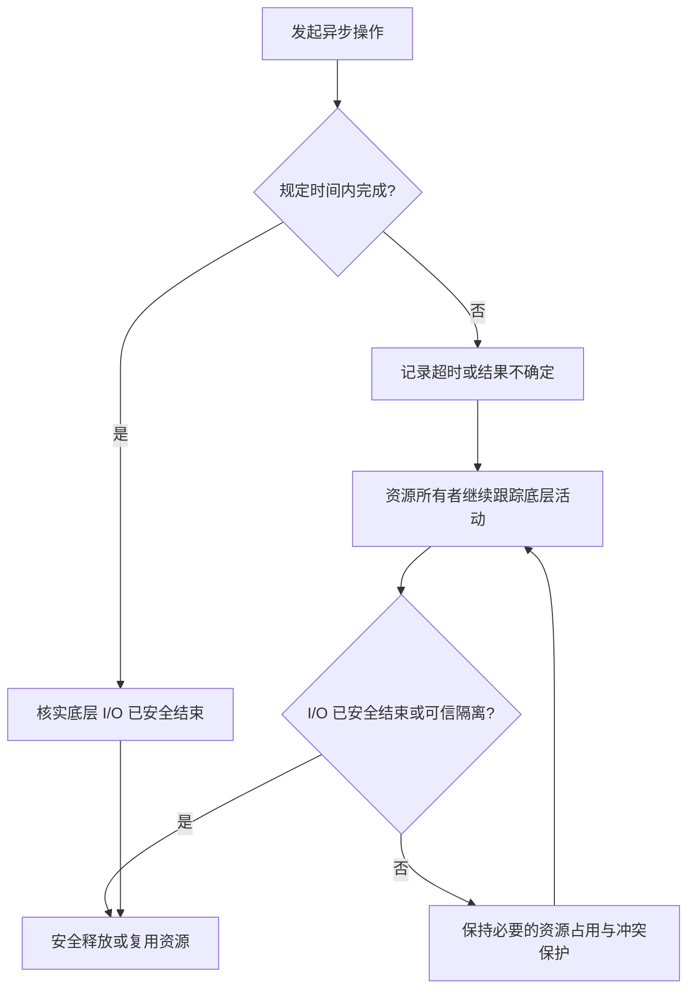

<p class="figure-caption">图 2-1 异步操作超时与资源安全释放流程</p>

对异步操作应区分超时、取消、异常和正常结束；不能仅凭调用方返回、Future/Task 取消或连接状态判断底层 I/O 已安全结束。

### 2.1.5 性能与资源有界原则

性能设计围绕明确的负载与质量要求展开，而不是无依据地增加并发或缓存。

<p class="table-caption">表 2-5 性能与资源有界设计要求</p>

| 设计要求 | 具体规定 |
|---|---|
| 负载模型 | 明确请求规模、并发规模、数据量及运行条件 |
| 容量约束 | 队列、线程、Task、连接、缓存及存储资源应有合理边界 |
| 背压 | 资源不足时明确等待、拒绝、丢弃或降级策略及适用条件 |
| 缓存 | 明确缓存用途、权威数据来源、失效与容量策略 |
| 性能指标 | 明确时延、吞吐、资源占用及测量口径 |
| 性能取舍 | 不得以违反正确性、安全性和可靠性约束换取性能 |

### 2.1.6 故障可控与恢复原则

设计应覆盖正常运行及合理预期的异常场景，明确故障影响范围和恢复条件。

<p class="table-caption">表 2-6 故障与恢复设计要求</p>

| 设计要求 | 具体规定 |
|---|---|
| 故障识别 | 明确可能的超时、通信失败、存储失败、任务异常和进程崩溃 |
| 故障隔离 | 限制故障传播，避免无关组件或资源被错误影响 |
| 状态可信 | 不将未知状态解释为确定成功或失败 |
| 重试与恢复 | 明确允许重试的条件，禁止可能产生危险副作用的盲目重试 |
| 持久化恢复 | 规定异常中断后的数据一致性及状态恢复规则 |
| 生命周期 | 明确启动、就绪、运行、关闭和重启期间的异常处理 |
| 失效行为 | 无法恢复时应有明确的降级、阻塞或停止服务条件 |

### 2.1.7 横切能力非侵入式原则

日志、审计、指标、追踪、权限校验等横切能力应与核心业务逻辑分离，优先通过统一的边界组件、装饰器、中间件或独立服务实现，不应将重复的技术处理流程散布在业务代码中。非侵入式不等于隐藏业务约束：凡影响业务准入、执行结果、事务一致性或故障处理的规则，必须在业务契约中明确，并保留必要的显式调用点。

<p class="table-caption">表 2-7 横切能力非侵入式设计要求</p>

| 设计要求 | 具体规定 |
|---|---|
| 职责分离 | 业务组件负责业务规则与状态转换；横切组件负责统一的记录、采集、校验与传输机制 |
| 边界统一 | 在服务入口、应用服务边界、消息发布边界等明确位置接入横切能力，避免各业务分支重复编排 |
| 最小侵入 | 不为记录日志、采集指标或传播追踪上下文而改变业务方法的核心控制流程和返回语义 |
| 审计正确性 | 审计事件的业务含义及产生时机由业务契约定义；持久化、投递、重试等通用机制与业务处理解耦，同时保证要求的一致性 |
| 故障影响 | 明确横切能力故障时的阻断、降级或重试规则；不得默认其失败不会影响业务，也不得默默吞掉必须处理的错误 |
| 可读性与验证 | 业务代码能够直接体现主流程；横切处理可独立测试，端到端测试验证其与业务契约一致 |

不为追求形式上的非侵入而引入复杂框架或过多抽象；简单、清晰的显式边界优先于难以追踪的隐式执行机制。

### 2.1.8 公共能力复用与冗余控制原则

优先使用符合需求的标准库、成熟软件包、现有工具及公共组件；相同且稳定的职责才提炼为公共能力，不重复发明、不为假设性扩展提前设计框架。

<p class="table-caption">表 2-8 公共能力复用与冗余控制要求</p>

| 设计要求 | 具体规定 |
|---|---|
| 复用优先 | 先评估现成组件是否满足功能、安全、性能及维护要求，再决定是否自行实现。 |
| 提炼公共职责 | 多模块存在稳定相同的职责时统一实现；业务规则留在所属业务模块。 |
| 控制依赖 | 核查成熟度、许可证、版本、安全维护及引入成本。 |
| 控制抽象 | 避免仅为减少少量重复而引入复杂框架或多层转发。 |
| 清理冗余 | 统一能力落地后删除重复、废弃和不必要的兼容实现。 |

### 2.1.9 图表表达与设计一致性原则

设计优先使用合适的图形和表格表达结构、流程、时序、状态及约束，图表不能代替必要的精确定义。

<p class="table-caption">表 2-9 图表表达与一致性设计要求</p>

| 设计要求 | 具体规定 |
|---|---|
| 视图完整 | 使用 4+1 架构视图组织系统设计，覆盖适用内容 |
| 图形选择 | 根据表达目的选择结构图、状态图、时序图、活动图等 |
| 图表一致 | 图形、表格和正文不得相互矛盾 |
| 跨章节一致 | 同一接口、状态、参数及资源规则保持一致 |
| 设计深度 | 明确影响系统行为的契约，允许自主选择内部实现细节 |
| 可验证性 | 关键设计要求应能够对应测试条件与验收证据 |

### 2.1.10 软件设计工作流程

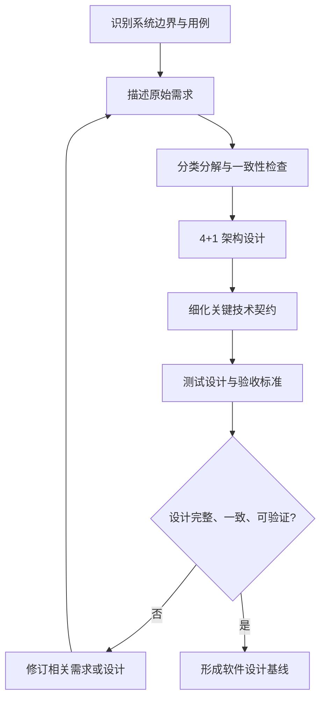

<p class="figure-caption">图 2-2 软件设计编制流程</p>

工作流程允许迭代，不要求传统瀑布式阶段。发现缺口或冲突时直接修订相关需求、架构视图或契约，不通过追加覆盖性条款解决。

### 2.1.11 规范性参考文献及项目无关性

本章为跨项目通用设计与编制规范，不得写入具体仓库、服务、业务协议、接口文件路径或项目专有指标。设计正文引用具体项目的源码、配置和协议文件时，应放在相关业务章节或接口/数据契约章节。

- **《符号体系.md》**：数学量类型、变量命名、标量/矢量/矩阵/张量、下标和公式运算的规范性依据。统计业务中的普通标量同样遵守其标量与阵列的区分原则。
- **《软件系统建模图形与表达规范.md》**：业务流程、DFD、活动/状态/时序图、算法图、伪代码和图元语义的规范性依据。

规范性引用以文件标题和相应章节为准，不复制全文；引用之间存在冲突时先识别并修订冲突，不擅自切换符号或重新解释图元。任何设计实例的具体接口名称、消息字段和技术约束均在第三章及后续适当章节给出。

## 2.2 需求体系及描述规范

需求采用“识别用例 → 逐条描述原始需求 → 分类分解 → 总分一致性检查”的方法。用例应从外部使用者及运行场景出发，覆盖适用的部署、启动、正常使用、配置、运维、正常关闭、重启及异常恢复过程；不局限于业务 RPC，也不将内部技术机制机械列为用例。用例识别属于需求分析，第 4 章用例视图负责表达参与者、边界及用例关系。

<p class="table-caption">表 2-10 原始需求描述字段</p>

| 字段 | 描述要求 |
|---|---|
| 编号 | 唯一原始需求标识，例如 `UR-01` |
| 名称 | 准确概括使用者需要的能力或运行场景 |
| 请求方（Requester） | 发起操作的外部系统、服务或接口，如外部客户端、上层服务、进程管理系统；消息和周期自动触发时可以没有直接请求方，标记“不适用” |
| 触发方式（Trigger） | 标明触发类型、事件来源、触发条件及必要的周期或接口；允许多个类型组合，区分外部触发和内部自动步骤 |
| 输入（Input） | 请求方向本系统提供的数据、参数和信息 |
| 反馈（Response） | 本系统返回请求方的确认、状态、结果及错误信息 |
| 目标方（Destination） | 接收本系统业务输出的外部系统、消息中间件或现场设备；没有时标记“不适用” |
| 业务输出（Output） | 本系统发往目标方的数据、消息或控制指令；没有时标记“不适用” |
| 业务流程（Flow） | 用 Mermaid 表达主要控制流程、数据输入/输出及重要异常，已表达的动作不重复 |
| 业务规则（Business Rules） | 补充主流程未精确定义的术语、公式、算法、初始化、阈值和边界；允许文字分条、LaTeX、图、伪代码或表格，不重复业务流程 |
| 关键约束（Constraints） | 性能、可靠性、安全、审计、可观测性、错误信息、缓存、I/O 与背压等可验证的非功能要求 |

反馈与业务输出必须分开：反馈面向请求方，业务输出面向目标方；请求方与目标方可有多个，且请求方断连不必然撤销已接受的业务操作。

### 2.2.1 触发方式分类与标注规则

原始需求必须列出实际适用的触发方式；同一需求可以组合多种触发方式，不能把处理流程中的普通步骤误写成独立触发。触发方式描述“何时、由什么启动”，不预先决定线程、定时器或队列等内部实现。

- **消息触发（Message）**：外部消息到达，例如实时消息或可靠消息；标明消息来源与订阅范围。
- **周期触发（Periodic）**：达到配置周期，例如实时周期输出或变化加周期保底；标明周期来源及生效条件。
- **API 触发（API）**：收到明确的外部接口请求，例如任务启动或配置应用接口；标明接口和调用方。
- **状态触发（State）**：受监控对象的状态发生满足条件的变化，例如外部依赖从不可用恢复可用；标明状态条件，不把普通循环迭代误列为触发。
- **生命周期触发（Lifecycle）**：服务进入启动、关闭、重启或配置生效等阶段；标明阶段及必要前置条件。

周期触发与消息触发可以同时存在：消息到达更新数据，周期到达决定何时输出。若无外部直接请求方，Requester 写“不适用（自动触发）”，但仍须列出消息生产者或状态来源；触发方式不替代 Input、Response 与 Output 的定义。

### 2.2.2 原始需求四节结构与写作原则

各 UR 固定为四节：**基本信息与触发方式、业务流程、业务规则、关键约束**。根据语义选择最清晰的表达形式；文字、公式、图形、伪代码和表格地位平等；**业务流程图已清楚表达的处理不得在后两节复述**。规则和约束必须有唯一规范定义，其他章节仅引用。

1. **基本信息与触发方式**：表格列出 Requester、Trigger、Input、Response、Destination、Output。Trigger 采用第 2.2.1 节分类，明确事件来源、触发条件及周期或 API。
2. **业务流程**：Mermaid Flowchart 或适用的 UML 活动图表达触发入口、主要处理、判断、数据输入输出、重要异常及恢复出口；复杂算法通过“预定义过程”节点指向第三节，不在总流程中堆叠实现细节。
3. **业务规则**：仅描述流程图无法精确表达的算法、公式、阈值、初始化、状态不变量、顺序及边界。允许文字分条定义、算法流程图、DFG、LaTeX 公式、表格或明确标为 `text` 的伪代码；必须说明输入、输出、初始值、边界及终止条件。无额外内容时标注“无额外规则”。
4. **关键约束**：**优先给出定量要求**（带单位、作用范围、测量窗口、默认值或硬上限、验收方法）；不能合理量化的才采用具有明确判定条件的定性要求。**仅放可核验的非功能要求**，按性能与容量、可靠性与恢复、安全与授权、审计、可观测性、错误信息、缓存与有效期、I/O 资源安全、背压与过载分类；无关分类可以省略或说明不适用。约束应给出故障条件、正确结果、测量或验收口径，不得用抽象口号代替。

### 2.2.3 业务图形元素与数据语义

参照《软件系统建模图形与表达规范.md》第 5.1 节 Flowchart、第 7.1 节 DFD 与第 8.1 节算法规范。业务活动图的控制流箭头表示处理顺序，DFD 箭头表示数据流，**两者不得混用**。图中应以不同形状区分处理、判断和数据。

| 元素 | Mermaid 写法 | 语义 |
|---|---|---|
| 开始/结束 | `A([开始/结束])` | 明确入口和完成/失败出口 |
| 处理 Process | `B["更新缓存"]` | 矩形，表达动作而非数据 |
| 判断 Decision | `C{"已过期?"}` | 菱形，分支标明条件 |
| 输入/输出 Data | `D[/"采样消息"/]` | 平行四边形，表达数据输入/输出 |
| 预定义子过程 | `E[["计算统计指标"]]` | 双边矩形，引用业务规则的算法说明 |
| 数据存储 | `F[("最新值缓存")]` | 存储节点；仅在理解读写关系必要时出现 |

不因形式要求增加无意义数据节点。数据来源、存储及复杂数据变换应单独绘制 DFD，避免业务活动图变成混杂的控制/数据流图。Mermaid 第一行初始化配置、图编号和图题仍须符合第一章。

### 2.2.4 业务规则、输出定义与关键约束的具体要求

- **业务规则**：定义与边界条件优先文字分条；涉及数学关系必须使用 LaTeX 独立公式；复杂步骤按需使用 Flowchart/DFG 或伪代码补充。表达形式不限于图和表；精确定义阈值、边界、初始化、更新基准和不可变条件，不复述主流程动作。算法必须能够独立据输入判断预期输出。
- **性能与容量**：优先用定量指标给出负载范围、时延/吞吐口径、并发及资源上限；必须区分设计目标、默认配置、不可突破的资源上限和验收实测值；未确定的阈值不得虚构。
- **可靠性及 I/O**：明确超时、结果不确定、重试、恢复、安全收敛及资源释放条件。调用返回或 Task 取消不代表底层 I/O 已结束。
- **错误信息**：定义错误类别、错误码或结果、对象与关联标识、发生阶段、可检索证据及敏感信息脱敏；禁止把 UNKNOWN 伪装为成功或明确失败。
- **缓存与背压**：规定缓存键、容量、更新/覆盖、过期、丢弃、等待、拒绝、暂停消费及恢复条件；所有超限策略必须可观测。
- **安全与审计**：列出认证、授权、控制边界以及需审计的操作、事件产生时机、关联 ID、可信保存与失败处理；运行日志不能代替审计。
- **可观测性**：指标、统计窗口、状态、事件、更新时间、无数据语义及告警；可结合真实场景验收。

**指标、计算和输出契约完整性（强制）：**凡使用“计算、统计、比较、阈值、状态、错误、容量、返回结果”等词定义业务能力，必须形成封闭的输出集合；不得用“等”“包括但不限于”替代本版本必须实现的清单。每个指标/派生字段至少定义以下内容；其中数学计算不得仅写在表格单元格内，必须另列可渲染的 LaTeX 公式：

| 必填字段 | 内容 |
|---|---|
| 唯一标识、类型和单位 | 与公开接口字段或指标名一致；明示 `counter/gauge/histogram`、计量单位 |
| 统计层级和数据来源 | 系统 / 进程 / 组件 / 任务 / 消费者；事件记录点、分子和分母来源 |
| 计算公式与口径 | 累计/窗口/瞬时，窗口端点、去重规则、事件计数次数、百分位算法 |
| 触发、初始化和重置 | 何时采集/计算、初始值、首个周期、进程重启、配置热更新 |
| 边界与缺失 | 零分母、空样本、UNKNOWN、超时、重复投递、源不可达的值域与 `unavailable` 语义 |
| 输出与验收 | 指标名、采样时间、窗口、可用性表达、配置边界及给定数据可独立验算的实例 |

**示例与可复算性（强制）：**当业务规则涉及多种计数口径、状态转换、时间窗口、边界分支或重试等易混淆情形时，至少给出一个具体输入—处理过程—预期输出的完整算例。算例必须标明初始条件、计量单位、每一步事件及最终结果；若同时存在样本条数、批次数、I/O 尝试次数等不同统计单位，须分别列出，禁止混用。算例应覆盖易误解的边界（例如重试成功仍有失败尝试记录），且结果必须可直接转化为确定性测试断言。算例是对定义的验证，不得取代规范性定义，也不应重复流程图中的全部步骤；涉及计算关系仍按第一章使用 LaTeX。

**数学定义与表达门禁：**业务规则的文字定义应独立成段或分条；涉及计算时，必须在定义后给出独立 LaTeX 公式，逐一释义变量、单位、取值域以及零分母、空样本和无效值。算法图与伪代码是可选的精度增强手段，不得要求所有业务规则使用表格。公式与中文混排遵守第一章 §1.3.1。

**约束定量优先门禁（强制）：**关键约束首先给出数值、单位、统计范围、采样方法、允许误差、测试条件和通过标准；可配置阈值应列出默认值及合法范围。仅当约束本质上无法定量（例如禁止错误 ACK）时，才用可判定的定性约束。不得用“及时、足够、合理、有界、尽可能、低延迟、高可靠”等词代替具体要求；未完成基准测试的数值应标明“设计验收目标，尚未实测”，不得声称达标。

**完备性门禁：**业务规则涉及的状态枚举、错误分类/错误信息字段、缓存容量及淘汰策略、I/O 结果、背压策略、审计与统计输出均应列举封闭集合和边界输入；凡无法根据文档构造确定预期结果的要求，视为需求未完成，不得标记为可编码。参数可以配置，但必须说明合法范围、默认/缺省行为及越界错误；性能数值未经验证时不得伪称已达标。每项约束必须可追溯至可执行的 UC/System 场景。

每项业务规则和关键约束须能由 UC/场景及第 14 章测试追溯；第 5～13 章详述实现契约时应引用 UR，不得另造冲突定义。

统一样式：

```text
### 3.x UR-xx 需求名称
#### 3.x.1 基本信息与触发方式
Requester / Trigger / Input / Response / Destination / Output
#### 3.x.2 业务流程
Mermaid 活动流程图，含重要异常及数据输入输出
#### 3.x.3 业务规则
可用文字、LaTeX、伪代码、图或表格精确定义算法、初始化与边界，不重复流程
#### 3.x.4 关键约束
按性能、可靠性、安全、审计、可观测性、错误、缓存、I/O、背压列可验证要求
```

本节也是第三章及后续章节的强制完整性验收标准。

<p class="table-caption">表 2-11 分类需求体系与描述重点</p>

| 类别 | 核心问题 | 典型要求 |
|---|---|---|
| 功能需求（Functionality） | 系统提供什么行为 | 对外能力、业务流程、业务规则、输入输出与状态反馈 |
| 性能需求（Performance） | 运行速度与资源上限 | 时延、吞吐、并发、调度、公平性、容量、背压、资源消耗、扩展能力 |
| 可靠性需求（Reliability） | 故障时如何保持正确与恢复 | 容错、超时、重试、请求关联、事务、持久化、故障恢复、可用性、未结束操作的资源管理 |
| 安全需求（Safety & Security） | 如何防止危险或非法控制 | 控制权、互锁、失效安全、认证、授权、通信及数据安全 |
| 横切能力（Cross-cutting Concerns） | 如何观测、管理与追责 | 审计（操作证据、可靠投递、完整性、追溯）、日志、指标、追踪、配置、版本、可测试性、可维护性 |

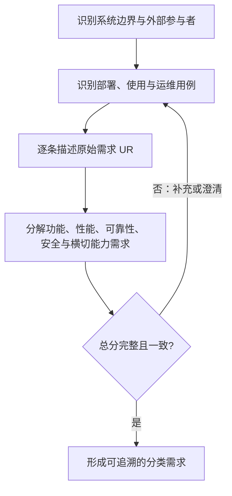

<p class="figure-caption">图 2-3 需求识别、分解与一致性检查流程</p>

分类需求必须从原始需求的输入、反馈、业务输出、规则和约束中推导，不得遗漏、矛盾或未经确认增加能力；多条原始需求的共同约束可以合并，但必须保留来源编号。每条分类需求应给出可核验条件，性能要求还需明确测量口径，不虚构现场阈值。审计应独立于普通日志定义，不得以运行日志代替审计证据。

需求分类与设计专题是不同维度：启动、正常关闭、重启及 Reload 属于跨需求的运行生命周期设计，统一在进程视图展开；相应行为和质量约束分别由原始需求及分类需求追溯。

## 2.3 4+1 架构视图：内涵、外延与表达规范

<p class="table-caption">表 2-12 4+1 架构视图的职责与成果</p>

| 视图 | 关注范围 | 主要成果 | 不应混淆 |
|---|---|---|---|
| 用例视图（+1） | 参与者、系统边界、典型/异常场景 | 系统上下文、用例、业务流程 | 不负责线程调度 |
| 逻辑视图（Logical） | 组件职责、模型、接口、状态规则、依赖 | 组件图、类/数据关系、状态图 | 不等于源码目录树 |
| 进程视图（Process） | 进程、线程、Event Loop、Task、协作、生命周期、同步、并发、资源、背压、缓存、故障恢复 | 运行结构图、任务所有权表、时序/状态/活动图、资源预算 | Task 不等于 OS 线程；图名须区分标准 UML 与示意图 |
| 开发视图（Development） | 软件模块边界、层次、静态依赖、公共契约与复用关系 | 模块图、依赖图、模块职责表 | 不描述真实并发拓扑，也不列现有代码修改清单 |
| 物理视图（Physical/Deployment） | 节点、进程部署、存储、网络、控制权和现场外部依赖 | 部署图、网络/故障域/外部依赖表 | 不是现场设备内部物理结构模型 |

### 2.3.1 用例视图的场景编写规范

用例以参与者的完整业务目标为单位组织，而非以原始需求、RPC 或内部模块为单位逐条改名。一项用例可以关联多项原始需求；一项原始需求也可以由多个业务场景共同覆盖。用例视图回答“在具体业务场景中系统如何工作”，不代替逻辑视图、进程视图和数据设计。

<p class="table-caption">表 2-13 业务场景用例的必备描述要素</p>

| 要素 | 编写规定 |
|---|---|
| 用例身份与目标 | 给出唯一编号、业务场景名称及参与者要达成的可观察目标；名称使用业务活动，不使用内部机制命名 |
| 参与者与触发条件 | 列明实际发起操作的外部角色；内部定时任务、恢复及发布等自动步骤不得虚构外部参与者 |
| 前置条件 | 列明系统就绪、授权、配置或数据存在等必要条件；不得混入未确认的实现假设 |
| 主业务流程 | 以 Mermaid 业务活动图（flowchart）为主要表达，覆盖触发、校验、关键处理、反馈及后置结果；以判断节点表达重要分支，避免大段编号文字复述 |
| 分支与异常流程 | 在活动图中呈现影响业务结果的主要异常出口；罕见或不宜展开的异常在简明说明表中概括，避免为了完整而画出所有技术异常 |
| 后置条件 | 明确成功和失败之后的业务状态、外部可见结果、未完成事项及后续查询方式 |
| 需求追溯 | 标明相关 UR；核对全部 UR 在真实场景中得到覆盖，但不要求 UR 与 UC 一一对应 |

跨用例共享的内部机制（如存储、审计发布和调度）应作为相关业务流程中的自动步骤或支撑行为描述；只有存在独立业务目标时才另立用例。应避免将一串 gRPC 方法名或 CRUD 操作直接当作完整用例，也不得在用例章节展开线程、锁、表结构及类方法等实现细节。

用例的正文采用“一张业务活动图 + 一张简明用例说明表”的表达形式。活动图包含主路径、必要判断以及重要异常分支；图中节点使用业务动作，不展开展示内部类、锁和数据库事务。说明表只填写参与者、业务目标、前置条件、主要异常、后置条件及关联需求。业务分支已在图中完整表达时，不再重复书写大段“主业务流程”和“异常流程”；复杂跨参与者消息时序可在独立小节补充时序图。图题和表题按文档约定独立编号。

进程视图应按四个设计专题组织，而不是按需求类别重复划分：

<p class="table-caption">表 2-14 进程视图的四类设计专题</p>

| 专题 | 必须明确的设计对象 | 推荐表达 |
|---|---|---|
| 运行时结构 | 进程、线程、Event Loop、Task、线程池、组件与资源所有权 | 分层运行结构图、Task 职责表 |
| 运行生命周期（Runtime Lifecycle） | 启动、初始化、就绪、运行、Reload、正常关闭、重启及其阶段转换 | 生命周期状态图、启动/关闭/Reload 时序图 |
| 并发与资源管理 | Task 协作、队列、通知、同步、调度、容量限额、背压、缓存及释放 | 任务协作时序图、资源与背压策略表 |
| 异常与恢复 | 超时、取消、故障隔离、未收敛 I/O、崩溃恢复与降级 | 故障状态图、异常裁决矩阵 |

各专题共享同一运行模型，明确创建者、所有者、同步关系和退出条件；不因分节而重复定义状态或资源。生命周期是进程视图的独立设计专题，不是第六类需求。

图表仅使用其可准确表达的语义：结构关系用 Mermaid Flowchart；行为交互用 Sequence Diagram；状态约束用 State Diagram；条件控制用活动/流程图。图题说明对象、范围及图类型。关键质量属性贯穿各视图，不能只写在单独的“非功能要求”段落。

## 2.4 测试设计方法、组织及验收规范

测试设计以测试层级组织物理目录，以 Marker 描述测试层级、测试专题与运行场景。测试文件名应清楚表达验证对象或行为；测试文件及其标记、验证说明统一登记在测试矩阵中。需求、用例及重要技术契约必须能追溯到实际测试，不为同一目的建立重复测试体系。

<p class="table-caption">表 2-15 测试层级与目录规范</p>

| 层级 Marker | 物理目录 | 验证范围 |
|---|---|---|
| `unit` | `unit/` | 状态转换、业务规则、纯逻辑，无外部服务依赖 |
| `component` | `component/` | 单组件职责及其可控依赖 |
| `integration` | `integration/` | 组件之间及真实外部依赖的接口协作 |
| `system` | `system/` | 独立进程、完整业务场景及端到端行为 |

<p class="table-caption">表 2-16 测试 Marker 与矩阵编制规范</p>

| 事项 | 规范 |
|---|---|
| 层级 Marker | 每项测试必须且仅属于 `unit`、`component`、`integration`、`system` 之一，与目录对应 |
| 专题 Marker | 标识可靠性、安全、性能等验证主题，可与层级及场景 Marker 叠加；无专项主题时可为空 |
| 场景 Marker | 标识并发、超时、恢复、负载、现场等执行条件或情境；有相应场景时标记 |
| 测试矩阵 | 至少包含“测试文件名、层级 Marker、专题 Marker、场景 Marker、测试说明”五列；每项重要测试应有可定位的文件归属 |
| 标记粒度 | 标记以具体测试函数或类为准；同文件可包含不同专题与场景，矩阵列出涉及的 Marker |
| 运行条件 | 通过 Fixture 和环境准备明确外部依赖；现场专用测试与常规回归分离，未执行不视为通过 |
| 执行规则 | 提供按目录、Marker 及其布尔组合的 pytest 命令；所有 Marker 在项目配置中注册 |
| 可追溯性 | 测试说明与需求、用例或技术契约对应；行为变更时同步检查测试及矩阵 |
| 验收证据 | 保留运行环境、命令、实际结果、指标和未验证项，禁止把设计目标当作测试结果 |

目录划分测试层级，专题与场景通过 Marker 横向组合；可靠性测试不单独设第五类目录。测试矩阵用于定位和筛选测试，不预设每个实现文件必须存在，也不要求每个文件仅能有一种测试场景。

### 2.4.1 测试依据及 System 覆盖要求

各层级测试必须依据已确认的设计成果编制；System Test 以用例视图为主基线，以原始需求及技术契约补充覆盖，不得由测试人员凭经验任意缩减范围。

<p class="table-caption">表 2-17 各测试层级的设计依据</p>

| 测试层级 | 主要依据 | 验证重点 |
|---|---|---|
| Unit | 详细设计、函数及算法契约 | 纯逻辑、状态转换、参数及边界规则 |
| Component | 逻辑视图、组件职责及内部接口契约 | 单组件行为、依赖协作及异常处理 |
| Integration | 接口与通信契约、开发视图、物理视图 | 真实接口调用、跨组件通信及外部依赖 |
| **System** | **用例视图（UC）及原始需求（UR）**，并补充接口、运行、部署、安全及性能约束 | **从真实受测服务进程及其通信入口验证业务目标、异常、边界与恢复行为** |

System Test 必须遵守以下规定：

1. **用例覆盖率 100%**：每项 UC 至少有一项 System Test 作为验证证据；同一测试可以覆盖多个 UC，同一 UC 可以由多个测试覆盖，**不按测试数量与 UC 数量的大小关系判定覆盖**。
2. **规定场景覆盖率 100%**：每项 UC 明确的主流程、关键分支、异常流程、边界和恢复场景均必须有对应 System Test；不能仅以一条正常路径代表整个 UC 已覆盖。
3. **需求覆盖率 100%**：每项 UR 必须能够经一个或多个 UC 追溯至 System Test；若某项需求未能被 UC 覆盖，必须先补全用例，不得直接以技术测试代替业务用例。
4. **技术约束补充覆盖**：用例未充分表达的性能、容量、并发、安全、权限、超时和可靠性要求，依据对应技术契约补充测试；不得因 UC 未逐项列出而豁免。
5. **真实系统边界**：System Test 通过真实受测服务进程和适用的外部依赖、通信链路执行；Mock 不得代替本次明确纳入验收范围的基础设施及通信链路。
6. **覆盖与通过分开裁定**：测试已关联不等于已执行；失败、跳过及未运行均不得计为通过。验收报告分别给出需求覆盖、用例及场景覆盖、执行情况和通过情况；缺少真实环境时标记 `NOT_RUN`，不得用模拟结果替代。
7. **变更同步**：任何 UR、UC、接口或行为约束的新增、删除、调整，必须同步核查 System Test、测试矩阵和验收条款；新增 UC 不得留下无测试映射。

<p class="table-caption">表 2-18 System Test 追溯矩阵规范</p>

| 字段 | 要求 |
|---|---|
| UR 编号 | 被验证的原始需求编号，可列多个 |
| UC 编号与场景 | 用例编号及主流程、异常、边界或恢复场景标识 |
| 技术契约 | 相关接口、配置、运行或安全约束的章节编号；没有则记“—” |
| 测试文件名／测试标识 | 可定位的 System Test 文件名及测试函数或参数化场景标识 |
| 层级／专题／场景 Marker | 层级固定为 `system`，其余按第 2.4 节定义填写 |
| 验证内容与预期结果 | 从用户可观察行为与副作用表述判定依据 |
| 执行环境及结果 | 真实依赖、执行证据、`PASS`／`FAIL`／`SKIP`／`NOT_RUN` 等状态 |

追溯链为 **UR → UC／用例场景 → System Test → 执行结果与证据**，技术契约作为补充依据进入相应测试。第 4 章负责编制完整 UC 和场景，第 14 章依据本规范给出实际测试矩阵及验收安排，两章必须双向核对。

# 3. 软件需求

本章按第 2.2 节规定，以“基本信息与触发方式 → 业务流程 → 业务规则 → 关键约束”描述八项原始需求。业务规则仅展开流程中的复杂算法、精确数据契约及边界，不复述图形；关键约束仅放非功能要求。第 4 章按用例组织场景，第 5～13 章落实实现契约。

## 3.1 业务需求总表

<p class="table-caption">表 3-1 Sink Service 业务需求总表</p>

| 编号 | 业务需求 | 业务目标 | 触发方式 |
|---|---|---|---|
| UR-01 | 实时数据派发 | 按策略输出最新且未过期的采样，原样保留质量标志 | 消息、周期、状态 |
| UR-02 | 历史数据派发 | 持久消费并至少一次交付历史采样，支持故障恢复 | 消息、状态 |
| UR-03 | Delivery 管理 | 独立启停和管理 Delivery 的期望/实际状态 | API、生命周期、状态 |
| UR-04 | 派发运行指标周期统计 | 初始化统计状态，记录基础数据并周期计算指标快照 | 生命周期、事件、周期 |
| UR-05 | 派发运行状态、指标与事件查询 | 查询当前状态、已计算指标和事件 | API |
| UR-06 | 数据派发配置管理 | Get/Push/Apply 完整快照并安全应用 | API、状态、生命周期 |
| UR-07 | 链路诊断（Diagnose） | 按阶段提供可核验证据而不破坏生产链路 | API |
| UR-08 | gRPC 服务端实现 | 实现已冻结的 9 公共 + 4 专属 Unary RPC | API、生命周期 |

首版 Sink Adapter 为 Redis Client、Modbus TCP Server、Kafka Producer；不包含 TDengine、gRPC Adapter、MQTT、IEC 104。两类消息依据 `contracts.sample_message.SampleMessage`，Realtime 经 NATS Core，Reliable 经 JetStream；不擅自改变来源消息的数据质量。

### 3.1.1 首版派发负载与验收基准

本版性能验收负载为：**同时运行不少于 20 个 Sink 实例，每个 Sink 按可配置触发方式（消息、周期或变化与周期保底）输出；周期型输出须支持 10 Hz、每批 500 个 `float32` 测点值。** 验收负载总计 200 批/s 和 100000 个数值/s，裸 `float32` 值载荷约 400000 B/s，不含消息封装与协议开销。该指标是**验收目标，尚未经实际压力测试证明**，不同 Adapter 以及端到端性能分别测试，不允许以单一 Redis 结果推定全部目标协议达标。若目标协议无法表达批处理，必须在验收报告中明确其映射的写入操作数和限制，而不隐含承诺网络单报文支持 500 点。

## 3.2 UR-01 实时数据派发

### 3.2.1 基本信息与触发方式

<p class="table-caption">表 3-2 UR-01 基本信息</p>

| 字段 | 内容 |
|---|---|
| 请求方（Requester） | NATS Core 消息生产者（Collector）；周期定时器非外部请求方 |
| 触发方式（Trigger） | 消息：实时样本到达；周期：按 Delivery 输出/保底周期；状态：目标恢复后重试未过期最新值 |
| 输入（Input） | SampleMessage、来源规则、有效期、Delivery 输出策略 |
| 反馈（Response） | 不逐条应答 Core 消息；通过状态、指标与事件查询派发结果 |
| 目标方（Destination） | 已绑定的 Redis、Modbus TCP Server 或 Kafka |
| 业务输出（Output） | 未过期的最新值及原始质量、时间、测点身份 |

### 3.2.2 业务流程

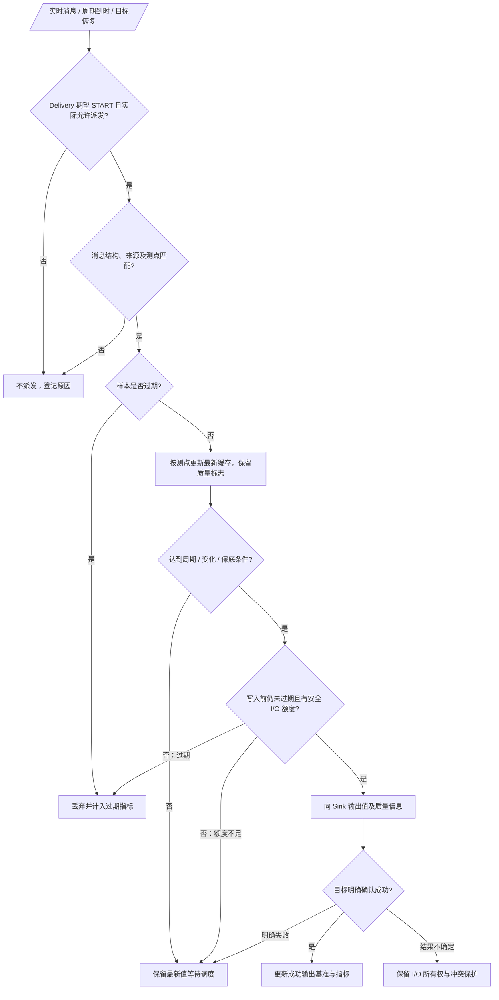

<p class="figure-caption">图 3-1 UR-01 实时数据派发业务活动图</p>

### 3.2.3 业务规则

**R01-01 时效算法。** `sample_time` 为具有时区的事件时间；实时有效期为 `sample_time + max_staleness_ms`，在缓存入列与写前按当前 UTC 时刻判定：`now >= deadline` 为过期；时钟偏差与未来时间拒绝阈值以配置契约为准，不得将无效时间解释为最新。

**R01-02 新旧比较。** 同 `delivery_id/device_id/point_id` 按 `sample_time`、稳定 `sample_id` 判定更新；较早样本不能覆盖较新样本；完全重复 `sample_id` 不产生新的业务版本。

**R01-03 变化判定。** 数值量以最近一次**明确成功**输出值为基准。设当前值为 $x$，基准值为 $x_0$，绝对阈值为 $a$，相对阈值为 $r$，启用的判定条件分别为：

$$
|x-x_0|\ge a
$$

$$
\frac{|x-x_0|}{|x_0|}\ge r,\qquad |x_0|>0
$$

两个条件中任意一个已启用且满足即判定变化。基准为零时不计算相对变化；首次无基准直接判定变化；非数值按值不等判定；质量标志改变必定视为变化。保底周期自最近一次**成功确认**起算；禁用的阈值不得以零阈值参与判断。

**R01-04 输出契约。** 质量 `good/bad/uncertain` 原样保留，质量不参与过期过滤；Redis/Kafka 输出包含测点身份、时间、值、质量、`sample_id`；Modbus Server 必须定义明确的质量关联寄存器或映射，否则相关 Delivery 配置校验失败。


### 3.2.4 关键约束

<p class="table-caption">表 3-26 UR-01 非功能约束</p>

| 约束类别 | 可验证要求 |
|---|---|
| 性能与容量 | 设计验收负载：至少 20 个并行 Sink，每个 10 Hz、每批 500 个 `float32`，合计至少 200 批/s、100000 值/s；不同协议分别测试，输出周期可配置，10 Hz 负载不得因内部定时分辨率被拒绝。该值为待实测目标。 |
| 缓存与背压 | Realtime 每 Delivery 按测点去重，默认最多 10000 个最新点（与配置第 11 章一致）；满载时拒绝新增键而不驱逐已有键；已存在键覆盖。所有丢弃或拒绝计数，内存不随持续输入无限增长。 |
| I/O 安全 | 每 Delivery 默认最多 1 个在途写入，UNKNOWN 未收敛持续占有额度；调度不重入。 |
| 可靠性与错误 | 目标拒绝、重试、UNKNOWN 分别报告；目标质量映射缺失时在配置阶段报错。 |
| 可观测性 | 每次派发结果关联 delivery_id、sink_id、sample_id 且不写入敏感凭据。 |

## 3.3 UR-02 历史数据派发

### 3.3.1 基本信息与触发方式

<p class="table-caption">表 3-4 UR-02 基本信息</p>

| 字段 | 内容 |
|---|---|
| 请求方（Requester） | JetStream durable Consumer（自动消息投递），没有人工请求方 |
| 触发方式（Trigger） | 消息：JetStream 投递；状态：目标恢复、Consumer 恢复、退避期限到达 |
| 输入（Input） | 持久化 SampleMessage、Delivery 来源条件、JetStream 元数据 |
| 反馈（Response） | ACK/NAK/InProgress 等确认行为；状态、指标及错误可查询 |
| 目标方（Destination） | 可靠目标 Sink；永久错误的 DLQ Stream |
| 业务输出（Output） | 历史原始样本；必要时输出带错误和源标识的死信 |

### 3.3.2 业务流程

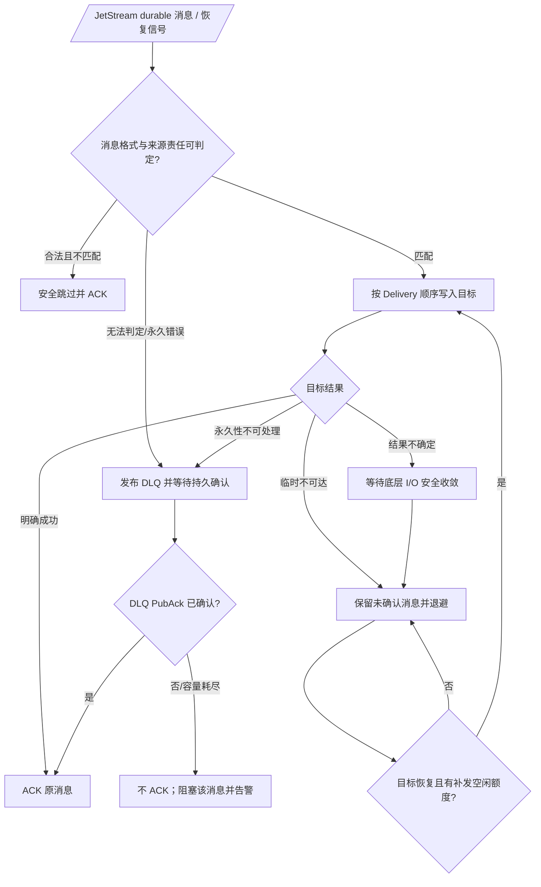

<p class="figure-caption">图 3-2 UR-02 历史数据派发业务活动图</p>

### 3.3.3 业务规则

**R02-01 结果分型。** `CONFIRMED`（目标确认，ACK 原消息）、`TRANSIENT`（保留原消息等待）、`PERMANENT`（持久化 DLQ 后 ACK）、`UNCERTAIN`（保持 I/O 所有权、冲突保护和未确认状态）；未知禁止归入明确失败或成功。

**R02-02 ACK 和死信。** 原始消息的 ACK 只能发生在目标明确成功或 DLQ 已获持久 PubAck 之后；DLQ 发布不明、容量耗尽、原始消息责任归属不明一律不 ACK。

**R02-03 补发与去重。** 以稳定 `sample_id` 保留业务关联；同 Delivery 的历史消息保持接收顺序、至少一次；重复投递可能重写目标，必须通过 Adapter 能力及下游契约说明幂等边界，不能把 Kafka 生产者幂等误称为跨系统恰好一次。

**R02-04 恢复调度。** 恢复积压只在目标空闲额度下限速运行，当前实时写入先占用可用额度；跨进程不能依靠进程内锁宣称实现同一目标的绝对优先权。


### 3.3.4 关键约束

<p class="table-caption">表 3-27 UR-02 非功能约束</p>

| 约束类别 | 可验证要求 |
|---|---|
| 可靠性 | 原消息在目标明确成功或 DLQ 获持久 PubAck 前 ACK 次数必须为 0；故障重试无限时仍受 Broker 保留容量和期限约束，不保证无限保存。 |
| 背压 | 每 Delivery 默认并发写入 1；历史补发不得使用被实时派发占用的目标额度；实际消费批次、ACK pending 和补发速率均不得突破第 11 章配置值，超限时暂停拉取而不是丢弃可靠数据。 |
| I/O | UNKNOWN 安全收敛之前释放底层操作所有权的次数必须为 0。 |
| 审计 | DLQ 记录源消息 ID、原因、发生时刻及可查位置，脱敏。 |

## 3.4 UR-03 Delivery 管理

### 3.4.1 基本信息与触发方式

<p class="table-caption">表 3-6 UR-03 基本信息</p>

| 字段 | 内容 |
|---|---|
| 请求方（Requester） | 授权 CLI、运维平台及自动化管理客户端 |
| 触发方式（Trigger） | API：StartDelivery/StopDelivery；生命周期：启动加载；状态：Watchdog 恢复 START |
| 输入（Input） | delivery_id、expected_revision、持久化期望状态 |
| 反馈（Response） | OperationResult 的受理、期望状态、实际状态、版本和错误 |
| 目标方（Destination） | 所属进程的 Delivery 与共享 Sink |
| 业务输出（Output） | 启动或停止该 Delivery 的派发行为 |

### 3.4.2 业务流程

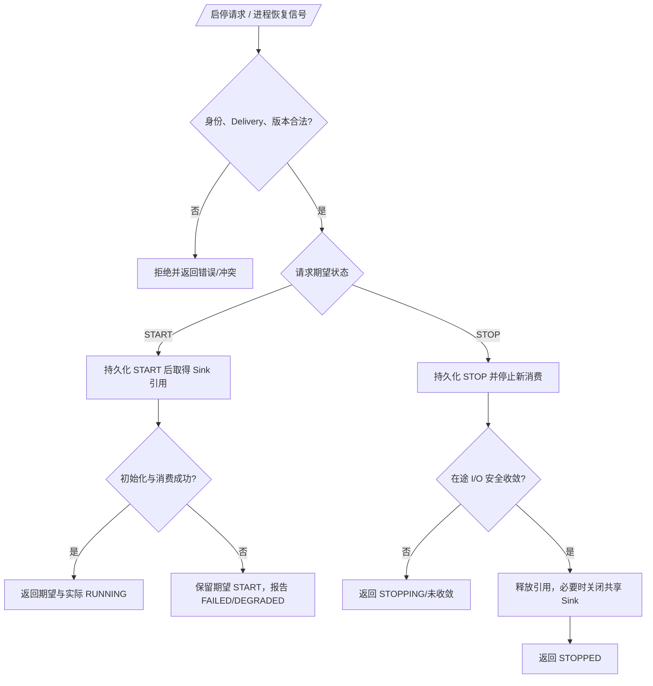

<p class="figure-caption">图 3-3 UR-03 Delivery 管理业务活动图</p>

### 3.4.3 业务规则

**R03-01 状态模型。** 区分持久 `desired_state`（START/STOP）与实际 `runtime_state`（初始化、运行、退化、停止中、停止、失败）；两者不得互相代替，Stop 只在安全收敛后返回实际 STOPPED。

**R03-02 共享资源所有权。** 共享 Sink 以稳定身份键管理引用；最后一个 Delivery 引用释放且 I/O 已安全收敛后才可关闭目标连接；正在进行的操作不能因上层取消失去所有权。


### 3.4.4 关键约束

<p class="table-caption">表 3-28 UR-03 非功能约束</p>

| 约束类别 | 可验证要求 |
|---|---|
| 可靠性 | 手动 STOP 后自动恢复次数必须为 0；持久化失败后启动次数必须为 0；同一 Delivery 状态写入并发数不得超过 1。 |
| I/O | 共享 Sink 引用数或未收敛 I/O 数大于 0 时，强制关闭次数为 0；每 Delivery 写入默认并发 1。 |
| 审计 | 记录可信调用方、操作目标、版本与结果。 |

## 3.5 UR-04 派发运行指标周期统计

### 3.5.1 基本信息与触发方式

<p class="table-caption">表 3-8 UR-04 基本信息</p>

| 字段 | 内容 |
|---|---|
| 请求方（Requester） | 不适用（自动触发）；启动阶段由服务进程生命周期驱动 |
| 触发方式（Trigger） | 生命周期：服务初始化或运行配置变更；状态：派发操作完成或运行状态变化；周期：`metrics_compute_interval_ms` 到期 |
| 输入（Input） | 统计配置、接收及交付计数、执行耗时、丢弃/重投/DLQ 记录、运行状态变化 |
| 反馈（Response） | 不适用；初始化失败以服务健康和事件暴露 |
| 目标方（Destination） | 本进程内存统计快照，供 `GetMetrics` 查询 |
| 业务输出（Output） | 带窗口、样本覆盖时长和计算时间的最新统计快照；异常事件按现有事件机制记录 |

### 3.5.2 业务流程

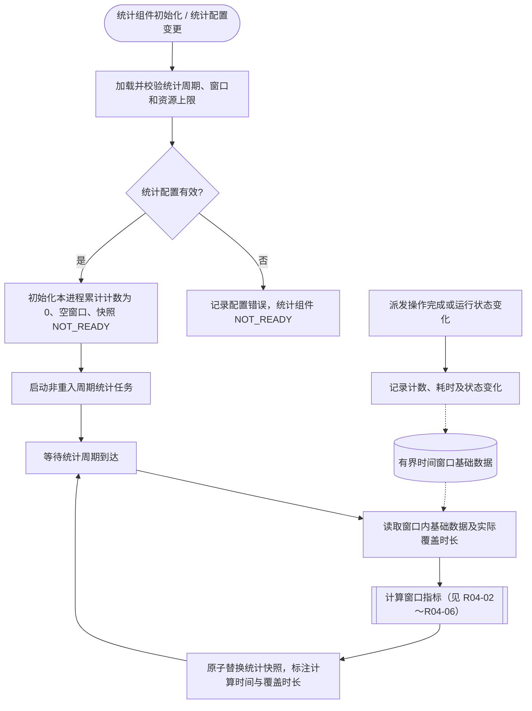

<p class="figure-caption">图 3-4 UR-04 指标初始化、基础记录和周期计算业务活动图</p>

### 3.5.3 业务规则

**R04-01 统计对象与计数时机。** 指标按 **Delivery** 独立累计；计数单位必须区分“样本条数”和“目标 I/O 尝试次数”。本版本五项累计计数定义如下。

<p class="table-caption">表 3-10b R04-01 累计计数器的唯一计数口径</p>

| 指标 | 计量对象 | 递增时机 | 重复投递、重试与边界 |
|---|---|---|---|
| `received_total` | 样本条 | 成功解码且交给本 Delivery 时 +1 | JetStream 再次投递并再次进入本 Delivery 时再次 +1 |
| `delivered_total` | 逻辑交付次（指标单位为条） | 一次交付执行取得目标明确成功确认时 +1 | 同一次执行中的重复确认不再计数；重新投递形成的新执行若成功可再次 +1 |
| `failed_total` | I/O 尝试次 | 目标 I/O 一次尝试**明确失败**时 +1 | 同一样本的首次失败和重试失败分别计数；未收敛的 UNKNOWN 不计数 |
| `dropped_total` | 样本条 | Realtime 样本因过期、最新值覆盖或缓存上限被最终放弃时 +1 | 每条被放弃的缓存样本只计一次；Reliable 待重投消息不算丢弃 |
| `dead_letter_total` | 样本条 | Reliable 消息成功持久化写入 DLQ 并取得确认时 +1 | DLQ 写入失败不计数，也不得 ACK 原消息 |

`bad`、`uncertain` 是样本质量标志，不是 I/O 失败或丢弃条件。以上累计值由业务操作即时更新；周期任务读取基础数据，计算窗口指标。**不同计量对象的计数器不能简单相加，也不要求守恒。**

**算例 R04-01-A：单个 Reliable Delivery 接收 100 条样本。** 假设统计初值均为 0，所有消息均首次交付到本 Delivery，其中：

1. 90 条首次 I/O 成功；
2. 5 条首次 I/O 明确失败，随后各重试一次并成功；
3. 3 条首次 I/O 明确失败，仍等待后续重投；
4. 2 条经业务校验判定为永久无效，未执行目标 I/O，已成功持久化进入 DLQ。

得到以下可直接验算的增量：

| 指标 | 算例结果 | 计算依据 |
|---|---:|---|
| `received_total` | 100 条 | 100 条首次进入 Delivery |
| `delivered_total` | 95 条 | 90 条首次成功 + 5 条重试成功 |
| `failed_total` | 8 次 | 5 次首次失败 + 3 次首次失败 |
| `dropped_total` | 0 条 | Reliable 不按实时丢弃机制处理 |
| `dead_letter_total` | 2 条 | 2 条获得 DLQ 持久化确认 |

此时还有 **3 条待重投**，但不能仅凭以上五个累计计数推断所有积压：其他时刻可能存在重复投递、多个在途 I/O 或外部消费者积压。若这 3 条随后重新投递，`received_total` 还会按实际再次接收计数。

**计量单位补充。** 一次批量输出包含 500 个 `float32` 数值，不等于 500 次目标 I/O；若该批由 500 条测点样本组成，则样本计数按 500 条，实际 I/O 尝试次数取决于 Adapter 的批量写入行为。指标 `failed_total` 仅计明确失败的目标 I/O 尝试，而非批内每个数值。

**R04-02 统计窗口、初始化及计算周期。** 设统计时刻为 $t$，纪元创建时刻为 $t_0$，配置的窗口长度为 $W$（秒），则有效窗口和覆盖时长定义为：

$$
\mathcal W(t)=(\max(t_0,t-W),t]
$$

$$
T(t)=\min(W,t-t_0)
$$

其中 $t$、$t_0$ 均由单调时钟换算为秒，$W>0$；事件按动作完成时间归入半开窗口。周期调度使用单调时钟，对外计算时间使用 UTC。

首次启动、进程重启或统计周期/窗口配置更改时，创建新统计纪元：累计计数清零、窗口为空、快照标记 `NOT_READY`。**第一个统计周期到达时即执行计算**，产生 `READY` 快照；未填满的窗口使用实际覆盖时长，不补造历史数据。定时任务不得重入，前次未完成时跳过本周期。

**R04-03 交付速率。** 令 $N_d(t)$ 为窗口 $\mathcal W(t)$ 内获得目标明确成功确认的逻辑交付次数。交付速率定义为：

$$
\lambda_d(t)=\frac{N_d(t)}{T(t)}
$$

单位为条/秒，对应 `delivered_rate_per_second`。当 $T(t)=0$ 时不可用；窗口内无交付但已有有效覆盖时长时取零。

**R04-04 写入成功率。** 令 $N_s(t)$、$N_f(t)$ 分别为窗口内目标 I/O 明确成功、明确失败的**尝试次数**；重试按实际尝试计入，不确定 I/O 在结果未明确前不计入任一项。定义：

$$
\eta(t)=\frac{N_s(t)}{N_s(t)+N_f(t)}
$$

`write_success_ratio` 为无量纲数，范围为 $[0,1]$；分母为零时不可用，不得返回零或百分之百。此项是**写入尝试成功率**，不是去重后的样本交付率。

**R04-05 写入耗时 P99。** 仅收集窗口内**得到明确成功确认**的目标 I/O 耗时（毫秒）。将 $n$ 个有效样本升序排列为 $d_{(1)},\ldots,d_{(n)}$，使用最近秩法：

$$
Q_{0.99}=d_{(\lceil 0.99n\rceil)},\qquad n>0
$$

对应 `write_latency_ms_p99`，单位毫秒；无有效样本时不可用。耗时从实际调用 Adapter I/O 开始，至目标可信成功确认结束，不包含队列等待。样本存储必须有界；若实施近似算法，必须在技术设计中明确误差上限并据此验收，不得静默改变最近秩语义。

**R04-06 瞬时水位和快照有效性。** `backlog_messages` 为统计时点可核实的当前 Reliable 待处理消息数；`io_inflight` 为当前尚未安全结束的目标 I/O 数，包括 UNKNOWN 未收敛 I/O。二者均为 Gauge，不作窗口求和；外部 Broker 不可达时，`backlog_messages` 为不可用，不得用零或旧值冒充。`metrics_snapshot_ready` 表示是否已完成首次周期计算；`metrics_covered_ms` 表示本次快照有效窗口覆盖毫秒数。快照替换须原子化，查询只读最近一次完整快照。

<p class="table-caption">表 3-10a UR-04 首版必选指标（12 项）</p>

| 指标名称 | 类型、单位 | 统计对象 | 定义位置 |
|---|---|---|---|
| `received_total` | Counter，条 | Delivery | R04-01 |
| `delivered_total` | Counter，条 | Delivery | R04-01 |
| `failed_total` | Counter，次 | Delivery | R04-01 |
| `dropped_total` | Counter，条 | Realtime Delivery | R04-01 |
| `dead_letter_total` | Counter，条 | Reliable Delivery | R04-01 |
| `delivered_rate_per_second` | Gauge，条/秒 | Delivery | R04-03 |
| `write_success_ratio` | Gauge，比例 | Delivery | R04-04 |
| `write_latency_ms_p99` | Gauge，毫秒 | Delivery | R04-05 |
| `backlog_messages` | Gauge，条 | Reliable Delivery | R04-06 |
| `io_inflight` | Gauge，个 | Delivery | R04-06 |
| `metrics_snapshot_ready` | Gauge，布尔 | Process | R04-02、R04-06 |
| `metrics_covered_ms` | Gauge，毫秒 | Process | R04-02、R04-06 |

计数器与水位可在运行时更新，但速率、成功率、P99 等**窗口指标只在周期计算后更新**。指标通过现有 `GetMetricsResponse.metrics[]` 表达，不增加 Proto 字段。对于不可用的数值指标，按契约省略该项并配套状态或事件说明，不得填零。

以上 12 项是首版规范性指标全集。队列年龄、重投速率、详细错误分类、多个分位数和组件内部性能指标可作为**可选诊断扩展**，不构成首版功能或 System Test 强制指标，也不能取代错误事件、日志和健康检查。

### 3.5.4 关键约束

<p class="table-caption">表 3-29 UR-04 非功能约束</p>

| 约束类别 | 可验证要求 |
|---|---|
| 性能 | 默认每 1000 ms 计算一次，默认统计窗口 60000 ms；支持配置周期 100～60000 ms、窗口 1000～3600000 ms（须满足窗口不小于周期）；周期计算并发上限 1，超期积压任务上限 0，超期跳过计数。以上为设计默认值及建议合法范围，须同步在第 11 章实施。 |
| 可靠性 | 首次统计前返回 `NOT_READY`，可用 P99 样本数为 0 时不输出 P99；统计任务异常不得清除上一已完成快照，必须同时标记陈旧时间。 |
| 错误 | Broker 不可用的 Gauge 只能标缺失，不能报零。 |
| 可观测性 | 每一指标附计算时间、作用域、单位及窗口；不得以 sample_id 为标签形成高基数。 |

## 3.6 UR-05 派发运行状态、指标与事件查询

### 3.6.1 基本信息与触发方式

<p class="table-caption">表 3-10 UR-05 基本信息</p>

| 字段 | 内容 |
|---|---|
| 请求方（Requester） | 授权运维管理及监控客户端 |
| 触发方式（Trigger） | API：`GetServiceInfo`、`GetServiceStatus`、`GetCapabilities`、`GetMetrics`、`GetEvents`、`ListDeliveries`、`GetDelivery` |
| 输入（Input） | 作用域、对象 ID、窗口、筛选和分页参数 |
| 反馈（Response） | 服务身份与健康、Delivery 配置及状态、最新已计算指标、事件或明确错误 |
| 目标方（Destination） | 不适用 |
| 业务输出（Output） | 不适用（只读查询） |

### 3.6.2 业务流程

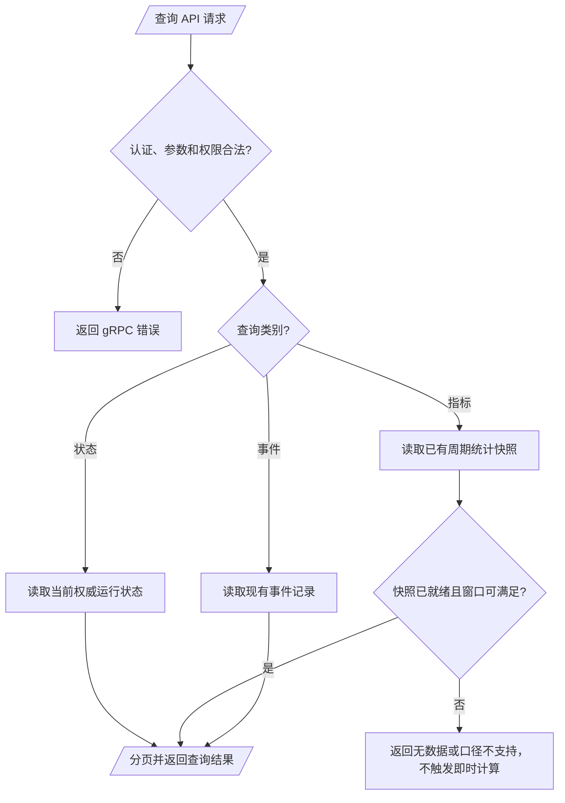

<p class="figure-caption">图 3-5 UR-05 运行状态、指标与事件查询业务活动图</p>

### 3.6.3 业务规则

**R05-01 查询语义。** `GetMetrics` 仅返回已计算快照及已支持的 `window_ms`；未知窗口必须明确报告不支持，不临时重新计算；首次计算前的 NOT_READY 与值为 0 不同。

**R05-02 分页与状态。** 状态、指标及事件分别按其权威来源读取；分页游标和对象作用域必须保持稳定语义，不把部分失败掩盖为全量成功。


### 3.6.4 关键约束

<p class="table-caption">表 3-30 UR-05 非功能约束</p>

| 约束类别 | 可验证要求 |
|---|---|
| 性能与容量 | 设计验收目标：单次最多 500 条事件，查询返回体上限 2 MiB，局部服务查询 P99 不高于 200 ms（每秒 20 并发请求，20 Sink 运行条件）；超限返回明确参数错误；验收目标尚未实测。 |
| 安全 | 认证和对象级授权；查询不执行脱敏处理，返回字段依正式查询契约和权限决定。未经授权的查询不得返回业务内容。 |
| 错误 | 缺少数据、不支持窗口、对象不存在、来源不可达须可区分；不可触发目标新连接。 |
| 审计 | 记录运维查询中需留证的敏感操作。 |

## 3.7 UR-06 数据派发配置管理

### 3.7.1 基本信息与触发方式

<p class="table-caption">表 3-12 UR-06 基本信息</p>

| 字段 | 内容 |
|---|---|
| 请求方（Requester） | 授权配置管理客户端；双进程仅静态 Writer 受理写操作 |
| 触发方式（Trigger） | API：GetConfigSnapshot/PushConfigSnapshot/ApplyConfigSnapshot；状态：Reader 收敛；生命周期：重启加载 |
| 输入（Input） | SnapshotScope、完整文件集、candidate_id、expected_revision |
| 反馈（Response） | 快照及候选校验、文件提交、逐对象应用结果、effective_revision、restart_required |
| 目标方（Destination） | 共享正式配置目录、Realtime/可靠进程 |
| 业务输出（Output） | 正式文件提交及受影响 Delivery/Sink 的运行配置变更 |

### 3.7.2 业务流程

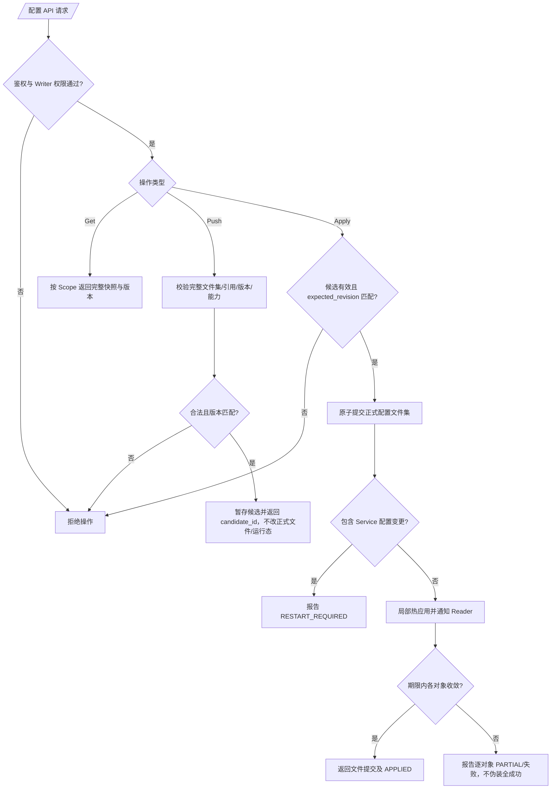

<p class="figure-caption">图 3-6 UR-06 数据派发配置管理业务活动图</p>

### 3.7.3 业务规则

**R06-01 版本提交。** Push 返回仅可供 Apply 使用的候选 ID；Apply 只有在 revision 匹配时才提交完整正式文件集；磁盘提交成功与运行对象热生效成功是两个独立结果。

**R06-02 配置分类。** Service 配置修改需重启；Template 版本不可变；Instance 通过版本化引用热更新；服务文件、模板文件及实例文件不能混为一类。


### 3.7.4 关键约束

<p class="table-caption">表 3-31 UR-06 非功能约束</p>

| 约束类别 | 可验证要求 |
|---|---|
| 可靠性 | 同一配置源同时生效的 Writer 数量上限 1；正式文件集必须全部提交或全部不提交；部分热生效时不得返回全成功。 |
| 安全 | 路径校验、权限、秘密数据保护；审计：Push/Apply 的身份、候选 ID、版本、结果和失败原因。 |
| I/O | 不强制取消旧版本未结束写入。 |

## 3.8 UR-07 链路诊断（Diagnose）

### 3.8.1 基本信息与触发方式

<p class="table-caption">表 3-14 UR-07 基本信息</p>

| 字段 | 内容 |
|---|---|
| 请求方（Requester） | 授权 CLI、运维平台或诊断客户端 |
| 触发方式（Trigger） | API：Diagnose |
| 输入（Input） | target_id、stages、timeout_ms、correlation_id |
| 反馈（Response） | overall_status、分阶段状态/耗时/证据/错误、limitations |
| 目标方（Destination） | NATS/JetStream、目标 Sink 的安全只读探测端点 |
| 业务输出（Output） | 默认无业务数据输出，诊断不得改写生产数据 |

### 3.8.2 业务流程

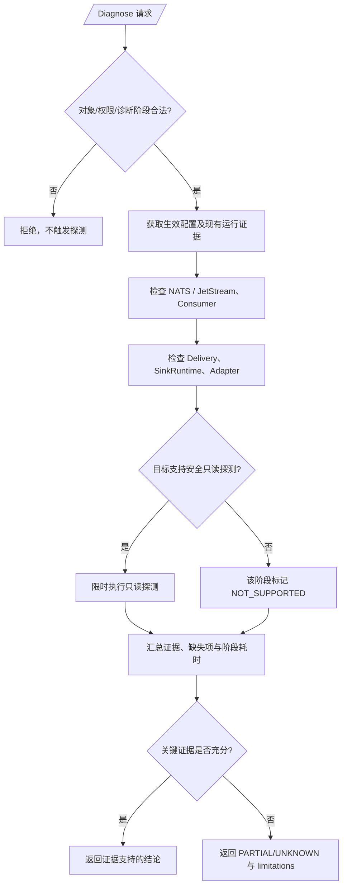

<p class="figure-caption">图 3-7 UR-07 链路诊断（Diagnose）业务活动图</p>

### 3.8.3 业务规则

**R07-01 证据等级。** `NOT_RUN` 表示未执行；`NOT_SUPPORTED` 表示该目标不提供安全探测；`UNKNOWN` 表示证据不足；三者均不得作为 PASS。TCP 可达、协议成功、目标确认是不同阶段证据。

**R07-02 目标约束。** 无安全只读探测能力的目标不得实施有副作用的测试写入；诊断超时后未收敛 I/O 不得回收其资源所有权。


### 3.8.4 关键约束

<p class="table-caption">表 3-32 UR-07 非功能约束</p>

| 约束类别 | 可验证要求 |
|---|---|
| 安全与性能 | 只读探针禁止执行写入；设计默认总期限 5000 ms、每阶段不超过剩余期限、每服务同时探测最多 4 个、响应体不超过 1 MiB；配置越界须拒绝，值须同步进配置章节。 |
| I/O | 诊断不得抢占生产额度或破坏未收敛操作。 |
| 可观测性 | 每阶段时间、来源、失败类别、UNKNOWN/NOT_RUN 的依据可追溯。 |

## 3.9 UR-08 gRPC 服务端实现

### 3.9.1 基本信息与触发方式

<p class="table-caption">表 3-16 UR-08 基本信息</p>

| 字段 | 内容 |
|---|---|
| 请求方（Requester） | 经认证的 gRPC 客户端；服务管理器负责进程生命周期 |
| 触发方式（Trigger） | API：13 项 Unary RPC；生命周期：启动/关闭服务端 |
| 输入（Input） | `src/contracts/common.proto`、`sink_service.proto` 中的请求消息、认证上下文 |
| 反馈（Response） | 正式 Proto 响应或 gRPC 状态错误 |
| 目标方（Destination） | 按具体 RPC 路由到业务组件 |
| 业务输出（Output） | 业务操作输出归 UR-01～UR-07，本 UR 不新增独立派发 |

### 3.9.2 业务流程

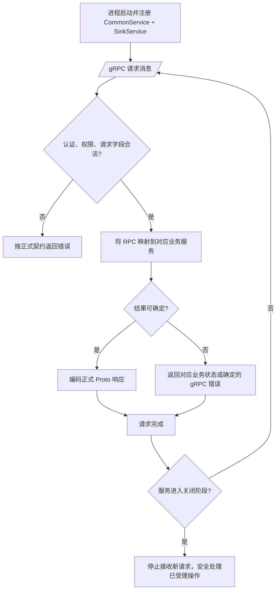

<p class="figure-caption">图 3-8 UR-08 gRPC 服务端实现业务活动图</p>

### 3.9.3 业务规则

**R08-01 接口全集。** CommonService 固定 9 项：`GetServiceInfo`、`GetServiceStatus`、`GetCapabilities`、`GetConfigSnapshot`、`PushConfigSnapshot`、`ApplyConfigSnapshot`、`GetMetrics`、`GetEvents`、`Diagnose`；SinkService 固定 4 项：`ListDeliveries`、`GetDelivery`、`StartDelivery`、`StopDelivery`。

**R08-02 契约权威。** 请求/响应字段、gRPC status、错误及版本信息全部以正式 Proto 为准；不得因文档新增私有字段或自造 RPC。


### 3.9.4 关键约束

<p class="table-caption">表 3-33 UR-08 非功能约束</p>

| 约束类别 | 可验证要求 |
|---|---|
| 安全与性能 | 强制 mTLS 与权限检查；设计目标：请求体最大 2 MiB、单服务并发 RPC 默认上限 64、默认 deadline 5000 ms，必须在配置章节体现。请求断连不撤销已提交操作，未收敛写入不得被误判完成；错误状态依正式 Proto/gRPC。 |

> **修订标识 v1_13**：第 1～3 章正文保持 v1_12 冻结原文；本次仅对第 4～14 章进行编码准入专项整改。

# 4. 用例视图

> 修订版本：v1_14。第 1～3 章保持 v1_13 附件原文；本轮仅修订第 4～14 章。

## 4.1 系统上下文

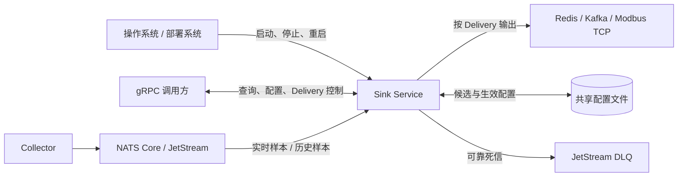

<p class="figure-caption">图 4-1 Sink Service 系统边界与外部交互</p>

用例基于第 3 章八项 UR，按外部可观察的完整业务目标组织。进程管理系统、运维 gRPC 调用方为主动参与者；NATS/JetStream 样本和故障事件是业务触发，不虚构人工参与者。每个用例的规定场景采用 `UC-xx-S01`（主流程）、`S02`（关键边界）、`S03`（异常与恢复）；同一场景涉及多种条件时，System Test 必须逐一参数化或分别验证。

<p class="table-caption">表 4-1 用例—需求总表</p>

| 用例 | 业务目标 | 关联需求 |
|---|---|---|
| UC-01 | 首次部署启动并就绪 | UR-03、UR-06、UR-08 |
| UC-02 | 启动 Delivery 并建立输出 | UR-03、UR-06、UR-08 |
| UC-03 | 停止 Delivery 并释放共享资源 | UR-03、UR-06、UR-08 |
| UC-04 | 实时样本按策略派发 | UR-01 |
| UC-05 | 历史样本可靠交付 | UR-02 |
| UC-06 | 查询服务、Sink、Delivery 和指标 | UR-05、UR-08 |
| UC-07 | 校验、修改配置并热生效 | UR-06、UR-08 |
| UC-08 | 正常停止服务 | UR-03、UR-08 |
| UC-09 | 重启加载新配置 | UR-03、UR-06、UR-08 |
| UC-10 | 异常退出后恢复和重新交付 | UR-02、UR-03、UR-06 |
| UC-11 | 故障隔离与目标恢复 | UR-01、UR-02、UR-03 |
| UC-12 | 查询死信状态并交接外部运维 | UR-02、UR-05 |
| UC-13 | 诊断数据派发链路 | UR-07、UR-08 |
| UC-14 | 初始化并周期生成派发指标 | UR-04 |

## 4.2 UC-01 首次部署启动并就绪

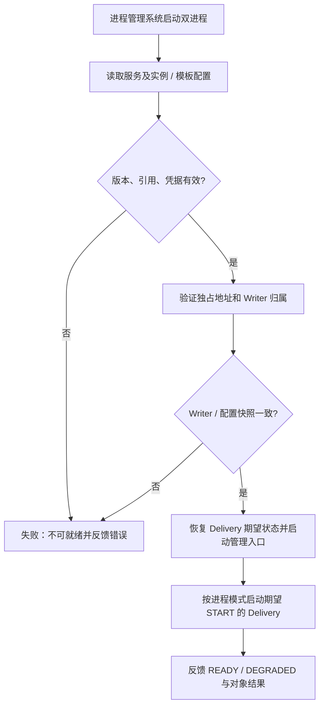

<p class="figure-caption">图 4-2 UC-01 业务活动图</p>

<p class="table-caption">表 4-2 UC-01 用例说明与规定场景</p>

| 要素 | 内容 |
|---|---|
| 参与者 | 进程管理系统 |
| 业务目标 | 首次部署启动并就绪 |
| 前置条件 | 系统具备配置路径及 TLS 文件 |
| 主要异常 | 配置非法、Writer 冲突、独占端口占用 |
| 后置条件 | 进程及对象的就绪状态真实可查询 |
| 关联需求 | UR-03、UR-06、UR-08 |
| UC-01-S01 主流程 | 启动双进程并查询就绪 |
| UC-01-S02 关键边界 | Service 配置变化与单进程未就绪 |
| UC-01-S03 异常与恢复 | 非法配置、Writer 冲突和进程恢复 |

## 4.3 UC-02 启动 Delivery 并建立输出

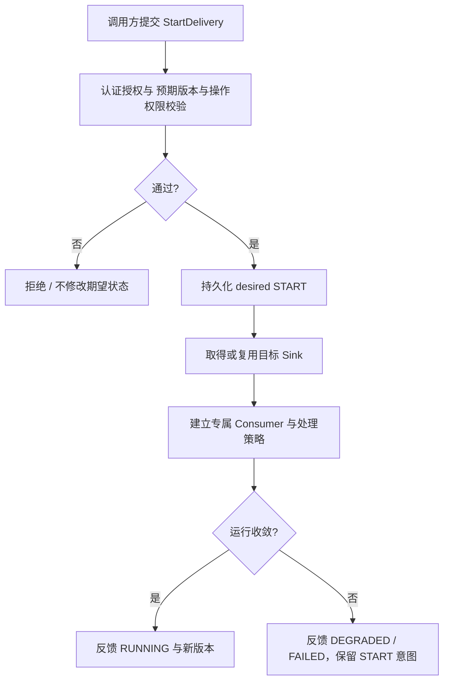

<p class="figure-caption">图 4-3 UC-02 业务活动图</p>

<p class="table-caption">表 4-3 UC-02 用例说明与规定场景</p>

| 要素 | 内容 |
|---|---|
| 参与者 | gRPC 调用方 |
| 业务目标 | 启动 Delivery 并建立输出 |
| 前置条件 | Delivery 已存在、配置已校验、调用方有 control 权限 |
| 主要异常 | revision 冲突、Sink 不可达、订阅失败 |
| 后置条件 | 持久 START 与实际状态、版本分别可查询 |
| 关联需求 | UR-03、UR-06、UR-08 |
| UC-02-S01 主流程 | 启动已配置 Delivery 并确认状态 |
| UC-02-S02 关键边界 | 重复启动与共享 Sink 的引用 |
| UC-02-S03 异常与恢复 | 版本冲突、目标不可达及待收敛 |

## 4.4 UC-03 停止 Delivery 并释放共享资源

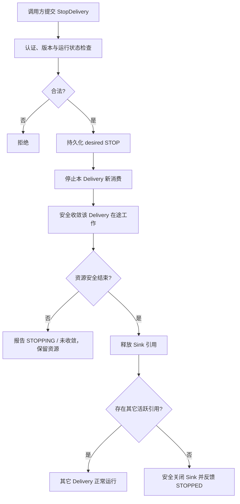

<p class="figure-caption">图 4-4 UC-03 业务活动图</p>

<p class="table-caption">表 4-4 UC-03 用例说明与规定场景</p>

| 要素 | 内容 |
|---|---|
| 参与者 | gRPC 调用方 |
| 业务目标 | 停止 Delivery 并释放共享资源 |
| 前置条件 | Delivery 已存在，调用方具备 control 权限 |
| 主要异常 | 未收敛 I/O、重复 Stop、关联 Sink 被其它 Delivery 使用 |
| 后置条件 | STOP 不被 Watchdog 覆盖；资源安全释放或明确阻塞 |
| 关联需求 | UR-03、UR-06、UR-08 |
| UC-03-S01 主流程 | 停止 Delivery 并确认实际停止 |
| UC-03-S02 关键边界 | 重复停止、其它 Delivery 共享 Sink |
| UC-03-S03 异常与恢复 | 未收敛 I/O、关闭超时及资源保护 |

## 4.5 UC-04 实时样本按策略派发

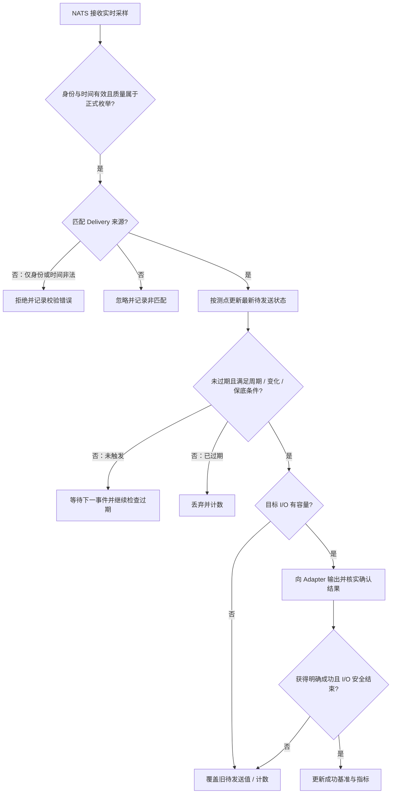

<p class="figure-caption">图 4-5 UC-04 业务活动图</p>

<p class="table-caption">表 4-5 UC-04 用例说明与规定场景</p>

| 要素 | 内容 |
|---|---|
| 参与者 | Collector/NATS 数据事件 |
| 业务目标 | 实时样本按策略派发 |
| 前置条件 | 实时进程与 Delivery 正在运行 |
| 主要异常 | 过期、乱序、质量 bad、满缓存、下游慢 |
| 后置条件 | 最新值及交付指标可信，不承诺实时消息全量交付 |
| 关联需求 | UR-01 |
| UC-04-S01 主流程 | 接收样本并按三种策略派发 |
| UC-04-S02 关键边界 | 阈值、质量变化、过期、乱序与容量边界 |
| UC-04-S03 异常与恢复 | NATS 中断、慢目标、背压和恢复 |

## 4.6 UC-05 历史样本可靠交付

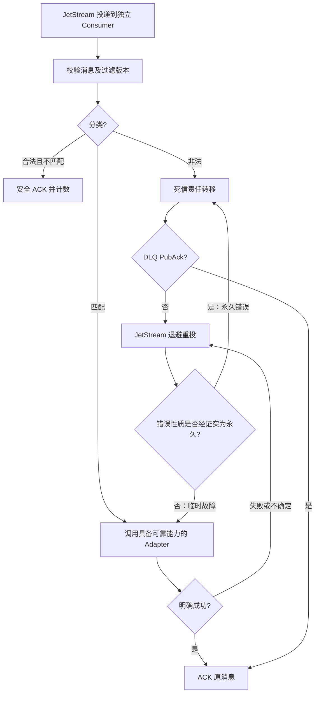

<p class="figure-caption">图 4-6 UC-05 业务活动图</p>

<p class="table-caption">表 4-6 UC-05 用例说明与规定场景</p>

| 要素 | 内容 |
|---|---|
| 参与者 | JetStream 数据事件 |
| 业务目标 | 历史样本可靠交付 |
| 前置条件 | reliable 模式目标已通过能力校验 |
| 主要异常 | ACK 续约、写入超时、DLQ PubAck 丢失 |
| 后置条件 | 已成功交付或已确认转死信；其它保留重投权 |
| 关联需求 | UR-02 |
| UC-05-S01 主流程 | 匹配消息可靠写入并确认 ACK |
| UC-05-S02 关键边界 | 不匹配消息、重复投递、目标写入结果不确定 |
| UC-05-S03 异常与恢复 | 永久错误转死信、DLQ 满、PubAck 失败及恢复 |

## 4.7 UC-06 查询服务、Sink、Delivery 和指标

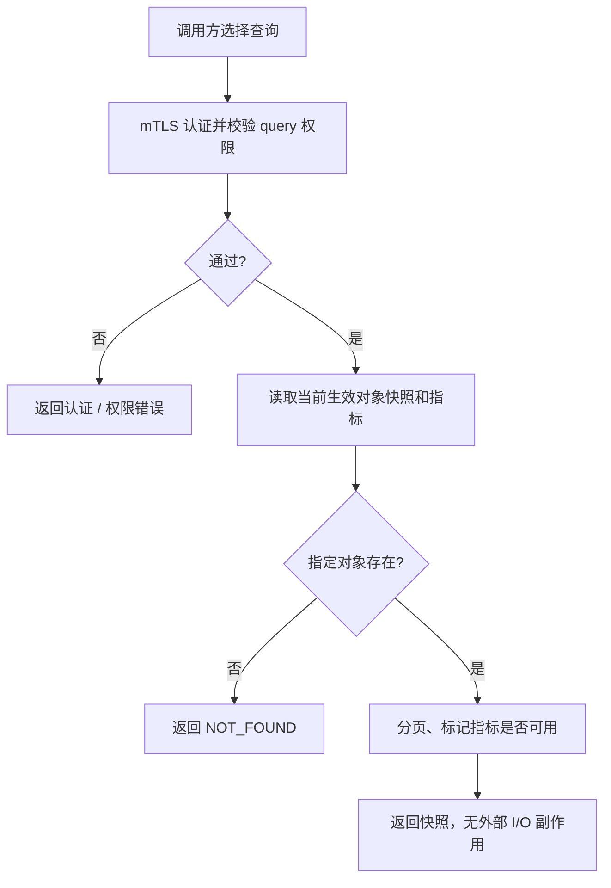

<p class="figure-caption">图 4-7 UC-06 业务活动图</p>

<p class="table-caption">表 4-7 UC-06 用例说明与规定场景</p>

| 要素 | 内容 |
|---|---|
| 参与者 | gRPC 调用方 |
| 业务目标 | 查询服务、Sink、Delivery 和指标 |
| 前置条件 | gRPC 管理入口可用 |
| 主要异常 | 未认证、无权限、无对应对象、Metrics 不可用 |
| 后置条件 | 返回生效状态快照，查询不触发目标连接 |
| 关联需求 | UR-05、UR-08 |
| UC-06-S01 主流程 | 查询服务、Delivery、Sink、Metrics 与事件 |
| UC-06-S02 关键边界 | 无数据、统计窗口、分页和不可用指标 |
| UC-06-S03 异常与恢复 | 无权限、对象不存在、部分进程不可用 |

## 4.8 UC-07 校验、修改配置并热生效

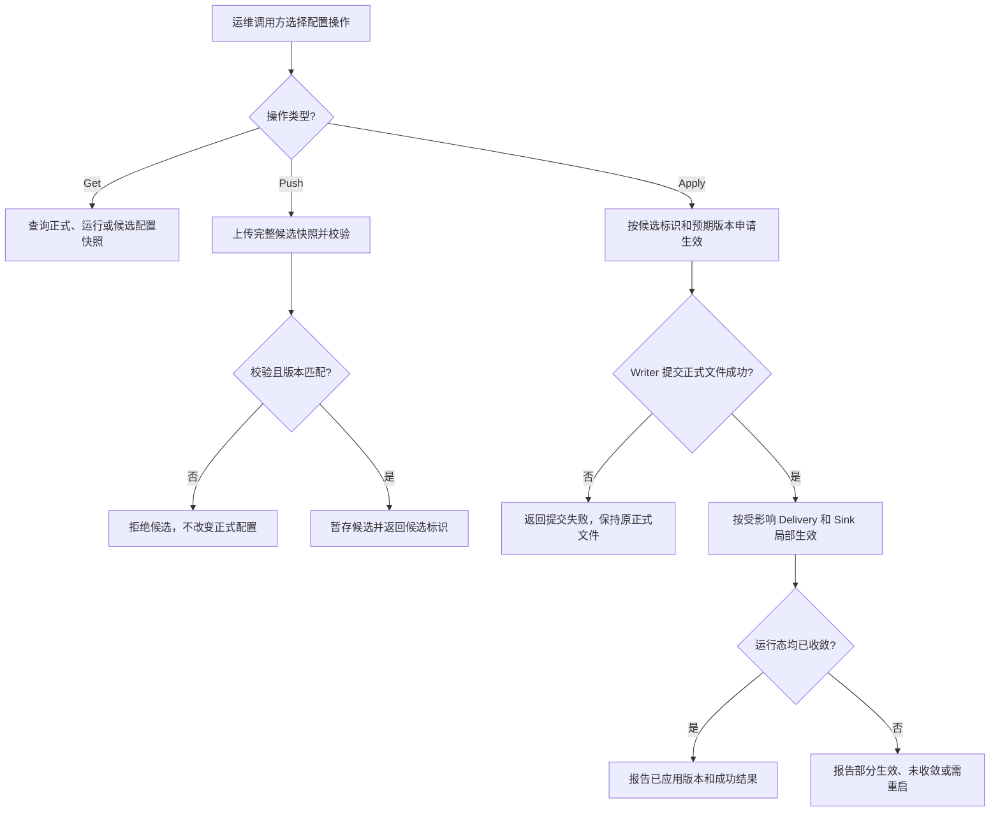

<p class="figure-caption">图 4-8 UC-07 业务活动图</p>

<p class="table-caption">表 4-8 UC-07 用例说明与规定场景</p>

| 要素 | 内容 |
|---|---|
| 参与者 | gRPC 调用方 |
| 业务目标 | 校验、修改配置并热生效 |
| 前置条件 | Writer 运行且配置存储可读写 |
| 主要异常 | Reader 不可达、应用超时、版本冲突、连接未收敛 |
| 后置条件 | 提交版本与每对象 active 版本可对账，不伪报全局成功 |
| 关联需求 | UR-06、UR-08 |
| UC-07-S01 主流程 | 完整配置 Get、Push、Apply 与局部热生效 |
| UC-07-S02 关键边界 | 候选校验、版本冲突、Service 重启要求 |
| UC-07-S03 异常与恢复 | 文件提交后应用失败、Reader 不可达与收敛查询 |

## 4.9 UC-08 正常停止服务

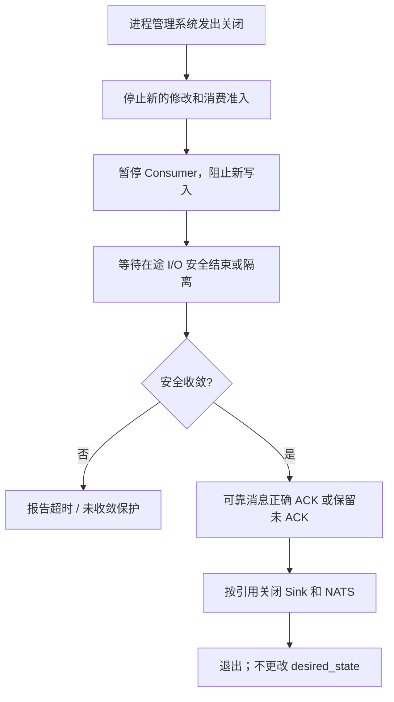

<p class="figure-caption">图 4-9 UC-08 业务活动图</p>

<p class="table-caption">表 4-9 UC-08 用例说明与规定场景</p>

| 要素 | 内容 |
|---|---|
| 参与者 | 进程管理系统 |
| 业务目标 | 正常停止服务 |
| 前置条件 | 进程正在运行 |
| 主要异常 | 未结束 I/O、NATS 不可达、关闭超时 |
| 后置条件 | 不提前 ACK、无不安全资源复用 |
| 关联需求 | UR-03、UR-08 |
| UC-08-S01 主流程 | 正常停止进程并保全交付责任 |
| UC-08-S02 关键边界 | 重复关闭、待处理消息及共享资源 |
| UC-08-S03 异常与恢复 | 关闭超时、未收敛 I/O 与安全退出 |

## 4.10 UC-09 重启加载新配置

```mermaid
%%{init: {"flowchart": {"useMaxWidth": true}}}%%
flowchart TD
 A["操作系统重启进程"] --> B["按关闭契约处理原进程"]
 B --> C["读取全部当前配置与版本"]
 C --> D{"配置与旧资源安全?"}
 D -->|否| X["不可就绪，报告冲突"]
 D -->|是| E["恢复期望状态与 durable 身份"]
 E --> F["仅启动 desired START 的 Delivery"]
 F --> G["返回当前文件与逐对象生效版本"]
```

<p class="figure-caption">图 4-10 UC-09 业务活动图</p>

<p class="table-caption">表 4-10 UC-09 用例说明与规定场景</p>

| 要素 | 内容 |
|---|---|
| 参与者 | 进程管理系统 |
| 业务目标 | 重启加载新配置 |
| 前置条件 | 已运行过旧实例 |
| 主要异常 | 重启配置不兼容、旧监听未隔离 |
| 后置条件 | 按新配置或报告不可就绪，不复用旧缓存 |
| 关联需求 | UR-03、UR-06、UR-08 |
| UC-09-S01 主流程 | 重启服务并加载正式新配置 |
| UC-09-S02 关键边界 | Service 参数变更和手动 STOP 保持 |
| UC-09-S03 异常与恢复 | 配置非法、端口占用及旧资源未收敛 |

## 4.11 UC-10 异常退出后恢复和重新交付

```mermaid
%%{init: {"flowchart": {"useMaxWidth": true}}}%%
flowchart TD
 A["异常退出后进程重启"] --> B["读取有效配置、意图和 JetStream 进度"]
 B --> C["检验旧进程所有权与独占资源"]
 C --> D{"冲突被排除?"}
 D -->|否| X["受影响 Sink 阻塞；不冒险复用"]
 D -->|是| E["实时缓存清空，历史恢复原 durable"]
 E --> F["检验目标可靠交付能力"]
 F --> G["恢复 desired START 的对象"]
 G --> H["报告积压、重投和真实状态"]
```

<p class="figure-caption">图 4-11 UC-10 业务活动图</p>

<p class="table-caption">表 4-11 UC-10 用例说明与规定场景</p>

| 要素 | 内容 |
|---|---|
| 参与者 | 进程管理系统 |
| 业务目标 | 异常退出后恢复和重新交付 |
| 前置条件 | 存在已部署配置和持久意图 |
| 主要异常 | 重投重复、Reader/Writer 不一致、旧 I/O 不明 |
| 后置条件 | 恢复进度正确，遗留问题显式暴露 |
| 关联需求 | UR-02、UR-03、UR-06 |
| UC-10-S01 主流程 | 异常退出后按持久意图恢复派发 |
| UC-10-S02 关键边界 | 可靠消息重复投递、实时缓存清空 |
| UC-10-S03 异常与恢复 | Reader/Writer 版本不一致、旧资源冲突 |

## 4.12 UC-11 故障隔离与目标恢复

```mermaid
%%{init: {"flowchart": {"useMaxWidth": true}}}%%
flowchart TD
 A["检测连接或写入故障"] --> B["隔离引用故障 Sink 的 Deliveries"]
 B --> C{"desired START?"}
 C -->|否| X["不恢复，保持手动 STOP"]
 C -->|是| D["保持未安全结束的 I/O 所有权"]
 D --> E{"可安全重建连接?"}
 E -->|否| F["保持 DEGRADED / BLOCKED 告警"]
 E -->|是| G["有界退避重连"]
 G --> H["恢复 Consumer 与交付"]
 H --> I["其它 Sink 持续正常运行"]
```

<p class="figure-caption">图 4-12 UC-11 业务活动图</p>

<p class="table-caption">表 4-12 UC-11 用例说明与规定场景</p>

| 要素 | 内容 |
|---|---|
| 参与者 | 下游故障自动触发 |
| 业务目标 | 故障隔离与目标恢复 |
| 前置条件 | 已检测连接/输出故障 |
| 主要异常 | 永久断连、目标超时、手工 Stop 与重连竞争 |
| 后置条件 | 受影响 Delivery 局部 DEGRADED，不影响无关联 Sink |
| 关联需求 | UR-01、UR-02、UR-03 |
| UC-11-S01 主流程 | 隔离故障 Sink 并恢复相关 Delivery |
| UC-11-S02 关键边界 | 多个 Delivery 引用同一 Sink、无关 Sink 保持运行 |
| UC-11-S03 异常与恢复 | 重连失败、手动 STOP 与未收敛 I/O |

## 4.13 UC-12 查询死信状态并交接外部运维

```mermaid
%%{init: {"flowchart": {"useMaxWidth": true}}}%%
flowchart TD
 A["运维调用方查询死信及派发异常"] --> B["校验查询权限与筛选范围"]
 B --> C{"有可核验的死信或积压记录?"}
 C -->|否| D["报告无记录或证据不可用"]
 C -->|是| E["返回事件身份、原因、时间与投递状态"]
 E --> F["运维人员使用外部工具独立处理或重放"]
 F --> G["Sink Service 仅提供证据查询，不执行重放"]
```

<p class="figure-caption">图 4-13 UC-12 业务活动图</p>

<p class="table-caption">表 4-13 UC-12 用例说明与规定场景</p>

| 要素 | 内容 |
|---|---|
| 参与者 | gRPC 运维调用方 |
| 业务目标 | 查询死信状态并交接外部运维 |
| 前置条件 | 具备运维查询权限；允许当前无死信记录 |
| 主要异常 | 死信内容不可查询、记录缺失、Broker 不可用 |
| 后置条件 | 外部承担重放决定；Sink Service 只提供观察证据 |
| 关联需求 | UR-02、UR-05 |
| UC-12-S01 主流程 | 查询死信记录、积压和可用证据 |
| UC-12-S02 关键边界 | 无死信、分页、死信证据缺失 |
| UC-12-S03 异常与恢复 | Broker 不可达、查询失败与外部工具交接 |

## 4.14 UC-13 诊断数据派发链路

```mermaid
%%{init: {"flowchart": {"useMaxWidth": true}}}%%
flowchart TD
 A["运维调用方指定 Delivery 和诊断范围"] --> B["验证身份、权限与对象"]
 B --> C{"准入成功?"}
 C -->|否| X["返回拒绝及原因"]
 C -->|是| D["检查 NATS / JetStream 连通、消费与积压证据"]
 D --> E["检查 Delivery 状态、匹配、过滤与调度证据"]
 E --> F["检查 Sink 连接、Adapter 与目标响应证据"]
 F --> G{"证据覆盖完整且均成功?"}
 G -->|是| H["返回已验证范围内 PASS"]
 G -->|否| I["返回 FAIL / PARTIAL / UNKNOWN 与缺失阶段"]
 H --> J["只读返回阶段证据，不执行业务写入"]
 I --> J
```

<p class="figure-caption">图 4-14 UC-13 业务活动图</p>

<p class="table-caption">表 4-14 UC-13 用例说明与规定场景</p>

| 要素 | 内容 |
|---|---|
| 参与者 | 授权运维调用方 |
| 业务目标 | 诊断数据派发链路 |
| 前置条件 | 有效身份、诊断范围及目标 Delivery；部分依赖不可用时仍返回已取得的证据 |
| 主要异常 | NATS 不可达、Consumer 积压、目标连接失败、目标写入证据缺失、诊断超时 |
| 后置条件 | 提供有时间戳的阶段状态与证据；不修改业务 ACK、配置或 Delivery 期望状态 |
| 关联需求 | UR-07、UR-08 |
| UC-13-S01 主流程 | 分阶段诊断 NATS、Delivery、Sink 和目标 |
| UC-13-S02 关键边界 | 阶段跳过、证据缺失与结果 UNKNOWN |
| UC-13-S03 异常与恢复 | 超时、权限拒绝、依赖不可达及无副作用 |

## 4.15 UC-14 初始化并周期生成派发指标

```mermaid
%%{init: {"flowchart": {"useMaxWidth": true}}}%%
flowchart TD
    A["服务进程启动"] --> B["统计组件加载配置并初始化空窗口"]
    B --> C{"配置合法?"}
    C -->|否| X["报告初始化异常"]
    C -->|是| D["等待统计周期"]
    E["派发操作完成或运行状态变化"] --> F["记录基础计数、耗时和状态"]
    F -.-> G["窗口基础数据"]
    D --> H["计算窗口指标和覆盖时长"]
    G -.-> H
    H --> I["原子发布统计快照"]
    I --> D
```

<p class="figure-caption">图 4-15 UC-14 周期统计业务活动图</p>

<p class="table-caption">表 4-15 UC-14 用例说明与规定场景</p>

| 要素 | 内容 |
|---|---|
| 参与者 | 部署/进程管理系统触发启动；后续周期调度属于服务自动行为，不虚构外部请求方 |
| 业务目标 | 启动统计组件，自动周期产出可查询且口径清晰的指标 |
| 前置条件 | Sink Service 启动，统计配置已提供 |
| 主要异常 | 配置无效、首次窗口不足、无事件、无耗时样本、重启、统计任务超期、配置热变更 |
| 后置条件 | 统计快照具有准确计算时间、窗口与就绪状态；不影响派发主路径 |
| 关联需求 | UR-04 |
| UC-14-S01 主流程 | 初始化为 NOT_READY，首个周期生成带覆盖时长的快照，后续持续更新 |
| UC-14-S02 关键边界 | 空窗口、窗口未填满、无延迟样本、周期与窗口不一致、查询不同窗口 |
| UC-14-S03 异常与恢复 | 非法配置、重启重置、热变更窗口重建、慢计算跳周期不重入 |

## 4.16 用例与 System Test 追溯基线

UC-04 的边界场景包含实时过期丢弃、恢复仅输出最新值；UC-05 的异常/恢复场景包含临时故障持续退避、不可恢复错误入 DLQ、DLQ 满时保持未 ACK 责任、源 Stream 满时的告警；UC-10/11 的恢复场景包含 Reliable 自动补发限流、与 Realtime 的目标资源隔离、重复投递去重及同一 Durable 的先后顺序。上述条件必须在第 14 章以参数化测试分别验证，不能仅用一个成功恢复测试代替。


第 4 章共 14 项 UC、42 个规定场景，覆盖 UR-01～UR-08。每个 `UC-xx-S01/S02/S03` 均是第 14 章 System Test 的最低场景基线；图中关键分支以及各场景表中的并列异常必须逐项验证，不能以单一正常路径代表场景通过。测试矩阵必须同时记录 UR、UC 场景、测试标识、预期结果和实际执行证据。

UC-12 仅查询死信与积压证据，外部运维工具负责重放；UC-13 仅提供可证实范围内的链路诊断，不替代 CLI 的跨服务诊断，也不产生业务写入。启动、重启、关闭的运行机制在第 6 章定义，用例视图只描述其可观察业务结果。

# 5. 逻辑视图

逻辑视图只描述组件职责和状态，不将每个模块等同于常驻 Task。Delivery 是业务执行单元；Sink 是共享目标资源；Consumer 归 Delivery 所有。两个进程不共享 Python 对象，所有配置一致性由唯一 Writer 和版本对账承担。

## 5.1 组件结构与职责

```mermaid
%%{init: {"flowchart": {"useMaxWidth": true}}}%%
flowchart TB
  API["gRPC 接入：身份与权限"] --> CFG["配置管理"]
  API --> DM["Delivery 管理"]
  API --> Q["状态 / Metrics 查询"]
  API --> DG["Diagnose 链路诊断"]
  DG --> DM
  DG --> Q
  DG --> N
  subgraph APP["应用层"]
    DM --> D["DeliveryRuntime"]
    D --> F["SourceFilter / OutputPolicy"]
    D --> SM["SinkManager"]
    SM --> SR["SinkRuntime"]
  end
  subgraph INF["基础设施"]
    N["NATS / JetStream Consumer"]
    A["三类 Sink Adapter"]
    CS["配置存取 / 版本同步"]
  end
  N --> D
  SR --> A
  CFG --> CS
  CFG --> DM
  Q --> DM
  Q --> SM
```

<p class="figure-caption">图 5-1 Sink Service 逻辑组件结构</p>

<p class="table-caption">表 5-1 组件职责与非职责</p>

| 组件 | 职责 | 不承担 |
|---|---|---|
| DeliveryRuntime | 生命周期、策略、消息处理与独立确认责任 | 目标连接建立与关闭 |
| SinkRuntime | 持有连接、写入、并发额度、异常与安全结束证据 | NATS 消费和变化触发 |
| SinkManager | 按目标配置和进程归属复用 SinkRuntime | 持有每 Delivery 最新值 |
| Consumer | 订阅、取样、JetStream ACK/NAK/InProgress | 目标业务确认的推断 |
| ConfigService | 完整校验、提交版本、受影响对象收敛与进程对账 | 数据库记录保留管理 |
| Metrics | 只读指标/事件窗口 | 修改业务状态 |
| Diagnose | 采集 NATS/Consumer、Delivery、Sink、Adapter 阶段证据，形成有范围的诊断结论 | 业务写入、ACK、修改 Delivery 状态、冒充目标业务确认 |
| Adapter | 协议操作、确认粒度、资源隔离与能力声明 | 决定哪些来源样本应交付 |

## 5.2 核心对象与引用关系

```mermaid
%%{init: {"class": {"useMaxWidth": true}}}%%
classDiagram
  class DeliveryInstance {
    +delivery_id
    +sink_id
    +mode
    +desired_state
    +template_ref
  }
  class DeliveryRuntime {
    +actual_state
    +active_revision
    +start()
    +stop()
  }
  class Consumer {
    <<interface>>
    +start()
    +stop()
    +ack()
  }
  class SinkRuntime {
    +sink_id
    +inflight
    +open()
    +write()
    +close()
  }
  class SinkPort {
    <<interface>>
    +open()
    +write()
    +health()
    +close()
  }
  DeliveryInstance "1" --> "1" DeliveryRuntime
  DeliveryRuntime "1" --> "1" Consumer
  DeliveryRuntime "0..*" --> "1" SinkRuntime
  SinkRuntime "1" --> "1" SinkPort
```

<p class="figure-caption">图 5-2 Sink、Delivery、Consumer 与 Adapter 关系</p>

## 5.3 生命周期和状态责任

```mermaid
%%{init: {"state": {"useMaxWidth": true}}}%%
stateDiagram-v2
  [*] --> STOPPED
  STOPPED --> STARTING: desired START
  STARTING --> RUNNING: 消费与目标就绪
  STARTING --> FAILED: 启动失败
  RUNNING --> DEGRADED: 消费或目标不可用
  DEGRADED --> RUNNING: 依赖恢复且 desired START
  DEGRADED --> FAILED: 需要重建运行资源
  FAILED --> STARTING: desired START 且可重试
  STARTING --> STOPPING: desired STOP
  RUNNING --> STOPPING: desired STOP
  DEGRADED --> STOPPING: desired STOP
  FAILED --> STOPPING: desired STOP
  STOPPING --> STOPPED: 消费及 I/O 安全收敛
```

<p class="figure-caption">图 5-3 Delivery 运行状态机</p>

```mermaid
%%{init: {"state": {"useMaxWidth": true}}}%%
stateDiagram-v2
  [*] --> CLOSED
  CLOSED --> OPENING: 第一个活跃引用
  OPENING --> OPEN: 目标已就绪
  OPENING --> FAILED: 建连失败
  OPEN --> DEGRADED: 写入或连接故障
  DEGRADED --> OPENING: 可安全重连
  OPEN --> CLOSING: 最后引用释放
  DEGRADED --> CLOSING: desired STOP 无引用
  CLOSING --> CLOSED: 底层 I/O 安全结束
  CLOSING --> BLOCKED: 未结束 I/O
  BLOCKED --> CLOSING: 安全结束或隔离证据
  FAILED --> OPENING: 存在引用且可恢复
```

<p class="figure-caption">图 5-4 Sink 共享连接生命周期</p>

交付业务结果 `CONFIRMED/FAILED/UNCERTAIN` 与底层 I/O `IN_FLIGHT/SETTLED/ISOLATED` 是两个不同维度；`UNCERTAIN` 不可提前释放或重新使用可能冲突的连接。相同 SinkRuntime 的两个 Delivery 可以共享物理连接，但任何一个的 ACK、过滤、期望状态与指标均独立。

## 5.4 实时与可靠逻辑路径

```mermaid
%%{init: {"flowchart": {"useMaxWidth": true}}}%%
flowchart LR
  N["Core NATS"] --> F["身份与来源校验"]
  F --> L["每 Delivery 最新值"]
  L --> P["周期 / 变化 / 保底"]
  P --> W["SinkRuntime.write"]
  T["周期触发"] --> P
  W --> M["确认结果与 Metrics"]
```

<p class="figure-caption">图 5-5 实时 Delivery 内部协作</p>

```mermaid
%%{init: {"flowchart": {"useMaxWidth": true}}}%%
flowchart LR
  J["JetStream 独立 Durable"] --> F["已冻结过滤规则"]
  F --> W["可靠 Sink.write"]
  W --> E{"业务确认?"}
  E -->|是| A["ACK"]
  E -->|否或不明| R["退避重投"]
  R --> D["永久错误才发布死信"]
  D -->|PubAck| A
```

<p class="figure-caption">图 5-6 历史 Delivery 内部协作</p>

# 6. 进程视图

按照附件第 2.3 节，将本章严格分为运行时结构、生命周期、并发与资源、异常恢复四个专题。所有长期 Task、执行线程、普通应用对象、资源创建者和退出条件均需可定位。

## 6.1 运行时结构

```mermaid
%%{init: {"flowchart": {"useMaxWidth": true}}}%%
flowchart TB
  subgraph R["realtime 进程：独立 asyncio Loop"]
    RR["gRPC 请求协程"]
    RC["Realtime Consumers × N"]
    RP["每 Delivery 策略定时 Task"]
    RS["SinkRuntime / Adapter"]
    RW["监督与 Metrics Task"]
    RC --> RP --> RS
  end
  subgraph H["reliable 进程：独立 asyncio Loop"]
    HG["gRPC 请求协程"]
    HC["JetStream Consumers × N"]
    HS["SinkRuntime / Adapter"]
    HW["监督与 Metrics Task"]
    HC --> HS
  end
  N["NATS Core / JetStream"] --> RC
  N --> HC
  RS --> T["各类下游目标"]
  HS --> T
  F[("共享配置 / Writer 提交快照")] --> R
  F --> H
```

<p class="figure-caption">图 6-1 双进程、Event Loop 与执行资源</p>

<p class="table-caption">表 6-1 执行单元、所有者及退出条件</p>

| 执行单元 | 方式 | 所有者 | 终止及资源约束 |
|---|---|---|---|
| gRPC 调用 | 按请求协程 | gRPC Server | 请求取消不回滚已提交的期望状态 |
| 实时消息接收 | 每 Delivery 一个订阅/回调 | DeliveryRuntime | Stop 后关闭订阅并停止新交付 |
| 输出周期任务 | 有策略时按 Delivery 常驻 | DeliveryRuntime | 定时器退出与缓存清理不得冒充 Sink 写入取消 |
| 可靠消费 | 每 Delivery 单一处理执行序列 | DeliveryRuntime | 不跨重建与旧 I/O 形成第二个冲突在途 |
| Sink 连接与 I/O | 普通共享对象与有界调用 | SinkRuntime | 未安全结束的底层 I/O 保留额度 |
| 配置同步 | Reader 监督 Task | ProcessRuntime | 按版本对账，停机停止拉取新候选 |
| 阻塞 SDK | 必要时有界线程池 | SinkRuntime | 工作线程未退出不能释放其所持连接 |
| Metrics 与恢复 | 监督 Task | ProcessRuntime | 仅 desired START 允许自动恢复 |

## 6.2 运行生命周期

```mermaid
%%{init: {"flowchart": {"useMaxWidth": true}}}%%
flowchart TD
  A["进程启动"] --> B["读取完整配置快照与进程归属"]
  B --> C{"结构、引用、权限、独占端口合法?"}
  C -->|否| X["NOT_READY：报告失败"]
  C -->|是| D["恢复持久化 desired_state"]
  D --> E["初始化 gRPC、NATS、监督"]
  E --> F["仅拉起归属本进程且 desired START 的 Delivery"]
  F --> G{"全部所需交付可运行?"}
  G -->|是| H["READY"]
  G -->|否| I["DEGRADED：保留管理入口和恢复监督"]
```

<p class="figure-caption">图 6-2 启动、就绪及故障降级</p>

```mermaid
%%{init: {"flowchart": {"useMaxWidth": true}}}%%
flowchart TD
  A["系统请求关闭"] --> B["拒绝新配置写入与新消费"]
  B --> C["停止各 Delivery 消费入口"]
  C --> D["等待在途 I/O 真实结束 / 可信隔离"]
  D --> E{"在关闭期限前安全?"}
  E -->|否| X["报告未收敛并保持必要资源保护"]
  E -->|是| F["已确认历史写入才 ACK；其他保留重投"]
  F --> G["释放引用并关闭 Sink"]
  G --> H["关闭 NATS / gRPC 并退出"]
```

<p class="figure-caption">图 6-3 服务优雅关闭与底层 I/O 保护</p>

```mermaid
%%{init: {"sequence": {"useMaxWidth": true}}}%%
sequenceDiagram
 participant C as 管理客户端
 participant W as 唯一 Writer
 participant D as DeliveryRuntime
 participant S as SinkRuntime
 participant R as 恢复监督
 C->>W: StopDelivery(id, expected_revision)
 W->>W: 持久化 STOP
 W->>D: 收敛 STOP
 par 正常停止
  D->>S: 等待在途安全结束并释放引用
 and 自动恢复触发
  R->>W: 读取最新 desired 状态
  W-->>R: STOP
  R->>R: 禁止重连此 Delivery
 end
 D-->>C: 当前状态 / 未收敛信息
```

<p class="figure-caption">图 6-4 Delivery Stop 与 Watchdog 重连竞争</p>

## 6.3 并发、额度、背压与缓存

补发属于 Reliable 进程内部低优先级工作负载，资源边界按第 10.3.2 节执行。Realtime 与 Reliable 分属独立进程，但共享物理 Kafka/Redis 目标时必须使用可实际验证的目标侧配额或连接隔离；跨进程的独立本地 `max_inflight_global` 不构成全局共享额度。并发上限取 Adapter 安全能力和所有适用配置上限的最小值；单 Delivery 默认串行，底层 I/O 未收敛持续占额度。


<p class="table-caption">表 6-2 资源预算与不足处理</p>

| 资源 | 约束及拥有者 | 容量耗尽策略 |
|---|---|---|
| 单 Delivery 历史逻辑在途 | 1，由 DeliveryRuntime 维护 | 暂停取新消息、保持 Broker 积压 |
| Sink 在途目标 I/O | max_inflight_per_sink；由 SinkRuntime 计数 | 等待有界期限或报告失败；未收敛保留额度 |
| 进程全局目标 I/O | max_inflight_global；由 ProcessRuntime 计数 | 不允许无界创建新的任务/线程 |
| 实时待发送缓存 | 每 Delivery max_pending_points，按身份合并 | 已有键覆盖；新键超额按配置拒绝新测点并计数，不随机驱逐 |
| NATS 接收缓冲 | pending_msgs_limit / pending_bytes_limit | 达到上限时按 realtime 丢弃策略报告 |
| 重试 | JetStream 消息存储与 Broker 退避 | 进程不创建无界本地重试队列 |
| Metrics 事件窗口 | max_events + window_seconds | 淘汰窗口外事件；超载计数 |

```mermaid
%%{init: {"sequence": {"useMaxWidth": true}}}%%
sequenceDiagram
 participant D as DeliveryRuntime
 participant S as SinkRuntime
 participant A as Adapter / 底层 I/O
 D->>S: write(sample)
 S->>S: 获取全局和 Sink 在途额度
 S->>A: 发起写入
 alt 安全完成并有可信确认
  A-->>S: CONFIRMED / SETTLED
  S-->>D: 成功
  S->>S: 释放额度
 else 超时但 I/O 未安全结束
  S-->>D: UNCERTAIN
  Note over S,A: Sink 保有额度和可能冲突的连接
  A-->>S: 后续安全结束或可信隔离
  S->>S: 核实并释放额度
 end
```

<p class="figure-caption">图 6-5 Sink 并发额度与未收敛 I/O</p>

### 6.3.1 实时优先级及跨进程资源边界

Realtime 与 Reliable 默认分别运行于不同进程，因此**进程内 Semaphore 不能实现跨进程的 Sink 并发总额度或优先级**。当两个进程连接同一物理目标时，必须使用目标侧可验证的独立配额、连接池限额、限速或独立目标实例实现优先级；若目标不支持配额隔离，配置校验应禁止声称具有“实时输出不受补发影响”的共享目标组合。

Reliable 补发仅使用已核实的剩余容量，不能抢占正在执行的实时 I/O；优先级不等同于 JetStream durable Consumer 内可任意跳过旧序列。补发等待过长必须生成饥饿事件。性能测试应同时施加实时负载与历史补发，分别测量目标负载及实时延迟。

## 6.4 异常、崩溃与恢复

```mermaid
%%{init: {"flowchart": {"useMaxWidth": true}}}%%
flowchart TD
  A["Sink 写入失败 / 断连"] --> B["标记该 Sink DEGRADED"]
  B --> C["仅关联 Delivery DEGRADED"]
  C --> D{"desired START 且旧 I/O 安全?"}
  D -->|否| X["保留阻塞与告警；不重建冲突连接"]
  D -->|是| E["按退避重连一个 SinkRuntime"]
  E --> F{"恢复成功?"}
  F -->|否| E
  F -->|是| G["恢复关联 START Delivery"]
  B --> H["其它 Sink 与 Delivery 继续正常"]
```

<p class="figure-caption">图 6-6 目标连接故障范围与恢复</p>

<p class="table-caption">表 6-3 故障及恢复裁决矩阵</p>

| 故障 | 受影响范围 | 必须行为 |
|---|---|---|
| 实时进程崩溃 | 仅实时 | 历史独立运行；实时缓存重启为空 |
| 历史进程崩溃 | 仅历史 | JetStream 保留消息，原 durable 继续 |
| NATS 断连 | 本进程订阅 | 标记不可用、按期望状态重订阅 |
| 单目标断连 | 引用该 Sink 的 Delivery | 共用连接监督重建，不影响其它 Sink |
| Writer 崩溃 | 配置写入/管理 | Reader 只读继续旧生效配置；无选举接管 |
| Reader 崩溃 | 该模式交付 | Writer 保留已提交版本并报告 Reader 未确认 |
| 旧 I/O 不明 | 冲突 Sink 资源 | 保留额度和隔离限制 |
| 配置热更失败 | 受影响对象 | 逐对象 APPLY_FAILED；其它独立生效 |
| DLQ 不可用 | 相关历史 Delivery | 不 ACK 原消息，退避并告警 |

# 7. 开发视图

本章只规定目标模块及依赖。按 D38 使用 Domain / Application / Infrastructure；没有独立职责的类不强制分立。Clean Rewrite 不保留旧 `StartSink/StopSink/ClearSink` 控制兼容层。

## 7.1 目标代码结构

```text
src/
├── sink_service/
│   ├── main.py
│   ├── assembly.py
│   ├── domain/
│   │   ├── delivery.py
│   │   ├── policy.py
│   │   ├── sink.py
│   │   └── errors.py
│   ├── application/
│   │   ├── runtime.py
│   │   ├── delivery_runtime.py
│   │   ├── sink_runtime.py
│   │   ├── config.py
│   │   ├── metrics.py
│   │   └── port.py
│   └── infrastructure/
│       ├── grpc_server.py
│       ├── config_repository.py
│       ├── nats_consumer.py
│       ├── adapters/
│       │   ├── redis.py
│       │   ├── kafka.py
│       │   └── modbus/
│       └── security.py
├── contracts/
│   ├── common.proto
│   └── sink_service.proto
└── core/
```

## 7.2 组件职责与对应测试

<p class="table-caption">表 7-1 模块职责及主要测试</p>

| 模块 | 责任 | 对应测试文件 |
|---|---|---|
| domain/delivery.py | Delivery 状态、来源及输出语义 | unit/test_delivery_state.py |
| domain/policy.py | 三种实时输出与质量判定 | unit/test_output_policy.py |
| application/delivery_runtime.py | 独立 Consumer、历史 ACK 与实时策略 | component/test_delivery_runtime.py |
| application/sink_runtime.py | 共享连接、并发、阻塞与确认 | component/test_sink_runtime.py |
| application/config.py | 配置生效、Writer/Reader 对账 | component/test_config.py |
| infrastructure/nats_consumer.py | NATS / JetStream API、重投、死信 | integration/test_jetstream.py |
| infrastructure/config_repository.py | 原子写入、版本、意图恢复 | integration/test_config_repository.py |
| infrastructure/grpc_server.py | 按外部正式 proto 实现 Server、身份与权限 | integration/test_grpc.py |
| infrastructure/adapters/* | 三类目标写入与能力确认 | integration/test_adapters.py |
| application/runtime.py | 双进程启停与故障监督 | system/test_lifecycle.py |

## 7.3 模块依赖

```mermaid
%%{init: {"flowchart": {"useMaxWidth": true}}}%%
flowchart TB
  G["gRPC 接入"] --> A["Sink Service Application"]
  A --> D["Sink Service Domain"]
  I["Sink Service Infrastructure"] --> A
  I --> D
  A --> C["Core 通用配置与类型"]
  I --> C
  G --> P["contracts/sink_service.proto"]
  I --> E["NATS / Adapter SDK / 配置存储"]
  M["main + assembly"] --> A
  M --> I
```

<p class="figure-caption">图 7-1 模块依赖及外部适配</p>

## 7.4 复用及禁止依赖

Core 提供可复用的 Schema 校验、通用 DTO 与消息类型；Sink Service 不在 Domain 引用 NATS、Protobuf、Redis 或 Kafka。所有外部调用方（Web Server、CLI、测试、配置）随 `.proto` 和旧 Sink 控制接口删除同步迁移；不能以“兼容旧版”为由保留两套生产语义。业务异常向 Adapter 错误、交付状态和 gRPC Status 三个边界分别映射，避免偷换结果。

# 8. 物理视图（部署视图）

## 8.1 部署拓扑

```mermaid
%%{init: {"flowchart": {"useMaxWidth": true}}}%%
flowchart LR
  C["Collector"] --> N["NATS / JetStream"]
  subgraph HOST["同容器或不同容器 / 节点"]
    RT["Sink Service：realtime"]
    HIS["Sink Service：reliable"]
    CFG[("共享一致配置快照")]
    RT <-->|"单 Writer / 状态查询"| CFG
    HIS <-->|"只读对账"| CFG
  end
  N --> RT
  N --> HIS
  RT --> T["目标系统"]
  HIS --> T
  G["gRPC 管理客户端"] --> RT
  G --> HIS
```

<p class="figure-caption">图 8-1 实时/可靠双进程与部署依赖</p>

<p class="table-caption">表 8-1 物理部署与故障域</p>

| 对象 | 部署要求 | 失败影响 |
|---|---|---|
| realtime 进程 | 独立 PID、独立 gRPC 端口、只持有 realtime Delivery | 仅实时派发受影响 |
| reliable 进程 | 独立 PID、独立 gRPC 端口、独立 durable 消费身份 | 仅历史派发受影响 |
| 共享配置 | 文件内容发布原子、版本可比较；跨容器必须确保同一一致可见存储 | Reader 版本无法确认时不可宣称 APPLIED |
| 唯一 Writer | Service 配置静态指定一个 writer 角色；另一个只读 | Writer 故障不自动切换角色 |
| 独占端口 | Modbus TCP Server 等监听地址/端口只能归单进程 | 冲突拒绝配置或不就绪 |
| NATS/JetStream | 稳定 stream/subject 与 durable 命名、消息保留容量配置 | Broker 保留边界外不能保证历史样本不丢 |
| gRPC mTLS | 真实客户端证书身份和最小授权 | 认证失败拒绝管理操作 |
| 目标存储 | 由目标方提供留存、清理、容量、备份及幂等保证 | Sink Service 不管理目标存储生命周期 |

## 8.2 部署身份与重建约束

`deployment_id`、`wind_farm_id`、`process_role`、`delivery_id` 必须联合确定唯一消费归属。一个历史 Delivery 的 durable 名称须在重启前后保持稳定，不得因随机 `boot_id` 改变。配置 Writer 的实际存储位置是部署强约束；跨主机普通本地文件不构成共享配置。Modbus Sink 是 TCP **Server**，只更新服务内可读寄存器数据区并监听主站读取，不主动向 PLC 下发指令。

# 9. gRPC Server 实现

本章以重新查询的 GitHub `luoshaozhuo/wind-hub` 的 `main` 提交 `bf9dc6d2815a62b77a5e9868b3c6e8e35b3a492c` 的 `src/contracts/common.proto`、`src/contracts/sink_service.proto` 为唯一权威接口定义。本模块仅实现 Server；Proto 的字段号、类型及 RPC 名称不得在本模块内重新定义。当前契约为 **公共 `CommonService` 9 个 Unary RPC + 专属 `SinkService` 4 个 Unary RPC，共 13 个**。接口清单是应实现的目标，不代表现有代码已经通过测试。

## 9.1 服务与接口总表

<p class="table-caption">表 9-1 最新 main 的 gRPC 接口及业务归属</p>

| Service | RPC | 请求 → 响应 | 对应需求 / 实现责任 |
|---|---|---|---|
| CommonService | `GetServiceInfo` | `Empty` → `GetServiceInfoResponse` | UR-05、08；服务身份、版本、进程角色 |
| CommonService | `GetServiceStatus` | `Empty` → `GetServiceStatusResponse` | UR-05、08；依赖健康、更新时间 |
| CommonService | `GetCapabilities` | `Empty` → `GetCapabilitiesResponse` | UR-08；公布实际支持能力及 RPC |
| CommonService | `GetConfigSnapshot` | `GetConfigSnapshotRequest` → `GetConfigSnapshotResponse` | UR-06、08；正式/运行/候选快照查询 |
| CommonService | `PushConfigSnapshot` | `PushConfigSnapshotRequest` → `PushConfigSnapshotResponse` | UR-06、08；候选完整校验与暂存 |
| CommonService | `ApplyConfigSnapshot` | `ApplyConfigSnapshotRequest` → `ApplyConfigSnapshotResponse` | UR-06、08；文件提交与逐对象生效 |
| CommonService | `GetMetrics` | `GetMetricsRequest` → `GetMetricsResponse` | UR-04、05、08；数值、窗口、时间、单位 |
| CommonService | `GetEvents` | `GetEventsRequest` → `GetEventsResponse` | UR-05、08；事件时间过滤及分页 |
| CommonService | `Diagnose` | `DiagnoseRequest` → `DiagnoseResponse` | UR-07、08；分阶段诊断和局限 |
| SinkService | `ListDeliveries` | `ListDeliveriesRequest` → `ListDeliveriesResponse` | UR-03、05、08；Delivery 列表与分页 |
| SinkService | `GetDelivery` | `ObjectId` → `GetDeliveryResponse` | UR-03、05、08；单项配置和运行状态 |
| SinkService | `StartDelivery` | `OperationRequest` → `OperationResult` | UR-03、08；修改期望状态并报告实际状态 |
| SinkService | `StopDelivery` | `OperationRequest` → `OperationResult` | UR-03、08；手动停止持久化及实际状态 |

以上 13 项都是 Unary；不自行增加 `ListSinks`、`GetSink`、`GetPublishingStatus`、`GetMetricsEvents` 等未定义 RPC。Sink 运行信息通过已有服务状态、Delivery 状态、Metrics/Events/Diagnose 等现行接口暴露，不臆造独立 Sink RPC。

## 9.2 消息字段与语义

<p class="table-caption">表 9-2 公共接口字段契约</p>

| RPC | 关键输入 | 关键输出和必须满足的业务规则 |
|---|---|---|
| `GetServiceInfo` | `Empty` | `service_id`、`process_role`、`software_version`、`contract_version`、`started_at`；双进程身份不可混同 |
| `GetServiceStatus` | `Empty` | `health`、`dependencies[]`（name/health/detail）、`observed_at`；gRPC 可达不等于派发就绪 |
| `GetCapabilities` | `Empty` | `rpc_names[]`、`protocols[]`、`features[]`；必须与实装能力一致 |
| `GetConfigSnapshot` | `scope` (`SNAPSHOT_SCOPE_DISK/RUNTIME/CANDIDATE`)、候选查询时 `candidate_id` | `snapshot_id`、`revision`、`files[]`、`validation[]`、`application_id`、`apply_results[]`、`last_error`；不同范围不得混报 |
| `PushConfigSnapshot` | `files[]`（relative_path/content/size_bytes/sha256）、`expected_revision` | `candidate_id`、`valid`、`validation[]`、`base_revision`；只暂存，不修改正式磁盘或运行态 |
| `ApplyConfigSnapshot` | `candidate_id`、`expected_revision` | `file_commit`、`apply_results[]`、`effective_revision`、`restart_required`、`application_id`；文件提交和运行收敛独立裁定 |
| `GetMetrics` | `scope`、`window_ms` | `metrics[]`（name/value/unit/window_ms/sampled_at）；无数据不伪造零值。当前 Proto 没有快照就绪、缺失原因及覆盖时间专用字段；需通过约定的现有指标/健康/事件表达，并在系统测试验证其可观察性 |
| `GetEvents` | `from_time`、`to_time`、`filter`、`page_size`、`page_token` | `events[]`（event_id/timestamp/severity/source/error_code/message）、`next_page_token`；分页有上限 |
| `Diagnose` | `target_id`、`stages[]`、`timeout_ms`、`correlation_id` | `overall_status`、`stages[]`（阶段/状态/耗时/错误/证据/时间/来源）、`limitations[]`；证据不足不报成功 |

<p class="table-caption">表 9-3 专属 Delivery 字段契约</p>

| RPC | 关键输入 | 关键输出和必须满足的业务规则 |
|---|---|---|
| `ListDeliveries` | `channel`、`page_size`、`page_token` | `deliveries[]`、`next_page_token`；按 realtime/reliable 通道过滤和分页 |
| `GetDelivery` | `ObjectId.id` | `delivery`，含 `delivery_id/channel/sink_id/process_role/desired_state/actual_state/revision/last_error/config[]` |
| `StartDelivery` | `OperationRequest.id`、`expected_revision` | `operation_id/accepted/desired_state/actual_state/revision/error_code/message`；受理与运行收敛分别报告 |
| `StopDelivery` | 同上 | 同上；手动 STOP 需持久化，Watchdog 不恢复停止对象；尚未安全结束的 I/O 不能冒充已释放；若 deadline 已到应返回尚未收敛的实际状态 |

`ScalarValue` 仅由 `oneof kind` 中的 bool、sint64、uint64、double、string、bytes 六类型表示。`AddressField` 由 `key + ScalarValue value` 构成。`SnapshotScope` 另有 `UNSPECIFIED=0`，服务端必须裁决是否允许，不能将未指定默认解释为已确认的范围。`GetDelivery` 与启动/停止的 ID 字段分别为 `ObjectId.id` 和 `OperationRequest.id`，不可擅自改名为 `delivery_id` 的 wire 字段。`OperationResult.accepted` 不等于实际派发成功；`OperationRequest` 不包含 `request_id` 字段。带副作用的 RPC 超时或断连不得据此推断未执行。

## 9.3 服务端映射、权限及双进程归属

<p class="table-caption">表 9-4 RPC 到内部职责与测试映射</p>

| RPC 组 | 实现责任组件 | 权限及资源约束 | 主要测试归属 |
|---|---|---|---|
| 身份、健康、能力（三项） | Service Runtime / Health | mTLS、状态权威来自本进程；只读 | `test_grpc_contract.py`、`test_grpc_api.py` |
| 配置快照（三项） | ConfigService / 唯一 Writer | Get 按角色授权；Push/Apply 仅 Writer 可修改；候选、revision 竞争与真实文件提交 | `test_config_snapshot.py`、`test_config_apply.py` |
| Metrics、Events（两项） | Metrics / Event Query | 只读、作用域/窗口/分页有界；按权限返回 | `test_metrics.py`、`test_metrics_query.py` |
| Diagnose（一项） | Diagnose | 分阶段超时、证据完整性、只读/无业务副作用 | `test_diagnose.py`、`test_diagnose_pipeline.py` |
| Delivery 查询（两项） | Delivery Manager / State Query | 列表分页；跨进程状态不得猜测或冒用 | `test_grpc_contract.py`、`test_grpc_api.py` |
| Delivery 启停（两项） | Delivery Manager / Config Writer | `expected_revision` 冲突保护、期望状态持久化、异步收敛和资源安全 | `test_delivery_state.py`、`test_delivery_flow.py` |

Writer/Reader 配置管理遵循第 11 章。当前 Proto 不包含跨进程状态聚合专用字段，也不包含查询单个 Sink 的 RPC；全局状态仅可来自可验证的进程汇报，不能凭共享配置推断另一进程的 actual_state。若两个进程均对外提供 `CommonService`，各自只报告有证据的本进程状态；修改性操作由唯一 Writer 接收或返回明确的非授权/失败前置条件错误，禁止 Reader 静默成功。全局 Delivery 列表需要由具备权威共享配置和可核验运行状态的入口负责，不能把另一进程的缺失状态编造为 STOPPED。系统必须通过真实 Proto Stub 核对完整服务注册、方法数量、参数/输出类型、mTLS、版本冲突及错误语义。

### 9.3.1 方法受理、错误与版本的一致裁决

| 情况 | 裁决 | 可观察结果 |
|---|---|---|
| 查询不存在的 Delivery | 不改变运行状态 | gRPC `NOT_FOUND` |
| 请求参数非法或 page_size 超限 | 拒绝，不截断为隐含成功 | `INVALID_ARGUMENT`，分页上限由 Service 配置确定 |
| `expected_revision` 与权威提交版本不符 | 不写入配置、不改变期望状态 | `ABORTED`，返回冲突信息 |
| 在 Reader 调用配置变更或 Delivery 启停 | 不转为隐式成功 | `FAILED_PRECONDITION`（或授权拒绝时 `PERMISSION_DENIED`） |
| 手动 STOP 已持久化、底层 I/O 未收敛 | 操作已受理，但 actual 不得伪造 STOPPED | `accepted=true`；返回真实 `actual_state` 与说明，继续可查询 |
| Apply 已提交磁盘、局部运行失败 | 不谎称整体成功、不静默回滚正式文件 | `file_commit` 与逐对象 `apply_results` 独立反映，记录 `application_id` |
| 客户端 deadline / 断连 | 不直接取消已提交的业务事实 | 调用方按修订号、`operation_id` 或 `application_id` 核查；缺失查询接口时通过现有快照/状态查询核查，不自行增加 RPC |
| 认证或授权失败 | 不执行业务副作用 | `UNAUTHENTICATED` / `PERMISSION_DENIED` |

`OperationResult` 中的 `accepted` 表示本次状态变更已受理，而非数据实际写出成功。操作响应中的 `revision` 为权威配置修订号；`desired_state` 和 `actual_state` 不得混用。对外错误码遵守正式 gRPC 契约，不以新增私有枚举代替标准 gRPC Status。所有配置路径与内容受长度/总量上限保护。

## 9.4 服务端协作视图

```mermaid
%%{init: {"sequence": {"useMaxWidth": true}}}%%
sequenceDiagram
    participant C as gRPC 调用方
    participant G as CommonService / SinkService
    participant A as 应用服务
    participant R as Config / Delivery Runtime
    C->>G: 按正式 Proto 请求
    G->>G: mTLS、授权与输入校验
    G->>A: 调用对应业务入口
    A->>R: 执行并获取权威状态
    R-->>A: 文件提交、运行状态或诊断证据
    A-->>G: 业务结果及局限
    G-->>C: 严格按 Proto 响应
```

<p class="figure-caption">图 9-1 gRPC Server 对外契约与应用协作时序图</p>

# 10. 数据交付、JetStream 与可靠性契约

## 10.1 样本身份、消费模式及来源权威

Collector 到 NATS 的消息以同一 main 提交的 `src/contracts/sample_message.py::SampleMessage` 为权威，使用 `schema_version=1` 的严格 UTF-8 JSON；`extra="forbid"`，消息模型不可变。字段为 `wind_farm_id`、`collector_id`、`task_id`、`device_id`、`point_id`、`sample_id`、`value`、`quality`、`sample_time`、`publish_time`、可选 `receive_time` 和 `max_staleness_ms`。`value` 仅允许有限 float、int、bool、str 或 null；`quality` 枚举为小写 `good/bad/uncertain`；时间必须带时区并规范到 UTC。`wind_farm_id/collector_id/task_id/device_id/point_id` 禁止包含 NATS Subject 特殊字符。**不使用不存在的 `site_id` 字段，也不把质量值按大写文本反序列化。**

`SampleMessage.subject(mode)` 固定为 `wh.rt.<wind_farm_id>.<collector_id>.<device_id>.<point_id>` 或 `wh.hist.<wind_farm_id>.<collector_id>.<device_id>.<point_id>`；`task_id` 不属于 Subject，但参与消息来源识别。realtime **必须**包含正值 `max_staleness_ms`（范围 1～86,400,000）；reliable **必须不含**该字段。历史数据不因实时 TTL 被过滤。订阅 Subject/Consumer 过滤需要兼容上述五段后缀的正式形式，其他格式不得擅自兼容。实时使用 Core NATS，历史使用 JetStream。多权威 Publisher 对同一逻辑点冲突时按明确来源身份和配置裁决，不能按最近到达时间随意切权。

## 10.2 实时三种输出策略的确定性语义

<p class="table-caption">表 10-1 实时策略状态规则</p>

| 触发 | periodic 周期输出 | on_change 变化触发 | change_with_heartbeat 变化+保底 |
|---|---|---|---|
| 首次有效样本 | 等待下一个周期边界输出 | 与未有成功输出基准相比，立即触发 | 首次立即触发并开始保底计时 |
| 新鲜数值改变 | 更新最新值，下一周期输出 | 从上次确认输出值计算变化；达阈值触发 | 变化达阈值立即触发并重置保底计时 |
| 质量变化 | 保留质量并更新最新值；周期到达按时效处理 | 质量状态变化触发输出，原样传递 bad/uncertain | 同 on_change，并更新保底状态 |
| 周期到达但无新样本 | 仍在 TTL 内可按最新值重复发送 | 不触发 | 达到保底周期且有有效值才发送 |
| 写入失败/结果不明 | 不更新 last_confirmed_output | 不更新成功输出基准，可在下次事件重评估 | 不更新成功输出基准及成功保底时间 |
| 数据过期 | 直接丢弃，不派发 | 直接丢弃，不派发 | 直接丢弃，不派发 |

变化绝对阈值以测点工程单位计算；相对阈值在 `last_confirmed_value` 不为零时以其绝对值为分母，等于零时禁用相对比较，不补入额外分母下限。两阈值并存时满足任一即触发；首次样本不要求经过变化阈值。质量为 `good/bad/uncertain` 的未过期样本均须派发；质量变化自身构成变化触发条件；数值变化判定按 UR-01 既定阈值执行，不能以质量为 `bad/uncertain` 为由跳过或过滤。`last_confirmed_output` 只在 Adapter 返回明确成功且 I/O 安全结束后更新。基于样本时间的乱序判定先比较采样时间，相等时由稳定 sample_id 去重；未来时间或时钟偏差超过允许窗口的样本按策略拒绝或标记异常。实时缓存按 Delivery 与测点有界；已存在测点持续覆盖，新测点超容量拒绝加入并计数。

```mermaid
%%{init: {"sequence": {"useMaxWidth": true}}}%%
sequenceDiagram
 participant N as Core NATS
 participant D as Realtime Delivery
 participant P as OutputPolicy
 participant S as SinkRuntime
 N->>D: sample-1
 D->>D: 按测点更新最新值
 D->>P: 变化和 TTL 判断
 P->>S: write(sample-1)
 N->>D: sample-2
 D->>D: 覆盖仍待发送的旧值
 alt sample-1 明确成功且安全结束
  S-->>P: CONFIRMED
  P->>P: 更新上次成功输出基准
 else sample-1 超时且 I/O 未结束
  S-->>P: UNCERTAIN
  Note over S,P: 保留冲突保护，不宣布 sample-1 已输出
 end
  P->>S: 仅在旧 I/O 安全结束或已可信隔离、具有新额度后输出 sample-2
```

<p class="figure-caption">图 10-1 实时最新值与写入确认的时序</p>

## 10.3 JetStream 历史消息处理及 ACK

### 10.3.1 故障分类、积压与确认裁决

| 事件 | 可验证裁决 | 消息和运行状态 |
|---|---|---|
| 目标不可达、限流、临时服务错误 | `TRANSIENT`，有界退避并持续探测恢复 | 原消息留在 JetStream；**不得仅因重试次数耗尽转入 DLQ**；Delivery `DEGRADED` |
| 解析错误、Schema 永久不兼容、已确认不可恢复的目标业务拒绝 | `PERMANENT`，记录可定位原因 | 先发布 DLQ 并得到持久 PubAck，再 ACK 原消息 |
| 已发出 I/O 但超时/断连、结果未知 | `UNCERTAIN` | 保留消息责任与冲突保护；旧 I/O 未安全结束前不得启动冲突重写 |
| DLQ 写入失败、DLQ 存储满 | `DLQ_BLOCKED` | 不 ACK 原消息；暂停受影响 Delivery 并报警，待资源恢复继续转移 |
| 源 Stream 容量/保留上限逼近或到达 | `SOURCE_CAPACITY_RISK` | 立即报警并检查 Stream `DiscardNew`、`MaxAge`、`MaxBytes` 和保留策略；不得承诺已丢消息可补回 |

**配置前置条件**：Reliable 数据 Stream 与 DLQ Stream 使用持久 `file` 存储；对不容忍静默丢失的历史数据采用 `LimitsPolicy + DiscardNew`，容量满时拒绝新发布而不是淘汰未交付旧消息；`MaxAge` 必须覆盖目标最长允许中断时间，若保留期届满导致旧消息失效则属于上游容量/可靠性故障，不能声称无损。JetStream 的 `MaxDeliver` 是 Broker 重投配置，不是永久错误分类器；为临时故障配置持续恢复机制，确保达到该值不会静默停止处理，推荐对可恢复故障使用不限次数投递或受控暂停/重建消费并保持序列与确认进度。不存在可靠写入证据时不 ACK。

### 10.3.2 恢复补发调度、优先级与顺序边界

正常 Realtime 不使用 JetStream、磁盘或 DLQ，内存最新值覆盖并在有效期届满后丢弃。Reliable 的历史积压在目标恢复后**自动继续交付**，不要求先转 DLQ 再人工重放；DLQ 中的永久错误消息仍由外部工具在修复后受控重放，不自动循环重放。

**补发优先级**：当前实时派发优先，Reliable 新消息次之，历史积压补发最低。补发只在可观测的目标余量和可用 I/O 额度内启动，独立限制 `replay_max_inflight` 和 `replay_max_rate_per_second`；不能抢占已经开始的 I/O，不能通过无界后台 Task 追赶。持续正常负载下允许补发长期等待，必须记录积压年龄与饥饿告警；不得同时承诺零影响与必定清空。

**关键实现约束**：单 Durable Consumer 按序消费时，新消息排在积压后，无法仅靠本地优先级保证新历史消息先于积压；也不能在未证明分流、去重和顺序契约前随意跳过游标。首版将“当前优先”严格落实为 **Realtime 独立进程和独立资源配额**、Reliable 补发低优先级限流；在同一 Reliable Durable 内维持序列先后，不承诺 Reliable 新消息越过旧积压。若后续要求 Reliable 新消息插队，必须单独设计双 Consumer/分流和消息顺序规则，不作为本版隐含功能。两个进程共享同一 Kafka/Redis 目标时，以目标侧连接/流量配额隔离，不能仅凭进程内 Semaphore 声称跨进程限流有效。

### 10.3.3 恢复重复投递与 DLQ 上限

使用源消息稳定 `sample_id` 与 Delivery 身份形成去重键；消息发布到 DLQ 时保存源 Stream、Consumer、sequence、原始 payload、失败分类、首次/末次失败时间和原因，禁止因重试生成新的业务消息身份。Kafka Producer 幂等仅覆盖其生产会话的重试，跨系统重复须由下游去重或明确接受至少一次；Redis Reliable 须用原子去重/版本比较。若目标既无可验证的业务去重能力、又未明确接受至少一次重复，则拒绝配置为 Reliable；两种准入方式均不得冒充 exactly-once。

DLQ 配置 `max_bytes`、保留期、告警阈值及 `DiscardNew`。DLQ 满时既不 ACK 原消息也不删除其确认责任；若源 Stream 也耗尽容量，进入可靠性故障告警并显式暴露上游拒绝/丢失风险。死信重放只由外部授权工具发起，经审查去重后投递，不允许 Sink 自动循环重放永久错误。


```mermaid
%%{init: {"sequence": {"useMaxWidth": true}}}%%
sequenceDiagram
 participant J as JetStream
 participant D as DeliveryRuntime
 participant S as SinkAdapter
 participant DL as Dead Letter Stream
 J->>D: 投递消息 + num_delivered
 D->>D: 校验冻结版本与来源
 alt 合法但不匹配
  D->>J: ACK
 else 匹配
  D->>S: write(sample)
  opt 长 I/O 且仍需等待
   D->>J: InProgress (延长 ACK 期限)
  end
  alt 明确成功
   S-->>D: CONFIRMED / SETTLED
   D->>J: ACK
  else 失败或结果不确定
   D->>D: 继续跟踪未收敛 I/O 并维持续约/冲突保护
   D->>D: 确认安全结束或可信隔离
   alt 临时失败
    D->>J: I/O 安全结束或隔离后才安排延迟重投
   else 永久错误
    D->>DL: 发布稳定 dead_letter_id
    alt DLQ PubAck
     DL-->>D: 已确认持久接收
     D->>J: ACK 原消息
    else DLQ 发布失败/不明
     D->>J: 不 ACK，重试转移
    end
   end
  end
 end
```

<p class="figure-caption">图 10-2 JetStream 可靠交付、续约和死信闭环</p>

<p class="table-caption">表 10-2 可靠处理与确认后置条件</p>

| 消息处理情况 | 处理动作 | 允许 ACK |
|---|---|---|
| 来源不匹配且过滤版本确定 | 安全跳过并计数 | 允许 |
| 格式/身份无效 | 带错误原因转入 DLQ | 仅 DLQ PubAck 后 |
| 目标写入明确成功且安全完成 | 记录已交付事实 | 允许 |
| 目标明确失败 | 按 Broker 重投，计数 | 不允许 |
| 超时或调用取消、I/O 不确定 | 保留额度和冲突保护；禁止并发重放该目标 | 不允许 |
| 已确认永久错误 | 稳定 ID 发布 DLQ 并确认 | 仅 DLQ PubAck 后 |
| DLQ PubAck 丢失 | 可能重复发布，依稳定 ID 去重 | 不允许 |
| 人工 STOP | 停止取新消息，未确认消息留在 durable | 只有此前满足 ACK 条件的消息允许 |

Broker `num_delivered` 作为实际投递次数的权威；`ack_wait_seconds` 和最大预计写入时长必须协调，处理未完成时 `InProgress` 续约，但续约不能替代 I/O 安全结束核查。重试优先采用 JetStream `Nak(delay)`/Consumer BackOff 中一种清晰配置，避免双重退避。**写入结果不确定且底层 I/O 未安全结束时不得主动 NAK 或发起下次写入**；继续 InProgress 续约或暂停消费并保留排他保护。若进程被杀、续约失效或发生跨进程重投，目标幂等约束是防止重复业务副作用的必要条件，不能声称进程本地锁提供跨重启互斥。一个 Delivery 同时只处理一个逻辑消息；未结束底层 I/O 不能借重投新建第二个冲突调用。DLQ 消息含 `dead_letter_id`（由 stream、consumer identity、stream_seq、delivery_id 稳定派生）、原样本标识、原始消息可安全序列化内容、配置代及错误分类；外部运维工具负责重放。

### 10.3.4 重投及死信的确定性边界

1. 重投次数以 Broker 元数据作为监控证据，不能以达到次数上限判定永久错误；只有确认属于永久错误、DLQ 明确持久接收后才能 ACK 原消息。DLQ 发布结果不确定时沿用稳定 `dead_letter_id` 重试，允许 DLQ 出现重复记录，外部按该 ID 去重。
2. 目标已明确成功但 ACK 丢失，Broker 可能重投，必须允许同一稳定样本 ID 再次到达；`require_dedup` 必须验证跨进程/重启有效的业务去重，`allow_at_least_once` 则必须由下游明确接受重复，不能把两者混为强制幂等。
3. 写入超时、Task 取消和连接断开均不构成底层 I/O 安全结束的证据。资源所有者持续跟踪；资源长期无法收敛时停止受影响 Delivery 新交付并报告阻塞，不得突破并发额度。
4. `InProgress` 仅延长消息 ACK 时间，不改变目标实际写入状态；无法继续续约时应报告不确定并依赖目标幂等性处理可能发生的 Broker 重投。不得承诺严格 exactly-once。
5. 在 NATS/JetStream 或目标不可用时，受影响 Delivery 按配置进行重连或退避；无关 Delivery 不被连带停止。所有重试、ACK、DLQ 失败均进入 Metrics/Events。

### 10.3.5 Reliable 目标重复语义的准入裁定

可靠交付要求目标明确声明**业务重复处理策略**，而非一律要求目标具备强幂等能力。允许两种有效模式：`require_dedup`（通过稳定的 `delivery_id + sample_id` 实现或核验下游去重）与 `allow_at_least_once`（由下游明确接受重复）；任何模式都不得宣称端到端 exactly-once。Kafka Producer `enable_idempotence` 只限定 Producer 向 Broker 的某些重复，不替代跨系统业务去重。没有声明策略、无可靠成功确认、或 Adapter 不支持 Reliable 时拒绝配置。此条是第 11 章配置校验及第 12 章 Adapter 准入的统一依据。

## 10.4 历史来源过滤与配置版本边界

```mermaid
%%{init: {"flowchart": {"useMaxWidth": true}}}%%
flowchart TD
 A["提交历史来源变更"] --> B["暂停受影响 Delivery 新取消息"]
 B --> C["收敛旧版本在途并确认或保留未 ACK"]
 C --> D{"旧运行安全收敛?"}
 D -->|否| X["保持旧 active_revision / 阻塞切换"]
 D -->|是| E["记录旧过滤版本边界与切换时的 Consumer 进度"]
 E --> F["构造新来源过滤规则"]
 F --> G["恢复原 durable 或受控替代 Consumer"]
 G --> H["按明确版本边界处理积压与新消息"]
```

<p class="figure-caption">图 10-3 历史 Delivery 修改来源过滤的责任切换</p>

默认历史来源变更采用**暂停、完成旧在途、保存切换边界、按新版本继续**，并明确记录边界前消息按旧责任规则判定；不能因新规则不匹配就 ACK 原本应交付的旧历史积压。若 JetStream 不能在当前 durable 上精确区分新旧版本的消息责任，则禁止自动热切换该过滤项，返回 `RESTART_REQUIRED` 或 `APPLY_FAILED` 并要求受控迁移，不允许静默丢历史。实例引用版本、消费进度和 active_revision 必须成组记录；删除或重建 durable 前必须证明旧消息责任已明确处理，禁止仅因修改过滤规则就清除积压。

## 10.5 可靠性边界声明

至少一次消费不等于最终目标 exactly-once。JetStream ACK、Kafka Broker ACK 和 Modbus 内存寄存器镜像更新分别属于不同确认边界。Reliable 配置必须同时满足：Adapter 支持可靠确认；业务重复策略明确为 `require_dedup`（能够验证的去重）或 `allow_at_least_once`（下游明确接受重复）。**不要求两种策略同时成立**。进程崩溃后可能重复交付；采用 `allow_at_least_once` 时，此重复是明确接受的业务语义，不得暗示已被去重。历史保留受 JetStream 的容量/期限约束，不能承诺恢复已被 Broker 删除的消息。

# 11. 配置与热重载

## 11.1 文件体系及版本

Sink Service 使用三类配置：`services/sink.yaml` 定义进程与服务参数；`templates/sinks/`、`templates/deliveries/` 定义不可变的版本化模板；`instances/sinks.yaml`、`instances/deliveries.yaml` 定义实例和模板引用。每份文件均有 `schema_version` 和 `file_version`；实例引用 `template_id + template_version`，不存在自动跟随最新模板。`revision` 是修改并发令牌，不替代文件内容版本。版本报告必须列出存储版本与逐对象生效版本，不能把磁盘候选版本冒充运行版本。

## 11.2 完整配置示例

以下给出本版本的目标配置示例。仅本版三种 Adapter 属于有效配置范围；旧版其它 Adapter 模板须删除或拒绝加载。字段旁注释说明含义、值域与是否可热更新；现场地址、证书路径和容量数值是示例默认提议而非已测量事实。

### 11.2.1 services/sink.yaml

```yaml
schema_version: 1            # 固定结构版本 1；不支持其它版本时拒绝
file_version: "1.0.0"       # 文件版本：非空、内容变更须更新
service_id: "sink-west"     # 服务逻辑身份：非空、部署内唯一
wind_farm_id: "farm-a"          # 风场标识：必须与消息身份匹配
deployment_id: "prod-a"     # 部署身份：用于稳定消费命名
process_role: "realtime"   # realtime | reliable；两个进程分别配置
config_writer: true        # true | false；同一共享配置域仅一个 true
config_root: "/etc/wind-hub/config"  # 三类配置文件的共享一致根目录

grpc:
  listen_host: "127.0.0.1"      # 绑定 IP；可指定网卡地址
  listen_port: 50061            # 1..65535；另一进程必须不同
  max_active_rpcs: 64           # 1..64；默认/本版本验收并发上限
  max_request_bytes: 2097152     # 1..2097152；请求体上限 2 MiB
  default_deadline_ms: 5000      # 1..5000；应用层内部预算，不能假定 gRPC 自动为客户端注入 deadline

security:
  ca_cert: "/etc/wind-hub/tls/ca.crt"         # 信任的客户端 CA
  server_cert: "/etc/wind-hub/tls/sink.crt"   # 服务端证书
  server_key: "/etc/wind-hub/tls/sink.key"    # 私钥路径，不在日志中输出
  callers:                              # mTLS 证书可信身份到权限映射
    - caller_id: "maintenance"          # 非空、唯一
      certificate_identity: "spiffe://wind-hub/maintenance" # URI SAN
      permissions: [query, control, config] # query | control | config

nats:
  servers: ["nats://127.0.0.1:4222"] # 非空服务器 URL 列表
  realtime_subject: "wh.rt"       # Core NATS 前缀；订阅过滤匹配 wh.rt.>
  reliable_subject: "wh.hist"     # JetStream Subject 前缀；Stream 覆盖 wh.hist.>
  reliable_stream: "WH_HISTORY"   # 必须覆盖 reliable_subject
  dead_letter_stream: "WH_DLQ"    # 死信流，必须持久可写
  dead_letter_subject: "wh.dlq"  # 单独的 DLQ 主题，必须属于 dead_letter_stream
  history_storage: file          # 已有可靠 Stream 必须持久化，校验 Broker 实态
  dlq_storage: file              # DLQ Stream 必须持久化，校验 Broker 实态
  history_discard: new           # 源 Stream 满时拒绝新发布，不覆盖未交付消息
  dlq_discard: new               # DLQ 满时拒绝新死信，不覆盖已有死信
  dlq_max_bytes: 1073741824      # 示例容量 1 GiB；按现场核定
  dlq_max_age_seconds: 2592000  # 示例保留期 30 天；超限告警
  connect_timeout_ms: 2000        # 正整数
  max_reconnect_interval_ms: 5000 # 正整数

runtime:
  max_inflight_global: 128      # 正整数；包含未安全收敛的 I/O
  max_inflight_per_sink: 8      # 正整数 <= 全局上限；可由 Sink 模板收紧
  max_pending_points: 10000    # 每 Delivery 实时缓存点数上限；一个点存一份最新样本
  io_wait_timeout_ms: 3000     # 正整数；仅限定等待，不证明 I/O 已结束
  max_event_records: 10000     # 1..10000；事件内存窗口条数

reliable:
  max_deliver: -1              # 配置意图：不因次数触发终止；部署前用实际 NATS 版本校验该值与持续重投行为
  ack_wait_seconds: 30         # >0；期间长 I/O 用 InProgress 续约
  retry_base_ms: 1000         # >0；JetStream 重投退避基数
  retry_max_ms: 60000         # >= retry_base_ms
  max_inflight_per_delivery: 1 # 已决策固定 1；不能增大
  transient_retry_policy: continuous  # 临时故障持续受控退避，不以次数耗尽判永久错误
  permanent_error_action: dlq         # 持久化 PubAck 后才 ACK 原消息
  replay_max_inflight: 1              # 仅占用目标剩余额度，不预留或抢占
  replay_max_rate_per_second: 50      # 示例补发限速，受目标侧配额约束
  replay_starvation_alarm_seconds: 300 # 低优先级持续饥饿则告警
  dedup_key: sample_id                # 结合 delivery_id 确定业务身份

metrics:
  metrics_compute_interval_ms: 1000 # 100..60000；计算周期
  metrics_window_ms: 60000         # 1000..3600000；滚动窗口；须能被桶宽整除
  supported_window_ms: [60000]     # 非空、去重；首版仅可查询已计算窗口
  max_time_buckets: 120            # 1..3600；实际时间桶宽 = 500 ms；覆盖 60000 ms
  overrun_policy: skip             # 固定 skip，不允许任务重入

config_sync:
  poll_interval_ms: 1000      # Reader 检查原子提交版本的周期
  apply_timeout_ms: 10000     # 配置 gRPC 等待的上限
  writer_endpoint: "127.0.0.1:50061" # Reader 用；Writer 可空

shutdown:
  grace_seconds: 10           # >0；未收敛 I/O 不强制安全释放
```

两个进程使用相同的服务字段约束但分别有 `process_role`、`grpc.listen_port`、`config_writer`；Reader 的 `config_writer=false`，`writer_endpoint` 指向 Writer。共享配置提交路径只在 Writer 侧可写，Reader 不得借其它 API 绕过权限。

### 11.2.2 templates/sinks/redis_realtime/1.0.0.yaml

```yaml
schema_version: 1
file_version: "1.0.0"
template_id: "redis_realtime"       # 模板稳定 ID
object_version: "1.0.0"           # 精确模板版本，不允许原地改写
kind: redis                       # redis | kafka | modbus_tcp
capabilities:
  realtime: true                 # 是否允许实时派发
  reliable: false               # 首版 Redis 模板仅实时；若需 Reliable 必须独立定义支持可靠确认和重复策略的模板
  idempotent: false             # 对业务 sample_id 的幂等保证
  supports_concurrent_write: true # Adapter 声明的写入并发安全能力
  max_safe_inflight: 8           # 1..8；且不超过运行时额度
connection:
  port: 6379                     # 正整数，实例可覆盖
output:
  namespace: "windhub"          # Redis Key 命名空间
  write_timeout_ms: 2000        # 正整数；超时仍需追踪 I/O
```

### 11.2.3 templates/deliveries/realtime_power/1.0.0.yaml

```yaml
schema_version: 1
file_version: "1.0.0"
template_id: "realtime_power"
object_version: "1.0.0"
delivery_mode: realtime            # realtime | reliable
source_filter: {} # 不配置质量过滤；good/bad/uncertain 均须派发
output:
  policy: change_with_heartbeat    # periodic | on_change | change_with_heartbeat
  period_ms: 100                  # 正整数毫秒；10 Hz 示例（保底周期同此参数）
  absolute_threshold: 1.0        # >=0；目标点工程单位
  relative_threshold: 0.01       # >=0；相对比例
staleness:
  max_age_ms: 3000               # 正数；仅作为附加更严格约束，不覆盖来源 max_staleness_ms；到期即丢弃
```

### 11.2.4 templates/deliveries/reliable_history/1.0.0.yaml

```yaml
schema_version: 1
file_version: "1.0.0"
template_id: "reliable_history"
object_version: "1.0.0"
delivery_mode: reliable
source_filter: {} # 历史输出不按质量静默过滤
reliable:
  max_deliver: -1               # 与服务级一致；有效值和消费者行为须经所部署 JetStream 版本验证
  retry_base_ms: 1000           # >0
  retry_max_ms: 60000           # >= retry_base_ms
  dead_letter_subject: "wh.dlq" # 死信 Subject
```

### 11.2.5 templates/sinks/kafka_history/1.0.0.yaml

```yaml
schema_version: 1
file_version: "1.0.0"
template_id: "kafka_history"
object_version: "1.0.0"
kind: kafka
capabilities:
  realtime: false
  reliable: true                # 须明确下游接受至少一次或按 sample_id 去重
  idempotent: false            # Kafka Producer 幂等不等于跨系统业务幂等
  supports_concurrent_write: false # 单写入序列，无并行写入
  max_safe_inflight: 1         # 单写入时必须为 1
connection:
  bootstrap_servers: ["192.168.1.20:9092"]
  credential_ref: "kafka/history"
output:
  topic: "windhub.samples"
  key_field: device_id         # 同一设备路由到固定分区
  business_duplicate_policy: allow_at_least_once # require_dedup | allow_at_least_once；显式重复策略
  dedup_identity_fields: [delivery_id, sample_id] # 稳定身份；下游按需去重
  enable_idempotence: true
  acks: all
  write_timeout_ms: 2000
```

此模板只保证 Kafka Producer 的提交确认边界，Broker 接收成功不代表下游最终处理成功；使用 Reliable 时必须明确选择下游业务级去重或允许至少一次重复，不得把 Producer 幂等误认为端到端去重。具体点表与质量标志映射遵守第 12 章。

### 11.2.6 templates/sinks/modbus_registers/1.0.0.yaml

Modbus TCP Server 是**被读取的寄存器服务端**，并非对外写寄存器的客户端。一次成功派发只表示内部寄存器镜像更新完成，不表示第三方已读取。

```yaml
schema_version: 1
file_version: "1.0.0"
template_id: "modbus_registers"
object_version: "1.0.0"
kind: modbus_tcp
capabilities:
  realtime: true                 # 仅支持实时；Reliable 配置必须拒绝
  reliable: false
  idempotent: true               # 对同一点最新寄存器镜像覆盖更新
  supports_concurrent_write: false # 单写入者更新寄存器映射
  max_safe_inflight: 1
connection:
  listen_host: "0.0.0.0"        # 服务监听地址；部署时设置网络 ACL
  port: 1502                     # 1..65535；实例间监听地址不可冲突
output:
  unit_id: 1                     # 1..247
  register_start: 1000           # 0..65535
  value_encoding: float32_be     # float32_be；每值占用两个 Holding Register
  quality_encoding: separate_register # separate_register；不得隐去质量
  quality_register_start: 2000   # 0..65535；每值占用一个独立寄存器（500 值对应 value 1000..1999、quality 2000..2499）
  quality_codes: {good: 0, bad: 1, uncertain: 2}
  write_timeout_ms: 2000         # 1..30000；内部更新期限
```

约束：点到寄存器地址必须稳定且无重叠；`value_encoding`、字节序、`quality_codes`、地址范围、最多可映射点数均须在 Push 阶段验证。一个 `float32` 占两个 16 位寄存器，质量另占一个寄存器；超出地址空间或与其他实例监听地址冲突直接拒绝，不得部分映射。质量标志必须可以由客户端按寄存器表读取。

### 11.2.7 instances/sinks.yaml

```yaml
schema_version: 1
file_version: "1.0.0"
revision: "sinks-r1"           # 并发修改令牌；由 Writer 更新
sinks:
  ems_redis:
    template_id: redis_realtime
    template_version: "1.0.0"
    connection:
      host: "192.168.1.10"       # 目标主机 IP 或 DNS
      port: 6379                  # 1..65535
      credential_ref: "redis/ems" # Secret 引用；禁止明文口令
    overrides: {}                # 仅覆盖模板明确允许的字段
  history_kafka:
    template_id: kafka_history
    template_version: "1.0.0"   # Kafka 模板须声明幂等/确认能力
    connection:
      bootstrap_servers: ["192.168.1.20:9092"]
      credential_ref: "kafka/history"
    overrides: {}
  modbus_view:
    template_id: modbus_registers
    template_version: "1.0.0"
    connection:
      listen_host: "0.0.0.0"
      port: 1502
    overrides: {}
```

`history_kafka` 引用前述不可变 Kafka Sink 模板；部署时校验 Broker ACK、`business_duplicate_policy` 以及受控下游对重复样本的处理声明；未配置该策略时拒绝 Reliable 配置。`allow_at_least_once` 表示明确接受重复，不得声称端到端恰好一次。

### 11.2.8 instances/deliveries.yaml

```yaml
schema_version: 1
file_version: "1.0.0"
revision: "deliveries-r1"
deliveries:
  ems_power:
    template_id: realtime_power
    template_version: "1.0.0"
    sink_id: ems_redis             # 仅一个 Sink；必须存在
    desired_state: START          # START | STOP；人工启停修改本字段
    source:
      wind_farm_id: farm-a             # 必须匹配可信来源身份
      collector_id: collector-1
      devices: [WT001, WT002]     # 可为空表示该任务下全部设备；按校验契约
      points: [active_power]      # 可为空表示该来源全部点
    overrides: {}
  power_history:
    template_id: reliable_history
    template_version: "1.0.0"
    sink_id: history_kafka
    desired_state: START
    source:
      wind_farm_id: farm-a
      collector_id: collector-1
      devices: [WT001, WT002]
      points: [active_power]
    overrides: {}
  ems_modbus_view:
    template_id: realtime_power
    template_version: "1.0.0"
    sink_id: modbus_view
    desired_state: START
    source:
      wind_farm_id: farm-a
      collector_id: collector-1
      devices: [WT001, WT002]
      points: [active_power]
    overrides: {}
```

## 11.2.9 配置字段与跨文件校验契约

| 维度 | 必须执行的校验 | 失败处理 |
|---|---|---|
| 服务与 RPC | `max_active_rpcs` 为 1～64、请求体至多 2 MiB、默认 deadline 至多 5000 ms；监听端口不重复 | Push 拒绝并指出文件路径、字段及允许范围 |
| 统计 | 计算周期 100～60000 ms、窗口 1000～3600000 ms、时间桶 1～3600；`supported_window_ms` 非空且均不超过 `metrics_window_ms`；时间桶容量足够覆盖窗口 | 不允许静默扩大窗口、改写公式或降级精度 |
| 进程与 Writer | 同一配置域恰好一个 Writer；双进程 `process_role` 和监听端口互不冲突 | 冲突直接拒绝 |
| Adapter 及 I/O | `supports_concurrent_write=false` 时 `max_safe_inflight=1`；并发能力必须与 Adapter 声明兼容；在途超时不释放未收敛额度 | 不得假设超时即完成 |
| Reliable | Sink 模板必须声明 `reliable=true`；Kafka 显式配置 `business_duplicate_policy`；Modbus TCP Server 拒绝 Reliable | 不支持模式拒绝实例，禁止静默退化 |
| 配置引用 | `sink_id`、模板 ID/版本存在；模板版本不可变；实例受控 `overrides` 字段均合法 | 原子拒绝完整候选 |
| Modbus 寄存器 | 地址、数量、value/quality 区域不重叠；每 float32 两寄存器，质量独立映射；监听地址唯一 | 禁止部分建立寄存器表 |
| Realtime 缓存 | 每 Delivery 测点缓存上限、覆盖/过期处理及内存上界可计算 | 超限执行已定义丢弃/拒绝，不得无限排队 |
| 目标资源配额 | 共享目标具备可验证的实时保留额度或物理隔离；补发只用剩余额度，限速/并发界限完整 | 无法保障实时优先级则拒绝“实时优先”声明和相应混合部署 |
| 性能容量 | 配置及部署拓扑可表达至少 20 个 Sink、各 10 Hz、每批 500 个 float32；并核算适配器单点消息到批写、带宽、寄存器地址空间和质量映射 | 无法满足时明确返回容量不支持；最终以系统压测验收 |

跨进程资源不允许用两个进程各自的内存 Semaphore 伪装为同一物理 Sink 的全局限额。若真实目标无可验证的物理隔离或配额，必须将实时与补发配置到不同目标，或者声明该部署**不提供实时优先级保证**并拒绝需要此保证的配置。`replay_max_inflight` 与 `replay_max_rate_per_second` 只是补发本进程的上限，不是跨进程保障。

字段范围是本版本**配置校验契约**，性能指标是**待系统实测的验收目标**，二者不得混为已验证的运行能力。

### 11.2.10 配置示例的执行边界与准入补充

1. **服务角色**：`services/sink.yaml` 为单个运行进程的完整配置。部署两个进程须分别生成文件（或以明确的启动配置路径读取不同文件）；不得把 `process_role: realtime` 这一份文件原样用于两个进程。Reader 应配置 `process_role: reliable`、`config_writer: false`、独立 gRPC 端口、`writer_endpoint`，二者 `config_root` 必须指向一致可见的正式快照。
2. **Source Subject**：`wh.rt` 与 `wh.hist` 是前缀，不是完整订阅主题；实时样本主题严格为 `wh.rt.<wind_farm_id>.<collector_id>.<device_id>.<point_id>`，历史对应 `wh.hist...`。实际 NATS 订阅和 JetStream Stream 的 Subject 覆盖、Consumer Filter 必须与层级相符。不得把前缀字符串当作匹配全部设备的精确 Subject。
3. **样本契约**：一个 `SampleMessage` 只承载一个测点的标量值与质量。所谓每批 500 个 `float32` 是 Sink 侧把 500 条有效样本组织成一次 Adapter 批输出；**不是**修改上游消息为批量 Schema。必须确定批次边界：同一个 Sink、同一个调度周期形成一批，每个测点最多取最新一条、按 `(device_id, point_id)` 升序确定固定测点映射排序（规则见第 12.1.1 节）；不足 500 点时按实际点数输出，不补伪造零值。配置中的 10 Hz 代表周期输出调度 100 ms；Adapter 应声明批写能力，不能只按单值写入计数冒充 500 点批次。
4. **运行语义**：`max_inflight_global: 128` 只是进程级总上限，不能替代 `max_inflight_per_sink`、Adapter 安全上限、同 Delivery 1 在途以及目标侧配额。补发优先级必须通过部署时明确且可测的目标资源隔离实现；不能把 `replay_max_rate_per_second` 当作真实资源保证。
5. **重试配置**：`reliable.max_deliver: -1` 属于配置目标语义，初始化时必须核对 Broker/Consumer 的实际重投策略、Retention 和版本支持；若 Broker 不允许目标配置或不能证明长期临时错误仍会重投，则 Reliable 服务不得就绪。Consumer 不得因为达到 `MaxDeliver` 自动将临时错误归类永久故障。
6. **权威约束**：`schema_version`、模板/实例引用及上述 YAML 字段为本设计的目标配置契约；如其与现行配置加载器不一致，应修改实现和测试，不能静默忽略未知字段或保留双套旧配置。

### 11.2.11 配置可执行性补充约束

- 所有输出测点的值、质量及点号须按 Sink 与 Delivery 的稳定映射确定；同一 Modbus Server 寄存器表内 `(device_id, point_id)` 唯一对应一个 value/quality 地址对。示例 `devices: [WT001, WT002]`、`points: [active_power]` 仅构成 2 个映射点，**不是** 500 点的完整验收配置。500 点场景应生成 500 个互异的来源测点，并在执行前核查地址闭包与数量。
- `max_pending_points` 为缓存容量上限，不是 Adapter 批次长度；`period_ms: 100` 为 10 Hz 输出周期，必须与限流、I/O 在途及质量映射同时满足才能准入性能场景。
- 模板标识与实例引用均在单次完整快照中闭合；示例 Kafka 的 `allow_at_least_once` 仅说明重复接收策略，不表示已实测 Kafka 端到端去重。
- 两个进程的 Service 配置需各有独立的启动路径；在使用同一共享正式配置域时，Get/Push/Apply 的受管文件范围必须明确保留各角色配置，不能由单角色快照删除另一角色的服务配置。该规则的文件命名及打包清单必须由部署配置明确并纳入 Push 校验。

## 11.3 完整配置快照 Get / Push / Apply

本节规定 CLI 已确认的外部配置行为，不自行定义 Proto 字段。**Get** 读取指定作用域的完整文件快照与 revision；**Push** 校验完整候选文件集合（路径安全、Schema、文件版本、模板引用、实例引用、Sink 能力及冲突），只暂存候选及标识，**不得**改变正式文件或运行配置；**Apply** 检查候选标识和预期 revision，原子提交正式文件集合，再对 Instance/Template 引用变更进行受影响对象增量应用。Service 配置变更仅提交文件并明确提示需要重启。

| 阶段 | 成功条件 | 失败处理与反馈 |
|---|---|---|
| Get | 返回一致的正式/生效/候选作用域及版本 | 不可读或版本不一致时显式失败，不返回混合版本 |
| Push | 完整校验通过并暂存不可混淆候选 | 校验失败不生成可应用候选，不改变磁盘正式配置或 Runtime |
| Apply 文件提交 | Writer 对预期 revision 执行唯一原子提交 | 冲突拒绝；文件集合提交失败不得宣称部分文件为新正式版本 |
| Apply 运行生效 | 受影响 Delivery 局部收敛，Reader 报告实际 active revision | 未收敛保持已提交文件版本，逐对象报告 PENDING/FAILED，不能虚报全成功 |
| Service 配置变更 | 正式文件提交成功，显示 `RESTART_REQUIRED` | 不在运行进程内冒险热替换服务级资源 |

候选快照需限制总字节数、路径个数、存活时间及并发候选数；仅唯一 Writer 可以暂存并提交共享配置。手动 Start/Stop 的 `desired_state` 变更与快照 Apply 竞争同一配置 revision，防止丢失更新。旧实例和连接的释放须等待 I/O 安全结束或可信隔离。

### 11.3.1 候选快照和文件集契约

| 对象 | 编码前必须确定的行为 |
|---|---|
| 全量文件集 | `files[]` 表示被管辖的 Sink Service 配置树的完整替换集合；未包含的旧受管文件视为待删除。不得触碰其他 Service 的配置树。 |
| 路径安全 | `relative_path` 必须位于受管根目录内；拒绝绝对路径、`..`、符号链接、重复路径、非普通文件；提交前后均核验。 |
| 文件完整性 | 校验 `size_bytes` 和 SHA-256 与实际 `content` 一致；未知 Schema、版本或失效引用拒绝 Push。 |
| 版本不可变 | 既有 Template 版本内容一旦提交不得原地覆盖；更新需创建新版本并修改 Instance 引用。 |
| 候选生命周期 | 绑定 `base_revision`、不可变内容摘要与唯一 `candidate_id`；过期、失效、重复应用须显式拒绝或按已完成结果安全响应，不得悄然覆盖较新正式版本。 |
| 原子提交 | 对多个文件采用同一代完整目录快照/清单指针切换，保证 Reader 只能读取一个完整 revision；仅逐文件 `os.replace` 不足以保证整个集合原子可见。持久化执行 `fsync`，崩溃后能识别并恢复最后完整提交代。 |
| 运行状态 | `stored_revision` 为已提交磁盘代；`active_revision` 为进程确实应用的代。部分应用失败不回滚已提交文件，但保留旧对象运行代及安全所有权。 |
| 服务配置 | Service 参数改变只标记需要重启，现有进程继续使用旧 active 服务参数；重启后应用已提交版本。 |
| 竞争 | Delivery Start/Stop 与 Apply 共用权威 revision 的 CAS；若配置 Apply 删除目标 Delivery，并发控制请求因版本/对象状态冲突拒绝。 |

## 11.4 文件校验及生效流程

```mermaid
%%{init: {"flowchart": {"useMaxWidth": true}}}%%
flowchart TD
 A["Push 完整候选文件集合"] --> B["校验 schema、版本、引用、能力和路径"]
 B --> C{"校验通过?"}
 C -->|否| X["拒绝候选，不改变正式文件和 Runtime"]
 C -->|是| D["暂存不可变候选与基线 revision"]
 D --> E["Apply：检查期望 revision 与 Writer 身份"]
 E --> F{"版本仍匹配?"}
 F -->|否| Y["拒绝冲突，正式配置不变"]
 F -->|是| G["原子提交完整正式文件集合"]
 G --> H["按实例/模板引用计算受影响对象"]
 H --> I["局部应用并等待 Reader 版本确认"]
 I --> J["分别返回文件提交、运行结果、重启要求"]
```


<p class="figure-caption">图 11-1 完整候选快照校验、提交与增量生效</p>

## 11.5 热更新中的竞态和不可变边界

只允许通过 Writer 对实例文件进行 revision CAS 更新；对外通过 Get/Push/Apply 处理完整快照；服务内部针对单个 Delivery 的期望状态更新使用相同 revision CAS 与原子文件提交机制，不额外暴露旧的 Update/Replace 接口。模板版本不可修改，发布新版本后仅修改实例引用才影响运行。Service 参数保存后标记 `RESTART_REQUIRED`，不混入当前实际生效版本。受影响 Sink 连接切换前先停止新交付，旧 I/O 未安全结束则维持旧 active_revision 和资源所有权，并把新 stored_revision 记录为待收敛。Reader 以 `revision + content_hash` 确认全量候选快照，不信任部分写入的文件；通知可以丢失，定期轮询保证最终发现。Writer 只对已收到 Reader 生效确认的对象标记 APPLIED；Reader 故障时不启动第二 Writer。历史来源过滤变更必须遵守第 10.4 节的积压责任边界。

## 11.6 配置安全性与身份来源

凭据通过 Secret 引用解析，示例采用 `env:` 或部署支持的安全 Secret 后端；Secret 明文不写入 YAML，也不通过 GetConfig 返回。配置文件必须限定目录、符号链接及路径遍历访问；原子提交须采用完整目录代与原子清单指针切换；每个临时文件持久化后 fsync 文件与目录，并在切换时确保 Reader 只看见一个已提交代。Writer 无法验证配置文件内容哈希时拒绝同步，不能报告已经生效。

周期统计配置仅在 `services/sink.yaml` 的 `metrics` 段定义，不得在 `runtime` 或实例配置中重复声明；热更新与重启遵守 UR-04 的窗口重建规则。`GetMetricsRequest.window_ms` 必须属于 `supported_window_ms`，否则明确返回不支持的窗口错误。


# 12. Sink Adapter 能力与输出映射

## 12.1 三类 Adapter 的确认、并发及幂等契约

<p class="table-caption">表 12-1 首版 Sink Adapter 能力矩阵</p>

| 目标 | 协议角色 | Realtime | Reliable | 确认边界 | 并发及幂等要求 |
|---|---|---|---|---|---|
| Redis | Client | 支持 | 仅支持业务级原子去重/版本防倒退配置 | Redis 服务端成功响应；不等于磁盘持久化 | Adapter 声明并发安全上限；同一 Key 必须防旧值覆盖；可靠模式以原子脚本维护 `sample_id` 去重或业务版本 |
| Modbus TCP Server | Server | 支持 | 不支持 | 本地寄存器映射更新成功；不代表外部主站已读取 | 独占监听地址、并发变量更新须原子且排序；默认同一映射串行 |
| Kafka | Producer | 不作为首版示例实时目标（Adapter 能力按模板声明） | 在 `require_dedup` 或 `allow_at_least_once` 明确声明时支持 | 所需 ACK 策略下 Broker 确认；不代表 Consumer 处理成功 | `enable_idempotence=true`、`acks=all`；同设备稳定 Key；Producer 幂等不能覆盖 JetStream→Kafka 跨系统重复 |

首版仅实现三类；TDengine、gRPC、MQTT 与 IEC 104 不在此版本开发及验收范围内。Adapter 返回 `CONFIRMED/FAILED/UNCERTAIN` 与底层 I/O 收敛状态，不能把超时当成明确失败。Kafka 作为大数据平台接入出口，只承担 Producer，不在 Sink 中增加 Kafka Consumer、数据清洗或分析逻辑。

**并发能力契约**：每个 Delivery 默认仅允许一个在途操作；共享 Sink 可以允许不同 Delivery 并发，但须满足 Adapter 的 `supports_concurrent_write`、`max_safe_inflight`、Sink 配置上限、进程上限和目标顺序约束的交集。未声明安全并发的 Adapter 上限固定为 1。跨进程共享目标资源时，不能把两个进程的本地计数误认为全局协调；需要独立连接/端口/客户端配额或明示无法提供严格隔离的部署限制。

**输出批次契约**：上游 NATS 传输保持单点 `SampleMessage`；按 Sink 独立维护映射点集合。10 Hz 周期调度时从有效最新值缓存提取本周期待输出点，按稳定 `(device_id, point_id)` 排序打包，**一次批次最多 500 个值**；更多测点须依固定顺序切分为多个批次并分别计入交付负载。每个值与原始 `quality`、`sample_time`、`sample_id` 对应；Modbus 映射为寄存器镜像的原子更新，Redis/Kafka 按第 12.1.1 节的固定编码/序列化定义确认。若目标不具备实际批写能力，其写入时延与 I/O 次数须按单点或分块操作真实计量，不得用调用 1 次的抽象层统计掩盖多个网络请求。

**重复策略**：Kafka Reliable 按 `output.business_duplicate_policy` 验证；`require_dedup` 必须提供可核验的去重方，`allow_at_least_once` 明确不承诺去重。Redis 首版模板 `reliable: false`，不得仅因理论上可使用原子脚本就将该实例当作支持 Reliable。Modbus TCP Server `reliable: false`，业务成功边界只到内存镜像。

### 12.1.1 三类输出的可编码映射契约

下述映射是对已有单样本消息、稳定测点身份及输出能力的实现细化；它不修改 `SampleMessage` 的线格式。

1. **Redis**：业务 Key 由 `namespace:wind_farm_id:collector_id:device_id:point_id` 组成，禁止使用 `sample_id` 作为 Key 的一部分。Value 为 UTF-8 JSON 对象，固定包含 `sample_id`、`value`、`quality`、`sample_time`、`publish_time`、`collector_id`、`device_id`、`point_id`、`wind_farm_id`；时间统一为 UTC ISO 8601，数值与布尔使用原始 JSON 类型，`null` 不改写为数字零。单个 Adapter 批次的成功要求所有属于该批的 Key 更新均获得可信确认；部分成功不得宣称整批已成功，已成功测点的确认按具体操作记录。
2. **Kafka**：输出 Topic 使用模板 `output.topic`；Message Key 使用 `wind_farm_id:collector_id:device_id` 的 UTF-8 字节；Value 为原 `SampleMessage` 的规范 JSON（不添加 Sink 内部业务计算字段），并保留 `sample_id` 用作下游业务去重键。同一设备使用稳定 Key，但不承诺跨设备、跨分区的顺序。Broker 确认数按真实 Producer 操作记录，多个上游样本合成的调度批次不假装为 Kafka 原生单条消息。
3. **Modbus TCP Server**：同一 `unit_id` 的点映射按 `(wind_farm_id, collector_id, device_id, point_id)` 字典序固定排序，序号从 0 开始。第 $i$ 个点的浮点值起始 Holding Register 为 `register_start` 加 $2i$，质量寄存器为 `quality_register_start` 加 $i$。寄存器地址为零基偏移，编码固定为 IEEE-754 binary32，高字在前且每字节高字节在前。质量码 `good=0`、`bad=1`、`uncertain=2`。每个配置代内映射固定；映射变更需先完成旧版本的安全切换。对 `null` 或不可编码为有限 `float32` 的值，拒绝该点更新并记录明确错误，不将其改写为 0；不影响同批其他有效点的编码结果。读取端必须通过同一版本的点位映射清单解释寄存器，不能仅凭点值自行恢复身份。
4. **批次与计数**：一个调度批次可以拆成多个网络 I/O 操作；`failed_total` 按真实明确失败 I/O 尝试计数。`delivered_total` 按获得明确成功确认的逻辑样本交付计数，同批 500 条样本均已确认时增量为 500，而不是 1；仅当各样本明确完成时分别计入。批次大小、样本数和 I/O 尝试数须分别在测试中核验，不互相代替。

配置准入还须检查 Redis Key 命名空间合法性、Kafka Topic 非空、Modbus 映射区域与编码支持范围。含有非 `float32` 类型或 `null` 的 Modbus 来源不应被伪装为一次成功写入；确需写入此类数据时必须先确定新编码规则并变更设计，本版不隐含支持。

## 12.2 输出点映射与冲突规则

<p class="table-caption">表 12-2 输出映射验证</p>

| 映射事项 | 要求 |
|---|---|
| 来源身份 | 至少以 wind_farm/collector/task/device/point 标识，来源缺失或冲突拒绝 |
| 目标地址 | Redis Key、Kafka Topic+Key、Modbus Address/Function 显式映射 |
| 类型 | 标量类型、质量、时间戳及单位转换不得丢失精度或静默溢出 |
| 重复映射 | 两个 Delivery 映射同一输出地址时需显式冲突策略；默认校验拒绝 |
| 时序 | 最新值不能被更老且时间相同但身份冲突的值覆盖 |
| 连接能力 | max_safe_inflight 必须限制 SinkRuntime 上限 |
| 配置切换 | 旧 I/O 未收敛时不能复用相同独占地址或目标写入权 |

```mermaid
%%{init: {"flowchart": {"useMaxWidth": true}}}%%
flowchart TD
 A["SinkAdapter.write"] --> B{"获得可信确认?"}
 B -->|明确成功| C["CONFIRMED"]
 B -->|明确失败| D["FAILED"]
 B -->|超时 / 取消 / 连接断开| E["UNCERTAIN"]
 C --> F{"底层 I/O 安全结束?"}
 D --> F
 E --> F
 F -->|是| G["释放资源额度"]
 F -->|否| H["持有额度、连接和冲突保护"]
 H --> I["继续跟踪安全结束或可信隔离"]
```

<p class="figure-caption">图 12-1 写入结果及底层 I/O 状态分类</p>

# 13. 安全、可观测性与运行指标

## 13.1 管理面身份与授权

外部 gRPC 只使用 mTLS 验证身份；从可信证书 URI SAN 映射 caller_id，再按 `query/control/config` 检查。不能使用请求体自报的 caller_id 作为权限事实。授权查询不执行通用脱敏；凭据不作为普通业务查询输出字段。Writer/Reader 身份不通过客户端可修改字段决定。运行日志不保存 Token、私钥或明文连接口令。

## 13.2 操作审计和普通指标

人工 Start/Stop、配置 Push/Apply 的可信 caller、操作标识（由服务生成；没有契约字段时不虚构请求幂等键）、对象、原/新 revision、成功及失败状态应通过统一运维操作事件记录，**此类事件不是历史采样数据，也不等于必须永久保存的 Commander 命令审计**。指标与日志在边界集中实现，不能改变交付 ACK 或资源释放结果。

## 13.3 指标、窗口与失效性

**首版必选指标及其计算、初始化和单位以 UR-04 表 3-10a 与 R04-01～R04-06 为规范性定义**；本节仅补充采集实现、运行告警和展示要求，不得另设不一致口径。

可靠性异常仍必须产生事件、日志及健康状态。详细重投、积压年龄、DLQ 容量、重放饥饿等数值可作为诊断扩展，但不纳入首版必选指标全集；容量风险、源流写入失败和 DLQ 阻塞仍应按照第 10 章告警，不得因为简化指标而降低故障处理要求。


<p class="table-caption">表 13-1 首版监控职责</p>

| 监控内容 | 依据 |
|---|---|
| 12 项必选指标 | UR-04 表 3-10a，统一口径，无第二套计算定义 |
| 错误事件与运维操作审计 | UR-05、UR-06 及 §13.2；不通过新增计数指标取代 |
| 可靠积压与 DLQ 容量告警 | 第 10 章；异常时必须报警，详细 Gauge 可选 |
| 业务健康状态 | `GetServiceStatus`，与进程存活区分 |

窗口覆盖时长按 `metrics_covered_ms` 报告；无法通过现有 Proto 表达的可用性不新增字段，而由省略指标和状态/事件明确说明。进程重启不回填未知历史；Broker 积压来自可核实查询，失败时不可报告零值。指标标签只使用有界的进程角色和对象 ID，不使用 `sample_id` 等高基数标签。

## 13.4 链路诊断证据与安全边界

Diagnose 仅返回所指定范围内的可验证证据：NATS/JetStream 连通与消费者状态、Delivery 匹配/过滤与待处理、Sink 连接与在途 I/O、Adapter 返回及可验证的目标响应。每阶段报告执行位置、观察时间、耗时、状态、错误及证据来源；未执行和无法证明分别记为 `NOT_RUN`/`UNKNOWN`（最终状态名称以正式 Proto 为准）。TCP 通不代表协议成功，Adapter 接受不等于目标完成业务处理。

默认只读，不发送测试业务样本、不 ACK/NAK 正式消息、不清空积压、不修改 desired_state 或配置。诊断有独立并发、时限和结果大小上限，按授权范围返回；超时/取消不得误认为被检查的底层 I/O 已停止。跨服务端到端结论由调用方关联各服务独立证据，Sink Service 不宣称 Collector 的采集链路已验证。

# 14. 测试体系、物理组织与验收

**派发吞吐强制验收场景：**同时配置 ≥20 个 Sink，各 10 Hz，每次 500 个 `float32` 测点值，至少持续 10 min。分别记录实际成功批次/s、成功数值/s、输出周期误差、P99 派发延迟、CPU/内存及各 Sink 错误和背压；在验收报告中标注协议类型及环境。通过条件为各 Sink 达到配置的 10 Hz 且全局成功输出不少于 200 批/s 和 100000 数值/s（若实测失败，必须记录 FAIL，不得伪称通过）。


## 14.1 测试依据及裁定规则

UR-04 强制追加如下参数化验算场景：零样本首轮计算、无成功延迟分位数、首次单样本、成功/失败混合的分子分母、不同样本量下 P99 最近秩、重投与实际尝试计数隔离、UNKNOWN 与明确失败互斥、过期/覆盖/容量原因分计数、重启/热更新纪元重置、Broker 不可达返回 unavailable、窗口边界 `(t-W,t]`。这些场景是第 14 章原有 UC/System 矩阵的细化验收要求，不得因原表未逐项列名而省略。


遵循第 2.4、2.4.1 节的 `unit/component/integration/system` 四层级、Marker 与证据规则。第 2 章的“真实 CLI 操作入口”对本服务应解释为**真实 gRPC 调用、真实 NATS/JetStream 消息入口和真实服务进程**；跨服务 CLI 测试可补充但不得替代 Sink Service 的独立系统验收。系统用例及其主路径、关键分支、异常、边界和恢复场景的**设计覆盖目标均为 100%**，不按测试文件数判断覆盖。系统测试采用真实基础设施；若真实环境不具备，应标记 `NOT_RUN`，不得以 Mock 宣称通过。

## 14.2 测试目录和 Marker

```text
tests/sink_service/
├── unit/
├── component/
├── integration/
├── system/
└── conftest.py
```

每个测试仅有一个层级 Marker，和物理目录一致；专题 Marker 如 `reliability/security/performance/contract`，场景 Marker 如 `normal/exception/concurrency/timeout/recovery/storage/load/field`，应在项目配置中注册；同一测试可叠加专题及场景标记。

## 14.3 测试文件矩阵

<p class="table-caption">表 14-1 测试文件、Marker 与说明</p>

| 测试文件名 | 层级 Marker | 专题 Marker | 场景 Marker | 测试说明 |
|---|---|---|---|---|
| `test_output_policy.py` | unit | reliability | normal、exception | UR-01 三策略、变化阈值、质量/过期 |
| `test_sample_identity.py` | unit | reliability | exception | 来源、乱序、重复及冲突样本 |
| `test_delivery_state.py` | unit | reliability | normal、exception | UR-03 desired/actual 状态转换 |
| `test_ack_rules.py` | unit | reliability | exception、timeout | UR-02 成功确认、不匹配 ACK、死信判定 |
| `test_delivery_runtime.py` | component | reliability | concurrency | Sink 共享、独立 Consumer、停止收敛 |
| `test_realtime_cache.py` | component | performance | load | 有界合并、丢弃、最新值与重启清空 |
| `test_config_snapshot.py` | component | contract | normal、exception | Get/Push/Apply 校验、候选、冲突及版本 |
| `test_writer_reader.py` | component | reliability | recovery、timeout | Writer/Reader 版本及部分收敛 |
| `test_metrics.py` | component | contract | exception | 初始化、时间窗口、周期计算、跳周期、延迟分位数及快照不可用 |
| `test_diagnose.py` | component | security | exception、timeout | 诊断分阶段证据、无副作用、限流 |
| `test_grpc_contract.py` | integration | contract、security | normal、exception | 正式 Proto 全 RPC、mTLS、授权与错误映射 |
| `test_jetstream_real.py` | integration | reliability | timeout、recovery | 真实 JetStream durable、ACK、重投、DLQ PubAck |
| `test_nats_realtime_real.py` | integration | reliability | normal、exception | 真实 NATS Core 实时消息链路 |
| `test_adapters_real.py` | integration | reliability | normal、exception | 三类 Adapter 真实协议确认边界 |
| `test_config_disk_real.py` | integration | reliability | storage、recovery | 共享配置原子提交、磁盘重启恢复 |
| `test_lifecycle.py` | system | reliability | normal、recovery | UC-01、08、09 双进程和停止/重启 |
| `test_delivery_flow.py` | system | reliability | normal、exception | UC-02～05、11 共享/实时/可靠派发 |
| `test_dlq_recovery.py` | system | reliability | timeout、recovery | UC-05、10、12 重投/死信/崩溃 |
| `test_config_apply.py` | system | reliability | concurrency、recovery | UC-07 快照、Writer/Reader、部分生效 |
| `test_metrics_query.py` | system | contract | normal、exception | UC-06、12 查询指标事件、分页和故障状态 |
| `test_metrics_cycle_e2e.py` | system | contract | normal、boundary、recovery | UC-14 初始化、首次周期、空窗口、重启及口径热变更 |
| `test_diagnose_pipeline.py` | system | reliability | exception、timeout | UC-13 阶段探测、证据不足、只读安全 |
| `test_grpc_api.py` | system | security | normal、exception | UC-02、03、06、07、13 正式接口可用性 |
| `test_resource_safety.py` | system | reliability | timeout、concurrency | UC-03、08、11 未收敛 I/O 与故障隔离 |
| `test_capacity.py` | system | performance | load | 有界缓存/在途、吞吐、P99、内存资源 |
| `test_field_delivery.py` | system | reliability | field | 获授权条件下三类目标的真实交付 |

上述文件均为**目标测试设计**，并不代表已创建、运行或通过。

## 14.4 System Test 用例与场景追溯矩阵

第 4 章 **14 项 UC × 3 个规定场景 = 42 项**，每项场景必须有可定位的独立测试或参数化 ID；每条场景中并列操作、异常和边界仍须逐项验证。以下均为**目标测试设计，非已运行结果**。实际验收报告须增补运行环境、执行状态及证据，任何 `NOT_RUN/SKIP/FAIL` 不计通过。第 2 章所称真实 CLI 操作入口对服务端的适用解释遵循第 14.1 节。

<p class="table-caption">表 14-2 全量 42 项 UC 场景与 System Test 映射</p>

| UR | UC / 场景 | 技术契约 | 测试文件 / 目标函数 | 层级 Marker | 专题 Marker | 场景 Marker | 预期验证与真实边界 |
|---|---|---|---|---|---|---|---|
| UR-03、06、08 | UC-01-S01 | 9.1～9.3；11 | `test_lifecycle.py::test_uc_01_s01` | `system` | `contract` | `normal` | 启动双进程并查询就绪；进程/业务就绪分离，失败可观察 |
| UR-03、06、08 | UC-01-S02 | 9.1～9.3；11 | `test_lifecycle.py::test_uc_01_s02` | `system` | `reliability` | `boundary` | Service 配置变化与单进程未就绪；进程/业务就绪分离，失败可观察 |
| UR-03、06、08 | UC-01-S03 | 9.1～9.3；11 | `test_lifecycle.py::test_uc_01_s03` | `system` | `reliability` | `failure` | 非法配置、Writer 冲突和进程恢复；进程/业务就绪分离，失败可观察 |
| UR-03、06、08 | UC-02-S01 | 9.1～9.3；11 | `test_delivery_flow.py::test_uc_02_s01` | `system` | `contract` | `normal` | 启动已配置 Delivery 并确认状态；desired 与 actual 可区分，无重复资源 |
| UR-03、06、08 | UC-02-S02 | 9.1～9.3；11 | `test_delivery_flow.py::test_uc_02_s02` | `system` | `reliability` | `boundary` | 重复启动与共享 Sink 的引用；desired 与 actual 可区分，无重复资源 |
| UR-03、06、08 | UC-02-S03 | 9.1～9.3；11 | `test_delivery_flow.py::test_uc_02_s03` | `system` | `reliability` | `failure` | 版本冲突、目标不可达及待收敛；desired 与 actual 可区分，无重复资源 |
| UR-03、06、08 | UC-03-S01 | 9.1～9.3；11 | `test_resource_safety.py::test_uc_03_s01` | `system` | `contract` | `normal` | 停止 Delivery 并确认实际停止；手动 STOP 不恢复，引用安全释放 |
| UR-03、06、08 | UC-03-S02 | 9.1～9.3；11 | `test_resource_safety.py::test_uc_03_s02` | `system` | `reliability` | `boundary` | 重复停止、其它 Delivery 共享 Sink；手动 STOP 不恢复，引用安全释放 |
| UR-03、06、08 | UC-03-S03 | 9.1～9.3；11 | `test_resource_safety.py::test_uc_03_s03` | `system` | `reliability` | `failure` | 未收敛 I/O、关闭超时及资源保护；手动 STOP 不恢复，引用安全释放 |
| UR-01 | UC-04-S01 | 6；10；12 | `test_delivery_flow.py::test_uc_04_s01` | `system` | `contract` | `normal` | 接收样本并按三种策略派发；最新值、背压与有效性正确 |
| UR-01 | UC-04-S02 | 6；10；12 | `test_delivery_flow.py::test_uc_04_s02` | `system` | `reliability` | `boundary` | 阈值、质量变化、过期、乱序与容量边界；最新值、背压与有效性正确 |
| UR-01 | UC-04-S03 | 6；10；12 | `test_delivery_flow.py::test_uc_04_s03` | `system` | `reliability` | `failure` | NATS 中断、慢目标、背压和恢复；最新值、背压与有效性正确 |
| UR-02 | UC-05-S01 | 6；10；12 | `test_dlq_recovery.py::test_uc_05_s01` | `system` | `contract` | `normal` | 匹配消息可靠写入并确认 ACK；ACK 规则及死信转移安全 |
| UR-02 | UC-05-S02 | 6；10；12 | `test_dlq_recovery.py::test_uc_05_s02` | `system` | `reliability` | `boundary` | 不匹配消息、重复投递、目标写入结果不确定；ACK 规则及死信转移安全 |
| UR-02 | UC-05-S03 | 6；10；12 | `test_dlq_recovery.py::test_uc_05_s03` | `system` | `reliability` | `failure` | 永久错误转死信、DLQ 满、PubAck 失败及恢复；ACK 规则及死信转移安全 |
| UR-05、08 | UC-06-S01 | 9.1～9.3；13 | `test_metrics_query.py::test_uc_06_s01` | `system` | `contract` | `normal` | 查询服务、Delivery、Sink、Metrics 与事件；实时状态、指标口径一致 |
| UR-05、08 | UC-06-S02 | 9.1～9.3；13 | `test_metrics_query.py::test_uc_06_s02` | `system` | `reliability` | `boundary` | 无数据、统计窗口、分页和不可用指标；实时状态、指标口径一致 |
| UR-05、08 | UC-06-S03 | 9.1～9.3；13 | `test_metrics_query.py::test_uc_06_s03` | `system` | `reliability` | `failure` | 无权限、对象不存在、部分进程不可用；实时状态、指标口径一致 |
| UR-06、08 | UC-07-S01 | 9.1～9.3；11 | `test_config_apply.py::test_uc_07_s01` | `system` | `contract` | `normal` | 完整配置 Get、Push、Apply 与局部热生效；文件提交与运行生效分离 |
| UR-06、08 | UC-07-S02 | 9.1～9.3；11 | `test_config_apply.py::test_uc_07_s02` | `system` | `reliability` | `boundary` | 候选校验、版本冲突、Service 重启要求；文件提交与运行生效分离 |
| UR-06、08 | UC-07-S03 | 9.1～9.3；11 | `test_config_apply.py::test_uc_07_s03` | `system` | `reliability` | `failure` | 文件提交后应用失败、Reader 不可达与收敛查询；文件提交与运行生效分离 |
| UR-03、08 | UC-08-S01 | 6；10；12 | `test_lifecycle.py::test_uc_08_s01` | `system` | `contract` | `normal` | 正常停止进程并保全交付责任；禁止不安全释放/重启 |
| UR-03、08 | UC-08-S02 | 6；10；12 | `test_lifecycle.py::test_uc_08_s02` | `system` | `reliability` | `boundary` | 重复关闭、待处理消息及共享资源；禁止不安全释放/重启 |
| UR-03、08 | UC-08-S03 | 6；10；12 | `test_lifecycle.py::test_uc_08_s03` | `system` | `reliability` | `failure` | 关闭超时、未收敛 I/O 与安全退出；禁止不安全释放/重启 |
| UR-03、06、08 | UC-09-S01 | 9.1～9.3；11 | `test_lifecycle.py::test_uc_09_s01` | `system` | `contract` | `normal` | 重启服务并加载正式新配置；服务级变更经重启生效 |
| UR-03、06、08 | UC-09-S02 | 9.1～9.3；11 | `test_lifecycle.py::test_uc_09_s02` | `system` | `reliability` | `boundary` | Service 参数变更和手动 STOP 保持；服务级变更经重启生效 |
| UR-03、06、08 | UC-09-S03 | 9.1～9.3；11 | `test_lifecycle.py::test_uc_09_s03` | `system` | `reliability` | `failure` | 配置非法、端口占用及旧资源未收敛；服务级变更经重启生效 |
| UR-02、03、06 | UC-10-S01 | 6；10；12 | `test_dlq_recovery.py::test_uc_10_s01` | `system` | `contract` | `normal` | 异常退出后按持久意图恢复派发；不丢消费责任，不重启 STOP |
| UR-02、03、06 | UC-10-S02 | 6；10；12 | `test_dlq_recovery.py::test_uc_10_s02` | `system` | `reliability` | `boundary` | 可靠消息重复投递、实时缓存清空；不丢消费责任，不重启 STOP |
| UR-02、03、06 | UC-10-S03 | 6；10；12 | `test_dlq_recovery.py::test_uc_10_s03` | `system` | `reliability` | `failure` | Reader/Writer 版本不一致、旧资源冲突；不丢消费责任，不重启 STOP |
| UR-01、02、03 | UC-11-S01 | 6；10；12 | `test_delivery_flow.py::test_uc_11_s01` | `system` | `contract` | `normal` | 隔离故障 Sink 并恢复相关 Delivery；无关 Sink 不受影响 |
| UR-01、02、03 | UC-11-S02 | 6；10；12 | `test_delivery_flow.py::test_uc_11_s02` | `system` | `reliability` | `boundary` | 多个 Delivery 引用同一 Sink、无关 Sink 保持运行；无关 Sink 不受影响 |
| UR-01、02、03 | UC-11-S03 | 6；10；12 | `test_delivery_flow.py::test_uc_11_s03` | `system` | `reliability` | `failure` | 重连失败、手动 STOP 与未收敛 I/O；无关 Sink 不受影响 |
| UR-02、05 | UC-12-S01 | 9.1～9.3；13 | `test_metrics_query.py::test_uc_12_s01` | `system` | `contract` | `normal` | 通过 GetMetrics/GetEvents/Diagnose 查询可用的死信统计和证据；不承诺逐条 DLQ 浏览或服务内重放 |
| UR-02、05 | UC-12-S02 | 9.1～9.3；13 | `test_metrics_query.py::test_uc_12_s02` | `system` | `reliability` | `boundary` | 无死信、Events 分页、死信证据缺失；不假定已有逐条 DLQ 查询 RPC |
| UR-02、05 | UC-12-S03 | 9.1～9.3；13 | `test_metrics_query.py::test_uc_12_s03` | `system` | `reliability` | `failure` | Broker 不可达、查询失败与外部工具交接；不暗含服务内死信重放 |
| UR-07、08 | UC-13-S01 | 9.1～9.3；13 | `test_diagnose_pipeline.py::test_uc_13_s01` | `system` | `contract` | `normal` | 分阶段诊断 NATS、Delivery、Sink 和目标；不改正式消息/配置，UNKNOWN 不虚报成功 |
| UR-07、08 | UC-13-S02 | 9.1～9.3；13 | `test_diagnose_pipeline.py::test_uc_13_s02` | `system` | `reliability` | `boundary` | 阶段跳过、证据缺失与结果 UNKNOWN；不改正式消息/配置，UNKNOWN 不虚报成功 |
| UR-07、08 | UC-13-S03 | 9.1～9.3；13 | `test_diagnose_pipeline.py::test_uc_13_s03` | `system` | `reliability` | `failure` | 超时、权限拒绝、依赖不可达及无副作用；不改正式消息/配置，UNKNOWN 不虚报成功 |
| UR-04 | UC-14-S01 | 3.5；6.2；13 | `test_metrics_cycle_e2e.py::test_uc_14_s01` | `system` | `contract` | `normal` | 真实服务进程初始化 NOT_READY，按周期产生带真实覆盖时长的快照；调用 GetMetrics 只读取快照 |
| UR-04 | UC-14-S02 | 3.5；9.2；13 | `test_metrics_cycle_e2e.py::test_uc_14_s02` | `system` | `reliability` | `boundary` | 空窗口吞吐为零但延迟无数据，首次窗口未填满不得伪造完整窗口，支持/不支持窗口分别验证 |
| UR-04 | UC-14-S03 | 3.5；6.2；11 | `test_metrics_cycle_e2e.py::test_uc_14_s03` | `system` | `reliability` | `recovery` | 错误配置、进程重启清零、热更新重建窗口，慢计算时跳周期且不重入 |

以上文件及函数名为计划标识，测试人员必须落实实际可运行的 pytest Node ID、全部并列分支参数化 ID、运行环境及证据；缺少任一项不得宣称覆盖或通过。

## 14.5 技术契约补充测试与执行环境

新增专项 System Test 场景：`test_realtime_expiry_e2e.py`（实时过期丢弃、重启不补发）；`test_reliable_outage_replay_e2e.py`（Kafka/Redis 长期不可达后自动续发、流控限额、与实时竞争）；`test_dlq_capacity_e2e.py`（DLQ 满、PubAck 失败、源 Stream 接近满，验证不提前 ACK 和告警）；`test_reliable_duplicate_e2e.py`（ACK 丢失、进程崩溃后重复消息的 Kafka/Redis 幂等边界）；`test_replay_starvation_e2e.py`（持续实时负载下补发等待与告警）；`test_modbus_server_e2e.py`（服务端寄存器更新、外部客户端读取、明确不承诺主站读取确认）。全部是真实 NATS/JetStream、真实目标协议边界的待实现测试，未经执行不得标 PASS；同时归属 UC-04、UC-05、UC-10、UC-11、UC-12 及第 10～12 章技术契约。


<p class="table-caption">表 14-3 gRPC 13 项方法级验收表</p>

| 服务 | 必须逐项验证的方法 | 关键验证条件 |
|---|---|---|
| CommonService | `GetServiceInfo`、`GetServiceStatus`、`GetCapabilities` | 真实 Servicer 注册，进程角色及健康正确 |
| CommonService | `GetConfigSnapshot`、`PushConfigSnapshot`、`ApplyConfigSnapshot` | 候选不生效、revision 冲突、文件提交与运行生效分开 |
| CommonService | `GetMetrics`、`GetEvents` | 窗口与分页、统计真实、权限和无数据 |
| CommonService | `Diagnose` | 阶段证据、超时、只读安全和 UNKNOWN |
| SinkService | `ListDeliveries`、`GetDelivery` | 通道筛选、分页、配置和双进程状态 |
| SinkService | `StartDelivery`、`StopDelivery` | 版本冲突、期望状态、手动停止、未收敛 I/O |

方法验收必须使用正式生成的 Stub，逐项核对请求/响应 Descriptor、实际 gRPC 可调用性、正常与异常结果，不能只按数量检查。


<p class="table-caption">表 14-4 技术契约的系统/集成验证</p>

| 契约 | 验证内容 | 基础设施与要求 |
|---|---|---|
| 第 6 章 | 双进程、任务资源所有权、未收敛 I/O、竞争与恢复 | 两个独立真实进程，允许可控故障注入 |
| 第 9 章 | `CommonService` 9 项 + `SinkService` 4 项全部 Unary RPC，认证、错误、deadline | 真实 gRPC Server/Stub、mTLS，Proto 已发布；未能完成编译或真实联调则 NOT_RUN |
| 第 10 章 | 实时 NATS 和可靠 JetStream、确认/死信与重复投递 | 真实 NATS Core 与 JetStream 服务 |
| 第 11 章 | 快照候选与原子提交、版本冲突、Writer/Reader 收敛 | 真实磁盘配置和两个进程；故障可控 |
| 第 12 章 | Redis/Modbus TCP Server/Kafka 成功边界 | 真实协议端点；不可用项逐项 NOT_RUN |
| 第 13 章 | UR-04 必选 12 项指标、P99、统计窗口、资源上限、诊断/事件安全 | 记录负载、窗口、机器规格、测试数据、样本量 |

System 测试以真实进程与真实消息基础设施运行，受控测试目标可为实现真实协议的模拟下游；不能用 Mock 代替 NATS、JetStream 或服务进程。实际风场现场测试须获授权且隔离控制风险。容量和时延阈值不得虚构，应在场景执行前基于目标硬件与目标吞吐确认，测量口径、窗口、样本量和结果一并留证。

### 14.5.1 跨章节约束专门验收

| 验收主题 | 必须验证的可复现条件 | 通过标准 |
|---|---|---|
| 质量与过期 | 同批注入 `good`、`bad`、`uncertain` 及过期样本 | 未过期三类质量均被派发且标志保留；过期样本不写入目标 |
| 计数口径 | 依 UR-04 R04-01 的完整算例输入，含一次 I/O 失败后成功与可靠重投 | 五项累计计数与窗口指标符合第 3 章定义；按样本计数和按尝试计数不混淆 |
| 并行派发容量 | ≥20 个独立 Sink、每个 10 Hz、每批 500 个 `float32`、连续 ≥10 min | 每 Sink 达到配置频率；总成功 ≥200 批/s、≥100000 数值/s；需给出实测证据 |
| 共享目标优先级 | 同一物理目标的 Realtime、Reliable 并存，持续大量历史积压 | 经目标侧配额验证 Realtime 不被补发占满；无配额时配置拒绝此保证 |
| 历史可靠性 | 临时故障、永久错误、DLQ 满、PubAck 丢失、重启后重投 | 临时故障不因重试次数转 DLQ；DLQ 持久确认前不 ACK；重复消费满足目标幂等/下游去重约定 |
| 配置快照原子性 | Push 与 Start/Stop 并发、断电模拟、Reader 版本落后 | 单代提交可见，revision 冲突明确返回，`stored_revision` 与 `active_revision` 不混淆 |
| 统计初始化 | 空窗口启动、第一个周期、统计超期、重启、口径热更新 | `NOT_READY`/无数据/0 语义区分；周期任务不重入、不积压 |
| 查询无脱敏 | 授权与未授权分别读取全部可查询字段 | 授权按正式契约原样返回；未授权拒绝，日志不得泄漏凭据 |

### 14.5.2 System 场景执行协议与证据格式

每个 `UC-xx-Syy` 测试必须使用一个带场景 ID 的独立参数化用例或函数，至少记录：`given`（真实进程、Broker/目标版本、初始配置/状态与输入消息）、`when`（调用的正式 RPC、注入消息、故障动作及等待期限）、`then`（目标输出、ACK、运行状态、指标和错误的可机器断言值）、`cleanup`（恢复配置及资源）。同一场景表内以“、”“及”列出的不同边界必须逐一建立参数化 case；不得以一个笼统 case 占位。执行证据记录测试 Node ID、环境版本、开始/结束时间、实际结果及消息/寄存器/事件关联标识。

关键确定性断言：

1. `UC-04-S02`：构造 `good/bad/uncertain` 各一个未过期样本，输出质量与输入完全一致；构造 `now == sample_time + max_staleness_ms`，输出数为 0；相对阈值基准值为 0 时仅按已启用绝对阈值判定。
2. `UC-05-S03`：对临时故障重复执行超过所配置普通重试计数的次数，DLQ 新增数仍为 0 且原消息未 ACK；永久错误须先取得 DLQ 持久 PubAck，再确认源 ACK；PubAck 不可确认时源 ACK 数为 0。
3. `UC-07-S03`：原子提交后的 Reader 故障必须返回文件提交成功但对象未应用；Reader 恢复后通过正式快照接口验证存储版本与有效版本收敛。
4. `UC-14-S02`：零有效 I/O 样本时 `write_latency_ms_p99` 不得出现为数值 0；有有效覆盖时长但无成功写入，`delivered_rate_per_second` 为 0；不支持的窗口必须返回参数错误，不得触发重新统计。
5. `UC-03-S03`：人为阻塞目标 I/O 超过 Stop 等待期限，返回状态不得为 `STOPPED`；共享 Sink 不能提前关闭，后续确认 I/O 安全结束后才可释放。

上述为执行协议和基础断言，而非软件已通过验收的记录。

## 14.6 执行命令和质量检查

```bash
pytest tests/sink_service -m '(unit or component) and not field'
pytest tests/sink_service -m integration
pytest tests/sink_service -m 'system and not field'
pytest tests/sink_service -m 'reliability and timeout and not field'
pytest tests/sink_service -m performance
ruff check src/sink_service tests/sink_service
ruff format --check src/sink_service tests/sink_service
mypy src/sink_service
lint-imports
```

上述是目标命令，未作为本次文档修订的实际执行结果。正式编码提交前必须执行项目规定的 Lint、Format、类型和依赖静态检查；缺少环境时逐项说明，不能宣称通过。测试报告分别给出 **UC 覆盖率、场景覆盖率、UR 覆盖率、已执行率、通过率**，其中 FAIL/SKIP/NOT_RUN 均不得算 PASS。任何 UR/UC/契约变更，必须同步检查本章矩阵、相关测试及验收条件。

## 14.7 验收门槛

系统验收要求：全部 UR、UC 及规定场景形成可定位的真实测试映射；必需的测试在符合要求的环境执行且 PASS；无未裁定 P0/P1 缺陷；真实依赖未具备的测试标记 NOT_RUN 并阻止宣称完整验收通过。指标结果须同时提供原始测量口径，不得用设计期望充当实测证据。以 main commit `bf9dc6d2815a62b77a5e9868b3c6e8e35b3a492c` 的正式 Proto 作为接口基线；代码实现和联调仍需实际验证。

### 14.7.1 文档编码准入静态检查

编码开始之前应先检查以下设计契约（这是**设计检查**，不等于系统测试已通过）：

| 设计检查项 | 判定标准 |
|---|---|
| 冻结范围 | 第 1～3 章与 v1_12 完全一致；变更需另行决策 |
| UR/UC/场景映射 | 8 项 UR、14 项 UC 和每个规定的 System 场景均有唯一可执行测试入口；每个场景有明确断言 |
| gRPC 契约 | 以锁定 main 提交的 Proto 逐项核对 9+4 RPC、消息字段、枚举、状态返回；不得在设计中发明 wire 字段 |
| 消息契约 | 单样本 JSON、三种 quality、时区/有效期规则、Subject 层级及 500 点批输出分层清楚 |
| 数据可靠性 | 明确 ACK/DLQ PubAck/未知 I/O 所有权；Broker 限额未证实时不写“无损” |
| 配置闭包 | 每个模板与实例引用都存在；角色、监听端口、容量、策略、质量寄存器映射合法 |
| 术语一致 | `Sink` 指目标实例，`Delivery` 指派发任务，`Realtime/Reliable` 指通道，`sample` 为单测点消息，`batch` 为 Adapter 输出组 |
| 性能目标 | 20 Sink × 10 Hz × 500 值被定义为验收负载而非已完成的性能证明；区分不同 Adapter 能力 |

## 14.8 配置契约专项验收（补充）

| 测试对象 | 正常/异常输入 | 必须断言 |
|---|---|---|
| 统计配置 | 合法 1000/60000 ms；重复、窗口越界、桶不足 | 合法启动并首次 `NOT_READY` 后形成快照；非法 Push 拒绝，旧配置不变 |
| RPC 配置 | 并发 64、请求体 2 MiB、deadline 5000 ms；分别超界 | 边界值通过；超界返回明确配置字段错误；不得启动不一致进程 |
| Kafka Reliable | `require_dedup`、`allow_at_least_once`、缺失策略 | 前两者按声明通过准入；缺失拒绝；重复测试不宣称 exactly-once |
| Modbus TCP Server | 1 个 float32+质量寄存器、500 点、地址冲突、Reliable 模式 | 值与质量同时可读；正确连续映射；冲突及 Reliable 拒绝 |
| 并发能力 | 单写入 Adapter 配 `max_safe_inflight=2` | Push 拒绝；已在途 I/O 超时不提前回收额度 |
| 双进程优先级 | 实时和补发共用目标、分别具有/没有物理隔离或目标侧配额 | 有保障时实测实时优先；无保障不允许声称优先级成立 |
| 完整快照 | Template 缺失、版本原地覆盖、Writer 冲突、CAS 冲突 | 完整候选原子拒绝；正式文件和 active_revision 均不被错误改变 |
| 容量性能 | 20 Sink × 10 Hz × 500 float32，持续 10 分钟 | 确实输出 ≥200 批/s、≥100000 数值/s；记录 P99、错误、背压与资源；未实测不得标 PASS |

上述测试是原有 UC→System Test 矩阵的专项细化，不替代原场景覆盖；每个配置拒绝分支须记录错误码、字段路径及可复现输入。

## 14.9 v1_14 设计审查与未验证事项

本节为设计检查结果，不是实际软件验收。

- **已核实**：最新查询 `main` HEAD 为 `bf9dc6d2815a62b77a5e9868b3c6e8e35b3a492c`；`common.proto` 9 RPC、`sink_service.proto` 4 RPC 与第 9 章一致；`SampleMessage` 消息字段、质量枚举及 Subject 层级经源文件复核。
- **已整改**：UC-05 临时故障重试次数误导向 DLQ；第 10 章相对阈值分母与 R01-03 不一致；实时图中过期/不确定写入处理不完整；10 Hz 输出示例周期；不存在的 `OperationRequest.request_id`；System 测试矩阵断行及 UC-12 追溯偏差。
- **待编码时验证**：JetStream `max_deliver=-1` 与具体 Broker 版本实际消费行为；真实 Redis/Kafka/Modbus 适配器配置加载；全文件集原子提交与跨进程隔离；mTLS 和角色权限；三类 Adapter 的 20×10 Hz×500 float32 负载；Mermaid/LaTeX 在最终目标渲染器下的视觉检查。未实测项目不得记 PASS。
- **编码前须落实的部署输入**：双进程各自的服务配置实际文件路径、共享根目录及唯一 Writer 角色；目标侧实时/补发配额；500 点来源清单和对应 Modbus 地址表。这些是部署或测试输入，不能用文内少量演示实例冒充完整现场配置。