<h1 class="title">CLI 软件设计</h1>

<p class="subtitle">v1_7 · 20261109</p>

<style>
body {
  font-family: "Microsoft YaHei";
  font-size: 16px;
  line-height: 1.75;
  color: #24292f;
}
.title {
  font-family: "Microsoft YaHei";
  font-size: 32px;
  line-height: 1.30;
  font-weight: 700;
  text-align: center;
}
.subtitle {
  font-family: "Microsoft YaHei";
  font-size: 18px;
  line-height: 1.50;
  font-weight: 400;
  text-align: center;
}
h1 {
  font-family: "Microsoft YaHei";
  font-size: 28px;
  line-height: 1.40;
  font-weight: 700;
}
h2 {
  font-family: "Microsoft YaHei";
  font-size: 22px;
  line-height: 1.40;
  font-weight: 700;
}
h3 {
  font-family: "Microsoft YaHei";
  font-size: 18px;
  line-height: 1.50;
  font-weight: 700;
}
h4 {
  font-family: "Microsoft YaHei";
  font-size: 16px;
  line-height: 1.50;
  font-weight: 700;
}
p, li {
  font-family: "Microsoft YaHei";
  font-size: 16px;
  line-height: 1.75;
}
.figure-caption,
.formula-caption {
  font-family: "Microsoft YaHei";
  font-size: 14px;
  line-height: 1.50;
  font-weight: 600;
  text-align: center;
  margin: 0.65em 0 0.35em 0;
}
.table-caption {
  font-family: "Microsoft YaHei";
  font-size: 13px;
  line-height: 1.40;
  font-weight: 500;
  text-align: center;
  margin: 0.65em 0 0.35em 0;
}
.mermaid,
.mermaid text,
.mermaid .label {
  font-family: "Microsoft YaHei" !important;
  font-size: 14px !important;
  line-height: 1.20;
}
table {
  width: 100%;
  border-collapse: collapse;
  font-family: "Microsoft YaHei";
  font-size: 13px;
  line-height: 1.45;
}
table th,
table th p,
table th li {
  font-family: "Microsoft YaHei";
  font-size: 13px;
  line-height: 1.40;
  font-weight: 600;
}
table td,
table td p,
table td li,
table td strong,
table td b {
  font-family: "Microsoft YaHei";
  font-size: 13px;
  line-height: 1.45;
  font-weight: 400;
}
table th,
table td {
  padding: 0.40em 0.60em;
  vertical-align: top;
}
code, pre {
  font-family: "Cascadia Code";
  font-size: 14px;
  line-height: 1.50;
}
p code, li code, td code {
  color: #24292f;
  background: #f3f4f6;
  padding: 0.08em 0.28em;
  border-radius: 3px;
}
pre {
  color: #c9d1d9;
  background: #0d1117;
  padding: 1em;
  border-radius: 6px;
  overflow-x: auto;
}
pre code {
  color: inherit;
  background: transparent;
  padding: 0;
}
.hljs-comment, .hljs-quote,
.token.comment, .token.prolog, .token.doctype, .token.cdata {
  color: #8b949e;
  font-style: italic;
}
.hljs-keyword, .hljs-selector-tag, .hljs-literal,
.token.keyword, .token.boolean { color: #ff7b72; }
.hljs-string, .hljs-doctag, .hljs-regexp,
.token.string, .token.char, .token.regex { color: #a5d6ff; }
.hljs-number, .token.number { color: #79c0ff; }
.hljs-title, .hljs-function, .token.function { color: #d2a8ff; }
.hljs-title.class_, .hljs-type, .hljs-built_in,
.token.class-name, .token.builtin { color: #ffa657; }
.hljs-variable, .hljs-attr, .hljs-property,
.token.variable, .token.property, .token.attr-name { color: #7ee787; }
.hljs-operator, .hljs-punctuation,
.token.operator, .token.punctuation { color: #c9d1d9; }
</style>

---

## 目录

1. [文档约定](#1-文档约定)  
2. [软件设计指导原则与编制方法](#2-软件设计指导原则与编制方法)  
3. [软件需求](#3-软件需求)  
4. [用例视图](#4-用例视图)  
5. [逻辑视图](#5-逻辑视图)  
6. [进程视图](#6-进程视图)  
7. [开发视图](#7-开发视图)  
8. [物理视图（部署视图）](#8-物理视图部署视图)  
9. [CLI 客户端接口适配设计](#9-cli-客户端接口适配设计)  
10. [交互式命令与终端呈现设计](#10-交互式命令与终端呈现设计)  
11. [CLI 自身配置与运行参数](#11-cli-自身配置与运行参数)  
12. [关键技术契约](#12-关键技术契约)  
13. [安全与可观测性](#13-安全与可观测性)  
14. [测试体系与验收](#14-测试体系与验收)  
15. [设计一致性与待决事项](#15-设计一致性与待决事项)  

---


# 1. 文档约定

本章是全文的固定排版与表达规范。文档修订、补充和派生版本均应遵守本章，不再根据个人习惯调整字体、字号、行距、图题、表题、公式或代码样式。

本文开头的 `<style>...</style>` 是 HTML `style` 元素，其中包含内部 CSS 样式表，本文简称为 CSS 样式块。第 1.1～1.4 节规定目标样式；CSS 样式块通过 `h1`、`h2`、`p`、`table`、`th`、`td`、`pre`、`code` 等选择器，将规范应用到 Markdown 渲染后生成的 HTML 元素。

## 1.1 字体约定

<p class="table-caption">表 1-1 文档字体与排版规范</p>

| 文档元素 | 字体 | 字号 | 行间距/行高 | 字重 | 对齐方式 |
|---|---|---:|---:|---:|---|
| 文档标题 | Microsoft YaHei | 32 px | 1.30 | 700 | 居中 |
| 文档副标题 | Microsoft YaHei | 18 px | 1.50 | 400 | 居中 |
| 一级标题 | Microsoft YaHei | 28 px | 1.40 | 700 | 左对齐 |
| 二级标题 | Microsoft YaHei | 22 px | 1.40 | 700 | 左对齐 |
| 三级标题 | Microsoft YaHei | 18 px | 1.50 | 700 | 左对齐 |
| 四级标题 | Microsoft YaHei | 16 px | 1.50 | 700 | 左对齐 |
| 正文 | Microsoft YaHei | 16 px | 1.75 | 400 | 左对齐 |
| 图题 | Microsoft YaHei | 14 px | 1.50 | 600 | 居中 |
| 图内文字 | Microsoft YaHei | 14 px | 1.20 | 400 | 按图形布局 |
| 表题 | Microsoft YaHei | 13 px | 1.40 | 500 | 居中 |
| 表头 | Microsoft YaHei | 13 px | 1.40 | 600 | 左对齐 |
| 表格正文 | Microsoft YaHei | 13 px | 1.45 | 400 | 左对齐 |
| 公式题 | Microsoft YaHei | 14 px | 1.50 | 600 | 居中 |
| 代码文字 | Cascadia Code | 14 px | 1.50 | 400 | 左对齐 |

以上规范已经通过本文开头的 CSS 样式块固定。其中，正文为 `16 px`；表题、表头和表格正文均为 `13 px`。表头字重为 `600`，低于标题字重；表格正文行高为 `1.45`，因此表格在字号、字重和行距上均明显弱于正文。英文业务对象、数据库对象和程序标识符仍按所在文本元素的字号排版，但使用行内代码形式，例如 `Asset`、`Connection`、`task_id`。

## 1.2 绘图约定

1. 上下文图、第 0 层及更深层 DFD、总体流程图和关系流程图统一使用 Mermaid。
2. 每一个 Mermaid 图都必须在 Mermaid 代码块第一行加入初始化配置，统一只设置 `useMaxWidth: true`。初始化配置格式为：

```text
%%{init: {"<Mermaid 图类型配置域>": {"useMaxWidth": true}}}%%
```

其中 `<Mermaid 图类型配置域>` 必须根据实际 Mermaid 图类型替换，不得固定写成 `flowchart`，也不得使用与实际图类型不匹配的配置域。

<p class="table-caption">表 1-2 Mermaid 图类型与初始化配置</p>

| Mermaid 图类型 | 图声明 | 第一行初始化配置 |
|---|---|---|
| Flowchart | `flowchart TB/LR/...` | `%%{init: {"flowchart": {"useMaxWidth": true}}}%%` |
| Sequence Diagram | `sequenceDiagram` | `%%{init: {"sequence": {"useMaxWidth": true}}}%%` |
| State Diagram | `stateDiagram-v2` | `%%{init: {"state": {"useMaxWidth": true}}}%%` |
| Class Diagram | `classDiagram` | `%%{init: {"class": {"useMaxWidth": true}}}%%` |
| ER Diagram | `erDiagram` | `%%{init: {"er": {"useMaxWidth": true}}}%%` |

若后续使用其他 Mermaid 图类型，也必须遵守同一规则：

```text
实际图类型
    ↓
确定该图类型对应的 Mermaid 配置域
    ↓
第一行写入：
%%{init: {"对应配置域": {"useMaxWidth": true}}}%%
```

不得额外加入 `wrap` 等非统一配置；如确有特殊需要，应在对应图的局部设计说明中单独论证。

3. 每张图必须有图编号和图题，编号采用“章节号-本章图序号”，例如“图 7-2”。
4. 图题必须使用普通图题样式，不得使用 Markdown 标题。统一写法为：

```html
<p class="figure-caption">图 1-1 图题</p>
```

## 1.3 公式约定

1. 行内公式使用单美元符号，例如 `$E_1$`。
2. 独立公式使用双美元符号，例如：

```text
$$
\mathrm{Entity}=E_1\land(E_2\lor E_3\lor E_4)\land E_5
$$
```

3. 正式公式不得放入代码块。
4. 不使用 `\[` 与 `\]` 作为公式定界符。
5. 变量下标统一写成 `E_1`、`R_1`；逻辑“与”和“或”统一写成 `\land`、`\lor`。
6. 公式必须使用 LaTeX，不使用普通文本模拟数学符号。
7. 需要编号的公式使用“式（章节号-本章公式序号）”，式题采用普通公式题样式：

```html
<p class="formula-caption">式（8-1）实体判断逻辑</p>
```

## 1.4 代码约定

1. 多行代码必须使用带语言标识的围栏代码块，例如 `python`、`sql`、`json`、`yaml`、`mermaid` 或 `text`。
2. 单个标识符、字段名、命令和短代码使用行内代码，例如 `PRIMARY KEY`、`Connection`。
3. 伪代码必须明确标记为 `text` 或在正文中说明“以下为伪代码”；不得使读者误认为它可以直接运行。
4. 代码块统一使用深色背景，颜色为 `#0D1117`；普通代码文字颜色为 `#C9D1D9`。
5. 语法高亮统一采用表 1-3 的配色。Markdown 渲染器应使用 Highlight.js 或 Prism 可识别的语言标识；渲染器不支持高亮时，至少保留代码背景色和普通代码文字颜色。

<p class="table-caption">表 1-3 代码语法高亮配色</p>

| 语法元素 | 颜色 | 十六进制 |
|---|---|---|
| 代码背景 | 深黑蓝 | `#0D1117` |
| 普通文字、运算符和标点 | 浅灰 | `#C9D1D9` |
| 注释 | 灰色 | `#8B949E` |
| 关键字和布尔值 | 红色 | `#FF7B72` |
| 字符串和正则表达式 | 浅蓝 | `#A5D6FF` |
| 数值 | 蓝色 | `#79C0FF` |
| 函数名 | 紫色 | `#D2A8FF` |
| 类型、类名和内置对象 | 橙色 | `#FFA657` |
| 变量、属性和字段 | 绿色 | `#7EE787` |


---


# 2. 软件设计指导原则与编制方法

本章规定本设计书的编制准则，不是特定系统的内部实现说明，也不要求按传统瀑布流程开发。后续章节必须以需求为依据；非适用事项应注明理由，不机械增加模块或抽象。

## 2.1 总则

本节规定软件设计书的编制原则、设计深度和工作流程。软件设计以需求为依据，以架构视图组织设计内容，以明确的行为与接口契约约束实现，并通过测试与验收验证设计目标。优先采用简单、安全、高效的方案，避免无依据的功能扩展和过度设计。

### 2.1.1 需求驱动原则

软件设计必须来源于已确认的需求，不应从技术方案反向编造需求。

<p class="table-caption">表 2-1 需求驱动设计要求</p>

| 设计要求 | 具体规定 |
|---|---|
| 需求依据 | 关键功能、技术机制和质量约束应能够追溯至需求 |
| 设计范围 | 不擅自增加功能或扩大系统职责 |
| 需求分解 | 原始需求与分类需求保持完整、一致 |
| 设计取舍 | 同样满足需求时，优先选择职责更少、依赖更少的方案 |
| 需求变更 | 新增或改变系统行为时，先核对需求，再修订相关设计 |

### 2.1.2 职责与边界明确原则

系统及组件必须具有清晰的职责、依赖方向和状态所有权。

<p class="table-caption">表 2-2 职责与边界设计要求</p>

| 设计要求 | 具体规定 |
|---|---|
| 系统边界 | 明确本系统负责什么、不负责什么 |
| 组件职责 | 重要职责有明确的负责组件，避免重复承担 |
| 状态所有权 | 关键状态具有明确的权威来源和修改责任 |
| 接口边界 | 区分内部接口、对外接口与外部依赖 |
| 依赖控制 | 避免循环依赖和不必要的跨层访问 |
| 简单性 | 不因假设性的扩展需要增加抽象、兼容层或冗余实现 |

### 2.1.3 行为与契约确定原则

设计应消除影响正确性的重要歧义，但不规定无关的私有方法。

<p class="table-caption">表 2-3 行为与契约设计要求</p>

| 设计对象 | 必须明确的内容 |
|---|---|
| 业务操作 | 触发条件、输入、反馈、业务输出及处理规则 |
| 接口 | 参数、类型、返回值、错误、超时及版本语义 |
| 状态 | 状态定义、转换条件、终态与非法转换 |
| 数据 | 数据结构、约束、所有权、一致性与生命周期 |
| 并发操作 | 执行顺序、同步条件、互斥范围与竞争裁决 |
| 异常操作 | 失败条件、处理结果、恢复行为及禁止行为 |

同一契约应有唯一的规范定义位置，其他章节通过引用关联，不重复规定矛盾规则。

### 2.1.4 资源与异步操作安全原则

异步操作的业务结果、底层执行活动和资源生命周期必须分别判断。

<p class="table-caption">表 2-4 异步操作与资源管理原则</p>

| 概念 | 定义及设计要求 |
|---|---|
| 操作逻辑终结 | 业务层已形成最终处理结果，不代表底层活动已经结束 |
| 底层 I/O 安全结束 | 有可信证据表明相关 I/O 不再继续执行或产生新的相关资源访问 |
| 安全隔离 | 通过可验证措施，使未结束操作无法与后续操作发生有害冲突 |
| 资源所有权 | 明确谁创建、持有、跟踪和释放资源 |
| 资源安全释放 | 满足安全结束或可信隔离条件后，才允许释放或复用可能产生冲突的资源 |

核心原则：操作超时不等于底层 I/O 结束；未确认 I/O 安全结束或隔离前，不得释放可能引发冲突操作的执行资源。

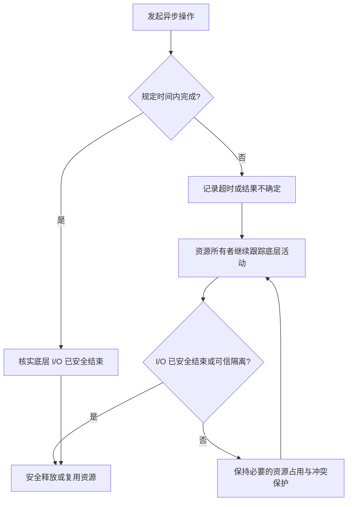

<p class="figure-caption">图 2-1 异步操作超时与资源安全释放流程</p>

对异步操作应区分超时、取消、异常和正常结束；不能仅凭调用方返回、Future/Task 取消或连接状态判断底层 I/O 已安全结束。

### 2.1.5 性能与资源有界原则

性能设计围绕明确的负载与质量要求展开，而不是无依据地增加并发或缓存。

<p class="table-caption">表 2-5 性能与资源有界设计要求</p>

| 设计要求 | 具体规定 |
|---|---|
| 负载模型 | 明确请求规模、并发规模、数据量及运行条件 |
| 容量约束 | 队列、线程、Task、连接、缓存及存储资源应有合理边界 |
| 背压 | 资源不足时明确等待、拒绝、丢弃或降级策略及适用条件 |
| 缓存 | 明确缓存用途、权威数据来源、失效与容量策略 |
| 性能指标 | 明确时延、吞吐、资源占用及测量口径 |
| 性能取舍 | 不得以违反正确性、安全性和可靠性约束换取性能 |

### 2.1.6 故障可控与恢复原则

设计应覆盖正常运行及合理预期的异常场景，明确故障影响范围和恢复条件。

<p class="table-caption">表 2-6 故障与恢复设计要求</p>

| 设计要求 | 具体规定 |
|---|---|
| 故障识别 | 明确可能的超时、通信失败、存储失败、任务异常和进程崩溃 |
| 故障隔离 | 限制故障传播，避免无关组件或资源被错误影响 |
| 状态可信 | 不将未知状态解释为确定成功或失败 |
| 重试与恢复 | 明确允许重试的条件，禁止可能产生危险副作用的盲目重试 |
| 持久化恢复 | 规定异常中断后的数据一致性及状态恢复规则 |
| 生命周期 | 明确启动、就绪、运行、关闭和重启期间的异常处理 |
| 失效行为 | 无法恢复时应有明确的降级、阻塞或停止服务条件 |

### 2.1.7 横切能力非侵入式原则

日志、审计、指标、追踪、权限校验等横切能力应与核心业务逻辑分离，优先通过统一的边界组件、装饰器、中间件或独立服务实现，不应将重复的技术处理流程散布在业务代码中。非侵入式不等于隐藏业务约束：凡影响业务准入、执行结果、事务一致性或故障处理的规则，必须在业务契约中明确，并保留必要的显式调用点。

<p class="table-caption">表 2-7 横切能力非侵入式设计要求</p>

| 设计要求 | 具体规定 |
|---|---|
| 职责分离 | 业务组件负责业务规则与状态转换；横切组件负责统一的记录、采集、校验与传输机制 |
| 边界统一 | 在服务入口、应用服务边界、消息发布边界等明确位置接入横切能力，避免各业务分支重复编排 |
| 最小侵入 | 不为记录日志、采集指标或传播追踪上下文而改变业务方法的核心控制流程和返回语义 |
| 审计正确性 | 审计事件的业务含义及产生时机由业务契约定义；持久化、投递、重试等通用机制与业务处理解耦，同时保证要求的一致性 |
| 故障影响 | 明确横切能力故障时的阻断、降级或重试规则；不得默认其失败不会影响业务，也不得默默吞掉必须处理的错误 |
| 可读性与验证 | 业务代码能够直接体现主流程；横切处理可独立测试，端到端测试验证其与业务契约一致 |

不为追求形式上的非侵入而引入复杂框架或过多抽象；简单、清晰的显式边界优先于难以追踪的隐式执行机制。

### 2.1.8 公共能力复用与冗余控制原则

优先使用符合需求的标准库、成熟软件包、现有工具及公共组件；相同且稳定的职责才提炼为公共能力，不重复发明、不为假设性扩展提前设计框架。

<p class="table-caption">表 2-8 公共能力复用与冗余控制要求</p>

| 设计要求 | 具体规定 |
|---|---|
| 复用优先 | 先评估现成组件是否满足功能、安全、性能及维护要求，再决定是否自行实现。 |
| 提炼公共职责 | 多模块存在稳定相同的职责时统一实现；业务规则留在所属业务模块。 |
| 控制依赖 | 核查成熟度、许可证、版本、安全维护及引入成本。 |
| 控制抽象 | 避免仅为减少少量重复而引入复杂框架或多层转发。 |
| 清理冗余 | 统一能力落地后删除重复、废弃和不必要的兼容实现。 |

### 2.1.9 图表表达与设计一致性原则

设计优先使用合适的图形和表格表达结构、流程、时序、状态及约束，图表不能代替必要的精确定义。

<p class="table-caption">表 2-9 图表表达与一致性设计要求</p>

| 设计要求 | 具体规定 |
|---|---|
| 视图完整 | 使用 4+1 架构视图组织系统设计，覆盖适用内容 |
| 图形选择 | 根据表达目的选择结构图、状态图、时序图、活动图等 |
| 图表一致 | 图形、表格和正文不得相互矛盾 |
| 跨章节一致 | 同一接口、状态、参数及资源规则保持一致 |
| 设计深度 | 明确影响系统行为的契约，允许自主选择内部实现细节 |
| 可验证性 | 关键设计要求应能够对应测试条件与验收证据 |

### 2.1.10 软件设计工作流程

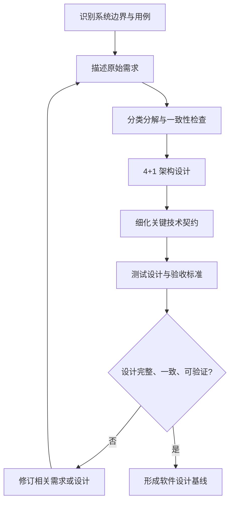

<p class="figure-caption">图 2-2 软件设计编制流程</p>

工作流程允许迭代，不要求传统瀑布式阶段。发现缺口或冲突时直接修订相关需求、架构视图或契约，不通过追加覆盖性条款解决。

## 2.2 需求体系及描述规范

需求采用“识别用例 → 逐条描述原始需求 → 分类分解 → 总分一致性检查”的方法。用例应从外部使用者及运行场景出发，覆盖适用的部署、启动、正常使用、配置、运维、正常关闭、重启及异常恢复过程；不局限于业务 RPC，也不将内部技术机制机械列为用例。用例识别属于需求分析，第 4 章用例视图负责表达参与者、边界及用例关系。

<p class="table-caption">表 2-10 原始需求描述字段</p>

| 字段 | 描述要求 |
|---|---|
| 编号 | 唯一原始需求标识，例如 `UR-01` |
| 名称 | 准确概括使用者需要的能力或运行场景 |
| 请求方（Requester） | 发起操作的外部系统、服务或接口，如 CLI、gRPC 客户端、进程管理系统；不要求是自然人 |
| 输入（Input） | 请求方向本系统提供的数据、参数和信息 |
| 反馈（Response） | 本系统返回请求方的确认、状态、结果及错误信息 |
| 目标方（Destination） | 接收本系统业务输出的外部系统、消息中间件或现场设备；没有时标记“不适用” |
| 业务输出（Output） | 本系统发往目标方的数据、消息或控制指令；没有时标记“不适用” |
| 业务规则（Business Rules） | 正常与异常业务处理、前置条件、执行顺序及结果判定 |
| 约束（Constraints） | 性能、可靠性、安全和横切能力的要求，尤其审计；描述应独立于具体技术实现 |

反馈与业务输出必须分开：反馈面向请求方，业务输出面向目标方；请求方与目标方可有多个，且请求方断连不必然撤销已接受的业务操作。

<p class="table-caption">表 2-11 分类需求体系与描述重点</p>

| 类别 | 核心问题 | 典型要求 |
|---|---|---|
| 功能需求（Functionality） | 系统提供什么行为 | 对外能力、业务流程、业务规则、输入输出与状态反馈 |
| 性能需求（Performance） | 运行速度与资源上限 | 时延、吞吐、并发、调度、公平性、容量、背压、资源消耗、扩展能力 |
| 可靠性需求（Reliability） | 故障时如何保持正确与恢复 | 容错、超时、重试、请求关联、事务、持久化、故障恢复、可用性、未结束操作的资源管理 |
| 安全需求（Safety & Security） | 如何防止危险或非法控制 | 控制权、互锁、失效安全、认证、授权、通信及数据安全 |
| 横切能力（Cross-cutting Concerns） | 如何观测、管理与追责 | 审计（操作证据、可靠投递、完整性、追溯）、日志、指标、追踪、配置、版本、可测试性、可维护性 |

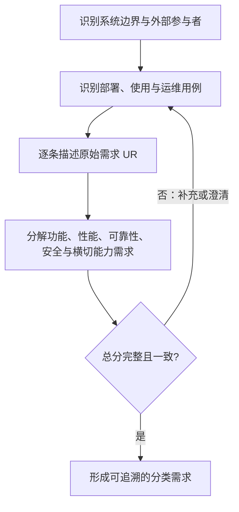

<p class="figure-caption">图 2-3 需求识别、分解与一致性检查流程</p>

分类需求必须从原始需求的输入、反馈、业务输出、规则和约束中推导，不得遗漏、矛盾或未经确认增加能力；多条原始需求的共同约束可以合并，但必须保留来源编号。每条分类需求应给出可核验条件，性能要求还需明确测量口径，不虚构现场阈值。审计应独立于普通日志定义，不得以运行日志代替审计证据。

需求分类与设计专题是不同维度：启动、正常关闭、重启及 Reload 属于跨需求的运行生命周期设计，统一在进程视图展开；相应行为和质量约束分别由原始需求及分类需求追溯。

## 2.3 4+1 架构视图：内涵、外延与表达规范

<p class="table-caption">表 2-12 4+1 架构视图的职责与成果</p>

| 视图 | 关注范围 | 主要成果 | 不应混淆 |
|---|---|---|---|
| 用例视图（+1） | 参与者、系统边界、典型/异常场景 | 系统上下文、用例、业务流程 | 不负责线程调度 |
| 逻辑视图（Logical） | 组件职责、模型、接口、状态规则、依赖 | 组件图、类/数据关系、状态图 | 不等于源码目录树 |
| 进程视图（Process） | 进程、线程、Event Loop、Task、协作、生命周期、同步、并发、资源、背压、缓存、故障恢复 | 运行结构图、任务所有权表、时序/状态/活动图、资源预算 | Task 不等于 OS 线程；图名须区分标准 UML 与示意图 |
| 开发视图（Development） | 软件模块边界、层次、静态依赖、公共契约与复用关系 | 模块图、依赖图、模块职责表 | 不描述真实并发拓扑，也不列现有代码修改清单 |
| 物理视图（Physical/Deployment） | 节点、进程部署、存储、网络、控制权和现场外部依赖 | 部署图、网络/故障域/外部依赖表 | 不是现场设备内部物理结构模型 |

### 2.3.1 用例视图的场景编写规范

用例以参与者的完整业务目标为单位组织，而非以原始需求、RPC 或内部模块为单位逐条改名。一项用例可以关联多项原始需求；一项原始需求也可以由多个业务场景共同覆盖。用例视图回答“在具体业务场景中系统如何工作”，不代替逻辑视图、进程视图和数据设计。

<p class="table-caption">表 2-13 业务场景用例的必备描述要素</p>

| 要素 | 编写规定 |
|---|---|
| 用例身份与目标 | 给出唯一编号、业务场景名称及参与者要达成的可观察目标；名称使用业务活动，不使用内部机制命名 |
| 参与者与触发条件 | 列明实际发起操作的外部角色；内部定时任务、恢复及发布等自动步骤不得虚构外部参与者 |
| 前置条件 | 列明系统就绪、授权、配置或数据存在等必要条件；不得混入未确认的实现假设 |
| 主业务流程 | 以 Mermaid 业务活动图（flowchart）为主要表达，覆盖触发、校验、关键处理、反馈及后置结果；以判断节点表达重要分支，避免大段编号文字复述 |
| 分支与异常流程 | 在活动图中呈现影响业务结果的主要异常出口；罕见或不宜展开的异常在简明说明表中概括，避免为了完整而画出所有技术异常 |
| 后置条件 | 明确成功和失败之后的业务状态、外部可见结果、未完成事项及后续查询方式 |
| 需求追溯 | 标明相关 UR；核对全部 UR 在真实场景中得到覆盖，但不要求 UR 与 UC 一一对应 |

跨用例共享的内部机制（如存储、审计发布和调度）应作为相关业务流程中的自动步骤或支撑行为描述；只有存在独立业务目标时才另立用例。应避免将一串 gRPC 方法名或 CRUD 操作直接当作完整用例，也不得在用例章节展开线程、锁、表结构及类方法等实现细节。

用例的正文采用“一张业务活动图 + 一张简明用例说明表”的表达形式。活动图包含主路径、必要判断以及重要异常分支；图中节点使用业务动作，不展开展示内部类、锁和数据库事务。说明表只填写参与者、业务目标、前置条件、主要异常、后置条件及关联需求。业务分支已在图中完整表达时，不再重复书写大段“主业务流程”和“异常流程”；复杂跨参与者消息时序可在独立小节补充时序图。图题和表题按文档约定独立编号。

进程视图应按四个设计专题组织，而不是按需求类别重复划分：

<p class="table-caption">表 2-14 进程视图的四类设计专题</p>

| 专题 | 必须明确的设计对象 | 推荐表达 |
|---|---|---|
| 运行时结构 | 进程、线程、Event Loop、Task、线程池、组件与资源所有权 | 分层运行结构图、Task 职责表 |
| 运行生命周期（Runtime Lifecycle） | 启动、初始化、就绪、运行、Reload、正常关闭、重启及其阶段转换 | 生命周期状态图、启动/关闭/Reload 时序图 |
| 并发与资源管理 | Task 协作、队列、通知、同步、调度、容量限额、背压、缓存及释放 | 任务协作时序图、资源与背压策略表 |
| 异常与恢复 | 超时、取消、故障隔离、未收敛 I/O、崩溃恢复与降级 | 故障状态图、异常裁决矩阵 |

各专题共享同一运行模型，明确创建者、所有者、同步关系和退出条件；不因分节而重复定义状态或资源。生命周期是进程视图的独立设计专题，不是第六类需求。

图表仅使用其可准确表达的语义：结构关系用 Mermaid Flowchart；行为交互用 Sequence Diagram；状态约束用 State Diagram；条件控制用活动/流程图。图题说明对象、范围及图类型。关键质量属性贯穿各视图，不能只写在单独的“非功能要求”段落。

## 2.4 测试设计方法、组织及验收规范

测试设计以测试层级组织物理目录，以 Marker 描述测试层级、测试专题与运行场景。测试文件名应清楚表达验证对象或行为；测试文件及其标记、验证说明统一登记在测试矩阵中。需求、用例及重要技术契约必须能追溯到实际测试，不为同一目的建立重复测试体系。

<p class="table-caption">表 2-15 测试层级与目录规范</p>

| 层级 Marker | 物理目录 | 验证范围 |
|---|---|---|
| `unit` | `unit/` | 状态转换、业务规则、纯逻辑，无外部服务依赖 |
| `component` | `component/` | 单组件职责及其可控依赖 |
| `integration` | `integration/` | 组件之间及真实外部依赖的接口协作 |
| `system` | `system/` | 独立进程、完整业务场景及端到端行为 |

<p class="table-caption">表 2-16 测试 Marker 与矩阵编制规范</p>

| 事项 | 规范 |
|---|---|
| 层级 Marker | 每项测试必须且仅属于 `unit`、`component`、`integration`、`system` 之一，与目录对应 |
| 专题 Marker | 标识可靠性、安全、性能等验证主题，可与层级及场景 Marker 叠加；无专项主题时可为空 |
| 场景 Marker | 标识并发、超时、恢复、负载、现场等执行条件或情境；有相应场景时标记 |
| 测试矩阵 | 至少包含“测试文件名、层级 Marker、专题 Marker、场景 Marker、测试说明”五列；每项重要测试应有可定位的文件归属 |
| 标记粒度 | 标记以具体测试函数或类为准；同文件可包含不同专题与场景，矩阵列出涉及的 Marker |
| 运行条件 | 通过 Fixture 和环境准备明确外部依赖；现场专用测试与常规回归分离，未执行不视为通过 |
| 执行规则 | 提供按目录、Marker 及其布尔组合的 pytest 命令；所有 Marker 在项目配置中注册 |
| 可追溯性 | 测试说明与需求、用例或技术契约对应；行为变更时同步检查测试及矩阵 |
| 验收证据 | 保留运行环境、命令、实际结果、指标和未验证项，禁止把设计目标当作测试结果 |

目录划分测试层级，专题与场景通过 Marker 横向组合；可靠性测试不单独设第五类目录。测试矩阵用于定位和筛选测试，不预设每个实现文件必须存在，也不要求每个文件仅能有一种测试场景。

### 2.4.1 测试依据及 System 覆盖要求

各层级测试必须依据已确认的设计成果编制；System Test 以用例视图为主基线，以原始需求及技术契约补充覆盖，不得由测试人员凭经验任意缩减范围。

<p class="table-caption">表 2-17 各测试层级的设计依据</p>

| 测试层级 | 主要依据 | 验证重点 |
|---|---|---|
| Unit | 详细设计、函数及算法契约 | 纯逻辑、状态转换、参数及边界规则 |
| Component | 逻辑视图、组件职责及内部接口契约 | 单组件行为、依赖协作及异常处理 |
| Integration | 接口与通信契约、开发视图、物理视图 | 真实接口调用、跨组件通信及外部依赖 |
| **System** | **用例视图（UC）及原始需求（UR）**，并补充接口、运行、部署、安全及性能约束 | **从真实 CLI 操作入口验证完整业务目标、关键异常、边界与恢复行为** |

System Test 必须遵守以下规定：

1. **用例覆盖率 100%**：每项 UC 至少有一项 System Test 作为验证证据；同一测试可以覆盖多个 UC，同一 UC 可以由多个测试覆盖，**不按测试数量与 UC 数量的大小关系判定覆盖**。
2. **规定场景覆盖率 100%**：每项 UC 明确的主流程、关键分支、异常流程、边界和恢复场景均必须有对应 System Test；不能仅以一条正常路径代表整个 UC 已覆盖。
3. **需求覆盖率 100%**：每项 UR 必须能够经一个或多个 UC 追溯至 System Test；若某项需求未能被 UC 覆盖，必须先补全用例，不得直接以技术测试代替业务用例。
4. **技术约束补充覆盖**：用例未充分表达的性能、容量、并发、安全、权限、超时和可靠性要求，依据对应技术契约补充测试；不得因 UC 未逐项列出而豁免。
5. **真实系统边界**：System Test 通过真实 CLI 进程和真实通信/运行基础设施执行。涉及 containerd、iSulad、systemd 的用例必须分别在对应真实管理器上验证；允许在真实容器或 Service Unit 中运行模拟下游业务组件，Mock 不得代替运行基础设施验收。
6. **覆盖与通过分开裁定**：测试已关联不等于已执行；失败、跳过及未运行均不得计为通过。验收报告分别给出需求覆盖、用例及场景覆盖、执行情况和通过情况；缺少真实环境时标记 `NOT_RUN`，不得用模拟结果替代。
7. **变更同步**：任何 UR、UC、接口或行为约束的新增、删除、调整，必须同步核查 System Test、测试矩阵和验收条款；新增 UC 不得留下无测试映射。

<p class="table-caption">表 2-18 System Test 追溯矩阵规范</p>

| 字段 | 要求 |
|---|---|
| UR 编号 | 被验证的原始需求编号，可列多个 |
| UC 编号与场景 | 用例编号及主流程、异常、边界或恢复场景标识 |
| 技术契约 | 相关接口、配置、运行或安全约束的章节编号；没有则记“—” |
| 测试文件名／测试标识 | 可定位的 System Test 文件名及测试函数或参数化场景标识 |
| 层级／专题／场景 Marker | 层级固定为 `system`，其余按第 2.4 节定义填写 |
| 验证内容与预期结果 | 从用户可观察行为与副作用表述判定依据 |
| 执行环境及结果 | 真实依赖、执行证据、`PASS`／`FAIL`／`SKIP`／`NOT_RUN` 等状态 |

追溯链为 **UR → UC／用例场景 → System Test → 执行结果与证据**，技术契约作为补充依据进入相应测试。第 4 章负责编制完整 UC 和场景，第 14 章依据本规范给出实际测试矩阵及验收安排，两章必须双向核对。

# 3. 软件需求

**当前设计契约基线**：`main@14e3be661cfd1d30417144d3f4cfa928d313eaa5`。外部 RPC/消息以 `src/contracts/*.proto` 和《Contracts 软件设计 v1_6》为准；早期 CLI v1_1 与旧 main SHA 只作为历史修订来源，不代表当前 RPC 契约。

CLI 是 wind-hub 的统一管理、控制、调试和诊断客户端。其业务输出为发往 Service 的 gRPC 请求、发往进程管理器的操作请求以及 CLI 本地网络探测；现场操作和权威业务状态归对应 Service 所有。第 3.1 节是已确认的需求范围，第 3.2 节将其分解为可核验要求。

## 3.1 原始需求

### 3.1.1 原始需求总表

<p class="table-caption">表 3-1 CLI 原始需求总表</p>

| 编号 | 类别 | 原始需求 | 用户目标 | 数据源 / 执行方 |
|---|---|---|---|---|
| UR-01 | 操作入口 | 命令交互与执行 | 通过交互终端或脚本执行 CLI 命令 | CLI 本地、各 Service |
| UR-02 | 服务管理 | 服务进程生命周期管理 | 启动、停止、重启指定 Service | 进程/容器管理器 |
| UR-03 | 服务管理 | 服务状态与能力查询 | 查询服务身份、运行状态、健康及支持能力 | 各 Service gRPC |
| UR-04 | 配置管理 | 配置快照管理 | 获取、推送和应用 Service 完整配置 | 各 Service gRPC |
| UR-05 | 配置管理 | 配置比较 | 比较两个完整 `configs/` 目录快照的文件差异 | CLI 本地文件系统 |
| UR-06 | 业务管理 | 业务对象查询与管理 | 查询设备、测点、任务等对象，并执行相应管理操作 | 各 Service gRPC |
| UR-07 | 监视与读取 | 跨模块数据与运行状态监视 | 读取 Collector 缓存测点、Gateway 当前变量，以及各模块提供的设备/任务/交付/生成状态；支持允许的周期刷新 | Collector、Gateway 及各 Service gRPC |
| UR-08 | 远程诊断 | 调用远程 Service 诊断能力 | 执行单服务或跨服务诊断，终端显示诊断结果并支持导出报告 | 各 Service gRPC |
| UR-09 | 控制与写入 | 跨模块业务控制及授权写入 | 经 Commander 执行真实设备控制；经 Gateway 更新内部变量；控制 Collector 采集任务、Sink Delivery、Gateway 实例与 Data Generator 生成任务 | Commander、Gateway、Collector、Sink、Data Generator gRPC |
| UR-10 | 本地诊断 | CLI 本地网络探测 | 扫描网段可达 IP、指定 IP 常用工业 TCP 端口、指定 IP/Port | CLI 本地网络工具 |
| UR-11 | 运行监控 | 运行指标与事件查询 | 查询各 Service 的运行指标、故障事件和发布状态 | 各 Service gRPC |

### 3.1.2 UR-01 命令交互与执行

<p class="table-caption">表 3-2 UR-01 命令交互与执行</p>

| 字段 | 描述 |
|---|---|
| 请求方（Requester） | 操作人员、自动化脚本 |
| 触发方式（Trigger） | 终端：启动 Shell 后输入命令，或命令行单次调用 |
| 输入（Input） | 命令、参数、交互式 Shell 或非交互命令、输出格式、目标 Service |
| 反馈（Response） | 格式化结果、错误信息及单次命令退出码 |
| 目标方（Destination） | 按命令选择 Service、进程管理器或 CLI 本地环境；纯帮助命令不适用 |
| 业务输出（Output） | 对应远程请求或本地操作 |
| 业务规则（Business Rules） | 提供交互式及单次调用；所有模式使用相同命令模型、参数校验和业务语义；执行结果默认打印到终端 |
| 约束（Constraints） | 启动只依赖 CLI 自身配置，不依赖其他 Service 的 `configs/`；错误码、退出码一致，凭据不输出到屏幕或历史 |

### 3.1.3 UR-02 服务进程生命周期管理

<p class="table-caption">表 3-3 UR-02 服务进程生命周期管理</p>

| 字段 | 描述 |
|---|---|
| 请求方（Requester） | 授权操作人员、自动化脚本 |
| 触发方式（Trigger） | 终端/API：操作人员发起进程 start/stop/restart/status |
| 输入（Input） | Service 名称、部署目标、start/stop/restart 指令 |
| 反馈（Response） | 管理器受理结果、进程状态、就绪核验结果及错误 |
| 目标方（Destination） | 进程或容器管理器 |
| 业务输出（Output） | 进程启动、停止和重启操作请求 |
| 业务规则（Business Rules） | 通过外部管理器执行；不能通过尚未启动的 Service 自身 gRPC 启动它；管理器操作成功与业务就绪分别判断 |
| 约束（Constraints） | 授权与审计、操作超时、目标不存在或管理器不可用的显式反馈；CLI 不接管服务内部运行生命周期 |

### 3.1.4 UR-03 服务状态与能力查询

<p class="table-caption">表 3-4 UR-03 服务状态与能力查询</p>

| 字段 | 描述 |
|---|---|
| 请求方（Requester） | 操作人员、自动化脚本 |
| 触发方式（Trigger） | 终端/API：查询服务信息、健康或能力 |
| 输入（Input） | Service 名称、查询项 |
| 反馈（Response） | 身份、版本、进程/业务状态、健康和能力清单 |
| 目标方（Destination） | 对应 Service gRPC Server |
| 业务输出（Output） | 服务信息、状态、能力查询 RPC |
| 业务规则（Business Rules） | 区分 gRPC 可达、服务健康、功能可用；不支持的能力明确报告 |
| 约束（Constraints） | 认证授权、调用超时、敏感信息脱敏 |

### 3.1.5 UR-04 配置快照管理

<p class="table-caption">表 3-5 UR-04 配置快照管理</p>

| 字段 | 描述 |
|---|---|
| 请求方（Requester） | 授权操作人员、自动化脚本 |
| 触发方式（Trigger） | 终端/API：执行配置 Get/Push/Apply |
| 输入（Input） | Service、Get/Push/Apply 操作、完整候选快照、候选标识及预期版本 |
| 反馈（Response） | 磁盘/运行/候选快照、Push 校验结果、Apply 文件提交与运行生效结果、重启要求 |
| 目标方（Destination） | 对应 Service gRPC Server |
| 业务输出（Output） | `GetConfigSnapshot`、`PushConfigSnapshot`、`ApplyConfigSnapshot` RPC |
| 业务规则（Business Rules） | Get 获取完整配置；Push 校验后整体暂存、不修改正式文件或运行状态；Apply 替换正式文件，对 Instance/Template 变更热更新受影响对象；Service 配置变更报告 `RESTART_REQUIRED`；文件提交与运行生效分别报告 |
| 约束（Constraints） | Schema/版本/引用校验、冲突保护、文件集合一致性、失败恢复、部分热更新结果可追溯、服务端授权与审计；CLI 不直接修改正式服务文件 |

### 3.1.6 UR-05 配置比较

<p class="table-caption">表 3-6 UR-05 配置比较</p>

| 字段 | 描述 |
|---|---|
| 请求方（Requester） | 操作人员、自动化脚本 |
| 触发方式（Trigger） | 终端：显式指定两个本地目录进行 Diff |
| 输入（Input） | 两个显式指定的完整 `configs/` 目录路径 |
| 反馈（Response） | 两个目录文件数量与总容量、增减量；仅一侧存在的文件清单、内容修改文件清单和共同文件的文本逐行差异 |
| 目标方（Destination） | CLI 本地终端；按需保存为本地报告 |
| 业务输出（Output） | 文件级统计、差异清单及文本 Unified Diff；不发送任何业务 RPC |
| 业务规则（Business Rules） | 递归扫描两个完整目录；以相对路径对应文件，统计文件总数和字节数；对共同文件按实际内容比较；文本输出逐行差异，二进制只标记不同及字节数；过程只读 |
| 约束（Constraints） | 不依赖 Service 在线或 CLI 加载业务配置；不解析 YAML Schema；限制输出量，报告不可读文件/权限错误；不得泄露敏感配置值（需脱敏或受控显示） |

### 3.1.7 UR-06 业务对象查询与管理

<p class="table-caption">表 3-7 UR-06 业务对象查询与管理</p>

| 字段 | 描述 |
|---|---|
| 请求方（Requester） | 操作人员、授权自动化脚本 |
| 触发方式（Trigger） | 终端/API：查询或变更业务对象 |
| 输入（Input） | Service、对象类型、ID、查询过滤与分页参数；受支持的管理动作及预期版本 |
| 反馈（Response） | 对象列表、详情、状态、变更受理及执行结果 |
| 目标方（Destination） | 对应业务 Service gRPC Server |
| 业务输出（Output） | 列表/详情查询、任务启停、Gateway 变量发现/批量更新/读回确认等业务管理 RPC |
| 业务规则（Business Rules） | 业务对象及运行期望状态由 Service 维护；CLI 只发出操作请求，读取权威结果；Gateway 的 `ListVariables`、`ClaimTargets`、`UpdateVariables`、`ReadVariables` 使用同一变量标识，形成发现→更新→结果反馈→读回确认闭环；变量更新仅修改 Gateway 内部变量存储，不触发现场控制；请求超时不等于后台操作未执行 |
| 约束（Constraints） | 分页、权限、并发冲突保护；对有副作用操作由 Service 审计 |

### 3.1.8 UR-07 跨模块数据与运行状态监视

<p class="table-caption">表 3-8 UR-07 跨模块数据与运行状态监视</p>

| 字段 | 描述 |
|---|---|
| 请求方（Requester） | 操作人员、自动化脚本 |
| 触发方式（Trigger） | 终端：单次查询或显式启动/终止周期监视；不要求 Server 提供 Streaming RPC |
| 输入（Input） | 模块、目标对象 ID、测点/变量 ID、筛选与分页参数、刷新间隔及输出方式 |
| 反馈（Response） | 原始数据与采样时间、质量、逐项错误；或设备、采集任务、Delivery、Gateway、Generation 的期望/实际状态、更新时间与错误（以对应 Proto 实际字段为准） |
| 目标方（Destination） | Collector、Industrial Gateway、Commander、Sink Service、Data Generator 的 gRPC Server |
| 业务输出（Output） | Collector `ReadPoints`、Gateway `ReadVariables`；各模块 `List*`/`Get*`、公共 `GetServiceStatus` 等只读 RPC。CLI 按选定范围轮询 Unary 请求 |
| 业务规则（Business Rules） | **值监视**：Collector `ReadPoints` 执行一次现场主动读取，不读取采集缓存；它不创建周期采集任务或自动向 NATS 发布；Gateway 显示其内部变量，不主动读真实 PLC。**状态监视**：Commander 提供可控设备和命令结果，Sink 提供 Delivery 状态，Data Generator 提供 Generation 状态，Collector/Gateway 提供任务或实例状态；这些状态查询不能冒充实时测点值。各模块只返回契约可提供的字段，不创建假读数或假 RPC；持续模式由 CLI 轮询实现 |
| 约束（Constraints） | 各目标独立 deadline，轮询不重入/不积压；区分采样时间与查询/刷新时间；质量、过期、缺测、部分失败与断连均可见；客户端取消只结束本地监视，不停止服务任务 |

<p class="table-caption">表 3-8a 各模块监视能力边界</p>

| 模块 | 可读取对象/值 | 实际 RPC | 不支持或不得推断的能力 |
|---|---|---|---|
| Collector | 一次性主动读取的测点值、设备/测点元数据、采集任务、发布状态 | `ReadPoints`、`ListDevices/GetDevice`、`ListPoints/GetPoint`、`ListTasks/GetTask`、`GetPublishingStatus` | `ReadPoints` 是一次性现场主动读，不是缓存读取、Streaming 或 NATS 发布 |
| Commander | 可控设备、可写点元数据、既有命令结果 | `ListDevices/GetDevice/ListPoints/GetCommandResult` | **无现场实时值读取 RPC**；`ListPoints` 不返回当前值 |
| Sink Service | Delivery 配置、期望/实际状态与错误 | `ListDeliveries/GetDelivery` | **无单个 Sink 数据值读取 RPC** |
| Industrial Gateway | Gateway 实例状态、变量元数据及内部变量当前值 | `ListGateways/GetGateway/ListVariables/ReadVariables` | `ReadVariables` 不向真实 PLC 主动读取 |
| Data Generator | 虚拟设备、场景与 Generation 运行状态 | `ListDevices/GetDevice/ListScenarios/GetGeneration` | **无模型实时输出样本读取 RPC**；需要值时只能在其实际输出目标 Gateway 的授权可见变量中读取 |
| 各服务公共能力 | 健康、指标、事件、诊断证据 | `GetServiceStatus/GetMetrics/GetEvents/Diagnose` | 指标/诊断结果不等同于设备测点实时值 |

### 3.1.9 UR-08 调用远程 Service 诊断能力

<p class="table-caption">表 3-9 UR-08 调用远程 Service 诊断能力</p>

| 字段 | 描述 |
|---|---|
| 请求方（Requester） | 操作人员、自动化脚本 |
| 触发方式（Trigger） | 终端/API：单服务或跨服务诊断请求 |
| 输入（Input） | Service、对象、诊断类型、参数、范围及超时；可选报告路径 |
| 反馈（Response） | 分阶段状态、耗时、错误、原始证据、总体结论和报告输出状态 |
| 目标方（Destination） | Collector、Commander、Sink Service、Industrial Gateway 等对应 gRPC Server |
| 业务输出（Output） | 各 Service 诊断 RPC；CLI 将诊断结果打印到终端，并支持导出 JSON |
| 业务规则（Business Rules） | Service 负责自身网络/协议/业务诊断；Collector 支持主动读取、原生批量读取、监听及 IEC104 总召；CLI 负责跨 Service 诊断编排及结果汇总，不直接操作协议 Driver |
| 约束（Constraints） | 明确执行位置、阶段证据及未覆盖项；Collector 发布成功不代表 Sink 已写库；远程 I/O 安全收敛由执行 Service 负责 |

### 3.1.10 UR-09 跨模块业务控制与授权写入

<p class="table-caption">表 3-10 UR-09 跨模块业务控制与授权写入</p>

| 字段 | 描述 |
|---|---|
| 请求方（Requester） | 授权操作人员、自动化脚本 |
| 触发方式（Trigger） | 终端：显式提交写入、启停操作或结果查询；不隐式执行控制 |
| 输入（Input） | 模块、目标对象、动作、预期版本；现场控制时提供可写点/目标值/有效期；Gateway 更新时提供变量和值及服务端要求的租约参数 |
| 反馈（Response） | 受理/拒绝、期望与实际状态、逐项写入结果、命令 ID 或错误、未知状态及后续权威查询方式 |
| 目标方（Destination） | Commander、Industrial Gateway、Collector、Sink Service、Data Generator 对应 gRPC Server |
| 业务输出（Output） | Commander `SubmitCommand/GetCommandResult`；Gateway `ClaimTargets/UpdateVariables`、`StartGateway/StopGateway`；Collector `StartTask/StopTask`；Sink `StartDelivery/StopDelivery`；Data Generator `StartGeneration/StopGeneration` |
| 业务规则（Business Rules） | 将**现场设备写入**与**Gateway 内部变量更新**严格区分：真实 PLC 写入只能通过 Commander；Gateway 更新仅写本地变量存储并需有效 lease_token，不触发 Commander；其余 Start/Stop 仅改变相应业务任务或实例的运行期望，不等于 OS 容器启停。CLI 不持有权威状态，操作后通过对应 Get/List/Read 查询；未知受理不可盲目重试 |
| 约束（Constraints） | 服务端鉴权授权、预期 revision、审计、deadline、幂等与并发由所属 Service 裁决；租约失败/过期不得更新；不同服务的控制含义不能用一个泛化 RPC 掩盖；CLI 显示部分成功和 I/O 未收敛等真实语义 |

<p class="table-caption">表 3-10a 跨模块控制动作映射</p>

| 业务目标 | 控制 RPC | 结果/复核 RPC | 副作用边界 |
|---|---|---|---|
| 真实 PLC 设定值 | Commander `SubmitCommand` | `GetCommandResult` | 现场写入；受理未知不重发 |
| Gateway 内部变量值 | Gateway `ClaimTargets` + `UpdateVariables` + `ClaimTargets` RELEASE | `ReadVariables` | 内部存储更新；令牌由 Gateway 管理，读回不是历史执行证明 |
| Collector 采集任务 | `StartTask/StopTask` | `GetTask` | 采集任务期望状态 |
| Sink Delivery | `StartDelivery/StopDelivery` | `GetDelivery` | 指定派发任务期望状态 |
| Gateway 业务实例 | `StartGateway/StopGateway` | `GetGateway` | Gateway 实例启停，不启动宿主进程 |
| Data Generator 生成任务 | `StartGeneration/StopGeneration` | `GetGeneration` | 生成任务启停，不启动宿主进程 |

### 3.1.11 UR-10 CLI 本地网络探测

<p class="table-caption">表 3-11 UR-10 CLI 本地网络探测</p>

| 字段 | 描述 |
|---|---|
| 请求方（Requester） | 操作人员、自动化脚本 |
| 触发方式（Trigger） | 终端：执行网段、工业端口或指定 TCP 探测 |
| 输入（Input） | 三选一：`scan CIDR`；`industrial IP`；`tcp IP PORT`；可选超时 |
| 反馈（Response） | 网段可达 IP 与延迟；工业常用端口 OPEN/CLOSED/TIMEOUT 与协议提示；指定 IP/Port 的 TCP 建连结果及耗时 |
| 目标方（Destination） | CLI 所在主机网络栈、用户指定网段/主机 |
| 业务输出（Output） | 一次性 ICMP 扫描或 TCP Connect 探测，结果打印终端 |
| 业务规则（Business Rules） | `net scan` 扫描 CIDR 内 ICMP 可达主机；`net industrial` 扫描固定工业 TCP 端口预设；`net tcp` 仅探测指定 TCP 端口；三种命令均一次完成；开放端口不代表协议握手成功 |
| 约束（Constraints） | 仅扫描授权网络；手工指定地址，不依赖 Service 配置；限定 CIDR 范围、并发、超时；无 ICMP 回复不等于设备离线；无协议读写 |

### 3.1.12 UR-11 运行指标与事件查询

<p class="table-caption">表 3-12 UR-11 运行指标与事件查询</p>

| 字段 | 描述 |
|---|---|
| 请求方（Requester） | 操作人员、自动化脚本 |
| 触发方式（Trigger） | 终端/API：查询指标、事件或发布状态 |
| 输入（Input） | Service、指标/事件类型、时间窗口、筛选条件 |
| 反馈（Response） | 运行指标、故障/恢复事件、发布与交付状态、更新时间 |
| 目标方（Destination） | 对应 Service gRPC Server |
| 业务输出（Output） | 指标、事件、发布/交付状态查询 RPC |
| 业务规则（Business Rules） | 运行指标由 Service 提供，区分瞬时量、累计量、窗口统计；机组测点实时监视归 UR-07 |
| 约束（Constraints） | 查询容量、分页或时间窗口限制、身份认证及脱敏 |

## 3.2 分类需求

### 3.2.1 功能需求

<p class="table-caption">表 3-13 功能需求</p>

| 编号 | 可核验要求 | 来源 |
|---|---|---|
| FR-01 | 统一支持单次命令和交互式 Shell，输出结果、错误与退出码 | UR-01 |
| FR-02 | 通过 containerd、iSulad 或 systemd 管理 Service 启停与重启，查询就绪结果 | UR-02 |
| FR-03 | 查询 Service 身份、状态、健康及能力信息 | UR-03 |
| FR-04 | 对完整 Service 配置执行 Get/Push/Apply，Push 不生效，Apply 报告磁盘和运行态结果 | UR-04 |
| FR-05 | 使用两个显式本地目录递归比较整个 `configs/`：文件数、总字节数、增删改及文本 Diff | UR-05 |
| FR-06 | 经 Service 查询设备、点、任务等对象并执行其提供的业务管理操作；Gateway 支持通过 `ListVariables`、`ClaimTargets`、`UpdateVariables`、`ReadVariables` 完成租约保护的批量变量读写及读回确认 | UR-06 |
| FR-07 | 支持 Collector `ReadPoints`、Gateway `ReadVariables` 的当前值读取及五服务对象/任务/交付/生成状态查询；按目标 Unary RPC 周期轮询，不创建额外数据流接口 | UR-07 |
| FR-08 | 经 Service 执行远程通信/业务诊断并显示结果，CLI 编排跨服务诊断及导出报告 | UR-08 |
| FR-09 | 按表 3-10a 提供 Commander 现场控制、Gateway 租约变量更新及 Collector/Sink/Gateway/Data Generator 业务任务启停；各类副作用分别报告，不混用结果语义 | UR-09 |
| FR-10 | `net scan CIDR` 一次性扫描 ICMP 可达 IP | UR-10 |
| FR-11 | `net industrial IP` 一次性扫描预设工业 TCP 端口 | UR-10 |
| FR-12 | `net tcp IP PORT` 一次性探测 TCP 建连结果 | UR-10 |
| FR-13 | 查询各 Service 指标、事件、发布或交付状态 | UR-11 |

### 3.2.2 性能需求

<p class="table-caption">表 3-14 性能与资源需求</p>

| 编号 | 可核验要求及口径 | 来源 |
|---|---|---|
| PR-01 | 服务 Endpoint 共享 gRPC Channel；分别测量 CLI 请求端到端耗时和服务返回的执行耗时，不混同 | UR-03、UR-04、UR-06～UR-09、UR-11 |
| PR-02 | 列表和事件查询分页或窗口有界；周期轮询仅保留当前界面所需数据，不无限累积样本 | UR-06、UR-07、UR-08、UR-11 |
| PR-03 | 对所有监视目标的 Unary 轮询均不得重入或积压；慢响应跳过到期轮次，各 Endpoint 独立限流并限制界面刷新速率 | UR-07 |
| PR-04 | 一次性网段扫描限制主机数量、并发探针及单目标超时；统计实际扫描数与总耗时 | UR-10 |
| PR-05 | 远程诊断设置各阶段与总体超时；远程诊断仅执行一次 RPC；需要重复查询时由 CLI 按有界周期调度，禁止叠加请求 | UR-08 |

### 3.2.3 可靠性需求

<p class="table-caption">表 3-15 可靠性需求</p>

| 编号 | 可核验要求 | 来源 |
|---|---|---|
| RR-01 | CLI 启动不依赖 Service 在线或其配置目录；单个 Service 故障不得阻断独立命令 | UR-01、UR-03、UR-10 |
| RR-02 | Push 校验失败不暂存部分快照；Apply 分别报告文件提交和运行生效，部分失败不得谎报全成功 | UR-04 |
| RR-03 | 本地目录比较只读，遇文件读取错误明确报告；不生成伪完整比较结论 | UR-05 |
| RR-04 | gRPC 客户端取消、超时或断开不代表远程操作结束；对已提交副作用操作不得盲重试 | UR-02、UR-04、UR-06、UR-08、UR-09 |
| RR-05 | Collector 与 Gateway 值监视区分无值、过期、逐点失败、轮询失败与断连；业务状态查询区分未提供与运行异常；停止本地轮询不改变任何 Service 业务运行状态 | UR-07 |
| RR-06 | 跨服务诊断保留各阶段证据与未执行项；无法证实端到端成功时返回 UNKNOWN 或 PARTIAL | UR-08 |
| RR-07 | 网段扫描探测失败不阻断其他地址；资源句柄和子进程按规定安全释放 | UR-10 |

### 3.2.4 安全需求

<p class="table-caption">表 3-16 安全需求</p>

| 编号 | 可核验要求 | 来源 |
|---|---|---|
| SR-01 | 使用安全的 gRPC 身份认证，Service 对实际操作进行授权，CLI 不越权执行 | UR-03、UR-04、UR-06～UR-09、UR-11 |
| SR-02 | CLI 不实例化现场协议 Driver，不修改 Service 正式配置文件、数据库或权威运行状态 | UR-04、UR-06～UR-09 |
| SR-03 | 真实 PLC 控制仅经 Commander；Gateway 内部变量更新必须通过目标租约及服务端授权；任务启停按服务所属权限审计，CLI 不绕过 Server | UR-09 |
| SR-04 | 配置提交、任务状态修改、进程控制等敏感操作需要授权并可追溯 | UR-02、UR-04、UR-06 |
| SR-05 | 配置 Diff 和报告输出对密钥、证书私钥、Token 等敏感信息采取脱敏或限制明文显示 | UR-01、UR-04、UR-05、UR-08 |
| SR-06 | 网络扫描限制于经授权目标及预设范围，不执行端口暴力扫描或协议写入 | UR-10 |

### 3.2.5 横切能力需求

<p class="table-caption">表 3-17 横切能力需求</p>

| 编号 | 可核验要求 | 来源 |
|---|---|---|
| CR-01 | 所有命令共用稳定输出结构、错误码、退出码和单次/交互式执行规则 | UR-01～UR-11 |
| CR-02 | 远程接口统一采用 `src/contracts/` 权威 Proto；CLI 为 Client，Service 为 Server | UR-03、UR-04、UR-06～UR-09、UR-11 |
| CR-03 | 统一管理 gRPC 连接、调用 deadline、认证、追踪和客户端取消 | UR-03、UR-04、UR-06～UR-09、UR-11 |
| CR-04 | 服务未实现、能力不支持、连接不可达和业务失败必须分别反馈，不允许隐式 Driver 回退 | UR-03、UR-06～UR-09 |
| CR-05 | 诊断阶段结果、错误、时间戳和证据可追溯；报告与普通日志分离 | UR-08、UR-10、UR-11 |
| CR-06 | 测试覆盖需求、用例、接口和主要异常场景；真实测试结果与设计目标严格区分 | UR-01～UR-11 |

## 3.3 追溯与接口归属

<p class="table-caption">表 3-18 原始需求到分类需求追溯</p>

| UR | 功能 | 性能/可靠性 | 安全/横切 |
|---|---|---|---|
| UR-01 | FR-01 | RR-01 | SR-05、CR-01、CR-06 |
| UR-02 | FR-02 | RR-04 | SR-04、CR-01、CR-06 |
| UR-03 | FR-03 | PR-01、RR-01 | SR-01、CR-02～CR-04 |
| UR-04 | FR-04 | PR-01、RR-02、RR-04 | SR-01、SR-02、SR-04、SR-05、CR-02～CR-04 |
| UR-05 | FR-05 | RR-03 | SR-05、CR-01、CR-06 |
| UR-06 | FR-06 | PR-01、PR-02、RR-04 | SR-01、SR-02、SR-04、CR-02～CR-04 |
| UR-07 | FR-07 | PR-01～PR-03、RR-05 | SR-01、SR-02、CR-02～CR-04 |
| UR-08 | FR-08 | PR-01、PR-02、PR-05、RR-04、RR-06 | SR-01、SR-02、SR-05、CR-02～CR-05 |
| UR-09 | FR-09 | PR-01、RR-04 | SR-01～SR-03、CR-02～CR-04 |
| UR-10 | FR-10～FR-12 | PR-04、RR-01、RR-07 | SR-06、CR-01、CR-05 |
| UR-11 | FR-13 | PR-01、PR-02 | SR-01、CR-02～CR-05 |

<p class="table-caption">表 3-19 Collector 目标 RPC 与需求归属</p>

| 接口组 | RPC | UR |
|---|---|---|
| 服务管理（3） | `GetServiceInfo`、`GetServiceStatus`、`GetCapabilities` | UR-03 |
| 配置管理（3） | `GetConfigSnapshot`、`PushConfigSnapshot`、`ApplyConfigSnapshot` | UR-04 |
| 设备与测点（5） | `ListDevices`、`GetDevice`、`ListPoints`、`GetPoint`、`ReadPoints` | UR-06、UR-07 |
| 采集任务（4） | `ListTasks`、`GetTask`、`StartTask`、`StopTask` | UR-06 |
| 运行监控（3） | `GetMetrics`、`GetEvents`、`GetPublishingStatus` | UR-11 |
| 诊断（2） | 公共 `Diagnose`、专属 `InterrogateDevice` | UR-08 |

Collector 读取契约统一为一次性 Unary `ReadPoints`；持续读取由 CLI 周期轮询实现。各公共 RPC 统一在Contracts v1_7 定义。

# 4. 用例视图

## 4.1 系统上下文

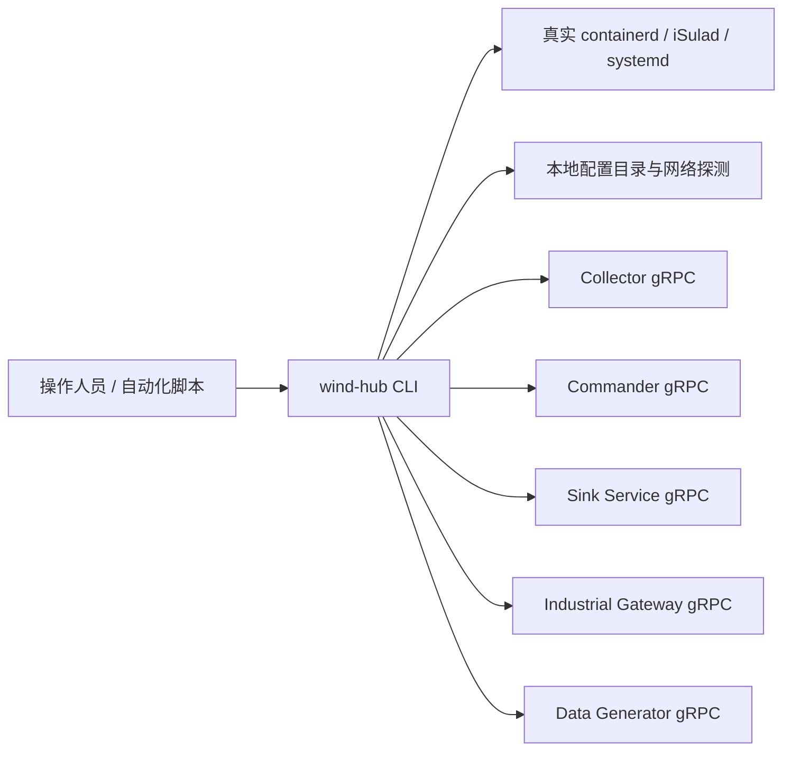

<p class="figure-caption">图 4-1 CLI 系统上下文图</p>

用例覆盖第 3 章全部 11 项 UR。各 UC 的场景以 `UC-xx-S01`（主流程）、`S02`（关键边界）、`S03`（异常/恢复）编号，每个场景中的并列条件都须由参数化或独立测试逐项验证；每个场景须有可追溯的 System Test。业务图展示主要流程，具体边界以用例表为准。

<p class="table-caption">表 4-1 用例—需求总表</p>

| 用例 | 目标 | 关联需求 |
|---|---|---|
| UC-01 | 启动 Shell 并执行命令 | UR-01 |
| UC-02 | 管理容器或 Linux 服务进程 | UR-02 |
| UC-03 | 查询服务身份、健康与能力 | UR-01、UR-03 |
| UC-04 | 获取、推送和应用完整配置快照 | UR-04 |
| UC-05 | 比较两套本地完整配置目录 | UR-05 |
| UC-06 | 查询 Collector 设备、测点与采集任务 | UR-06 |
| UC-07 | 控制 Collector 采集任务 | UR-06、UR-09 |
| UC-08 | 监视 Collector 缓存值与 Gateway 内部变量，并轮询业务状态 | UR-07 |
| UC-09 | 查询并控制 Sink Delivery | UR-06、UR-07、UR-09 |
| UC-10 | 查询和控制 Industrial Gateway | UR-06、UR-07、UR-09 |
| UC-11 | 查询与控制 Data Generator | UR-06、UR-07、UR-09 |
| UC-12 | 诊断单个 Service 的链路 | UR-08 |
| UC-13 | 诊断跨服务数据链路 | UR-08 |
| UC-14 | 经 Commander 现场写入与查询结果 | UR-07、UR-09 |
| UC-15 | 执行三种本地网络探测 | UR-10 |
| UC-16 | 查看运行指标、事件与发布情况 | UR-07、UR-11 |

## 4.2 UC-01 启动 Shell 并执行命令

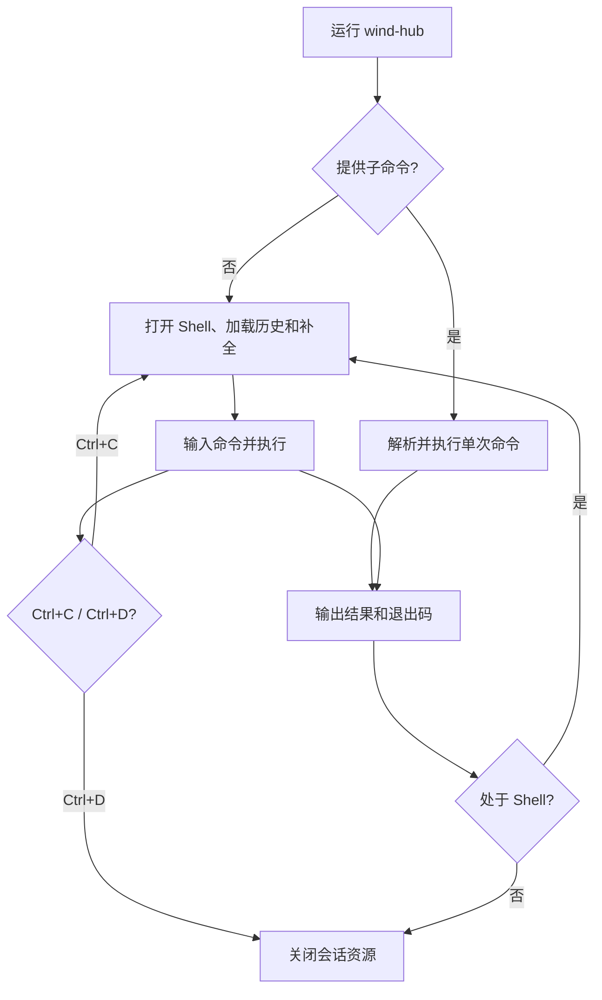

<p class="figure-caption">图 4-2 UC-01 业务活动图</p>

<p class="table-caption">表 4-2 UC-01 用例说明与规定场景</p>

| 要素 | 内容 |
|---|---|
| 参与者 | 交互用户、脚本 |
| 业务目标 | 启动 Shell 并执行命令 |
| 前置条件 | CLI 安装完成；本地配置可选 |
| 主要异常 | 非法参数；下游离线；Ctrl+C；Ctrl+D；命令失败后继续输入 |
| 后置条件 | Shell 可继续运行或按约定退出；无远端副作用 |
| 关联需求 | UR-01 |
| UC-01-S01 主流程 | Shell 启动与退出 |
| UC-01-S02 关键边界 | 参数；历史；补全和 JSON |
| UC-01-S03 异常与恢复 | 远端不可达及中断 |

## 4.3 UC-02 管理容器或 Linux 服务进程

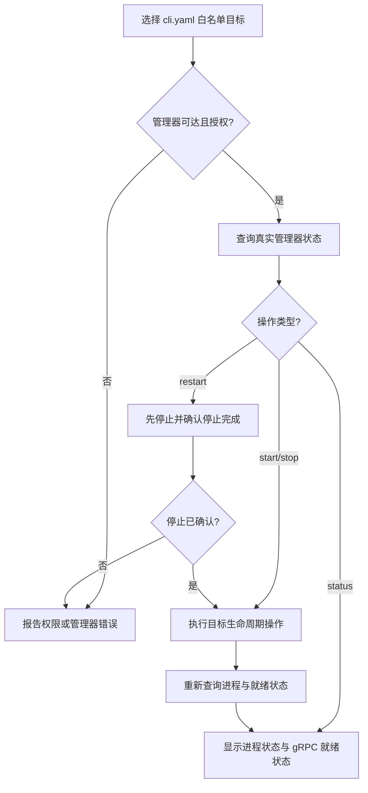

<p class="figure-caption">图 4-3 UC-02 业务活动图</p>

<p class="table-caption">表 4-3 UC-02 用例说明与规定场景</p>

| 要素 | 内容 |
|---|---|
| 参与者 | 授权运维人员、脚本 |
| 业务目标 | 管理容器或 Linux 服务进程 |
| 前置条件 | 受管目标在 cli.yaml 白名单；真实管理器已安装 |
| 主要异常 | 重复启停；目标不存在；权限不足；Daemon 不可达；超时；异常退出；RUNNING 但非 READY；重启停止失败 |
| 后置条件 | 仅操作白名单目标；管理器状态与就绪状态分别显示 |
| 关联需求 | UR-02 |
| UC-02-S01 主流程 | 状态查询及启停重启 |
| UC-02-S02 关键边界 | 重复操作；延迟就绪 |
| UC-02-S03 异常与恢复 | 权限；不可达；超时及异常退出 |

## 4.4 UC-03 查询服务身份、健康与能力

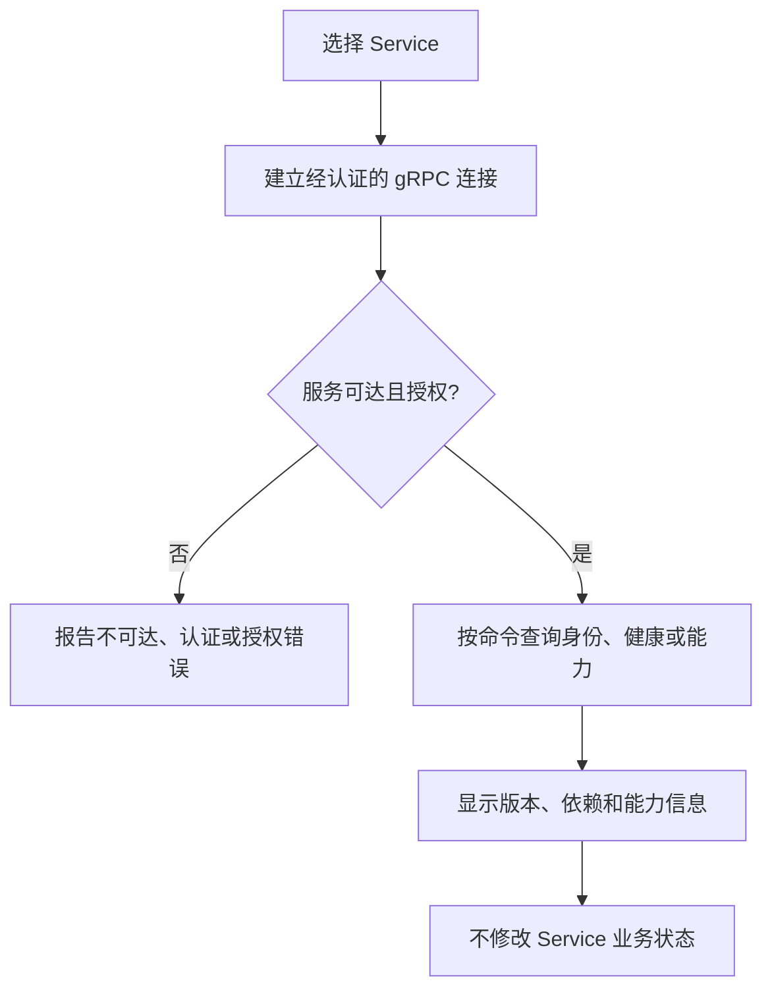

<p class="figure-caption">图 4-4 UC-03 业务活动图</p>

<p class="table-caption">表 4-4 UC-03 用例说明与规定场景</p>

| 要素 | 内容 |
|---|---|
| 参与者 | 运维人员、脚本 |
| 业务目标 | 查询服务身份、健康与能力 |
| 前置条件 | 目标已配置；证书及授权可用 |
| 主要异常 | 服务未启动；握手失败；拒绝；不支持的能力；部分依赖异常 |
| 后置条件 | 只读结果、真实错误和调用时间，不把进程 RUNNING 等同 READY |
| 关联需求 | UR-01、UR-03 |
| UC-03-S01 主流程 | 基本状态及能力 |
| UC-03-S02 关键边界 | 五服务查询和 JSON |
| UC-03-S03 异常与恢复 | 认证失败；不支持；依赖异常 |

## 4.5 UC-04 获取、推送和应用完整配置快照

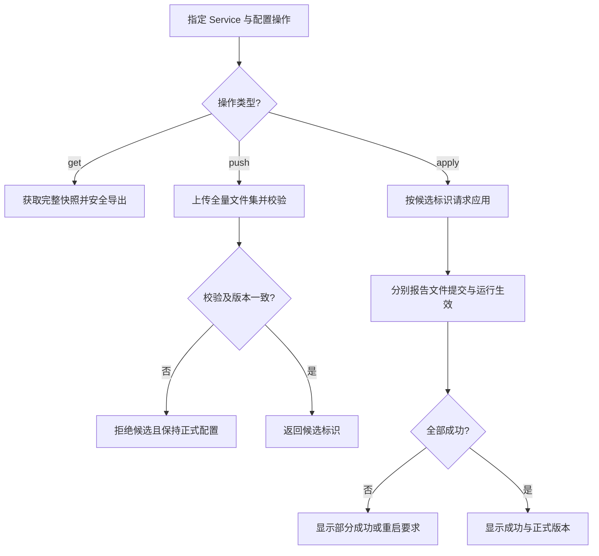

<p class="figure-caption">图 4-5 UC-04 业务活动图</p>

<p class="table-caption">表 4-5 UC-04 用例说明与规定场景</p>

| 要素 | 内容 |
|---|---|
| 参与者 | 授权运维人员、脚本 |
| 业务目标 | 获取、推送和应用完整配置快照 |
| 前置条件 | 目标服务可用；有完整目录；预期版本已知 |
| 主要异常 | 路径非法/重复；校验失败；版本冲突；候选过期；文件提交成功但运行时部分失败；网络中断状态未知 |
| 后置条件 | Push 不改正式配置；Apply 返回独立的文件与运行态结果，不自动回滚 |
| 关联需求 | UR-04 |
| UC-04-S01 主流程 | Get/Push/Apply 主链 |
| UC-04-S02 关键边界 | 冲突与候选边界 |
| UC-04-S03 异常与恢复 | 部分生效；断连与恢复查询 |

## 4.6 UC-05 比较两套本地完整配置目录

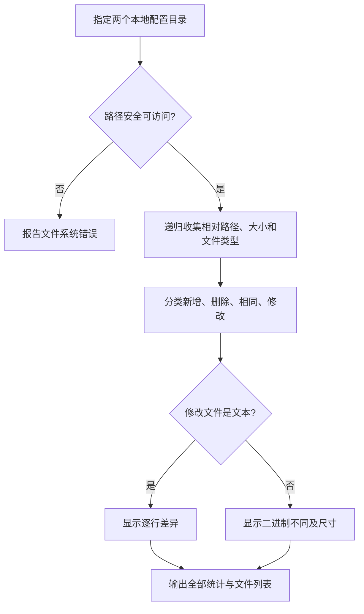

<p class="figure-caption">图 4-6 UC-05 业务活动图</p>

<p class="table-caption">表 4-6 UC-05 用例说明与规定场景</p>

| 要素 | 内容 |
|---|---|
| 参与者 | 操作人员、脚本 |
| 业务目标 | 比较两套本地完整配置目录 |
| 前置条件 | 显式指定两个可读取目录 |
| 主要异常 | 目录缺失、权限拒绝、符号链接、扫描时修改、编码失败、大文件截断、敏感内容 |
| 后置条件 | 只读比较；错误路径可定位；统计与差异一致 |
| 关联需求 | UR-05 |
| UC-05-S01 主流程 | 增删改及容量统计 |
| UC-05-S02 关键边界 | 文本/二进制；空目录 |
| UC-05-S03 异常与恢复 | 并发修改；权限及敏感输出 |

## 4.7 UC-06 查询 Collector 设备、测点与采集任务

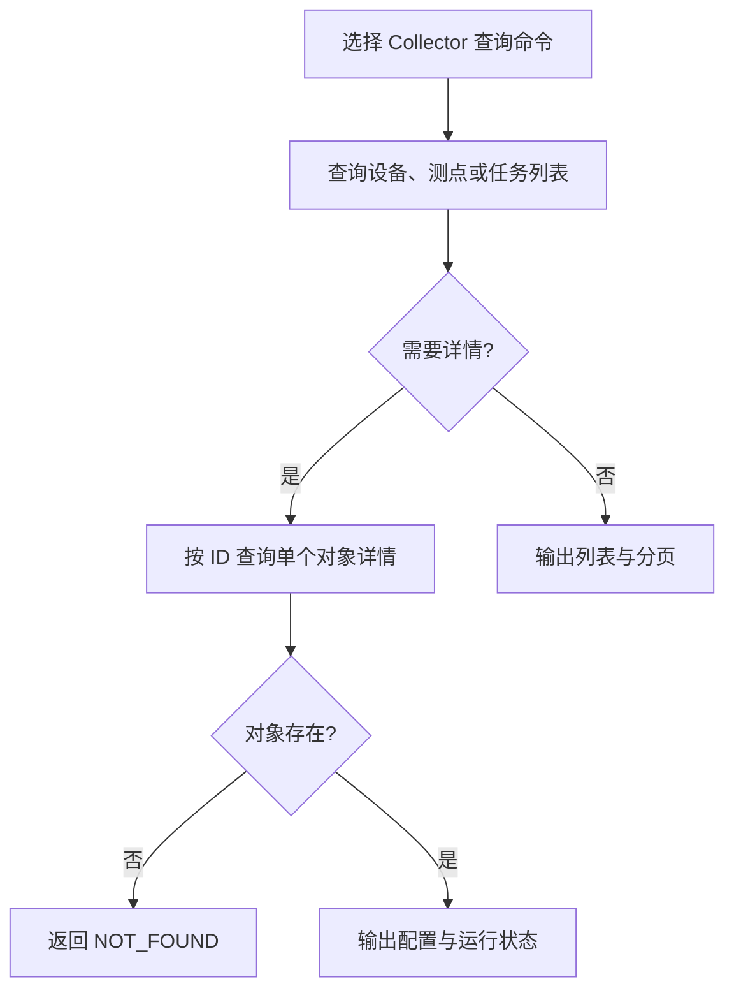

<p class="figure-caption">图 4-7 UC-06 业务活动图</p>

<p class="table-caption">表 4-7 UC-06 用例说明与规定场景</p>

| 要素 | 内容 |
|---|---|
| 参与者 | 操作人员、脚本 |
| 业务目标 | 查询 Collector 设备、测点与采集任务 |
| 前置条件 | Collector 可用 |
| 主要异常 | 设备/测点/任务不存在；分页边界；无权限；服务断连 |
| 后置条件 | 完整展示对象及运行状态；不改变采集任务 |
| 关联需求 | UR-06 |
| UC-06-S01 主流程 | 列表和详情 |
| UC-06-S02 关键边界 | 分页；空列表 |
| UC-06-S03 异常与恢复 | 无权限；对象消失 |

## 4.8 UC-07 控制 Collector 采集任务

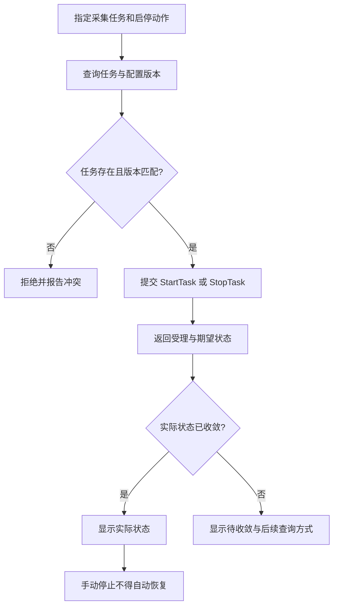

<p class="figure-caption">图 4-8 UC-07 业务活动图</p>

<p class="table-caption">表 4-8 UC-07 用例说明与规定场景</p>

| 要素 | 内容 |
|---|---|
| 参与者 | 授权运维人员 |
| 业务目标 | 控制 Collector 采集任务 |
| 前置条件 | 目标任务存在并具备权限 |
| 主要异常 | 重复启停、版本冲突、初始化失败、停机未收敛、失联 |
| 后置条件 | 状态转换及实际结果正确呈现，不误称立即成功 |
| 关联需求 | UR-06、UR-09 |
| UC-07-S01 主流程 | 启动/停止 |
| UC-07-S02 关键边界 | 幂等边界及状态变更 |
| UC-07-S03 异常与恢复 | 版本冲突；未收敛及恢复 |

## 4.9 UC-08 跨模块实时值与运行状态监视

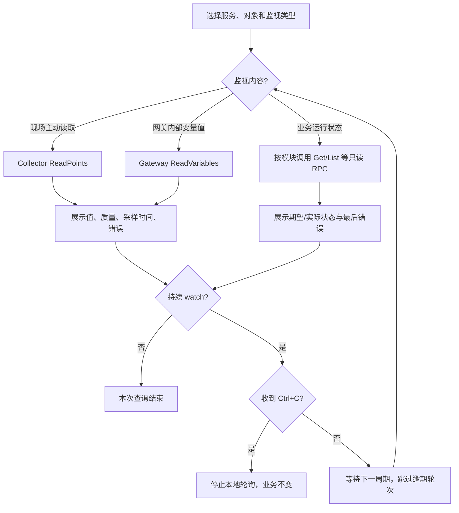

<p class="figure-caption">图 4-9 跨模块实时值与运行状态监视业务活动图</p>

<p class="table-caption">表 4-9 UC-08 用例说明与规定场景</p>

| 要素 | 内容 |
|---|---|
| 参与者 | 操作人员、自动化脚本 |
| 业务目标 | 通过一个 CLI 读取 Collector 测点、Gateway 变量和其他服务的可查询运行状态，不混淆值与状态 |
| 前置条件 | 相应服务可达且具只读权限；对象 ID 可用 |
| 主要异常 | Collector 缓存缺失、Gateway 变量缺失/过期、Commander 无当前值接口、Sink/Generator 仅状态可读、部分失败、超时、Ctrl+C |
| 后置条件 | 单次/周期查询均不写入现场或变更任务；状态和样本保留来源标记 |
| 关联需求 | UR-07 |
| UC-08-S01 主流程 | Collector latest/watch、Gateway read/watch、五服务状态单次查询与 watch；逐个验证源正确 |
| UC-08-S02 关键边界 | 不同 Sample 质量/时间、新鲜度；状态查询无采样值、分页边界及慢响应不重入 |
| UC-08-S03 异常与恢复 | 服务不可达、接口不支持、权限拒绝、样本缺测、部分失败与 Ctrl+C，后续只读轮询可恢复 |

## 4.10 UC-09 查询并控制 Sink Delivery

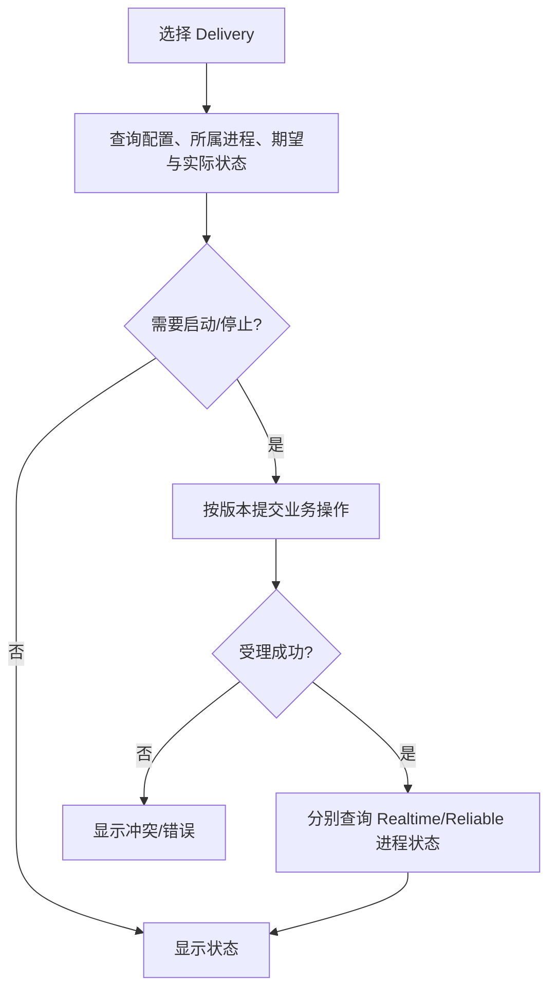

<p class="figure-caption">图 4-10 UC-09 业务活动图</p>

<p class="table-caption">表 4-10 UC-09 用例说明与规定场景</p>

| 要素 | 内容 |
|---|---|
| 参与者 | 运维人员 |
| 业务目标 | 查询并控制 Sink Delivery |
| 前置条件 | Sink 管理端点可用 |
| 主要异常 | Delivery 不存在、重试中、部分故障、版本冲突、手动停后自动恢复误触发 |
| 后置条件 | 正确记录期望及实际状态，只有指定 Delivery 受影响 |
| 关联需求 | UR-06、UR-07、UR-09 |
| UC-09-S01 主流程 | 查询和启停 |
| UC-09-S02 关键边界 | 双进程；部分故障 |
| UC-09-S03 异常与恢复 | 版本冲突；手动停止 |

## 4.11 UC-10 查询和控制 Industrial Gateway

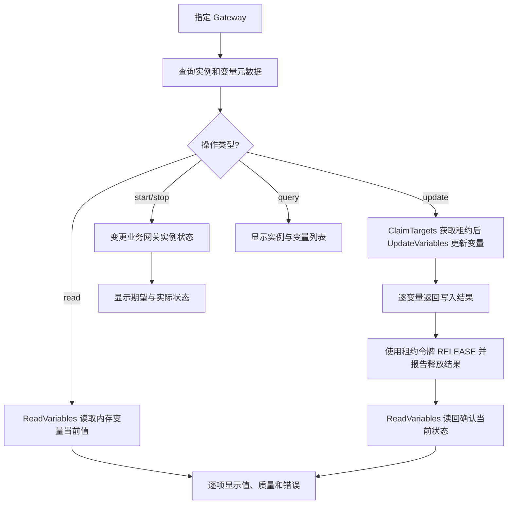

<p class="figure-caption">图 4-11 UC-10 业务活动图</p>

<p class="table-caption">表 4-11 UC-10 用例说明与规定场景</p>

| 要素 | 内容 |
|---|---|
| 参与者 | 运维人员 |
| 业务目标 | 发现 Gateway 全部变量，批量更新授权变量，读取结果确认，并管理 Gateway 运行状态 |
| 前置条件 | Gateway Server 可用 |
| 主要异常 | 网关无效、变量不存在/不可读/租约冲突/不可通过 gRPC 更新、类型不匹配、重复 ID、值过期、部分变量失败、配置冲突、RPC 超时结果未知 |
| 后置条件 | 在有效目标租约保护下更新 Gateway 权威变量存储并供协议 Server 读取，不自动转发现场控制；`ReadVariables` 只读 Gateway 当前变量、不主动读取真实 PLC；写入结果与读回值分别呈现，不混淆容器启停 |
| 关联需求 | UR-06、UR-07、UR-09 |
| UC-10-S01 主流程 | `ListVariables` 分页列出全部变量→`ClaimTargets` 获取租约→`UpdateVariables` 批量更新并释放租约→逐项检查结果→`ReadVariables` 读回确认 |
| UC-10-S02 关键边界 | 多变量批量、只读工业协议变量允许内部更新但不触发现场写入、更新权限与协议写权限分离、读回值和更新值对照 |
| UC-10-S03 异常与恢复 | 变量不存在、类型不符、重复 ID、禁止更新、部分成功、网关未就绪；RPC 超时标记结果未知，读回而不盲目重试 |

## 4.12 UC-11 查询与控制 Data Generator

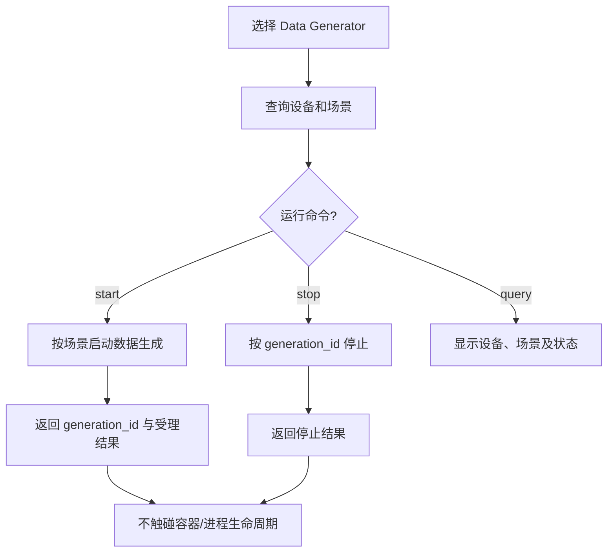

<p class="figure-caption">图 4-12 UC-11 业务活动图</p>

<p class="table-caption">表 4-12 UC-11 用例说明与规定场景</p>

| 要素 | 内容 |
|---|---|
| 参与者 | 运维人员 |
| 业务目标 | 查询与控制 Data Generator |
| 前置条件 | Data Generator Server 可用 |
| 主要异常 | 场景缺失、重复操作、配置冲突、执行失败 |
| 后置条件 | 管理数据生成任务，不启动/停止其宿主容器；不包含故障注入 |
| 关联需求 | UR-06、UR-07、UR-09 |
| UC-11-S01 主流程 | 设备场景及启停 |
| UC-11-S02 关键边界 | 重复操作 |
| UC-11-S03 异常与恢复 | 冲突；停止失败 |

## 4.13 UC-12 诊断单个 Service 的链路

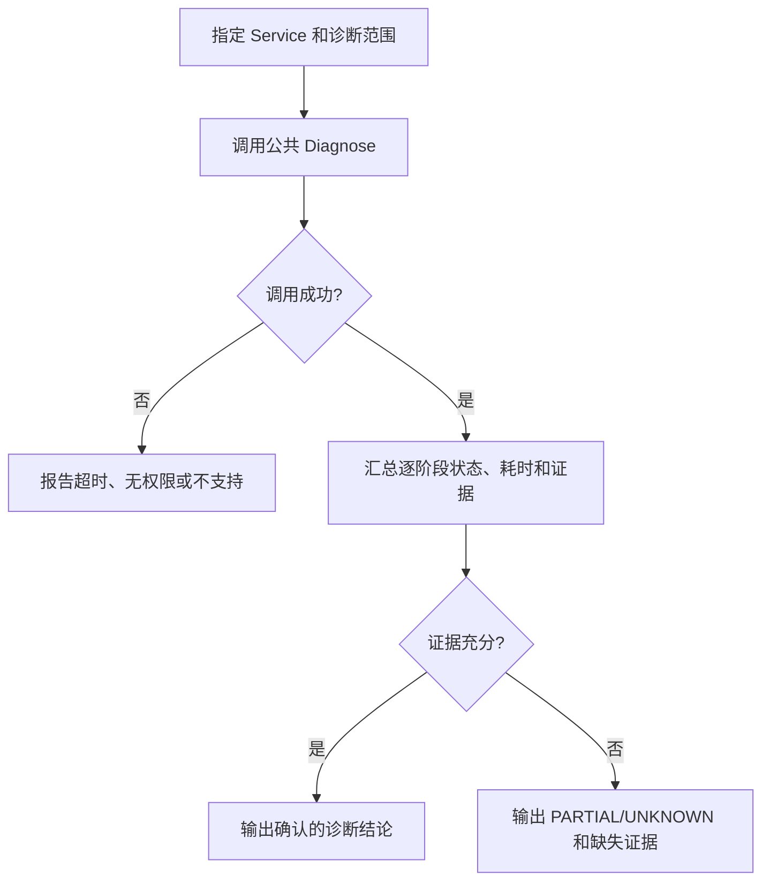

<p class="figure-caption">图 4-13 UC-12 业务活动图</p>

<p class="table-caption">表 4-13 UC-12 用例说明与规定场景</p>

| 要素 | 内容 |
|---|---|
| 参与者 | 运维人员 |
| 业务目标 | 诊断单个 Service 的链路 |
| 前置条件 | 目标服务允许 Diagnose |
| 主要异常 | 阶段不支持、协议失败、超时、权限不足、部分阶段无证据 |
| 后置条件 | 显示 PASS/FAIL/UNKNOWN 及未覆盖范围，导出报告与屏显一致 |
| 关联需求 | UR-08 |
| UC-12-S01 主流程 | 各服务诊断 |
| UC-12-S02 关键边界 | 部分证据；报告 |
| UC-12-S03 异常与恢复 | 阶段错误；权限拒绝 |

## 4.14 UC-13 诊断跨服务数据链路

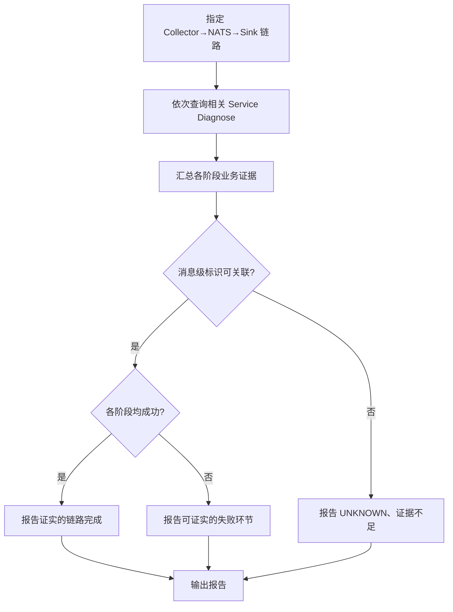

<p class="figure-caption">图 4-14 UC-13 业务活动图</p>

<p class="table-caption">表 4-14 UC-13 用例说明与规定场景</p>

| 要素 | 内容 |
|---|---|
| 参与者 | 运维人员 |
| 业务目标 | 诊断跨服务数据链路 |
| 前置条件 | Collector/Sink 可达且允许读取证据 |
| 主要异常 | 证据无关联、目标不支持、事件缺失、Sink 未到达、某 Service 不可达 |
| 后置条件 | 证据不足判 UNKNOWN，不用两端各自成功推断端到端成功 |
| 关联需求 | UR-08 |
| UC-13-S01 主流程 | 完整可证实链路 |
| UC-13-S02 关键边界 | 某阶段失败或缺证 |
| UC-13-S03 异常与恢复 | 跨服务断连；报告输出 |

## 4.15 UC-14 经 Commander 现场写入与查询结果

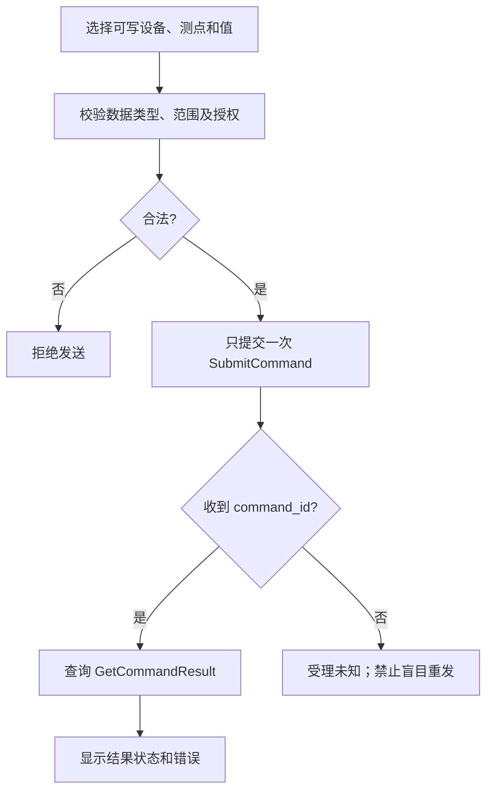

<p class="figure-caption">图 4-15 UC-14 业务活动图</p>

<p class="table-caption">表 4-15 UC-14 用例说明与规定场景</p>

| 要素 | 内容 |
|---|---|
| 参与者 | 授权操作人员、脚本 |
| 业务目标 | 经 Commander 现场写入与查询结果 |
| 前置条件 | 设备及测点可写且权限有效 |
| 主要异常 | 拒绝、版本过期、值越界、排队超时、提交无响应、UNKNOWN、执行失败 |
| 后置条件 | 不通过 Collector/Gateway 代下发；未知受理不自动重发；凭已知命令 ID 查询 |
| 关联需求 | UR-07、UR-09 |
| UC-14-S01 主流程 | 合法写入及结果查询 |
| UC-14-S02 关键边界 | 参数边界；终态 |
| UC-14-S03 异常与恢复 | 未知受理；超时；不重试 |

## 4.16 UC-15 执行三种本地网络探测

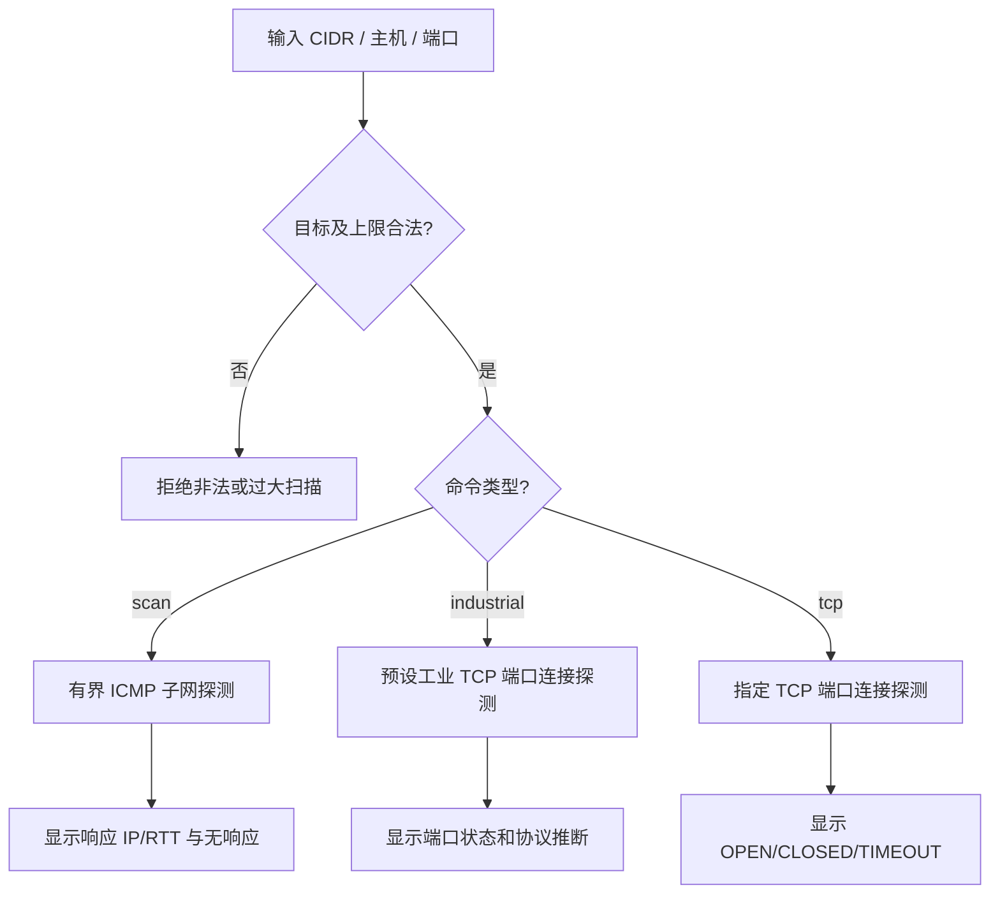

<p class="figure-caption">图 4-16 UC-15 业务活动图</p>

<p class="table-caption">表 4-16 UC-15 用例说明与规定场景</p>

| 要素 | 内容 |
|---|---|
| 参与者 | 授权运维人员、脚本 |
| 业务目标 | 执行三种本地网络探测 |
| 前置条件 | 被测网络范围已授权 |
| 主要异常 | 无响应、拒绝、超时、范围太大、权限不足、用户中断 |
| 后置条件 | 只报告可观测的连接响应，不证明协议可用，不执行工业协议写入 |
| 关联需求 | UR-10 |
| UC-15-S01 主流程 | 三命令正常操作 |
| UC-15-S02 关键边界 | CIDR 上限；端口范围 |
| UC-15-S03 异常与恢复 | 拒绝；超时及中断 |

## 4.17 UC-16 查看运行指标、事件与发布情况

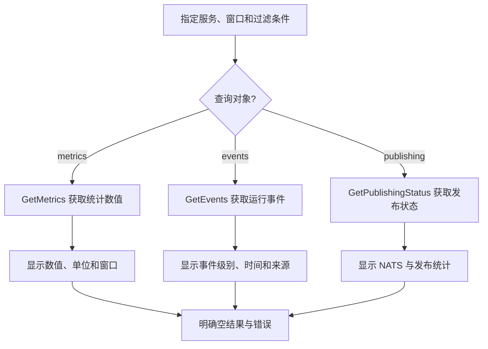

<p class="figure-caption">图 4-17 UC-16 业务活动图</p>

<p class="table-caption">表 4-17 UC-16 用例说明与规定场景</p>

| 要素 | 内容 |
|---|---|
| 参与者 | 运维人员、脚本 |
| 业务目标 | 查看运行指标、事件与发布情况 |
| 前置条件 | 目标 Service 可用 |
| 主要异常 | 窗口无数据、分页边界、事件为空、统计不可用、权限拒绝 |
| 后置条件 | Metrics 与 Events 概念区分，事件不混入指标 |
| 关联需求 | UR-07、UR-11 |
| UC-16-S01 主流程 | 指标；事件及发布状态 |
| UC-16-S02 关键边界 | 时间窗口；分页 |
| UC-16-S03 异常与恢复 | 空结果；拒绝；断连 |

# 5. 逻辑视图

## 5.1 组件职责与依赖

```mermaid
%%{init: {"flowchart": {"useMaxWidth": true}}}%%
flowchart TB
    Shell["命令入口 / 交互终端"] --> Dispatch["命令解析与分派"]
    Dispatch --> Present["统一输出 / 报告"]
    Dispatch --> Services["Service Client Adapters"]
    Dispatch --> ConfigDiff["本地目录 Diff"]
    Dispatch --> Net["网络探测命令适配"]
    Net --> CoreDiag["Core 网络诊断原语"]
    ConfigDiff --> CoreConfig["Core 配置通用能力（适用时）"]
    Dispatch --> Process["进程管理适配器"]
    Services --> RPC["公共 gRPC 客户端 / Contracts"]
    Services --> Orch["跨服务诊断编排"]
    RPC --> Remote["Collector / Commander / Sink / Gateway / Data Generator"]
```

<p class="figure-caption">图 5-1 CLI 逻辑组件图</p>

<p class="table-caption">表 5-1 逻辑组件职责</p>

| 组件 | 职责 | 持有状态 | 禁止职责 |
|---|---|---|---|
| Command Shell | 交互式 Shell 和单次命令解析 | 当前交互命令及显示选项 | 业务状态权威裁决 |
| Service Client Adapters | 对外 RPC 参数映射和结果解码 | 客户端 Channel/请求句柄 | 实现服务内部业务 |
| Diagnostic Orchestrator | 多 Service 诊断请求编排、证据关联 | 当前诊断阶段结果 | 直接操作 NATS/目标数据库冒充 Service 诊断 |
| Directory Diff Adapter | 编排文件级差异及展示；通用文件读写、哈希和安全校验优先由 Core 公共能力承担（已提供时） | 本次目录扫描结果 | 重复 Core 已有基础能力、擅自解析 Service 业务语义 |
| Network Probe Adapter | 调用 Core 的 ICMP/TCP/端口扫描；仅保留 CLI 子网遍历、限流与输出适配 | 当前探测参数及临时结果 | 复制 Core 的 TCP/ICMP 实现、协议写入 |
| Process Adapter | 向外部管理器发出启停请求 | 当前进程操作结果 | 替 Service 处理内部任务关闭 |
| Presentation | Table/JSON、错误及报告 | 有界的当前结果 | 将 UNKNOWN 改为成功 |

## 5.2 关键数据与状态模型

<p class="table-caption">表 5-2 CLI 数据对象及权威来源</p>

| 数据对象 | 最小必要字段 | 来源或所有者 |
|---|---|---|
| ServiceTarget | service_id、endpoint、TLS 及操作超时 | CLI 自身配置 |
| CommandResult | command、status、code、message、timestamp、duration、data、warnings | CLI 输出边界 |
| TelemetrySample | device_id、point_id、value、quality、sample_timestamp、freshness | Collector 提供，CLI 只读 |
| DiagnosisStage | stage、status、duration_ms、error_code、message、evidence | 各执行 Service 提供 |
| DirectoryDiff | left/right 统计、added、removed、modified、unchanged、text_diff | CLI 本地扫描 |
| RemoteOperation | remote_id、acceptance、result、unknown_reason | 对应 Service 权威 |

不同语义的状态不得混合：通信可达不等于业务健康；客户端取消不等于服务端任务停止；最新值不等于本次主动读取。诊断状态只代表已执行检查及证据覆盖范围。

# 6. 进程视图

## 6.1 运行时结构及所有权

```mermaid
%%{init: {"flowchart": {"useMaxWidth": true}}}%%
flowchart TB
    OS["CLI OS 进程"] --> Entry["主线程 / CLI 交互与命令分派"]
    Entry --> Loop["异步客户端执行上下文"]
    Loop --> RPC["gRPC Channels / Unary RPC"]
    Loop --> Probe["有界本地网络探测 Task / 子进程"]
    Entry --> Diff["本地目录扫描与差异输出"]
    Entry --> Report["终端 / JSON 报告"]
```

<p class="figure-caption">图 6-1 CLI 运行时结构图</p>

交互会话保留同一异步执行上下文以复用 Channel；单次命令在结束时关闭其客户端连接。CLI 不需要后台常驻服务、持续采集循环或 Driver 所有权。

<p class="table-caption">表 6-1 任务与资源所有权</p>

| 资源 | 所有者 | 生命周期 | 边界 |
|---|---|---|---|
| CLI 主循环 | CLI 命令入口 | 启动至退出 | 不依赖业务 Service 在线 |
| gRPC Channel | Service Client Manager | 交互会话复用，退出时关闭 | Endpoint/TLS 身份匹配后复用 |
| 轮询任务 | 当前 CLI watch 命令 | 启动监视至 Ctrl+C 或终止条件 | 每次仅一个在途 ReadPoints；结束后取消本地调度 |
| 本地探测 Task/Socket | Network Probe | 一次扫描命令内 | 并发、超时及目标数量有界 |
| 本地报告句柄 | Presentation | 输出期间 | 失败不得破坏旧文件 |

## 6.2 运行生命周期

```mermaid
%%{init: {"state": {"useMaxWidth": true}}}%%
stateDiagram-v2
    [*] --> Starting
    Starting --> Interactive: 无子命令
    Starting --> ExecutingOnce: 有子命令
    Interactive --> Running: 接受命令
    Running --> Interactive: 返回结果
    Running --> Cancelling: 用户中断
    Cancelling --> Interactive: 本地句柄已处理
    Interactive --> Closing: exit/EOF
    ExecutingOnce --> Closing: 操作已返回
    Closing --> Exited: 关闭客户端资源
    Exited --> [*]
```

<p class="figure-caption">图 6-2 CLI 生命周期状态图</p>

启动时只校验 `cli.yaml`（或安全默认项），不加载Data Generator 的完整 `configs/`。单条命令失败不使交互 CLI 失效。CLI 只负责自身退出与本地资源关闭，Service 自身的 Watchdog、任务、连接及进程生命周期由对应 Service 管理。

## 6.3 典型实时监视时序

```mermaid
%%{init: {"sequence": {"useMaxWidth": true}}}%%
sequenceDiagram
    actor Operator as 操作员
    participant CLI as CLI
    participant Collector as Collector gRPC
    Operator->>CLI: collector watch DEVICE [POINT...]
    loop 每轮等待前轮结束，直至 Ctrl+C
        CLI->>Collector: ReadPoints(device_id, point_ids) Unary
        Collector-->>CLI: values + quality + timestamps / errors
        CLI-->>Operator: 更新当前界面
        Note over CLI: 等待下一个固定周期；超期跳过轮次
    end
    Operator->>CLI: Ctrl+C
    CLI-->>Operator: 停止本地轮询，返回 Shell
```

<p class="figure-caption">图 6-3 Collector 缓存数据周期轮询时序图（Gateway 与状态监视采用同类客户端调度）</p>

## 6.4 超时、取消与恢复

<p class="table-caption">表 6-2 异常裁决矩阵</p>

| 条件 | CLI 结果 | CLI 处理 | 远程权威责任 |
|---|---|---|---|
| Service 不可达 | UNAVAILABLE（退出码 3） | 报错，不回退 Driver | Service 自主恢复 |
| RPC UNIMPLEMENTED | UNSUPPORTED（退出码 3） | 明确能力缺失，不绕过 RPC | Service 提供契约能力 |
| 只读 RPC 超时 | TIMEOUT（退出码 3） | 本轮失败，后续周期可再次查询 | 只读请求无远端业务副作用 |
| 写入或 Apply 受理后超时 | UNKNOWN（退出码 3） | 不盲目重发；仅通过可用权威查询恢复 | Server 决定实际状态 |
| ReadPoints 响应慢于轮询间隔 | WARNING（监视不中止） | 跳过逾期轮次，不重入、不缓存待执行轮次 | Collector 仅执行单次读取 |
| 连续轮询断连 | UNAVAILABLE | 显示数据过期/断连，按配置有限重连 | Collector 保留采集状态 |
| ICMP 无响应 | NO_RESPONSE | 不判主机必定离线 | 不适用 |
| Ctrl+C | INTERRUPTED（单次命令为 130） | 停止本地调度，回收 Socket/任务 | 不取消远端生产业务任务 |

# 7. 开发视图

## 7.1 目标代码组织

```text
src/
├── cli/                 # 命令入口、交互、展示、Service Client、诊断与文件比较适配
├── contracts/           # 统一 protobuf 源与公共消息
├── core/                # 可复用的非 Service 专有通用能力
├── collector/
├── commander/
├── sink_service/
├── industrial_gateway/
└── data_generator/
```

CLI 可以按职责拆分少量模块，但不强制建立空的 Domain/Application/Infrastructure 三层。原则上复用 Core 已有公共能力；Core 尚无匹配能力时，仅在 CLI 保留与命令直接相关的最小实现，禁止因复用而改变 Core 的模块无关性。`contracts/` 由 CLI 和各 Service 共同依赖；CLI 不直接 import 任何 Service 的业务实现或协议驱动。

## 7.2 静态依赖关系

```mermaid
%%{init: {"flowchart": {"useMaxWidth": true}}}%%
flowchart TB
    CLI["src/cli"] --> Contracts["src/contracts"]
    CLI --> Common["src/core：公共配置 / 网络诊断 / 领域基础"]
    Collector["src/collector"] --> Contracts
    Commander["src/commander"] --> Contracts
    Sink["src/sink_service"] --> Contracts
    Gateway["src/industrial_gateway"] --> Contracts
    Generator["src/data_generator"] --> Contracts
```

<p class="figure-caption">图 7-1 CLI 与各服务的契约依赖图</p>

<p class="table-caption">表 7-1 模块与职责</p>

| 模块 | 责任 | 禁止依赖 |
|---|---|---|
| `cli` | 命令编排、结果展示、Contracts gRPC Client、Core 通用能力适配 | Service 内部数据库、工业协议 Driver 和重复通用算法 |
| `contracts` | Proto 消息、Service 定义及生成代码的唯一源 | 具体服务业务实现 |
| `core` | 模块无关的配置读写/解析/比较、工业协议通信、横切机制、共享领域对象与网络/链路诊断（具体以现有 API 为准） | CLI 专用交互状态及服务业务配置语义 |
| 各 Service | 业务/诊断执行及 gRPC Server 实现 | CLI 命令分派 |

## 7.3 Core 能力复用及差异处置

本节是 CLI 开发的强制依赖约束。区分「仓库现有 API」「已存在但语义不相同」「目标通用能力尚未提供」；不得将目标能力当成当前已实现。CLI 必须先调用 Core 的公开入口，只有无法满足 CLI 特有需求且不适合抽象到 Core 时才保留本地代码。

<p class="table-caption">表 7-2 Core 复用判定矩阵</p>

| CLI 功能 | 当前 Core 能力（main 基线） | 采用方式及差异 |
|---|---|---|
| `net tcp` | `core.infrastructure.diagnostic.network.tcp_probe` | 复用 TCP Connect、耗时与诊断结果；CLI 转换为终端状态，不另写 `asyncio.open_connection` |
| `net industrial` | `core.infrastructure.diagnostic.network.scan_ports` | 复用有界并发端口探测；端口名称/列表及 Rich 呈现归 CLI；保留 Core 16 并发的上限，不直接扩大 |
| `net scan CIDR`、单地址 Ping | `core.infrastructure.diagnostic.network.ping_host/ping_probe` | 复用单主机 ICMP；CIDR 展开、总数限制和并发编排为 CLI 特有能力，避免重复 Ping 子进程实现 |
| 本地共享配置校验 | Core 通用配置诊断原语和 `configuration` 共享文档装配接口 | 只用于共享实例/模板文档及其引用；不能据此校验各服务专属配置 |
| 配置语义差异 | `core.infrastructure.diagnostic.config.compare_config` | 当前只比较共享配置语义；不等于 CLI `config diff` 对任意两个文件目录的完整逐行 Diff |
| 文件级目录 Diff | Core 当前未发现满足该完整语义的统一公开接口 | 保留 CLI 文件树编排作为现阶段缺口；后续 Core 提供模块无关的文件级比较时迁移并删除重复实现，不能强行改用共享配置语义比较 |
| 远程工业链路诊断 | `core.infrastructure.diagnostic.protocol.check_protocol/benchmark_protocol` | Core 的本地只读工业协议诊断供其合法消费者复用；CLI 的远程诊断通过 Service 的 `Diagnose`，不在 CLI 创建 Driver |
| JSON/YAML 通用读写 | Core 配置基础设施按其真实 API 复用 | CLI 自身 `cli.yaml` 的字段语义仍属 CLI；不得用 Core 的共享设备业务模型解释 CLI 配置 |
| RPC 请求及解码 | `src/contracts/*_pb2.py`、`*_pb2_grpc.py` | 使用全部正式 Service 的生成代码；不得另造独立字段、动态方法名映射或私有 Proto |

**变更要求：** 调整 Core 公共接口须核查 Collector、Commander、Gateway、Sink、Data Generator 与测试的调用方；CLI 仅依赖明确公开的通用 API，不倒逼 Core 接受 CLI 专用对象。对 Core 中以固定 `instances/`、`templates/` 作为前提的旧诊断函数，不应宣称其具备任意路径、任意文件的通用比较能力。

# 8. 物理视图（部署视图）

```mermaid
%%{init: {"flowchart": {"useMaxWidth": true}}}%%
flowchart LR
    subgraph OperatorHost["运维主机"]
        CLI["CLI 进程"]
        Config["cli.yaml"]
        Local["本地 configs_A / configs_B"]
        CLI --- Config
        CLI --- Local
    end
    CLI -->|gRPC/mTLS| Collector["Collector"]
    CLI -->|gRPC/mTLS| Commander["Commander"]
    CLI -->|gRPC/mTLS| Sink["Sink Service"]
    CLI -->|gRPC/mTLS| Gateway["Industrial Gateway"]
    CLI --> DG["Data Generator"]
    CLI --> PM["进程/容器管理器"]
    CLI --> Network["本地网络探测目标"]
    Collector --> Field["现场设备"]
```

<p class="figure-caption">图 8-1 CLI 与 Service 部署及通信边界</p>

<p class="table-caption">表 8-1 部署与故障边界</p>

| 类别 | 要求 | 故障影响 |
|---|---|---|
| CLI 主机 | 支持 Python 环境、gRPC 与本地文件访问 | CLI 自身不可用 |
| CLI 配置 | 自身 Endpoint/TLS/终端默认值 | 仅影响相关目标连接；帮助与本地探测可继续 |
| Service 网络 | CLI 到 Service gRPC 可达 | 对应远程命令不可用，不影响其他目标 |
| 进程管理器 | 按部署方式支持启停操作 | 仅 UR-02 不可用 |
| 本地网络探测 | 探测从 CLI 主机发出 | 结果不能代替 Collector 所在环境视角 |
| Service 配置目录 | 由各 Service 独立维护 | CLI 启动不依赖该目录 |

# 9. CLI 客户端接口适配设计

本章只规定 CLI 如何消费远程接口；本地通用机制按第 7.3 节优先复用 Core。**所有 gRPC Service、RPC 参数、消息字段编号、枚举和 wire 兼容性由《Contracts 软件设计 v1_7》及上述基线的 `src/contracts/*.proto` 统一定义**。CLI 不拥有 Proto，不实现业务 Server，不得私自新增字段或通过空字符串模拟缺失字段。契约版本更新须先修改 Contracts 文档与 Proto，并检查所有调用方。

## 9.1 客户端通信与边界

| 项目 | CLI 要求 |
|---|---|
| 连接 | 一个 Endpoint/TLS 身份对应可复用的 gRPC Channel；所有 Channel 在其所属 Event Loop 内创建与关闭 |
| 调用 | 对每次 Unary RPC 设置 deadline；保留远端 gRPC 状态与业务响应中的状态字段，不以网络异常推断副作用是否生效 |
| 权限 | mTLS 身份凭据由 CLI 配置；服务端授权为唯一权威；交互确认不代替服务端权限 |
| 取消 | Ctrl+C 停止本地等待和后续轮询；受理状态不明的变更请求保持 UNKNOWN，不自动重发 |
| 状态 | 服务进程状态、gRPC 可达性、业务健康、期望状态与实际状态分别显示 |
| 分页 | 使用 Proto 定义的 page_size/page_token/next_page_token；无结果与查询失败分开 |
| 结果 | 将 protobuf 类型映射到统一的 CLI 输出，不用未定义的 wire 字段补齐展示 |

## 9.2 RPC 调用映射

以下列出的均为最新 `main` Proto 中真实存在的 Unary RPC；具体请求/响应定义参见 Contracts v1_7。

| 目标 Service | RPC | CLI 业务命令/用途 |
|---|---|---|
| 公共 CommonService（各服务） | `GetServiceInfo`, `GetServiceStatus`, `GetCapabilities` | `service info/status/capabilities` |
| 公共 CommonService（各服务） | `GetConfigSnapshot`, `PushConfigSnapshot`, `ApplyConfigSnapshot` | `config get/push/apply` |
| 公共 CommonService（各服务） | `GetMetrics`, `GetEvents`, `Diagnose` | `metrics/events`、`diagnose` 系列 |
| CollectorService | `ListDevices`, `GetDevice`, `ListPoints`, `GetPoint` | `collector devices/device/points/point` |
| CollectorService | `ReadPoints` | `collector latest/watch`；watch 为客户端周期调用，不是 Streaming RPC |
| CollectorService | `ListTasks`, `GetTask`, `StartTask`, `StopTask` | `collector tasks/task/start/stop` |
| CollectorService | `GetPublishingStatus`, `InterrogateDevice` | `collector publishing`、`diagnose collector gi` |
| CommanderService | `ListDevices`, `GetDevice`, `ListPoints` | `commander devices/device/points`（均无现场值） |
| CommanderService | `SubmitCommand`, `GetCommandResult` | `commander write/result` |
| SinkService | `ListDeliveries`, `GetDelivery`, `StartDelivery`, `StopDelivery` | `sink deliveries/delivery/start/stop` |
| IndustrialGatewayService | `ListGateways`, `GetGateway`, `StartGateway`, `StopGateway` | `gateway list/status/start/stop` |
| IndustrialGatewayService | `ListVariables`, `ReadVariables` | `gateway variables/read/watch` |
| IndustrialGatewayService | `ClaimTargets`, `UpdateVariables` | `gateway update` 的目标租约获取、令牌写入和释放 |
| DataGeneratorService | `ListDevices`, `GetDevice`, `ListScenarios`, `GetGeneration`, `StartGeneration`, `StopGeneration` | `data-generator devices/device/scenarios/status/start/stop` |

## 9.2.1 五模块读写能力与限制

| 模块 | 实时值读取 | 元数据/运行状态读取 | 写入及控制 |
|---|---|---|---|
| Collector | `ReadPoints`（一次性现场主动读） | Device、Point、Task、Publishing | `StartTask/StopTask`（业务任务） |
| Commander | **无** | Device、PointMetadata、CommandResult | `SubmitCommand`（真实设备），`GetCommandResult` 查询结果 |
| Sink Service | **无** | Delivery 配置及状态 | `StartDelivery/StopDelivery` |
| Industrial Gateway | `ReadVariables`（内存变量） | Gateway、Variable | `ClaimTargets/UpdateVariables`（内部变量）；`StartGateway/StopGateway` |
| Data Generator | **无独立样本读取 RPC** | Device、Scenario、Generation | `StartGeneration/StopGeneration`；生成数据经独立客户端向 Gateway 更新 |

所有业务监视以现有 Unary 为基础由 CLI 轮询；不能将 `GetMetrics`、`Diagnose`、`GetCommandResult` 或 `InterrogateDevice` 解释为通用实时值流。`InterrogateDevice` 是明确触发现场 IEC104 总召的诊断操作，独立于缓存监视。

## 9.3 Gateway 变量更新的租约语义

最新 `UpdateVariablesRequest` 除 `gateway_id`、`values` 外还有 `lease_token`；CLI 不得按 v1_1 的无令牌模型发送写入。执行 `gateway update` 时：

1. CLI 根据输入确定唯一的 `gateway_id` 与变量集合，使用 `ClaimTargets(action=ACQUIRE)` 申请独占租约，传入操作身份 `owner_id` 与有界 `lease_ms`。
2. 仅在 `accepted=true` 且获得非空 `lease_token` 后调用 `UpdateVariables`，原样携带取得的令牌；逐项检查 `results[]`。
3. 如操作时间跨越租约期限，按服务端契约通过 `ClaimTargets(action=RENEW)` 延续，不能使用过期令牌。
4. 操作完成后使用相同 owner、精确变量集合和令牌执行 `ClaimTargets(action=RELEASE)`；释放失败必须报告，不能宣称资源已释放。
5. ACQUIRE 失败时不发送更新；Update RPC 超时或断连时不自动重发，按 UNKNOWN 显示，可读回确认当前值，但读回不能证明此前提交是否发生。
6. 租约避免与 Data Generator 的既有目标写入冲突；CLI 不可抢占其他有效 owner 的租约。租约 TTL、授权与原子归属由 Gateway Server 裁决。

**待决授权边界**：`industrial_gateway.proto` 注释称租约为 per-Generation；虽然存在 `ClaimTargets` RPC，不能据此推断普通 CLI 身份具有 ACQUIRE 权限。未获 Gateway 服务端明确授权时，`gateway update` 应返回 PERMISSION_DENIED/UNSUPPORTED，不得绕过令牌或冒用 Generation owner。

**兼容性差异**：原 v1_1 第 9.6 节的两字段 `UpdateVariablesRequest` 示例已失效。此处不重定义字段号。CLI 仍保留 `gateway update` 命令，但须增加租约获取与释放的业务步骤。

## 9.4 配置快照和现场控制的特殊处理

- Get/Push/Apply 的 `revision`、`expected_revision`、`candidate_id` 以 `common.proto` 定义为准。`Push` 不应用，`Apply` 分别呈现 `file_commit`、`apply_results`、`restart_required`，不得合并为一个布尔值。
- `SubmitCommand` 的 `command_id` 由 Commander 返回；没有收到 `command_id` 时不能构造假 ID，也不能自动再次提交。`GetCommandResult` 只能按已知 `command_id` 查询。
- `ReadPoints` 执行一次现场主动读取且不触发额外 NATS 发布；`InterrogateDevice` 才是显式 IEC104 总召；CLI 不以本地协议驱动替代两者。
- 业务响应中用字符串表达的状态不应由 CLI 假定是 Proto enum；应由对应 Service 设计说明给出合法值及状态规则。

## 9.5 契约缺口处理

CLI 发现契约不能表达的需求时，记录差异并提交 Contracts 统一演进，不得扩展本地私有 Proto、将关键结构编码进 `message` 字符串，或使用与实际 Server 不一致的演示 RPC。Proto 变更检查全部五个 Service、CLI、Data Generator 对 Gateway 的客户端以及测试。

# 10. 交互式命令与终端呈现设计

## 10.1 交互式 Shell 约定

以交互式 Shell 为主要入口，`wind-hub <COMMAND>` 为单次命令辅助入口。**不设置双交互模式，仅保留一种交互式 Shell。** 技术组合：`Typer` 命令树、`prompt_toolkit` 编辑/补全/历史、`Rich` 表格/颜色/实时刷新、`grpcio` 客户端；不开发自有命令编辑器、历史管理或终端渲染器。

| 操作 | 约定 |
|---|---|
| `wind-hub` | 启动会话并显示提示符 `wind-hub>`；CLI 启动不依赖任何业务 Service 在线 |
| `Tab` / 上下键 | 命令及可获取的服务/对象补全；会话命令历史导航，敏感参数不持久化 |
| `help` / `--help` | 按 Typer 命令树查看命令与参数帮助 |
| `Ctrl+C` | 中断当前前台监听/探测并返回 Shell，不停止远端生产采集任务 |
| `Ctrl+D` / `exit` | 关闭 CLI 会话与客户端 Channel，退出；不停止业务 Service |
| 单次命令 | 输出结构化结果并返回进程退出码；不进入 Shell |
| 输出模式 | 默认 Rich table；`--format json` 用稳定 Schema 供脚本消费 |

```mermaid
%%{init: {"state": {"useMaxWidth": true}}}%%
stateDiagram-v2
    [*] --> Shell: wind-hub
    Shell --> Executing: 输入命令
    Executing --> Shell: 命令完成
    Executing --> Shell: Ctrl+C 取消前台显示
    Shell --> Exited: exit / Ctrl+D
    Exited --> [*]
```

<p class="figure-caption">图 10-1 交互式会话与前台命令生命周期（示意）</p>

## 10.2 命令树及参数规范

下列是规范性目标命令名；**本章命令是目标正式命令；正式验收前必须实现所有必需命令；未实现时返回明确错误，不得在实现报告中标记通过**。查询列表用复数，单对象详情用单数，控制动词 `start`/`stop`/`restart` 保持统一。

```text
wind-hub [--config CLI_YAML] [--format table|json] [COMMAND ...]
  service    list | info | status | capabilities | start | stop | restart
  config     get | push | apply | diff
  collector  devices | device | points | point | tasks | task | start | stop | latest | watch | metrics | events | publishing
  commander  devices | device | points | write | result | metrics | events
  sink       deliveries | delivery | start | stop | metrics | events
  gateway    list | status | variables | read | watch | update | start | stop | metrics
  data-generator  devices | device | scenarios | start | stop | status
  monitor     collector | gateway | commander | sink | data-generator
  diagnose   collector (device|pipeline|gi) | commander | sink | gateway | data-generator | pipeline
  net        scan | industrial | tcp
  help | exit
```

<p class="table-caption">表 10-1 命令与输入及接口映射</p>

| 命令 | 必选参数/重要选项 | 服务或本地实现 | 说明 |
|---|---|---|---|
| `service list` | — | CLI 配置的受管目标 | 列出 Service 与运行时 |
| `service info/capabilities` | SERVICE | Service GetServiceInfo/GetCapabilities | 服务身份、支持能力 |
| `service status` | 可选 SERVICE | 运行时管理器 + 服务 gRPC | 进程状态与业务健康分别显示 |
| `service start/stop/restart` | SERVICE | containerd/iSulad/systemd | 操作真实进程或容器 |
| `config get` | SERVICE、`--output PATH` | Service GetConfigSnapshot | 获取完整快照并安全导出 |
| `config push` | SERVICE、PATH | Service PushConfigSnapshot | 校验并暂存完整候选 |
| `config apply` | SERVICE、CANDIDATE_ID | Service ApplyConfigSnapshot | 提交并逐对象报告运行生效 |
| `config diff` | PATH_A PATH_B | pathlib/filecmp/difflib | 完整目录数量、容量、文本差异 |
| `collector devices/device` | [DEVICE]/DEVICE | Collector ListDevices/GetDevice | 列表与详情 |
| `collector points/point` | DEVICE [POINT] | Collector ListPoints/GetPoint | 测点元信息 |
| `collector tasks/task/start/stop` | [TASK]/TASK | Collector ListTasks/GetTask/StartTask/StopTask | 任务查询及期望状态变更 |
| `collector latest` / `collector watch` | DEVICE、可选 POINT... | ReadPoints（单次/客户端轮询） | 现场主动读取一次；watch 为客户端定时重复发起 Unary |
| `gateway read` / `gateway watch` | GATEWAY_ID、VARIABLE...；watch 可设 `--interval` | ReadVariables（单次/客户端轮询） | Gateway 内部变量当前值；不主动读 PLC |
| `monitor collector/gateway/commander/sink/data-generator` | 模块对应对象 ID、可选 `--watch`/`--interval` | 对应 Get/List/Status Unary | 查询各模块运行状态；无当前数值接口时仅显示状态，不伪造采样值 |
| `collector metrics/events/publishing` | 可选筛选 | GetMetrics/GetEvents/GetPublishingStatus | 指标/事件 |
| `commander devices/device/points` | 可选对象 ID | Commander ListDevices/GetDevice/ListPoints | 可控对象、可写点元数据，不返回当前值 |
| `commander write` | DEVICE POINT VALUE、可选 `--yes` | Commander 提交控制 RPC | 不自动重试；返回 command_id |
| `commander result` | COMMAND_ID | GetCommandResult | 查询权威结果 |
| `commander metrics/events` | 可选筛选 | Commander 指标/事件 | 运维信息 |
| `sink deliveries/delivery` | [ID]/ID | Sink Delivery 查询 | 配置与运行状态 |
| `sink start/stop` | DELIVERY_ID | Sink Delivery 控制 | 修改期望状态 |
| `sink metrics/events` | 可选筛选 | Sink 指标/事件 | 消费及交付 |
| `gateway list/status/variables/update/start/stop/metrics` | `update`：GATEWAY_ID、变量值集合；其他同前 | Gateway `ListVariables`/`ReadVariables`/`ClaimTargets`/`UpdateVariables` 等 | CLI 支持变量发现→租约申请→批量更新→租约释放→逐项结果→读回确认；RPC 不触发现场控制；未实现验收失败 |
| `data-generator devices/device/scenarios` | 可选对象 ID | Data Generator ListDevices/ListScenarios | 依据 9.2 及 Contracts v1_7 的专属 RPC 实现 |
| `data-generator start/stop/status` | 场景/任务标识 | StartGeneration / StopGeneration / GetGeneration | start 传 scenario_id、stop/status 传 generation_id；无故障注入命令 |
| `diagnose collector/commander/sink/gateway/data-generator` | 目标对象及可选范围 | 对应 Service 诊断 RPC | 统一显示阶段证据 |
| `diagnose pipeline` | DEVICE | CLI 调用 Collector + Sink | 跨服务证据汇总 |
| `net scan` | CIDR | CLI 本地 ICMP 扫描 | 一次性发现可响应地址 |
| `net industrial` | IP | CLI 本地工业 TCP 端口集 | 一次性扫描预设端口 |
| `net tcp` | IP PORT | CLI 本地 TCP Connect | 一次性指定端口 |

### 10.2.1 命令—RPC 映射补充（多服务读写及 Collector 精简接口）

| 接口能力 | CLI 调用入口 | 说明 |
|---|---|---|
| `GetServiceInfo`、`GetServiceStatus`、`GetCapabilities` | `service status SERVICE`、`service info SERVICE`、`service capabilities SERVICE` | 状态与能力分离 |
| `GetConfigSnapshot`、`PushConfigSnapshot`、`ApplyConfigSnapshot` | `config get/push/apply` | 三接口模型 |
| `ListDevices`、`GetDevice` | `collector devices`、`collector device DEVICE` | 列表和详情 |
| `ListPoints`、`GetPoint` | `collector points DEVICE`、`collector point DEVICE POINT` | 单点详情明确 |
| `ListTasks`、`GetTask` | `collector tasks`、`collector task TASK` | 单任务详情明确 |
| `StartTask`、`StopTask` | `collector start TASK`、`collector stop TASK` | 状态变更 |
| `GetMetrics`、`GetEvents`、`GetPublishingStatus` | `collector metrics`、`collector events`、`collector publishing` | 发布状态单独可查 |
| `Diagnose` | `diagnose collector device DEVICE`、`diagnose collector pipeline DEVICE` | 同一公共 RPC，通过 stages/scope 区分范围 |
| `ReadPoints` | `collector latest DEVICE [POINT...]`、`collector watch DEVICE [POINT...]` | 单次现场主动读取；watch 为 CLI 周期调用独立 Unary；不创建服务端任务或 NATS 发布 |
| `InterrogateDevice` | `diagnose collector gi DEVICE` | IEC104 一次性总召 |

`diagnose pipeline DEVICE` 为 CLI 跨服务编排命令，调用各 Service 的公共 `Diagnose` 汇总证据。必需 RPC 对应命令均应提供帮助；尚未实现时返回 gRPC UNIMPLEMENTED 或 CLI 明确的未实现错误；不得将其隐藏以规避验收。每项远程命令禁止绕过对应 Service 直接执行本地业务。

### 10.2.2 命令参数及交互统一约束

| 类型 | 规则 |
|---|---|
| 输入身份 | Service、设备、点、Delivery 均使用已配置的标识；必须显式指定要求的对象 |
| 查询输出 | 表格默认分页/截断，提示总数；`--format json` 输出可机器解析的完整结构或明确分页标志 |
| 长时间监视 | 使用 Rich Live 更新终端，禁止无限累积；Ctrl+C 仅结束本次监视 |
| 高风险操作 | 写入、配置 Apply、启停要求清晰显示目标及参数；交互确认不代替服务端授权 |
| 命令历史 | 不存证书私钥、口令、Token，记录其他命令时使用 prompt_toolkit 自带历史机制 |
| 连接与事件循环 | 单个 Shell 使用同一 asyncio Event Loop，所有 grpc.aio.Channel 在该 Loop 创建并在会话退出时关闭；单次执行使用独立 Loop；Typer 只负责解析/路由，prompt_toolkit 负责输入，Rich 负责渲染 |

## 10.3 启动、服务状态与生命周期输出

```text
$ wind-hub
Wind Hub CLI（版本由程序实际构建信息提供）
Type 'help' for commands.

wind-hub> service status
SERVICE             RUNTIME       PROCESS    GRPC
───────────────────────────────────────────────────
Collector           containerd    RUNNING    READY
Commander           iSulad        RUNNING    READY
Sink Service        systemd       RUNNING    READY
Industrial Gateway  containerd    STOPPED    UNAVAILABLE
Data Generator           systemd       STOPPED    UNAVAILABLE

wind-hub> service start collector
Target       : collector
Runtime      : containerd
Manager      : STARTED
Service gRPC : READY
Result       : SUCCESS

wind-hub> service restart commander
Manager      : RESTARTED
Service gRPC : NOT_READY
Result       : PARTIAL
Message      : Process restarted; service readiness not confirmed
```

管理器操作成功不意味着 gRPC 一定已就绪。`service stop`/`restart` 对真实容器或 systemd Unit 生效；不能只改 CLI 内存状态。

## 10.4 配置管理与目录比较输出

```text
wind-hub> config get collector --output ./collector_snapshot
Service : collector
Snapshot: disk
Files   : 14
Result  : SUCCESS

wind-hub> config push collector ./configs_B
Validation : PASSED
Candidate  : cand-001
Disk       : UNCHANGED
Runtime    : UNCHANGED
Result     : SUCCESS

wind-hub> config apply collector cand-001
File commit       : SUCCESS
Hot reload        : PARTIAL (1 failed / 8 affected)
Restart required  : YES (service config changed)
Result            : PARTIAL
```

```text
wind-hub> config diff ./configs_A ./configs_B

ITEM           configs_A      configs_B      DELTA
─────────────────────────────────────────────────
Files          4              4              0
Total bytes    12,480         14,120         +1,640
Added          -              1              +1
Removed        1              -              -1
Modified       -              1              1
Unchanged      -              2              2

ADDED     services/commander.yaml
REMOVED   instances/site.yaml
MODIFIED  services/collector.yaml
UNCHANGED instances/devices.yaml
UNCHANGED templates/protocols/modbus/1.0.0.yaml

--- configs_A/services/collector.yaml
+++ configs_B/services/collector.yaml
@@ -1,3 +1,3 @@
 runtime:
-  read_timeout: 5.0
+  read_timeout: 3.0
```

两个路径都显式指定；不解析 YAML 语义。上述 5 条变更分类涵盖文件并集，左右各 4 个文件（1 新增、1 删除、1 修改、2 未变）；字节数为格式示例。涉密值不得原样输出。

## 10.5 Collector 对象查询和实时监视输出

```text
wind-hub> collector devices
DEVICE    PROTOCOL   ONLINE   TASK
──────────────────────────────────────
WTG001    modbus     YES      RUNNING
WTG002    modbus     NO       STOPPED

wind-hub> collector device WTG001
Device    : WTG001
Protocol  : Modbus TCP
Endpoint  : 192.0.2.10:502
State     : ONLINE

wind-hub> collector points WTG001
POINT          DATA TYPE     ACCESS
───────────────────────────────────
active_power   float32       READ
wind_speed     float32       READ

wind-hub> collector tasks
TASK      DEVICE   DESIRED   ACTUAL
─────────────────────────────────────
WTG001    WTG001   START     RUNNING

wind-hub> collector latest WTG001
POINT          VALUE       QUALITY    SAMPLED AT
──────────────────────────────────────────────────
active_power   1520.5 kW   GOOD       09:42:15.000
wind_speed     8.6 m/s     GOOD       09:42:15.000
```

持续模式使用 Rich 动态表格，`Ctrl+C` 仅停止显示，不停止 Collector 采集：

```text
wind-hub> collector watch WTG001
DEVICE: WTG001        Updated: 09:42:16       POLLING: ACTIVE
POINT          VALUE       QUALITY    AGE
──────────────────────────────────────────────
active_power   1522.0 kW   GOOD       125 ms
wind_speed     8.7 m/s     GOOD       125 ms

Press Ctrl+C to return to shell.
^C
wind-hub>
```

## 10.6 Commander 与 Sink 输出

```text
wind-hub> commander devices
DEVICE     WRITABLE POINTS   STATUS
───────────────────────────────────
WTG001     3                 AVAILABLE

wind-hub> commander write WTG001 active_power_limit 1200
Target: WTG001 / active_power_limit
Value : 1200
Confirm control command? [y/N]: y
Command ID : cmd-001
Accepted   : YES
Outcome    : PENDING

wind-hub> commander result cmd-001
Command ID : cmd-001
State      : COMPLETED
Outcome    : SUCCESS
```

```text
wind-hub> sink deliveries
DELIVERY       MODE       DESIRED   ACTUAL
──────────────────────────────────────────
tdengine-01    RELIABLE   START     RUNNING
redis-01       REALTIME   START     RUNNING

wind-hub> sink stop redis-01
Delivery : redis-01
Desired  : STOP
Actual   : STOPPED
Result   : SUCCESS
```

控制命令 UNKNOWN 不提示自动重试；脚本模式进行控制操作需显式确认参数或由上层授权工作流确认，`--yes` 本身不等于业务授权。

## 10.7 Gateway 与 Data Generator 输出

以下为目标样式；具体对象和操作在两服务 Proto 确认后才能视为可执行命令。

```text
wind-hub> gateway list
GATEWAY       STATE      ENDPOINTS
──────────────────────────────────
edge-01       ONLINE     2

wind-hub> gateway status edge-01
Gateway : edge-01
State   : ONLINE
Traffic : 120 messages/s

wind-hub> gateway update edge-01 --values updates.json --yes
VARIABLE      SUCCESS  ERROR_CODE
──────────────────────────────────
wind_power    true     -
wind_speed    true     -
bad_variable  false    NOT_FOUND

wind-hub> gateway read edge-01 wind_power wind_speed
VARIABLE      VALUE
──────────────────────
wind_power    1200
wind_speed    8.5

wind-hub> data-generator devices
DEVICE      PROTOCOL    STATE
────────────────────────────────
virtual-01  Modbus TCP  RUNNING
virtual-02  IEC104      STOPPED

wind-hub> data-generator scenarios
SCENARIO      STATUS
──────────────────────
normal-wind   READY

```

`gateway update GATEWAY_ID --values PATH --yes` 的 `PATH` 为 UTF-8 JSON 数组，元素仅含 `variable_id` 与 `value`；`value` 为 JSON 标量（布尔、整数、有限浮点数或字符串），由 CLI 按 `ScalarValue` 类型编码。CLI 不接受原始工业协议地址作为更新目标，不以 `Variable.writable` 自行推断 gRPC 更新权限；CLI 需先调用 `ClaimTargets` 获取有效 `lease_token`，更新后释放租约，由 Gateway 返回逐项结果。需要确认实际状态时显式执行 `gateway read`，不可将提交成功和读回一致性混为一项保证。

## 10.8 远程诊断与跨服务链路输出

```text
wind-hub> diagnose collector WTG001
STAGE          STATUS    DURATION    EVIDENCE
────────────────────────────────────────────────
Config         PASS      0.2 ms      Endpoint resolved
TCP            PASS      2.1 ms      Connected
Protocol       PASS      4.8 ms      Modbus response
Acquisition    PASS      1.0 ms      Task running
NATS Publish   PASS      3.5 ms      Publish acknowledged
Overall        PASS
Scope          Collector -> NATS only

wind-hub> diagnose pipeline WTG001
STAGE                    STATUS    EVIDENCE
─────────────────────────────────────────────
Collector acquisition    PASS      Sample available
NATS publish             PASS      Acknowledged
Sink consume             PASS      Delivery received
Target storage           UNKNOWN   Write evidence unavailable
Overall                  UNKNOWN
```

`diagnose commander`、`diagnose sink`、`diagnose gateway`、`diagnose data-generator` 复用 `STAGE/STATUS/DURATION/EVIDENCE` 结构。需要导出报告时通过统一 `--output PATH.json` 参数保存结果；终端打印不依赖文件导出。

## 10.9 本地三种网络探测输出

```text
wind-hub> net scan 192.168.1.0/24
Network : 192.168.1.0/24
Method  : ICMP
Progress: 254/254 (100%)

IP ADDRESS       STATUS    LATENCY
────────────────────────────────────
192.168.1.1      UP        0.8 ms
192.168.1.10     UP        1.2 ms
192.168.1.100    UP        2.1 ms

Scanned     : 254
Reachable   : 3
No response : 251
Duration    : 3.24 s
```

```text
wind-hub> net industrial 192.168.1.100
Target : 192.168.1.100
Method : TCP Connect

PORT    PROTOCOL       STATUS    LATENCY
─────────────────────────────────────────
102     Siemens S7     CLOSED    1.3 ms
502     Modbus TCP     OPEN      2.1 ms
2404    IEC 104        OPEN      1.8 ms
4840    OPC UA         CLOSED    1.2 ms
44818   EtherNet/IP    TIMEOUT   1000 ms
48898   ADS Router     OPEN      2.3 ms

Scanned : 6
Open    : 3
Closed  : 2
Timeout : 1
Duration: 1.08 s
```

```text
wind-hub> net tcp 192.168.1.100 502
Target   : 192.168.1.100
Port     : 502
Protocol : TCP
Status   : OPEN
Latency  : 2.1 ms
Message  : TCP connection established
```

## 10.10 运行指标与事件输出

```text
wind-hub> collector metrics
METRIC                 VALUE
──────────────────────────────
active_devices         82
samples_per_second     820
publish_errors_total   3

wind-hub> collector events
TIME       SEVERITY   DEVICE    EVENT
────────────────────────────────────────────
09:42:01   WARNING    WTG002    connection lost
09:42:10   INFO       WTG002    recovered

wind-hub> commander metrics
METRIC            VALUE
───────────────────────
pending_commands  1

wind-hub> sink metrics
METRIC              VALUE
─────────────────────────
deliveries_running  2
```

## 10.11 通用异常、JSON 与退出码

```text
wind-hub> collector watch WTG003
Result  : UNAVAILABLE
Code    : SERVICE_UNREACHABLE
Message : Collector gRPC endpoint not reachable

wind-hub> commander result cmd-002
State   : UNKNOWN
Message : Command execution outcome cannot yet be confirmed
Action  : Query the same command ID later; do not resubmit blindly

wind-hub> config apply collector cand-stale
Result  : FAILURE
Code    : REVISION_CONFLICT
Message : Snapshot revision changed; fetch the current snapshot
```

```json
{
  "schema_version": 1,
  "command": "net tcp",
  "status": "SUCCESS",
  "target": "192.168.1.100:502",
  "data": {"tcp_state": "OPEN", "latency_ms": 2.1},
  "error_code": null
}
```

<p class="table-caption">表 10-2 统一退出码目标</p>

| 退出码 | 含义 |
|---|---|
| 0 | 操作成功或只读查询成功 |
| 1 | 明确执行失败 |
| 2 | 参数非法、配置错误或权限拒绝 |
| 3 | 结果未知、服务不可达或不支持（JSON 中保留具体分类） |
| 4 | 操作部分成功，存在失败或未生效项 |
| 130 | 单次命令被用户中断 |

统一 JSON Schema 与命令层错误映射必须在实现时冻结并通过测试验证；上述仅为目标契约，不是现行程序执行结果。所有终端示例均为**模拟数据**。

# 11. CLI 自身配置与运行参数

## 11.1 配置文件范围

CLI 自身只有一套可独立加载的配置，例如 `cli.yaml`。其内容是 Service gRPC 地址、TLS、输出及运行管理目标映射；CLI **不依赖 Collector/Commander/Sink 等 `configs/` 业务配置树启动**。业务配置仅在执行 `config get/push/apply` 或 `config diff` 时按参数读取。

## 11.2 CLI 配置示例（目标字段）

```yaml
schema_version: 1
cli:
  prompt: "wind-hub> "
  output_format: table  # table | json
  timeout_seconds: 5
  history: true
  max_display_rows: 1000
  poll_interval_ms: 1000
  poll_reconnect_attempts: 3
  snapshot_max_bytes: 67108864
  diff_max_file_bytes: 1048576
  diff_max_output_lines: 10000
services:
  collector:
    grpc_endpoint: "127.0.0.1:50051"
    tls_profile: local
    manager: containerd
    target: collector
    namespace: default
    manager_socket: "/run/containerd/containerd.sock"
  commander:
    grpc_endpoint: "127.0.0.1:50052"
    tls_profile: local
    manager: isulad
    isula_binary: "/usr/bin/isula"  # 固定绝对路径，不调用 Shell
    target: commander
  sink_realtime:
    grpc_endpoint: "127.0.0.1:50053"
    tls_profile: local
    manager: systemd
    systemd_scope: system
    target: wind-hub-sink-realtime.service
  sink_reliable:
    tls_profile: local
    manager: systemd
    systemd_scope: system
    target: wind-hub-sink-reliable.service
    rpc_via: sink_realtime  # 唯一配置写入/管理端点示例
  gateway:
    grpc_endpoint: "127.0.0.1:50054"
    tls_profile: local
    manager: containerd
    target: gateway
    namespace: default
    manager_socket: "/run/containerd/containerd.sock"
  data_generator:
    grpc_endpoint: "127.0.0.1:50055"
    tls_profile: local
    manager: systemd
    target: wind-hub-data_generator.service
tls_profiles:
  local:
    ca_cert: "/etc/wind-hub/certs/ca.crt"
    client_cert: "/etc/wind-hub/certs/cli.crt"
    client_key: "/etc/wind-hub/certs/cli.key"
network_probe:
  max_hosts: 1024
  max_concurrency: 64
  timeout_seconds: 1
  industrial_tcp_ports: [102, 502, 2404, 4840, 44818, 48898]
```

以上 Endpoint、证书路径、运行目标和上限全为**配置格式示例**，不代表项目真实端口或出厂值。iSulad 固定以本机 isula CLI 适配；containerd 使用实际 Namespace 与 Socket 配置；敏感凭据不可嵌入命令历史。

### 11.2.1 配置字段与双进程部署约束

| 字段 | 必填条件 | 语义与校验 |
|---|---|---|
| `schema_version` | 总是 | 固定已支持 Schema 版本，未知版本拒绝加载 |
| `services.<id>.grpc_endpoint` | 独立提供 gRPC Server 时 | `host:port` 或明确 URI；若配置 `rpc_via` 则可省略，不能用管理器 Socket 替代 gRPC Endpoint |
| `services.<id>.tls_profile` | 启用远程 gRPC 时 | 引用 `tls_profiles` 中已存在条目；证书在使用前校验可读 |
| `services.<id>.manager` | 执行服务启停时 | `containerd`、`isulad`、`systemd` 三选一 |
| `rpc_via` | 某进程不独立提供业务管理 RPC 时 | 引用其他已定义 Service ID，目标必须有 grpc_endpoint，不允许循环引用；仅代理业务 RPC，进程状态仍查询自身管理器 |
| `target`、`namespace` | 使用对应管理器时 | target 为固定白名单 ID；containerd 必填 namespace；systemd target 是 Unit |
| `manager_socket` | containerd | 本地 Unix Socket，权限严格限制 |
| `isula_binary` | iSulad | 固定的 `isula` 可执行文件绝对路径；调用时禁止 shell=True |
| `network_probe.*` | 使用本地探测时 | 非负、有界，非法端口或超大网段须拒绝 |

Sink Service 的 Realtime 与 Reliable 默认可部署为两个进程；若 CLI 同时管理两者，配置必须分别声明两个**进程管理目标**及各自服务端点（如果它们实际提供独立 gRPC），不能用一个 `sink` 目标冒充两个进程的生命周期。聚合视图允许显示逻辑服务名 `sink`，但每一操作必须明确进程 ID 和通道，且不能依据某一通道健康推断另一通道正常。

双进程管理必须分别配置独立 target；只有暴露 gRPC 的进程才配置 grpc_endpoint。以下示例进一步说明端点归属（非额外必需配置）：

```yaml
services:
  sink_realtime:
    grpc_endpoint: "127.0.0.1:50053"
    tls_profile: local
    manager: systemd
    target: wind-hub-sink-realtime.service
  sink_reliable:
    rpc_via: sink_realtime  # 业务管理 RPC 经唯一写入端点
    tls_profile: local
    manager: systemd
    target: wind-hub-sink-reliable.service
```

以上是两进程配置规则的示例，不表示 Sink 已实现两个独立管理 gRPC Server；如仅单一写入/管理端提供 RPC，另一进程仅提供运行管理时，应在目标配置中明确管理端归属，不允许 CLI 对未暴露的 RPC 端点进行猜测调用。


### 11.2.2 运行参数与上限

| 参数 | 首版默认值 | 上限 / 约束 |
|---|---|---|
| `cli.timeout_seconds` | 5 s | 可配置 1～120 s；副作用超时不推断远端失败 |
| `cli.max_display_rows` | 1000 | 1～10000；JSON 分页需明示是否完整 |
| `cli.poll_interval_ms` | 1000 ms | 200～60000 ms；每个监视命令最多一个在途请求，超时跳过轮次 |
| `cli.poll_reconnect_attempts` | 3 | 0～10；只读轮询允许重试，副作用操作不重试 |
| `cli.snapshot_max_bytes` | 67108864 | 64 MiB（完整快照传输及导出上限）；超限明确拒绝，不截断提交 |
| `cli.diff_max_file_bytes` | 1048576 | 超过 1 MiB 的文本文件只报告差异及大小，不渲染逐行 Diff |
| `cli.diff_max_output_lines` | 10000 | 多余差异行省略并提示截断，统计必须完整 |
| `network_probe.max_hosts` | 1024 | 1～4096；超限拒绝整个网段 |
| `network_probe.max_concurrency` | 64 | 1～256 |
| `network_probe.timeout_seconds` | 1 s | 0.1～30 s |

`cli.yaml` 未指定参数时按本表默认值加载；配置值超限直接拒绝，不静默放宽。远端 Service 对分页/快照的服务端限制可更严格，须以明确错误反馈。

## 11.3 命令入口

```bash
wind-hub
wind-hub service status
wind-hub --format json collector latest WTG001
wind-hub config diff ./configs_A ./configs_B
wind-hub net industrial 192.168.1.100
```

# 12. 关键技术契约

## 12.1 本地完整配置目录 Diff

两个显式路径均指向整个 `configs/` 根目录。递归按相对路径比较文件数量、总字节数、增删改与不变文件；同路径采用完整字节比较，文本用 `difflib.unified_diff` 给出行级差异，二进制不做文本比较。扫描不执行 YAML Schema 校验，不读取 Service 的生效配置。

Core 已有通用文件能力优先复用；其当前 `compare_config` 是共享配置语义比较，不能直接承担本节的通用文件级差异。未形成等价 Core API 前，CLI 可用标准库 `pathlib`、`hashlib`、`difflib` 完成最小文件级比较和 Rich 显示；统一公共实现落地后删除重复实现。对不可读文件、运行中目录变更、符号链接及大文件必须明确定义处置；限制报告大小、脱敏敏感字段，避免把不完整扫描当成完整比较。

```mermaid
%%{init: {"flowchart": {"useMaxWidth": true}}}%%
flowchart TD
    A["指定 A 与 B 两个 configs 目录"] --> B["递归扫描相对路径、文件数与总字节数"]
    B --> C["比较路径集合与共同文件字节内容"]
    C --> D["生成新增/删除/修改/不变清单"]
    D --> E["文本 Unified Diff；二进制大小差异"]
    E --> F["Rich 输出结果"]
```

<p class="figure-caption">图 12-1 完整配置目录文件级差异流程</p>

### 12.1.1 文件系统异常与输出限额

只处理两个明确目录下的常规文件；遇到符号链接直接报告 `UNSUPPORTED_ENTRY`，不跟随（避免逃逸），并将总结果标为 INCOMPLETE；不可读文件报告错误，不能计入相同文件。扫描文件内容前后若大小、mtime 或 inode 变化，重新读取一次；仍变化则报告 `CHANGED_DURING_SCAN`，不宣称一致。文本按 UTF-8 解码；解码失败或含 NUL 字节按二进制处理，只报告大小/哈希变化。隐藏文件计入，忽略目录本身容量。

全部文件完整参与总数和总字节统计；大文件可用分块 SHA-256 比较，禁止将全部内容一次性载入内存。屏幕 Diff 有行数和字节数上限，超过只截断**显示**并标记 `TRUNCATED`，绝不把截断当作全部相同。潜在凭据文件（如 `.key`、含 `secret`/`password` 名称）只输出路径及内容是否不同，不显示敏感原文。若存在未能扫描的文件，总体状态为 INCOMPLETE。

## 12.2 CLI 本地一次性网络探测

| 命令 | 方法 | 输出 | 注意 |
|---|---|---|---|
| `net scan CIDR` | ICMP 主机发现 | 可达 IP、延迟、扫描数及无响应数 | 无响应不等于离线 |
| `net industrial IP` | TCP Connect 扫描固定预设端口 | 端口/协议提示、OPEN/CLOSED/TIMEOUT | 端口提示不代表协议识别成功 |
| `net tcp IP PORT` | 一次 TCP Connect | 状态、耗时、错误 | 不进行工业协议握手 |

Core 统一提供 TCP、单主机 ICMP、批量端口探测；CLI 负责 CIDR 枚举和有界编排，只有 CLI 独有逻辑保留本地。Core 的 `scan_ports` 当前并发上限为 16；CLI 不得将本地原有 64/256 的默认值直接传给它而忽略接口限制。Core 当前网络诊断主要面向 Linux；平台能力不足要明确返回 UNSUPPORTED/UNKNOWN，不得制造探测成功。

端口预设：Siemens S7/102、Modbus TCP/502、IEC104/2404、OPC UA/4840、EtherNet/IP/44818、ADS Router/48898。ADS Router TCP 端口与 AMS 目标端口不同。使用成熟系统工具/标准库，不重复实现操作系统网络协议栈；网段扫描并发、范围和超时有上限。

## 12.3 跨模块数据监视、写入与远程诊断边界

`collector latest/watch` 调用 Collector `ReadPoints` 对现场设备执行一次读取或周期性发起独立读取；`gateway read/watch` 使用 Gateway `ReadVariables` 内部变量；`monitor <service>` 使用该模块现有只读状态 RPC。三类展示必须标明数据来源；命令结果、Delivery 状态和 Generation 状态不等于当前测点值。Collector 的 `ReadPoints` 是现场主动读取，不读取采集缓存，也不触发 NATS 发布；诊断接口不会隐式执行现场主动读。远程底层 I/O 的取消与安全释放由所属 Service 负责；CLI 只停止后续轮询、取消在途 gRPC 请求并释放 Channel。跨服务诊断的整体结论必须与实际阶段证据相符。

## 12.4 Core 复用的错误与结果适配

Core `DiagnosticResult` 与 gRPC Service 的响应分别来自本机和远程执行环境。CLI 展示时必须保留 `source`、实际执行位置、测量时间及局限说明，不能将 Core `PASS`（TCP 建连）解释成工业协议正常，也不得将 Core `compare_config` 的“配置语义相同”解释成“两个文件树的字节内容相同”。Core 异常由 CLI 统一错误信封封装，不吞掉取消、超时与权限错误；终端格式化与 CLI 退出码由 CLI 自身负责。

# 13. 安全与可观测性

| 主题 | 设计约束 |
|---|---|
| 认证与权限 | 服务 RPC 使用 mTLS 和服务端对象授权；运行时管理器使用受限 Socket/管理接口权限 |
| 服务目标白名单 | CLI 只管理 `cli.yaml` 显式配置的容器和 systemd Unit，不提供任意 PID/容器管理 |
| 现场控制 | 仅调用 Commander；不由 CLI 判断底层写入是否生效；不自动重试 UNKNOWN |
| 配置 | Push/Apply 由服务端校验、提交和审计；本地 Diff 只读，报告敏感值脱敏 |
| 终端 | 命令历史不保存密钥及敏感参数；Rich 输出不泄露认证字段 |
| 日志与报告 | CLI 日志、运维报告、Service 审计独立，不用普通日志代替审计 |
| 可观测性 | CLI 记录目标、调用耗时、结果、相关 ID；远程指标和事件仍由对应 Service 权威提供 |
| 服务隔离 | 单个服务 UNAVAILABLE 不阻断其他服务查询和本地网络探测 |

# 14. 测试体系与验收

## 14.1 测试依据与层级

执行第 2.4、2.4.1 节规定。Core 复用还须验证 CLI 未重复实现 TCP/ICMP/端口探测、错误语义正确且与 Core API 版本一致：Unit 基于逻辑规则，Component 基于组件契约，Integration 基于第 9 章真实接口，System 以第 4 章 UC 及场景为主基线并补充第 9～13 章非功能约束。所有系统测试使用真实 CLI 进程和真实通信链路；容器内允许模拟业务 Server，管理器必须真实。

<p class="table-caption">表 14-1 各层级代表性测试文件与 Marker</p>

| 测试文件名 | 层级 Marker | 专题 Marker | 场景 Marker | 测试说明 |
|---|---|---|---|---|
| `test_parser.py` | unit | contract | interactive | 命令参数、输入约束及退出码 |
| `test_directory_diff.py` | unit | reliability | filesystem | 本地目录完整比对 |
| `test_poll_scheduler.py` | unit | reliability | polling | ReadPoints 轮询不重入、跳过积压轮次 |
| `test_shell.py` | component | usability | interactive | Prompt、Tab、Ctrl+C、历史及输出 |
| `test_network_probe.py` | component | reliability | network | 有界 ICMP/TCP 探测及取消 |
| `test_core_reuse.py` | component | contract | core_reuse | Core 的 ping/tcp/scan_ports 复用、结果适配、无重复底层网络 I/O |
| `test_gateway_lease_client.py` | integration | contract | lease | ClaimTargets 与 UpdateVariables 真实请求字段、权限及释放语义 |
| `test_containerd_real.py` | integration | reliability | real_container | 真实 containerd Daemon 及容器 |
| `test_isulad_real.py` | integration | reliability | real_container | 真实 iSulad Daemon 及容器 |
| `test_systemd_real.py` | integration | reliability | real_process | 真实 systemd Unit |
| `test_grpc_contract_real.py` | integration | contract | real_service | 五服务公共与专属 Unary RPC（按 Contracts v1_7）、mTLS、错误映射 |

## 14.2 System Test：全 UC 与场景追溯矩阵

每项 `UC-xx-S01/S02/S03` 必须有可定位 System Test；一个文件可容纳多个测试函数，但场景不得遗漏。以下为**待实现的测试计划，不表示已经存在或通过**。每行场景必须实现可定位的独立测试函数或参数化 ID；行内多个操作和故障类型应分别参数化验证，不能只执行其中一个。测试输入、断言及环境记录在测试代码和验收报告中。

<p class="table-caption">表 14-2 System Test 全场景映射</p>

| 需求 | UC / 场景 | 技术契约 | 测试文件名 | 层级 Marker | 专题 Marker | 场景 Marker | 验证内容与预期结果 |
|---|---|---|---|---|---|---|---|
| UR-01 | UC-01-S01 | 9.1～9.2；10 | `test_shell_e2e.py` / `test_uc_01_s01` | `system` | `contract` | `normal` | Shell 启动与退出；断言启动返回提示符，退出不停止远端服务 |
| UR-01 | UC-01-S02 | 9.1～9.2；10 | `test_shell_e2e.py` / `test_uc_01_s02` | `system` | `contract` | `boundary` | 参数、历史、补全和 JSON；断言非法参数退出2；帮助/补全包含配置命令，JSON可解析 |
| UR-01 | UC-01-S03 | 9.1～9.2；10 | `test_shell_e2e.py` / `test_uc_01_s03` | `system` | `reliability` | `failure` | 远端不可达及中断；断言不可达退出3，Ctrl+C回Shell并能继续执行命令 |
| UR-02 | UC-02-S01 | 10.3；11.2 | `test_runtime_e2e.py` / `test_uc_02_s01` | `system` | `contract` | `normal` | 状态查询及启停重启；断言每种运行时 start→RUNNING、stop→STOPPED、restart 后 PID/状态更新 |
| UR-02 | UC-02-S02 | 10.3；11.2 | `test_runtime_e2e.py` / `test_uc_02_s02` | `system` | `contract` | `boundary` | 重复操作、延迟就绪；断言重复启停无误杀；进程运行而 gRPC 不就绪分别显示 |
| UR-02 | UC-02-S03 | 10.3；11.2 | `test_runtime_e2e.py` / `test_uc_02_s03` | `system` | `security` | `failure` | 权限、不可达、超时及异常退出；断言权限拒绝不改变目标状态；超时不谎报成功；异常退出可识别 |
| UR-01、UR-03 | UC-03-S01 | 9.2；10 | `test_service_info_e2e.py` / `test_uc_03_s01` | `system` | `contract` | `normal` | 基本状态及能力；断言五个服务均返回身份/版本、健康和能力 |
| UR-01、UR-03 | UC-03-S02 | 9.2；10 | `test_service_info_e2e.py` / `test_uc_03_s02` | `system` | `contract` | `boundary` | 五服务查询和 JSON；断言五服务输出结构一致；JSON含独立健康/能力字段 |
| UR-01、UR-03 | UC-03-S03 | 9.2；10 | `test_service_info_e2e.py` / `test_uc_03_s03` | `system` | `reliability` | `failure` | 认证失败、不支持、依赖异常；断言mTLS拒绝退出2；UNIMPLEMENTED退出3；依赖故障不显示READY |
| UR-04 | UC-04-S01 | 9.2；10 | `test_snapshot_e2e.py` / `test_uc_04_s01` | `system` | `contract` | `normal` | Get/Push/Apply 主链；断言Get文件哈希一致；Push磁盘不变；Apply后磁盘版本变化 |
| UR-04 | UC-04-S02 | 9.2；10 | `test_snapshot_e2e.py` / `test_uc_04_s02` | `system` | `contract` | `boundary` | 冲突与候选边界；断言基线revision冲突拒绝提交；候选失效不得应用 |
| UR-04 | UC-04-S03 | 9.2；10 | `test_snapshot_e2e.py` / `test_uc_04_s03` | `system` | `security` | `failure` | 部分生效、断连与恢复查询；断言逐对象部分失败退出4；Get运行视图可查询最后生效错误 |
| UR-05 | UC-05-S01 | 12.1 | `test_diff_e2e.py` / `test_uc_05_s01` | `system` | `contract` | `normal` | 增删改及容量统计；断言新增1删除1修改1未变2；两侧文件数均4；字节统计精确 |
| UR-05 | UC-05-S02 | 12.1 | `test_diff_e2e.py` / `test_uc_05_s02` | `system` | `contract` | `boundary` | 文本/二进制、空目录；断言空目录为0；二进制不输出文本diff；文本差异可复现 |
| UR-05 | UC-05-S03 | 12.1 | `test_diff_e2e.py` / `test_uc_05_s03` | `system` | `reliability` | `failure` | 并发修改、权限及敏感输出；断言并发变更不能报告完整成功；权限错误可定位；敏感内容不泄漏 |
| UR-06 | UC-06-S01 | 9.2；10 | `test_collector_objects_e2e.py` / `test_uc_06_s01` | `system` | `contract` | `normal` | 列表和详情；断言列表与详情的device_id/point_id对应，地址和类型正确 |
| UR-06 | UC-06-S02 | 9.2；10 | `test_collector_objects_e2e.py` / `test_uc_06_s02` | `system` | `contract` | `boundary` | 分页、空列表；断言空列表总数0；分页不重复漏项 |
| UR-06 | UC-06-S03 | 9.2；10 | `test_collector_objects_e2e.py` / `test_uc_06_s03` | `system` | `reliability` | `failure` | 无权限、对象消失；断言无权限退出2；对象消失NOT_FOUND且不崩溃 |
| UR-06、UR-09 | UC-07-S01 | 9.2；10 | `test_collector_task_e2e.py` / `test_uc_07_s01` | `system` | `contract` | `normal` | 启动/停止；断言start后desired_running=true；stop后false且Watchdog不重启 |
| UR-06、UR-09 | UC-07-S02 | 9.2；10 | `test_collector_task_e2e.py` / `test_uc_07_s02` | `system` | `contract` | `boundary` | 幂等边界及状态变更；断言重复启停不产生额外任务；实际与期望分别显示 |
| UR-06、UR-09 | UC-07-S03 | 9.2；10 | `test_collector_task_e2e.py` / `test_uc_07_s03` | `system` | `reliability` | `failure` | 版本冲突、未收敛及恢复；断言revision冲突无副作用；未收敛状态不谎报RUNNING |
| UR-07 | UC-08-S01 | 9.2、12.3；10 | `test_cross_module_monitor_e2e.py` / `test_uc_08_s01` | `system` | `contract` | `normal` | 跨模块监视：Collector latest/watch、Gateway read/watch、五服务状态；验证正确 RPC、值与状态区分、watch 至少刷新两轮且无主动 PLC 读取 |
| UR-07 | UC-08-S02 | 9.2、12.3；10 | `test_cross_module_monitor_e2e.py` / `test_uc_08_s02` | `system` | `contract` | `boundary` | 跨模块边界：Collector/Gateway 的过期、逐项缺测及慢响应；Commander/Sink/Generator 不伪造实时值，轮询不重入 |
| UR-07 | UC-08-S03 | 9.2、12.3；10 | `test_cross_module_monitor_e2e.py` / `test_uc_08_s03` | `system` | `reliability` | `failure` | 五模块断连、接口缺失、超时和中断；断言来源明确，Ctrl+C 仅停止轮询并返回 Shell |
| UR-06、UR-07、UR-09 | UC-09-S01 | 9.2；10 | `test_sink_e2e.py` / `test_uc_09_s01` | `system` | `contract` | `normal` | 查询和启停；断言查询Delivery配置与状态；启停只改变目标Delivery |
| UR-06、UR-07、UR-09 | UC-09-S02 | 9.2；10 | `test_sink_e2e.py` / `test_uc_09_s02` | `system` | `contract` | `boundary` | 双进程、部分故障；断言Realtime/Reliable状态互不混淆，单侧故障不假报另一侧 |
| UR-06、UR-07、UR-09 | UC-09-S03 | 9.2；10 | `test_sink_e2e.py` / `test_uc_09_s03` | `system` | `reliability` | `failure` | 版本冲突、手动停止；断言冲突不更新配置；手动停止不被自动恢复 |
| UR-06、UR-07、UR-09 | UC-10-S01 | 9.2～9.3；10 | `test_gateway_e2e.py` / `test_uc_10_s01` | `system` | `contract` | `normal` | 分页获取变量→经授权的 CLI 身份执行 ClaimTargets 领取目标→持有效 lease_token 调用 UpdateVariables→释放租约→ReadVariables 读回；断言变量 ID 一致、存储值可见、无现场 PLC 读写或 Commander 下发 |
| UR-06、UR-07、UR-09 | UC-10-S02 | 9.2～9.3；10 | `test_gateway_e2e.py` / `test_uc_10_s02` | `system` | `contract` | `boundary` | 租约占用冲突、重复申请/释放、租约期限边界、批量更新多个变量、工业协议写权限与 gRPC 更新权限独立；断言响应按请求顺序一一对应，读回仍含质量/时间戳，写操作不触发现场控制 |
| UR-06、UR-07、UR-09 | UC-10-S03 | 9.2～9.3；10 | `test_gateway_e2e.py` / `test_uc_10_s03` | `system` | `reliability` | `failure` | 租约领取失败、令牌过期、owner 不一致、RELEASE 失败、变量不存在、重复 ID、非法类型/值、未授权、容量超限、网关未就绪、超时；断言逐变量部分成功、整体错误分离、未知写入不自动重试，读回不冒充写入确认 |
| UR-06、UR-07、UR-09 | UC-11-S01 | 9.2；10 | `test_data_generator_e2e.py` / `test_uc_11_s01` | `system` | `contract` | `normal` | 设备场景及启停；断言场景列表含版本；启动返回generation_id；停止目标实例 |
| UR-06、UR-07、UR-09 | UC-11-S02 | 9.2；10 | `test_data_generator_e2e.py` / `test_uc_11_s02` | `system` | `contract` | `boundary` | 重复操作；断言重复start/stop结果明确且不影响其他generation_id |
| UR-06、UR-07、UR-09 | UC-11-S03 | 9.2；10 | `test_data_generator_e2e.py` / `test_uc_11_s03` | `system` | `reliability` | `failure` | 冲突、停止失败；断言配置冲突无副作用；失败保留错误与可查询状态 |
| UR-08 | UC-12-S01 | 9.2；10 | `test_service_diagnose_e2e.py` / `test_uc_12_s01` | `system` | `contract` | `normal` | 各服务诊断；断言五服务Diagnose返回阶段及来源证据 |
| UR-08 | UC-12-S02 | 9.2；10 | `test_service_diagnose_e2e.py` / `test_uc_12_s02` | `system` | `contract` | `boundary` | 部分证据、报告；断言缺证阶段为UNKNOWN/PARTIAL，报告保留原始状态 |
| UR-08 | UC-12-S03 | 9.2；10 | `test_service_diagnose_e2e.py` / `test_uc_12_s03` | `system` | `reliability` | `failure` | 阶段错误、权限拒绝；断言单阶段失败不伪装整体成功；权限拒绝退出2 |
| UR-08 | UC-13-S01 | 9.2；10 | `test_pipeline_diagnose_e2e.py` / `test_uc_13_s01` | `system` | `contract` | `normal` | 完整可证实链路；断言Collector到Sink同一关联标识可证实后才SUCCESS |
| UR-08 | UC-13-S02 | 9.2；10 | `test_pipeline_diagnose_e2e.py` / `test_uc_13_s02` | `system` | `contract` | `boundary` | 某阶段失败或缺证；断言缺少消息级关联证据不得SUCCESS；阶段失败可定位 |
| UR-08 | UC-13-S03 | 9.2；10 | `test_pipeline_diagnose_e2e.py` / `test_uc_13_s03` | `system` | `reliability` | `failure` | 跨服务断连、报告输出；断言跨服务断连为UNKNOWN/PARTIAL；导出报告标识缺失阶段 |
| UR-07、UR-09 | UC-14-S01 | 9.2、9.4；10 | `test_commander_e2e.py` / `test_uc_14_s01` | `system` | `contract` | `normal` | 合法写入及结果查询；断言合法写入返回command_id且结果可按ID查询 |
| UR-07、UR-09 | UC-14-S02 | 9.2、9.4；10 | `test_commander_e2e.py` / `test_uc_14_s02` | `system` | `contract` | `boundary` | 参数边界、终态；断言类型/范围非法拒绝；终态SUCCESS/FAILURE可区分 |
| UR-07、UR-09 | UC-14-S03 | 9.2、9.4；10 | `test_commander_e2e.py` / `test_uc_14_s03` | `system` | `security` | `failure` | 未知受理、超时、不重试；断言受理超时无ID报告UNKNOWN，不得自动提交第二次 |
| UR-10 | UC-15-S01 | 12.2 | `test_network_e2e.py` / `test_uc_15_s01` | `system` | `contract` | `normal` | 三命令正常操作；断言scan返回可响应IP；industrial标注端口；tcp输出OPEN/CLOSED/TIMEOUT |
| UR-10 | UC-15-S02 | 12.2 | `test_network_e2e.py` / `test_uc_15_s02` | `system` | `contract` | `boundary` | CIDR 上限、端口范围；断言网段超过4096拒绝；端口超范围拒绝；不把NO_RESPONSE等同OFFLINE |
| UR-10 | UC-15-S03 | 12.2 | `test_network_e2e.py` / `test_uc_15_s03` | `system` | `reliability` | `failure` | 拒绝、超时及中断；断言目标拒绝和超时分别返回；取消后子进程/Socket无遗留 |
| UR-07、UR-11 | UC-16-S01 | 9.2；10 | `test_observability_e2e.py` / `test_uc_16_s01` | `system` | `contract` | `normal` | 指标、事件及发布状态；断言五服务指标窗口、事件字段可查；发布状态单独可查 |
| UR-07、UR-11 | UC-16-S02 | 9.2；10 | `test_observability_e2e.py` / `test_uc_16_s02` | `system` | `contract` | `boundary` | 时间窗口、分页；断言窗口分页有界，空结果合法且不伪造记录 |
| UR-07、UR-11 | UC-16-S03 | 9.2；10 | `test_observability_e2e.py` / `test_uc_16_s03` | `system` | `reliability` | `failure` | 空结果、拒绝、断连；断言未授权退出2；断连退出3；局部失败可定位 |

## 14.3 技术约束补充 System Test

<p class="table-caption">表 14-3 技术约束专项测试</p>

| 测试文件名 | 层级 Marker | 专题 Marker | 场景 Marker | 契约 / 验证说明 |
|---|---|---|---|---|
| `test_mtls_permissions_e2e.py` | system | security | real_service | 9.1、13：mTLS、越权、身份与审计边界 |
| `test_timeout_unknown_e2e.py` | system | reliability | timeout | 6.4、9.1：RPC 超时不推断远端副作用、不盲目重发 |
| `test_config_apply_partial_e2e.py` | system | reliability | partial | 9.2：文件提交与运行生效分别返回，部分成功退出码 4 |
| `test_gateway_variable_update_real.py` | system | contract | real_service | 9.3：真实 CLI→Gateway 变量发现→ClaimTargets→UpdateVariables→Release→读回闭环（Data Generator→Gateway 链路归 Contracts/Generator 验收）；请求顺序、部分成功、写权限隔离、拒绝控制转发、未知结果不重试 |
| `test_gateway_lease_cli_e2e.py` | system | reliability | fencing | 9.3：真实 CLI 仅在独立 owner 授权存在时申请租约；无授权必须拒绝，验证租约获取拒绝、过期/错误 owner、释放失败以及断连后的未知状态；不得绕过租约更新 |
| `test_poll_load_e2e.py` | system | performance | polling | 6.3、12.3：Collector/Gateway/状态监视慢响应均不重入、请求有界、无积压 |
| `test_cross_module_monitor_e2e.py` | system | contract | real_service | UR-07、UC-08：Collector 样本、Gateway 内存变量、Commander/Sink/Generator 业务状态的真实 Unary 轮询全覆盖，不存在的值读取 RPC 明确拒绝 |
| `test_cross_module_control_e2e.py` | system | security | real_service | UR-09、UC-07/09/10/11/14：分别验证现场写入、Gateway 内部更新、Collector Task、Sink Delivery、Gateway Instance 与 Generation 启停及授权/失败/未知结果 |
| `test_runtime_cleanup_e2e.py` | system | reliability | recovery | 10.3、13：异常退出后无错误目标清理及进程误杀 |

## 14.4 真实运行时环境及验收

| 运行时 | 必须真实的基础设施 | 允许模拟内容 | 核验 |
|---|---|---|---|
| containerd | Daemon、namespace、OCI Runtime、真实容器 | 容器内 gRPC 业务 Server | start/stop/restart/status、未就绪、权限、异常退出 |
| iSulad | Daemon、真实容器 | 容器内 gRPC 业务 Server | start/stop/restart/status、未就绪、权限、异常退出 |
| systemd | 真实 systemd Manager、专用 Unit | Unit 执行的 gRPC 业务 Server | start/stop/restart/status、未就绪、权限、异常退出 |

测试 Fixture 为容器、Unit、镜像、端口和管理 Namespace 创建独立资源；必须验证真实进程启动、停止及异常退出，模拟业务 Server 必须以独立进程提供实际 gRPC 端点；记录运行版本、进程、命令、对应 UC/场景、测试标识和结果；结束时清理专用资源并验证无遗留。基础设施不可用登记 `NOT_RUN`，不得算 PASS；不能使用 Mock Daemon 代替。

### 14.4.1 UC-02 真实运行时交叉覆盖

<p class="table-caption">表 14-4 UC-02 运行时强制覆盖</p>

| 真实环境 | UC-02-S01 正常操作 | UC-02-S02 边界操作 | UC-02-S03 故障恢复 |
|---|---|---|---|
| containerd | start/stop/restart/status 及真实任务状态 | 重复操作、gRPC 延迟就绪 | Daemon 不可达、权限拒绝、退出/超时 |
| iSulad | isula 管理真实容器的相同操作 | 重复操作、gRPC 延迟就绪 | Daemon 不可达、权限拒绝、退出/超时 |
| systemd | 真实 system Unit 的相同操作 | 重复操作、gRPC 延迟就绪 | D-Bus/权限拒绝、异常退出、超时 |

三个运行时各自覆盖全部三个场景，至少九个独立的“运行时×场景”测试标识；涉及多种错误时参数化补齐，不得以单环境结果替代。全部用专用模拟业务 Server、真实容器/Unit 和真实 CLI 验证。

## 14.5 执行与验收判定

```bash
pytest tests/unit -m unit
pytest tests/component -m component
pytest tests/integration -m integration
pytest tests/system -m system
ruff check src/cli tests
ruff format --check src/cli tests
mypy src/cli
lint-imports
```

以上为目标命令，需与最终目录和 Marker 配置核对，未声称已执行。

**计划完整性检查**：从第 4 章抽取所有 `UC-xx-Syy` 场景，逐项比对表 14-2；每行含多种分支时以测试参数化 ID 验证全部分支。表 14-1、14-2、14-3 的每项测试均需具备测试文件名、层级 Marker、专题 Marker、场景 Marker、预期判据；环境和运行结果由实际报告补足。

**验收条件**：UR 覆盖率 100%、UC 覆盖率 100%、`UC-S01/S02/S03` 规定场景映射覆盖率 100%；每项技术约束有对应测试；全部必测项实际 PASS，`FAIL/SKIP/NOT_RUN` 均不计通过。验收报告记录测试函数及参数化 ID、环境、命令、状态和证据，不以测试文件存在代替执行。

# 15. 设计一致性与待决事项

## 15.1 需求—用例—命令—System Test 追溯

<p class="table-caption">表 15-1 完整追溯索引</p>

| 需求 | 第 4 章覆盖用例 | 命令与接口依据 | System Test 依据 |
|---|---|---|---|
| UR-01 | UC-01、UC-03 | Shell、help、service；10.1～10.2 | 表 14-2 UC-01/03 |
| UR-02 | UC-02 | service；10.3、11.2 | 表 14-2 UC-02 |
| UR-03 | UC-03 | service info/status/capabilities；9.2 | 表 14-2 UC-03 |
| UR-04 | UC-04 | config get/push/apply；9.2 | 表 14-2 UC-04 |
| UR-05 | UC-05 | config diff；12.1 | 表 14-2 UC-05 |
| UR-06 | UC-06、UC-07、UC-09、UC-10、UC-11 | 五服务对象管理；9.2 | 表 14-2 对应 UC |
| UR-07 | UC-08、UC-09、UC-10、UC-11、UC-14、UC-16 | collector latest/watch、gateway read/watch、各服务 status/watch；9.2、12.3 | 表 14-2 相应 UC 及表 14-3 多模块监视专项 |
| UR-08 | UC-12、UC-13 | diagnose；9.2、10.8 | 表 14-2 UC-12/13 |
| UR-09 | UC-07、UC-09、UC-10、UC-11、UC-14 | commander write/result、gateway update、各模块 start/stop；9.2～9.4 | 表 14-2 相应 UC 及表 14-3 跨模块控制专项 |
| UR-10 | UC-15 | net scan/industrial/tcp；12.2 | 表 14-2 UC-15 |
| UR-11 | UC-16 | metrics/events/publishing；9.2 | 表 14-2 UC-16 |

## 15.2 Contracts / Core / CLI 一致性验收

<p class="table-caption">表 15-2 公共能力与接口一致性检查</p>

| 检查项 | 通过条件 | 当前代码核查状态 |
|---|---|---|
| 6 份 Proto 的 43 个唯一 Unary RPC | 全部在 Contracts 中明确归属；CLI 对所需能力具有对应命令或说明不适用 | 契约清单已核对；CLI 全命令落地尚须测试 |
| Gateway `UpdateVariables` | 请求携带有效 `lease_token`，遵守 `ClaimTargets` ACQUIRE/RENEW/RELEASE | **待整改**：main 中 `cli.plant_commands.gateway_update` 未携带令牌 |
| 本地 TCP/ICMP/端口探测 | 复用 Core 公共探测原语，不重复实现网络 I/O | **待整改**：main 中 `cli.network_probe` 仍有独立实现 |
| 配置比较 | 清楚区分文件树字节 Diff 与 Core 共享配置语义 Diff，不混淆状态 | 设计已区分；复用程度待编码核实 |
| Core/Contracts 接口变更 | 全调用方、测试、配置、注释同步检查；静态检查及系统测试有真实证据 | NOT_RUN |

该表为依据当前 `main` 源码的差异登记，不是完成代码改造的声明。需在开发阶段整改后按第 14 章测试矩阵执行验证。

## 15.3 设计状态与同步规则

第 4 章定义 16 项 UC，每项包含主流程、边界、异常/恢复三个规定场景（共 48 个场景标识）。第 14 章逐项提供测试归属和独立技术约束补充。所有 UC、接口、命令变更必须同步更新本追溯表和 System Test。命令、RPC 与 Proto 属于目标开发契约，不表示当前生产代码已实现或真实环境验收通过。

**版本**：`CLI_软件设计_v1_4.md`。本次统一扩展 UR-07/UR-09 为五服务监视与控制，并依据现有 Gateway `ClaimTargets` 与 `UpdateVariables(lease_token)` 调整 CLI 租约调用，Gateway 当前有 8 个专属 RPC；不重新定义契约。此版明确 Contracts 对齐、Core 复用约束和当前生产代码差异；仅修订设计，不代表 Client 已按新要求整改或通过测试。


### 14.10 v1_5 跨模块设计一致性修订（2026-11-09）

以当前 main 的 Collector v1_11 §10.4 和 Contracts v1_7 正式 `ReadPoints` 契约为依据，纠正原 v1_4 将 `ReadPoints` 描述为“读取采集缓存、不主动读取 PLC”的错误口径。CLI `collector latest/watch` 调用一次性现场主动读；watch 每周期由客户端发出新的 Unary，服务端不创建周期采集 Task、也不因此额外发布 NATS。Gateway `ReadVariables` 则读取 Gateway 内部变量，两者不得混淆。原有 43 个唯一 RPC、Sink 9+4 管理接口、Data Generator 经 Gateway `UpdateVariables` 输出及 `ClaimTargets` 租约语义均不改变。

**联动测试要求：** 增加 `collector latest/watch` 实际触发现场读、每次请求最多一项在途、取消后不继续轮询、无额外 NATS 发布、Gateway `ReadVariables` 不访问实际 PLC 的 System/Integration 场景；测试应置于 `tests/src/`，且未运行前只可标为待验收。不引入 Collector 缓存读 RPC，不更改 Core 或 Contracts。


### 14.11 v1_6 版本递增说明（2026-11-09）

本版从 v1_5 延续，完成 Contracts v1_7 → v1_7 的状态说明版本跟踪；原 CLI v1_4 的 Collector `ReadPoints` 缓存读表述已在 v1_5 改为现场主动读，v1_6 仅收敛版本及跨文档引用，不增加任何业务 RPC，也不把 `ReadPoints` 改成 Streaming 或 NATS 发布。第 1～2 章保持原文。未运行代码及系统测试，状态按实际验收报告单独判断。


### 14.12 冻结基础设计协调修订（2026-11-09）

服务间业务由 RPC 访问，CLI 不自行解释共享模板语义，跨目录通用解析复用 Core，wind-hub 共享引用装配由 configuration 担当；Collector ReadPoints 主动读点、Gateway 租约写入、Sink Delivery 控制的正式语义不变。

本版只修订业务设计，不修改总体架构 v1_0、Core v1_27、Contracts v1_7 的正式职责/接口，不创建新的 Proto。第 1、2 章与上一版完全相同；本章记录不替代本设计其余原始需求和场景的裁决。
