<h1 class="title">wind-hub Collector 软件设计</h1>

<p class="subtitle">v0_9 · 20261029</p>

<style>
body {
  font-family: "Microsoft YaHei";
  font-size: 16px;
  line-height: 1.75;
  color: #24292f;
}
.title {
  font-family: "Microsoft YaHei";
  font-size: 32px;
  line-height: 1.30;
  font-weight: 700;
  text-align: center;
}
.subtitle {
  font-family: "Microsoft YaHei";
  font-size: 18px;
  line-height: 1.50;
  font-weight: 400;
  text-align: center;
}
h1 {
  font-family: "Microsoft YaHei";
  font-size: 28px;
  line-height: 1.40;
  font-weight: 700;
}
h2 {
  font-family: "Microsoft YaHei";
  font-size: 22px;
  line-height: 1.40;
  font-weight: 700;
}
h3 {
  font-family: "Microsoft YaHei";
  font-size: 18px;
  line-height: 1.50;
  font-weight: 700;
}
h4 {
  font-family: "Microsoft YaHei";
  font-size: 16px;
  line-height: 1.50;
  font-weight: 700;
}
p, li {
  font-family: "Microsoft YaHei";
  font-size: 16px;
  line-height: 1.75;
}
.figure-caption,
.formula-caption {
  font-family: "Microsoft YaHei";
  font-size: 14px;
  line-height: 1.50;
  font-weight: 600;
  text-align: center;
  margin: 0.65em 0 0.35em 0;
}
.table-caption {
  font-family: "Microsoft YaHei";
  font-size: 13px;
  line-height: 1.40;
  font-weight: 500;
  text-align: center;
  margin: 0.65em 0 0.35em 0;
}
.mermaid,
.mermaid text,
.mermaid .label {
  font-family: "Microsoft YaHei" !important;
  font-size: 14px !important;
  line-height: 1.20;
}
table {
  width: 100%;
  border-collapse: collapse;
  font-family: "Microsoft YaHei";
  font-size: 13px;
  line-height: 1.45;
}
table th,
table th p,
table th li {
  font-family: "Microsoft YaHei";
  font-size: 13px;
  line-height: 1.40;
  font-weight: 600;
}
table td,
table td p,
table td li {
  font-family: "Microsoft YaHei";
  font-size: 13px;
  line-height: 1.45;
  font-weight: 400;
}
table th,
table td {
  padding: 0.40em 0.60em;
  vertical-align: top;
}
code, pre {
  font-family: "Cascadia Code";
  font-size: 14px;
  line-height: 1.50;
}
p code, li code, td code {
  color: #24292f;
  background: #f3f4f6;
  padding: 0.08em 0.28em;
  border-radius: 3px;
}
pre {
  color: #c9d1d9;
  background: #0d1117;
  padding: 1em;
  border-radius: 6px;
  overflow-x: auto;
}
pre code {
  color: inherit;
  background: transparent;
  padding: 0;
}
.hljs-comment, .hljs-quote,
.token.comment, .token.prolog, .token.doctype, .token.cdata {
  color: #8b949e;
  font-style: italic;
}
.hljs-keyword, .hljs-selector-tag, .hljs-literal,
.token.keyword, .token.boolean { color: #ff7b72; }
.hljs-string, .hljs-doctag, .hljs-regexp,
.token.string, .token.char, .token.regex { color: #a5d6ff; }
.hljs-number, .token.number { color: #79c0ff; }
.hljs-title, .hljs-function, .token.function { color: #d2a8ff; }
.hljs-title.class_, .hljs-type, .hljs-built_in,
.token.class-name, .token.builtin { color: #ffa657; }
.hljs-variable, .hljs-attr, .hljs-property,
.token.variable, .token.property, .token.attr-name { color: #7ee787; }
.hljs-operator, .hljs-punctuation,
.token.operator, .token.punctuation { color: #c9d1d9; }
</style>

---

## 目录

1. [文档约定](#1-文档约定)  
2. [文档定位与使用方式](#2-文档定位与使用方式)  
3. [功能与非功能需求](#3-功能与非功能需求)  
4. [用例视图](#4-用例视图)  
5. [逻辑视图](#5-逻辑视图)  
6. [进程视图](#6-进程视图)  
7. [开发视图](#7-开发视图)  
8. [配置设计（目标方案）](#8-配置设计目标方案)  
9. [数据可靠性、Metrics 与 History](#9-数据可靠性metrics-与-history)  
10. [gRPC 接口契约（目标）](#10-grpc-接口契约目标)  
11. [实施契约、边界与验收](#11-实施契约边界与验收)  

---

# 1. 文档约定

本章是全文的固定排版与表达规范。文档修订、补充和派生版本均应遵守本章，不再根据个人习惯调整字体、字号、行距、图题、表题、公式或代码样式。

本文开头的 `<style>...</style>` 是 HTML `style` 元素，其中包含内部 CSS 样式表，本文简称为 **CSS 样式块**。第 1.1～1.4 节规定目标样式；CSS 样式块通过 `h1`、`h2`、`p`、`table`、`th`、`td`、`pre`、`code` 等选择器，将规范应用到 Markdown 渲染后生成的 HTML 元素。

## 1.1 字体约定

<p class="table-caption">表 1-1 文档字体与排版规范</p>

| 文档元素 | 字体 | 字号 | 行间距/行高 | 字重 | 对齐方式 |
|---|---|---:|---:|---:|---|
| 文档标题 | Microsoft YaHei | 32 px | 1.30 | 700 | 居中 |
| 文档副标题 | Microsoft YaHei | 18 px | 1.50 | 400 | 居中 |
| 一级标题 | Microsoft YaHei | 28 px | 1.40 | 700 | 左对齐 |
| 二级标题 | Microsoft YaHei | 22 px | 1.40 | 700 | 左对齐 |
| 三级标题 | Microsoft YaHei | 18 px | 1.50 | 700 | 左对齐 |
| 四级标题 | Microsoft YaHei | 16 px | 1.50 | 700 | 左对齐 |
| 正文 | Microsoft YaHei | 16 px | 1.75 | 400 | 左对齐 |
| 图题 | Microsoft YaHei | 14 px | 1.50 | 600 | 居中 |
| 图内文字 | Microsoft YaHei | 14 px | 1.20 | 400 | 按图形布局 |
| 表题 | Microsoft YaHei | 13 px | 1.40 | 500 | 居中 |
| 表头 | Microsoft YaHei | 13 px | 1.40 | 600 | 左对齐 |
| 表格正文 | Microsoft YaHei | 13 px | 1.45 | 400 | 左对齐 |
| 公式题 | Microsoft YaHei | 14 px | 1.50 | 600 | 居中 |
| 代码文字 | Cascadia Code | 14 px | 1.50 | 400 | 左对齐 |

以上规范已经通过本文开头的 CSS 样式块固定。其中，正文为 `16 px`；表题、表头和表格正文均为 `13 px`。表头字重为 `600`，低于标题字重；表格正文行高为 `1.45`，因此表格在字号、字重和行距上均明显弱于正文。英文业务对象、数据库对象和程序标识符仍按所在文本元素的字号排版，但使用行内代码形式，例如 `Asset`、`Connection`、`task_id`。

## 1.2 绘图约定

1. 上下文图、第 0 层及更深层 DFD、总体流程图和关系流程图统一使用 Mermaid。
2. 每一个 Mermaid 图都必须在 Mermaid 代码块第一行加入初始化配置，统一只设置 `useMaxWidth: true`。初始化配置格式为：

```text
%%{init: {"<Mermaid 图类型配置域>": {"useMaxWidth": true}}}%%
```

其中 `<Mermaid 图类型配置域>` 必须根据实际 Mermaid 图类型替换，不得固定写成 `flowchart`，也不得使用与实际图类型不匹配的配置域。

<p class="table-caption">表 1-2 Mermaid 图类型与初始化配置</p>

| Mermaid 图类型 | 图声明 | 第一行初始化配置 |
|---|---|---|
| Flowchart | `flowchart TB/LR/...` | `%%{init: {"flowchart": {"useMaxWidth": true}}}%%` |
| Sequence Diagram | `sequenceDiagram` | `%%{init: {"sequence": {"useMaxWidth": true}}}%%` |
| State Diagram | `stateDiagram-v2` | `%%{init: {"state": {"useMaxWidth": true}}}%%` |
| Class Diagram | `classDiagram` | `%%{init: {"class": {"useMaxWidth": true}}}%%` |
| ER Diagram | `erDiagram` | `%%{init: {"er": {"useMaxWidth": true}}}%%` |

若后续使用其他 Mermaid 图类型，也必须遵守同一规则：

```text
实际图类型
    ↓
确定该图类型对应的 Mermaid 配置域
    ↓
第一行写入：
%%{init: {"对应配置域": {"useMaxWidth": true}}}%%
```

不得额外加入 `wrap` 等非统一配置；如确有特殊需要，应在对应图的局部设计说明中单独论证。

3. 每张图必须有图编号和图题，编号采用“章节号-本章图序号”，例如“图 7-2”。
4. 图题必须使用普通图题样式，不得使用 Markdown 标题。统一写法为：

```html
<p class="figure-caption">图 7-2 图题</p>
```

## 1.3 公式约定

1. 行内公式使用单美元符号，例如 `$E_1$`。
2. 独立公式使用双美元符号，例如：

```text
$$
\mathrm{Entity}=E_1\land(E_2\lor E_3\lor E_4)\land E_5
$$
```

3. 正式公式不得放入代码块。
4. 不使用 `\[` 与 `\]` 作为公式定界符。
5. 变量下标统一写成 `E_1`、`R_1`；逻辑“与”和“或”统一写成 `\land`、`\lor`。
6. 公式必须使用 LaTeX，不使用普通文本模拟数学符号。
7. 需要编号的公式使用“式（章节号-本章公式序号）”，式题采用普通公式题样式：

```html
<p class="formula-caption">式（8-1）实体判断逻辑</p>
```

## 1.4 代码约定

1. 多行代码必须使用带语言标识的围栏代码块，例如 `python`、`sql`、`json`、`yaml`、`mermaid` 或 `text`。
2. 单个标识符、字段名、命令和短代码使用行内代码，例如 `PRIMARY KEY`、`Connection`。
3. 伪代码必须明确标记为 `text` 或在正文中说明“以下为伪代码”；不得使读者误认为它可以直接运行。
4. 代码块统一使用深色背景，颜色为 `#0D1117`；普通代码文字颜色为 `#C9D1D9`。
5. 语法高亮统一采用表 1-2 的配色。Markdown 渲染器应使用 Highlight.js 或 Prism 可识别的语言标识；渲染器不支持高亮时，至少保留代码背景色和普通代码文字颜色。

<p class="table-caption">表 1-2 代码语法高亮配色</p>

| 语法元素 | 颜色 | 十六进制 |
|---|---|---|
| 代码背景 | 深黑蓝 | `#0D1117` |
| 普通文字、运算符和标点 | 浅灰 | `#C9D1D9` |
| 注释 | 灰色 | `#8B949E` |
| 关键字和布尔值 | 红色 | `#FF7B72` |
| 字符串和正则表达式 | 浅蓝 | `#A5D6FF` |
| 数值 | 蓝色 | `#79C0FF` |
| 函数名 | 紫色 | `#D2A8FF` |
| 类型、类名和内置对象 | 橙色 | `#FFA657` |
| 变量、属性和字段 | 绿色 | `#7EE787` |

---

# 2. 文档定位与使用方式

## 2.1 适用对象

本设计说明 Collector 的现有实现与目标架构，作为分阶段重构、接口修改、配置迁移、独立测试和最终验收的开发依据。第 11 章为跨章节冲突时优先遵守的实施契约；标注“现状”的描述不能替代目标要求。

## 2.2 目标

以需求及用例、逻辑、进程、开发视图建立可追溯的系统模型（物理部署视图不在本次范围）；区分已实现功能与本轮确定的目标配置设计；未验证的性能指标不作为既有能力。

---

# 3. 功能与非功能需求

<p class="table-caption">表 3-1 功能需求（目标契约）</p>

| 编号 | 功能 | 需求 |
|---|---|---|
| FR-01 | 配置管理 | 复用协议、设备、点表、采集任务、Delivery 五类模板；配置文件与实例分离；实例可局部覆盖模板；提供 gRPC 配置读取/校验/局部 Update/整份 Replace/生效状态查询；collector.yaml 重启生效，实例及被引用模板最小影响热更新 |
| FR-02 | 连接管理 | 每台 Device 独立通信会话；由 Watchdog 执行周期健康检查、故障检测及自动重连；连接恢复后恢复所有期望状态为 START 的采集实例 |
| FR-03 | 采集任务管理 | 每台 Device 对应一个采集 Task Instance；多个设备可共享 TaskTemplate；Task 使用持久化 desired_state（START/STOP）；模板提供缺省值，设备实例可覆盖；gRPC 启停先保存设备实例配置，重连及进程重启均依据持久化期望状态 |
| FR-04 | 数据采集 | 支持 ADS、Modbus TCP、IEC 60870-5-104；支持 POLL、SUBSCRIBE、LISTEN；周期轮询 fixed-rate、禁止同一实例重入，超期跳过多余周期；按配置采集全部动态测点 |
| FR-05 | 数据处理 | 工程值换算、质量标记、设备/测点身份和采样时间保留；静态信息不进入采集通道 |
| FR-06 | 数据发布 | Collector 统一发布采样消息；实时模式通过 Core NATS 发布，可靠模式要求 JetStream PubAck；下游由 Delivery 筛选、重采样和路由；按模式明确确认与丢弃边界 |
| FR-07 | 运行管理 | Collector 内置 gRPC 接口，向外部应用程序提供状态/指标查询、持久化任务启停、配置 Update/Replace 与生效状态查询；不提供远程重启；支持优雅停机 |

<p class="figure-caption">图 3-1 功能边界（目标方案）</p>

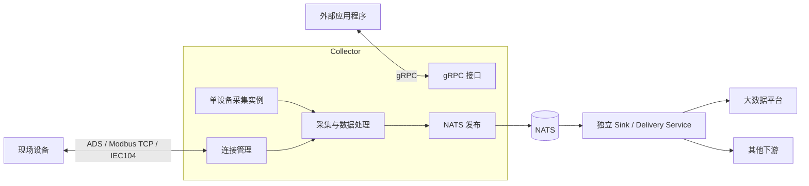

<p class="table-caption">表 3-2 非功能需求与验收口径</p>

| 编号 | 类别 | 需求及验收口径 |
|---|---|---|
| NFR-01 | 采集性能 | 按协议分别验证设备数、每设备动态点数、采样周期、总点吞吐率和周期抖动；目标值待压测基线确定，不虚构最大容量 |
| NFR-02 | 可靠性 | 设备故障独立隔离；Watchdog 恢复连接并恢复全部持久化期望状态为 START 的 Task；NATS 故障不停止采集；每种投递模式记录丢失与确认边界 |
| NFR-03 | 资源与背压 | 监控 CPU、RSS、线程数、连接数和 NATS 待发送量；规定有界资源与超限行为，不把 Core 已解析的 queue_maxsize / backpressure_policy 误认为 Collector 已落实 |
| NFR-04 | 数据正确性与时效性 | 批量读取结果不得错配；保留质量与时间语义；实时消息陈旧时间可配置；下游重采样不改写原始采样时间 |
| NFR-05 | 可观测性 | 可查询设备连接、采集实例、采集成功/失败、时序偏差和发布丢弃指标；提供错误日志 |
| NFR-06 | 可维护性 | 模块责任清晰，协议实现可替换；模板复用和实例覆盖可检验；不允许隐式多级继承 |
| NFR-07 | 部署与退出 | Collector 独立进程运行；按依赖逆序优雅停止，并配置整体停机超时 |


## 3.1 非功能需求的运行约束与验收重点

- **并发正确性**：启动/停止、显式重连/Watchdog 重连、Task 启停/热重载不得产生重复连接、重复采集句柄或孤儿协程；通过交叉操作与取消注入测试验证。
- **消息丢失口径**：将“采集到的点数”“发布得到确认的点数”“发布未确认/丢弃的点数”分别计量；可靠模式不得误称端到端无丢失。
- **容量口径**：采集性能按协议、设备数、每设备动态测点数、采样周期、采集成功率和周期抖动联合测量；NATS 断开与慢下游应单独压测。

**设计状态：** 当前代码仍支持 Task Definition 展开为多个 Task Instance，且 Collector 进程的 NATS delivery 模式由服务配置指定。表 3-1 中“每 Device 一个采集实例”“多个 Delivery 实例及其重采样配置”属于已讨论确认的**目标架构**，尚未完成代码重构。实时模式与 JetStream 可靠模式目前均无 Collector 本地磁盘缓冲。

---

# 4. 用例视图

本视图回答**参与者需要 Collector 完成什么，以及关键场景如何完成**。用例既约束现状实现，也用于验证后续单设备单实例目标方案。

<p class="figure-caption">图 4-1 Collector 用例及系统边界</p>

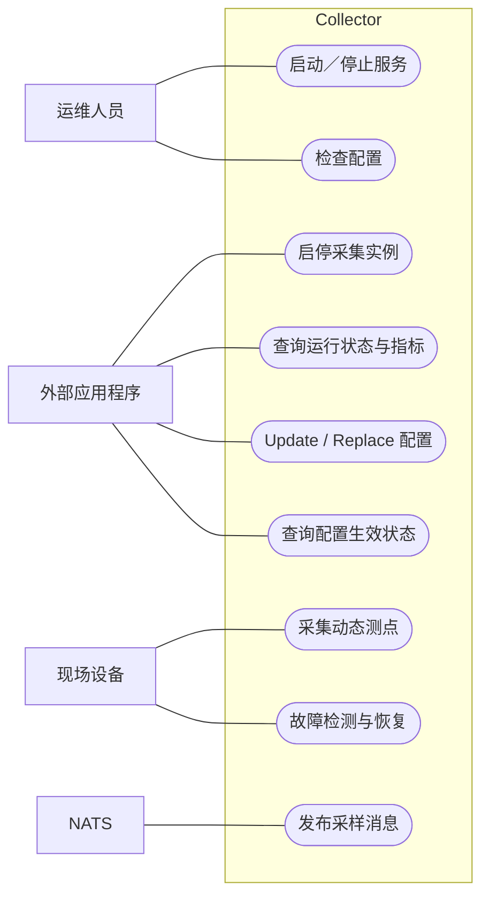

<p class="table-caption">表 4-1 关键用例场景</p>

| 场景 | 触发 | 主要步骤 | 完成条件 |
|---|---|---|---|
| UC-01 服务启动 | 进程启动 | 校验配置→装配组件→尝试连接设备→注册实例→开放 gRPC | 可查询运行状态；现状全部实例默认 STOPPED；目标按设备实例的有效 desired_state 初始化，START 自动启动 |
| UC-02 启动采集 | 外部 gRPC 操作 | 版本校验→持久化 desired_state=START→启动采集句柄→处理样本→发布 NATS | 实例进入 RUNNING；采样可持续执行 |
| UC-03 故障恢复 | 健康检查发现连接故障 | 重连设备→校验恢复条件→重建原需运行的采集句柄 | 恢复所有期望状态 START 的实例；期望 STOP 的实例不恢复 |
| UC-04 配置更新 | 外部配置事务 | Update/Replace→生成候选→全量校验→原子持久化→按差异增量生效或标记需重启 | 成功提交或拒绝并保留旧基线 |
| UC-05 任务停止 | 外部 gRPC 操作 | 原子写入设备实例 desired_state=STOP→停止对应实例 | 重连及进程重启均不恢复该实例 |
| UC-06 配置状态 | 外部 gRPC 查询 | 比较持久化配置、运行配置及设备级应用结果 | 返回 APPLIED / RESTART_REQUIRED / APPLY_FAILED 及差异明细 |
| UC-07 服务停止 | SIGINT/SIGTERM | 关闭 gRPC→停止采集→关闭发布器→释放连接 | 资源按依赖顺序清理 |

---

# 5. 逻辑视图

本视图回答**系统有哪些逻辑对象、各自负责什么、如何协作**；不描述物理部署、进程线程或源码目录。

## 5.1 核心组件

<p class="figure-caption">图 5-1 Collector 核心组件协作</p>

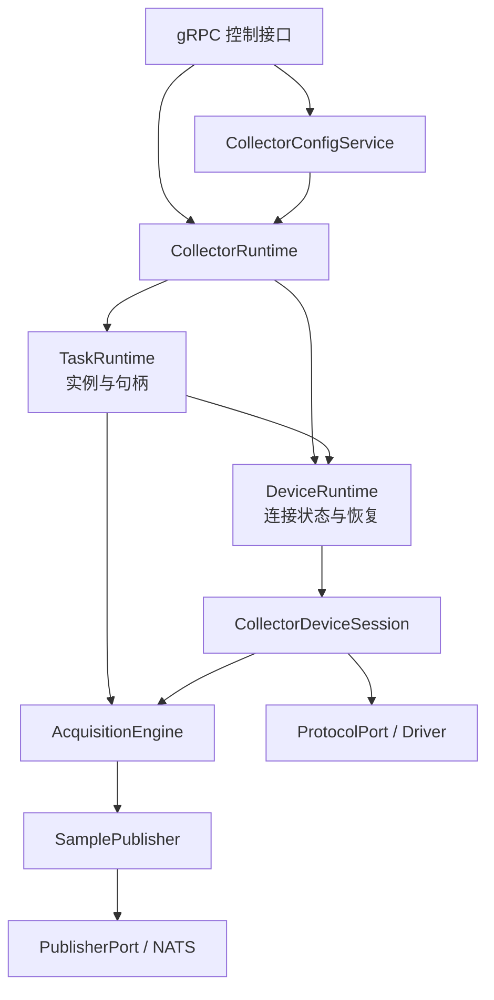

`DeviceRuntime` 是连接及 Watchdog 的所有者；`TaskRuntime` 是实例、运行意图及采集句柄的所有者；`AcquisitionEngine` 统一处理数据；`CollectorRuntime` 只做总体协调。

## 5.2 对象关系与采集机制

<p class="figure-caption">图 5-2 设备与采集对象关系（现状与目标区分）</p>

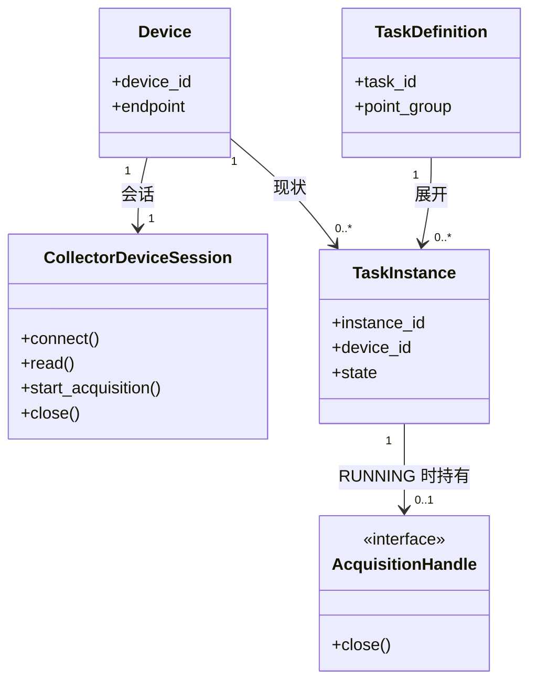

**目标调整：** 每个启用的 Device 仅对应 **1 个采集 Task Instance**，多台同型号设备复用 `TaskTemplate`；实例到设备的现状 `0..*` 关系将改为 `1`。TaskTemplate 提供 `desired_state` 默认值，Device 可覆盖；手动启停更新并持久化对应设备实例的期望状态；具体模板关系见第 8 章。

<p class="figure-caption">图 5-3 三种采集机制与统一数据入口</p>

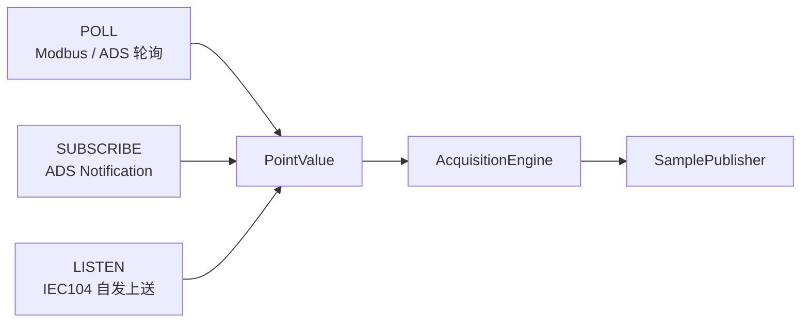

静态信息不进入采集链路。Delivery 的筛选、重采样与输出策略属于独立服务职责。

---

# 6. 进程视图

本视图回答**进程如何通信、Collector 内部如何并发运行、运行时如何启动、关闭与故障恢复**。不限定主机、容器或物理网络拓扑。

## 6.1 进程通信

<p class="figure-caption">图 6-1 独立进程与通信关系</p>

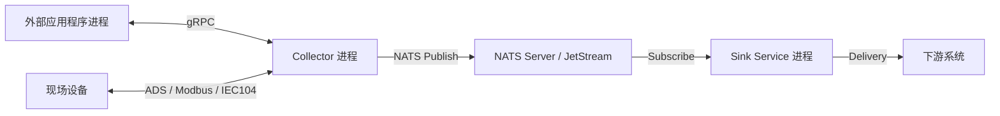

## 6.2 进程内并发模型与竞争控制

<p class="figure-caption">图 6-2 进程内异步任务、线程及所有权</p>

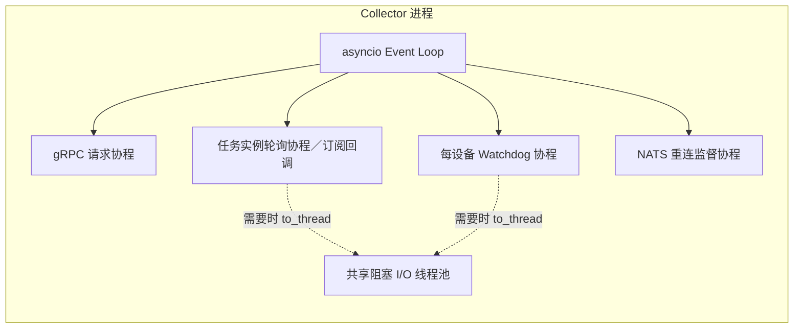

<p class="table-caption">表 6-1 竞争场景及当前防护机制</p>

| 并发风险 | 防护及所有者 | 必须验证的结果 |
|---|---|---|
| Collector 启动与关闭重叠 | `CollectorRuntime._lifecycle_lock` 串行化 | 启动中不被停机状态覆盖，失败执行逆序清理 |
| 显式建连与 Watchdog 同时重连 | `DeviceRuntime` 每设备连接锁；会话和 Driver 自有生命周期约束 | 同一目标不发生并发重复建连 |
| 同一实例 Start/Stop 交叉 | `TaskRuntime._instance_guard` 每实例异步锁 | 同实例最多一个句柄；停止不留下后台采集 |
| 轮询慢于采样周期 | `PollingAcquisitionHandle` 同实例串行 fixed-rate；超期跳过多余时隙 | 不重入、不形成补采风暴 |
| 热重载与连接/订阅恢复交叉 | 配置写入串行化；受影响设备加独立更新门闩，并与 Watchdog、Task 启停协调 | 无旧句柄残留；不触碰未受影响设备；STOP 不复活 |
| 并发配置 Update/Replace 与 Task 启停 | 写入携带 expected_version；全量校验并原子持久化；同设备序列化应用 | 无覆盖更新、丢失状态或重复启停 |
| 多设备增量应用时单设备失败 | 每设备独立执行并记录 applied_version、错误与待收敛状态 | 不影响其他设备；可识别局部成功 |
| 设备断线与正在读操作交叉 | Driver 协议生命周期、Watchdog 恢复；采集前查询连接可用性 | 无重复恢复、失败分类正确 |
| 取消任务与同步协议 I/O 未完成 | 协议 Driver 保有底层在途操作所有权；Collector 等待句柄退出 | 不将取消视作底层操作已经完成 |
| NATS 故障和持续采集并发 | Publisher 独立连接重试，发布失败计数并丢弃 | 采集不中断，资源有界，无隐式持久缓存 |

**注意：** 表中是当前代码的职责和应验证约束，并非所有竞争场景已经过实机压力验证；不能以 `asyncio.Lock` 的存在替代底层协议取消/关闭测试。

## 6.3 启动与关闭

<p class="figure-caption">图 6-3 Collector 启动顺序</p>

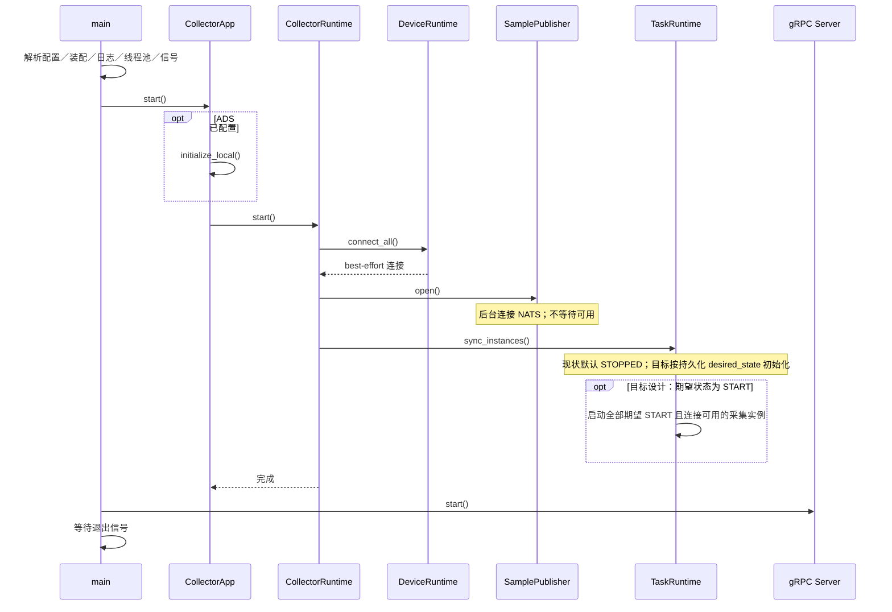

<p class="figure-caption">图 6-4 Collector 优雅关闭顺序</p>

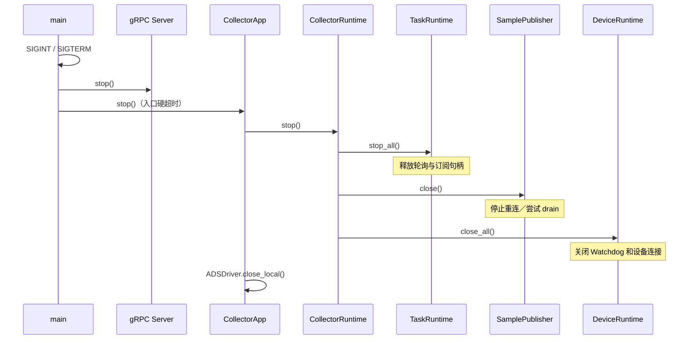

组件关闭失败时继续尝试清理其他组件；入口默认硬超时 30 秒，超时不能保证全部资源释放。

## 6.4 故障恢复

<p class="figure-caption">图 6-5 设备断线恢复与实例恢复</p>

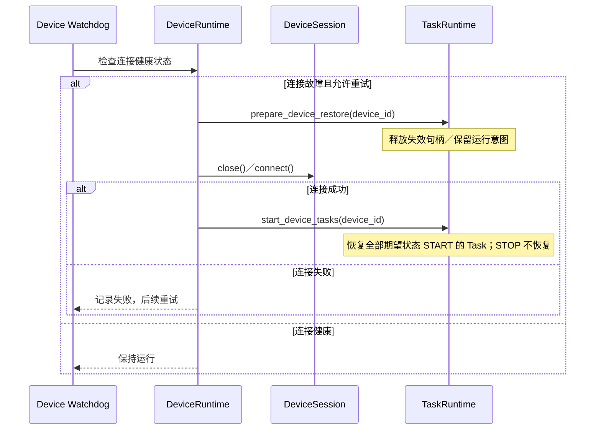


## 6.5 Task 期望状态及持久化（目标设计）

废止 `auto_start`，只使用 **`desired_state: START | STOP`**。`TaskTemplate` 定义缺省状态，`Device` 实例的 `overrides.task.desired_state` 优先；外部 gRPC 手动启停**仅修改设备实例配置**，不修改共享模板。`desired_state` 是唯一的期望状态权威，运行时仅保留可查询的 `RUNNING / STOPPED` 实际状态。

| 事件 | 持久化及运行规则 |
|---|---|
| 第一次启动／进程重启 | 从完整有效配置解析每台设备的 `desired_state`；START 尝试采集，STOP 保持停止 |
| 手动 Start | 版本校验→原子持久化该 Device 的 `desired_state=START`→启动或等待连接恢复 |
| 手动 Stop | 版本校验→原子持久化该 Device 的 `desired_state=STOP`→停止对应采集句柄；重连、重启不复活 |
| 断线 | 期望状态不变；实际停止、等待 Watchdog |
| Watchdog 重连 | 恢复该设备所有 `desired_state=START` 的 Task；STOP 不恢复 |
| 运行时应用失败 | 已保存的 desired_state 不回滚，向 gRPC 报告 `APPLY_FAILED` 和设备级未收敛原因，重试收敛 |

**持久化先于执行**，目的是防止 Stop 已生效但进程突然退出后重启又按旧 START 自动启动。若写入失败，不执行目标操作；若写入成功、实际操作失败，保留新期望状态并报告未收敛。并发手动操作须以 `expected_revision` 防止丢失更新；不应为每次任务启停重写共享模板。

<p class="figure-caption">图 6-6 Task 期望状态持久化及恢复</p>

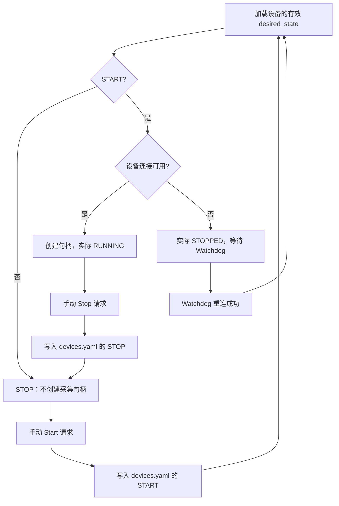

## 6.6 Watchdog：自动恢复机制

每个已启用 Device 有独立 `WatchdogUseCase`，由 `DeviceRuntime` 创建、启动和停止。Watchdog 执行周期健康检查及重连；普通数据读取路径**不主动发起重连**，避免故障期间连接风暴。

<p class="figure-caption">图 6-7 Watchdog 故障恢复决策</p>

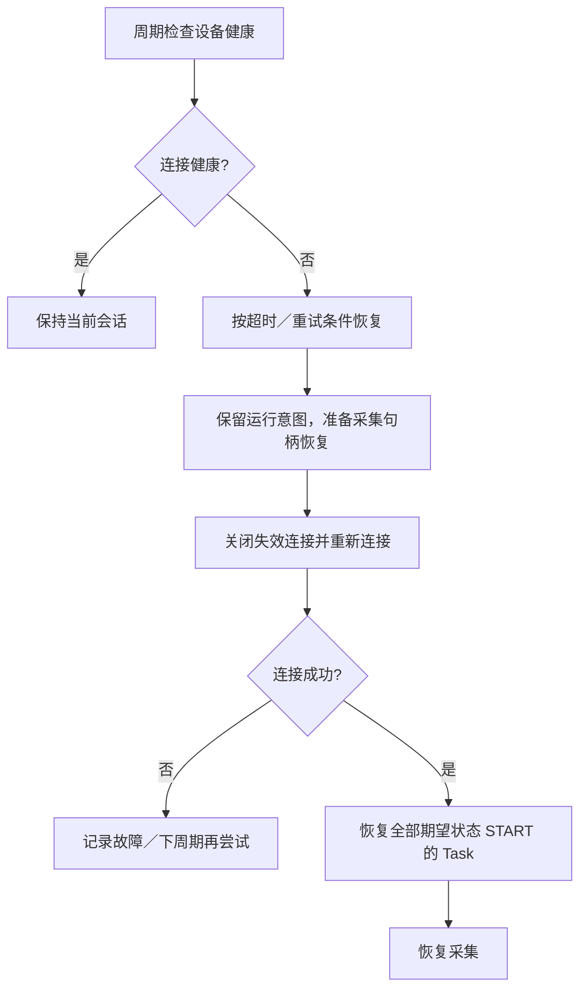

- 可配置 `watchdog_interval`、`health_timeout`、`connect_timeout`；启动期单设备连接失败不阻断其他设备。
- 设备重连、采集任务恢复是**两段生命周期**；恢复仅依据 Task 当前的 START/STOP 期望状态，与首次启动时的运行结果无关。
- 非连接级测点错误不得被错误归类为连接故障；断线期间不应无限创建协议连接。

## 6.7 发布背压、队列及数据持久化

<p class="figure-caption">图 6-8 Collector 至下游的数据可靠性边界</p>

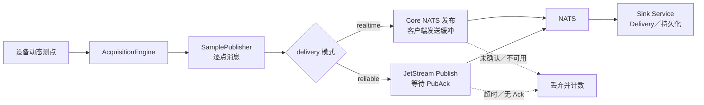

<p class="table-caption">表 6-2 当前 Collector 的背压及持久化契约</p>

| 场景 | 当前行为 | 数据丢失与责任边界 |
|---|---|---|
| `realtime` 正常 | `nats.publish()` 返回视为本机提交成功 | 不等价于订阅者接收或持久化；允许后续丢失 |
| `reliable` 正常 | 等待 JetStream PubAck（有超时） | Ack 仅表明 JetStream 接收/存储确认，不表示最终数据库写入 |
| NATS 不可用/发布超时 | 返回失败、记丢弃数；NATS 连接监督独立重试 | **两种模式均可能丢失本轮数据**，Collector 不本地落盘补发 |
| 批次中单条发布失败 | `SamplePublisher` 停止发布该批余下点，余下计入 dropped | 不保证本批全量到达；靠指标暴露 |
| 消费端慢/下游存储故障 | Collector 与 Sink 通过 NATS 解耦 | 由 NATS/JetStream 与 Sink 自身确认、保留、重试策略决定，不属于 Collector 的端到端保证 |
| 进程停止 | 停止采集后 `NatsPublisher.close()` 尝试 `drain`（限时） | 超时/异常时仍可能丢失未完成发送 |

**背压澄清：** `core.application.settings.RuntimeSettings` 允许 `queue_maxsize` 和 `backpressure_policy`（`drop_old`、`drop_new`、`block`），但 Collector `RuntimeParams` 未接收这两个字段，当前 `SamplePublisher` 也没有独立可配置 `asyncio.Queue`。当前边界是 NATS 客户端有限 pending 缓冲和发布超时；不能宣称已经实现可配置的队列满策略。

**目标建议（待评审、未实现）：** Collector 保持无本地磁盘缓存。实时模式发布受阻时按失败丢弃；可靠模式如果要求**任何故障期间不丢数据**，必须另行引入持久化队列/重发协议，或将该保证限制在 JetStream 确认之后。优先明确丢失语义，再决定是否需要额外队列。

---

# 7. 开发视图

本视图只说明**源码的组织、模块依赖与实现定位**，不再包含启动、关闭或实例状态转移图。

## 7.1 源码模块组织

<p class="figure-caption">图 7-1 Collector 包结构及主要依赖</p>

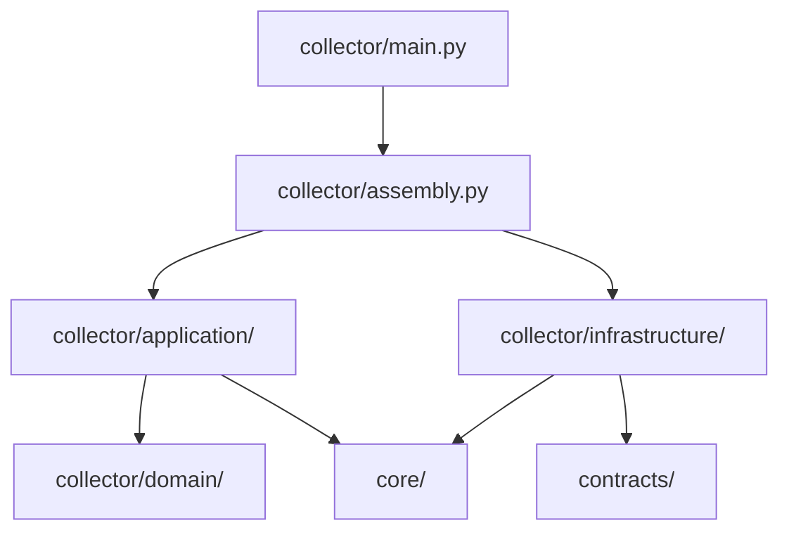

```text
src/
├── collector/
│   ├── main.py                     # 进程入口
│   ├── assembly.py                 # 组合根
│   ├── application/
│   │   ├── runtime.py              # 总协调
│   │   ├── device_runtime.py       # 连接所有权
│   │   ├── task_runtime.py         # 实例所有权
│   │   ├── session.py              # 设备采集会话
│   │   ├── config_service.py       # 热重载编排
│   │   └── nats_dispatch.py        # 样本消息组装
│   ├── domain/
│   │   └── acquisition.py          # 数据处理入口
│   └── infrastructure/
│       ├── grpc/                   # gRPC 适配器
│       ├── config/                 # 配置加载
│       └── nats_publisher.py       # NATS 实现
├── core/                           # 通用协议与领域能力
└── contracts/                      # 跨进程消息契约
```

## 7.2 模块责任与依赖约束

<p class="table-caption">表 7-1 模块职责及接口</p>

| 模块 | 职责 | 主要依赖 |
|---|---|---|
| `assembly.py` | 组合与依赖注入 | Application、Infrastructure、Core |
| `application/runtime.py` | 总生命周期协调 | DeviceRuntime、TaskRuntime、Engine、Publisher |
| `device_runtime.py` | 连接状态、Watchdog | CollectorDeviceSession |
| `task_runtime.py` | 任务实例、句柄、运行意图 | DeviceRuntime、AcquisitionEngine |
| `domain/acquisition.py` | 数据批次处理 | 各 Port 协议 |
| `nats_dispatch.py` | 样本消息封装 | PublisherPort、SampleMessage |
| `infrastructure/` | 配置、协议接入、gRPC、NATS | Application/Core/Contracts |

**依赖原则：** Domain 不引用 Collector Infrastructure；由 `assembly.py` 注入协议 Driver 和发布器实现。现状代码依据：`feat/nats-sink-service` @ `e380fb3c03cb47e7eb416dfa8c15bdcdf5b4d1f0`。

---

# 8. 配置设计（目标方案）

## 8.1 三类配置与所有权

配置按 **Template / Service / Instance** 分离，不以 Collector 服务配置选择模板。**Instance 显式引用模板 ID 与版本**；Service 只描述该进程自身运行参数。

| 类别 | 路径（目标） | 内容、所有权及生效 |
|---|---|---|
| Template | `templates/` | 协议、型号、点表、采集、Delivery 模板；工程单位和业务点标准目录；发布后版本不可变；由 Core 校验，引用它的实例按需热更新 |
| Service | `services/collector.yaml` | Collector 进程运行参数、NATS、Watchdog、Metrics、ADS 本机身份、日志；**修改后重启生效** |
| Service | `services/commander.yaml`、`sink.yaml`、`gateway.yaml` | 各自进程配置，Collector 不读取、不修改；对应服务自行管理生效 |
| Instance | `instances/site.yaml`、`devices.yaml` | 场站身份、设备实例、模板版本引用、实例覆盖、持久化 `desired_state`；按设备增量热更新 |
| Instance | `instances/deliveries.yaml` | Delivery 实例；由 Sink/Delivery 所有者负责加载、热更新，Collector 不管理 |

<p class="figure-caption">图 8-1 配置分类、引用与生效关系</p>

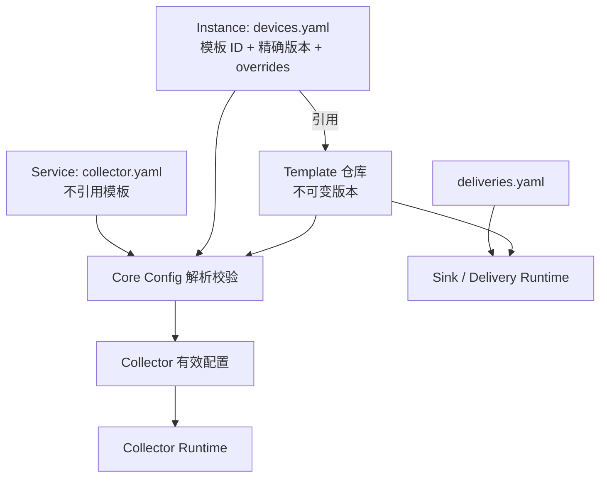

目录示例（目标结构，**当前 Core 解析器尚未支持**）：

```text
config/
├── services/
│   ├── collector.yaml
│   ├── commander.yaml
│   ├── sink.yaml
│   └── gateway.yaml
├── instances/
│   ├── site.yaml
│   ├── devices.yaml
│   └── deliveries.yaml
└── templates/
    ├── protocols/
    ├── device_models/
    ├── point_tables/
    ├── tasks/
    ├── deliveries/
    ├── units.yaml
    └── business_points.yaml
```

入口约束：Collector 接收服务配置路径、实例根目录和模板根目录；Core 从实例中的版本化引用解析模板。`collector.yaml` **不包含模板集合选择、设备实例或 Delivery 实例引用**。启动入口显式接收 `--config`、`--instances`、`--templates` 三个路径；启动任一必需引用失效时拒绝启动，不隐式回退到最新版。

## 8.2 版本、引用及覆盖

- 所有 YAML 使用内部 `schema_version`（结构契约版本）；模板另外声明稳定 `template_id` 和 `template_version`；`revision`/内容 SHA-256 属于配置管理层并发与追溯数据，不靠文件名推断。
- 同一 `template_id + template_version` 内容不可变。发布新版本并让实例修改引用，才允许改变模板含义；禁止原地覆盖已发布模板。
- `DeviceModel` 组合引用 `ProtocolTemplate`、`PointTable`、`TaskTemplate`；`Device` 只声明身份、IP 和少量覆盖。`DeliveryTemplate` 供 Sink/Delivery 实例引用。
- 覆盖优先级为模板默认值、Device 实例显式覆盖；只允许白名单字段，地址及类型等不宜直接覆盖单点。Core 已有的点表 `parent_id` 继承规则需单独保留并校验无环。
- 工程语义继续使用 `units`（Quantity/Unit 及单位换算）和 `business_points`（业务标识、标准单位、逻辑类型）；测点的 `scale/offset` 与单位间换算区分；数据类型、Quantity、引用完整性必须校验。模板版本改变后不得悄悄重定义历史业务语义。

```yaml
# instances/devices.yaml（示意）
schema_version: 1
devices:
  WT01:
    model:
      id: turbine_a
      version: 1.2.0
    endpoint:
      host: 192.168.1.101
    overrides:
      task:
        desired_state: START
  WT02:
    model:
      id: turbine_a
      version: 1.2.0
    endpoint:
      host: 192.168.1.102
    overrides:
      task:
        desired_state: STOP
```

Task 只维护期望状态 `START/STOP` 与实际状态 `RUNNING/STOPPED`；gRPC 手动启停**先持久化到对应 Device 实例，再执行状态收敛**。重启与 Watchdog 恢复均按持久化期望状态处理；停止的设备不自动复活。TaskTemplate 可以提供默认状态，但手动操作不得修改共享模板。

## 8.3 Core 配置校验链路

<p class="figure-caption">图 8-2 配置解析、验证与有效快照</p>

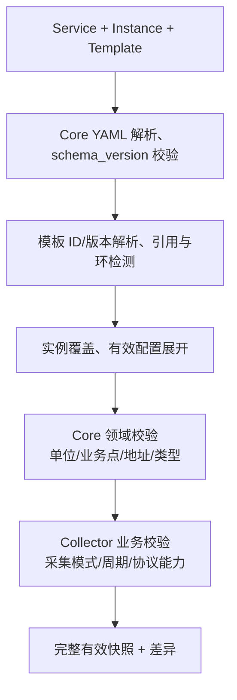

`core/infrastructure/config` 负责 YAML、版本与解析；`core/domain/validation.py` 负责通用领域约束；Collector Application 负责采集专属规则和设备级变更差异。启动、Validate、Update、Replace **必须复用同一套无副作用的候选校验**，验证阶段不得写盘、连接 PLC 或启动任务。错误报告统一返回 `code/file/field_path/message`。当前 Core 的 `YamlConfigAdapter`、`parse_domain.py`、`validation.py` 可作为重构起点，**并非已支持新布局或版本机制**。

## 8.4 Service 配置与 Metrics

`services/collector.yaml` 只包含 Collector 进程级设置；示例为建议值，并非验收后的容量参数：

```yaml
schema_version: 1
runtime:
  shutdown_timeout: 30
  thread_pool:
    max_workers: 32
watchdog:
  interval: 5
  health_timeout: 1
messaging:
  servers: ["nats://127.0.0.1:4222"]
  delivery: realtime
  max_staleness_ms: 500
metrics:
  enabled: true
  windows: [60, 300, 3600]
  publish_interval: 60
  max_staleness: 300
  event_capacity: 1000
  pending_capacity: 120
```

Metrics 只保留当前状态、进程累计值、滚动窗口和有限待发布内存；不落本地数据库。`max_staleness` 从**固定统计窗口结束时间**起算，过期丢弃并计数；队列满优先淘汰最旧的待发布统计消息；进程重启缓存丢失，Sink 不得把缺失窗口当成零异常。`metrics` 发布使用独立 Subject；固定窗口快照须携带 `collector_id`、`boot_id`、窗口 ID、起止时间及 schema 版本，供下游幂等归档。

## 8.5 Update、Replace、生效与并发

`GetConfig/ValidateConfig/UpdateConfig/ReplaceConfig/GetConfigStatus` 统一使用选择器标明 `SERVICE / INSTANCE / TEMPLATE`。其中 Update 是**单一配置对象的路径级补丁**，Replace 是**单一文件或指定新模板版本的整体替换/创建**；二者均不等同于跨目录原子替换。模板已发布版本不可 Update，也不可就地 Replace。

- 配置写入必须指定 `expected_revision` 与 `request_id`；版本冲突返回 `ABORTED`，重复请求需幂等。配置校验完成后进行原子文件写入；**落盘与设备生效不构成一个原子事务**。
- `collector.yaml` 保存后只标记 `RESTART_REQUIRED`；Collector 绝不远程启动、停止或重启服务。其他 Collector 相关实例/模板修改按引用关系计算**有效配置差异**，仅锁定、停采、重建真正受影响的设备。
- 模板的存在不意味着引用设备必须变更；只有实例**切换到新版模板**或有效配置实际变化时才实施对应热更新。仅更新 Delivery 配置不应停止 Collector 采集。
- 设备 IP/协议改变才需重连；采集策略改变通常只重建任务句柄；状态变化只启停目标 Task；无关设备继续采集。Watchdog 重连、手动 Task 控制、配置更新按设备同步，避免旧句柄恢复与状态覆盖。
- 报告 `APPLIED / RESTART_REQUIRED / APPLY_FAILED`；同时保留各配置对象 `stored_revision/active_revision` 和设备级 `target_revision/applied/error`。已保存但未收敛时保留待处理状态，可重试，不能假称生效。

<p class="figure-caption">图 8-3 配置提交与设备级增量收敛</p>

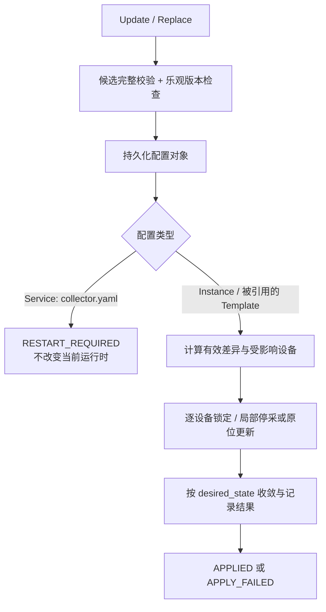

## 8.6 当前仓库与目标方案的区别

当前 Core 仍以 `configs/system.yaml`、`devices.yaml`、`device_models.yaml`、`points.yaml`、`tasks.yaml`、`units.yaml`、`business_points.yaml` 和 `sinks.yaml` 组织；`load_collector()` 不载入 Sink 定义。`sinks.yaml` 中现有 TDengine 历史输出属于 Sink 而非 Collector。当前 Collector `ConfigService` 使用 Prepare/Activate/Abort，部分字段变更直接拒绝热更新。**三类目录、新版本引用、Config 写入 API、状态持久化及 Metrics 发布均属于目标开发工作。**

---

# 9. 数据可靠性、Metrics 与 History

## 9.1 指标与定义

<p class="table-caption">表 9-1 Collector 可靠性指标（目标契约）</p>

| 领域 | 指标 | 统计口径及注意事项 |
|---|---|---|
| 连接 | 连接可用率 | 可用时长 / 应在线时长；排除禁用和显式 STOP 对应的非监测时段（连接监测若始终启用则按连接监测计划另计） |
| 连接 | 断线、重连次数/成功率 | 健康→不可用转换计一次断线；成功重连 / 已完成重连尝试；超时单独计数 |
| 恢复 | 采集恢复耗时 | 故障发现至首个有效采集样本的耗时；不同于 TCP/ADS 重连耗时 |
| 采集 | 执行成功率 | 完全成功的实际执行次数 / 实际执行次数；部分成功独立计数 |
| 采集 | 测点完整率 | 本轮实际成功点数 / 本轮计划点数，按窗口汇总分子分母 |
| 调度 | 漏采率 | 跳过的计划周期 / START 状态期间计划周期（仅固定周期 POLL） |
| 采集 | 超时率、耗时 P95/P99 | 超时次数 / 执行次数；耗时摘要按有效样本归档 |
| 数据 | BAD 质量率、数据新鲜度 | BAD 样本 / 总样本；当前时刻至最近有效点值的年龄 |
| 发布 | 确认率、未确认数、时延 | 成功确认数 / 尝试发布数；Core NATS 仅客户端入队，JetStream 以 PubAck 为准 |
| 缓冲 | 队列满、过期丢弃、缓存水位 | 仅对真实存在的有界缓冲统计；Metrics 缓存独立于采样发布路径 |

固定周期轮询可以计算计划次数；SUBSCRIBE / LISTEN 为事件驱动，不虚构理论采样数。`STOP` 与禁用时段不计入应执行分母；START 但断线、恢复中时段必须计入相应可用性或漏采统计。时间间隔用单调时钟测量，归档窗口用 UTC；历史成功率按分子/分母合计计算，不能平均各窗口的百分数。

## 9.2 四种统计方式

| 类型 | Collector 保留 | 下游用途 |
|---|---|---|
| 在线 | 内存当前连接、任务状态、累计计数和最新点值 | gRPC 查询、实时告警 |
| 移动窗口 | 内存 60/300/3600 秒滚动聚合 | gRPC 实时查询 |
| 固定窗口 | 按 `publish_interval` 产出不重叠基础窗口，独立 Subject 经 NATS 发布 | Sink 幂等入库和更长周期聚合 |
| History / 离线 | Collector 不存长期历史 | Sink 本地 TDengine 滚动保留数月到约一年；外部系统长期保存与离线对账 |

<p class="figure-caption">图 9-1 Metrics 统计及历史职责边界</p>

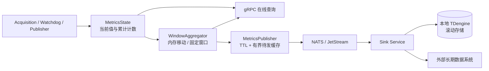

指标事件只做轻量更新，窗口计算、发布与设备采集解耦；故障事件限量保留并及时发布。发布失败只做有限内存重试，TTL 过期和重启后允许统计窗口缺口，但应记录丢弃量；不能声称零丢失。Sink 写库成功才代表历史入库成功；JetStream PubAck 仅表示消息进入 JetStream，并非端到端入库。

## 9.3 已实现与待开发

当前 `CollectorMetricsState` 有进程累计计数、设备连接异常计数和容量 5000 的近期事件环形缓冲；还没有完整的多窗口聚合、独立 MetricsPublisher 和统一发布指标契约。现有 `SamplePublisher` 在采样失败时计数，但不表示有本地持久化队列。当前 NATS Publisher 无本地磁盘缓冲，NATS 故障期间采样消息可能丢失；本地历史交由 Sink，Collector 不负责 TDengine 驱动。

---

# 10. gRPC 接口契约（目标）

## 10.1 统一约定

首版采用 Unary RPC；采样和 Metrics 历史不走 gRPC 流。共有 **4 个 Service、17 个 RPC**。所有状态查询从内存快照返回，不触发设备 I/O；写操作有权限控制与审计，不泄露凭据。枚举：`TaskDesiredState={START,STOP}`、`TaskActualState={RUNNING,STOPPED}`、`ConfigStatus={APPLIED,RESTART_REQUIRED,APPLY_FAILED}`。未实现指标返回有效性标志，不使用零值冒充有效数据。

`ConfigSelector`：`scope`(`SERVICE/INSTANCE/TEMPLATE`)；`name`（如 `collector`、`devices`、`device_models/turbine_a`）；`version`（模板必填）。配置写入必须带 `expected_revision` 和 `request_id`，版本冲突映射 `ABORTED`。每个配置文件/对象分别记录存储与生效版本及 SHA-256。

## 10.2 CollectorRuntimeService（6 个）

| RPC | 请求字段及约束 | 响应字段 |
|---|---|---|
| `GetCollectorInfo` | `Empty` | `collector_id:string`、`boot_id:string`、`version:string`、`started_at:Timestamp`、`uptime_seconds:double`、`site_id:string`、`active_revision:string` |
| `GetRuntimeStatus` | `Empty` | `running:bool`、`device_total:uint32`、`device_connected:uint32`、`device_disconnected:uint32`、`task_total:uint32`、`task_running:uint32`、`task_stopped:uint32`、`nats_connected:bool`、`config_status:ConfigStatus` |
| `ListDevices` | `device_ids:repeated string`、`protocol:string?`、`connected:optional bool`、`page_size:uint32`、`page_token:string` | `devices:repeated DeviceStatus`、`next_page_token:string` |
| `GetDevice` | `device_id:string` 必填 | `device:DeviceStatus`、`model_id:string`、`model_version:string`、`task_id:string`、`last_sample_at:Timestamp?`、`last_success_at:Timestamp?`、`last_recovery_at:Timestamp?` |
| `GetLatestValues` | `device_id:string` 必填、`point_ids:repeated string`（空表示全部） | `values:repeated LatestValue`；每项 `point_id`、`found`、`value:ScalarValue?`、`quality`、`sample_time`、`receive_time`、`age_ms` |
| `GetPointMetadata` | `device_id:string` 必填、`point_ids:repeated string` | `points:repeated PointMetadata`（`point_id`、`business_point_id`、`data_type`、`unit_id`、`quantity_id`、`access`、`description`、`scale`、`offset`、`protocol_address`）、`active_revision` |

`DeviceStatus`：`device_id:string`、`protocol:string`、`connected:bool`、`last_error:string?`、`consecutive_failures:uint32`、`last_connected_at:Timestamp?`、`last_disconnected_at:Timestamp?`、`watchdog_enabled:bool`、`desired_state:TaskDesiredState`、`actual_state:TaskActualState`。Timestamp 缺失应使用 protobuf 字段存在性，不填伪时间。

## 10.3 CollectorTaskService（4 个）

| RPC | 请求字段及约束 | 响应字段 |
|---|---|---|
| `ListTasks` | `device_ids:repeated string`、`desired_state?:TaskDesiredState`、`actual_state?:TaskActualState`、`page_size`、`page_token` | `tasks:repeated TaskStatus`、`next_page_token` |
| `GetTask` | `device_id:string` 必填 | `task:TaskStatus` |
| `StartTask` | `device_id:string`、`expected_revision:string`、`request_id:string`，均必填 | `device_id`、`desired_state`、`actual_state`、`stored_revision`、`converged:bool`、`error:string?` |
| `StopTask` | 同 `StartTask` | 同 `StartTask` |

`TaskStatus`：`task_id`、`device_id`、`template_id`、`interval_ms:optional uint32`、`mode:POLL/SUBSCRIBE/LISTEN`、`desired_state`、`actual_state`、`last_error?`、`last_success_at?`。Start/Stop 幂等且**先保存设备实例期望状态**，再执行控制；设备断线时 `START + STOPPED` 合法，待 Watchdog 恢复。失败或未收敛在响应中明示，不回滚已持久化的期望状态。

## 10.4 CollectorConfigService（5 个）

| RPC | 请求字段及约束 | 响应字段 |
|---|---|---|
| `GetConfig` | `selector:ConfigSelector`、`effective:bool`（仅 Instance） | `selector`、`schema_version`、`revision`、`content_hash`、`yaml_content`（脱敏）、`template_refs` |
| `ValidateConfig` | `selector`、`yaml_content:string`、`expected_revision:string?` | `valid:bool`、`errors:repeated ConfigIssue`、`warnings`、`affected_devices`、`restart_required:bool`、`candidate_hash` |
| `UpdateConfig` | `selector`、`expected_revision`、`request_id`、`updates:repeated ConfigPatch` | `ConfigMutationResponse` |
| `ReplaceConfig` | `selector`、`expected_revision`、`request_id`、`yaml_content`（完整对象） | `ConfigMutationResponse` |
| `GetConfigStatus` | `selectors:repeated ConfigSelector`（空表示全部）、`include_devices:bool` | `status:ConfigStatus`、`configs:repeated ConfigApplyStatus` |

`ConfigPatch`：`path:string`（JSON Pointer）、`operation:SET/REMOVE`、`value:google.protobuf.Value`（SET 必填；REMOVE 禁止携带）；不允许任意字段写入。`ConfigIssue`：`code`、`file`、`field_path`、`message`。`ConfigMutationResponse`：`success`（校验/持久化结果）、`stored_revision`、`status`、`restart_required`、`affected_devices:repeated DeviceApplyResult`、`errors:repeated ConfigIssue`。`DeviceApplyResult`：`device_id`、`target_revision`、`applied`、`error`。`ConfigApplyStatus`：`selector`、`stored_revision`、`active_revision`、`stored_hash`、`active_hash`、`status`、`restart_required`、`last_attempt_at`、`errors`、可选设备明细。

**约束：** `SERVICE` 仅允许本 Collector 的 `collector.yaml`；`TEMPLATE` 新版本通过 Replace 创建，不能更新原版本。Config 的 Replace 不表示整套配置目录的原子替换。单个设备应用失败不会回滚其他已成功设备；整体状态优先显示 `APPLY_FAILED` 并保留 `RESTART_REQUIRED` 明细。无远程重启 RPC。

## 10.5 CollectorMetricsService（2 个）

| RPC | 请求字段及约束 | 响应字段 |
|---|---|---|
| `GetMetrics` | `device_ids:repeated string`、`metric_names:repeated string`、`window_seconds:uint32`（0 表示当前/累计，否则必须为配置窗口）、`page_size`、`page_token` | `collector_id`、`boot_id`、`generated_at`、`metrics:repeated MetricValue`、`next_page_token` |
| `GetMetricsEvents` | `device_ids:repeated string`、`event_types:repeated string`、`since:Timestamp?`、`limit:uint32` | `events:repeated MetricEvent`、`truncated:bool` |

`MetricValue`：`name`、`device_id?`、`value:double`、`unit`、`window_start?`、`window_end?`、`valid:bool`、`sample_count:uint64`。`MetricEvent`：`event_id`、`timestamp`、`event_type`、`device_id?`、`severity`、`message`。分页大小和返回数量由服务端设置上限，事件缓存不足时返回 `truncated=true`；历史查询由 Sink/外部服务承担。

## 10.6 统一错误及迁移约束

| gRPC Code | 使用场景 |
|---|---|
| `INVALID_ARGUMENT` | 参数格式、字段路径及 Schema 不合法 |
| `NOT_FOUND` | Device、Task、配置对象不存在 |
| `ALREADY_EXISTS` | 模板版本已发布 |
| `ABORTED` | 配置 revision 冲突 |
| `FAILED_PRECONDITION` | 引用、状态或操作前提不成立 |
| `PERMISSION_DENIED` | 配置访问越权 |
| `RESOURCE_EXHAUSTED` | 查询/请求过大 |
| `UNAVAILABLE` | 依赖暂时不可用 |
| `INTERNAL` | 非预期服务端异常 |

当前 `CollectorRuntimeService` / `CollectorControlService` 包含 `ApplyTaskPlacement`、Task Definition/Instance 两层接口及 Prepare/Activate/Abort 配置事务；这些**不能在未审查调用方、调度契约及测试的情况下直接删除**。实施目标接口时应同步迁移所有 gRPC 调用方、proto、配置 Schema、测试和文档，不保留无故兼容层。

---

# 11. 实施契约、边界与验收

本章将第 3—10 章转化为可执行的交付约束，明确过去尚未确定的边界。属于**目标设计**，实施前需核对仓库最新提交；下列规则不代表现状已实现。

## 11.1 交付范围与不做事项

| 范围 | 必须交付 | 不属于本次 Collector 范围 |
|---|---|---|
| 采集 | 每启用设备一个采集实例，POLL/SUBSCRIBE/LISTEN，持久化 START/STOP，Watchdog 恢复 | 设备静态信息周期采样、下游逐消费者重复采集 |
| 配置 | 三类配置读取与验证、模板版本、实例覆盖、对象级 Update/Replace、增量热更新、生效状态 | 远程重启、跨多个 YAML 文件的全局原子 Replace、Collector 管理其他进程配置 |
| Metrics | 在线累计与状态、内存移动窗口、固定基础窗口发布、有限错误事件与待发缓存 | Collector 本地历史库、跨进程历史查询、保证统计消息零丢失 |
| 发布 | 原始样本 NATS/JetStream、独立 Metrics Subject，明确丢弃边界 | 本地磁盘补发、对外部数据库完成入库提供保证 |
| Sink | 文档中仅定义边界；Sink 负责本地 TDengine 滚动历史、外部长期数据系统传输 | 在 Collector 中实现 TDengine 驱动或 Delivery 业务 |

## 11.2 启动、模板版本与配置一致性

- 启动入口为 `wind-hub collector run --config <collector.yaml> --instances <directory> --templates <directory>`；**具体 CLI 命令名以项目现有 CLI 组织方式落地，但三个独立路径参数及其含义不可变**。Collector 不从 `collector.yaml` 读取模板选择；设备实例引用精确的 `template_id + template_version`，Core 根据模板根目录解析。缺失、重号、版本不符、循环引用、覆盖越权均为校验错误，不回退到其他版本。
- `schema_version` 是解析格式版本；`template_version` 是不可变模板内容版本；`revision` 是写事务的乐观并发令牌；`hash` 是规范化配置内容的 SHA-256。**同一模板 ID/版本不得修改内容**；创建新版本不能自动切换已运行设备，必须变更实例引用。
- 公共 `site.yaml`、`units.yaml`、`business_points.yaml` 仍需在有效配置校验中存在；它们与共享模板的引用关系由 Core 负责，Collector 只读取所需快照。原有点表继承合法规则保留，但不额外引入模板到模板的通用继承链。
- 单对象 `UpdateConfig`、`ReplaceConfig` 的原子性仅覆盖**一个指定配置对象及其文件提交**。如果新实例同时依赖尚未发布的新模板，应先发布不可变模板版本，再原子切换实例引用。候选实例必须在现有已发布模板集合上完成全量交叉校验，杜绝半成品引用。
- 模板仓库与实例目录可能被多个进程共享：只有被授权的配置管理方可以发布模板，Collector 的 gRPC 至多写其获授权的对象；模板写入和实例写入均需路径固定化、越权检查、写入序列化、版本冲突检查。**禁止根据外部传入的 selector 拼接任意磁盘路径**。
- `GetConfig` 返回的脱敏 YAML 只用于展示，不保证可以直接作为无损 Replace 输入；敏感字段的写入使用授权的完整配置契约，不能在脱敏后悄悄覆盖或清空密码。

## 11.3 配置更新的事务与设备收敛

1. 校验 `request_id + selector + expected_revision`，锁定目标配置对象；同一 `request_id` 重试必须返回同一事务结果，不能重复修改设备。
2. 在**候选有效配置**上完成 Core 格式、模板引用、业务语义及 Collector 采集能力校验；校验阶段绝无外部副作用。校验失败不写盘、不改变运行资源。
3. 原子持久化目标文件并生成 `stored_revision`。`collector.yaml` 变更只报告 `RESTART_REQUIRED`，现有运行资源保持原样；其他配置计算受影响设备集合，对每台设备按实际差异进行必要的停采、更新或重连；无关设备不受影响。
4. 单设备采用一致的生命周期协调顺序：**取得设备更新互斥权 → 阻止旧 Watchdog 恢复与旧采集句柄重入 → 必要时停采/更新连接或点表 → 按最新持久化 START/STOP 收敛 → 释放互斥权**。必须防止取消导致底层句柄失去释放所有权；协议调用超时不可推断底层同步操作已终止。
5. 持久化成功而部分设备应用失败时，文件 `stored_revision` 前进；每台设备独立记 `target_revision / applied / error`，失败设备维持待收敛状态，由明确的重试路径再次尝试；不得全局回滚已成功设备，也不得宣称整体 `APPLIED`。`GetConfigStatus` 应保留文件级 `RESTART_REQUIRED` 和设备级 `APPLY_FAILED` 的并存明细。
6. **已持久化的 `STOP` 优先于所有恢复操作**：手动 Stop 即使实际句柄关闭失败，Watchdog 和后续重试都不得启动该实例；Collector 进程重启按持久化值初始化。`START` 在设备断线时允许实际 `STOPPED`，应报告未收敛和连接原因，而不是返回实际启动成功。
7. 热更新只覆盖该 Collector 应管理的设备及采集配置。共享模板新增但尚无人引用不会造成运行时重构；Sink/Delivery 配置变化不触发 Collector 重建。

## 11.4 数据可靠性与 Metrics 统计的精确定义

- 指标事实源位于 Collector 运行时。每个指标必须写明**维度、分子、分母、时间基准及不适用条件**；空窗口或没有分母时 `valid=false`，不能返回 100% 或 0% 伪结果。
- 连接可用性使用每设备单调时钟维护状态区间。指标的观测对象是**应保持连接的启用设备**，不直接按 Task 是否 STOP 排除；如果业务需要只统计应采集时段的可用性，应另定义“采集服务可用率”，不可混为同一指标。
- POLL 的计划采集周期基于 START 有效区间与调度器实际计划槽位计数；即使断线仍计入计划槽位，跳过/失败与成功分开统计。SUBSCRIBE/LISTEN 不估算不存在的理论样本数，改统计监听中断时长、实际通知量、最新值年龄与质量。
- 采样成功、消息提交确认、JetStream PubAck、Sink 入库成功是**四个不同边界**；Collector 无法独立统计最终入库成功率。可靠模式的 PubAck 超时可能是**结果不确定**，必须记录“未确认”，不可等同于下游肯定未收到，也不应未经幂等设计就无限重试。
- 本地只维护当前值、累计计数、配置窗口所需的内存摘要、近期事件及有界待发布窗口。移动窗口供 gRPC 查询；**NATS 只发布互不重叠的固定基础窗口**，默认基础窗口长度等于 `publish_interval`，整分钟 UTC 对齐。`windows` 中的移动窗口长度必须是基础窗口长度的正整数倍，或者实现明确的亚窗口计数策略；首版要求正整数倍，以避免近似边界无定义。
- 为保证发布内容可聚合，固定窗口发布**分子、分母和计数增量**，不只发布成功率百分比；P95/P99 必须发布可合并的延迟分布摘要，或明确仅供本地查询、历史端不作跨窗口聚合。首版可选择本地计算分位数、NATS 只发布数量/耗时累计及最大值，不允许 Sink 直接平均分位数。
- Metrics 发布独立于采样主路径，以有限内存缓存等待 JetStream PubAck；窗口 ID 由 `collector_id + boot_id + window_start + window_end + schema_version` 确定。`max_staleness` 为窗口结束后允许尝试发布的最大年龄，过期删去；满队列淘汰最旧窗口并计数，异常退出允许缺口。过期与积压的统计应可查询；不得为补指标而阻塞 PLC 数据采集。
- 原始样本的 `realtime` 与 `reliable` 传输契约延续第 6.7 节：**均不保证 NATS 故障期间零丢失**。首版不增加 Collector 本地持久化队列；可靠发布模式以 JetStream PubAck 作为 Collector 的交付边界。

## 11.5 gRPC 具体边界与安全规则

- 第 10 章的 **4 Service、17 RPC** 为目标对外最小集合。Proto 的字段名、类型、必填/可选语义以第 10 章为准；实现阶段可补充 protobuf 必需的枚举 `UNSPECIFIED`、分页令牌与错误明细，但不得自行增加不相关 API、远程重启或历史查询接口。
- `GetLatestValues`、`GetMetrics` 的批量结果必须有服务端规模上限；对 `GetLatestValues` 允许显式点 ID 列表，空列表返回所有点时也必须限制单次返回量并报告超限，不能让任意调用一次拉取全场高频数据。
- `StartTask` / `StopTask` 使用设备 ID 定位唯一实例，并且通过**同一配置事务服务**持久化期望状态；它们不得有独立且绕开 revision 检查的 YAML 写入代码。设备不存在为 `NOT_FOUND`，配置版本冲突为 `ABORTED`，持久化成功但执行失败通过响应 `converged=false` 和配置状态反馈。
- `ConfigSelector` 按授权的配置对象注册表解析；`SERVICE` 只能选择 Collector 服务配置，`INSTANCE` 只处理 Collector 归属实例，`TEMPLATE` 只允许具备发布权限的调用方新建不可变版本。所有写接口需认证、授权、审计，不把凭据写入日志、指标或 gRPC 错误文本。
- 因旧接口有 `ApplyTaskPlacement` 和 Prepare/Activate/Abort 配置事务，**先审查所有调用方并完成迁移再删除旧契约**；不能在未调整调度器情况下仅凭“单设备单任务”删除 placement 逻辑。生产实现不新增无故兼容层。

## 11.6 分阶段实施顺序与验收门槛

| 阶段 | 生产代码交付 | 独立验收重点 |
|---|---|---|
| 1. 配置基础 | Core 三类配置模型/校验/版本、实例引用及覆盖、Collector 新启动参数与有效快照 | schema_version、模板精确版本、不变性、缺失/循环引用、覆盖非法、凭据保护；现有采集不退化 |
| 2. 任务与连接 | 单设备单采集实例、START/STOP 持久化、启动恢复、Watchdog 与设备级最小影响热更新 | 重启后 STOP 不复活、断线 START 自动恢复、手动 Stop 与重连竞态、热更新不影响未变设备、取消/超时无泄漏 |
| 3. 控制面与统计 | 17 RPC、配置对象 Update/Replace/Status、指标窗口/事件/发布；移除被替代接口 | Proto 调用方同步、幂等与版本冲突、配置部分收敛、窗口边界/TTL/满队列、重启缺口、gRPC 查询上限、安全审计 |

**每阶段代码完成必须实际运行** Ruff Lint、Ruff Format、仓库规定的 Mypy/Pyright 和 import-linter 静态检查；无法运行必须明确列出未验证项。ChatGPT 负责生产代码和缺陷修复；会话外 Claude Code 负责独立审查、测试/Fixture 与格式检查修复、复测。相关测试失败不得以忽略规则或兼容层绕过。验收通过后再决定是否合并；**不主动创建 PR**。

**容量验收**：最终必须按协议分别测量设备数、每设备动态测点数、采集周期、执行成功率、漏采率、P95/P99、CPU/RSS/线程数，并对 NATS 不可用、慢下游、热更新与任务启停并发开展故障注入。实际容量阈值由现场目标与测试结果确定，未测不得声称满足。
