<h1 class="title">wind-hub Collector 软件设计</h1>

<p class="subtitle">v1_0 · 20261101</p>

<style>
body {
  font-family: "Microsoft YaHei";
  font-size: 16px;
  line-height: 1.75;
  color: #24292f;
}
.title {
  font-family: "Microsoft YaHei";
  font-size: 32px;
  line-height: 1.30;
  font-weight: 700;
  text-align: center;
}
.subtitle {
  font-family: "Microsoft YaHei";
  font-size: 18px;
  line-height: 1.50;
  font-weight: 400;
  text-align: center;
}
h1 {
  font-family: "Microsoft YaHei";
  font-size: 28px;
  line-height: 1.40;
  font-weight: 700;
}
h2 {
  font-family: "Microsoft YaHei";
  font-size: 22px;
  line-height: 1.40;
  font-weight: 700;
}
h3 {
  font-family: "Microsoft YaHei";
  font-size: 18px;
  line-height: 1.50;
  font-weight: 700;
}
h4 {
  font-family: "Microsoft YaHei";
  font-size: 16px;
  line-height: 1.50;
  font-weight: 700;
}
p, li {
  font-family: "Microsoft YaHei";
  font-size: 16px;
  line-height: 1.75;
}
.figure-caption,
.formula-caption {
  font-family: "Microsoft YaHei";
  font-size: 14px;
  line-height: 1.50;
  font-weight: 600;
  text-align: center;
  margin: 0.65em 0 0.35em 0;
}
.table-caption {
  font-family: "Microsoft YaHei";
  font-size: 13px;
  line-height: 1.40;
  font-weight: 500;
  text-align: center;
  margin: 0.65em 0 0.35em 0;
}
.mermaid,
.mermaid text,
.mermaid .label {
  font-family: "Microsoft YaHei" !important;
  font-size: 14px !important;
  line-height: 1.20;
}
table {
  width: 100%;
  border-collapse: collapse;
  font-family: "Microsoft YaHei";
  font-size: 13px;
  line-height: 1.45;
}
table th,
table th p,
table th li {
  font-family: "Microsoft YaHei";
  font-size: 13px;
  line-height: 1.40;
  font-weight: 600;
}
table td,
table td p,
table td li,
table td strong,
table td b {
  font-family: "Microsoft YaHei";
  font-size: 13px;
  line-height: 1.45;
  font-weight: 400;
}
table th,
table td {
  padding: 0.40em 0.60em;
  vertical-align: top;
}
code, pre {
  font-family: "Cascadia Code";
  font-size: 14px;
  line-height: 1.50;
}
p code, li code, td code {
  color: #24292f;
  background: #f3f4f6;
  padding: 0.08em 0.28em;
  border-radius: 3px;
}
pre {
  color: #c9d1d9;
  background: #0d1117;
  padding: 1em;
  border-radius: 6px;
  overflow-x: auto;
}
pre code {
  color: inherit;
  background: transparent;
  padding: 0;
}
.hljs-comment, .hljs-quote,
.token.comment, .token.prolog, .token.doctype, .token.cdata {
  color: #8b949e;
  font-style: italic;
}
.hljs-keyword, .hljs-selector-tag, .hljs-literal,
.token.keyword, .token.boolean { color: #ff7b72; }
.hljs-string, .hljs-doctag, .hljs-regexp,
.token.string, .token.char, .token.regex { color: #a5d6ff; }
.hljs-number, .token.number { color: #79c0ff; }
.hljs-title, .hljs-function, .token.function { color: #d2a8ff; }
.hljs-title.class_, .hljs-type, .hljs-built_in,
.token.class-name, .token.builtin { color: #ffa657; }
.hljs-variable, .hljs-attr, .hljs-property,
.token.variable, .token.property, .token.attr-name { color: #7ee787; }
.hljs-operator, .hljs-punctuation,
.token.operator, .token.punctuation { color: #c9d1d9; }
</style>

---

## 目录

1. [文档约定](#1-文档约定)  
2. [软件设计指导原则与编制方法](#2-软件设计指导原则与编制方法)  
3. [软件需求](#3-软件需求)  
4. [用例视图](#4-用例视图)  
5. [逻辑视图](#5-逻辑视图)  
6. [进程视图](#6-进程视图)  
7. [开发视图](#7-开发视图)  
8. [物理视图（部署视图）](#8-物理视图部署视图)  
9. [gRPC 接口契约与适配](#9-grpc-接口契约与适配)  
10. [配置与热重载](#10-配置与热重载)  
11. [采集、调度及故障恢复](#11-采集调度及故障恢复)  
12. [样本发布、Metrics 与可靠性](#12-样本发布metrics-与可靠性)  
13. [安全、可观测性与运行指标](#13-安全可观测性与运行指标)  
14. [测试体系、物理组织与验收](#14-测试体系物理组织与验收)  

---


# 1. 文档约定

本章是全文的固定排版与表达规范。文档修订、补充和派生版本均应遵守本章，不再根据个人习惯调整字体、字号、行距、图题、表题、公式或代码样式。

本文开头的 `<style>...</style>` 是 HTML `style` 元素，其中包含内部 CSS 样式表，本文简称为 CSS 样式块。第 1.1～1.4 节规定目标样式；CSS 样式块通过 `h1`、`h2`、`p`、`table`、`th`、`td`、`pre`、`code` 等选择器，将规范应用到 Markdown 渲染后生成的 HTML 元素。

## 1.1 字体约定

<p class="table-caption">表 1-1 文档字体与排版规范</p>

| 文档元素 | 字体 | 字号 | 行间距/行高 | 字重 | 对齐方式 |
|---|---|---:|---:|---:|---|
| 文档标题 | Microsoft YaHei | 32 px | 1.30 | 700 | 居中 |
| 文档副标题 | Microsoft YaHei | 18 px | 1.50 | 400 | 居中 |
| 一级标题 | Microsoft YaHei | 28 px | 1.40 | 700 | 左对齐 |
| 二级标题 | Microsoft YaHei | 22 px | 1.40 | 700 | 左对齐 |
| 三级标题 | Microsoft YaHei | 18 px | 1.50 | 700 | 左对齐 |
| 四级标题 | Microsoft YaHei | 16 px | 1.50 | 700 | 左对齐 |
| 正文 | Microsoft YaHei | 16 px | 1.75 | 400 | 左对齐 |
| 图题 | Microsoft YaHei | 14 px | 1.50 | 600 | 居中 |
| 图内文字 | Microsoft YaHei | 14 px | 1.20 | 400 | 按图形布局 |
| 表题 | Microsoft YaHei | 13 px | 1.40 | 500 | 居中 |
| 表头 | Microsoft YaHei | 13 px | 1.40 | 600 | 左对齐 |
| 表格正文 | Microsoft YaHei | 13 px | 1.45 | 400 | 左对齐 |
| 公式题 | Microsoft YaHei | 14 px | 1.50 | 600 | 居中 |
| 代码文字 | Cascadia Code | 14 px | 1.50 | 400 | 左对齐 |

以上规范已经通过本文开头的 CSS 样式块固定。其中，正文为 `16 px`；表题、表头和表格正文均为 `13 px`。表头字重为 `600`，低于标题字重；表格正文行高为 `1.45`，因此表格在字号、字重和行距上均明显弱于正文。英文业务对象、数据库对象和程序标识符仍按所在文本元素的字号排版，但使用行内代码形式，例如 `Asset`、`Connection`、`task_id`。

## 1.2 绘图约定

1. 上下文图、第 0 层及更深层 DFD、总体流程图和关系流程图统一使用 Mermaid。
2. 每一个 Mermaid 图都必须在 Mermaid 代码块第一行加入初始化配置，统一只设置 `useMaxWidth: true`。初始化配置格式为：

```text
%%{init: {"<Mermaid 图类型配置域>": {"useMaxWidth": true}}}%%
```

其中 `<Mermaid 图类型配置域>` 必须根据实际 Mermaid 图类型替换，不得固定写成 `flowchart`，也不得使用与实际图类型不匹配的配置域。

<p class="table-caption">表 1-2 Mermaid 图类型与初始化配置</p>

| Mermaid 图类型 | 图声明 | 第一行初始化配置 |
|---|---|---|
| Flowchart | `flowchart TB/LR/...` | `%%{init: {"flowchart": {"useMaxWidth": true}}}%%` |
| Sequence Diagram | `sequenceDiagram` | `%%{init: {"sequence": {"useMaxWidth": true}}}%%` |
| State Diagram | `stateDiagram-v2` | `%%{init: {"state": {"useMaxWidth": true}}}%%` |
| Class Diagram | `classDiagram` | `%%{init: {"class": {"useMaxWidth": true}}}%%` |
| ER Diagram | `erDiagram` | `%%{init: {"er": {"useMaxWidth": true}}}%%` |

若后续使用其他 Mermaid 图类型，也必须遵守同一规则：

```text
实际图类型
    ↓
确定该图类型对应的 Mermaid 配置域
    ↓
第一行写入：
%%{init: {"对应配置域": {"useMaxWidth": true}}}%%
```

不得额外加入 `wrap` 等非统一配置；如确有特殊需要，应在对应图的局部设计说明中单独论证。

3. 每张图必须有图编号和图题，编号采用“章节号-本章图序号”，例如“图 7-2”。
4. 图题必须使用普通图题样式，不得使用 Markdown 标题。统一写法为：

```html
<p class="figure-caption">图 1-1 图题</p>
```

## 1.3 公式约定

1. 行内公式使用单美元符号，例如 `$E_1$`。
2. 独立公式使用双美元符号，例如：

```text
$$
\mathrm{Entity}=E_1\land(E_2\lor E_3\lor E_4)\land E_5
$$
```

3. 正式公式不得放入代码块。
4. 不使用 `\[` 与 `\]` 作为公式定界符。
5. 变量下标统一写成 `E_1`、`R_1`；逻辑“与”和“或”统一写成 `\land`、`\lor`。
6. 公式必须使用 LaTeX，不使用普通文本模拟数学符号。
7. 需要编号的公式使用“式（章节号-本章公式序号）”，式题采用普通公式题样式：

```html
<p class="formula-caption">式（8-1）实体判断逻辑</p>
```

## 1.4 代码约定

1. 多行代码必须使用带语言标识的围栏代码块，例如 `python`、`sql`、`json`、`yaml`、`mermaid` 或 `text`。
2. 单个标识符、字段名、命令和短代码使用行内代码，例如 `PRIMARY KEY`、`Connection`。
3. 伪代码必须明确标记为 `text` 或在正文中说明“以下为伪代码”；不得使读者误认为它可以直接运行。
4. 代码块统一使用深色背景，颜色为 `#0D1117`；普通代码文字颜色为 `#C9D1D9`。
5. 语法高亮统一采用表 1-3 的配色。Markdown 渲染器应使用 Highlight.js 或 Prism 可识别的语言标识；渲染器不支持高亮时，至少保留代码背景色和普通代码文字颜色。

<p class="table-caption">表 1-3 代码语法高亮配色</p>

| 语法元素 | 颜色 | 十六进制 |
|---|---|---|
| 代码背景 | 深黑蓝 | `#0D1117` |
| 普通文字、运算符和标点 | 浅灰 | `#C9D1D9` |
| 注释 | 灰色 | `#8B949E` |
| 关键字和布尔值 | 红色 | `#FF7B72` |
| 字符串和正则表达式 | 浅蓝 | `#A5D6FF` |
| 数值 | 蓝色 | `#79C0FF` |
| 函数名 | 紫色 | `#D2A8FF` |
| 类型、类名和内置对象 | 橙色 | `#FFA657` |
| 变量、属性和字段 | 绿色 | `#7EE787` |


---


# 2. 软件设计指导原则与编制方法

本章规定本设计书的编制准则，不是特定系统的内部实现说明，也不要求按传统瀑布流程开发。后续章节必须以需求为依据；非适用事项应注明理由，不机械增加模块或抽象。

## 2.1 总则

本节规定软件设计书的编制原则、设计深度和工作流程。软件设计以需求为依据，以架构视图组织设计内容，以明确的行为与接口契约约束实现，并通过测试与验收验证设计目标。优先采用简单、安全、高效的方案，避免无依据的功能扩展和过度设计。

### 2.1.1 需求驱动原则

软件设计必须来源于已确认的需求，不应从技术方案反向编造需求。

<p class="table-caption">表 2-1 需求驱动设计要求</p>

| 设计要求 | 具体规定 |
|---|---|
| 需求依据 | 关键功能、技术机制和质量约束应能够追溯至需求 |
| 设计范围 | 不擅自增加功能或扩大系统职责 |
| 需求分解 | 原始需求与分类需求保持完整、一致 |
| 设计取舍 | 同样满足需求时，优先选择职责更少、依赖更少的方案 |
| 需求变更 | 新增或改变系统行为时，先核对需求，再修订相关设计 |

### 2.1.2 职责与边界明确原则

系统及组件必须具有清晰的职责、依赖方向和状态所有权。

<p class="table-caption">表 2-2 职责与边界设计要求</p>

| 设计要求 | 具体规定 |
|---|---|
| 系统边界 | 明确本系统负责什么、不负责什么 |
| 组件职责 | 重要职责有明确的负责组件，避免重复承担 |
| 状态所有权 | 关键状态具有明确的权威来源和修改责任 |
| 接口边界 | 区分内部接口、对外接口与外部依赖 |
| 依赖控制 | 避免循环依赖和不必要的跨层访问 |
| 简单性 | 不因假设性的扩展需要增加抽象、兼容层或冗余实现 |

### 2.1.3 行为与契约确定原则

设计应消除影响正确性的重要歧义，但不规定无关的私有方法。

<p class="table-caption">表 2-3 行为与契约设计要求</p>

| 设计对象 | 必须明确的内容 |
|---|---|
| 业务操作 | 触发条件、输入、反馈、业务输出及处理规则 |
| 接口 | 参数、类型、返回值、错误、超时及版本语义 |
| 状态 | 状态定义、转换条件、终态与非法转换 |
| 数据 | 数据结构、约束、所有权、一致性与生命周期 |
| 并发操作 | 执行顺序、同步条件、互斥范围与竞争裁决 |
| 异常操作 | 失败条件、处理结果、恢复行为及禁止行为 |

同一契约应有唯一的规范定义位置，其他章节通过引用关联，不重复规定矛盾规则。

### 2.1.4 资源与异步操作安全原则

异步操作的业务结果、底层执行活动和资源生命周期必须分别判断。

<p class="table-caption">表 2-4 异步操作与资源管理原则</p>

| 概念 | 定义及设计要求 |
|---|---|
| 操作逻辑终结 | 业务层已形成最终处理结果，不代表底层活动已经结束 |
| 底层 I/O 安全结束 | 有可信证据表明相关 I/O 不再继续执行或产生新的相关资源访问 |
| 安全隔离 | 通过可验证措施，使未结束操作无法与后续操作发生有害冲突 |
| 资源所有权 | 明确谁创建、持有、跟踪和释放资源 |
| 资源安全释放 | 满足安全结束或可信隔离条件后，才允许释放或复用可能产生冲突的资源 |

核心原则：操作超时不等于底层 I/O 结束；未确认 I/O 安全结束或隔离前，不得释放可能引发冲突操作的执行资源。

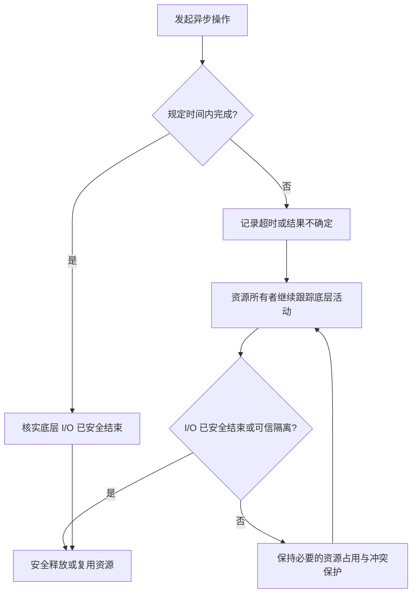

<p class="figure-caption">图 2-1 异步操作超时与资源安全释放流程</p>

对异步操作应区分超时、取消、异常和正常结束；不能仅凭调用方返回、Future/Task 取消或连接状态判断底层 I/O 已安全结束。

### 2.1.5 性能与资源有界原则

性能设计围绕明确的负载与质量要求展开，而不是无依据地增加并发或缓存。

<p class="table-caption">表 2-5 性能与资源有界设计要求</p>

| 设计要求 | 具体规定 |
|---|---|
| 负载模型 | 明确请求规模、并发规模、数据量及运行条件 |
| 容量约束 | 队列、线程、Task、连接、缓存及存储资源应有合理边界 |
| 背压 | 资源不足时明确等待、拒绝、丢弃或降级策略及适用条件 |
| 缓存 | 明确缓存用途、权威数据来源、失效与容量策略 |
| 性能指标 | 明确时延、吞吐、资源占用及测量口径 |
| 性能取舍 | 不得以违反正确性、安全性和可靠性约束换取性能 |

### 2.1.6 故障可控与恢复原则

设计应覆盖正常运行及合理预期的异常场景，明确故障影响范围和恢复条件。

<p class="table-caption">表 2-6 故障与恢复设计要求</p>

| 设计要求 | 具体规定 |
|---|---|
| 故障识别 | 明确可能的超时、通信失败、存储失败、任务异常和进程崩溃 |
| 故障隔离 | 限制故障传播，避免无关组件或资源被错误影响 |
| 状态可信 | 不将未知状态解释为确定成功或失败 |
| 重试与恢复 | 明确允许重试的条件，禁止可能产生危险副作用的盲目重试 |
| 持久化恢复 | 规定异常中断后的数据一致性及状态恢复规则 |
| 生命周期 | 明确启动、就绪、运行、关闭和重启期间的异常处理 |
| 失效行为 | 无法恢复时应有明确的降级、阻塞或停止服务条件 |

### 2.1.7 横切能力非侵入式原则

日志、审计、指标、追踪、权限校验等横切能力应与核心业务逻辑分离，优先通过统一的边界组件、装饰器、中间件或独立服务实现，不应将重复的技术处理流程散布在业务代码中。非侵入式不等于隐藏业务约束：凡影响业务准入、执行结果、事务一致性或故障处理的规则，必须在业务契约中明确，并保留必要的显式调用点。

<p class="table-caption">表 2-7 横切能力非侵入式设计要求</p>

| 设计要求 | 具体规定 |
|---|---|
| 职责分离 | 业务组件负责业务规则与状态转换；横切组件负责统一的记录、采集、校验与传输机制 |
| 边界统一 | 在服务入口、应用服务边界、消息发布边界等明确位置接入横切能力，避免各业务分支重复编排 |
| 最小侵入 | 不为记录日志、采集指标或传播追踪上下文而改变业务方法的核心控制流程和返回语义 |
| 审计正确性 | 审计事件的业务含义及产生时机由业务契约定义；持久化、投递、重试等通用机制与业务处理解耦，同时保证要求的一致性 |
| 故障影响 | 明确横切能力故障时的阻断、降级或重试规则；不得默认其失败不会影响业务，也不得默默吞掉必须处理的错误 |
| 可读性与验证 | 业务代码能够直接体现主流程；横切处理可独立测试，端到端测试验证其与业务契约一致 |

不为追求形式上的非侵入而引入复杂框架或过多抽象；简单、清晰的显式边界优先于难以追踪的隐式执行机制。

### 2.1.8 公共能力复用与冗余控制原则

优先使用符合需求的标准库、成熟软件包、现有工具及公共组件；相同且稳定的职责才提炼为公共能力，不重复发明、不为假设性扩展提前设计框架。

<p class="table-caption">表 2-8 公共能力复用与冗余控制要求</p>

| 设计要求 | 具体规定 |
|---|---|
| 复用优先 | 先评估现成组件是否满足功能、安全、性能及维护要求，再决定是否自行实现。 |
| 提炼公共职责 | 多模块存在稳定相同的职责时统一实现；业务规则留在所属业务模块。 |
| 控制依赖 | 核查成熟度、许可证、版本、安全维护及引入成本。 |
| 控制抽象 | 避免仅为减少少量重复而引入复杂框架或多层转发。 |
| 清理冗余 | 统一能力落地后删除重复、废弃和不必要的兼容实现。 |

### 2.1.9 图表表达与设计一致性原则

设计优先使用合适的图形和表格表达结构、流程、时序、状态及约束，图表不能代替必要的精确定义。

<p class="table-caption">表 2-9 图表表达与一致性设计要求</p>

| 设计要求 | 具体规定 |
|---|---|
| 视图完整 | 使用 4+1 架构视图组织系统设计，覆盖适用内容 |
| 图形选择 | 根据表达目的选择结构图、状态图、时序图、活动图等 |
| 图表一致 | 图形、表格和正文不得相互矛盾 |
| 跨章节一致 | 同一接口、状态、参数及资源规则保持一致 |
| 设计深度 | 明确影响系统行为的契约，允许自主选择内部实现细节 |
| 可验证性 | 关键设计要求应能够对应测试条件与验收证据 |

### 2.1.10 软件设计工作流程

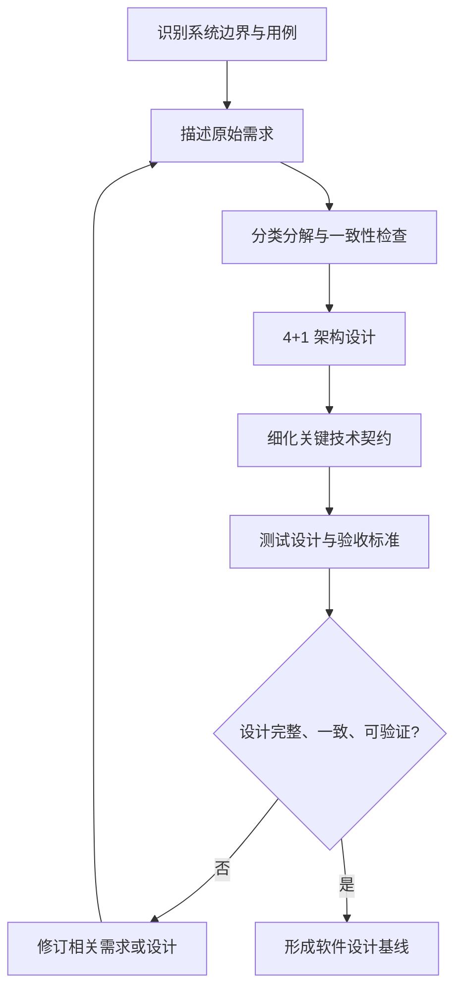

<p class="figure-caption">图 2-2 软件设计编制流程</p>

工作流程允许迭代，不要求传统瀑布式阶段。发现缺口或冲突时直接修订相关需求、架构视图或契约，不通过追加覆盖性条款解决。

## 2.2 需求体系及描述规范

需求采用“识别用例 → 逐条描述原始需求 → 分类分解 → 总分一致性检查”的方法。用例应从外部使用者及运行场景出发，覆盖适用的部署、启动、正常使用、配置、运维、正常关闭、重启及异常恢复过程；不局限于业务 RPC，也不将内部技术机制机械列为用例。用例识别属于需求分析，第 4 章用例视图负责表达参与者、边界及用例关系。

<p class="table-caption">表 2-10 原始需求描述字段</p>

| 字段 | 描述要求 |
|---|---|
| 编号 | 唯一原始需求标识，例如 `UR-01` |
| 名称 | 准确概括使用者需要的能力或运行场景 |
| 请求方（Requester） | 发起操作的外部系统、服务或接口，如 CLI、gRPC 客户端、进程管理系统；不要求是自然人 |
| 输入（Input） | 请求方向本系统提供的数据、参数和信息 |
| 反馈（Response） | 本系统返回请求方的确认、状态、结果及错误信息 |
| 目标方（Destination） | 接收本系统业务输出的外部系统、消息中间件或现场设备；没有时标记“不适用” |
| 业务输出（Output） | 本系统发往目标方的数据、消息或控制指令；没有时标记“不适用” |
| 业务规则（Business Rules） | 正常与异常业务处理、前置条件、执行顺序及结果判定 |
| 约束（Constraints） | 性能、可靠性、安全和横切能力的要求，尤其审计；描述应独立于具体技术实现 |

反馈与业务输出必须分开：反馈面向请求方，业务输出面向目标方；请求方与目标方可有多个，且请求方断连不必然撤销已接受的业务操作。

<p class="table-caption">表 2-11 分类需求体系与描述重点</p>

| 类别 | 核心问题 | 典型要求 |
|---|---|---|
| 功能需求（Functionality） | 系统提供什么行为 | 对外能力、业务流程、业务规则、输入输出与状态反馈 |
| 性能需求（Performance） | 运行速度与资源上限 | 时延、吞吐、并发、调度、公平性、容量、背压、资源消耗、扩展能力 |
| 可靠性需求（Reliability） | 故障时如何保持正确与恢复 | 容错、超时、重试、请求关联、事务、持久化、故障恢复、可用性、未结束操作的资源管理 |
| 安全需求（Safety & Security） | 如何防止危险或非法控制 | 控制权、互锁、失效安全、认证、授权、通信及数据安全 |
| 横切能力（Cross-cutting Concerns） | 如何观测、管理与追责 | 审计（操作证据、可靠投递、完整性、追溯）、日志、指标、追踪、配置、版本、可测试性、可维护性 |

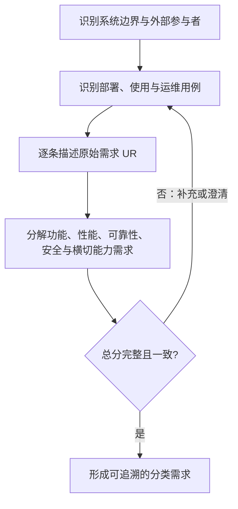

<p class="figure-caption">图 2-3 需求识别、分解与一致性检查流程</p>

分类需求必须从原始需求的输入、反馈、业务输出、规则和约束中推导，不得遗漏、矛盾或未经确认增加能力；多条原始需求的共同约束可以合并，但必须保留来源编号。每条分类需求应给出可核验条件，性能要求还需明确测量口径，不虚构现场阈值。审计应独立于普通日志定义，不得以运行日志代替审计证据。

需求分类与设计专题是不同维度：启动、正常关闭、重启及 Reload 属于跨需求的运行生命周期设计，统一在进程视图展开；相应行为和质量约束分别由原始需求及分类需求追溯。

## 2.3 4+1 架构视图：内涵、外延与表达规范

<p class="table-caption">表 2-12 4+1 架构视图的职责与成果</p>

| 视图 | 关注范围 | 主要成果 | 不应混淆 |
|---|---|---|---|
| 用例视图（+1） | 参与者、系统边界、典型/异常场景 | 系统上下文、用例、业务流程 | 不负责线程调度 |
| 逻辑视图（Logical） | 组件职责、模型、接口、状态规则、依赖 | 组件图、类/数据关系、状态图 | 不等于源码目录树 |
| 进程视图（Process） | 进程、线程、Event Loop、Task、协作、生命周期、同步、并发、资源、背压、缓存、故障恢复 | 运行结构图、任务所有权表、时序/状态/活动图、资源预算 | Task 不等于 OS 线程；图名须区分标准 UML 与示意图 |
| 开发视图（Development） | 软件模块边界、层次、静态依赖、公共契约与复用关系 | 模块图、依赖图、模块职责表 | 不描述真实并发拓扑，也不列现有代码修改清单 |
| 物理视图（Physical/Deployment） | 节点、进程部署、存储、网络、控制权和现场外部依赖 | 部署图、网络/故障域/外部依赖表 | 不是现场设备内部物理结构模型 |

### 2.3.1 用例视图的场景编写规范

用例以参与者的完整业务目标为单位组织，而非以原始需求、RPC 或内部模块为单位逐条改名。一项用例可以关联多项原始需求；一项原始需求也可以由多个业务场景共同覆盖。用例视图回答“在具体业务场景中系统如何工作”，不代替逻辑视图、进程视图和数据设计。

<p class="table-caption">表 2-13 业务场景用例的必备描述要素</p>

| 要素 | 编写规定 |
|---|---|
| 用例身份与目标 | 给出唯一编号、业务场景名称及参与者要达成的可观察目标；名称使用业务活动，不使用内部机制命名 |
| 参与者与触发条件 | 列明实际发起操作的外部角色；内部定时任务、恢复及发布等自动步骤不得虚构外部参与者 |
| 前置条件 | 列明系统就绪、授权、配置或数据存在等必要条件；不得混入未确认的实现假设 |
| 主业务流程 | 以 Mermaid 业务活动图（flowchart）为主要表达，覆盖触发、校验、关键处理、反馈及后置结果；以判断节点表达重要分支，避免大段编号文字复述 |
| 分支与异常流程 | 在活动图中呈现影响业务结果的主要异常出口；罕见或不宜展开的异常在简明说明表中概括，避免为了完整而画出所有技术异常 |
| 后置条件 | 明确成功和失败之后的业务状态、外部可见结果、未完成事项及后续查询方式 |
| 需求追溯 | 标明相关 UR；核对全部 UR 在真实场景中得到覆盖，但不要求 UR 与 UC 一一对应 |

跨用例共享的内部机制（如存储、审计发布和调度）应作为相关业务流程中的自动步骤或支撑行为描述；只有存在独立业务目标时才另立用例。应避免将一串 gRPC 方法名或 CRUD 操作直接当作完整用例，也不得在用例章节展开线程、锁、表结构及类方法等实现细节。

用例的正文采用“一张业务活动图 + 一张简明用例说明表”的表达形式。活动图包含主路径、必要判断以及重要异常分支；图中节点使用业务动作，不展开展示内部类、锁和数据库事务。说明表只填写参与者、业务目标、前置条件、主要异常、后置条件及关联需求。业务分支已在图中完整表达时，不再重复书写大段“主业务流程”和“异常流程”；复杂跨参与者消息时序可在独立小节补充时序图。图题和表题按文档约定独立编号。

进程视图应按四个设计专题组织，而不是按需求类别重复划分：

<p class="table-caption">表 2-14 进程视图的四类设计专题</p>

| 专题 | 必须明确的设计对象 | 推荐表达 |
|---|---|---|
| 运行时结构 | 进程、线程、Event Loop、Task、线程池、组件与资源所有权 | 分层运行结构图、Task 职责表 |
| 运行生命周期（Runtime Lifecycle） | 启动、初始化、就绪、运行、Reload、正常关闭、重启及其阶段转换 | 生命周期状态图、启动/关闭/Reload 时序图 |
| 并发与资源管理 | Task 协作、队列、通知、同步、调度、容量限额、背压、缓存及释放 | 任务协作时序图、资源与背压策略表 |
| 异常与恢复 | 超时、取消、故障隔离、未收敛 I/O、崩溃恢复与降级 | 故障状态图、异常裁决矩阵 |

各专题共享同一运行模型，明确创建者、所有者、同步关系和退出条件；不因分节而重复定义状态或资源。生命周期是进程视图的独立设计专题，不是第六类需求。

图表仅使用其可准确表达的语义：结构关系用 Mermaid Flowchart；行为交互用 Sequence Diagram；状态约束用 State Diagram；条件控制用活动/流程图。图题说明对象、范围及图类型。关键质量属性贯穿各视图，不能只写在单独的“非功能要求”段落。

## 2.4 测试设计方法、组织及验收规范

测试设计以测试层级组织物理目录，以 Marker 描述测试层级、测试专题与运行场景。测试文件名应清楚表达验证对象或行为；测试文件及其标记、验证说明统一登记在测试矩阵中。需求、用例及重要技术契约必须能追溯到实际测试，不为同一目的建立重复测试体系。

<p class="table-caption">表 2-15 测试层级与目录规范</p>

| 层级 Marker | 物理目录 | 验证范围 |
|---|---|---|
| `unit` | `unit/` | 状态转换、业务规则、纯逻辑，无外部服务依赖 |
| `component` | `component/` | 单组件职责及其可控依赖 |
| `integration` | `integration/` | 组件之间及真实外部依赖的接口协作 |
| `system` | `system/` | 独立进程、完整业务场景及端到端行为 |

<p class="table-caption">表 2-16 测试 Marker 与矩阵编制规范</p>

| 事项 | 规范 |
|---|---|
| 层级 Marker | 每项测试必须且仅属于 `unit`、`component`、`integration`、`system` 之一，与目录对应 |
| 专题 Marker | 标识可靠性、安全、性能等验证主题，可与层级及场景 Marker 叠加；无专项主题时可为空 |
| 场景 Marker | 标识并发、超时、恢复、负载、现场等执行条件或情境；有相应场景时标记 |
| 测试矩阵 | 至少包含“测试文件名、层级 Marker、专题 Marker、场景 Marker、测试说明”五列；每项重要测试应有可定位的文件归属 |
| 标记粒度 | 标记以具体测试函数或类为准；同文件可包含不同专题与场景，矩阵列出涉及的 Marker |
| 运行条件 | 通过 Fixture 和环境准备明确外部依赖；现场专用测试与常规回归分离，未执行不视为通过 |
| 执行规则 | 提供按目录、Marker 及其布尔组合的 pytest 命令；所有 Marker 在项目配置中注册 |
| 可追溯性 | 测试说明与需求、用例或技术契约对应；行为变更时同步检查测试及矩阵 |
| 验收证据 | 保留运行环境、命令、实际结果、指标和未验证项，禁止把设计目标当作测试结果 |

目录划分测试层级，专题与场景通过 Marker 横向组合；可靠性测试不单独设第五类目录。测试矩阵用于定位和筛选测试，不预设每个实现文件必须存在，也不要求每个文件仅能有一种测试场景。

# 3. 软件需求

本章依据第 2.2 节，先定义原始需求（UR），再抽取 FR、PR、RR、SR、CR。外部接口由 `src/contracts/common.proto` 与 `collector.proto` 定义；**接口已定义不等于功能已实现**。设计基线为 `main@6d6776d33b3398d42654468301bdd4d8542f9203`（2026-11-01）。

## 3.1 原始需求

<p class="table-caption">表 3-1 原始需求索引</p>

| 编号 | 原始需求 | 请求方 |
|---|---|---|
| UR-01 | 启动服务并初始化采集 | 进程管理系统 |
| UR-02 | 正常停止服务 | 进程管理系统 |
| UR-03 | 重启并重新读取配置 | 进程管理系统 |
| UR-04 | 按设备持续采集测点 | 设备实例配置与运行意图（自动触发） |
| UR-05 | 按设备启停采集任务 | gRPC 调用方 |
| UR-06 | 查询设备、测点与任务 | gRPC 调用方 |
| UR-07 | 即时读取指定设备测点 | gRPC 调用方 |
| UR-08 | 对 IEC104 设备发起总召 | gRPC 调用方 |
| UR-09 | 发布采样消息及查询发布状态 | 采集结果（自动触发）、gRPC 调用方 |
| UR-10 | 获取服务信息、能力与健康状态 | gRPC 调用方 |
| UR-11 | 配置快照上报、推送与应用 | gRPC 调用方 |
| UR-12 | 查询指标与运行事件 | gRPC 调用方 |
| UR-13 | 诊断采集完整链路 | gRPC 调用方 |
| UR-14 | 设备断线后的恢复 | 设备故障（自动触发） |
| UR-15 | 异常退出后恢复采集 | 进程管理系统 |

以下各表的“反馈”与“业务输出”严格分开；自动触发的场景没有人为构造的外部请求者。

### 3.1.1 UR-01 启动服务并初始化采集

<p class="table-caption">表 3-2 UR-01 启动服务并初始化采集</p>

| 字段 | 描述 |
|---|---|
| 编号 | UR-01 |
| 名称 | 启动服务并初始化采集 |
| 请求方（Requester） | 进程管理系统 |
| 输入（Input） | 服务配置、实例目录、模板目录、启动环境 |
| 反馈（Response） | 启动成功/失败及业务就绪状态 |
| 目标方（Destination） | 现场设备、NATS |
| 业务输出（Output） | 对期望 START 的设备启动采集并发布样本 |
| 业务规则（Business Rules） | 解析全部引用及版本、装配驱动与发布器、初始化监控并开放 gRPC；单设备离线不阻断其他设备就绪 |
| 约束（Constraints） | 缺失/非法配置拒绝就绪；不隐式回退模板版本；不得误报现场全连接成功 |

### 3.1.2 UR-02 正常停止服务

<p class="table-caption">表 3-3 UR-02 正常停止服务</p>

| 字段 | 描述 |
|---|---|
| 编号 | UR-02 |
| 名称 | 正常停止服务 |
| 请求方（Requester） | 进程管理系统 |
| 输入（Input） | 停止信号与停机期限 |
| 反馈（Response） | 退出结果、未安全结束资源 |
| 目标方（Destination） | 现场设备、NATS |
| 业务输出（Output） | 停止采集并释放采集/订阅资源，尽力排空已接纳消息 |
| 业务规则（Business Rules） | 先禁止新任务操作，协调任务句柄与连接关闭，最后关闭发布器及服务 |
| 约束（Constraints） | 超时/取消不代表底层 I/O 已退出；期限到达报告未收敛资源 |

### 3.1.3 UR-03 重启并重新读取配置

<p class="table-caption">表 3-4 UR-03 重启并重新读取配置</p>

| 字段 | 描述 |
|---|---|
| 编号 | UR-03 |
| 名称 | 重启并重新读取配置 |
| 请求方（Requester） | 进程管理系统 |
| 输入（Input） | 重启命令、磁盘配置 |
| 反馈（Response） | 当前实际生效文件版本及状态 |
| 目标方（Destination） | 现场设备 |
| 业务输出（Output） | 按最新有效期望状态恢复或停止采集 |
| 业务规则（Business Rules） | 停止旧进程，加载全部配置，重新解析精确引用并启动 |
| 约束（Constraints） | 手动 STOP 跨重启保持；配置无效不得沿用旧快照假装新版本生效 |

### 3.1.4 UR-04 按设备持续采集测点

<p class="table-caption">表 3-5 UR-04 按设备持续采集测点</p>

| 字段 | 描述 |
|---|---|
| 编号 | UR-04 |
| 名称 | 按设备持续采集测点 |
| 请求方（Requester） | 实例的 START 运行意图 |
| 输入（Input） | 协议、点表、采集模式与周期 |
| 反馈（Response） | 运行统计、质量与错误 |
| 目标方（Destination） | NATS |
| 业务输出（Output） | 设备动态测点样本 |
| 业务规则（Business Rules） | 每设备唯一采集实例；Modbus/ADS 轮询、ADS 通知、IEC104 监听按协议能力执行；工程量换算和质量标记 |
| 约束（Constraints） | fixed-rate 不重入、超期跳过；不采集静态信息；点级错误与连接级错误区分 |

### 3.1.5 UR-05 按设备启停采集任务

<p class="table-caption">表 3-6 UR-05 按设备启停采集任务</p>

| 字段 | 描述 |
|---|---|
| 编号 | UR-05 |
| 名称 | 按设备启停采集任务 |
| 请求方（Requester） | gRPC 调用方 |
| 输入（Input） | 任务 ID、expected_revision |
| 反馈（Response） | OperationResult（accepted、desired_state、actual_state、revision、error） |
| 目标方（Destination） | 现场设备 |
| 业务输出（Output） | 开启或停止相应采集操作 |
| 业务规则（Business Rules） | 按任务 ID 定位设备唯一任务；先持久化期望状态，再收敛；重复启停幂等 |
| 约束（Constraints） | 版本冲突拒绝；STOP 不被 Watchdog 复活；START 不等于已连通或已采到样本 |

### 3.1.6 UR-06 查询设备、测点与任务

<p class="table-caption">表 3-7 UR-06 查询设备、测点与任务</p>

| 字段 | 描述 |
|---|---|
| 编号 | UR-06 |
| 名称 | 查询设备、测点与任务 |
| 请求方（Requester） | gRPC 调用方 |
| 输入（Input） | 设备/测点/任务标识、过滤及分页 |
| 反馈（Response） | 配置与内存状态快照、下一页令牌 |
| 目标方（Destination） | 不适用 |
| 业务输出（Output） | 不适用 |
| 业务规则（Business Rules） | 列设备详情、测点元数据、任务列表及详情，分页和过滤 |
| 约束（Constraints） | 只读；不触发现场 I/O；数据与当前生效版本一致；权限过滤敏感地址 |

### 3.1.7 UR-07 即时读取指定设备测点

<p class="table-caption">表 3-8 UR-07 即时读取指定设备测点</p>

| 字段 | 描述 |
|---|---|
| 编号 | UR-07 |
| 名称 | 即时读取指定设备测点 |
| 请求方（Requester） | gRPC 调用方 |
| 输入（Input） | device_id、point_ids、timeout_ms |
| 反馈（Response） | 逐点 Sample（value、quality、freshness、error）、queried_at |
| 目标方（Destination） | 现场设备 |
| 业务输出（Output） | 发起一次独立实时读取 |
| 业务规则（Business Rules） | 以所请求测点定位当前设备的协议读取能力；返回逐点结果，不用采集缓存冒充现场读取 |
| 约束（Constraints） | ReadPoints 是现场读取而非订阅；超时不代表底层 I/O 安全结束；只读变量和错误粒度明确 |

### 3.1.8 UR-08 对 IEC104 设备发起总召

<p class="table-caption">表 3-9 UR-08 对 IEC104 设备发起总召</p>

| 字段 | 描述 |
|---|---|
| 编号 | UR-08 |
| 名称 | 对 IEC104 设备发起总召 |
| 请求方（Requester） | gRPC 调用方 |
| 输入（Input） | device_id、可选 common_address、timeout_ms |
| 反馈（Response） | status、样本、缺失点与错误 |
| 目标方（Destination） | IEC104 设备 |
| 业务输出（Output） | 发起一次总召请求 |
| 业务规则（Business Rules） | 仅 IEC104 设备、有效公共地址可接受；用协议层返回确定总召结果 |
| 约束（Constraints） | 不可把总召视为普通轮询；超时和部分返回需可区分 |

### 3.1.9 UR-09 发布采样消息及查询发布状态

<p class="table-caption">表 3-10 UR-09 发布采样消息及查询发布状态</p>

| 字段 | 描述 |
|---|---|
| 编号 | UR-09 |
| 名称 | 发布采样消息及查询发布状态 |
| 请求方（Requester） | 采集结果（自动触发）、gRPC 调用方 |
| 输入（Input） | 样本、发布频道或状态查询条件 |
| 反馈（Response） | 查询返回各频道连接状态、计数与错误 |
| 目标方（Destination） | NATS 与独立 Sink |
| 业务输出（Output） | 发送带身份、时间和质量的采样消息 |
| 业务规则（Business Rules） | 采集与发布解耦；实时和可靠通道确认边界不同；NATS 故障独立重连 |
| 约束（Constraints） | 无 Collector 本地磁盘补发；发布失败/背压必须可观察，不将 PubAck 视为 Sink 入库 |

### 3.1.10 UR-10 获取服务信息、能力与健康状态

<p class="table-caption">表 3-11 UR-10 获取服务信息、能力与健康状态</p>

| 字段 | 描述 |
|---|---|
| 编号 | UR-10 |
| 名称 | 获取服务信息、能力与健康状态 |
| 请求方（Requester） | gRPC 调用方 |
| 输入（Input） | 空请求 |
| 反馈（Response） | 服务信息、能力及依赖健康快照 |
| 目标方（Destination） | 不适用 |
| 业务输出（Output） | 不适用 |
| 业务规则（Business Rules） | 按 CommonService 返回身份、进程角色、软件/契约版本、依赖健康和 RPC/协议能力 |
| 约束（Constraints） | 不主动连接设备；健康状态区分进程存活、依赖异常与采集任务状况 |

### 3.1.11 UR-11 配置快照上报、推送与应用

<p class="table-caption">表 3-12 UR-11 配置快照上报、推送与应用</p>

| 字段 | 描述 |
|---|---|
| 编号 | UR-11 |
| 名称 | 配置快照上报、推送与应用 |
| 请求方（Requester） | gRPC 调用方 |
| 输入（Input） | scope、SnapshotFile、expected_revision、candidate_id |
| 反馈（Response） | 快照、校验问题、candidate_id、file_commit、apply_results、restart_required |
| 目标方（Destination） | 磁盘配置文件及 Collector 运行时 |
| 业务输出（Output） | 按审批后的快照提交文件并局部热更新 |
| 业务规则（Business Rules） | Get/Push/Apply 三阶段；Push 只验证和保存候选，不生效；Apply 重核 revision、先提交文件再按设备生效 |
| 约束（Constraints） | 服务配置变更重启生效；模板版本不可变；文件提交与逐对象运行应用不是同一原子事务 |

### 3.1.12 UR-12 查询指标与运行事件

<p class="table-caption">表 3-13 UR-12 查询指标与运行事件</p>

| 字段 | 描述 |
|---|---|
| 编号 | UR-12 |
| 名称 | 查询指标与运行事件 |
| 请求方（Requester） | gRPC 调用方 |
| 输入（Input） | scope、window_ms、时间范围、过滤和分页 |
| 反馈（Response） | Metric/Event 列表与 next_page_token |
| 目标方（Destination） | 不适用 |
| 业务输出（Output） | 不适用 |
| 业务规则（Business Rules） | 从 Collector 内存计数、窗口及有界事件缓存返回 |
| 约束（Constraints） | 无历史库；窗口与未定义指标不得用零冒充事实；分页/大小有界 |

### 3.1.13 UR-13 诊断采集完整链路

<p class="table-caption">表 3-14 UR-13 诊断采集完整链路</p>

| 字段 | 描述 |
|---|---|
| 编号 | UR-13 |
| 名称 | 诊断采集完整链路 |
| 请求方（Requester） | gRPC 调用方 |
| 输入（Input） | target_id、stages、timeout_ms、correlation_id |
| 反馈（Response） | overall_status、逐阶段 DiagnosticStage 与 limitations |
| 目标方（Destination） | 现场设备及 NATS（按诊断阶段） |
| 业务输出（Output） | 必要的受控探测数据 |
| 业务规则（Business Rules） | 按连接、协议、采集、发布顺序定位故障；返回证据、阶段耗时与可观察边界 |
| 约束（Constraints） | 受时间与权限限制；不隐式修改设备或配置；不承诺诊断无法观测的下游入库 |

### 3.1.14 UR-14 设备断线后的恢复

<p class="table-caption">表 3-15 UR-14 设备断线后的恢复</p>

| 字段 | 描述 |
|---|---|
| 编号 | UR-14 |
| 名称 | 设备断线后的恢复 |
| 请求方（Requester） | 设备故障（自动触发） |
| 输入（Input） | 设备健康状态、持久化 desired_state |
| 反馈（Response） | 故障事件、任务状态及恢复结果 |
| 目标方（Destination） | 现场设备 |
| 业务输出（Output） | 安全重连并恢复期望 START 的采集 |
| 业务规则（Business Rules） | Watchdog 控制连接恢复并协调旧句柄释放/隔离 |
| 约束（Constraints） | STOP 不自动启动；禁止连接风暴、重复订阅与未结束 I/O 的竞争 |

### 3.1.15 UR-15 异常退出后恢复采集

<p class="table-caption">表 3-16 UR-15 异常退出后恢复采集</p>

| 字段 | 描述 |
|---|---|
| 编号 | UR-15 |
| 名称 | 异常退出后恢复采集 |
| 请求方（Requester） | 进程管理系统 |
| 输入（Input） | 重新启动、磁盘配置和持久化状态 |
| 反馈（Response） | 恢复状态、错误和限制 |
| 目标方（Destination） | 现场设备、NATS |
| 业务输出（Output） | 仅恢复当前 START 设备的采集与发布 |
| 业务规则（Business Rules） | 重建资源和会话，重新读取配置、按期望状态初始化 |
| 约束（Constraints） | 不补发进程崩溃前未持久化样本；不能由旧在途 I/O 状态虚报新资源安全 |

## 3.2 功能需求（FR）

<p class="table-caption">表 3-17 功能需求（FR）</p>

| 编号 | 需求 | 可验证条件 | 来源 UR |
|---|---|---|---|
| FR-01 | 服务启动、停止及重启 | 按对应 UR 的输入、反馈、业务输出、异常与约束逐项建立正反例，验收时记录实际证据 | UR-01～UR-03、UR-15 |
| FR-02 | 三协议动态采集与唯一设备任务 | 按对应 UR 的输入、反馈、业务输出、异常与约束逐项建立正反例，验收时记录实际证据 | UR-04 |
| FR-03 | 采集任务启停及状态收敛 | 按对应 UR 的输入、反馈、业务输出、异常与约束逐项建立正反例，验收时记录实际证据 | UR-05 |
| FR-04 | 设备、测点、任务查询 | 按对应 UR 的输入、反馈、业务输出、异常与约束逐项建立正反例，验收时记录实际证据 | UR-06 |
| FR-05 | 设备实时测点读取 | 按对应 UR 的输入、反馈、业务输出、异常与约束逐项建立正反例，验收时记录实际证据 | UR-07 |
| FR-06 | IEC104 总召 | 按对应 UR 的输入、反馈、业务输出、异常与约束逐项建立正反例，验收时记录实际证据 | UR-08 |
| FR-07 | 样本发布与发布状态 | 按对应 UR 的输入、反馈、业务输出、异常与约束逐项建立正反例，验收时记录实际证据 | UR-09 |
| FR-08 | 公共服务信息、能力与状态 | 按对应 UR 的输入、反馈、业务输出、异常与约束逐项建立正反例，验收时记录实际证据 | UR-10 |
| FR-09 | 配置快照 Get/Push/Apply | 按对应 UR 的输入、反馈、业务输出、异常与约束逐项建立正反例，验收时记录实际证据 | UR-11 |
| FR-10 | Metrics 与事件查询 | 按对应 UR 的输入、反馈、业务输出、异常与约束逐项建立正反例，验收时记录实际证据 | UR-12 |
| FR-11 | 链路 Diagnose | 按对应 UR 的输入、反馈、业务输出、异常与约束逐项建立正反例，验收时记录实际证据 | UR-13 |
| FR-12 | Watchdog 自动恢复 | 按对应 UR 的输入、反馈、业务输出、异常与约束逐项建立正反例，验收时记录实际证据 | UR-14～UR-15 |

## 3.3 性能需求（PR）

<p class="table-caption">表 3-18 性能需求（PR）</p>

| 编号 | 需求 | 可验证条件 | 来源 UR |
|---|---|---|---|
| PR-01 | fixed-rate 采集周期与抖动、超期跳过 | 按对应 UR 的输入、反馈、业务输出、异常与约束逐项建立正反例，验收时记录实际证据 | UR-04 |
| PR-02 | 设备及点数吞吐、协议维度测量 | 按对应 UR 的输入、反馈、业务输出、异常与约束逐项建立正反例，验收时记录实际证据 | UR-04、UR-09 |
| PR-03 | 读取/诊断 RPC 超时与规模限制 | 按对应 UR 的输入、反馈、业务输出、异常与约束逐项建立正反例，验收时记录实际证据 | UR-07～UR-08、UR-13 |
| PR-04 | 队列、线程、连接和缓存上限 | 按对应 UR 的输入、反馈、业务输出、异常与约束逐项建立正反例，验收时记录实际证据 | UR-01、UR-04、UR-09、UR-12 |
| PR-05 | 启动、热更、关闭及恢复耗时 | 按对应 UR 的输入、反馈、业务输出、异常与约束逐项建立正反例，验收时记录实际证据 | UR-01～UR-03、UR-11、UR-14～UR-15 |

## 3.4 可靠性需求（RR）

<p class="table-caption">表 3-19 可靠性需求（RR）</p>

| 编号 | 需求 | 可验证条件 | 来源 UR |
|---|---|---|---|
| RR-01 | 任务 desired_state 持久化及 STOP 优先 | 按对应 UR 的输入、反馈、业务输出、异常与约束逐项建立正反例，验收时记录实际证据 | UR-05、UR-14～UR-15 |
| RR-02 | 设备故障隔离与安全重连 | 按对应 UR 的输入、反馈、业务输出、异常与约束逐项建立正反例，验收时记录实际证据 | UR-04、UR-14 |
| RR-03 | 超时/取消的底层 I/O 所有权 | 按对应 UR 的输入、反馈、业务输出、异常与约束逐项建立正反例，验收时记录实际证据 | UR-02、UR-07～UR-08、UR-14 |
| RR-04 | 快照校验、文件提交与逐对象应用分离 | 按对应 UR 的输入、反馈、业务输出、异常与约束逐项建立正反例，验收时记录实际证据 | UR-11 |
| RR-05 | 发布失败、未确认及背压计数 | 按对应 UR 的输入、反馈、业务输出、异常与约束逐项建立正反例，验收时记录实际证据 | UR-09 |
| RR-06 | 崩溃恢复和易失采样边界 | 按对应 UR 的输入、反馈、业务输出、异常与约束逐项建立正反例，验收时记录实际证据 | UR-03、UR-15 |

## 3.5 安全需求（SR）

<p class="table-caption">表 3-20 安全需求（SR）</p>

| 编号 | 需求 | 可验证条件 | 来源 UR |
|---|---|---|---|
| SR-01 | gRPC 认证授权与敏感信息保护 | 按对应 UR 的输入、反馈、业务输出、异常与约束逐项建立正反例，验收时记录实际证据 | UR-05～UR-13 |
| SR-02 | 读操作与诊断范围授权 | 按对应 UR 的输入、反馈、业务输出、异常与约束逐项建立正反例，验收时记录实际证据 | UR-07～UR-08、UR-13 |
| SR-03 | 模板引用与快照文件路径防越权 | 按对应 UR 的输入、反馈、业务输出、异常与约束逐项建立正反例，验收时记录实际证据 | UR-11 |
| SR-04 | 设备会话与订阅释放安全 | 按对应 UR 的输入、反馈、业务输出、异常与约束逐项建立正反例，验收时记录实际证据 | UR-02、UR-14～UR-15 |

## 3.6 横切能力需求（CR）

<p class="table-caption">表 3-21 横切能力需求（CR）</p>

| 编号 | 需求 | 可验证条件 | 来源 UR |
|---|---|---|---|
| CR-01 | 服务信息/状态/能力统一契约 | 按对应 UR 的输入、反馈、业务输出、异常与约束逐项建立正反例，验收时记录实际证据 | UR-10 |
| CR-02 | Metrics 与事件定义、窗口及有效性 | 按对应 UR 的输入、反馈、业务输出、异常与约束逐项建立正反例，验收时记录实际证据 | UR-09、UR-12、UR-14 |
| CR-03 | 链路分阶段诊断证据与局限 | 按对应 UR 的输入、反馈、业务输出、异常与约束逐项建立正反例，验收时记录实际证据 | UR-13 |
| CR-04 | 文件版本及逐设备生效可追踪 | 按对应 UR 的输入、反馈、业务输出、异常与约束逐项建立正反例，验收时记录实际证据 | UR-03、UR-11 |
| CR-05 | 非侵入式日志/指标与故障码 | 按对应 UR 的输入、反馈、业务输出、异常与约束逐项建立正反例，验收时记录实际证据 | UR-01～UR-15 |

## 3.7 需求一致性与数值口径

全部 15 项 UR 在分类需求和第 4 章用例中有归属。基准性能按协议分别测量设备数、每设备动态点数、POLL 周期与抖动、成功率、发布吞吐和资源占用；尚无依据冻结最大设备数与最小周期，不虚构保证值。任务状态以持久化 `START/STOP` 为期望、运行态为事实；采集完成、NATS 客户端提交、JetStream PubAck 与 Sink 入库为不同可靠性边界。接口没有新增“故障注入”RPC，测试在受控环境注入故障。

# 4. 用例视图

## 4.1 系统边界与参与者

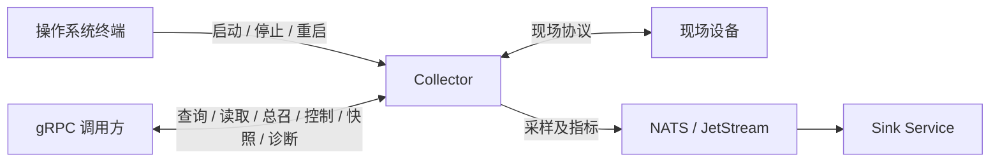

<p class="figure-caption">图 4-1 Collector 系统边界与外部交互</p>

现场设备与 NATS 是业务目标方或依赖，不被虚构为主动发起 gRPC 用例的参与者。

## 4.2 业务场景与完整用例

<p class="table-caption">表 4-1 场景用例与需求映射</p>

| 用例 | 完整业务场景 | 关联 UR |
|---|---|---|
| UC-01 | 首次启动并开始期望采集 | UR-01、UR-04、UR-09～UR-10 |
| UC-02 | 设备持续采集并发布数据 | UR-04、UR-09 |
| UC-03 | 查询设备/测点/任务并启停采集 | UR-05～UR-06 |
| UC-04 | 指定设备即时读取测点 | UR-07 |
| UC-05 | IEC104 总召并取得结果 | UR-08 |
| UC-06 | 查询服务、指标、事件及发布状态 | UR-09～UR-10、UR-12 |
| UC-07 | 推送配置候选并应用到设备 | UR-11 |
| UC-08 | 诊断完整采集通路 | UR-13 |
| UC-09 | 设备故障后自动恢复 | UR-04、UR-09、UR-14 |
| UC-10 | 正常停止服务 | UR-02 |
| UC-11 | 重启服务加载新配置 | UR-03、UR-15 |
| UC-12 | 异常退出后的重新启动 | UR-15、UR-14 |

### 4.2.1 UC-01 首次启动并开始期望采集

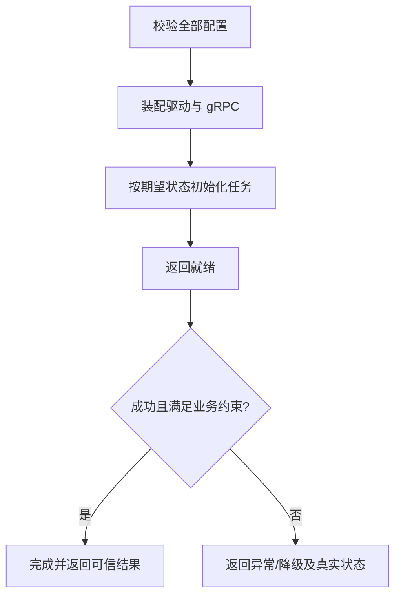

<p class="figure-caption">图 4-2 UC-01 首次启动并开始期望采集业务活动图</p>

<p class="table-caption">表 4-2 UC-01 用例说明</p>

| 要素 | 内容 |
|---|---|
| 参与者与目标 | 终端：首次启动并开始期望采集 |
| 前置条件 | 配置可用 |
| 主要异常 | 配置失败→拒绝就绪；离线设备→单设备降级 |
| 后置条件 | 实际期望与运行状态分别可查询 |
| 关联需求 | UR-01、UR-04、UR-09、UR-10 |

### 4.2.2 UC-02 设备持续采集并发布数据

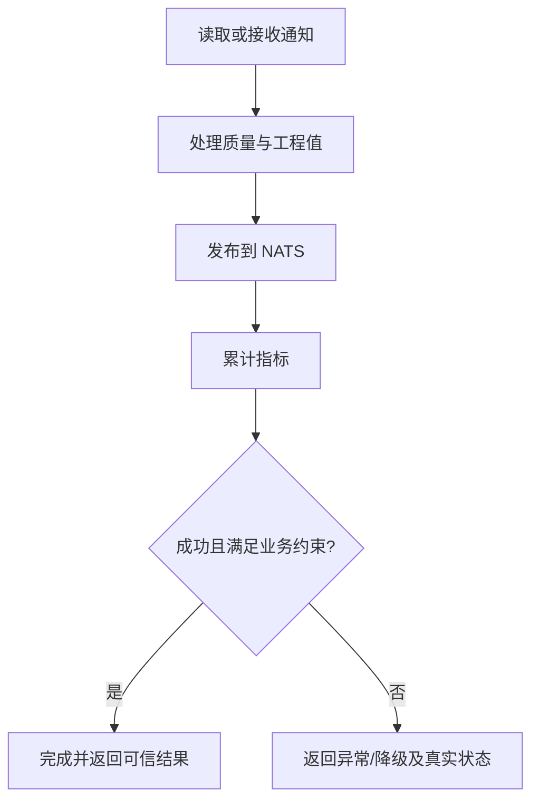

<p class="figure-caption">图 4-3 UC-02 设备持续采集并发布数据业务活动图</p>

<p class="table-caption">表 4-3 UC-02 用例说明</p>

| 要素 | 内容 |
|---|---|
| 参与者与目标 | 配置 START 自动触发：设备持续采集并发布数据 |
| 前置条件 | 任务及点表有效 |
| 主要异常 | 点级失败→质量/错误；发布失败→丢弃与计数 |
| 后置条件 | 不重入，样本时间与质量保留 |
| 关联需求 | UR-04、UR-09 |

### 4.2.3 UC-03 查询并启停任务

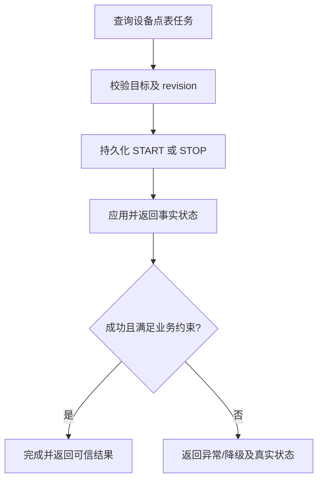

<p class="figure-caption">图 4-4 UC-03 查询并启停任务业务活动图</p>

<p class="table-caption">表 4-4 UC-03 用例说明</p>

| 要素 | 内容 |
|---|---|
| 参与者与目标 | gRPC 调用方：查询并启停任务 |
| 前置条件 | 具备查询和控制授权 |
| 主要异常 | 版本冲突→拒绝；断线 START→等待恢复 |
| 后置条件 | STOP 不再自动复活 |
| 关联需求 | UR-05、UR-06 |

### 4.2.4 UC-04 即时读取测点

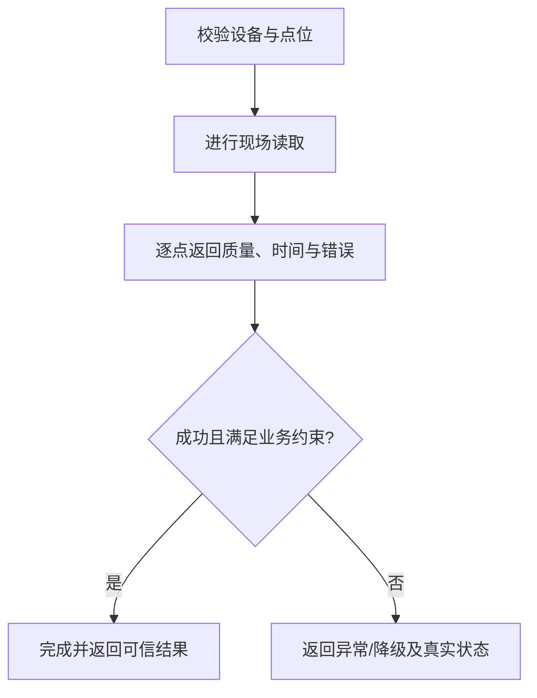

<p class="figure-caption">图 4-5 UC-04 即时读取测点业务活动图</p>

<p class="table-caption">表 4-5 UC-04 用例说明</p>

| 要素 | 内容 |
|---|---|
| 参与者与目标 | gRPC 调用方：即时读取测点 |
| 前置条件 | 目标点可读 |
| 主要异常 | 非法点→拒绝；部分失败→逐点证据 |
| 后置条件 | 查询不等于订阅，I/O 安全追踪 |
| 关联需求 | UR-07 |

### 4.2.5 UC-05 IEC104 总召

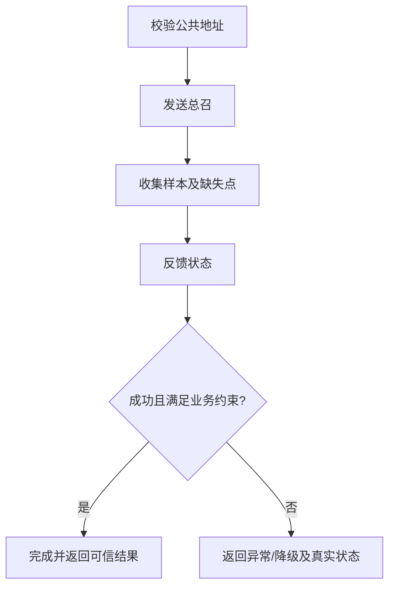

<p class="figure-caption">图 4-6 UC-05 IEC104 总召业务活动图</p>

<p class="table-caption">表 4-6 UC-05 用例说明</p>

| 要素 | 内容 |
|---|---|
| 参与者与目标 | gRPC 调用方：IEC104 总召 |
| 前置条件 | 目标为 IEC104 |
| 主要异常 | 不支持→拒绝；超时/部分返回→明确标记 |
| 后置条件 | 不伪造完整成功 |
| 关联需求 | UR-08 |

### 4.2.6 UC-06 查询服务和指标

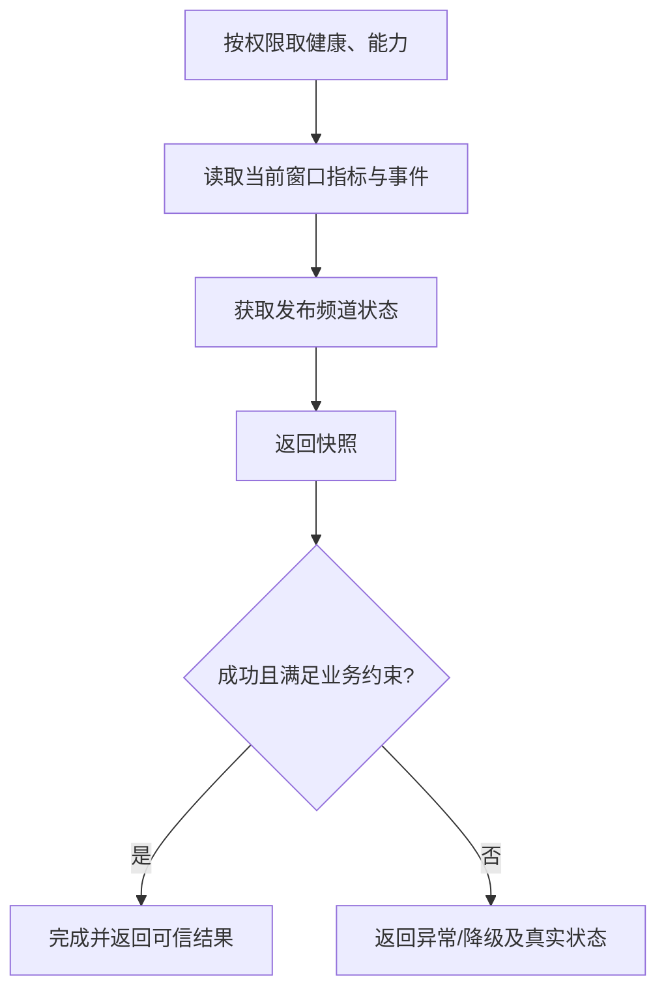

<p class="figure-caption">图 4-7 UC-06 查询服务和指标业务活动图</p>

<p class="table-caption">表 4-7 UC-06 用例说明</p>

| 要素 | 内容 |
|---|---|
| 参与者与目标 | gRPC 调用方：查询服务和指标 |
| 前置条件 | 服务可提供查询 |
| 主要异常 | 窗口不可用→明确标记；页数超限→拒绝 |
| 后置条件 | 查询不触发 PLC I/O |
| 关联需求 | UR-09、UR-10、UR-12 |

### 4.2.7 UC-07 配置候选推送并应用

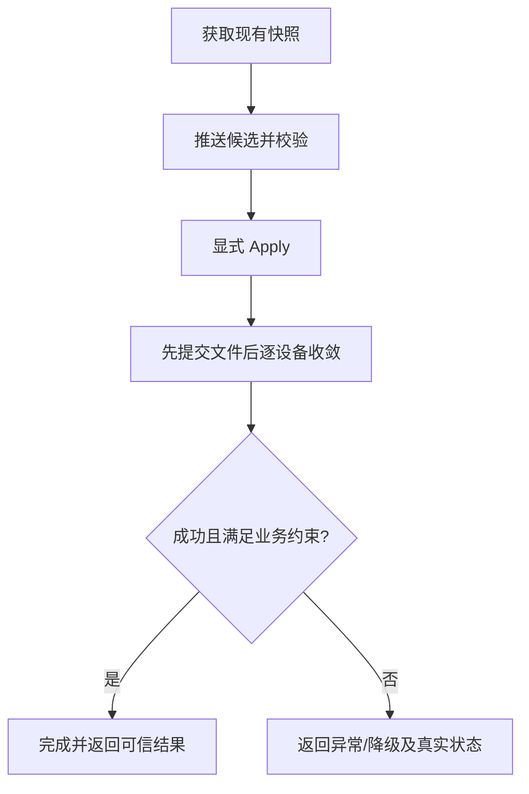

<p class="figure-caption">图 4-8 UC-07 配置候选推送并应用业务活动图</p>

<p class="table-caption">表 4-8 UC-07 用例说明</p>

| 要素 | 内容 |
|---|---|
| 参与者与目标 | gRPC 调用方：配置候选推送并应用 |
| 前置条件 | 具备配置授权 |
| 主要异常 | 版本冲突→拒绝；部分应用失败→逐项反馈 |
| 后置条件 | SERVICE 改动重启生效 |
| 关联需求 | UR-11 |

### 4.2.8 UC-08 诊断完整采集通路

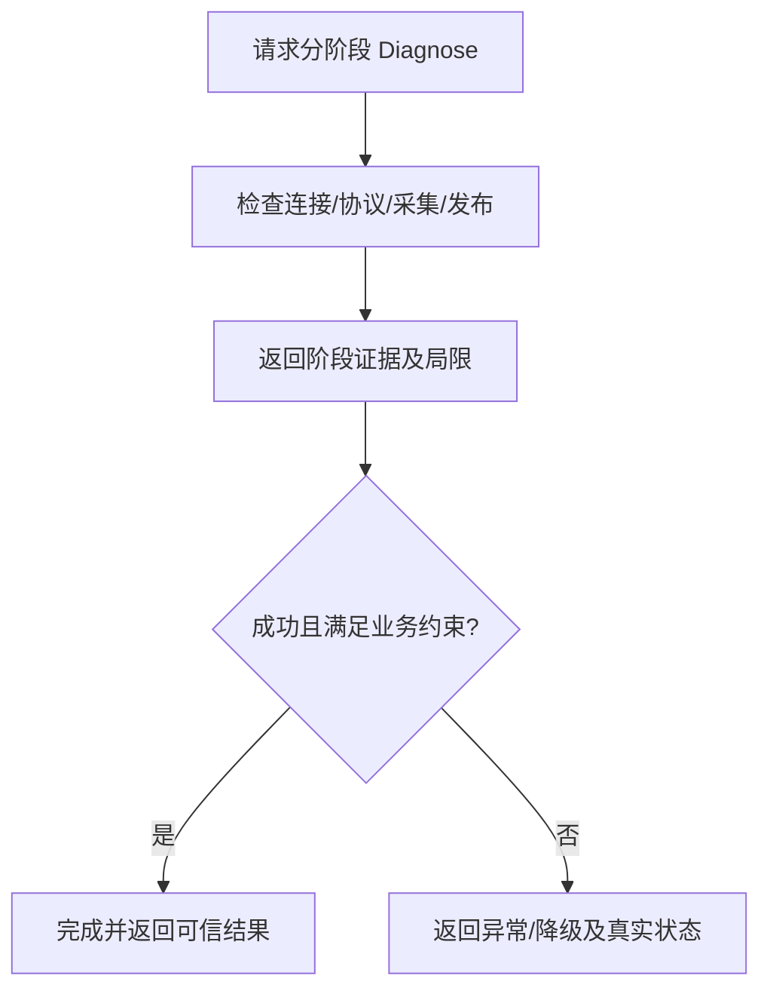

<p class="figure-caption">图 4-9 UC-08 诊断完整采集通路业务活动图</p>

<p class="table-caption">表 4-9 UC-08 用例说明</p>

| 要素 | 内容 |
|---|---|
| 参与者与目标 | gRPC 调用方：诊断完整采集通路 |
| 前置条件 | 诊断目标存在且有权限 |
| 主要异常 | 超时→明确失败阶段；不可观测→limitations |
| 后置条件 | 不隐式执行控制或改配置 |
| 关联需求 | UR-13 |

### 4.2.9 UC-09 设备故障后自动恢复

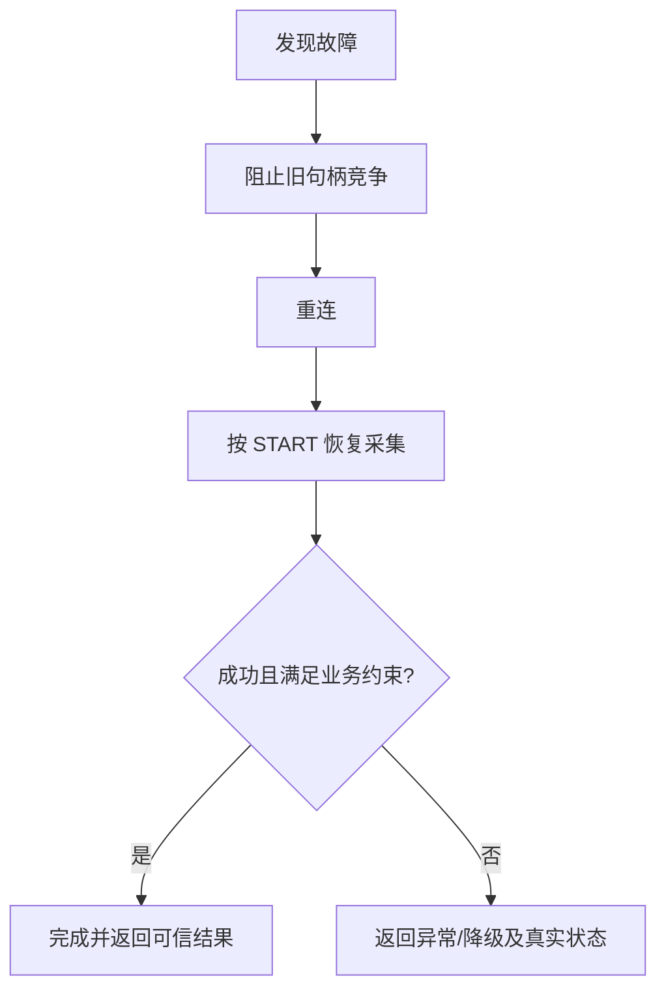

<p class="figure-caption">图 4-10 UC-09 设备故障后自动恢复业务活动图</p>

<p class="table-caption">表 4-10 UC-09 用例说明</p>

| 要素 | 内容 |
|---|---|
| 参与者与目标 | 自动故障检测：设备故障后自动恢复 |
| 前置条件 | 目标设备启用 |
| 主要异常 | 重连失败→重试并计数；STOP→不恢复 |
| 后置条件 | 其他设备不中断 |
| 关联需求 | UR-04、UR-09、UR-14 |

### 4.2.10 UC-10 正常停止服务

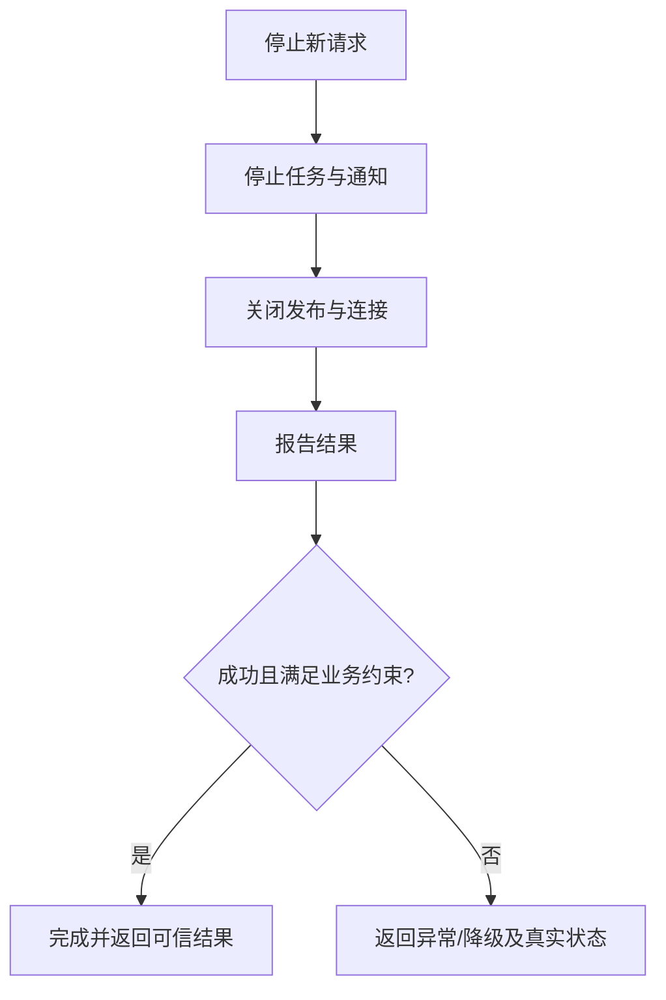

<p class="figure-caption">图 4-11 UC-10 正常停止服务业务活动图</p>

<p class="table-caption">表 4-11 UC-10 用例说明</p>

| 要素 | 内容 |
|---|---|
| 参与者与目标 | 终端：正常停止服务 |
| 前置条件 | 服务运行 |
| 主要异常 | 未结束 I/O→保留安全保护与告警 |
| 后置条件 | 不得虚报安全释放 |
| 关联需求 | UR-02 |

### 4.2.11 UC-11 重启并加载新配置

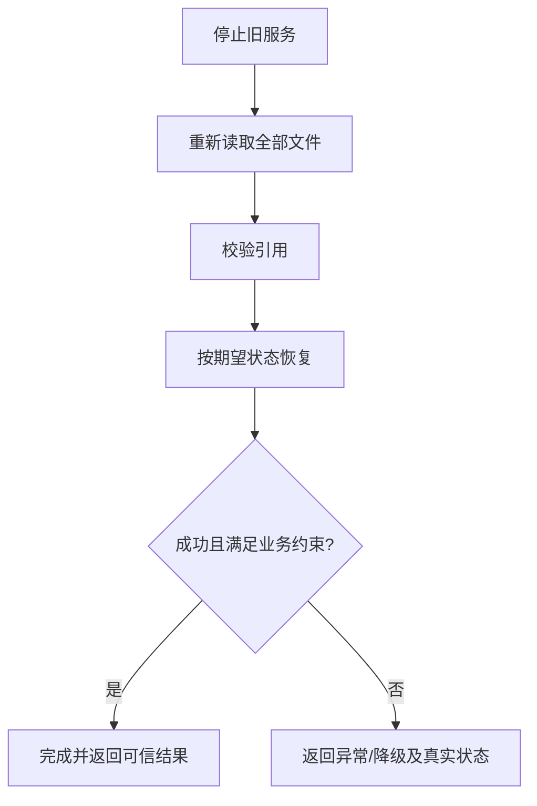

<p class="figure-caption">图 4-12 UC-11 重启并加载新配置业务活动图</p>

<p class="table-caption">表 4-12 UC-11 用例说明</p>

| 要素 | 内容 |
|---|---|
| 参与者与目标 | 终端：重启并加载新配置 |
| 前置条件 | 有待应用配置 |
| 主要异常 | 新配置非法→不可就绪 |
| 后置条件 | 不把旧运行配置当新配置 |
| 关联需求 | UR-03、UR-15 |

### 4.2.12 UC-12 异常退出后恢复

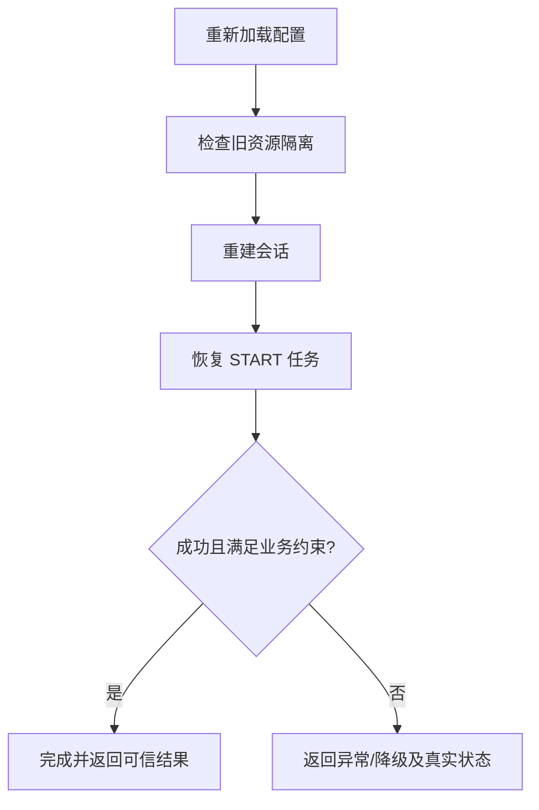

<p class="figure-caption">图 4-13 UC-12 异常退出后恢复业务活动图</p>

<p class="table-caption">表 4-13 UC-12 用例说明</p>

| 要素 | 内容 |
|---|---|
| 参与者与目标 | 终端重新启动：异常退出后恢复 |
| 前置条件 | 此前异常退出 |
| 主要异常 | 资源无法安全隔离→故障说明；易失样本→不补发 |
| 后置条件 | STOP 持久化且生效 |
| 关联需求 | UR-15、UR-14 |

# 5. 逻辑视图

本视图回答**系统有哪些逻辑对象、各自负责什么、如何协作**；不描述物理部署、进程线程或源码目录。

## 5.1 核心组件

<p class="figure-caption">图 5-1 Collector 核心组件协作</p>

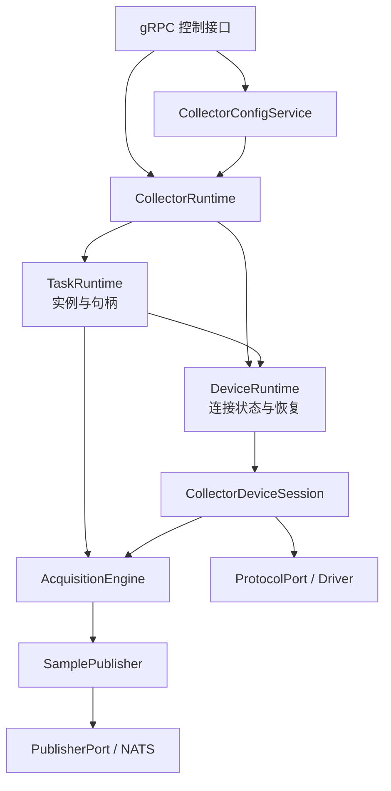

`DeviceRuntime` 是连接及 Watchdog 的所有者；`TaskRuntime` 是实例、运行意图及采集句柄的所有者；`AcquisitionEngine` 统一处理数据；`CollectorRuntime` 只做总体协调。

## 5.2 对象关系与采集机制

<p class="figure-caption">图 5-2 设备与采集对象关系（设计基线）</p>

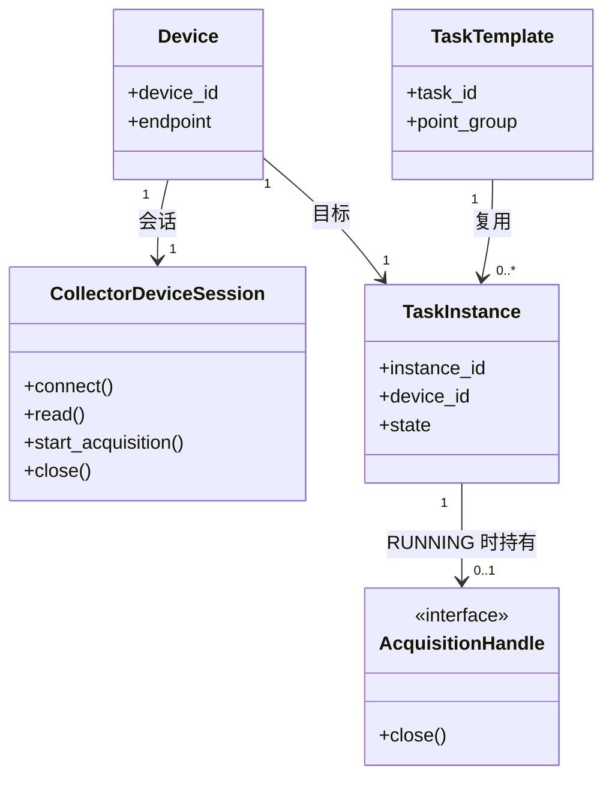

**统一目标契约：** 每个启用的 Device 仅对应 **1 个采集 Task Instance**，多台同型号设备复用 `TaskTemplate`；实例到设备始终为唯一目标关系。TaskTemplate 提供 `desired_state` 默认值，Device 可覆盖；手动启停更新并持久化对应设备实例的期望状态；具体模板关系见第 8 章。

<p class="figure-caption">图 5-3 三种采集机制与统一数据入口</p>

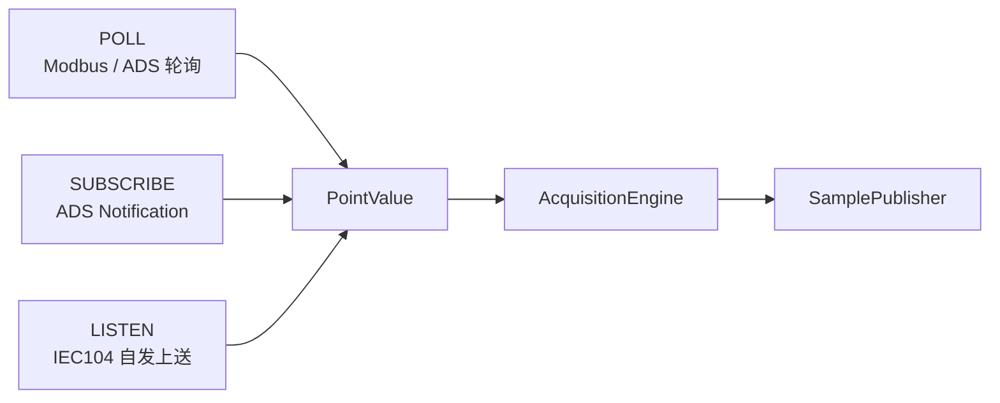

静态信息不进入采集链路。Delivery 的筛选、重采样与输出策略属于独立服务职责。

---

# 6. 进程视图

本视图回答**进程如何通信、Collector 内部如何并发运行、运行时如何启动、关闭与故障恢复**。不限定主机、容器或物理网络拓扑。

## 6.1 进程通信

<p class="figure-caption">图 6-1 独立进程与通信关系</p>

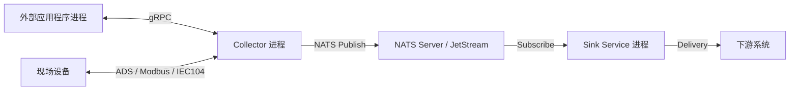

## 6.2 进程内并发模型与竞争控制

<p class="figure-caption">图 6-2 进程内异步任务、线程及所有权</p>

```mermaid
%%{init: {"flowchart": {"useMaxWidth": true}}}%%
flowchart TB
  subgraph PROC["Collector 进程"]
    direction TB
    EV["asyncio Event Loop"]
    GRPC["gRPC 请求协程"]
    ACQ["任务实例轮询协程／订阅回调"]
    WATCH["每设备 Watchdog 协程"]
    RETRY["NATS 重连监督协程"]
    THREAD["共享阻塞 I/O 线程池"]
    EV --> GRPC & ACQ & WATCH & RETRY
    ACQ -.->|需要时 to_thread| THREAD
    WATCH -.->|需要时 to_thread| THREAD
  end
```

<p class="table-caption">表 6-1 竞争场景及当前防护机制</p>

| 并发风险 | 防护及所有者 | 必须验证的结果 |
|---|---|---|
| Collector 启动与关闭重叠 | `CollectorRuntime._lifecycle_lock` 串行化 | 启动中不被停机状态覆盖，失败执行逆序清理 |
| 显式建连与 Watchdog 同时重连 | `DeviceRuntime` 每设备连接锁；会话和 Driver 自有生命周期约束 | 同一目标不发生并发重复建连 |
| 同一实例 Start/Stop 交叉 | `TaskRuntime._instance_guard` 每实例异步锁 | 同实例最多一个句柄；停止不留下后台采集 |
| 轮询慢于采样周期 | `PollingAcquisitionHandle` 同实例串行 fixed-rate；超期跳过多余时隙 | 不重入、不形成补采风暴 |
| 热重载与连接/订阅恢复交叉 | 配置写入串行化；受影响设备加独立更新门闩，并与 Watchdog、Task 启停协调 | 无旧句柄残留；不触碰未受影响设备；STOP 不复活 |
| 并发配置 ApplyConfigSnapshot 与 Task 启停 | 写入携带 expected_revision；全量校验并原子持久化；同设备序列化应用 | 无覆盖更新、丢失状态或重复启停 |
| 多设备增量应用时单设备失败 | 每设备独立执行并记录 applied_version、错误与待收敛状态 | 不影响其他设备；可识别局部成功 |
| 设备断线与正在读操作交叉 | Driver 协议生命周期、Watchdog 恢复；采集前查询连接可用性 | 无重复恢复、失败分类正确 |
| 取消任务与同步协议 I/O 未完成 | 协议 Driver 保有底层在途操作所有权；Collector 等待句柄退出 | 不将取消视作底层操作已经完成 |
| NATS 故障和持续采集并发 | Publisher 独立连接重试，发布失败计数并丢弃 | 采集不中断，资源有界，无隐式持久缓存 |

**注意：** 表中是设计职责和应验证约束，并非所有竞争场景已经过实机压力验证；不能以 `asyncio.Lock` 的存在替代底层协议取消/关闭测试。

## 6.3 启动与关闭

<p class="figure-caption">图 6-3 Collector 启动顺序</p>

```mermaid
%%{init: {"sequence": {"useMaxWidth": true}}}%%
sequenceDiagram
  participant M as main
  participant A as CollectorApp
  participant R as CollectorRuntime
  participant D as DeviceRuntime
  participant P as SamplePublisher
  participant T as TaskRuntime
  participant G as gRPC Server
  M->>M: 解析配置／装配／日志／线程池／信号
  M->>A: start()
  opt ADS 已配置
    A->>A: initialize_local()
  end
  A->>R: start()
  R->>D: connect_all()
  D-->>R: best-effort 连接
  R->>P: open()
  Note over P: 后台连接 NATS；不等待可用
  R->>T: sync_instances()
  Note over T: 设计契约
  opt 目标设计：期望状态为 START
    T->>T: 启动全部期望 START 且连接可用的采集实例
  end
  R-->>A: 完成
  M->>G: start()
  M->>M: 等待退出信号
```

<p class="figure-caption">图 6-4 Collector 优雅关闭顺序</p>

```mermaid
%%{init: {"sequence": {"useMaxWidth": true}}}%%
sequenceDiagram
  participant M as main
  participant G as gRPC Server
  participant A as CollectorApp
  participant R as CollectorRuntime
  participant T as TaskRuntime
  participant P as SamplePublisher
  participant D as DeviceRuntime
  M->>M: SIGINT / SIGTERM
  M->>G: stop()
  M->>A: stop()（入口硬超时）
  A->>R: stop()
  R->>T: stop_all()
  Note over T: 释放轮询与订阅句柄
  R->>P: close()
  Note over P: 停止重连／尝试 drain
  R->>D: close_all()
  Note over D: 关闭 Watchdog 和设备连接
  A->>A: ADSDriver.close_local()
```

组件关闭失败时继续尝试清理其他组件；入口默认硬超时 30 秒，超时不能保证全部资源释放。

## 6.4 故障恢复

<p class="figure-caption">图 6-5 设备断线恢复与实例恢复</p>

```mermaid
%%{init: {"sequence": {"useMaxWidth": true}}}%%
sequenceDiagram
  participant W as Device Watchdog
  participant D as DeviceRuntime
  participant S as DeviceSession
  participant T as TaskRuntime
  W->>D: 检查连接健康状态
  alt 连接故障且允许重试
    D->>T: prepare_device_restore(device_id)
    Note over T: 释放失效句柄／保留运行意图
    D->>S: close()／connect()
    alt 连接成功
      D->>T: start_device_tasks(device_id)
      Note over T: 恢复全部期望状态 START 的 Task；STOP 不恢复
    else 连接失败
      D-->>W: 记录失败，后续重试
    end
  else 连接健康
    D-->>W: 保持运行
  end
```


## 6.5 Task 期望状态及持久化（目标设计）

废止 `auto_start`，只使用 **`desired_state: START | STOP`**。`TaskTemplate` 定义缺省状态，`Device` 实例的 `overrides.task.desired_state` 优先；外部 gRPC 手动启停**仅修改设备实例配置**，不修改共享模板。`desired_state` 是唯一的期望状态权威，运行时仅保留可查询的 `RUNNING / STOPPED` 实际状态。

| 事件 | 持久化及运行规则 |
|---|---|
| 第一次启动／进程重启 | 从完整有效配置解析每台设备的 `desired_state`；START 尝试采集，STOP 保持停止 |
| 手动 Start | 版本校验→原子持久化该 Device 的 `desired_state=START`→启动或等待连接恢复 |
| 手动 Stop | 版本校验→原子持久化该 Device 的 `desired_state=STOP`→停止对应采集句柄；重连、重启不复活 |
| 断线 | 期望状态不变；实际停止、等待 Watchdog |
| Watchdog 重连 | 恢复该设备所有 `desired_state=START` 的 Task；STOP 不恢复 |
| 运行时应用失败 | 已保存的 desired_state 不回滚，向 gRPC 报告 `APPLY_FAILED` 和设备级未收敛原因，重试收敛 |

**持久化先于执行**，目的是防止 Stop 已生效但进程突然退出后重启又按旧 START 自动启动。若写入失败，不执行目标操作；若写入成功、实际操作失败，保留新期望状态并报告未收敛。并发手动操作须以 `expected_revision` 防止丢失更新；不应为每次任务启停重写共享模板。

<p class="figure-caption">图 6-6 Task 期望状态持久化及恢复</p>

```mermaid
%%{init: {"flowchart": {"useMaxWidth": true}}}%%
flowchart TD
  A["加载设备的有效 desired_state"] --> B{"START?"}
  B -->|否| C["STOP：不创建采集句柄"]
  B -->|是| D{"设备连接可用?"}
  D -->|是| E["创建句柄，实际 RUNNING"]
  D -->|否| F["实际 STOPPED，等待 Watchdog"]
  F --> G["Watchdog 重连成功"]
  G --> A
  E --> H["手动 Stop 请求"]
  H --> I["写入 devices.yaml 的 STOP"]
  I --> C
  C --> J["手动 Start 请求"]
  J --> K["写入 devices.yaml 的 START"]
  K --> A
```

## 6.6 Watchdog：自动恢复机制

每个已启用 Device 有独立 `WatchdogUseCase`，由 `DeviceRuntime` 创建、启动和停止。Watchdog 执行周期健康检查及重连；普通数据读取路径**不主动发起重连**，避免故障期间连接风暴。

<p class="figure-caption">图 6-7 Watchdog 故障恢复决策</p>

```mermaid
%%{init: {"flowchart": {"useMaxWidth": true}}}%%
flowchart TD
  A["周期检查设备健康"] --> B{"连接健康?"}
  B -->|是| C["保持当前会话"]
  B -->|否| D["按超时／重试条件恢复"]
  D --> E["保留运行意图，准备采集句柄恢复"]
  E --> F["关闭失效连接并重新连接"]
  F --> G{"连接成功?"}
  G -->|否| H["记录故障／下周期再尝试"]
  G -->|是| I["恢复全部期望状态 START 的 Task"]
  I --> J["恢复采集"]
```

- 可配置 `watchdog_interval`、`health_timeout`、`connect_timeout`；启动期单设备连接失败不阻断其他设备。
- 设备重连、采集任务恢复是**两段生命周期**；恢复仅依据 Task 当前的 START/STOP 期望状态，与首次启动时的运行结果无关。
- 非连接级测点错误不得被错误归类为连接故障；断线期间不应无限创建协议连接。

## 6.7 发布背压、队列及数据持久化

<p class="figure-caption">图 6-8 Collector 至下游的数据可靠性边界</p>

```mermaid
%%{init: {"flowchart": {"useMaxWidth": true}}}%%
flowchart LR
  A["设备动态测点"] --> B["AcquisitionEngine"]
  B --> C["SamplePublisher<br/>逐点消息"]
  C --> D{"delivery 模式"}
  D -->|realtime| E["Core NATS 发布<br/>客户端发送缓冲"]
  D -->|reliable| F["JetStream Publish<br/>等待 PubAck"]
  E --> N["NATS"]
  F --> N
  N --> S["Sink Service<br/>Delivery／持久化"]
  E -.->|未确认／不可用| X["丢弃并计数"]
  F -.->|超时／无 Ack| X
```

<p class="table-caption">表 6-2 采样发布背压及持久化契约</p>

| 场景 | 当前行为 | 数据丢失与责任边界 |
|---|---|---|
| `realtime` 正常 | `nats.publish()` 返回视为本机提交成功 | 不等价于订阅者接收或持久化；允许后续丢失 |
| `reliable` 正常 | 等待 JetStream PubAck（有超时） | Ack 仅表明 JetStream 接收/存储确认，不表示最终数据库写入 |
| NATS 不可用/发布超时 | 返回失败、记丢弃数；NATS 连接监督独立重试 | **两种模式均可能丢失本轮数据**，Collector 不本地落盘补发 |
| 批次中单条发布失败 | `SamplePublisher` 停止发布该批余下点，余下计入 dropped | 不保证本批全量到达；靠指标暴露 |
| 消费端慢/下游存储故障 | Collector 与 Sink 通过 NATS 解耦 | 由 NATS/JetStream 与 Sink 自身确认、保留、重试策略决定，不属于 Collector 的端到端保证 |
| 进程停止 | 停止采集后 `NatsPublisher.close()` 尝试 `drain`（限时） | 超时/异常时仍可能丢失未完成发送 |

**背压澄清：** `core.application.settings.RuntimeSettings` 允许 `queue_maxsize` 和 `backpressure_policy`（`drop_old`、`drop_new`、`block`），但 Collector `RuntimeParams` 未接收这两个字段，当前 `SamplePublisher` 也没有独立可配置 `asyncio.Queue`。当前边界是 NATS 客户端有限 pending 缓冲和发布超时；不能宣称已经实现可配置的队列满策略。

**目标建议（待评审、未实现）：** Collector 保持无本地磁盘缓存。实时模式发布受阻时按失败丢弃；可靠模式如果要求**任何故障期间不丢数据**，必须另行引入持久化队列/重发协议，或将该保证限制在 JetStream 确认之后。优先明确丢失语义，再决定是否需要额外队列。

---

# 7. 开发视图

本视图只说明**源码的组织、模块依赖与实现定位**，不再包含启动、关闭或实例状态转移图。

## 7.1 源码模块组织

<p class="figure-caption">图 7-1 Collector 包结构及主要依赖</p>

```mermaid
%%{init: {"flowchart": {"useMaxWidth": true}}}%%
flowchart TB
  MAIN["collector/main.py"] --> ASM["collector/assembly.py"]
  ASM --> APP["collector/application/"]
  ASM --> INF["collector/infrastructure/"]
  APP --> DOM["collector/domain/"]
  APP --> CORE["core/"]
  INF --> CORE
  INF --> CON["contracts/"]
```

```text
src/
├── collector/
│   ├── main.py                     # 进程入口
│   ├── assembly.py                 # 组合根
│   ├── application/
│   │   ├── runtime.py              # 总协调
│   │   ├── device_runtime.py       # 连接所有权
│   │   ├── task_runtime.py         # 实例所有权
│   │   ├── session.py              # 设备采集会话
│   │   ├── config_service.py       # 热重载编排
│   │   └── nats_dispatch.py        # 样本消息组装
│   ├── domain/
│   │   └── acquisition.py          # 数据处理入口
│   └── infrastructure/
│       ├── grpc/                   # gRPC 适配器
│       ├── config/                 # 配置加载
│       └── nats_publisher.py       # NATS 实现
├── core/                           # 通用协议与领域能力
└── contracts/                      # 跨进程消息契约
```

## 7.2 模块责任与依赖约束

<p class="table-caption">表 7-1 模块职责及接口</p>

| 模块 | 职责 | 主要依赖 |
|---|---|---|
| `assembly.py` | 组合与依赖注入 | Application、Infrastructure、Core |
| `application/runtime.py` | 总生命周期协调 | DeviceRuntime、TaskRuntime、Engine、Publisher |
| `device_runtime.py` | 连接状态、Watchdog | CollectorDeviceSession |
| `task_runtime.py` | 任务实例、句柄、运行意图 | DeviceRuntime、AcquisitionEngine |
| `domain/acquisition.py` | 数据批次处理 | 各 Port 协议 |
| `nats_dispatch.py` | 样本消息封装 | PublisherPort、SampleMessage |
| `infrastructure/` | 配置、协议接入、gRPC、NATS | Application/Core/Contracts |

**依赖原则：** Domain 不引用 Collector Infrastructure；由 `assembly.py` 注入协议 Driver 和发布器实现。实现边界以当前主分支代码及第 9 章 Proto 为准。

---

# 8. 物理视图（部署视图）

```mermaid
%%{init: {"flowchart": {"useMaxWidth": true}}}%%
flowchart LR
  CLI["管理 / 诊断 CLI"] -->|"mTLS gRPC"| C["Collector 独立进程"]
  C <-->|"Modbus TCP / ADS / IEC104"| DEV["PLC / 风机主控"]
  C -->|"NATS Publish"| N["NATS Server / JetStream"]
  N --> S["Sink Service"]
  C --> FS[("Service / Instance / Template 文件")]
```

<p class="figure-caption">图 8-1 Collector 部署节点与外部依赖示意图</p>

Collector 与 Sink、Commander 分进程；Collector 不直接操作 TDengine，也不执行现场变量写入。配置文件可能由多个服务共享，必须明确授权写入方。Collector 仅负责其已授权配置集合与采集任务；真实网络分区、ADS 本机身份、NATS 权限与 gRPC 证书由部署配置提供。

# 9. gRPC 接口契约与适配

## 9.1 权威来源与接口总量

基线 `main@6d6776d3`：`src/contracts/common.proto` 的 `windhub.common.v1.CommonService` **9 RPC**，`src/contracts/collector.proto` 的 `windhub.collector.v1.CollectorService` **11 RPC**，合计 **20 个 Unary RPC**。旧设计书的 4 Service / 17 RPC 与新契约不符，已废止。不得另行创造 `GetLatestValues`、`GetPointMetadata`、`UpdateConfig`、`ReplaceConfig`、`GetConfigStatus`、`CollectorMetricsService` 等旧目标 RPC。现有 Proto 以精确字段名、类型及存在性为准；本文规定业务行为，不重定义 wire schema。

## 9.2 CommonService（9 RPC）

<p class="table-caption">表 9-1 公共服务 RPC 落地要求</p>

| RPC | 请求与响应关键字段 | Collector 行为与对应需求 |
|---|---|---|
| `GetServiceInfo` | `Empty` → `service_id,process_role,software_version,contract_version,started_at` | 实际进程信息；UR-10 / UC-06 |
| `GetServiceStatus` | `Empty` → `health,dependencies,observed_at` | 设备与 NATS 健康只读快照；UR-10 / UC-06 |
| `GetCapabilities` | `Empty` → `rpc_names,protocols,features` | 只声明实际可用能力；UR-10 / UC-06 |
| `GetConfigSnapshot` | `scope,candidate_id` → `snapshot_id,revision,files,validation,application_id,apply_results,last_error` | 返回 DISK/RUNTIME/CANDIDATE 快照并区分磁盘与当前生效；UR-11 / UC-07 |
| `PushConfigSnapshot` | `files,expected_revision` → `candidate_id,valid,validation,base_revision` | 校验并暂存候选，不写成当前生效配置；UR-11 / UC-07 |
| `ApplyConfigSnapshot` | `candidate_id,expected_revision` → `file_commit,apply_results,effective_revision,restart_required,application_id` | 校验候选和版本、文件提交、逐设备应用；UR-11 / UC-07 |
| `GetMetrics` | `scope,window_ms` → `metrics[name,value,unit,window_ms,sampled_at]` | 内存统计；UR-12 / UC-06 |
| `GetEvents` | `from_time,to_time,filter,page_size,page_token` → `events,next_page_token` | 有界内存事件分页；UR-12 / UC-06 |
| `Diagnose` | `target_id,stages,timeout_ms,correlation_id` → `overall_status,stages,limitations` | 链路分阶段诊断；UR-13 / UC-08 |

## 9.3 CollectorService（11 RPC）

<p class="table-caption">表 9-2 Collector 专用 RPC 落地要求</p>

| RPC | 请求与响应关键字段 | Collector 行为与对应需求 |
|---|---|---|
| `ListDevices` | `filter,page_size,page_token` → `devices,next_page_token` | 查询设备、协议、端点、任务与 revision；UR-06 / UC-03 |
| `GetDevice` | `DeviceQuery.device_id` → `Device` | 生效设备详情与当前任务状态；UR-06 / UC-03 |
| `ListPoints` | `device_id,filter,page_size,page_token` → `PointMetadata[],next_page_token` | 生效点表分页；UR-06 / UC-03 |
| `GetPoint` | `device_id,point_id` → `PointMetadata` | 单点信息，不主动读取 PLC；UR-06 / UC-03 |
| `ReadPoints` | `device_id,point_ids,timeout_ms` → `device_id,samples,queried_at` | **主动现场读取**，逐点质量/时间/错误；UR-07 / UC-04 |
| `ListTasks` | `filter,page_size,page_token` → `tasks,next_page_token` | 每设备唯一任务的查询；UR-06 / UC-03 |
| `GetTask` | `ObjectId.id` → `Task` | 按 task_id 查任务，不误当 device_id；UR-06 / UC-03 |
| `StartTask` | `OperationRequest.id,expected_revision` → `OperationResult` | id 为 task_id，持久化 START 后收敛；UR-05 / UC-03 |
| `StopTask` | 同上 → `OperationResult` | 持久化 STOP，不自动复活；UR-05 / UC-03 |
| `GetPublishingStatus` | `channel` → `channels[PublishingStatus]` | 连接、published、failed、backpressure、last_error；UR-09 / UC-06 |
| `InterrogateDevice` | `device_id,optional common_address,timeout_ms` → `status,samples,missing_point_ids,error_code,error_message` | IEC104 总召；UR-08 / UC-05 |

## 9.4 共享数据语义与错误边界

- `ScalarValue` 使用 `oneof kind`，六种值为 `bool_value/sint64_value/uint64_value/double_value/string_value/bytes_value`；零值是合法数据，不能代替缺失。
- `Sample.value` 是 `optional ScalarValue`；`sample_timestamp` 为现场样本时间，`queried_at` 为查询时间，`quality/freshness/error_code/error_message` 不得混为一类状态。
- `PointMetadata` 包含 `readable/writable`、协议地址字段、`optional minimum/maximum` 与 `revision`，端点/地址展示须遵守查询授权。
- `OperationRequest` **只有** `id` 与 `expected_revision`，不要求调用方提供 `request_id`；`OperationResult.accepted` 不代表已实际 RUNNING。
- `SnapshotScope` 为 `UNSPECIFIED/DISK/RUNTIME/CANDIDATE`。`Push` 只产生候选；`Apply.file_commit` 与 `apply_results` 分开返回；服务配置变更不假装已热生效。
- `DiagnosticStage` 包含阶段、状态、耗时、错误、证据、观测时间与来源，`DiagnoseResponse.limitations` 记录未观测的环节。
- 查询的 `page_size/page_token` 与 `ReadPoints` 点数量由服务端限制。错误使用合适的 gRPC 状态：参数无效 `INVALID_ARGUMENT`，对象缺失 `NOT_FOUND`，revision 冲突 `ABORTED`，权限 `PERMISSION_DENIED`，依赖不可用 `UNAVAILABLE`，资源不足 `RESOURCE_EXHAUSTED`；部分点级失败应根据契约保留逐点错误而非丢掉成功样本。

## 9.5 实施与调用方同步

只按 `/src/contracts` 的源 `.proto` 生成 gRPC 代码，禁止把生成物当作独立契约维护。实现 20 个入口时逐个核对权限、运行状态、输入验证、错误和测试；同步检查 CLI、旧 Collector 控制面、所有调用方、类型生成与旧 RPC 引用。现有协议定义不等价于 Collector 生产服务已经实现，不得以 Descriptor 测试替代端到端测试。

# 10. 配置与热重载

## 10.1 三类配置与所有权

配置按 **Template / Service / Instance** 分离，不以 Collector 服务配置选择模板。**Instance 显式引用模板 ID 与版本**；Service 只描述该进程自身运行参数。

| 类别 | 路径（目标） | 内容、所有权及生效 |
|---|---|---|
| Template | `templates/` | 协议、型号、点表、采集、Delivery 模板；工程单位和业务点标准目录；发布后版本不可变；由 Core 校验，引用它的实例按需热更新 |
| Service | `services/collector.yaml` | Collector 进程运行参数、NATS、Watchdog、Metrics、ADS 本机身份、日志；**修改后重启生效** |
| Service | `services/commander.yaml`、`sink.yaml`、`gateway.yaml` | 各自进程配置，Collector 不读取、不修改；对应服务自行管理生效 |
| Instance | `instances/site.yaml`、`devices.yaml` | 场站身份、设备实例、模板版本引用、实例覆盖、持久化 `desired_state`；按设备增量热更新 |
| Instance | `instances/deliveries.yaml` | Delivery 实例；由 Sink/Delivery 所有者负责加载、热更新，Collector 不管理 |

<p class="figure-caption">图 10-1 配置分类、引用与生效关系</p>

```mermaid
%%{init: {"flowchart": {"useMaxWidth": true}}}%%
flowchart TB
  S["Service: collector.yaml<br/>不引用模板"] --> C["Core Config 解析校验"]
  I["Instance: devices.yaml<br/>模板 ID + 精确版本 + overrides"] --> C
  I -->|引用| T["Template 仓库<br/>不可变版本"]
  T --> C
  C --> E["Collector 有效配置"]
  E --> R["Collector Runtime"]
  D["deliveries.yaml"] --> SD["Sink / Delivery Runtime"]
  T --> SD
```

目录示例（目标结构，**当前 Core 解析器尚未支持**）：

```text
config/
├── services/
│   ├── collector.yaml
│   ├── commander.yaml
│   ├── sink.yaml
│   └── gateway.yaml
├── instances/
│   ├── site.yaml
│   ├── devices.yaml
│   └── deliveries.yaml
└── templates/
    ├── protocols/
    ├── device_models/
    ├── point_tables/
    ├── tasks/
    ├── deliveries/
    ├── units.yaml
    └── business_points.yaml
```

入口约束：Collector 接收服务配置路径、实例根目录和模板根目录；Core 从实例中的版本化引用解析模板。`collector.yaml` **不包含模板集合选择、设备实例或 Delivery 实例引用**。启动入口显式接收 `--config`、`--instances`、`--templates` 三个路径；启动任一必需引用失效时拒绝启动，不隐式回退到最新版。

## 10.2 版本、引用及覆盖

- 所有 YAML 使用内部 `schema_version`（结构契约版本）；模板另外声明稳定 `template_id` 和 `template_version`；`revision`/内容 SHA-256 属于配置管理层并发与追溯数据，不靠文件名推断。
- 同一 `template_id + template_version` 内容不可变。发布新版本并让实例修改引用，才允许改变模板含义；禁止原地覆盖已发布模板。
- `DeviceModel` 组合引用 `ProtocolTemplate`、`PointTable`、`TaskTemplate`；`Device` 只声明身份、IP 和少量覆盖。`DeliveryTemplate` 供 Sink/Delivery 实例引用。
- 覆盖优先级为模板默认值、Device 实例显式覆盖；只允许白名单字段，地址及类型等不宜直接覆盖单点。Core 已有的点表 `parent_id` 继承规则需单独保留并校验无环。
- 工程语义继续使用 `units`（Quantity/Unit 及单位换算）和 `business_points`（业务标识、标准单位、逻辑类型）；测点的 `scale/offset` 与单位间换算区分；数据类型、Quantity、引用完整性必须校验。模板版本改变后不得悄悄重定义历史业务语义。

```yaml
# instances/devices.yaml（示意）
schema_version: 1
devices:
  WT01:
    model:
      id: turbine_a
      version: 1.2.0
    endpoint:
      host: 192.168.1.101
    overrides:
      task:
        desired_state: START
  WT02:
    model:
      id: turbine_a
      version: 1.2.0
    endpoint:
      host: 192.168.1.102
    overrides:
      task:
        desired_state: STOP
```

Task 只维护期望状态 `START/STOP` 与实际状态 `RUNNING/STOPPED`；gRPC 手动启停**先持久化到对应 Device 实例，再执行状态收敛**。重启与 Watchdog 恢复均按持久化期望状态处理；停止的设备不自动复活。TaskTemplate 可以提供默认状态，但手动操作不得修改共享模板。

## 10.3 Core 配置校验链路

<p class="figure-caption">图 10-2 配置解析、验证与有效快照</p>

```mermaid
%%{init: {"flowchart": {"useMaxWidth": true}}}%%
flowchart TD
  A["Service + Instance + Template"] --> B["Core YAML 解析、schema_version 校验"]
  B --> C["模板 ID/版本解析、引用与环检测"]
  C --> D["实例覆盖、有效配置展开"]
  D --> E["Core 领域校验<br/>单位/业务点/地址/类型"]
  E --> F["Collector 业务校验<br/>采集模式/周期/协议能力"]
  F --> G["完整有效快照 + 差异"]
```

`core/infrastructure/config` 负责 YAML、版本与解析；`core/domain/validation.py` 负责通用领域约束；Collector Application 负责采集专属规则和设备级变更差异。启动、Validate、Update、Replace **必须复用同一套无副作用的候选校验**，验证阶段不得写盘、连接 PLC 或启动任务。错误报告统一返回 `code/file/field_path/message`。当前 Core 的 `YamlConfigAdapter`、`parse_domain.py`、`validation.py` 可作为重构起点，**并非已支持新布局或版本机制**。

## 10.4 Service 配置与 Metrics

`services/collector.yaml` 只包含 Collector 进程级设置；示例为建议值，并非验收后的容量参数：

```yaml
schema_version: 1
runtime:
  shutdown_timeout: 30
  thread_pool:
    max_workers: 32
watchdog:
  interval: 5
  health_timeout: 1
messaging:
  servers: ["nats://127.0.0.1:4222"]
  delivery: realtime
  max_staleness_ms: 500
metrics:
  enabled: true
  windows: [60, 300, 3600]
  publish_interval: 60
  max_staleness: 300
  event_capacity: 1000
  pending_capacity: 120
```

Metrics 只保留当前状态、进程累计值、滚动窗口和有限待发布内存；不落本地数据库。`max_staleness` 从**固定统计窗口结束时间**起算，过期丢弃并计数；队列满优先淘汰最旧的待发布统计消息；进程重启缓存丢失，Sink 不得把缺失窗口当成零异常。`metrics` 发布使用独立 Subject；固定窗口快照须携带 `collector_id`、`boot_id`、窗口 ID、起止时间及 schema 版本，供下游幂等归档。

## 10.5 Get / Push / Apply 配置快照

以第 9.2 节 CommonService 三个快照 RPC 为唯一外部配置接口；旧 `GetConfig/ValidateConfig/UpdateConfig/ReplaceConfig/GetConfigStatus` 不再是目标接口。`GetConfigSnapshot` 按 `scope` 返回文件集合、revision 及真实应用结果；`PushConfigSnapshot` 校验完整候选并暂存，不改变当前磁盘或运行配置；`ApplyConfigSnapshot` 校验 candidate、expected_revision，提交文件后局部热更，分别返回 `file_commit` 与逐对象 `apply_results`。应用失败保留已提交文件与失败详情，不把整个系统误报为 APPLIED。Service 配置需重启；Instance 与已切换引用的 Template 只影响真实差异设备。配置文件采用 `schema_version/file_version` 跟踪各文件版本，不能凭空采用不存在的全局生效 revision 替代逐文件/设备事实。

## 10.6 配置一致性与安全

模板为不可变版本；新版本必须通过实例精确引用才生效。外部 SnapshotFile 的 `relative_path` 必须执行合法路径白名单、归属权限和防目录穿越校验；不可任意覆盖其他服务文件。配置候选验证不连接 PLC、不修改运行态。持久化成功而设备应用失败时保留各设备失败原因，可通过 GetConfigSnapshot 查看，而不能假定自动回滚；手动 STOP 是恢复时的优先状态。

# 11. 采集、调度及故障恢复

基于第 5、6 章统一模型，每台已配置设备只有一个采集任务所有者；设备连接、订阅句柄与轮询协程属于同一生命周期协调范围。`POLL` 使用固定周期计划槽位，不重入、超期跳过；`SUBSCRIBE/LISTEN` 以实际事件计数，不虚构理论轮询次数。ADS Notification 的同步回调线程必须通过安全边界进入 asyncio；IEC104 总召属于独立即时操作，不暗中替换长期 LISTEN。

```mermaid
%%{init: {"state": {"useMaxWidth": true}}}%%
stateDiagram-v2
  [*] --> STOPPED
  STOPPED --> START_PENDING: START 已持久化
  START_PENDING --> RUNNING: 连接与采集成功
  START_PENDING --> STOPPED: STOP 已持久化
  RUNNING --> RECOVERING: 连接或句柄失效
  RECOVERING --> RUNNING: Watchdog 成功且仍为 START
  RECOVERING --> STOPPED: STOP 已持久化
  RUNNING --> STOPPED: STOP 已持久化且句柄安全停止
```

<p class="figure-caption">图 11-1 采集任务期望与实际状态的内部收敛示意图</p>

图中 `START_PENDING/RECOVERING` 是内部流程阶段，**不是** `Task.actual_state` 对外枚举；对外 Proto 当前采用字符串，必须明确映射实际 `RUNNING/STOPPED` 并通过错误说明未收敛。操作超时与协程取消不能推断阻塞协议 I/O 终止；旧操作未安全结束或隔离前不得启动有冲突的新采集/重连句柄。所有启停、Reload 与 Watchdog 操作按设备串行协调，不影响其他设备。

# 12. 样本发布、Metrics 与可靠性

## 12.1 指标与定义

<p class="table-caption">表 12-1 Collector 可靠性指标（目标契约）</p>

| 领域 | 指标 | 统计口径及注意事项 |
|---|---|---|
| 连接 | 连接可用率 | 可用时长 / 应在线时长；排除禁用和显式 STOP 对应的非监测时段（连接监测若始终启用则按连接监测计划另计） |
| 连接 | 断线、重连次数/成功率 | 健康→不可用转换计一次断线；成功重连 / 已完成重连尝试；超时单独计数 |
| 恢复 | 采集恢复耗时 | 故障发现至首个有效采集样本的耗时；不同于 TCP/ADS 重连耗时 |
| 采集 | 执行成功率 | 完全成功的实际执行次数 / 实际执行次数；部分成功独立计数 |
| 采集 | 测点完整率 | 本轮实际成功点数 / 本轮计划点数，按窗口汇总分子分母 |
| 调度 | 漏采率 | 跳过的计划周期 / START 状态期间计划周期（仅固定周期 POLL） |
| 采集 | 超时率、耗时 P95/P99 | 超时次数 / 执行次数；耗时摘要按有效样本归档 |
| 数据 | BAD 质量率、数据新鲜度 | BAD 样本 / 总样本；当前时刻至最近有效点值的年龄 |
| 发布 | 确认率、未确认数、时延 | 成功确认数 / 尝试发布数；Core NATS 仅客户端入队，JetStream 以 PubAck 为准 |
| 缓冲 | 队列满、过期丢弃、缓存水位 | 仅对真实存在的有界缓冲统计；Metrics 缓存独立于采样发布路径 |

固定周期轮询可以计算计划次数；SUBSCRIBE / LISTEN 为事件驱动，不虚构理论采样数。`STOP` 与禁用时段不计入应执行分母；START 但断线、恢复中时段必须计入相应可用性或漏采统计。时间间隔用单调时钟测量，归档窗口用 UTC；历史成功率按分子/分母合计计算，不能平均各窗口的百分数。

## 12.2 四种统计方式

| 类型 | Collector 保留 | 下游用途 |
|---|---|---|
| 在线 | 内存当前连接、任务状态、累计计数和最新点值 | gRPC 查询、实时告警 |
| 移动窗口 | 内存 60/300/3600 秒滚动聚合 | gRPC 实时查询 |
| 固定窗口 | 按 `publish_interval` 产出不重叠基础窗口，独立 Subject 经 NATS 发布 | Sink 幂等入库和更长周期聚合 |
| History / 离线 | Collector 不存长期历史 | Sink 本地 TDengine 滚动保留数月到约一年；外部系统长期保存与离线对账 |

<p class="figure-caption">图 12-1 Metrics 统计及历史职责边界</p>

```mermaid
%%{init: {"flowchart": {"useMaxWidth": true}}}%%
flowchart LR
  A["Acquisition / Watchdog / Publisher"] --> M["MetricsState<br/>当前值与累计计数"]
  M --> W["WindowAggregator<br/>内存移动 / 固定窗口"]
  M --> G["gRPC 在线查询"]
  W --> G
  W --> P["MetricsPublisher<br/>TTL + 有界待发缓存"]
  P --> N["NATS / JetStream"]
  N --> S["Sink Service"]
  S --> DB[("本地 TDengine<br/>滚动存储")]
  S --> EX["外部长期数据系统"]
```

指标事件只做轻量更新，窗口计算、发布与设备采集解耦；故障事件限量保留并及时发布。发布失败只做有限内存重试，TTL 过期和重启后允许统计窗口缺口，但应记录丢弃量；不能声称零丢失。Sink 写库成功才代表历史入库成功；JetStream PubAck 仅表示消息进入 JetStream，并非端到端入库。

## 12.3 已实现与待开发

旧设计基线中 `CollectorMetricsState` 有进程累计计数、设备连接异常计数和容量 5000 的近期事件环形缓冲；还没有完整的多窗口聚合、独立 MetricsPublisher 和统一发布指标契约。现有 `SamplePublisher` 在采样失败时计数，但不表示有本地持久化队列。当前 NATS Publisher 无本地磁盘缓冲，NATS 故障期间采样消息可能丢失；本地历史交由 Sink，Collector 不负责 TDengine 驱动。

---


**接口适配说明：** 对外 Metrics 与事件查询使用 `CommonService.GetMetrics/GetEvents` 的实际字段，旧 `CollectorMetricsService` 不再是目标契约；是否支持固定窗口对外发布属于业务实现验收，不得由公共 Proto 的存在推断已经落地。

# 13. 安全、可观测性与运行指标

采用 mTLS 验证 gRPC 客户端身份，按 query、task-control、config-apply、read、interrogate、diagnose 权限执行授权；如现场部署尚未定义权限映射，实施前必须固定策略，不能默认无鉴权。不得信任调用方自报身份，日志、错误和快照不可泄露密钥。Collector 不是 Commander，不提供现场变量写入 RPC。

可观测性分三层：设备连接/Watchdog 与采集状态、样本发布与背压、服务依赖/配置应用。所有计数及时间基准必须可复现，质量异常与连接故障分开计；`GetServiceStatus` 用健康状态表达实际依赖，不把 NATS 故障直接等同于全部采集停止。事件用 `GetEvents` 有界分页；诊断逐阶段提供 `Evidence`、观测时间及局限。低频 Metrics 聚合和发布不得阻塞 PLC 采集。

# 14. 测试体系、物理组织与验收

## 14.1 测试层级与 Marker

沿用第 2.4 节：`unit/`、`component/`、`integration/`、`system/` 四层，每测试唯一层级 Marker；专题 Marker（`reliability/security/performance`）与场景 Marker（`concurrency/timeout/recovery/load/field`）可叠加，具体名称以 `pyproject.toml` 已注册项为准，缺少时应先注册。物理目录示例：`tests/unit/collector`、`tests/component/collector`、`tests/integration/collector`、`tests/system/collector`；测试文件矩阵不写父目录，按层级定位。

## 14.2 测试文件、层级与场景矩阵

<p class="table-caption">表 14-1 测试组织与覆盖矩阵（目标文件名，可按项目既有命名调整）</p>

| 测试文件名 | 层级 Marker | 专题 Marker | 场景 Marker | 测试说明 |
|---|---|---|---|---|
| test_config_validation.py | unit | reliability |  | 模板版本、不变性、覆盖、Schema/地址及候选副作用 |
| test_task_state.py | unit | reliability | recovery | 任务唯一性、期望状态、STOP 优先、revision |
| test_fixed_rate.py | unit | performance | timeout | 超期跳槽、不重入、采样时间与计数 |
| test_sample_semantics.py | unit | reliability |  | ScalarValue/quality/时间、逐点缺失与部分失败 |
| test_window_metrics.py | unit | performance |  | 分子分母、窗口有效性、TTL 和过期 |
| test_watchdog.py | component | reliability | recovery | 重连、故障分类、START 恢复、STOP 不复活 |
| test_device_io_ownership.py | component | reliability | concurrency | 超时取消、底层未结束 I/O 与句柄所有权 |
| test_publisher.py | component | reliability | timeout | NATS/JetStream 确认边界与发布失败计数 |
| test_snapshot_service.py | component | security | concurrency | Get/Push/Apply 候选、版本冲突、路径授权、局部失败 |
| test_grpc_services.py | component | security |  | 公共 9 与专用 11 RPC 字段、错误、分页及权限 |
| test_three_protocols.py | integration | reliability |  | 真实/受控 Modbus、ADS、IEC104 采集与连接语义 |
| test_realtime_reads.py | integration | reliability | timeout | ReadPoints 现场读取、逐点错误、并发与时限 |
| test_iec104_interrogation.py | integration | reliability | timeout | 总召 optional 地址、超时、部分结果 |
| test_nats_delivery.py | integration | reliability | recovery | 实际 NATS/JetStream 通路及重连、指标 Subject |
| test_snapshot_reload.py | integration | reliability | concurrency | 磁盘提交与设备级热更、失败隔离 |
| test_uc01_start.py | system | reliability |  | UC-01 启动到就绪及初始 START |
| test_uc02_sampling.py | system | performance | load | UC-02 三协议持续采集、发布与背压 |
| test_uc03_task_control.py | system | reliability | concurrency | UC-03 查询、启停、重启后 STOP |
| test_uc04_read_points.py | system | reliability | timeout | UC-04 实时现场读取及逐点证据 |
| test_uc05_interrogate.py | system | reliability | timeout | UC-05 IEC104 总召全链路 |
| test_uc06_observability.py | system |  |  | UC-06 公共服务、发布、Metrics 和事件查询 |
| test_uc07_config_apply.py | system | reliability | concurrency | UC-07 Get/Push/Apply 与设备部分失败 |
| test_uc08_diagnose.py | system | reliability | timeout | UC-08 分阶段连接-协议-采集-发布证据 |
| test_uc09_recovery.py | system | reliability | recovery | UC-09 断线重连、句柄无泄漏 |
| test_uc10_shutdown.py | system | reliability | timeout | UC-10 正常关闭与未收敛 I/O |
| test_uc11_restart.py | system | reliability | recovery | UC-11 重启读取新配置 |
| test_uc12_crash.py | system | reliability | recovery | UC-12 异常退出、持久化意图和无虚假补发 |
| test_collector_capacity.py | system | performance | load | 按协议点数/周期/吞吐/P95/P99/CPU/RSS 压测 |
| test_collector_field.py | system | reliability | field | 现场真实 PLC、受权限/网络条件控制的独立验收 |

## 14.3 System 覆盖与验收证据

**UC-01～UC-12 必须全部对应至少一项独立进程 `system` 测试，允许更多但不能少。** 不能用 mock 的组件测试代替完整业务场景；真实 NATS、真实协议从站及独立进程需在环境可用时参与系统层验收。UC-04 的 `ReadPoints` 与 UC-05 的 `InterrogateDevice` 不得只以契约 Descriptor 测试充数；UC-07 必须核对写盘结果、runtime 生效及部分失败；UC-08 必须核对逐阶段证据和 limitations。

## 14.4 执行、静态检查与结论规则

```bash
ruff check src tests
ruff format --check src tests
mypy src
pytest tests/unit/collector tests/component/collector
pytest tests/integration/collector
pytest tests/system/collector
```

上述路径为设计目标，仓库实际目录、Mypy/Pyright 以及 import-linter 命令以项目配置为准。系统验收记录：Git SHA、执行环境、命令、真实依赖版本、通过/失败/跳过/xfail、P95/P99/吞吐/CPU/RSS/连接数、未执行条件及已知缺陷。无硬件/root 权限的 `field/netem` 测试应标记 NOT_RUN，不允许声称通过。ChatGPT 负责生产开发及缺陷修复；独立 Claude Code 负责测试、Fixture、静态审查与复测，较大生产改动反馈给 ChatGPT。不主动创建 PR。

## 14.5 设计基线与实施门槛

本设计已将 `main@6d6776d3` 的 20 个 RPC 全部映射到 UR 和 UC，测试矩阵覆盖 12/12 用例；**文档检查不等于生产验收**。进入正式编码前须确认当前实现与本设计差异，按四阶段均衡分配配置/任务/采集与诊断/发布与运行收敛工作；所有生产修改完成后独立验证。未经执行的 Ruff、类型检查、系统测试不得标记 PASS。
