<h1 class="title">wind-hub Collector 软件设计</h1>

<p class="subtitle">v1_14 · 20261108</p>

<style>
body {
  font-family: "Microsoft YaHei";
  font-size: 16px;
  line-height: 1.75;
  color: #24292f;
}
.title {
  font-family: "Microsoft YaHei";
  font-size: 32px;
  line-height: 1.30;
  font-weight: 700;
  text-align: center;
}
.subtitle {
  font-family: "Microsoft YaHei";
  font-size: 18px;
  line-height: 1.50;
  font-weight: 400;
  text-align: center;
}
h1 {
  font-family: "Microsoft YaHei";
  font-size: 28px;
  line-height: 1.40;
  font-weight: 700;
}
h2 {
  font-family: "Microsoft YaHei";
  font-size: 22px;
  line-height: 1.40;
  font-weight: 700;
}
h3 {
  font-family: "Microsoft YaHei";
  font-size: 18px;
  line-height: 1.50;
  font-weight: 700;
}
h4 {
  font-family: "Microsoft YaHei";
  font-size: 16px;
  line-height: 1.50;
  font-weight: 700;
}
p, li {
  font-family: "Microsoft YaHei";
  font-size: 16px;
  line-height: 1.75;
}
.figure-caption,
.formula-caption {
  font-family: "Microsoft YaHei";
  font-size: 14px;
  line-height: 1.50;
  font-weight: 600;
  text-align: center;
  margin: 0.65em 0 0.35em 0;
}
.table-caption {
  font-family: "Microsoft YaHei";
  font-size: 13px;
  line-height: 1.40;
  font-weight: 500;
  text-align: center;
  margin: 0.65em 0 0.35em 0;
}
.mermaid,
.mermaid text,
.mermaid .label {
  font-family: "Microsoft YaHei" !important;
  font-size: 14px !important;
  line-height: 1.20;
}
table {
  width: 100%;
  border-collapse: collapse;
  font-family: "Microsoft YaHei";
  font-size: 13px;
  line-height: 1.45;
}
table th,
table th p,
table th li {
  font-family: "Microsoft YaHei";
  font-size: 13px;
  line-height: 1.40;
  font-weight: 600;
}
table td,
table td p,
table td li,
table td strong,
table td b {
  font-family: "Microsoft YaHei";
  font-size: 13px;
  line-height: 1.45;
  font-weight: 400;
}
table th,
table td {
  padding: 0.40em 0.60em;
  vertical-align: top;
}
code, pre {
  font-family: "Cascadia Code";
  font-size: 14px;
  line-height: 1.50;
}
p code, li code, td code {
  color: #24292f;
  background: #f3f4f6;
  padding: 0.08em 0.28em;
  border-radius: 3px;
}
pre {
  color: #c9d1d9;
  background: #0d1117;
  padding: 1em;
  border-radius: 6px;
  overflow-x: auto;
}
pre code {
  color: inherit;
  background: transparent;
  padding: 0;
}
.hljs-comment, .hljs-quote,
.token.comment, .token.prolog, .token.doctype, .token.cdata {
  color: #8b949e;
  font-style: italic;
}
.hljs-keyword, .hljs-selector-tag, .hljs-literal,
.token.keyword, .token.boolean { color: #ff7b72; }
.hljs-string, .hljs-doctag, .hljs-regexp,
.token.string, .token.char, .token.regex { color: #a5d6ff; }
.hljs-number, .token.number { color: #79c0ff; }
.hljs-title, .hljs-function, .token.function { color: #d2a8ff; }
.hljs-title.class_, .hljs-type, .hljs-built_in,
.token.class-name, .token.builtin { color: #ffa657; }
.hljs-variable, .hljs-attr, .hljs-property,
.token.variable, .token.property, .token.attr-name { color: #7ee787; }
.hljs-operator, .hljs-punctuation,
.token.operator, .token.punctuation { color: #c9d1d9; }
</style>

---

## 目录

1. [文档约定](#1-文档约定)  
2. [软件设计指导原则与编制方法](#2-软件设计指导原则与编制方法)  
3. [软件需求](#3-软件需求)  
4. [用例视图](#4-用例视图)  
5. [逻辑视图](#5-逻辑视图)  
6. [进程视图](#6-进程视图)  
7. [开发视图](#7-开发视图)  
8. [物理视图（部署视图）](#8-物理视图部署视图)  
9. [对外接口与通信契约](#9-对外接口与通信契约)  
10. [核心技术与数据契约](#10-核心技术与数据契约)  
11. [配置与动态生效](#11-配置与动态生效)  
12. [外部适配与集成契约](#12-外部适配与集成契约)  
13. [安全、可观测性与运行指标](#13-安全可观测性与运行指标)  
14. [测试体系、物理组织与验收](#14-测试体系物理组织与验收)  

---

# 1. 文档约定

本章是全文的固定排版与表达规范。文档修订、补充和派生版本均应遵守本章，不再根据个人习惯调整字体、字号、行距、图题、表题、公式或代码样式。

本文开头的 `<style>...</style>` 是 HTML `style` 元素，其中包含内部 CSS 样式表，本文简称为 CSS 样式块。第 1.1～1.4 节规定目标样式；CSS 样式块通过 `h1`、`h2`、`p`、`table`、`th`、`td`、`pre`、`code` 等选择器，将规范应用到 Markdown 渲染后生成的 HTML 元素。

## 1.1 字体约定

<p class="table-caption">表 1-1 文档字体与排版规范</p>

| 文档元素 | 字体 | 字号 | 行间距/行高 | 字重 | 对齐方式 |
|---|---|---:|---:|---:|---|
| 文档标题 | Microsoft YaHei | 32 px | 1.30 | 700 | 居中 |
| 文档副标题 | Microsoft YaHei | 18 px | 1.50 | 400 | 居中 |
| 一级标题 | Microsoft YaHei | 28 px | 1.40 | 700 | 左对齐 |
| 二级标题 | Microsoft YaHei | 22 px | 1.40 | 700 | 左对齐 |
| 三级标题 | Microsoft YaHei | 18 px | 1.50 | 700 | 左对齐 |
| 四级标题 | Microsoft YaHei | 16 px | 1.50 | 700 | 左对齐 |
| 正文 | Microsoft YaHei | 16 px | 1.75 | 400 | 左对齐 |
| 图题 | Microsoft YaHei | 14 px | 1.50 | 600 | 居中 |
| 图内文字 | Microsoft YaHei | 14 px | 1.20 | 400 | 按图形布局 |
| 表题 | Microsoft YaHei | 13 px | 1.40 | 500 | 居中 |
| 表头 | Microsoft YaHei | 13 px | 1.40 | 600 | 左对齐 |
| 表格正文 | Microsoft YaHei | 13 px | 1.45 | 400 | 左对齐 |
| 公式题 | Microsoft YaHei | 14 px | 1.50 | 600 | 居中 |
| 代码文字 | Cascadia Code | 14 px | 1.50 | 400 | 左对齐 |

以上规范已经通过本文开头的 CSS 样式块固定。其中，正文为 `16 px`；表题、表头和表格正文均为 `13 px`。表头字重为 `600`，低于标题字重；表格正文行高为 `1.45`，因此表格在字号、字重和行距上均明显弱于正文。英文业务对象、数据库对象和程序标识符仍按所在文本元素的字号排版，但使用行内代码形式，例如 `Asset`、`Connection`、`task_id`。

## 1.2 绘图约定

1. 上下文图、第 0 层及更深层 DFD、总体流程图和关系流程图统一使用 Mermaid。
2. 每一个 Mermaid 图都必须在 Mermaid 代码块第一行加入初始化配置，统一只设置 `useMaxWidth: true`。初始化配置格式为：

```text
%%{init: {"<Mermaid 图类型配置域>": {"useMaxWidth": true}}}%%
```

其中 `<Mermaid 图类型配置域>` 必须根据实际 Mermaid 图类型替换，不得固定写成 `flowchart`，也不得使用与实际图类型不匹配的配置域。

<p class="table-caption">表 1-2 Mermaid 图类型与初始化配置</p>

| Mermaid 图类型 | 图声明 | 第一行初始化配置 |
|---|---|---|
| Flowchart | `flowchart TB/LR/...` | `%%{init: {"flowchart": {"useMaxWidth": true}}}%%` |
| Sequence Diagram | `sequenceDiagram` | `%%{init: {"sequence": {"useMaxWidth": true}}}%%` |
| State Diagram | `stateDiagram-v2` | `%%{init: {"state": {"useMaxWidth": true}}}%%` |
| Class Diagram | `classDiagram` | `%%{init: {"class": {"useMaxWidth": true}}}%%` |
| ER Diagram | `erDiagram` | `%%{init: {"er": {"useMaxWidth": true}}}%%` |

若后续使用其他 Mermaid 图类型，也必须遵守同一规则：

```text
实际图类型
    ↓
确定该图类型对应的 Mermaid 配置域
    ↓
第一行写入：
%%{init: {"对应配置域": {"useMaxWidth": true}}}%%
```

不得额外加入 `wrap` 等非统一配置；如确有特殊需要，应在对应图的局部设计说明中单独论证。

3. 每张图必须有图编号和图题，编号采用“章节号-本章图序号”，例如“图 7-2”。
4. 图题必须使用普通图题样式，不得使用 Markdown 标题。统一写法为：

```html
<p class="figure-caption">图 1-1 图题</p>
```

## 1.3 公式约定

1. 行内公式使用单美元符号，例如 `$E_1$`。
2. 独立公式使用双美元符号，例如：

```text
$$
\mathrm{Entity}=E_1\land(E_2\lor E_3\lor E_4)\land E_5
$$
```

3. 正式公式不得放入代码块。
4. 不使用 `\[` 与 `\]` 作为公式定界符。
5. 变量下标统一写成 `E_1`、`R_1`；逻辑“与”和“或”统一写成 `\land`、`\lor`。
6. 公式必须使用 LaTeX，不使用普通文本模拟数学符号。
7. 需要编号的公式使用“式（章节号-本章公式序号）”，式题采用普通公式题样式：

```html
<p class="formula-caption">式（8-1）实体判断逻辑</p>
```

### 1.3.1 中文文字与 LaTeX 公式混排和渲染

1. 数学量、指标计算式、分段定义与不等式使用 LaTeX；符号的字体、上下标及几何量/阵列类型遵从规范性参考文献《符号体系.md》。业务字段名使用行内代码表示；数学变量与业务字段之间必须建立明确映射，不能把标量、向量、张量混用。
2. 简短符号可使用行内 `$...$`，完整指标定义、分式、求和、分段函数及多行等式应使用独立的 `$$...$$`；独立公式定界符必须独占一行，公式块前后各留一个空行。不得把独立公式置于 Markdown 表格单元、列表行、HTML 标签内部或围栏代码块中。
3. 中文解释写在公式外的自然段或独立列表项中。数学环境中仅为短标签使用 `\text{...}`；不把长段中文及中文标点塞入公式，不让 `$` 跨越换行或 Markdown 表格列界。
4. 表格单元格仅放简短行内变量或公式；含 `|`、分段、多行、复杂上下标、分式的定义一律移到表格外。若一条规则包含先决条件、数学定义和异常处理，采用“文字定义 → 独立公式 → 文字边界说明”布局。
5. 所有数学符号必须在第一次出现处定义，包括物理/业务含义、类型、单位、取值域、采样或统计时刻；公式运算中单位必须一致，必要时写出秒与毫秒之间的换算。
6. 必须在最终 Markdown 渲染器中检查中文与行内公式、独立公式与列表边界、下标、上下标、百分位、分式、转义字符和 Mermaid/HTML 混排。静态代码围栏检查不能替代实际渲染验收。若渲染器不支持某类语法，应先调整表达方式，不得以不可渲染公式交付。

## 1.4 代码约定

1. 多行代码必须使用带语言标识的围栏代码块，例如 `python`、`sql`、`json`、`yaml`、`mermaid` 或 `text`。
2. 单个标识符、字段名、命令和短代码使用行内代码，例如 `PRIMARY KEY`、`Connection`。
3. 伪代码必须明确标记为 `text` 或在正文中说明“以下为伪代码”；不得使读者误认为它可以直接运行。
4. 代码块统一使用深色背景，颜色为 `#0D1117`；普通代码文字颜色为 `#C9D1D9`。
5. 语法高亮统一采用表 1-3 的配色。Markdown 渲染器应使用 Highlight.js 或 Prism 可识别的语言标识；渲染器不支持高亮时，至少保留代码背景色和普通代码文字颜色。

<p class="table-caption">表 1-3 代码语法高亮配色</p>

| 语法元素 | 颜色 | 十六进制 |
|---|---|---|
| 代码背景 | 深黑蓝 | `#0D1117` |
| 普通文字、运算符和标点 | 浅灰 | `#C9D1D9` |
| 注释 | 灰色 | `#8B949E` |
| 关键字和布尔值 | 红色 | `#FF7B72` |
| 字符串和正则表达式 | 浅蓝 | `#A5D6FF` |
| 数值 | 蓝色 | `#79C0FF` |
| 函数名 | 紫色 | `#D2A8FF` |
| 类型、类名和内置对象 | 橙色 | `#FFA657` |
| 变量、属性和字段 | 绿色 | `#7EE787` |


---


# 2. 软件设计指导原则与编制方法

本章规定本设计书的编制准则，不是特定系统的内部实现说明，也不要求按传统瀑布流程开发。后续章节必须以需求为依据；非适用事项应注明理由，不机械增加模块或抽象。

### 2.0 规范性参考文献与优先级

本设计书的公式和图形表达必须参考并遵守下列项目规范，引用文件为本设计的规范性依据，而非可选阅读材料：

| 规范文献 | 适用范围 | 强制规则 |
|---|---|---|
| 《符号体系.md》（v1_1） | 数学公式、标量、矢量、矩阵、张量、时间导数等 | 同一物理或数学量必须保持符号和对象层级一致，不得因编码便利擅自换符号；统计标量可新增本文件局部符号，但须显式定义、不与既有符号冲突 |
| 《软件系统建模图形与表达规范.md》（v0_2） | 业务流程、算法流程、DFD、状态、时序、伪代码、图题及图形语义 | 按建模目的选图；流程图区分过程、判断、输入输出、子过程与存储；数据流与控制流不得混用；Mermaid 初始化及图题遵循对应条款 |
| “项目对外接口定义”、“项目专用接口定义”、“项目数据契约” | 对外 RPC 和采样数据契约 | 实际字段、枚举、消息结构以代码库当前已冻结契约为准，不在需求书臆造字段或新接口 |

规范发生冲突时：实际对外数据契约按已冻结 Contract 执行；符号记法遵从《符号体系》；绘图遵从《软件系统建模图形与表达规范》；本章补充具体业务编制与验收口径。若仍存在冲突，应明确列出待决差异而不能暗中选取一种表述。

## 2.1 总则

本节规定软件设计书的编制原则、设计深度和工作流程。软件设计以需求为依据，以架构视图组织设计内容，以明确的行为与接口契约约束实现，并通过测试与验收验证设计目标。优先采用简单、安全、高效的方案，避免无依据的功能扩展和过度设计。

### 2.1.1 需求驱动原则

软件设计必须来源于已确认的需求，不应从技术方案反向编造需求。

<p class="table-caption">表 2-1 需求驱动设计要求</p>

| 设计要求 | 具体规定 |
|---|---|
| 需求依据 | 关键功能、技术机制和质量约束应能够追溯至需求 |
| 设计范围 | 不擅自增加功能或扩大系统职责 |
| 需求分解 | 原始需求与分类需求保持完整、一致 |
| 设计取舍 | 同样满足需求时，优先选择职责更少、依赖更少的方案 |
| 需求变更 | 新增或改变系统行为时，先核对需求，再修订相关设计 |

### 2.1.2 职责与边界明确原则

系统及组件必须具有清晰的职责、依赖方向和状态所有权。

<p class="table-caption">表 2-2 职责与边界设计要求</p>

| 设计要求 | 具体规定 |
|---|---|
| 系统边界 | 明确本系统负责什么、不负责什么 |
| 组件职责 | 重要职责有明确的负责组件，避免重复承担 |
| 状态所有权 | 关键状态具有明确的权威来源和修改责任 |
| 接口边界 | 区分内部接口、对外接口与外部依赖 |
| 依赖控制 | 避免循环依赖和不必要的跨层访问 |
| 简单性 | 不因假设性的扩展需要增加抽象、兼容层或冗余实现 |

### 2.1.3 行为与契约确定原则

设计应消除影响正确性的重要歧义，但不规定无关的私有方法。

<p class="table-caption">表 2-3 行为与契约设计要求</p>

| 设计对象 | 必须明确的内容 |
|---|---|
| 业务操作 | 触发条件、输入、反馈、业务输出及处理规则 |
| 接口 | 参数、类型、返回值、错误、超时及版本语义 |
| 状态 | 状态定义、转换条件、终态与非法转换 |
| 数据 | 数据结构、约束、所有权、一致性与生命周期 |
| 并发操作 | 执行顺序、同步条件、互斥范围与竞争裁决 |
| 异常操作 | 失败条件、处理结果、恢复行为及禁止行为 |

同一契约应有唯一的规范定义位置，其他章节通过引用关联，不重复规定矛盾规则。

### 2.1.4 资源与异步操作安全原则

异步操作的业务结果、底层执行活动和资源生命周期必须分别判断。

<p class="table-caption">表 2-4 异步操作与资源管理原则</p>

| 概念 | 定义及设计要求 |
|---|---|
| 操作逻辑终结 | 业务层已形成最终处理结果，不代表底层活动已经结束 |
| 底层 I/O 安全结束 | 有可信证据表明相关 I/O 不再继续执行或产生新的相关资源访问 |
| 安全隔离 | 通过可验证措施，使未结束操作无法与后续操作发生有害冲突 |
| 资源所有权 | 明确谁创建、持有、跟踪和释放资源 |
| 资源安全释放 | 满足安全结束或可信隔离条件后，才允许释放或复用可能产生冲突的资源 |

核心原则：操作超时不等于底层 I/O 结束；未确认 I/O 安全结束或隔离前，不得释放可能引发冲突操作的执行资源。

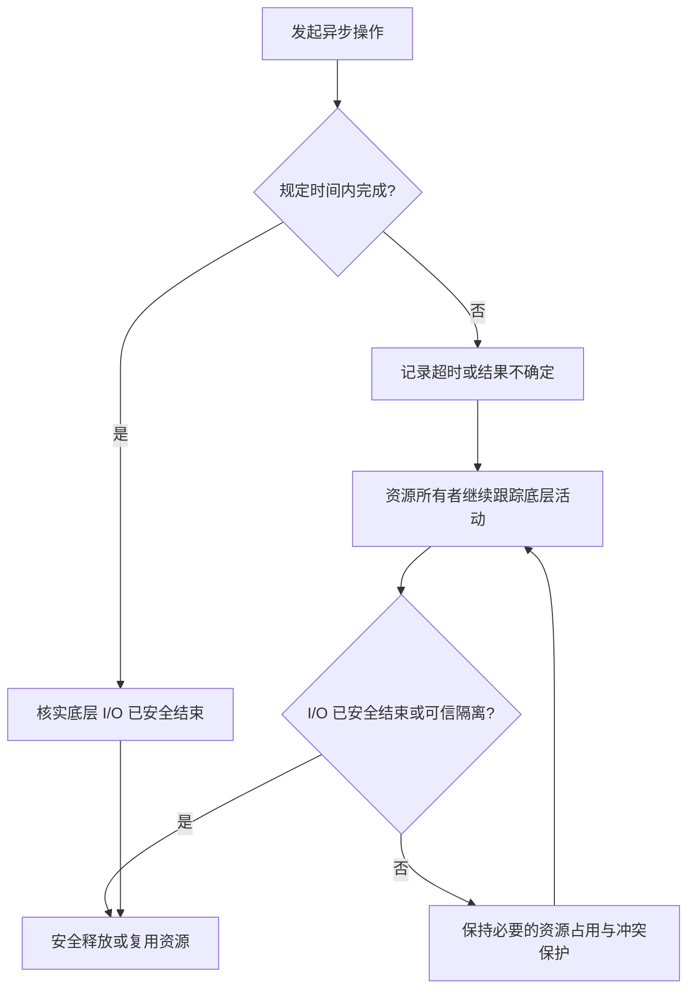

<p class="figure-caption">图 2-1 异步操作超时与资源安全释放流程</p>

对异步操作应区分超时、取消、异常和正常结束；不能仅凭调用方返回、Future/Task 取消或连接状态判断底层 I/O 已安全结束。

### 2.1.5 性能与资源有界原则

性能设计围绕明确的负载与质量要求展开，而不是无依据地增加并发或缓存。

<p class="table-caption">表 2-5 性能与资源有界设计要求</p>

| 设计要求 | 具体规定 |
|---|---|
| 负载模型 | 明确请求规模、并发规模、数据量及运行条件 |
| 容量约束 | 队列、线程、Task、连接、缓存及存储资源应有合理边界 |
| 背压 | 资源不足时明确等待、拒绝、丢弃或降级策略及适用条件 |
| 缓存 | 明确缓存用途、权威数据来源、失效与容量策略 |
| 性能指标 | 明确时延、吞吐、资源占用及测量口径 |
| 性能取舍 | 不得以违反正确性、安全性和可靠性约束换取性能 |

### 2.1.6 故障可控与恢复原则

设计应覆盖正常运行及合理预期的异常场景，明确故障影响范围和恢复条件。

<p class="table-caption">表 2-6 故障与恢复设计要求</p>

| 设计要求 | 具体规定 |
|---|---|
| 故障识别 | 明确可能的超时、通信失败、存储失败、任务异常和进程崩溃 |
| 故障隔离 | 限制故障传播，避免无关组件或资源被错误影响 |
| 状态可信 | 不将未知状态解释为确定成功或失败 |
| 重试与恢复 | 明确允许重试的条件，禁止可能产生危险副作用的盲目重试 |
| 持久化恢复 | 规定异常中断后的数据一致性及状态恢复规则 |
| 生命周期 | 明确启动、就绪、运行、关闭和重启期间的异常处理 |
| 失效行为 | 无法恢复时应有明确的降级、阻塞或停止服务条件 |

### 2.1.7 横切能力非侵入式原则

日志、审计、指标、追踪、权限校验等横切能力应与核心业务逻辑分离，优先通过统一的边界组件、装饰器、中间件或独立服务实现，不应将重复的技术处理流程散布在业务代码中。非侵入式不等于隐藏业务约束：凡影响业务准入、执行结果、事务一致性或故障处理的规则，必须在业务契约中明确，并保留必要的显式调用点。

<p class="table-caption">表 2-7 横切能力非侵入式设计要求</p>

| 设计要求 | 具体规定 |
|---|---|
| 职责分离 | 业务组件负责业务规则与状态转换；横切组件负责统一的记录、采集、校验与传输机制 |
| 边界统一 | 在服务入口、应用服务边界、消息发布边界等明确位置接入横切能力，避免各业务分支重复编排 |
| 最小侵入 | 不为记录日志、采集指标或传播追踪上下文而改变业务方法的核心控制流程和返回语义 |
| 审计正确性 | 审计事件的业务含义及产生时机由业务契约定义；持久化、投递、重试等通用机制与业务处理解耦，同时保证要求的一致性 |
| 故障影响 | 明确横切能力故障时的阻断、降级或重试规则；不得默认其失败不会影响业务，也不得默默吞掉必须处理的错误 |
| 可读性与验证 | 业务代码能够直接体现主流程；横切处理可独立测试，端到端测试验证其与业务契约一致 |

不为追求形式上的非侵入而引入复杂框架或过多抽象；简单、清晰的显式边界优先于难以追踪的隐式执行机制。

### 2.1.8 公共能力复用与冗余控制原则

优先使用符合需求的标准库、成熟软件包、现有工具及公共组件；相同且稳定的职责才提炼为公共能力，不重复发明、不为假设性扩展提前设计框架。

<p class="table-caption">表 2-8 公共能力复用与冗余控制要求</p>

| 设计要求 | 具体规定 |
|---|---|
| 复用优先 | 先评估现成组件是否满足功能、安全、性能及维护要求，再决定是否自行实现。 |
| 提炼公共职责 | 多模块存在稳定相同的职责时统一实现；业务规则留在所属业务模块。 |
| 控制依赖 | 核查成熟度、许可证、版本、安全维护及引入成本。 |
| 控制抽象 | 避免仅为减少少量重复而引入复杂框架或多层转发。 |
| 清理冗余 | 统一能力落地后删除重复、废弃和不必要的兼容实现。 |

### 2.1.9 图表表达与设计一致性原则

设计优先使用合适的图形和表格表达结构、流程、时序、状态及约束，图表不能代替必要的精确定义。

<p class="table-caption">表 2-9 图表表达与一致性设计要求</p>

| 设计要求 | 具体规定 |
|---|---|
| 视图完整 | 使用 4+1 架构视图组织系统设计，覆盖适用内容 |
| 图形选择 | 根据表达目的选择结构图、状态图、时序图、活动图等 |
| 图表一致 | 图形、表格和正文不得相互矛盾 |
| 跨章节一致 | 同一接口、状态、参数及资源规则保持一致 |
| 设计深度 | 明确影响系统行为的契约，允许自主选择内部实现细节 |
| 可验证性 | 关键设计要求应能够对应测试条件与验收证据 |

### 2.1.10 软件设计工作流程

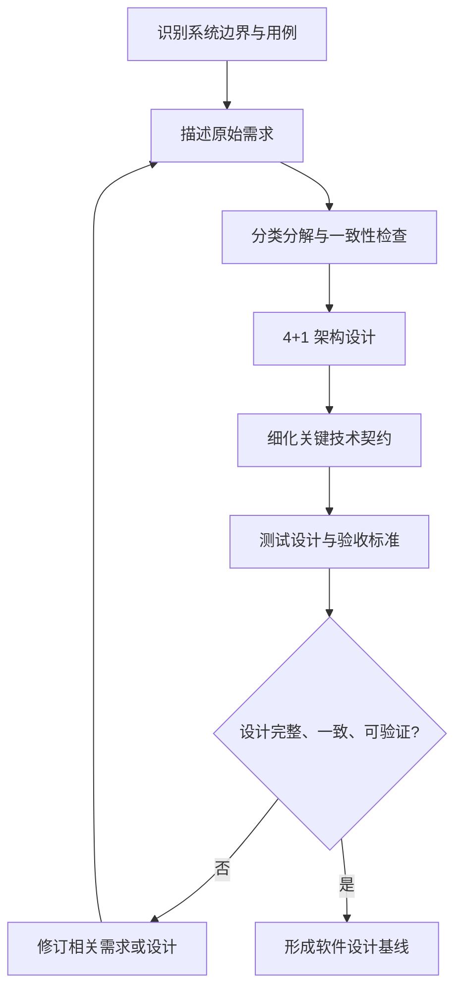

<p class="figure-caption">图 2-2 软件设计编制流程</p>

工作流程允许迭代，不要求传统瀑布式阶段。发现缺口或冲突时直接修订相关需求、架构视图或契约，不通过追加覆盖性条款解决。

### 2.1.11 规范性参考文献及项目无关性

本章为跨项目通用设计与编制规范，不得写入具体仓库、服务、业务协议、接口文件路径或项目专有指标。设计正文引用具体项目的源码、配置和协议文件时，应放在相关业务章节或接口/数据契约章节。

- **《符号体系.md》**：数学量类型、变量命名、标量/矢量/矩阵/张量、下标和公式运算的规范性依据。统计业务中的普通标量同样遵守其标量与阵列的区分原则。
- **《软件系统建模图形与表达规范.md》**：业务流程、DFD、活动/状态/时序图、算法图、伪代码和图元语义的规范性依据。

规范性引用以文件标题和相应章节为准，不复制全文；引用之间存在冲突时先识别并修订冲突，不擅自切换符号或重新解释图元。任何设计实例的具体接口名称、消息字段和技术约束均在第三章及后续适当章节给出。

## 2.2 需求体系及描述规范

需求采用“识别用例 → 逐条描述原始需求 → 分类分解 → 总分一致性检查”的方法。用例应从外部使用者及运行场景出发，覆盖适用的部署、启动、正常使用、配置、运维、正常关闭、重启及异常恢复过程；不局限于业务 RPC，也不将内部技术机制机械列为用例。用例识别属于需求分析，第 4 章用例视图负责表达参与者、边界及用例关系。

<p class="table-caption">表 2-10 原始需求描述字段</p>

| 字段 | 描述要求 |
|---|---|
| 编号 | 唯一原始需求标识，例如 `UR-01` |
| 名称 | 准确概括使用者需要的能力或运行场景 |
| 请求方（Requester） | 发起操作的外部系统、服务或接口，如外部客户端、上层服务、进程管理系统；消息和周期自动触发时可以没有直接请求方，标记“不适用” |
| 触发方式（Trigger） | 标明触发类型、事件来源、触发条件及必要的周期或接口；允许多个类型组合，区分外部触发和内部自动步骤 |
| 输入（Input） | 请求方向本系统提供的数据、参数和信息 |
| 反馈（Response） | 本系统返回请求方的确认、状态、结果及错误信息 |
| 目标方（Destination） | 接收本系统业务输出的外部系统、消息中间件或现场设备；没有时标记“不适用” |
| 业务输出（Output） | 本系统发往目标方的数据、消息或控制指令；没有时标记“不适用” |
| 业务流程（Flow） | 用 Mermaid 表达主要控制流程、数据输入/输出及重要异常，已表达的动作不重复 |
| 业务规则（Business Rules） | 补充主流程未精确定义的术语、公式、算法、初始化、阈值和边界；允许文字分条、LaTeX、图、伪代码或表格，不重复业务流程 |
| 关键约束（Constraints） | 性能、可靠性、安全、审计、可观测性、错误信息、缓存、I/O 与背压等可验证的非功能要求 |

反馈与业务输出必须分开：反馈面向请求方，业务输出面向目标方；请求方与目标方可有多个，且请求方断连不必然撤销已接受的业务操作。

### 2.2.1 触发方式分类与标注规则

原始需求必须列出实际适用的触发方式；同一需求可以组合多种触发方式，不能把处理流程中的普通步骤误写成独立触发。触发方式描述“何时、由什么启动”，不预先决定线程、定时器或队列等内部实现。

- **消息触发（Message）**：外部消息到达，例如实时消息或可靠消息；标明消息来源与订阅范围。
- **周期触发（Periodic）**：达到配置周期，例如实时周期输出或变化加周期保底；标明周期来源及生效条件。
- **API 触发（API）**：收到明确的外部接口请求，例如任务启动或配置应用接口；标明接口和调用方。
- **状态触发（State）**：受监控对象的状态发生满足条件的变化，例如外部依赖从不可用恢复可用；标明状态条件，不把普通循环迭代误列为触发。
- **生命周期触发（Lifecycle）**：服务进入启动、关闭、重启或配置生效等阶段；标明阶段及必要前置条件。

周期触发与消息触发可以同时存在：消息到达更新数据，周期到达决定何时输出。若无外部直接请求方，Requester 写“不适用（自动触发）”，但仍须列出消息生产者或状态来源；触发方式不替代 Input、Response 与 Output 的定义。

### 2.2.2 原始需求四节结构与写作原则

各 UR 固定为四节：**基本信息与触发方式、业务流程、业务规则、关键约束**。根据语义选择最清晰的表达形式；文字、公式、图形、伪代码和表格地位平等；**业务流程图已清楚表达的处理不得在后两节复述**。规则和约束必须有唯一规范定义，其他章节仅引用。

1. **基本信息与触发方式**：表格列出 Requester、Trigger、Input、Response、Destination、Output。Trigger 采用第 2.2.1 节分类，明确事件来源、触发条件及周期或 API。
2. **业务流程**：Mermaid Flowchart 或适用的 UML 活动图表达触发入口、主要处理、判断、数据输入输出、重要异常及恢复出口；复杂算法通过“预定义过程”节点指向第三节，不在总流程中堆叠实现细节。
3. **业务规则**：仅描述流程图无法精确表达的算法、公式、阈值、初始化、状态不变量、顺序及边界。允许文字分条定义、算法流程图、DFG、LaTeX 公式、表格或明确标为 `text` 的伪代码；必须说明输入、输出、初始值、边界及终止条件。无额外内容时标注“无额外规则”。
4. **关键约束**：**优先给出定量要求**（带单位、作用范围、测量窗口、默认值或硬上限、验收方法）；不能合理量化的才采用具有明确判定条件的定性要求。**仅放可核验的非功能要求**，按性能与容量、可靠性与恢复、安全与授权、审计、可观测性、错误信息、缓存与有效期、I/O 资源安全、背压与过载分类；无关分类可以省略或说明不适用。约束应给出故障条件、正确结果、测量或验收口径，不得用抽象口号代替。

### 2.2.3 业务图形元素与数据语义

参照《软件系统建模图形与表达规范.md》第 5.1 节 Flowchart、第 7.1 节 DFD 与第 8.1 节算法规范。业务活动图的控制流箭头表示处理顺序，DFD 箭头表示数据流，**两者不得混用**。图中应以不同形状区分处理、判断和数据。

| 元素 | Mermaid 写法 | 语义 |
|---|---|---|
| 开始/结束 | `A([开始/结束])` | 明确入口和完成/失败出口 |
| 处理 Process | `B["更新缓存"]` | 矩形，表达动作而非数据 |
| 判断 Decision | `C{"已过期?"}` | 菱形，分支标明条件 |
| 输入/输出 Data | `D[/"采样消息"/]` | 平行四边形，表达数据输入/输出 |
| 预定义子过程 | `E[["计算统计指标"]]` | 双边矩形，引用业务规则的算法说明 |
| 数据存储 | `F[("最新值缓存")]` | 存储节点；仅在理解读写关系必要时出现 |

不因形式要求增加无意义数据节点。数据来源、存储及复杂数据变换应单独绘制 DFD，避免业务活动图变成混杂的控制/数据流图。Mermaid 第一行初始化配置、图编号和图题仍须符合第一章。

### 2.2.4 业务规则、输出定义与关键约束的具体要求

- **业务规则**：定义与边界条件优先文字分条；涉及数学关系必须使用 LaTeX 独立公式；复杂步骤按需使用 Flowchart/DFG 或伪代码补充。表达形式不限于图和表；精确定义阈值、边界、初始化、更新基准和不可变条件，不复述主流程动作。算法必须能够独立据输入判断预期输出。
- **性能与容量**：优先用定量指标给出负载范围、时延/吞吐口径、并发及资源上限；必须区分设计目标、默认配置、不可突破的资源上限和验收实测值；未确定的阈值不得虚构。
- **可靠性及 I/O**：明确超时、结果不确定、重试、恢复、安全收敛及资源释放条件。调用返回或 Task 取消不代表底层 I/O 已结束。
- **错误信息**：定义错误类别、错误码或结果、对象与关联标识、发生阶段、可检索证据及敏感信息脱敏；禁止把 UNKNOWN 伪装为成功或明确失败。
- **缓存与背压**：规定缓存键、容量、更新/覆盖、过期、丢弃、等待、拒绝、暂停消费及恢复条件；所有超限策略必须可观测。
- **安全与审计**：列出认证、授权、控制边界以及需审计的操作、事件产生时机、关联 ID、可信保存与失败处理；运行日志不能代替审计。
- **可观测性**：指标、统计窗口、状态、事件、更新时间、无数据语义及告警；可结合真实场景验收。

**指标、计算和输出契约完整性（强制）：**凡使用“计算、统计、比较、阈值、状态、错误、容量、返回结果”等词定义业务能力，必须形成封闭的输出集合；不得用“等”“包括但不限于”替代本版本必须实现的清单。每个指标/派生字段至少定义以下内容；其中数学计算不得仅写在表格单元格内，必须另列可渲染的 LaTeX 公式：

| 必填字段 | 内容 |
|---|---|
| 唯一标识、类型和单位 | 与公开接口字段或指标名一致；明示 `counter/gauge/histogram`、计量单位 |
| 统计层级和数据来源 | 系统 / 进程 / 组件 / 任务 / 消费者；事件记录点、分子和分母来源 |
| 计算公式与口径 | 累计/窗口/瞬时，窗口端点、去重规则、事件计数次数、百分位算法 |
| 触发、初始化和重置 | 何时采集/计算、初始值、首个周期、进程重启、配置热更新 |
| 边界与缺失 | 零分母、空样本、UNKNOWN、超时、重复投递、源不可达的值域与 `unavailable` 语义 |
| 输出与验收 | 指标名、采样时间、窗口、可用性表达、配置边界及给定数据可独立验算的实例 |

**示例与可复算性（强制）：**当业务规则涉及多种计数口径、状态转换、时间窗口、边界分支或重试等易混淆情形时，至少给出一个具体输入—处理过程—预期输出的完整算例。算例必须标明初始条件、计量单位、每一步事件及最终结果；若同时存在样本条数、批次数、I/O 尝试次数等不同统计单位，须分别列出，禁止混用。算例应覆盖易误解的边界（例如重试成功仍有失败尝试记录），且结果必须可直接转化为确定性测试断言。算例是对定义的验证，不得取代规范性定义，也不应重复流程图中的全部步骤；涉及计算关系仍按第一章使用 LaTeX。

**数学定义与表达门禁：**业务规则的文字定义应独立成段或分条；涉及计算时，必须在定义后给出独立 LaTeX 公式，逐一释义变量、单位、取值域以及零分母、空样本和无效值。算法图与伪代码是可选的精度增强手段，不得要求所有业务规则使用表格。公式与中文混排遵守第一章 §1.3.1。

**约束定量优先门禁（强制）：**关键约束首先给出数值、单位、统计范围、采样方法、允许误差、测试条件和通过标准；可配置阈值应列出默认值及合法范围。仅当约束本质上无法定量（例如禁止错误 ACK）时，才用可判定的定性约束。不得用“及时、足够、合理、有界、尽可能、低延迟、高可靠”等词代替具体要求；未完成基准测试的数值应标明“设计验收目标，尚未实测”，不得声称达标。

**完备性门禁：**业务规则涉及的状态枚举、错误分类/错误信息字段、缓存容量及淘汰策略、I/O 结果、背压策略、审计与统计输出均应列举封闭集合和边界输入；凡无法根据文档构造确定预期结果的要求，视为需求未完成，不得标记为可编码。参数可以配置，但必须说明合法范围、默认/缺省行为及越界错误；性能数值未经验证时不得伪称已达标。每项约束必须可追溯至可执行的 UC/System 场景。

每项业务规则和关键约束须能由 UC/场景及第 14 章测试追溯；第 5～13 章详述实现契约时应引用 UR，不得另造冲突定义。

统一样式：

```text
### 3.x UR-xx 需求名称
#### 3.x.1 基本信息与触发方式
Requester / Trigger / Input / Response / Destination / Output
#### 3.x.2 业务流程
Mermaid 活动流程图，含重要异常及数据输入输出
#### 3.x.3 业务规则
可用文字、LaTeX、伪代码、图或表格精确定义算法、初始化与边界，不重复流程
#### 3.x.4 关键约束
按性能、可靠性、安全、审计、可观测性、错误、缓存、I/O、背压列可验证要求
```

本节也是第三章及后续章节的强制完整性验收标准。

<p class="table-caption">表 2-11 分类需求体系与描述重点</p>

| 类别 | 核心问题 | 典型要求 |
|---|---|---|
| 功能需求（Functionality） | 系统提供什么行为 | 对外能力、业务流程、业务规则、输入输出与状态反馈 |
| 性能需求（Performance） | 运行速度与资源上限 | 时延、吞吐、并发、调度、公平性、容量、背压、资源消耗、扩展能力 |
| 可靠性需求（Reliability） | 故障时如何保持正确与恢复 | 容错、超时、重试、请求关联、事务、持久化、故障恢复、可用性、未结束操作的资源管理 |
| 安全需求（Safety & Security） | 如何防止危险或非法控制 | 控制权、互锁、失效安全、认证、授权、通信及数据安全 |
| 横切能力（Cross-cutting Concerns） | 如何观测、管理与追责 | 审计（操作证据、可靠投递、完整性、追溯）、日志、指标、追踪、配置、版本、可测试性、可维护性 |

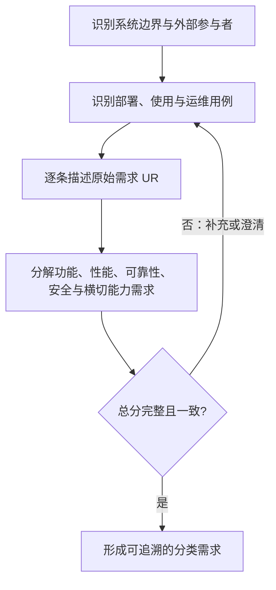

<p class="figure-caption">图 2-3 需求识别、分解与一致性检查流程</p>

分类需求必须从原始需求的输入、反馈、业务输出、规则和约束中推导，不得遗漏、矛盾或未经确认增加能力；多条原始需求的共同约束可以合并，但必须保留来源编号。每条分类需求应给出可核验条件，性能要求还需明确测量口径，不虚构现场阈值。审计应独立于普通日志定义，不得以运行日志代替审计证据。

需求分类与设计专题是不同维度：启动、正常关闭、重启及 Reload 属于跨需求的运行生命周期设计，统一在进程视图展开；相应行为和质量约束分别由原始需求及分类需求追溯。

## 2.3 4+1 架构视图：内涵、外延与表达规范

<p class="table-caption">表 2-12 4+1 架构视图的职责与成果</p>

| 视图 | 关注范围 | 主要成果 | 不应混淆 |
|---|---|---|---|
| 用例视图（+1） | 参与者、系统边界、典型/异常场景 | 系统上下文、用例、业务流程 | 不负责线程调度 |
| 逻辑视图（Logical） | 组件职责、模型、接口、状态规则、依赖 | 组件图、类/数据关系、状态图 | 不等于源码目录树 |
| 进程视图（Process） | 进程、线程、Event Loop、Task、协作、生命周期、同步、并发、资源、背压、缓存、故障恢复 | 运行结构图、任务所有权表、时序/状态/活动图、资源预算 | Task 不等于 OS 线程；图名须区分标准 UML 与示意图 |
| 开发视图（Development） | 软件模块边界、层次、静态依赖、公共契约与复用关系 | 模块图、依赖图、模块职责表 | 不描述真实并发拓扑，也不列现有代码修改清单 |
| 物理视图（Physical/Deployment） | 节点、进程部署、存储、网络、控制权和现场外部依赖 | 部署图、网络/故障域/外部依赖表 | 不是现场设备内部物理结构模型 |

### 2.3.1 用例视图的场景编写规范

用例以参与者的完整业务目标为单位组织，而非以原始需求、RPC 或内部模块为单位逐条改名。一项用例可以关联多项原始需求；一项原始需求也可以由多个业务场景共同覆盖。用例视图回答“在具体业务场景中系统如何工作”，不代替逻辑视图、进程视图和数据设计。

<p class="table-caption">表 2-13 业务场景用例的必备描述要素</p>

| 要素 | 编写规定 |
|---|---|
| 用例身份与目标 | 给出唯一编号、业务场景名称及参与者要达成的可观察目标；名称使用业务活动，不使用内部机制命名 |
| 参与者与触发条件 | 列明实际发起操作的外部角色；内部定时任务、恢复及发布等自动步骤不得虚构外部参与者 |
| 前置条件 | 列明系统就绪、授权、配置或数据存在等必要条件；不得混入未确认的实现假设 |
| 主业务流程 | 以 Mermaid 业务活动图（flowchart）为主要表达，覆盖触发、校验、关键处理、反馈及后置结果；以判断节点表达重要分支，避免大段编号文字复述 |
| 分支与异常流程 | 在活动图中呈现影响业务结果的主要异常出口；罕见或不宜展开的异常在简明说明表中概括，避免为了完整而画出所有技术异常 |
| 后置条件 | 明确成功和失败之后的业务状态、外部可见结果、未完成事项及后续查询方式 |
| 需求追溯 | 标明相关 UR；核对全部 UR 在真实场景中得到覆盖，但不要求 UR 与 UC 一一对应 |

跨用例共享的内部机制（如存储、审计发布和调度）应作为相关业务流程中的自动步骤或支撑行为描述；只有存在独立业务目标时才另立用例。应避免将一串 gRPC 方法名或 CRUD 操作直接当作完整用例，也不得在用例章节展开线程、锁、表结构及类方法等实现细节。

用例的正文采用“一张业务活动图 + 一张简明用例说明表”的表达形式。活动图包含主路径、必要判断以及重要异常分支；图中节点使用业务动作，不展开展示内部类、锁和数据库事务。说明表只填写参与者、业务目标、前置条件、主要异常、后置条件及关联需求。业务分支已在图中完整表达时，不再重复书写大段“主业务流程”和“异常流程”；复杂跨参与者消息时序可在独立小节补充时序图。图题和表题按文档约定独立编号。

进程视图应按四个设计专题组织，而不是按需求类别重复划分：

<p class="table-caption">表 2-14 进程视图的四类设计专题</p>

| 专题 | 必须明确的设计对象 | 推荐表达 |
|---|---|---|
| 运行时结构 | 进程、线程、Event Loop、Task、线程池、组件与资源所有权 | 分层运行结构图、Task 职责表 |
| 运行生命周期（Runtime Lifecycle） | 启动、初始化、就绪、运行、Reload、正常关闭、重启及其阶段转换 | 生命周期状态图、启动/关闭/Reload 时序图 |
| 并发与资源管理 | Task 协作、队列、通知、同步、调度、容量限额、背压、缓存及释放 | 任务协作时序图、资源与背压策略表 |
| 异常与恢复 | 超时、取消、故障隔离、未收敛 I/O、崩溃恢复与降级 | 故障状态图、异常裁决矩阵 |

各专题共享同一运行模型，明确创建者、所有者、同步关系和退出条件；不因分节而重复定义状态或资源。生命周期是进程视图的独立设计专题，不是第六类需求。

图表仅使用其可准确表达的语义：结构关系用 Mermaid Flowchart；行为交互用 Sequence Diagram；状态约束用 State Diagram；条件控制用活动/流程图。图题说明对象、范围及图类型。关键质量属性贯穿各视图，不能只写在单独的“非功能要求”段落。

## 2.4 测试设计方法、组织及验收规范

测试设计以测试层级组织物理目录，以 Marker 描述测试层级、测试专题与运行场景。测试文件名应清楚表达验证对象或行为；测试文件及其标记、验证说明统一登记在测试矩阵中。需求、用例及重要技术契约必须能追溯到实际测试，不为同一目的建立重复测试体系。

<p class="table-caption">表 2-15 测试层级与目录规范</p>

| 层级 Marker | 物理目录 | 验证范围 |
|---|---|---|
| `unit` | `unit/` | 状态转换、业务规则、纯逻辑，无外部服务依赖 |
| `component` | `component/` | 单组件职责及其可控依赖 |
| `integration` | `integration/` | 组件之间及真实外部依赖的接口协作 |
| `system` | `system/` | 独立进程、完整业务场景及端到端行为 |

<p class="table-caption">表 2-16 测试 Marker 与矩阵编制规范</p>

| 事项 | 规范 |
|---|---|
| 层级 Marker | 每项测试必须且仅属于 `unit`、`component`、`integration`、`system` 之一，与目录对应 |
| 专题 Marker | 标识可靠性、安全、性能等验证主题，可与层级及场景 Marker 叠加；无专项主题时可为空 |
| 场景 Marker | 标识并发、超时、恢复、负载、现场等执行条件或情境；有相应场景时标记 |
| 测试矩阵 | 至少包含“测试文件名、层级 Marker、专题 Marker、场景 Marker、测试说明”五列；每项重要测试应有可定位的文件归属 |
| 标记粒度 | 标记以具体测试函数或类为准；同文件可包含不同专题与场景，矩阵列出涉及的 Marker |
| 运行条件 | 通过 Fixture 和环境准备明确外部依赖；现场专用测试与常规回归分离，未执行不视为通过 |
| 执行规则 | 提供按目录、Marker 及其布尔组合的 pytest 命令；所有 Marker 在项目配置中注册 |
| 可追溯性 | 测试说明与需求、用例或技术契约对应；行为变更时同步检查测试及矩阵 |
| 验收证据 | 保留运行环境、命令、实际结果、指标和未验证项，禁止把设计目标当作测试结果 |

目录划分测试层级，专题与场景通过 Marker 横向组合；可靠性测试不单独设第五类目录。测试矩阵用于定位和筛选测试，不预设每个实现文件必须存在，也不要求每个文件仅能有一种测试场景。

### 2.4.1 测试依据及 System 覆盖要求

各层级测试必须依据已确认的设计成果编制；System Test 以用例视图为主基线，以原始需求及技术契约补充覆盖，不得由测试人员凭经验任意缩减范围。

<p class="table-caption">表 2-17 各测试层级的设计依据</p>

| 测试层级 | 主要依据 | 验证重点 |
|---|---|---|
| Unit | 详细设计、函数及算法契约 | 纯逻辑、状态转换、参数及边界规则 |
| Component | 逻辑视图、组件职责及内部接口契约 | 单组件行为、依赖协作及异常处理 |
| Integration | 接口与通信契约、开发视图、物理视图 | 真实接口调用、跨组件通信及外部依赖 |
| **System** | **用例视图（UC）及原始需求（UR）**，并补充接口、运行、部署、安全及性能约束 | **从真实受测服务进程及其通信入口验证业务目标、异常、边界与恢复行为** |

System Test 必须遵守以下规定：

1. **用例覆盖率 100%**：每项 UC 至少有一项 System Test 作为验证证据；同一测试可以覆盖多个 UC，同一 UC 可以由多个测试覆盖，**不按测试数量与 UC 数量的大小关系判定覆盖**。
2. **规定场景覆盖率 100%**：每项 UC 明确的主流程、关键分支、异常流程、边界和恢复场景均必须有对应 System Test；不能仅以一条正常路径代表整个 UC 已覆盖。
3. **需求覆盖率 100%**：每项 UR 必须能够经一个或多个 UC 追溯至 System Test；若某项需求未能被 UC 覆盖，必须先补全用例，不得直接以技术测试代替业务用例。
4. **技术约束补充覆盖**：用例未充分表达的性能、容量、并发、安全、权限、超时和可靠性要求，依据对应技术契约补充测试；不得因 UC 未逐项列出而豁免。
5. **真实系统边界**：System Test 通过真实受测服务进程和适用的外部依赖、通信链路执行；Mock 不得代替本次明确纳入验收范围的基础设施及通信链路。
6. **覆盖与通过分开裁定**：测试已关联不等于已执行；失败、跳过及未运行均不得计为通过。验收报告分别给出需求覆盖、用例及场景覆盖、执行情况和通过情况；缺少真实环境时标记 `NOT_RUN`，不得用模拟结果替代。
7. **变更同步**：任何 UR、UC、接口或行为约束的新增、删除、调整，必须同步核查 System Test、测试矩阵和验收条款；新增 UC 不得留下无测试映射。

<p class="table-caption">表 2-18 System Test 追溯矩阵规范</p>

| 字段 | 要求 |
|---|---|
| UR 编号 | 被验证的原始需求编号，可列多个 |
| UC 编号与场景 | 用例编号及主流程、异常、边界或恢复场景标识 |
| 技术契约 | 相关接口、配置、运行或安全约束的章节编号；没有则记“—” |
| 测试文件名／测试标识 | 可定位的 System Test 文件名及测试函数或参数化场景标识 |
| 层级／专题／场景 Marker | 层级固定为 `system`，其余按第 2.4 节定义填写 |
| 验证内容与预期结果 | 从用户可观察行为与副作用表述判定依据 |
| 执行环境及结果 | 真实依赖、执行证据、`PASS`／`FAIL`／`SKIP`／`NOT_RUN` 等状态 |

追溯链为 **UR → UC／用例场景 → System Test → 执行结果与证据**，技术契约作为补充依据进入相应测试。第 4 章负责编制完整 UC 和场景，第 14 章依据本规范给出实际测试矩阵及验收安排，两章必须双向核对。

# 3. 软件需求

Collector
的业务是连接现场设备，采集配置允许的动态测点，对采样值进行标准化处理并向
NATS 发布；它不执行设备写控制、不负责 Sink Delivery
分发或历史入库。本章遵循第 2.2.2
节的四节结构：基本信息与触发方式、业务流程、业务规则、关键约束。原始要求继承
Collector v0_9 的业务范围，配置管理接口与 Proto 权威来源按本版调整。

## 3.1 业务需求总表

```{=html}
<p class="table-caption">
```
表 3-1 Collector 业务需求
```{=html}
</p>
```
  --------------------------------------------------------------------------------------------------------
  编号                    业务需求                业务目标
  ----------------------- ----------------------- --------------------------------------------------------
  UR-01                   设备连接与健康管理      为每个设备维护独立协议会话，监测连接并在故障后安全恢复

  UR-02                   采集任务管理            每设备唯一采集实例，持久化 START/STOP 运行意图并执行启停

  UR-03                   动态测点采集与标准化    以 POLL/SUBSCRIBE/LISTEN
                                                  取得动态点值并处理质量、时间、工程单位

  UR-04                   采样数据发布            将原始样本提交 NATS realtime 或 JetStream reliable
                                                  通道并报告确认边界

  UR-05                   gRPC 服务接口实现       按 `contracts/` 已发布 Proto 实现 Collector 所需 Server
                                                  方法

  UR-06                   配置快照管理            Get/Push/Apply
                                                  配置快照，区分候选、已保存、已生效和待重启

  UR-07                   数据通路诊断            分段诊断设备网络、协议采集、标准化、NATS
                                                  发布及可验证边界

  UR-08                   运行指标监控            提供设备、任务、采样、发布、资源指标与窗口统计
  --------------------------------------------------------------------------------------------------------

## 3.2 UR-01 设备连接与健康管理

### 3.2.1 基本信息与触发方式

```{=html}
<p class="table-caption">
```
表 3-2 UR-01 基本信息
```{=html}
</p>
```
  -----------------------------------------------------------------------------------------
  字段                                内容
  ----------------------------------- -----------------------------------------------------
  请求方（Requester）                 运维客户端、进程启动与设备健康监测

  触发方式（Trigger）                 生命周期触发（启动）、状态触发（连接健康变化）、API
                                      触发（任务启停）

  输入（Input）                       设备标识、端点、协议参数及健康检查策略

  反馈（Response）                    连接状态、故障阶段、最近成功时间和恢复状态

  目标方（Destination）               现场 PLC / 协议 Server

  业务输出（Output）                  按协议建立、使用与关闭实际设备连接
  -----------------------------------------------------------------------------------------

### 3.2.2 业务流程

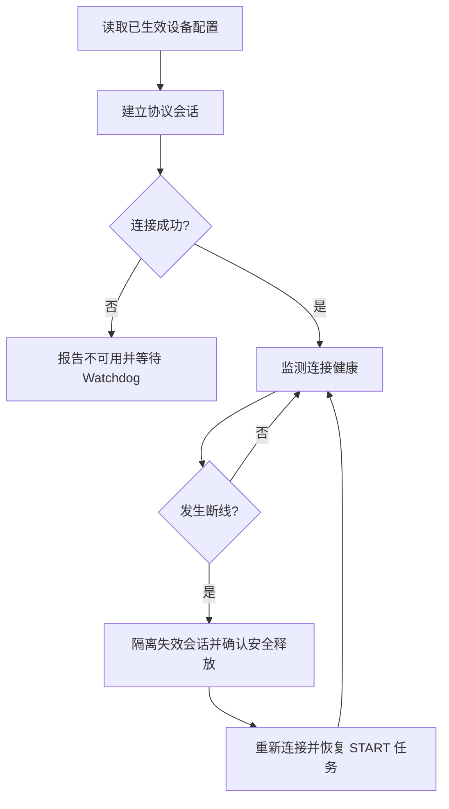

```{=html}
<p class="figure-caption">
```
图 3-1 设备连接与健康管理业务流程
```{=html}
</p>
```
### 3.2.3 业务规则

```{=html}
<p class="table-caption">
```
表 3-3 UR-01 业务规则与功能要求
```{=html}
</p>
```
  --------------------------------------------------------------------------------------------------------------------
  编号                                要求
  ----------------------------------- --------------------------------------------------------------------------------
  R-01                                每台启用设备持有独立的连接状态与通信会话；多个任务不得额外创建同设备重复连接。

  R-02                                支持 ADS、Modbus TCP、IEC
                                      60870-5-104；地址、站号、端口及协议能力来自已生效配置。

  R-03                                启动期单设备连接失败不阻断其他设备；设备故障以设备为边界隔离。

  R-04                                Watchdog 独立检查健康并执行受控重连；普通读路径不因单点错误盲目创建连接。

  R-05                                故障恢复后仅恢复当前 desired_state=START 的采集实例；手动 STOP 不自动恢复。

  R-06                                显式连接、重连、热更新和关闭在同设备上必须串行裁决。
  --------------------------------------------------------------------------------------------------------------------

### 3.2.4 关键约束

```{=html}
<p class="table-caption">
```
表 3-4 UR-01 非功能约束
```{=html}
</p>
```
  ------------------------------------------------------------------------------------------------------------------
  类别                                约束要求
  ----------------------------------- ------------------------------------------------------------------------------
  性能与资源                          检查间隔、连接期限、重试节奏及并发会话资源有界；采集点错误不等同于连接断开。

  可靠性与安全                        操作超时不等于底层 I/O 已结束；涉及协议资源的恢复遵守
                                      §6.8。服务配置及诊断证据不得泄露认证秘密。
  ------------------------------------------------------------------------------------------------------------------

```{=html}
<p class="table-caption">
```
表 3-5 UR-01 故障及处理
```{=html}
</p>
```
  ------------------------------------------------------------------------------------------------------------
  故障                                处理要求
  ----------------------------------- ------------------------------------------------------------------------
  不合法输入或依赖故障                超时不代表同步底层 I/O
                                      已停止；连接失败记录并按策略恢复；无法安全收敛时隔离设备，不重复释放。

  超时、取消或状态未知                仅在涉及在途协议 I/O
                                      或配置事务时保留原操作的安全所有权；结果不确定时必须报告
                                      UNKNOWN，且不得宣称成功。
  ------------------------------------------------------------------------------------------------------------

## 3.3 UR-02 采集任务管理

### 3.3.1 基本信息与触发方式

```{=html}
<p class="table-caption">
```
表 3-7 UR-02 基本信息
```{=html}
</p>
```
  ------------------------------------------------------------------------------------------------------------
  字段                                内容
  ----------------------------------- ------------------------------------------------------------------------
  请求方（Requester）                 CLI、授权 gRPC 客户端、进程生命周期

  触发方式（Trigger）                 API
                                      触发（StartTask/StopTask）、生命周期触发（重启）、状态触发（允许恢复）

  输入（Input）                       设备 ID、期望状态、有效配置版本

  反馈（Response）                    任务状态、持久化结果、实际启停与未收敛原因

  目标方（Destination）               设备采集运行时

  业务输出（Output）                  开启或停止目标设备采集句柄
  ------------------------------------------------------------------------------------------------------------

### 3.3.2 业务流程

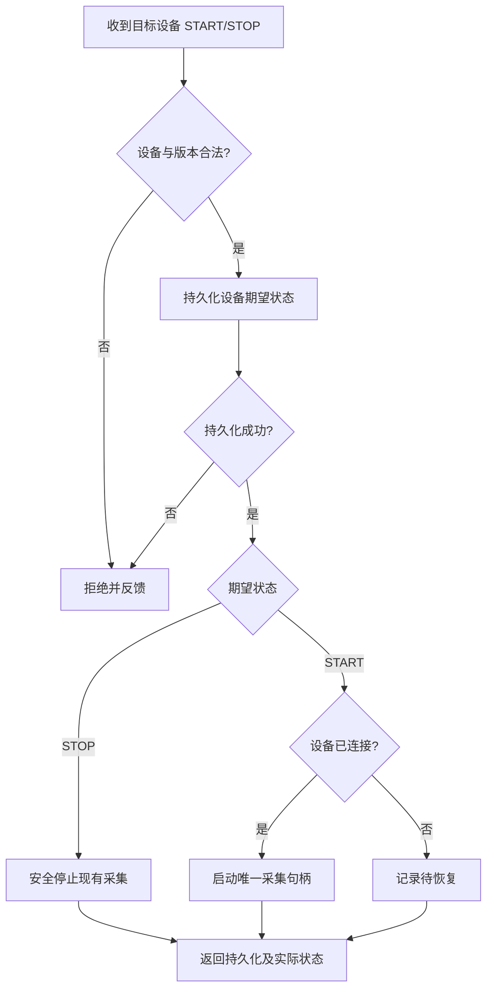

```{=html}
<p class="figure-caption">
```
图 3-2 采集任务管理业务流程
```{=html}
</p>
```
### 3.3.3 业务规则

```{=html}
<p class="table-caption">
```
表 3-8 UR-02 业务规则与功能要求
```{=html}
</p>
```
  ------------------------------------------------------------------------------------------------------------------
  编号                                要求
  ----------------------------------- ------------------------------------------------------------------------------
  R-01                                每台启用 Device 唯一对应一个采集 Task
                                      Instance，任务使用该设备完整配置动态点表；多设备可引用同一 TaskTemplate。

  R-02                                desired_state 只允许 START/STOP，运行实际状态与期望状态分开报告。

  R-03                                任务手动启停应先持久化对应设备实例配置，再执行；持久化失败不得改变实际意图。

  R-04                                START 且设备断线时允许实际 STOPPED，待 Watchdog 成功恢复；STOP
                                      无论重启、热更新或重连均不得复活。

  R-05                                同设备 Start/Stop/Reload/Watchdog 必须串行裁决；每个运行实例最多一个采集句柄。

  R-06                                禁止 Task Definition
                                      自动拆成多个设备内采集任务；不修改共享模板以完成单台启停。
  ------------------------------------------------------------------------------------------------------------------

### 3.3.4 关键约束

```{=html}
<p class="table-caption">
```
表 3-9 UR-02 非功能约束
```{=html}
</p>
```
  ------------------------------------------------------------------------------------------------------------------------------
  类别                                约束要求
  ----------------------------------- ------------------------------------------------------------------------------------------
  性能与资源                          任务控制须支持幂等、版本冲突保护、任务取消及资源安全释放；不为停止命令保留隐式自动重启。

  可靠性与安全                        操作超时不等于底层 I/O 已结束；涉及协议资源的恢复遵守
                                      §6.8。服务配置及诊断证据不得泄露认证秘密。
  ------------------------------------------------------------------------------------------------------------------------------

```{=html}
<p class="table-caption">
```
表 3-10 UR-02 故障及处理
```{=html}
</p>
```
  ----------------------------------------------------------------------------------------------------------------------------------
  故障                                处理要求
  ----------------------------------- ----------------------------------------------------------------------------------------------
  不合法输入或依赖故障                持久化成功而运行失败时保留新意图并返回未收敛状态；底层句柄无法安全关闭时禁止创建重叠新句柄。

  超时、取消或状态未知                仅在涉及在途协议 I/O 或配置事务时保留原操作的安全所有权；结果不确定时必须报告
                                      UNKNOWN，且不得宣称成功。
  ----------------------------------------------------------------------------------------------------------------------------------

## 3.4 UR-03 动态测点采集与标准化

### 3.4.1 基本信息与触发方式

```{=html}
<p class="table-caption">
```
表 3-12 UR-03 基本信息
```{=html}
</p>
```
  -----------------------------------------------------------------------------------------
  字段                                内容
  ----------------------------------- -----------------------------------------------------
  请求方（Requester）                 已启动采集实例

  触发方式（Trigger）                 周期触发（POLL）、消息触发（SUBSCRIBE/LISTEN）、API
                                      触发（主动读取/总召）

  输入（Input）                       设备点表、POLL 周期或订阅/监听参数

  反馈（Response）                    采集成功/失败、点质量、采样时刻及数量

  目标方（Destination）               统一采样发布能力

  业务输出（Output）                  具有设备 ID、点 ID、工程值、质量与时间的样本
  -----------------------------------------------------------------------------------------

### 3.4.2 业务流程

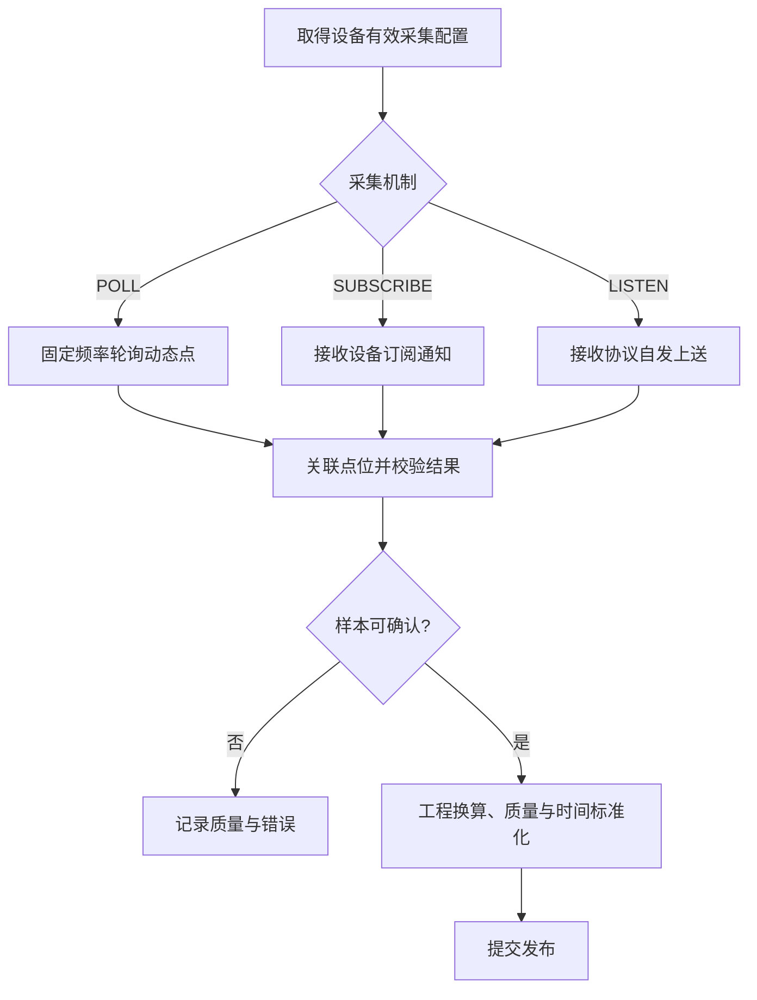

```{=html}
<p class="figure-caption">
```
图 3-3 动态测点采集与标准化业务流程
```{=html}
</p>
```
### 3.4.3 业务规则

```{=html}
<p class="table-caption">
```
表 3-13 UR-03 业务规则与功能要求
```{=html}
</p>
```
  --------------------------------------------------------------------------------------------------------------------
  编号                                要求
  ----------------------------------- --------------------------------------------------------------------------------
  R-01                                POLL 使用 fixed-rate
                                      调度；同一实例不重入，执行超期跳过多余计划时隙，不补采风暴。

  R-02                                ADS、Modbus TCP 可按能力轮询；ADS Notification 使用 SUBSCRIBE；IEC104
                                      自发上送使用 LISTEN；实际能力由驱动和点表约束。

  R-03                                批量读取按测点身份严格关联，不得因部分错误错配其他测点。

  R-04                                按点表完成数据类型验证、scale/offset
                                      与单位语义处理，并保留源质量和来源时间；静态元数据不重复进入采集流。

  R-05                                订阅和监听必须保留注册句柄所有权；重连后重建必要的订阅与监听，不复用失效句柄。

  R-06                                仅采集已生效设备实例允许的动态点；设备点表变更需按影响范围在安全边界生效。
  --------------------------------------------------------------------------------------------------------------------

### 3.4.4 关键约束

```{=html}
<p class="table-caption">
```
表 3-14 UR-03 非功能约束
```{=html}
</p>
```
  --------------------------------------------------------------------------------------------------------------------------------
  类别                                约束要求
  ----------------------------------- --------------------------------------------------------------------------------------------
  性能与资源                          记录采样周期、执行耗时、漏采率、完整率和新鲜度；不以事件驱动机制推算不存在的计划采样周期。

  可靠性与安全                        操作超时不等于底层 I/O 已结束；涉及协议资源的恢复遵守
                                      §6.8。服务配置及诊断证据不得泄露认证秘密。
  --------------------------------------------------------------------------------------------------------------------------------

```{=html}
<p class="table-caption">
```
表 3-15 UR-03 故障及处理
```{=html}
</p>
```
  -----------------------------------------------------------------------------------------------------------
  故障                                处理要求
  ----------------------------------- -----------------------------------------------------------------------
  不合法输入或依赖故障                读取超时、单点
                                      BAD、部分批量失败、订阅中断分别记录；不得将错误数据伪装成有效工程值。

  超时、取消或状态未知                仅在涉及在途协议 I/O
                                      或配置事务时保留原操作的安全所有权；结果不确定时必须报告
                                      UNKNOWN，且不得宣称成功。
  -----------------------------------------------------------------------------------------------------------

## 3.5 UR-04 采样数据发布

### 3.5.1 基本信息与触发方式

```{=html}
<p class="table-caption">
```
表 3-17 UR-04 基本信息
```{=html}
</p>
```
  -----------------------------------------------------------------------------
  字段                                内容
  ----------------------------------- -----------------------------------------
  请求方（Requester）                 采集与标准化组件

  触发方式（Trigger）                 消息触发（采样到达）、状态触发（NATS
                                      连接状态变化）

  输入（Input）                       标准化样本、发布通道及 Subject

  反馈（Response）                    提交结果、已确认/未确认、失败与丢弃指标

  目标方（Destination）               NATS / JetStream

  业务输出（Output）                  按 Schema v2 编码的采样批量消息
  -----------------------------------------------------------------------------

### 3.5.2 业务流程

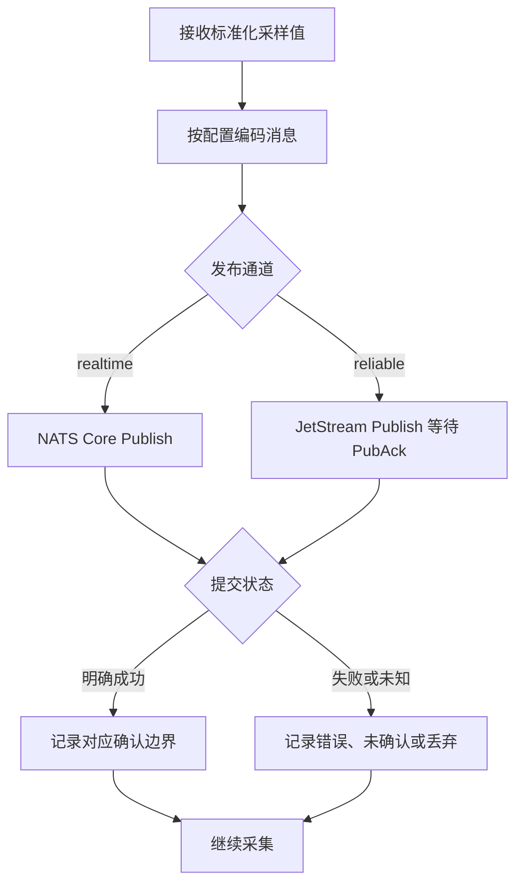

```{=html}
<p class="figure-caption">
```
图 3-4 采样数据发布业务流程
```{=html}
</p>
```
### 3.5.3 业务规则

```{=html}
<p class="table-caption">
```
表 3-18 UR-04 业务规则与功能要求
```{=html}
</p>
```
  -------------------------------------------------------------------------------------------------------------
  编号                                要求
  ----------------------------------- -------------------------------------------------------------------------
  R-01                                Collector 只发布原始测点样本，不承担 Delivery 选择、重采样、TDengine
                                      写入或其他 Sink 业务。

  R-02                                realtime 通过 NATS Core Publish；本机提交成功不代表订阅方已接收。

  R-03                                reliable 通过 JetStream Publish 并以 PubAck 作为 Collector
                                      可证实的交付边界；不代表 Sink 入库。

  R-04                                NATS 不可用、超时、缓冲容量不足时按明确策略失败或丢弃并计数；首版无
                                      Collector 本地磁盘补发队列。

  R-05                                样本与独立 Metrics 采用各自 Subject；发布通道故障不得无限积压或阻塞 PLC
                                      采集。

  R-06                                发送内容必须包含源批次身份和各测点身份、值、质量及时间，不跨采样事件合并。
  -------------------------------------------------------------------------------------------------------------

### 3.5.4 关键约束

```{=html}
<p class="table-caption">
```
表 3-19 UR-04 非功能约束
```{=html}
</p>
```
  ----------------------------------------------------------------------------------------------------------------
  类别                                约束要求
  ----------------------------------- ----------------------------------------------------------------------------
  性能与资源                          记录成功、失败、未确认、丢弃及发布延时；发布缓冲和重连任务有明确容量边界。

  可靠性与安全                        操作超时不等于底层 I/O 已结束；涉及协议资源的恢复遵守
                                      §6.8。服务配置及诊断证据不得泄露认证秘密。
  ----------------------------------------------------------------------------------------------------------------

```{=html}
<p class="table-caption">
```
表 3-20 UR-04 故障及处理
```{=html}
</p>
```
  ----------------------------------------------------------------------------------------------
  故障                                处理要求
  ----------------------------------- ----------------------------------------------------------
  不合法输入或依赖故障                PubAck 超时是未确认而非确定未投递；不得声称 Collector
                                      能保证端到端历史数据零丢失。

  超时、取消或状态未知                仅在涉及在途协议 I/O
                                      或配置事务时保留原操作的安全所有权；结果不确定时必须报告
                                      UNKNOWN，且不得宣称成功。
  ----------------------------------------------------------------------------------------------

## 3.6 UR-05 gRPC 服务接口实现

### 3.6.1 基本信息与触发方式

```{=html}
<p class="table-caption">
```
表 3-22 UR-05 基本信息
```{=html}
</p>
```
  字段                    内容
  ----------------------- ----------------------------------------
  请求方（Requester）     CLI、授权服务客户端
  触发方式（Trigger）     API 触发（外部客户端调用 RPC）
  输入（Input）           `contracts/` 中 Collector 所属 Request
  反馈（Response）        Proto 规定的响应、业务状态及 gRPC 错误
  目标方（Destination）   Collector Application
  业务输出（Output）      调用本服务已定义业务能力

### 3.6.2 业务流程

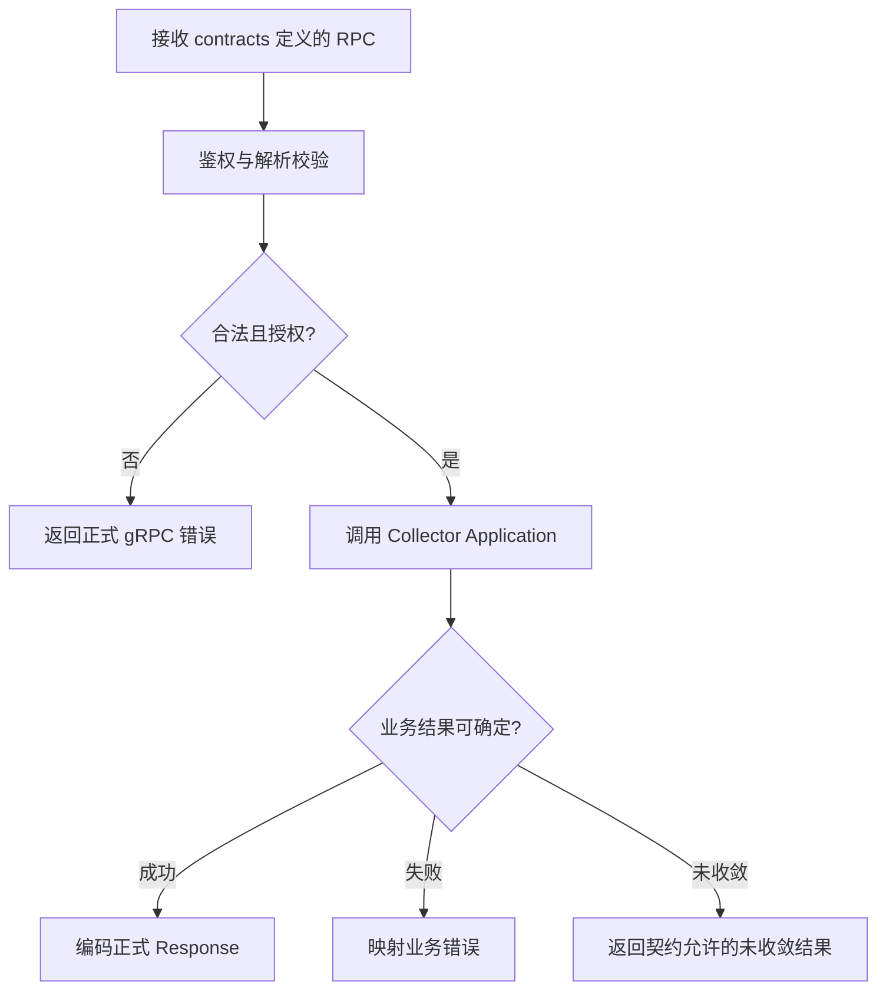

```{=html}
<p class="figure-caption">
```
图 3-5 gRPC 服务接口实现业务流程
```{=html}
</p>
```
### 3.6.3 业务规则

```{=html}
<p class="table-caption">
```
表 3-23 UR-05 业务规则与功能要求
```{=html}
</p>
```
  --------------------------------------------------------------------------------------------------------------------
  编号                                要求
  ----------------------------------- --------------------------------------------------------------------------------
  R-01                                `contracts/` 的 Proto 是 Service、RPC、Request、Response
                                      与枚举的唯一权威来源；Collector 不自行定义、复制或修改 Proto。

  R-02                                按当前正式 Proto 及 Collector 实际职责实现必需 Server 方法，不预设固定的 RPC
                                      数量或旧接口名称。

  R-03                                传输适配层只做解码、权限、校验、应用调用和响应映射，不复制采集与配置业务规则。

  R-04                                gRPC 查询状态、点表、Metrics 时不得隐式触发设备读操作；`ReadPoints`
                                      是明确的主动设备读取，`InterrogateDevice` 是 IEC104 主动总召，须按正式 Proto
                                      执行。

  R-05                                期限、取消或断开不能简单解释为已受理的写配置/启停操作被撤销。

  R-06                                不支持的 RPC 或 Proto 与需求冲突时记录契约
                                      GAP，由契约所有方收敛，不提供私有替代协议。
  --------------------------------------------------------------------------------------------------------------------

### 3.6.4 关键约束

```{=html}
<p class="table-caption">
```
表 3-24 UR-05 非功能约束
```{=html}
</p>
```
  ------------------------------------------------------------------------------------------------------------------
  类别                                约束要求
  ----------------------------------- ------------------------------------------------------------------------------
  性能与资源                          按统一安全策略执行认证授权、请求规模上限和错误映射，保证查询并发不阻塞采样。

  可靠性与安全                        操作超时不等于底层 I/O 已结束；涉及协议资源的恢复遵守
                                      §6.8。服务配置及诊断证据不得泄露认证秘密。
  ------------------------------------------------------------------------------------------------------------------

```{=html}
<p class="table-caption">
```
表 3-25 UR-05 故障及处理
```{=html}
</p>
```
  ------------------------------------------------------------------------------------------------------------------------
  故障                                处理要求
  ----------------------------------- ------------------------------------------------------------------------------------
  不合法输入或依赖故障                非法参数、越权、截止时间或服务关闭时提供可信状态；不虚报已持久化、已启停或已发布。

  超时、取消或状态未知                仅在涉及在途协议 I/O 或配置事务时保留原操作的安全所有权；结果不确定时必须报告
                                      UNKNOWN，且不得宣称成功。
  ------------------------------------------------------------------------------------------------------------------------

## 3.7 UR-06 配置快照管理

### 3.7.1 基本信息与触发方式

```{=html}
<p class="table-caption">
```
表 3-27 UR-06 基本信息
```{=html}
</p>
```
  ------------------------------------------------------------------------------------------
  字段                                内容
  ----------------------------------- ------------------------------------------------------
  请求方（Requester）                 CLI、授权配置管理客户端

  触发方式（Trigger）                 API
                                      触发（Get/Push/Apply）、生命周期触发（启动配置恢复）

  输入（Input）                       Get 请求、完整候选快照、Apply 请求及版本信息

  反馈（Response）                    候选校验结果、文件提交状态、设备级生效和待重启状态

  目标方（Destination）               Collector 配置与设备运行时

  业务输出（Output）                  安全提交配置文件，增量更新受影响设备
  ------------------------------------------------------------------------------------------

### 3.7.2 业务流程

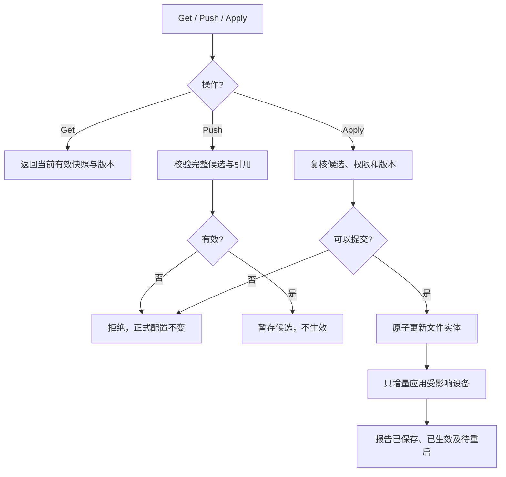

```{=html}
<p class="figure-caption">
```
图 3-6 配置快照管理业务流程
```{=html}
</p>
```
### 3.7.3 业务规则

```{=html}
<p class="table-caption">
```
表 3-28 UR-06 业务规则与功能要求
```{=html}
</p>
```
  ------------------------------------------------------------------------------------------------------------------------------
  编号                                要求
  ----------------------------------- ------------------------------------------------------------------------------------------
  R-01                                提供 Get/Push/Apply 快照行为；Push
                                      接收完整候选并完成校验，但不改变磁盘正式配置和运行配置。

  R-02                                Get 返回可辨认的正式/实际生效快照与版本；CLI 本地执行 diff，无需 Collector 单列差异 RPC。

  R-03                                Apply 重新核对候选身份、版本、模板精确引用，原子替换对应文件实体并按差异局部应用。

  R-04                                Service `collector.yaml` 的变化仅保存并报告 RESTART_REQUIRED，当前进程继续运行旧值。

  R-05                                Instance 配置或切换被引用模板版本后，仅更新实际受影响设备；已发布模板版本不可就地改写。

  R-06                                Apply 与 Start/Stop/Watchdog 共享设备级同步，保证 STOP 不复活、无旧句柄重新注册。

  R-07                                候选、磁盘正式版本、内存实际版本及各设备应用状态应独立报告，不能把部分成功说成全部成功。

  R-08                                Service 以三个必填字符串直接指定 site/devices Instance 文件和 Template 根目录；Device.model 仅保留精确 ID/版本；不得读取默认文件或额外的路径字段。

  R-09                                启动、Get/Push/Apply、崩溃恢复均按同一引用图解析；路径变更须整体校验，Service 引用变更只在重启后切换有效来源。
  ------------------------------------------------------------------------------------------------------------------------------

### 3.7.4 关键约束

```{=html}
<p class="table-caption">
```
表 3-29 UR-06 非功能约束
```{=html}
</p>
```
  ------------------------------------------------------------------------------------
  类别                                约束要求
  ----------------------------------- ------------------------------------------------
  性能与资源                          配置事务须防并发版本覆盖；候选数量、体积与 TTL
                                      有界；敏感配置脱敏；所有必需路径非空、可解析、受控，不允许缺省路径、路径穿越或符号链接逃逸。

  可靠性与安全                        操作超时不等于底层 I/O
                                      已结束；涉及协议资源的恢复遵守
                                      §6.8。服务配置及诊断证据不得泄露认证秘密。
  ------------------------------------------------------------------------------------

```{=html}
<p class="table-caption">
```
表 3-30 UR-06 故障及处理
```{=html}
</p>
```
  --------------------------------------------------------------------------------------------------------------------------------
  故障                                处理要求
  ----------------------------------- --------------------------------------------------------------------------------------------
  不合法输入或依赖故障                候选过期或冲突拒绝；写盘失败不动现有有效配置；局部应用失败保留目标版本与逐设备待收敛证据。

  超时、取消或状态未知                仅在涉及在途协议 I/O 或配置事务时保留原操作的安全所有权；结果不确定时必须报告
                                      UNKNOWN，且不得宣称成功。
  --------------------------------------------------------------------------------------------------------------------------------

## 3.8 UR-07 数据通路诊断

### 3.8.1 基本信息与触发方式

```{=html}
<p class="table-caption">
```
表 3-32 UR-07 基本信息
```{=html}
</p>
```
  字段                    内容
  ----------------------- ------------------------------------------
  请求方（Requester）     CLI、授权诊断客户端
  触发方式（Trigger）     API 触发（Diagnose）
  输入（Input）           设备、测点、范围及检查期限
  反馈（Response）        分阶段检查证据、耗时、故障点与未验证边界
  目标方（Destination）   现场设备、NATS 与选定的受控测试目标
  业务输出（Output）      必要的只读网络/协议探测与授权诊断发布

### 3.8.2 业务流程

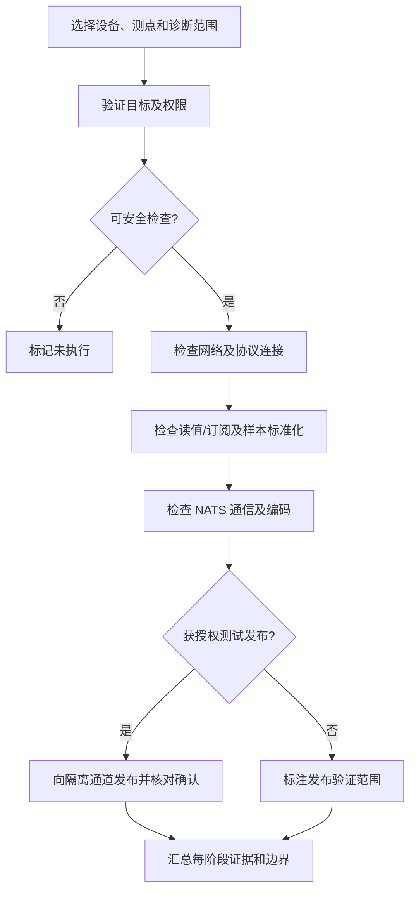

```{=html}
<p class="figure-caption">
```
图 3-7 数据通路诊断业务流程
```{=html}
</p>
```
### 3.8.3 业务规则

```{=html}
<p class="table-caption">
```
表 3-33 UR-07 业务规则与功能要求
```{=html}
</p>
```
  --------------------------------------------------------------------------------------------------
  编号                                要求
  ----------------------------------- --------------------------------------------------------------
  R-01                                从设备端点到 Collector
                                      的网络、端口、协议会话、测点读/订阅/监听、标准化、消息编码及
                                      NATS 发布分段检查。

  R-02                                检查网络连通不等于协议交互成功；协议成功不等于 NATS
                                      发布成功；NATS 提交不等于 Sink 入库。

  R-03                                诊断默认只读且不改变 Task
                                      期望状态；主动诊断消息只能发送到授权隔离 Subject/目标。

  R-04                                可明确区分 TCP/ADS/IEC104/Modbus
                                      连接故障、协议读错误、点表问题、NATS 连接与发布确认失败。

  R-05                                结果逐阶段标记 PASS/FAIL/NOT_RUN/UNKNOWN
                                      及耗时；汇总仅反映实际执行范围。

  R-06                                诊断具体 gRPC 入口依赖正式 `contracts/` Proto，不在 Collector
                                      内新增自定义方法。
  --------------------------------------------------------------------------------------------------

### 3.8.4 关键约束

```{=html}
<p class="table-caption">
```
表 3-34 UR-07 非功能约束
```{=html}
</p>
```
  ----------------------------------------------------------------------------------------------------------
  类别                                约束要求
  ----------------------------------- ----------------------------------------------------------------------
  性能与资源                          各阶段有期限、并发与资源限制；运行中诊断不得抢占核心采集或泄露凭据。

  可靠性与安全                        操作超时不等于底层 I/O 已结束；涉及协议资源的恢复遵守
                                      §6.8。服务配置及诊断证据不得泄露认证秘密。
  ----------------------------------------------------------------------------------------------------------

```{=html}
<p class="table-caption">
```
表 3-35 UR-07 故障及处理
```{=html}
</p>
```
  ----------------------------------------------------------------------------------------------
  故障                                处理要求
  ----------------------------------- ----------------------------------------------------------
  不合法输入或依赖故障                设备不可达、无法安全验证 NATS 到 Sink
                                      或权限不足时明确未验证，不假称全链路 PASS。

  超时、取消或状态未知                仅在涉及在途协议 I/O
                                      或配置事务时保留原操作的安全所有权；结果不确定时必须报告
                                      UNKNOWN，且不得宣称成功。
  ----------------------------------------------------------------------------------------------

## 3.9 UR-08 运行指标监控

### 3.9.1 基本信息与触发方式

```{=html}
<p class="table-caption">
```
表 3-37 UR-08 基本信息
```{=html}
</p>
```
  --------------------------------------------------------------------------------
  字段                                内容
  ----------------------------------- --------------------------------------------
  请求方（Requester）                 CLI、外部监控客户端

  触发方式（Trigger）                 周期触发（窗口统计与指标发布）、API
                                      触发（GetMetrics/GetEvents）

  输入（Input）                       设备、任务、指标名和统计窗口

  反馈（Response）                    当前指标、窗口范围、单位、有效性及近期事件

  目标方（Destination）               不适用

  业务输出（Output）                  不适用；通过正式 RPC 返回指标
  --------------------------------------------------------------------------------

### 3.9.2 业务流程

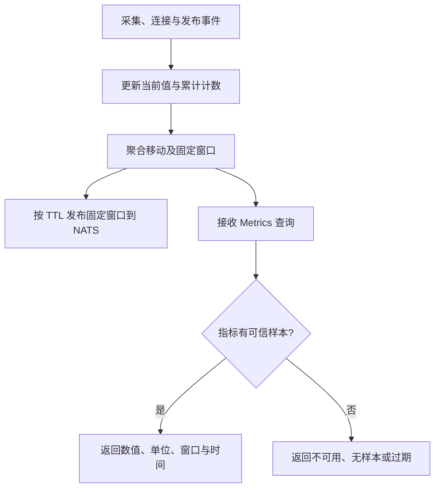

```{=html}
<p class="figure-caption">
```
图 3-8 运行指标监控业务流程
```{=html}
</p>
```
### 3.9.3 业务规则

```{=html}
<p class="table-caption">
```
表 3-38 UR-08 业务规则与功能要求
```{=html}
</p>
```
  ----------------------------------------------------------------------------------------------------------------
  编号                                要求
  ----------------------------------- ----------------------------------------------------------------------------
  R-01                                统计设备连接、断开、重连、采集执行、点完整率、轮询漏采、质量、新鲜度、NATS
                                      发布及资源使用。

  R-02                                在线状态与进程累计值保存在内存；提供配置长度的移动窗口；固定窗口快照按独立
                                      NATS Subject 发布。

  R-03                                固定窗口以 UTC 边界定义，发布分子分母与增量，不能让 Sink
                                      对窗口百分率直接取平均。

  R-04                                POLL 有计划周期；SUBSCRIBE/LISTEN 不虚构固定采集计划数。

  R-05                                统计发布失败仅有限内存缓冲，按 TTL 清理；进程重启不得宣称窗口历史连续。

  R-06                                Metrics 查询只读已存在快照，不主动读 PLC、启停任务或触发诊断。

  R-07                                每个指标明确单位、维度、分子、分母、时间和无效条件；无样本需显式无效。
  ----------------------------------------------------------------------------------------------------------------

### 3.9.4 关键约束

```{=html}
<p class="table-caption">
```
表 3-39 UR-08 非功能约束
```{=html}
</p>
```
  --------------------------------------------------------------------------------------------------------------------
  类别                                约束要求
  ----------------------------------- --------------------------------------------------------------------------------
  性能与资源                          窗口数、事件容量、标签维度、待发量与查询并发有界；指标处理不得阻塞采样主路径。

  可靠性与安全                        操作超时不等于底层 I/O 已结束；涉及协议资源的恢复遵守
                                      §6.8。服务配置及诊断证据不得泄露认证秘密。
  --------------------------------------------------------------------------------------------------------------------

```{=html}
<p class="table-caption">
```
表 3-40 UR-08 故障及处理
```{=html}
</p>
```
  ----------------------------------------------------------------------------------------------
  故障                                处理要求
  ----------------------------------- ----------------------------------------------------------
  不合法输入或依赖故障                统计窗口空、资源无法采样、NATS
                                      不可用、进程重启分别报告无效或缺口，不用零值冒充。

  超时、取消或状态未知                仅在涉及在途协议 I/O
                                      或配置事务时保留原操作的安全所有权；结果不确定时必须报告
                                      UNKNOWN，且不得宣称成功。
  ----------------------------------------------------------------------------------------------

#### 跨需求边界与具体场景补充

第 3
章全部请求均以外部进程、CLI、管理端或实际数据源为交互方；Watchdog、采集协程、NATS
发布器是内部支撑行为，不虚构为独立请求方。外部现场设备作为数据来源（或响应方），NATS
作为业务输出目标，用户业务反馈与 NATS 业务输出不可混用。`ReadPoints` 和
`InterrogateDevice` 已明确属于 UR-03
的主动采集能力；主动协议操作与后台运行意图分离。连接恢复受第 6 章 I/O
安全准入约束，发布部分成功遵守第 10
章逐点语义，配置文件提交与对象生效遵守第 11
章分离裁决。所有这些分支必须进入第 4、14 章场景追溯。

## 3.10 全局定量约束与验收边界

本节关闭 UR-01～08
中"有界、及时、合理"等不可验收表述。未特别说明时，时间单位均为秒；配置默认值取自最新
`configs/services/collector.yaml`，容量型候选约束由本设计冻结。

```{=html}
<p class="table-caption">
```
表 3-41 Collector 定量约束基线
```{=html}
</p>
```
  --------------------------------------------------------------------------------------------------------------
  对象                                 默认值 / 上限 边界与验收条件
  --------------------- ---------------------------- -----------------------------------------------------------
  设备连接超时                                  10 s 单设备连接超过期限返回超时；不得阻塞其他设备

  单次协议读取超时                               5 s 调用方可先返回超时，但底层 I/O 未安全结束前资源所有权不释放

  Watchdog 周期                                  5 s 仅检查并恢复 `desired_state=START` 的设备

  健康检查超时                                   1 s 超时记本次健康检查失败，不直接证明底层连接已安全关闭

  正常关闭期限                                  30 s 超期必须报告未收敛资源；不得宣称全部安全释放

  阻塞 I/O 线程池                         32 workers 不允许无界创建线程；耗尽时排队/背压，不在事件循环执行阻塞
                                                     I/O

  Realtime 最大新鲜度                         500 ms 超过该新鲜度的 realtime
                                                     样本按发布策略丢弃并计数，不补发历史

  Metrics 窗口                     60 / 300 / 3600 s 仅按已完成窗口或明确查询窗口统计

  Metrics 发布周期                              60 s 发布失败不得阻塞采集

  Metrics 最大滞留                             300 s 从窗口结束时刻起计算，超期待发快照丢弃并计数

  事件容量                                   1000 条 满后淘汰最旧事件并增加淘汰计数

  Metrics 待发容量                            120 条 满后淘汰最旧待发统计消息，不允许无界增长

  候选快照                8 个 / 16 MiB / 256 文件 / 任一上限超出即拒绝 Push；过期候选不可 Apply
                                          3600 s TTL 

  设备运行实例                           每设备 1 个 任一时刻最多一个采集句柄；旧 I/O
                                                     未安全结束或隔离前禁止创建冲突句柄
  --------------------------------------------------------------------------------------------------------------

POLL 调度采用 fixed-rate、不重入。设窗口内计划执行次数为
$N_{\\mathrm{plan}}$，实际开始执行次数为
$N_{\\mathrm{start}}$，因前一次执行未结束而跳过的计划时隙数为
$N_{\\mathrm{skip}}$，则必须满足：

$$
N_{\\mathrm{plan}} = N_{\\mathrm{start}} + N_{\\mathrm{skip}}
$$

```{=html}
<p class="formula-caption">
```
式（3-1）POLL 计划时隙守恒
```{=html}
</p>
```
漏采率只对 POLL 定义：

$$
r_{\\mathrm{miss}} =
\\begin{cases}
\\dfrac{N_{\\mathrm{skip}}}{N_{\\mathrm{plan}}}, & N_{\\mathrm{plan}} > 0 \\\\
\\text{undefined}, & N_{\\mathrm{plan}} = 0
\\end{cases}
$$

```{=html}
<p class="formula-caption">
```
式（3-2）POLL 漏采率
```{=html}
</p>
```
SUBSCRIBE/LISTEN 没有计划周期，不计算 $N_{\\mathrm{plan}}$ 和
$r_{\\mathrm{miss}}$，避免制造伪指标。上述默认值可通过后续受控配置版本调整；调整时必须同步修改需求约束、配置
Schema、测试边界和验收基线。

# 4. 用例视图

## 4.1 系统上下文

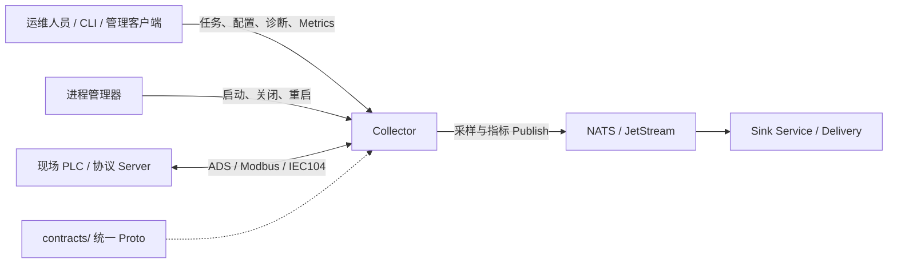

```{=html}
<p class="figure-caption">
```
图 4-1 Collector 系统上下文图
```{=html}
</p>
```
`UC-xx-S01` 表示主流程，`S02` 表示关键边界，`S03`
表示异常或恢复。并列检查对象须分别参数化执行。System Test
的依据是本章完整场景而非一个 RPC 名称。

```{=html}
<p class="table-caption">
```
表 4-1 用例与需求追溯
```{=html}
</p>
```
  用例    完整业务目标                       关联需求
  ------- ---------------------------------- ----------------------------
  UC-01   连接现场设备并保持会话可用         UR-01、UR-02
  UC-02   启动、停止设备采集并维持运行意图   UR-02、UR-03
  UC-03   从现场完整采样并发布 NATS          UR-03、UR-04
  UC-04   获取、推送并应用配置快照           UR-01、UR-02、UR-06
  UC-05   诊断设备到 NATS 的实际链路         UR-03、UR-04、UR-07
  UC-06   查看采集与发布指标                 UR-08
  UC-07   通过正式 gRPC 管理和查询服务       UR-05、UR-06、UR-07、UR-08
  UC-08   启动、关闭、重启与故障恢复服务     UR-01、UR-02、UR-03、UR-04

## 4.2 用例---需求总表

本表与 §4.1 的用例关联一致；不按编号强行建立 UR 与 UC 一一映射。

  需求    对应用例                     覆盖场景
  ------- ---------------------------- ------------------------------
  UR-01   UC-01、UC-04、UC-08          连接、配置、服务恢复及异常
  UR-02   UC-01、UC-02、UC-04、UC-08   启停、持久化、配置应用及恢复
  UR-03   UC-02、UC-03、UC-05、UC-08   采集、主动读取、诊断与恢复
  UR-04   UC-03、UC-05、UC-08          发布、链路诊断与重启恢复
  UR-05   UC-07                        正式 RPC 主流程、边界、异常
  UR-06   UC-04、UC-07                 快照生命周期与接口行为
  UR-07   UC-05、UC-07                 数据通路诊断与接口行为
  UR-08   UC-06、UC-07                 指标查询与接口行为

每项 UC 的 S01、S02、S03 参见本章用例表；相应测试追溯统一见 §14.5.2。

## 4.3 UC-01 连接现场设备并保持会话可用

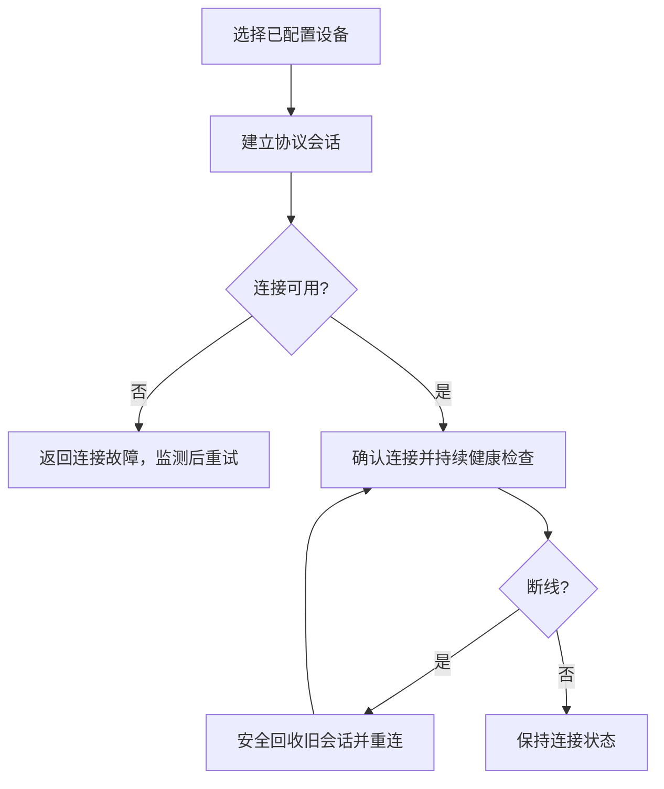

```{=html}
<p class="figure-caption">
```
图 4-2 UC-01 业务活动图
```{=html}
</p>
```
```{=html}
<p class="table-caption">
```
表 4-2 UC-01 用例说明与规定场景
```{=html}
</p>
```
  要素                   内容
  ---------------------- ----------------------------------------------------
  参与者                 运维人员、进程管理器、现场设备
  业务目标               设备建立协议会话并可监测健康
  前置条件               设备配置有效，服务已就绪
  主要异常               设备配置缺失；连接超时；协议握手失败；健康检查失败
  后置条件               连接状态真实可查询；其他设备不受单台故障影响
  关联需求               UR-01、UR-02
  UC-01-S01 主流程       ADS、Modbus TCP、IEC104 分别连接与检查
  UC-01-S02 关键边界     禁用设备、地址错误、重复连接请求
  UC-01-S03 异常与恢复   断线、连接超时、Watchdog 重连及恢复隔离

## 4.4 UC-02 启动、停止设备采集并维持运行意图

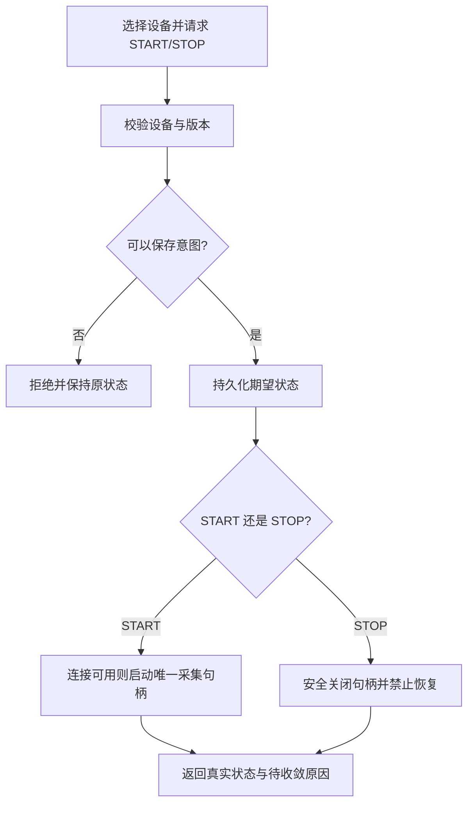

```{=html}
<p class="figure-caption">
```
图 4-3 UC-02 业务活动图
```{=html}
</p>
```
```{=html}
<p class="table-caption">
```
表 4-3 UC-02 用例说明与规定场景
```{=html}
</p>
```
  ------------------------------------------------------------------------
  要素                                内容
  ----------------------------------- ------------------------------------
  参与者                              CLI、授权客户端

  业务目标                            目标设备按 START/STOP
                                      收敛，重启/断线不篡改意图

  前置条件                            设备存在、配置版本有效

  主要异常                            版本冲突；存储失败；断线；并发启停

  后置条件                            返回持久化及实际状态；STOP
                                      重启不复活

  关联需求                            UR-02、UR-03

  UC-02-S01 主流程                    START 持续采样，STOP 安全停采

  UC-02-S02 关键边界                  重复启停、START 断线、同设备互斥

  UC-02-S03 异常与恢复                手动 STOP 与 Watchdog/Reload
                                      交叉、关闭中 I/O 未结束
  ------------------------------------------------------------------------

## 4.5 UC-03 从现场完整采样并发布 NATS

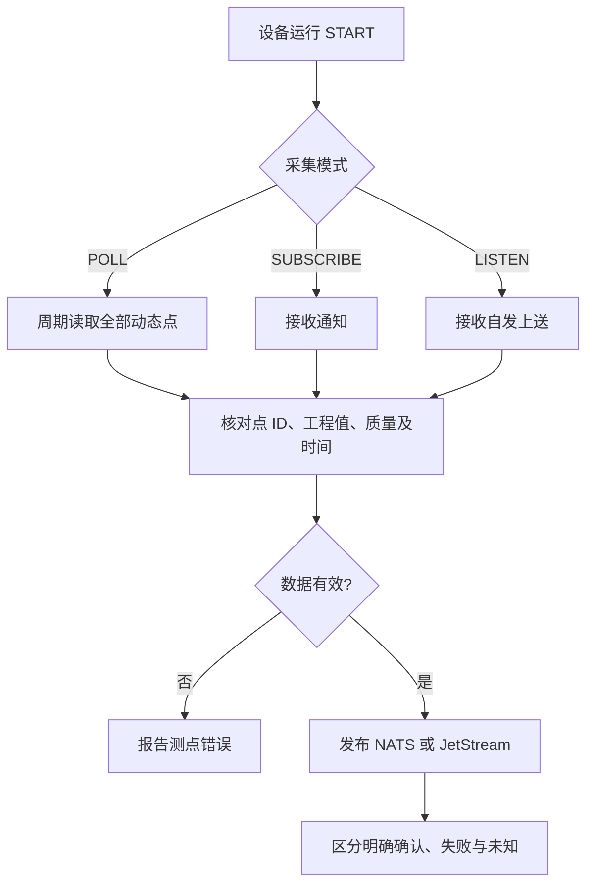

```{=html}
<p class="figure-caption">
```
图 4-4 UC-03 业务活动图
```{=html}
</p>
```
```{=html}
<p class="table-caption">
```
表 4-4 UC-03 用例说明与规定场景
```{=html}
</p>
```
  ----------------------------------------------------------------------------------
  要素                                内容
  ----------------------------------- ----------------------------------------------
  参与者                              运维人员、现场设备、NATS

  业务目标                            动态样本连同时间/质量与点身份进入配置的 NATS
                                      通道

  前置条件                            采集任务 START，设备及点表生效

  主要异常                            单点错误、超期轮询、订阅失效、NATS 故障

  后置条件                            采样与交付边界分开计数；无 Sink 入库保证

  关联需求                            UR-03、UR-04

  UC-03-S01 主流程                    POLL、SUBSCRIBE、LISTEN 的真实采集与发布

  UC-03-S02 关键边界                  点表部分错误、采样重排、调度超期；ReadPoints
                                      主动读点、IEC104 总召及缺失点

  UC-03-S03 异常与恢复                设备故障、重连、NATS 断开及恢复、发布未确认
  ----------------------------------------------------------------------------------

## 4.6 UC-04 获取、推送并应用配置快照

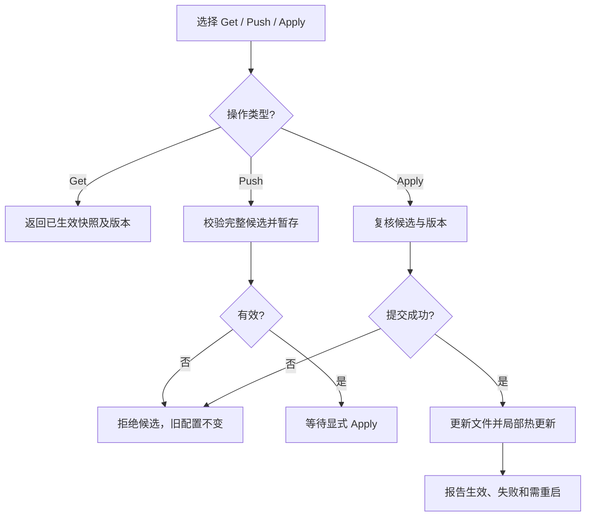

```{=html}
<p class="figure-caption">
```
图 4-5 UC-04 业务活动图
```{=html}
</p>
```
```{=html}
<p class="table-caption">
```
表 4-5 UC-04 用例说明与规定场景
```{=html}
</p>
```
  --------------------------------------------------------------------------------------
  要素                                内容
  ----------------------------------- --------------------------------------------------
  参与者                              CLI、授权运维客户端

  业务目标                            Get/Push/Apply 保持候选与正式配置隔离

  前置条件                            服务 gRPC 端口可达且有配置权限

  主要异常                            Schema 错误、候选过期、版本冲突、局部生效失败

  后置条件                            服务级待重启，设备级最小影响热更，文件状态可查询

  关联需求                            UR-01、UR-02、UR-06

  UC-04-S01 主流程                    Get、Push 校验且不生效、Apply 持久化与增量生效

  UC-04-S02 关键边界                  重复推送、版本冲突、路径缺失或逃逸、模板精确版本、Service 待重启

  UC-04-S03 异常与恢复                路径引用目标丢失、落盘失败、部分设备应用失败、断连后状态查询
  --------------------------------------------------------------------------------------

## 4.7 UC-05 诊断设备到 NATS 的实际链路

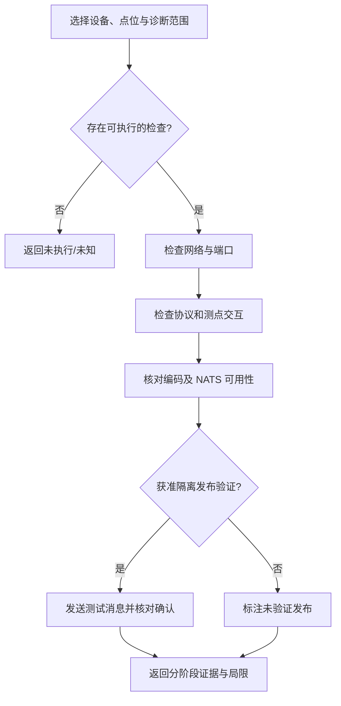

```{=html}
<p class="figure-caption">
```
图 4-6 UC-05 业务活动图
```{=html}
</p>
```
```{=html}
<p class="table-caption">
```
表 4-6 UC-05 用例说明与规定场景
```{=html}
</p>
```
  要素                   内容
  ---------------------- ----------------------------------------------
  参与者                 CLI、授权诊断客户端
  业务目标               定位网络、协议、采样、编码与发布的失败阶段
  前置条件               诊断范围与目标已指定
  主要异常               设备不可达；无诊断点；未授权发布；NATS 超时
  后置条件               返回实际检查、未检查及最终可证实结论
  关联需求               UR-03、UR-04、UR-07
  UC-05-S01 主流程       逐段网络、协议、采样、NATS 检查
  UC-05-S02 关键边界     安全只读、隔离 Subject、下游入库不在验证范围
  UC-05-S03 异常与恢复   空诊断计划、超时取消、协议异常与发布错误

## 4.8 UC-06 查看采集与发布指标

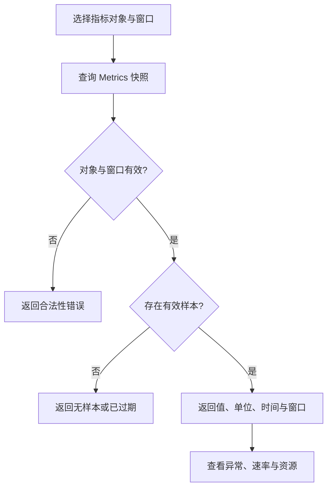

```{=html}
<p class="figure-caption">
```
图 4-7 UC-06 业务活动图
```{=html}
</p>
```
```{=html}
<p class="table-caption">
```
表 4-7 UC-06 用例说明与规定场景
```{=html}
</p>
```
  要素                   内容
  ---------------------- --------------------------------------------
  参与者                 运维人员、授权监控客户端
  业务目标               检查设备、任务、质量、调度、发布及资源状况
  前置条件               运行统计接口可用
  主要异常               空窗口、指标过期、标签超限、重启
  后置条件               返回可信数据与不可用标志，不触发 PLC 读
  关联需求               UR-08
  UC-06-S01 主流程       当前状态、累计和移动窗口指标查询
  UC-06-S02 关键边界     空窗口、计数分子分母、维度容量
  UC-06-S03 异常与恢复   采集失败、NATS 故障、统计重置与资源限制

## 4.9 UC-07 通过正式 gRPC 管理和查询服务

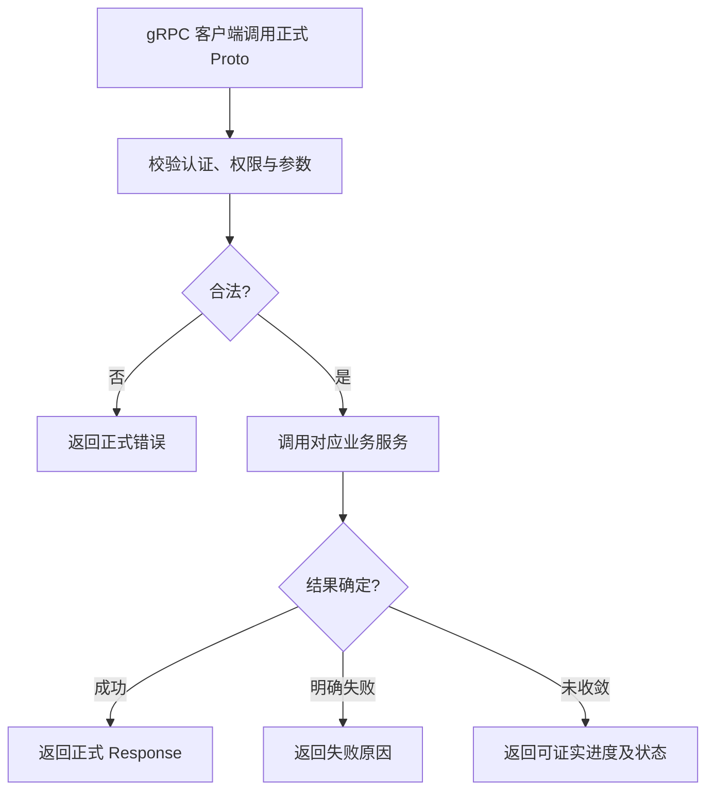

```{=html}
<p class="figure-caption">
```
图 4-8 UC-07 业务活动图
```{=html}
</p>
```
```{=html}
<p class="table-caption">
```
表 4-8 UC-07 用例说明与规定场景
```{=html}
</p>
```
  --------------------------------------------------------------------------
  要素                                内容
  ----------------------------------- --------------------------------------
  参与者                              CLI、授权 gRPC 客户端

  业务目标                            通过 contracts 正式接口获得可信结果

  前置条件                            Server 启动、Proto 与安全凭据有效

  主要异常                            认证失败、非法输入、不支持
                                      RPC、超时取消

  后置条件                            成功、明确失败与未收敛状态可区分

  关联需求                            UR-05、UR-06、UR-07、UR-08

  UC-07-S01 主流程                    CommonService 9 + CollectorService 11
                                      分别调用及真实结果返回

  UC-07-S02 关键边界                  认证授权、参数、分页、optional/oneof
                                      与并发限制

  UC-07-S03 异常与恢复                期限取消、业务未收敛、服务关闭
  --------------------------------------------------------------------------

## 4.10 UC-08 启动、关闭、重启与故障恢复服务

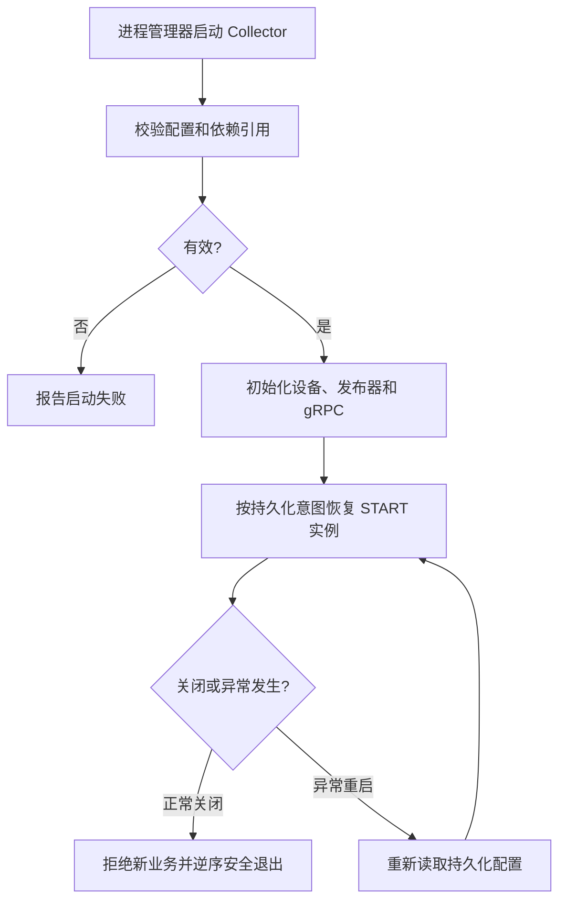

```{=html}
<p class="figure-caption">
```
图 4-9 UC-08 业务活动图
```{=html}
</p>
```
```{=html}
<p class="table-caption">
```
表 4-9 UC-08 用例说明与规定场景
```{=html}
</p>
```
  -----------------------------------------------------------------------------------
  要素                                内容
  ----------------------------------- -----------------------------------------------
  参与者                              进程管理器、运维人员

  业务目标                            服务可用且停机释放资源，重启按期望状态恢复

  前置条件                            有效
                                      Service/Instance/Template，必要依赖配置可解析

  主要异常                            配置无效、设备掉线、NATS 故障、阻塞底层 I/O

  后置条件                            就绪状态真实，STOP 不复活，退出安全且不虚报完成

  关联需求                            UR-01、UR-02、UR-03、UR-04

  UC-08-S01 主流程                    正常启动、按 START 初始化、关闭释放资源

  UC-08-S02 关键边界                  设备部分失败、启动/停止重叠、配置待重启

  UC-08-S03 异常与恢复                进程异常退出重启、设备恢复、NATS 恢复、未结束
                                      I/O
  -----------------------------------------------------------------------------------

## 4.11 用例与 System Test 追溯基线

所有 UC-01～UC-08 及 S01/S02/S03 必须在第 14 章映射到可执行用例；ADS
实体设备不可用时明确 NOT_RUN。

# 5. 逻辑视图

本视图回答**系统有哪些逻辑对象、各自负责什么、如何协作**；不描述物理部署、进程线程或源码目录。

## 5.1 核心组件

```{=html}
<p class="figure-caption">
```
图 5-1 Collector 核心组件协作
```{=html}
</p>
```
``` mermaid
%%{init: {"flowchart": {"useMaxWidth": true}}}%%
flowchart TB
  G["gRPC 控制接口"] --> R["CollectorRuntime"]
  G --> CFG["CollectorConfigService"]
  CFG --> R
  R --> D["DeviceRuntime<br/>连接状态与恢复"]
  R --> T["TaskRuntime<br/>实例与句柄"]
  T --> D
  D --> S["CollectorDeviceSession"]
  T --> E["AcquisitionEngine"]
  S --> E
  E --> P["SamplePublisher"]
  S --> DRV["ProtocolPort / Driver"]
  P --> NP["PublisherPort / NATS"]
```

`DeviceRuntime` 是连接及 Watchdog 的所有者；`TaskRuntime`
是实例、运行意图及采集句柄的所有者；`AcquisitionEngine`
统一处理数据；`CollectorRuntime` 只做总体协调。

## 5.2 对象关系与采集机制

```{=html}
<p class="figure-caption">
```
图 5-2 设备与采集对象关系（单设备单任务目标）
```{=html}
</p>
```
``` mermaid
%%{init: {"class": {"useMaxWidth": true}}}%%
classDiagram
  class Device {
    +device_id
    +endpoint
  }
  class CollectorDeviceSession {
    +connect()
    +read()
    +start_acquisition()
    +close()
  }
  class TaskDefinition {
    +task_id
    +point_group
  }
  class TaskInstance {
    +instance_id
    +device_id
    +state
  }
  class AcquisitionHandle {
    <<interface>>
    +close()
  }
  Device "1" --> "1" CollectorDeviceSession : 会话
  TaskTemplate "1" --> "0..*" TaskInstance : 复用
  Device "1" --> "1" TaskInstance : 唯一实例
  TaskInstance "1" --> "0..1" AcquisitionHandle : RUNNING 时持有
```

每个启用 Device 仅对应一个采集 Task Instance，多个设备可共享版本化
TaskTemplate；对应实例的 desired_state
由实例配置持久化。完整配置规定见第 11 章。

```{=html}
<p class="figure-caption">
```
图 5-3 三种采集机制与统一数据入口
```{=html}
</p>
```
``` mermaid
%%{init: {"flowchart": {"useMaxWidth": true}}}%%
flowchart LR
  POLL["POLL<br/>Modbus / ADS 轮询"] --> V["PointValue"]
  SUB["SUBSCRIBE<br/>ADS Notification"] --> V
  LISTEN["LISTEN<br/>IEC104 自发上送"] --> V
  V --> E["AcquisitionEngine"]
  E --> P["SamplePublisher"]
```

静态信息不进入采集链路。Delivery
的筛选、重采样与输出策略属于独立服务职责。

------------------------------------------------------------------------

## 5.3 状态模型与责任

设备意图 `START/STOP` 与运行状态 `RUNNING/FAULTED/ISOLATED/STOPPED`
分离；Watchdog 仅恢复意图为 START 的设备。未收敛协议 I/O
不得释放连接所有权。

## 5.4 核心逻辑协作

配置提交后按设备执行增量收敛；每台设备独立记录 `effective_revision`
和失败原因，整体状态不可掩盖部分失败。

# 6. 进程视图

本视图回答**进程如何通信、Collector
内部如何并发运行、运行时如何启动、关闭与故障恢复**。不限定主机、容器或物理网络拓扑。

## 6.1 进程通信

```{=html}
<p class="figure-caption">
```
图 6-1 独立进程与通信关系
```{=html}
</p>
```
``` mermaid
%%{init: {"flowchart": {"useMaxWidth": true}}}%%
flowchart LR
  EXT["外部应用程序进程"] <-->|gRPC| C["Collector 进程"]
  DEV["现场设备"] <-->|ADS / Modbus / IEC104| C
  C -->|NATS Publish| N["NATS Server / JetStream"]
  N -->|Subscribe| S["Sink Service 进程"]
  S -->|Delivery| OUT["下游系统"]
```

## 6.2 进程内并发模型与竞争控制

```{=html}
<p class="figure-caption">
```
图 6-2 进程内异步任务、线程及所有权
```{=html}
</p>
```
``` mermaid
%%{init: {"flowchart": {"useMaxWidth": true}}}%%
flowchart TB
  subgraph PROC["Collector 进程"]
    direction TB
    EV["asyncio Event Loop"]
    GRPC["gRPC 请求协程"]
    ACQ["任务实例轮询协程／订阅回调"]
    WATCH["每设备 Watchdog 协程"]
    RETRY["NATS 重连监督协程"]
    THREAD["共享阻塞 I/O 线程池"]
    EV --> GRPC & ACQ & WATCH & RETRY
    ACQ -.->|需要时 to_thread| THREAD
    WATCH -.->|需要时 to_thread| THREAD
  end
```

```{=html}
<p class="table-caption">
```
表 6-1 竞争场景及当前防护机制
```{=html}
</p>
```
  ----------------------------------------------------------------------------------------------------------------------------------
  并发风险                     防护及所有者                                               必须验证的结果
  ---------------------------- ---------------------------------------------------------- ------------------------------------------
  Collector 启动与关闭重叠     `CollectorRuntime._lifecycle_lock` 串行化                  启动中不被停机状态覆盖，失败执行逆序清理

  显式建连与 Watchdog 同时重连 `DeviceRuntime` 每设备连接锁；会话和 Driver                同一目标不发生并发重复建连
                               自有生命周期约束                                           

  同一实例 Start/Stop 交叉     `TaskRuntime._instance_guard` 每实例异步锁                 同实例最多一个句柄；停止不留下后台采集

  轮询慢于采样周期             `PollingAcquisitionHandle` 同实例串行                      不重入、不形成补采风暴
                               fixed-rate；超期跳过多余时隙                               

  热重载与连接/订阅恢复交叉    配置写入串行化；受影响设备加独立更新门闩，并与             无旧句柄残留；不触碰未受影响设备；STOP
                               Watchdog、Task 启停协调                                    不复活

  并发配置 Apply 与 Task 启停  写入携带                                                   无覆盖更新、丢失状态或重复启停
                               expected_version；全量校验并原子持久化；同设备序列化应用   

  多设备增量应用时单设备失败   每设备独立执行并记录 applied_version、错误与待收敛状态     不影响其他设备；可识别局部成功

  设备断线与正在读操作交叉     Driver 协议生命周期、Watchdog 恢复；采集前查询连接可用性   无重复恢复、失败分类正确

  取消任务与同步协议 I/O       协议 Driver 保有底层在途操作所有权；Collector 等待句柄退出 不将取消视作底层操作已经完成
  未完成                                                                                  

  NATS 故障和持续采集并发      Publisher 独立连接重试，发布失败计数并丢弃                 采集不中断，资源有界，无隐式持久缓存
  ----------------------------------------------------------------------------------------------------------------------------------

**注意：**
表中是当前代码的职责和应验证约束，并非所有竞争场景已经过实机压力验证；不能以
`asyncio.Lock` 的存在替代底层协议取消/关闭测试。

## 6.3 启动与关闭

```{=html}
<p class="figure-caption">
```
图 6-3 Collector 启动顺序
```{=html}
</p>
```
``` mermaid
%%{init: {"sequence": {"useMaxWidth": true}}}%%
sequenceDiagram
  participant M as main
  participant A as CollectorApp
  participant R as CollectorRuntime
  participant D as DeviceRuntime
  participant P as SamplePublisher
  participant T as TaskRuntime
  participant G as gRPC Server
  M->>M: --config 指定唯一 Service 文件（不接受隐式默认 Instance/Template）
  M->>M: 解析 Service → Instance 路径 → Template 根目录
  M->>M: 校验引用图、装配／日志／线程池／信号
  M->>A: start()
  opt ADS 已配置
    A->>A: initialize_local()
  end
  A->>R: start()
  R->>D: connect_all()
  D-->>R: best-effort 连接
  R->>P: open()
  Note over P: 后台连接 NATS；不等待可用
  R->>T: sync_instances()
  Note over T: 按持久化 desired_state 初始化
  opt 期望状态为 START
    T->>T: 启动全部期望 START 且连接可用的采集实例
  end
  R-->>A: 完成
  M->>G: start()
  M->>M: 等待退出信号
```

```{=html}
<p class="figure-caption">
```
图 6-4 Collector 优雅关闭顺序
```{=html}
</p>
```
``` mermaid
%%{init: {"sequence": {"useMaxWidth": true}}}%%
sequenceDiagram
  participant M as main
  participant G as gRPC Server
  participant A as CollectorApp
  participant R as CollectorRuntime
  participant T as TaskRuntime
  participant P as SamplePublisher
  participant D as DeviceRuntime
  M->>M: SIGINT / SIGTERM
  M->>G: stop()
  M->>A: stop()（入口硬超时）
  A->>R: stop()
  R->>T: stop_all()
  Note over T: 释放轮询与订阅句柄
  R->>P: close()
  Note over P: 停止重连／尝试 drain
  R->>D: close_all()
  Note over D: 关闭 Watchdog 和设备连接
  A->>A: ADSDriver.close_local()
```

组件关闭失败时继续尝试清理其他组件；入口默认硬超时 30
秒，超时不能保证全部资源释放。

## 6.4 故障恢复

```{=html}
<p class="figure-caption">
```
图 6-5 设备断线恢复与实例恢复
```{=html}
</p>
```
``` mermaid
%%{init: {"sequence": {"useMaxWidth": true}}}%%
sequenceDiagram
  participant W as Device Watchdog
  participant D as DeviceRuntime
  participant S as DeviceSession
  participant T as TaskRuntime
  W->>D: 检查连接健康状态
  alt 连接故障且允许重试
    D->>T: prepare_device_restore(device_id)
    Note over T: 释放失效句柄／保留运行意图
    D->>S: close()／connect()
    alt 连接成功
      D->>T: start_device_tasks(device_id)
      Note over T: 恢复全部期望状态 START 的 Task；STOP 不恢复
    else 连接失败
      D-->>W: 记录失败，后续重试
    end
  else 连接健康
    D-->>W: 保持运行
  end
```

## 6.5 Task 期望状态及持久化

废止 `auto_start`，只使用
**`desired_state: START | STOP`**。`TaskTemplate` 定义缺省状态，`Device`
实例的 `overrides.task.desired_state` 优先；外部 gRPC
手动启停**仅修改设备实例配置**，不修改共享模板。`desired_state`
是唯一的期望状态权威，实际状态对外采用 `Task.actual_state`
字符串（§9.3）；必须区分运行、已停、正在安全停止、故障隔离或未收敛，不能仅以
STOPPED 证明同步 I/O 已结束。

  ---------------------------------------------------------------------------------------------
  事件                                持久化及运行规则
  ----------------------------------- ---------------------------------------------------------
  第一次启动／进程重启                从完整有效配置解析每台设备的 `desired_state`；START
                                      尝试采集，STOP 保持停止

  手动 Start                          版本校验→原子持久化该 Device 的
                                      `desired_state=START`→启动或等待连接恢复

  手动 Stop                           版本校验→原子持久化该 Device 的
                                      `desired_state=STOP`→停止对应采集句柄；重连、重启不复活

  断线                                期望状态不变；实际不可采集、等待 Watchdog

  Watchdog 重连                       恢复该设备所有 `desired_state=START` 的 Task；STOP 不恢复

  运行时应用失败                      已保存的 desired_state 不回滚，向 gRPC 报告
                                      `APPLY_FAILED` 和设备级未收敛原因，重试收敛
  ---------------------------------------------------------------------------------------------

**持久化先于执行；持久化成功不等于操作收敛**，目的是防止 Stop
已生效但进程突然退出后重启又按旧 START
自动启动。若写入失败，不执行目标操作；若写入成功、实际操作失败，保留新期望状态并报告未收敛。并发手动操作须以
`OperationRequest.expected_revision` 防止丢失更新；`OperationRequest.id`
为 Task ID；不应为每次任务启停重写共享模板。

```{=html}
<p class="figure-caption">
```
图 6-6 Task 期望状态持久化及恢复
```{=html}
</p>
```
``` mermaid
%%{init: {"flowchart": {"useMaxWidth": true}}}%%
flowchart TD
  A["加载设备的有效 desired_state"] --> B{"START?"}
  B -->|否| C["STOP：不创建采集句柄"]
  B -->|是| D{"设备连接可用?"}
  D -->|是| E["创建句柄，实际 RUNNING"]
  D -->|否| F["实际 STOPPED，等待 Watchdog"]
  F --> G["Watchdog 重连成功"]
  G --> A
  E --> H["手动 Stop 请求"]
  H --> I["写入 devices.yaml 的 STOP"]
  I --> Q{"旧 I/O 已安全结束?"}
  Q -->|否| X["STOPPING / ISOLATED：保留底层所有权"]
  Q -->|是| C
  C --> J["手动 Start 请求"]
  J --> K["写入 devices.yaml 的 START"]
  K --> A
```

## 6.6 Watchdog：自动恢复机制

每个已启用 Device 有独立 `WatchdogUseCase`，由 `DeviceRuntime`
创建、启动和停止。Watchdog
执行周期健康检查及重连；普通数据读取路径**不主动发起重连**，避免故障期间连接风暴。

```{=html}
<p class="figure-caption">
```
图 6-7 Watchdog 故障恢复决策
```{=html}
</p>
```
``` mermaid
%%{init: {"flowchart": {"useMaxWidth": true}}}%%
flowchart TD
  A["周期检查设备健康"] --> B{"连接健康?"}
  B -->|是| C["保持当前会话"]
  B -->|否| D["按超时／重试条件恢复"]
  D --> E["隔离新操作，跟踪在途 I/O"]
  E --> Q{"I/O 安全收敛或可信隔离?"}
  Q -->|否| Z["ISOLATED：等待安全条件或运维"]
  Q -->|是| F["关闭失效连接并重新连接"]
  F --> G{"连接成功?"}
  G -->|否| H["记录故障／下周期再尝试"]
  G -->|是| I["恢复全部期望状态 START 的 Task"]
  I --> J["恢复采集"]
```

-   可配置
    `watchdog_interval`、`health_timeout`、`connect_timeout`；启动期单设备连接失败不阻断其他设备。
-   设备重连、采集任务恢复是**两段生命周期**；恢复仅依据 Task 当前的
    START/STOP 期望状态，与首次启动时的运行结果无关。
-   非连接级测点错误不得被错误归类为连接故障；断线期间不应无限创建协议连接。

## 6.7 发布背压、队列及数据持久化

```{=html}
<p class="figure-caption">
```
图 6-8 Collector 至下游的数据可靠性边界
```{=html}
</p>
```
``` mermaid
%%{init: {"flowchart": {"useMaxWidth": true}}}%%
flowchart LR
  A["设备动态测点"] --> B["AcquisitionEngine"]
  B --> C["SamplePublisher<br/>源事件批量消息"]
  C --> D{"delivery 模式"}
  D -->|realtime| E["Core NATS 发布<br/>客户端发送缓冲"]
  D -->|reliable| F["JetStream Publish<br/>等待 PubAck"]
  E --> N["NATS"]
  F --> N
  N --> S["Sink Service<br/>Delivery／持久化"]
  E -.->|未确认／不可用| X["丢弃并计数"]
  F -.->|确认未知| R["同 batch_id 退避重试／背压"]
```

```{=html}
<p class="table-caption">
```
表 6-2 当前 Collector 的背压及持久化契约
```{=html}
</p>
```
  -----------------------------------------------------------------------------------------------------------
  场景                    当前行为                                 数据丢失与责任边界
  ----------------------- ---------------------------------------- ------------------------------------------
  `realtime` 正常         `nats.publish()` 返回视为本机提交成功    不等价于订阅者接收或持久化；允许后续丢失

  `reliable` 正常         等待 JetStream PubAck（有超时）          Ack 仅表明 JetStream
                                                                   接收/存储确认，不表示最终数据库写入

  NATS 不可用/发布超时    分别记录明确失败、未确认与未发送；NATS   **两种模式均可能丢失本轮数据**；PubAck
                          连接监督独立重试                         超时不等于确定未送达，不能盲重发

  超限的单次来源批次      只在当前源事件内拆分多个稳定子批             不跨采集周期/原生回调合并   

  消费端慢/下游存储故障   Collector 与 Sink 通过 NATS 解耦         由 NATS/JetStream 与 Sink
                                                                   自身确认、保留、重试策略决定，不属于
                                                                   Collector 的端到端保证

  进程停止                停止采集后 `NatsPublisher.close()` 尝试  超时/异常时仍可能丢失未完成发送
                          `drain`（限时）                          
  -----------------------------------------------------------------------------------------------------------

**背压要求：**按实际发布器行为建立有界容量和丢弃统计；不得将 Core
配置字段的存在等同于 Collector 已具备相应队列策略。

**本版交付边界：**Collector 无本地磁盘持久队列。Realtime 每次来源事件成批提交 NATS Core，本地 publish 返回不代表 Broker/Sink 确认；Reliable 以 JetStream PubAck 作为 Broker 确认，未获确认时保持原 `batch_id/sample_id` 及内容退避重试。队列必须有界，入队超时明确报错并反压。**当前内存可靠队列不能保证崩溃后未确认批次恢复**，不得宣称端到端无损。发布器不建立第二个固定周期，也不跨 Task 采集周期或原生回调等待凑批。

------------------------------------------------------------------------

## 6.8 生命周期与未收敛 I/O 的统一裁决

  ------------------------------------------------------------------------------------------------------------------------
  对象                    允许状态/阶段                              准入、不变量与异常处理
  ----------------------- ------------------------------------------ -----------------------------------------------------
  进程                    INITIALIZING / READY / DEGRADED / STOPPING 配置或核心 gRPC 绑定失败不能报 READY；设备/NATS
                          / STOPPED / FAILED                         局部故障可 DEGRADED；STOPPING
                                                                     禁新写操作，清理失败记证据

  设备会话                DISCONNECTED / CONNECTING / CONNECTED /    每设备单一会话所有者；协议 I/O
                          RECOVERING / ISOLATED                      未安全结束或隔离前不得复用冲突连接资源

  采集 Task               START/STOP                                 STOP
                          期望；实际运行、已停、停止中或故障未收敛   先提交文件，停止中的资源由原所有者继续跟踪；RUNNING
                                                                     只能在句柄真实有效时报告

  主动读取或总召          PENDING / EXECUTING / SETTLED / UNKNOWN    与后台采集共享会话时必须协调；请求截止不代表底层 I/O
                                                                     安全结束，UNKNOWN 不可当作成功
  ------------------------------------------------------------------------------------------------------------------------

设备恢复流程必须遵守：发现故障 → 阻断新采集/主动读取 → 协议 I/O
安全收敛或可信隔离 → 关闭旧句柄 → 建立会话 → 原子读取最新持久化
desired_state → 仅对 START 重建采集句柄。无法证明底层安全时维持
ISOLATED，必要时人工处理；禁止无界创建重连连接。服务启动失败做逆序清理；退出超时必须暴露未释放资源，不能声明全部资源已释放。文件更新、Start/Stop、Watchdog
在设备级互斥，并统一以最终已提交配置 revision 决定状态，防止旧候选恢复
STOP 的任务。

# 7. 开发视图

本视图只说明**源码的组织、模块依赖与实现定位**，不再包含启动、关闭或实例状态转移图。

## 7.1 源码模块组织

```{=html}
<p class="figure-caption">
```
图 7-1 Collector 包结构及主要依赖
```{=html}
</p>
```
``` mermaid
%%{init: {"flowchart": {"useMaxWidth": true}}}%%
flowchart TB
  MAIN["collector/main.py"] --> ASM["collector/assembly.py"]
  ASM --> APP["collector/application/"]
  ASM --> INF["collector/infrastructure/"]
  APP --> DOM["collector/domain/"]
  APP --> CORE["core/"]
  INF --> CORE
  INF --> CON["contracts/"]
```

``` text
src/
├── collector/
│   ├── main.py                     # 进程入口
│   ├── assembly.py                 # 组合根
│   ├── application/
│   │   ├── runtime.py              # 总协调
│   │   ├── device_runtime.py       # 连接所有权
│   │   ├── task_runtime.py         # 实例所有权
│   │   ├── session.py              # 设备采集会话
│   │   ├── config_service.py       # 热重载编排
│   │   └── nats_dispatch.py        # 样本消息组装
│   ├── domain/
│   │   └── acquisition.py          # 数据处理入口
│   └── infrastructure/
│       ├── grpc/                   # gRPC 适配器
│       ├── config/                 # 配置加载
│       └── nats_publisher.py       # NATS 实现
├── core/                           # 通用协议与领域能力
└── contracts/                      # 跨进程消息契约
```

## 7.2 模块责任与依赖约束

```{=html}
<p class="table-caption">
```
表 7-1 模块职责及接口
```{=html}
</p>
```
  -------------------------------------------------------------------------------------------------------
  模块                       职责                         主要依赖
  -------------------------- ---------------------------- -----------------------------------------------
  `assembly.py`              组合与依赖注入               Application、Infrastructure、Core

  `application/runtime.py`   总生命周期协调               DeviceRuntime、TaskRuntime、Engine、Publisher

  `device_runtime.py`        连接状态、Watchdog           CollectorDeviceSession

  `task_runtime.py`          任务实例、句柄、运行意图     DeviceRuntime、AcquisitionEngine

  `domain/acquisition.py`    数据批次处理                 各 Port 协议

  `nats_dispatch.py`         样本消息封装                 PublisherPort、SampleBatch

  `infrastructure/`          配置、协议接入、gRPC、NATS   Application/Core/Contracts
  -------------------------------------------------------------------------------------------------------

**依赖原则：**Domain 不依赖 Infrastructure，Application
依赖端口，组合根注入协议和 NATS
实现。设计目录为职责边界，不强制精确实现文件名。gRPC Proto 统一由
`contracts/` 提供。

------------------------------------------------------------------------

## 7.3 静态依赖与公共能力复用

`collector` 依赖 `core` 和 `contracts`，不得由 Core 反向引用
Collector；`ScalarValue` 统一使用 Core 权威编解码，不在 Collector
中维护另一套规则。

# 8. 物理视图（部署视图）

Collector 为独立服务进程，可由 systemd
或容器进程管理器启动；不将容器作为协议会话或采集任务的逻辑所有者。部署参数必须区分现场设备网络、控制/管理
gRPC 网络与 NATS
消息网络，跨网段可达性由实际现场网络提供，不假定全部设备与服务位于一张网卡或同一主机。

``` mermaid
%%{init: {"flowchart": {"useMaxWidth": true}}}%%
flowchart LR
 subgraph F["现场工业网络"]
   PLC["PLC / 协议 Server"]
 end
 subgraph H["Collector 部署节点"]
   C["Collector 独立进程"]
   CFG["Service → Instance → Template 显式路径引用"]
   CFG --> C
 end
 CLI["管理客户端 / CLI"] <-->|"gRPC / mTLS"| C
 PLC <-->|"ADS / Modbus TCP / IEC104"| C
 C -->|"NATS / JetStream"| N["NATS 服务节点"]
 N --> S["Sink Service"]
```

```{=html}
<p class="figure-caption">
```
图 8-1 Collector 逻辑部署与外部依赖图
```{=html}
</p>
```
```{=html}
<p class="table-caption">
```
表 8-1 部署依赖与故障域
```{=html}
</p>
```
  -----------------------------------------------------------------------------------------------------------
  节点/依赖               职责                               故障及隔离
  ----------------------- ---------------------------------- ------------------------------------------------
  Collector 进程          设备连接、采集、状态、gRPC、发布   异常退出由外部进程管理器重启；按持久化意图恢复

  现场协议 Server         数据来源和连接目标                 单设备故障独立隔离；不影响其他设备

  NATS / JetStream        原始样本、指标消息的中间件         中断不应停止设备采集；Collector 不承诺本地补发

  Sink Service            下游 Delivery 和历史入库           不由 Collector 管理生命周期、配置和最终消费

  配置文件                三类配置及不可变模板版本           缺失引用拒绝生效；写入需原子提交

  CLI / 管理端            通过正式 Proto 请求管理与诊断      不得直连 Collector 内部内存对象
  -----------------------------------------------------------------------------------------------------------

部署必须校验实际网络地址、端口、权限、时钟同步、文件挂载及密钥保护。不得以
mock NATS 或模拟协议端口的测试结果替代要求真实外部依赖的 System 验收。

# 9. 对外接口与通信契约

## 9.1 最新 Main 的权威契约及实施范围

基线：`luoshaozhuo/wind-hub` 的 `main` 提交
`0dfee3bbbc864eae364fb214e447dea0a447820b`（2026-11-03
核对）。权威文件为
`src/contracts/common.proto`、`src/contracts/collector.proto`，生成入口
`scripts/generate_rpc.py`。旧
`collector_v2.proto`、`CollectorRuntimeService/CollectorTaskService/CollectorConfigService/CollectorMetricsService`
不再是目标契约。Collector 提供 **CommonService 9 RPC + CollectorService
11 RPC = 20 个 Unary
RPC**，均需按接口实现，不把诊断或配置拆为私有服务。Proto
定义消息字段的权威性高于文档的实现示例；本章规定业务语义和模块映射。

## 9.2 CommonService：9 个 RPC（`common.proto`）

```{=html}
<p class="table-caption">
```
表 9-1 通用服务的接口---需求---实现映射
```{=html}
</p>
```
  ---------------------------------------------------------------------------------------------------------------------------------------------------------------------------------------------------------------------
  RPC（请求 → 响应）                                                                Collector 业务实现与关键约束                                                                   UR / UC           专题与测试
  --------------------------------------------------------------------------------- ---------------------------------------------------------------------------------------------- ----------------- ------------------
  `GetServiceInfo(Empty) → GetServiceInfoResponse`                                  服务 ID、进程角色、软件与契约版本、启动时刻；不发起设备 I/O                                    UR-05 / UC-07     §6、§12；gRPC
                                                                                                                                                                                                     System

  `GetServiceStatus(Empty) → GetServiceStatusResponse`                              服务健康及每个依赖的健康状态，返回观测时间；NATS/PLC 失联不伪报健康                            UR-01、05 /       §6；System
                                                                                                                                                                                   UC-01、07、08     

  `GetCapabilities(Empty) → GetCapabilitiesResponse`                                返回实际已实现 RPC、协议和能力；不得公布未实现能力                                             UR-05 / UC-07     §9；Descriptor +
                                                                                                                                                                                                     System

  `GetConfigSnapshot(GetConfigSnapshotRequest) → GetConfigSnapshotResponse`         根据 DISK/RUNTIME/CANDIDATE 返回 `snapshot_id`、`revision`、文件、验证及各对象应用结果         UR-06 / UC-04     §11；System

  `PushConfigSnapshot(PushConfigSnapshotRequest) → PushConfigSnapshotResponse`      校验 `files[]` 和 `expected_revision`，返回                                                    UR-06 / UC-04     §11；System
                                                                                    `candidate_id`、`valid`、问题、基线版本；不改变正式文件/运行时                                                   

  `ApplyConfigSnapshot(ApplyConfigSnapshotRequest) → ApplyConfigSnapshotResponse`   按 `candidate_id`、`expected_revision` 提交；分别报告                                          UR-06 / UC-04     §11；System
                                                                                    `file_commit`、`apply_results[]`、`effective_revision`、`restart_required`、`application_id`                     

  `GetMetrics(GetMetricsRequest) → GetMetricsResponse`                              按 `scope`、`window_ms` 返回有依据的 Metric 数据，窗口支持依照实现能力清单报告                 UR-08 / UC-06、07 §12；System

  `GetEvents(GetEventsRequest) → GetEventsResponse`                                 按时间范围、过滤条件和分页返回事件，不把无事件误报历史完整                                     UR-08 / UC-06、07 §12；System

  `Diagnose(DiagnoseRequest) → DiagnoseResponse`                                    按目标、阶段和超时检查，返回 `overall_status`、`stages[]` 与 `limitations[]`                   UR-07 / UC-05、07 §12；System
  ---------------------------------------------------------------------------------------------------------------------------------------------------------------------------------------------------------------------

`common.proto` 中 `ScalarValue` 是 six-way
`oneof`（bool/sint64/uint64/double/string/bytes）；`Sample.value` 为
`optional`，不得用数值 0 代替缺失。Timestamp
必须保留字段存在性，`SnapshotScope` 含
DISK、RUNTIME、CANDIDATE。`GetConfigSnapshotResponse.apply_results` 与
`ApplyConfigSnapshotResponse.file_commit` 不可混同。`Metric` 仅有
`name/value/unit/window_ms/sampled_at`，**不含 valid
字段**；无样本或不可信值不得伪造零，可按已发布契约使用缺项、辅助状态及事件表达局限，必要时形成契约
GAP，不擅自加字段。诊断 `DiagnosticStage` 包含
stage/status/duration/error/evidence/observed_at/source。通用响应采用文件中定义的精确字段名，不另造
Request/Response 类型。

## 9.3 CollectorService：11 个 RPC（`collector.proto`）

```{=html}
<p class="table-caption">
```
表 9-2 Collector 专有接口---需求---实现映射
```{=html}
</p>
```
  -------------------------------------------------------------------------------------------------------------------------------------------------------------------------------------------------------
  RPC（请求 → 响应）                                                                业务语义与关键约束                                                                UR / UC           设计与测试
  --------------------------------------------------------------------------------- --------------------------------------------------------------------------------- ----------------- -----------------
  `ListDevices(ListDevicesRequest) → ListDevicesResponse`                           `filter/page_size/page_token`                                                     UR-01、05 /       §5、6；System
                                                                                    分页设备；返回协议、endpoint、task_id、actual_state、revision                     UC-01、07         

  `GetDevice(DeviceQuery) → GetDeviceResponse`                                      `device_id` 唯一定位；不存在则 NOT_FOUND；只读运行快照                            UR-01、05 /       §5；System
                                                                                                                                                                      UC-01、07         

  `ListPoints(ListPointsRequest) → ListPointsResponse`                              `device_id/filter/page_size/page_token` 分页测点元数据                            UR-03、05 /       §10；System
                                                                                                                                                                      UC-03、07         

  `GetPoint(PointQuery) → GetPointResponse`                                         设备及点 ID 定位 `PointMetadata`；检查可读/可写及协议地址的真实语义               UR-03、05 /       §10；System
                                                                                                                                                                      UC-03、07         

  `ReadPoints(ReadPointsRequest) → ReadPointsResponse`                              **主动从协议设备读取**指定 `point_ids[]`，受 `timeout_ms` 限制；返回逐点 `Sample` UR-03、05 /       §6、10；System
                                                                                    与 `queried_at`，不能描述成内存 LatestValues                                      UC-03、07         

  `ListTasks(ListTasksRequest) → ListTasksResponse`                                 任务分页列表，显示已生效配置和运行状态                                            UR-02、05 /       §6；System
                                                                                                                                                                      UC-02、07         

  `GetTask(common.ObjectId) → GetTaskResponse`                                      以 `id` 定位 Task，**非约定必须按 device_id**；Task 包括                          UR-02、05 /       §6；System
                                                                                    task_id/device_id/desired_state/actual_state/revision/last_error                  UC-02、07         

  `StartTask(common.OperationRequest) → common.OperationResult`                     `id` 为任务标识；按 `expected_revision` 乐观并发；`accepted` 不等于已运行         UR-02、05 /       §6、11；System
                                                                                                                                                                      UC-02、07         

  `StopTask(common.OperationRequest) → common.OperationResult`                      持久化 STOP 后安全停采；报告                                                      UR-02、05 /       §6、11；System
                                                                                    `operation_id/accepted/desired_state/actual_state/revision/error_code/message`    UC-02、07         

  `GetPublishingStatus(GetPublishingStatusRequest) → GetPublishingStatusResponse`   按 channel 返回 NATS 状态及 published/failed/backpressure/last_error，不代表 Sink UR-04、05 /       §10；System
                                                                                    入库                                                                              UC-03、07         

  `InterrogateDevice(InterrogateDeviceRequest) → InterrogateDeviceResponse`         **IEC104 总召**；`device_id`、optional `common_address`、`timeout_ms`；返回       UR-03、05 /       §10；System
                                                                                    status/samples/missing_point_ids/error_code/error_message，其他协议不能冒称支持   UC-03、07         
  -------------------------------------------------------------------------------------------------------------------------------------------------------------------------------------------------------

`ReadPoints` 与周期采集实例分离：它是可控的一次性主动操作，不更改
START/STOP，必须与同设备连接生命周期及后台采集协调。`InterrogateDevice`
的 IEC104 总召也是主动协议操作，不把 RPC 返回当作后台 LISTEN
的新生命周期。返回不完整点集时明确缺失/错误，不得隐式填零；一次只读操作的失败不得触发无界重试。

## 9.4 RPC 字段与业务操作的最小确定契约

本节不新增 Proto 字段。`common.proto` 与 `collector.proto`
中未提供的幂等键、错误明细、服务端流式能力，不得写成调用方必传项。

  -----------------------------------------------------------------------------------------------------------------------------------------------------------------------------------
  业务操作                输入裁决                                                                             输出、状态与边界
  ----------------------- ------------------------------------------------------------------------------------ ----------------------------------------------------------------------
  `StartTask` /           `OperationRequest.id` 必须解析为唯一 `task_id`；`expected_revision`                  `accepted` 仅表示请求获接受并已可靠提交期望状态，不保证 `actual_state`
  `StopTask`              必须匹配任务绑定的可写配置修订版；重复状态设置允许但仍须完成版本校验                 已达到目标；`operation_id` 由服务生成，不能以调用方 ID 代替

  `ReadPoints`            `device_id` 必填；空 `point_ids`                                                     `Sample` 保留 `point_id`、缺值与 `quality/error_code`；`queried_at`
                          是否表示全部点由服务本章统一规定为**全部可读点**，仍受单次点数上限；逐点校验         是本次调用观测时间而非设备采样时间；不能把最新值缓存冒充本次主动读取
                          ACL、可读权限及地址；`timeout_ms=0` 使用服务端上限而非无限等待                       

  `InterrogateDevice`     仅 IEC104；`common_address`                                                          `status` 表示总召总体状态，`samples`
                          不提供时采用已生效设备地址；主动总召与采集监听及同会话操作按协议安全规则串行或隔离   表示明确收到的结果，`missing_point_ids`
                                                                                                               不得伪造数值；超时可部分成功，`error_code` 必须能区分超时与协议失败

  `GetConfigSnapshot`     DISK/RUNTIME/CANDIDATE 分别读取正式文件、实际生效配置、已暂存候选；CANDIDATE 必须带  `revision` 对应所选 scope；`apply_results`
                          `candidate_id`                                                                       是对象生效证据，不能用文件提交代替运行时生效

  `PushConfigSnapshot`    `expected_revision` 为当前 DISK 基准；`files`                                        `valid=true` 只表示候选通过校验；`candidate_id` 非空才可 Apply；Push
                          是本服务管理范围完整集合，按路径白名单、容量、模板版本和完整引用校验                 不修改正式文件或当前运行配置

  `ApplyConfigSnapshot`   `candidate_id` 必须存在且仍有效；`expected_revision` 必须与当前 DISK                 `file_commit` 是文件提交证据；`application_id`
                          版本一致；受管文件提交一次性切换                                                     定位本次应用；`apply_results` 逐对象表达收敛；`effective_revision`
                                                                                                               只代表已确认生效的范围，不能代指全量完成

  `GetMetrics`            `scope` 仅允许约定的服务/设备/任务等范围，`window_ms` 必须为支持的窗口；不允许通过   无可信数据的指标**不列入 metrics**，不得返回伪 0；服务端不额外返回未在
                          query 驱动采样                                                                       Proto 声明的 `valid` 字段

  `GetEvents`             `from_time <= to_time`，分页 token 必须绑定过滤条件与稳定的事件快照边界              结果为当前内存持有的有限事件集合；不得暗示进程重启前历史完整

  `Diagnose`              `stages` 为空表示按目标默认诊断计划；空计划返回 UNKNOWN 且 `stages`                  `overall_status=PASS`
                          为空；阶段必须有超时与权限约束                                                       仅表示**实际执行且定义范围内**的检查全部通过；有未执行关键阶段时报告
                                                                                                               UNKNOWN 或说明 `limitations`，不推定 Sink 入库成功
  -----------------------------------------------------------------------------------------------------------------------------------------------------------------------------------

## 9.5 错误、期限、并发及安全契约

RPC 层按 Proto 参数和应用状态实施校验及标准 gRPC 状态（如
INVALID_ARGUMENT、NOT_FOUND、ABORTED、FAILED_PRECONDITION、RESOURCE_EXHAUSTED、UNAVAILABLE、PERMISSION_DENIED）；业务已持久化但未收敛时优先返回真实
OperationResult 或 Apply
逐对象状态，不以传输成功暗示执行完成。请求取消或超时不代表协议 I/O
已结束；底层所有者继续跟踪直至安全收敛或可信隔离。所有列表、主动读取、事件分页、诊断的返回量与并发必须有界；不得输出凭据。服务端支持
CommonService 和 CollectorService
的全部已公布方法，不支持的协议专用操作必须明示能力限制，而不是返回伪成功。

## 9.6 契约符合性及变更规则

第 13、14 章的 Descriptor 单方法测试必须覆盖 **20/20**，并分别验证重要
`oneof`、`optional`、Timestamp、分页、revision、file_commit/apply_results、diagnostic
evidence/limitations、主动读取与 IEC104 总召。项目中其他服务的 Proto 非
Collector 的 Server 实现责任。实现中如发现 `common.proto`
缺少明确表达的状态（例如 Metrics 的有效性字段），登记 GAP
并由统一契约所有方裁定，**不得私增 Proto 或在 Collector
内维护旧版本兼容层**。

# 10. 核心技术与数据契约

## 10.1 单设备唯一任务与采集机制

每设备一个采集实例。**采集触发策略与 Sink 的下游输出策略分离**；各采集模式统一调用批量回调 `tuple[ProtocolSample, ...]`，一次来源采集完成或一次原生通知形成一个逻辑批次。

| 模式 | 采集触发 | 源批次边界 | 当前实现 |
|---|---|---|---|
| `poll` | Task `interval` 周期主动批读，fixed-rate、超期跳过、不重入 | 每次采集周期完成即提交一批 | ADS、Modbus 及声明真实读取能力的协议 |
| `subscribe` | PLC 原生 Notification 回调 | 每次原生通知回调所含测点构成一批；多个块分别到达就分别发，不等待点表全点齐全 | ADS `cyclic/on_change` 原生注册均已编码；`on_change` 尚待 PLC 系统验收 |
| `listen` | 设备原生主动上送事件 | 每次协议接收消息集合构成一批；无事件不补造采样 | IEC104 Listener |

例如 `poll.interval=0.1 s` 时，正常情况下每 100 ms 采集并提交一批（约 10 批/s）；绝不等 1 s 凑十个周期再交付。该频率表示**采样与发布提交节奏**，不保证 Broker/Sink 每 100 ms 完成确认；设备 I/O 过慢时记录延迟与跳过时隙。原生 `subscribe/listen` 不臆造计划采样次数，也不增设 Collector 的周期补发或缓存合批功能。

**ADS 通知触发方式（目标协议配置）：**在通用 ADS 协议模板内增加 `notification_trigger: cyclic | on_change`，默认 `cyclic`。`cyclic` 使用已有 `notification_interval`；`on_change` 必须基于 PLC 原生变化通知能力，不通过 Collector 轮询或值比较模拟。**开发分支 ADSSubscription 已按 `notification_trigger` 使用原生 `ADSTRANS_SERVERCYCLE/ADSTRANS_SERVERONCHA`**，且更新点表时保持触发模式。Core 新增 `ads_1.2.0.yaml`；现有设备实例仍引用旧型号版本，升级引用后才能选用新参数。实际 PLC 原生变化通知、块级触发、断连恢复和热更新尚未通过系统验收，不得宣称现场能力 PASS。订阅类型属于 Core 原生协议能力，不作为 Collector 新增业务采集模式。

**源批次与传输子批：**每次 `poll` 结果或 `subscribe/listen` 原生回调形成独立源批次；NATS 批次点数/字节超限时，仅对**这一事件的测点**确定性拆分多个稳定子批，不跨来源事件合并；各子批保留原样本时间和唯一身份，Reliable 重投不得替换内容与 ID。Metrics 的 1 s / 60 s 汇总周期不是采样批次发布周期。

**gRPC：**`ReadPoints` 是一次性主动现场设备读，响应 `samples[]` 是本次读点集合；此接口不会创建周期采集任务，也不将其结果额外发布 NATS。客户端需要 10 Hz 时可间隔 100 ms 发起独立 Unary 请求，实际完成率仍受设备 I/O 串行和超时约束。

**专项验收：**覆盖 `poll 0.1 s` 一周期一源批次；ADS 每个原生通知块回调即时成批、块之间互不等待；IEC104 一次原生回调的消息集合即时成批、无事件不发布；超限只拆当前事件；`ReadPoints` 不额外发布；Broker 拥塞时源批次计数/延迟/丢弃/未确认准确。`on_change` 必须通过独立原生测试验收，不得仅以 Mock 回调充当真实支持。

## 10.2 设备恢复与任务意图

`desired_state` 是持久化权威；START/STOP
操作先修改设备实例配置再尝试收敛。Watchdog
负责断线发现与连接恢复，按最新配置仅恢复 START，STOP 不复活；当同步阻塞
I/O
发生超时，继续跟踪安全结束，不在旧句柄未安全释放时重建冲突资源。连接恢复不等于采集恢复，成功恢复以第一条有效样本及采集状态为准。

## 10.3 采样数据完整性

每个样本保留设备、测点、数值/数据类型、来源时间、采集接收时间及质量；工程值换算必须区分测点的
scale/offset 与 Quantity/Unit
单位换算。分批采集不得由于缺点、乱序或单点异常错误关联其余点。最新值缓存仅存运行事实，不把静态点表周期重复发布。

## 10.4 NATS 投递及可靠性边界

Realtime NATS Publish 返回仅表示本机提交；Reliable 以 JetStream PubAck 表示 Broker 确认。三种采集模式均发送 `SampleBatch(schema_version=2)`，每次来源事件独立成批，超限只拆本事件，不跨周期/回调合并。当前未提供本地持久化队列，崩溃后内存未确认批次可能丢失；未知与确定失败分别计数。Sink 负责下游输出策略与目标确认，Collector 不将 PubAck 解释为目标入库成功。

## 10.5 指标时间和历史职责

Collector 仅缓存最新值、累计计数、滚动窗口及有限错误事件；固定基础窗口以
UTC 对齐并发往指标
Subject，随消息提供分子分母和唯一窗口标识。长期历史属于 Sink
或外部平台。时间间隔测量用单调时钟，事件持久标识和归档时间用 UTC。

## 10.6 主动协议操作、部分成功与发布确认

`ReadPoints` 为 **一次性主动设备读取**：由
`ReadPointsRequest.device_id/point_ids/timeout_ms`
决定范围；不存在或不可读点不得被填入成功 Sample。逐点结果以
`Sample.value` 的 optional 存在性、`quality/error_code/error_message`
表达真实读取结果，`sample_timestamp` 与 `queried_at`
分开；批量读取中部分成功仅发布/返回真实成功值，不错配点位。`InterrogateDevice`
专属于 IEC104，总召地址存在性由 `optional common_address`
表示；未返回点位加入
`missing_point_ids`，不能把请求超时解释成总召完成。后台 POLL 为
fixed-rate 不重入、超期跳过；SUBSCRIBE/LISTEN 不制造假定周期数量。

NATS realtime `publish()` 本地提交成功仅意味着客户端接受发送；JetStream
PubAck 代表服务端确认，不代表 Sink
入库；发布超时一律单独记录"未确认"（可能已发送）。区分
`attempted`、`client_submitted`、`pubacked`、`failed`、`unconfirmed`、`not_attempted`、`dropped`，不得将
UNKNOWN 同时算作确定失败和确定丢失；`GetPublishingStatus` 的
`published/failed/backpressure` 属于 Proto 汇总字段，内部细分指标通过
Metrics 及事件表达。任何缓存均有上限及过期规则，NATS
故障不得阻塞后台采集或无界积压。

# 11. 配置与动态生效

## 11.1 三类配置与所有权

配置按 **Service / Instance / Template** 三类分离。**Service 仅声明直接使用的 Instance 文件和 Template 根目录；Instance 仅保留模板 ID 与精确版本，不重复传递 Template 根目录**：Collector 运行时直接读取两份 Instance 文件及 Template 根目录，因此 Service 必须显式声明三者的路径；Device Instance 仅声明设备型号模板 ID 与精确版本，不再重复声明 Template 根目录。Template 内部的 wind-hub 专属版本化引用由 `configuration` 装配；Core 只提供通用 YAML 解析和数据操作。Service 只指定 Template 根目录，不逐项选择模板 ID/版本；不得从程序内置默认目录或文件名推断任何缺失的路径。

| 类别 | 物理路径示例 | 引用与所有权 | 生效规则 |
|---|---|---|---|
| Service | `configs/services/collector.yaml` | Collector 运行参数；`config_sources.instances.site`、`config_sources.instances.devices` 与 `config_sources.templates.root` 三个字符串直接指定需读取的两份 Instance 文件及 Template 根目录 | Service 修改（包含 Instance/Template 路径）保存并标记 `RESTART_REQUIRED`，当前进程继续使用旧 Service 引用图 |
| Instance | `configs/instances/site.yaml` | 场站身份及其直接字段；不需要重复声明 Template 路径 | 变更后按受影响范围热生效 |
| Instance | `configs/instances/devices.yaml` | 设备实例；各 `devices.<ID>.model` 仅声明 `id`、`version`，不得重复配置 Template 根目录 | 实例、型号引用修改后按设备增量热生效 |
| Template | `configs/templates/` | 协议、型号、点表、任务、工程单位、业务点等共享模板；已发布精确版本不可变 | 由 Service 的 `config_sources.templates.root` 定位仓库，再按 Instance 的型号 ID/版本解析精确依赖；不得自动选最新版本 |
| 其他服务的配置 | `configs/services/commander.yaml` 等 | 由各自服务拥有；Collector 不读取、不管理 | 不纳入 Collector 候选 |

```mermaid
%%{init: {"flowchart": {"useMaxWidth": true}}}%%
flowchart LR
  S["Service: collector.yaml"] -->|"site"| I1["Instance: site.yaml"]
  S -->|"devices"| I2["Instance: devices.yaml"]
  S -->|"configuration.templates"| T["Template 仓库"]
  I2 -->|"model.id + model.version"| R["精确型号引用"]
  R --> T
  T --> C["configuration 引用装配与有效配置解析"]
  I1 --> C
  I2 --> C
  C --> D["Collector Runtime"]
```

<p class="figure-caption">图 11-1 Service 的直接路径引用及 Instance 的版本引用</p>

目录示例（**位置只是示例，不是运行时默认搜索目录**）：

```text
configs/
├── services/
│   └── collector.yaml
├── instances/
│   ├── site.yaml
│   └── devices.yaml
└── templates/
    ├── protocols/
    ├── device_models/
    ├── point_tables/
    ├── tasks/
    ├── units.yaml
    └── business_points.yaml
```

**路径解析契约：** `--config` 是唯一必需的配置入口参数。Service 中 `config_sources.instances.site`、`config_sources.instances.devices` 和 `config_sources.templates.root` 均为必填且直接为非空路径字符串，不得使用 `{pathname: ...}` 等包裹结构；三个相对路径**统一以部署工作根 config_root 为基准**。例如 `--config configs/services/collector.yaml` 时，部署工作根为 `configs/` 的父目录；Service 文件必须位于该根目录的 `services/` 下；运行时根据传入的 `--config` 所在的 `services/` 目录确定配置根目录，而不是依赖进程工作目录。配置源拒绝绝对路径；由宿主显式 `--config` 允许绝对 Service 文件路径，但不能使 Service 引用越过部署根；解析应规范化并校验文件/目录类型、存在性、可读性和路径安全性。不得自动填补默认目录，不得在引用失败时回退至其他同名文件/最新模板。同一 Instance 文件可供多个服务复用，其型号 ID/精确版本由使用它的服务所声明的 Template 仓库解析。

**版本快照契约：** DISK 快照中的 `services/collector.yaml`、`instances/site.yaml`、`instances/devices.yaml`、`templates/...` 是**快照内部逻辑键**，并非主机上需要拼接的默认路径。快照创建时必须依 Service→Instance、Service→Template 的直接引用图及 Instance→Template 的版本化引用收集授权物理文件，再将全部引用规范化为候选内部可解析的受管逻辑路径；提交与重启必须按同一 manifest 加载，不能绕过快照重新寻找主机默认目录。任何 Service 引用路径变化均视为 Service 配置变化，需要重启才可切换实际配置来源。

## 11.2 版本、引用及覆盖

-   所有 YAML 使用内部
    `schema_version`（结构契约版本）；模板另外声明稳定 `template_id` 和
    `template_version`；`revision`/内容 SHA-256
    属于配置管理层并发与追溯数据，不靠文件名推断。
-   同一 `template_id + template_version`
    内容不可变。发布新版本并让实例修改引用，才允许改变模板含义；禁止原地覆盖已发布模板。
-   `collector.yaml` 的 `config_sources.templates.root` 必须显式配置；`devices.<ID>.model` 的 ID/精确版本从该仓库解析为不可变模板，不能依赖默认 Template 根目录，也不得在 Instance 内重复配置仓库路径。
-   `DeviceModel` 组合引用
    `ProtocolTemplate`、`PointTable`、`TaskTemplate`；`Device`
    只声明身份、IP 和少量覆盖。`DeliveryTemplate` 供 Sink/Delivery
    实例引用。
-   覆盖优先级为模板默认值、Device
    实例显式覆盖；只允许白名单字段，地址及类型等不宜直接覆盖单点。Core
    已有的点表 `parent_id` 继承规则需单独保留并校验无环。
-   工程语义继续使用 `units`（Quantity/Unit 及单位换算）和
    `business_points`（业务标识、标准单位、逻辑类型）；测点的
    `scale/offset`
    与单位间换算区分；数据类型、Quantity、引用完整性必须校验。模板版本改变后不得悄悄重定义历史业务语义。

``` yaml
# configs/instances/devices.yaml（示意）
schema_version: 1
file_version: 1.0.0
devices:
  WT01:
    model:
      id: turbine_a
      version: 1.2.0
    endpoint:
      host: 192.168.1.101
    overrides:
      task:
        desired_state: START
  WT02:
    model:
      id: turbine_a
      version: 1.2.0
    endpoint:
      host: 192.168.1.102
    overrides:
      task:
        desired_state: STOP
```

Task 只维护期望状态 `START/STOP` 与实际状态 `RUNNING/STOPPED`；gRPC
手动启停**先持久化到对应 Device 实例，再执行状态收敛**。重启与 Watchdog
恢复均按持久化期望状态处理；停止的设备不自动复活。TaskTemplate
可以提供默认状态，但手动操作不得修改共享模板。

## 11.3 Core 配置校验链路

```{=html}
<p class="figure-caption">
```
图 11-2 配置解析、验证与有效快照
```{=html}
</p>
```
``` mermaid
%%{init: {"flowchart": {"useMaxWidth": true}}}%%
flowchart TD
  A["仅由 --config 指向 Service"] --> P["解析 Service 显式路径：Instance 文件 + Template 根目录"]
  P --> B["Core YAML 解析、schema_version 校验"]
  B --> C["模板 ID/版本解析、引用与环检测"]
  C --> D["实例覆盖、有效配置展开"]
  D --> E["configuration 共享配置校验<br/>单位/业务点/地址/类型"]
  E --> F["Collector 业务校验<br/>采集模式/周期/协议能力"]
  F --> G["完整有效快照 + 差异"]
```

`core/infrastructure/config` 负责
YAML、版本与解析；`core/domain/validation.py`
负责通用领域约束；Collector Application
负责采集专属规则和设备级变更差异。路径校验先于领域解析，缺失直接引用即拒绝，不得隐式补全。启动、Push 校验与 Apply 前复核
**必须复用同一套无副作用的候选校验**，验证阶段不得写盘、连接 PLC
或启动任务。错误报告统一返回
`code/file/field_path/message`。验证是否支持三类布局及模板精确版本须以当前仓库与执行证据为准。

## 11.4 Service 配置与 Metrics

`configs/services/collector.yaml` 是**本示例部署**的唯一 Collector 专属配置；正式启动由 `--config` 指明实际文件，不依赖硬编码的该路径。下例保留最新 `main` 的运行字段并补充本版新增的路径契约；当前 `main` 中尚未出现的 `config_sources.instances`、`config_sources.templates.root`、`file_version` 为**目标设计字段**，须同步更新 Schema、实现及示例，不能声称已被当前代码支持：

```yaml
schema_version: 1
file_version: 1.0.0
config_sources:
  instances:
    site: configs/instances/site.yaml
    devices: configs/instances/devices.yaml
  templates:
    root: configs/templates
runtime:
  shutdown_timeout: 30
  connect_timeout: 10
  read_timeout: 5
  thread_pool:
    max_workers: 32
watchdog:
  interval: 5
  health_timeout: 1
messaging:
  servers:
    - nats://127.0.0.1:4222
  delivery: realtime
  max_staleness_ms: 500
metrics:
  enabled: true
  windows: [60, 300, 3600]
  publish_interval: 60
  max_staleness: 300
  event_capacity: 1000
  pending_capacity: 120
```

Metrics
只保留当前状态、进程累计值、滚动窗口和有限待发布内存；不落本地数据库。`max_staleness`
从**固定统计窗口结束时间**起算，过期丢弃并计数；队列满优先淘汰最旧的待发布统计消息；进程重启缓存丢失，Sink
不得把缺失窗口当成零异常。`metrics` 发布使用独立
Subject；固定窗口快照须携带 `collector_id`、`boot_id`、窗口
ID、起止时间及 schema 版本，供下游幂等归档。

## 11.5 Get / Push / Apply 与一致性

Get
返回明确标注的正式文件快照、实际生效版本及可安全展示的脱敏字段；不以候选代替已生效配置。Push
对一份完整候选快照执行 Schema、引用、业务点/类型/单位及 Collector
采集专属校验，校验通过只在有界暂存区保存，不替换正式配置，不影响在途任务。CLI
的 diff 在客户端完成。

Apply
指定候选及预期版本，复核校验与权限后，原子更新受管文件实体，并针对实例/被引用模板的实际有效差异增量应用到受影响设备；完整候选校验必须覆盖显式路径、目标文件、Template ID/版本及引用图一致性。`collector.yaml`
仅保存并报告需重启。**持久化成功但设备应用失败**时按设备记录目标版本、实际版本及错误，不回滚已成功设备，不虚称整体成功；可从正式状态查询继续收敛。候选期限、容量、并发配置写入及安全路径校验必须受控。Proto
没有 Apply 请求幂等键；对同一 `candidate_id + expected_revision` 的重复
Apply
应返回可恢复的已提交状态（以服务端提交记录识别），不能再产生第二次不同的提交；不同
candidate
但相同请求内容不得假定幂等。多个文件不能假称天然构成一次跨文件原子事务。

``` mermaid
%%{init: {"flowchart": {"useMaxWidth": true}}}%%
flowchart TD
 A["Push 完整候选"] --> B["Core + Collector 无副作用校验"]
 B --> C{"有效?"}
 C -->|否| X["拒绝且正式文件不变"]
 C -->|是| D["暂存带版本候选"]
 D --> E["Apply 复核版本与引用"]
 E --> F{"可以提交?"}
 F -->|否| X
 F -->|是| G["原子替换授权配置实体"]
 G --> H{"Service 配置?"}
 H -->|是| I["标记 RESTART_REQUIRED"]
 H -->|否| J["逐设备最小影响热更新"]
 J --> K["报告 APPLIED / APPLY_FAILED 及明细"]
```

```{=html}
<p class="figure-caption">
```
图 11-3 配置候选与正式应用流程
```{=html}
</p>
```
## 11.6 配置示例与版本契约

实例必须以不可变模板 ID+版本精确引用；Service 直接声明两份 Instance 文件及 Template 根目录的路径。Device Instance 不再声明 Template 根目录，型号 ID/版本由 Service 指定的 Template 仓库解析；每个模板已发布版本不能原地重写。`configs/instances/devices.yaml`
的设备运行意图仅由本设备实例覆盖，手动 STOP
不修改共享模板。设备实例示例见第 11.2 节，服务配置示例见第 11.4
节。上述示例字段为设计约束，具体字段名须与项目当前配置 Schema
一致，不能无验证直接作为已运行配置宣称。

## 11.7 多文件候选与版本提交的一致性决策

`PushConfigSnapshotRequest.files[]`
是完整候选快照输入；校验检查路径白名单、重号、清单完整性、模板版本不可变、设备引用、数据类型/点表和所有
Collector 实例约束。候选与 `base_revision` 绑定，Push
不写正式文件、不改变运行配置。Apply 使用
`candidate_id + expected_revision`
二次检查；先在私有临时区生成**全部**可提交文件及内容摘要并完成同步，然后经单一受管版本入口**原子发布**
manifest/当前版本指针（同文件系统原子
rename、持久化顺序和目录同步由存储适配器保证）。进程启动/重载/正式快照读取均只按同一
manifest 加载完整快照，不允许读到半新半旧的文件集合；提交失败时旧
manifest 仍为权威，临时产物可清理。若当前项目采用直接覆盖多份 YAML
的布局而不支持版本目录/manifest
原子切换，则必须先完成文件事务机制整改，不能宣称完整快照事务已具备。

`SnapshotFile.relative_path`
只允许快照内部正规化后的受管逻辑键；拒绝请求携带任意主机绝对文件路径、`..`、符号链接逃逸、路径重复、大小/数量超限。Service 文档中的路径字符串属于**经过校验的配置字段**，不得与 `SnapshotFile.relative_path` 混用；候选内部引用必须指向同一快照拥有的实体，不得借由相对路径读取快照外文件。完整快照须包含本
Collector
所管全部必需配置，已发布不可变模板不允许内容同版本变更，禁止替换其他服务所有的配置文件。文件成功提交之后才逐设备按有效差异生效；模板引用没有变化的设备不受影响。服务配置保存但当前进程不热更新，响应
`restart_required`；实例/模板热更新失败保留 `ApplicationResult`
的真实对象级失败，同时保留 `file_commit` 成功事实。`effective_revision`
只能表示确认生效范围，不得因为部分对象成功便谎称全部生效。候选数/总字节/保留期有上限；Apply
配置版本与 Task 启停通过同一个设备配置事务序列裁决，最后读取最新
desired_state；不得在候选快照中恢复旧的 START。对于断连后重试，以候选
ID、版本和 application_id 查询证据，不盲目重复提交。

## 11.8 配置事务、候选持久化与运行版本收敛

部署时通过 `--config` 指明唯一 Collector Service 文件；仓库示例为 `configs/services/collector.yaml`，但运行时不能硬编码该位置。Service 显式指向所需的 Instance 文件和 Template 根目录；Device Instance 仅保留模板 ID/精确版本引用。快照中的 `SnapshotFile.relative_path` 使用固定的受管逻辑键（`services/collector.yaml`、`instances/site.yaml`、`instances/devices.yaml`、`templates/...`），它只用于快照/manifest 内部寻址，**不是来源目录的默认路径**；整个引用图必须校验并绑定到同一 generation。

候选配置采用服务端持久化暂存，首版固定约束如下：单候选总大小不超过 16
MiB、文件数不超过 256、同时有效候选不超过 8 个、TTL 为 3600
s。超过任一限制时 `Push` 拒绝且不改变 DISK/RUNTIME；过期候选不得
Apply。服务重启后仅恢复仍在 TTL 内且内容摘要、`base_revision`、manifest
完整的候选；损坏或过期候选直接 GC。GC 禁止删除 CURRENT 指向
generation、任何有效候选引用 generation、已提交收据所引用 generation。

`Push` 的"校验成功 + 候选持久化完成"必须在返回 `candidate_id`
前成立。Push 不得以 Service 中配置路径为借口访问候选目录外的系统文件；推送的完整逻辑快照必须重写/绑定所引用的路径，使候选与提交后的 manifest 在受管隔离根内自洽。候选文件、manifest 与目录项按"写临时文件 → 文件 `fsync` →
manifest `fsync` → 原子 rename CURRENT/版本指针 → 父目录
`fsync`"顺序提交。RPC
取消或截止时间到达只终结调用方等待；已经进入磁盘提交阶段的事务仍由配置事务所有者跟踪到明确成功或失败，不允许因
Task/Future 取消丢失所有权。

`Apply` 先校验 `candidate_id`、TTL 与 `expected_revision`，再提交
DISK。文件提交成功后形成唯一 `file_commit` 与
`application_id`，重复的同一 `candidate_id + expected_revision`
返回同一提交事实，不创建第二次不同提交。文件提交失败时旧 CURRENT
保持权威；崩溃恢复只接受 CURRENT 指向且 manifest/摘要完整的
generation，不扫描并猜测"最新目录"。

运行时采用两级生效版本语义：全局 `revision` 是 DISK
完整快照的权威版本；全局 `effective_revision`
仅在本次要求热生效的全部对象均已确认收敛时推进；逐设备
`effective_revision` 记录每台设备实际使用的配置版本。若 Service
配置变化（含 `config_sources.instances.*` 变化）需要重启，当前进程的全局 `effective_revision`
保持旧运行版本并返回
`restart_required=true`。部分设备应用失败时，成功设备可以推进，失败设备保持旧值并在
`apply_results[]` 报错。

因此，部分应用失败时不得回滚已经安全收敛的无关设备，也不得把 DISK
`revision`、全局 `effective_revision` 和逐设备 `effective_revision`
混为同一状态。Start/Stop、Apply、Watchdog
对同一设备共用串行裁决；每次准备建立新采集句柄前重新读取最新持久化
`desired_state`，保证 STOP 不被旧候选、旧 Watchdog 或延迟恢复复活。

# 12. 外部适配与集成契约

## 12.1 外部依赖与适配能力

```{=html}
<p class="table-caption">
```
表 12-1 外部依赖及证据边界
```{=html}
</p>
```
  ------------------------------------------------------------------------------------------------------
  外部系统          集成协议           Collector 职责                             不负责的事项
  ----------------- ------------------ ------------------------------------------ ----------------------
  现场 PLC /        Modbus             连接、读取/订阅/监听、时间戳与质量、恢复   现场控制结果校验
  风机主控          TCP、ADS、IEC104                                              

  NATS Core         Realtime Subject   发布最新采样，记录客户端提交与未确认结果   保证订阅者接收

  NATS JetStream    Reliable Subject   发布并等待 PubAck，记录未确认              Sink 下游入库确认

  Sink Service      NATS 消费          提供符合公共消息契约的原始采样             Sink
                                                                                  业务派发、入库或重放

  CLI/运维端        gRPC               20 RPC 及权限检查                          私有调试直连替代正式
                                                                                  RPC
  ------------------------------------------------------------------------------------------------------

## 12.2 数据与控制映射及冲突规则

每台设备与其版本化点表一一对应。读取仅允许配置中可读的点，缺测返回逐点
BAD 与原因，不制造数值零。IEC104 总召与主动读遵循 Driver
能力和有界期限。Sample Message 的设备 ID、点
ID、质量、时间戳与发布主题使用公共契约；重复点、未配置点、越权点明确拒绝。Collector
不发送控制写指令。

## 12.3 资源与连接生命周期

单台设备持有独立 Driver
Session；同设备后台采集、主动读、健康检查及总召串行协调。任务
STOP、热更新、Watchdog 恢复、进程关闭均等待底层 I/O
安全收敛，再按句柄→Session 顺序释放。协议连接、订阅握手、NATS
发布、Drain 和关闭均设有上限并报告 UNKNOWN 或
ISOLATED，不可将超时视为已安全关闭。系统恢复只能依据已持久化 START
意图。

# 13. 安全、可观测性与运行指标

## 13.1 安全与故障隔离

外部管理端遵守项目统一 gRPC
mTLS/授权策略，配置写入、任务控制和主动诊断需权限；日志、Metrics、配置回显不得泄漏凭据。设备间独立故障域，配置热更最小影响；任务取消、超时不表示底层
I/O 已结束。进程关闭须拒绝新工作、停止采集、尝试排空发布、释放设备连接及
ADS 本地资源，并报告未能安全退出的资源。

## 13.2 Diagnose 分段契约

```{=html}
<p class="table-caption">
```
表 12-1 数据通路诊断层级
```{=html}
</p>
```
  ------------------------------------------------------------------------------------------------
  阶段                    检查内容                                不能据此认定
  ----------------------- --------------------------------------- --------------------------------
  D1 网络/端口            设备网络连通、端口可达                  协议握手成功

  D2 协议                 ADS/Modbus/IEC104 会话与只读交互        所有测点有效

  D3 采集/编码            指定测点的读值、质量、类型和编码        NATS 已接收

  D4 NATS                 网络会话、Subject、必要时隔离测试消息   Sink 数据库已入库

  D5 最终边界             汇总已执行检查与未验证范围              未执行步骤通过、下游端到端成功
  ------------------------------------------------------------------------------------------------

默认非侵入式。主动测试发布须显式授权并选隔离通道；无安全目标标记
NOT_RUN，不得借诊断改变正常设备任务状态。空诊断计划报告 UNKNOWN 或正式
Proto 所允许的等效状态，不创建虚假 PASS 步骤。

## 13.3 Metrics 数据与运行约束

```{=html}
<p class="table-caption">
```
表 12-2 指标及准确口径
```{=html}
</p>
```
  -----------------------------------------------------------------------------------------------------------------
  类别                    必须可观测的指标                                     口径
  ----------------------- ---------------------------------------------------- ------------------------------------
  设备                    在线状态、连接次数、断线次数、重连次数及恢复时长     设备维度，排除实际不启用监测的时段

  任务                    START/STOP、RUNNING/STOPPED、实例启停与异常          区分期望与实际

  采集                    执行/成功/部分成功、点成功率、BAD 率、耗时 P95/P99   数量提供分子分母；部分成功单独统计

  调度                    计划时隙、跳过时隙、调度偏差                         仅适用于固定周期 POLL

  发布                    尝试、客户端提交、PubAck、失败、未确认、丢弃、时延   NATS 与 JetStream 分开统计

  资源                    CPU、RSS、线程、连接、缓冲与队列容量                 未采集标记 unavailable，不填 0

  窗口                    在线、移动窗口、固定基础窗口与事件                   内存有界；TTL 后丢弃，重启允许缺口
  -----------------------------------------------------------------------------------------------------------------

窗口聚合不平均百分比；无有效分母时返回无效值。基础固定窗口的发布内容包括
`collector_id`、`boot_id`、窗口边界、schema
版本、计数增量和分子分母。历史长期存储不属于 Collector；Metrics
发布失败不得阻塞 PLC 采集。

## 13.4 诊断结果及指标可表达性

诊断沿网络/端口 → 协议握手/只读交互 → 测点质量及编码 → NATS
通道/隔离发布顺序出具
`DiagnosticStage`，每阶段有执行状态、耗时、错误码、证据、观测时刻和来源。无法进行主动测试时必须在
`limitations[]` 明示未验证，不得将未执行阶段 PASS。若 `stages[]` 为空则
`overall_status` 为 UNKNOWN；TCP 连通不代表协议成功，NATS
客户端提交不代表 JetStream PubAck，更不代表 Sink 入库。

`GetMetricsResponse.Metric`
结构只有数值、单位、窗口与采样时刻，不含有效性布尔位；无样本时不能报告伪
0，使用缺项及受限说明，以"未返回该 Metric +
可查询事件/状态"表达无样本，这是现行 Proto
内可执行的确定规则；若上层明确需要逐项无效原因，再将 `valid/status` 作为
**C-GAP-01 契约增强建议**
提交统一契约所有方，不阻断本版编码。仅对有效分子/分母计算成功率，固定窗口保留可聚合原始计数而不是平均
P99。进程重启计数从 boot epoch 重置；窗口
TTL、过期丢弃和发布缓冲有界。`GetEvents`
独立提供分页、时间和错误事件证据，不声称进程内存事件能够跨重启连续。

## 13.5 指标计数口径、窗口与可复算示例

计数器按 `boot_id + scope`
隔离，进程重启后累计计数重新开始，不跨启动周期拼接。所有计数只在状态事实确定时增加一次；同一事件不得同时进入互斥结果计数。

发布侧定义：$N_{\\mathrm{attempt}}$
为尝试发布数，$N_{\\mathrm{submitted}}$ 为 realtime
客户端明确接受数，$N_{\\mathrm{ack}}$ 为 reliable 收到 JetStream PubAck
数，$N_{\\mathrm{fail}}$ 为明确失败数，$N_{\\mathrm{unknown}}$
为结果未确认数，$N_{\\mathrm{drop}}$
为发布前因过期/背压明确丢弃数。Realtime 与 reliable 分通道统计，不把
`submitted` 与 `ack` 混算。

对 reliable 通道，确认率定义为：

$$
r_{\\mathrm{ack}} =
\\begin{cases}
\\dfrac{N_{\\mathrm{ack}}}{N_{\\mathrm{attempt}}}, & N_{\\mathrm{attempt}} > 0 \\\\
\\text{undefined}, & N_{\\mathrm{attempt}} = 0
\\end{cases}
$$

```{=html}
<p class="formula-caption">
```
式（13-1）Reliable 发布确认率
```{=html}
</p>
```
样本完整率以期望点数 $N_{\\mathrm{expected}}$ 与取得有效值的点数
$N_{\\mathrm{valid}}$ 计算：

$$
r_{\\mathrm{complete}} =
\\begin{cases}
\\dfrac{N_{\\mathrm{valid}}}{N_{\\mathrm{expected}}}, & N_{\\mathrm{expected}} > 0 \\\\
\\text{undefined}, & N_{\\mathrm{expected}} = 0
\\end{cases}
$$

```{=html}
<p class="formula-caption">
```
式（13-2）样本完整率
```{=html}
</p>
```
示例：某 60 s reliable 窗口中尝试发布 1000 条，收到 970 个
PubAck，明确失败 20 条，10 条超时后结果未知，则
$r_{\\mathrm{ack}}=97\\%$；10 条 UNKNOWN
不能同时计入明确失败或明确成功。某次轮询期望 500 点，其中 490 点有效、10
点 BAD/缺失，则
$r_{\\mathrm{complete}}=98\\%$。固定窗口下游聚合必须累加分子/分母后重新计算，不得直接平均百分比。

`Metric.window_ms` 必须与实际统计窗口一致；当前默认窗口为
60000、300000、3600000 ms。`sampled_at` 表示该 Metric
快照形成时刻。无有效分母、窗口尚未形成或证据过期时不返回该
Metric，并通过 `GetEvents`/状态接口提供原因；不得以 0 代替"无数据"。

Diagnose 的每个 `DiagnosticStage.observed_at` 是证据观测时刻，`source`
标识证据来源。阶段证据在返回时的年龄不得超过该阶段 `timeout_ms`
与对应运行时新鲜度约束中的较严格者；无法满足则该阶段为
UNKNOWN/NOT_RUN，并在 `limitations[]` 说明。阶段错误至少区分
`NETWORK`、`PORT`、`PROTOCOL`、`POINT`、`NORMALIZATION`、`NATS_CONNECTION`、`NATS_PUBLISH`、`AUTHORIZATION`、`TIMEOUT`；错误码使用项目统一编码映射。`overall_status=PASS`
仅允许所有请求的关键阶段均实际执行并 PASS；存在 FAIL 则总体 FAIL；没有
FAIL 但存在 UNKNOWN/NOT_RUN 则总体 UNKNOWN。

# 14. 测试体系、物理组织与验收

Collector 测试按模块归档于 `tests/src/collector/`，模块内按 `unit/`、`component/`、`integration/`、`system/` 四个测试层级划分；每项测试必须且仅属于一个层级 Marker，专题与场景 Marker 可叠加。完整规范见第 2.4 节。下列文件名为测试设计目标，非仓库现有文件或已执行结果。

```text
tests/src/collector/
├── unit/
├── component/
├── integration/
└── system/
```

## 14.1 测试文件、层级和场景矩阵

矩阵中的“测试文件名”只写文件基名；实际目录由层级 Marker 唯一确定，例如 `test_fixed_rate.py` 位于 `tests/src/collector/unit/`，`test_collector_device_system.py` 位于 `tests/src/collector/system/`。

```{=html}
<p class="table-caption">
```
表 14-1 Collector 测试组织矩阵
```{=html}
</p>
```
  -----------------------------------------------------------------------------------------------------------------------------
  测试文件名                             层级 Marker    专题 Marker      场景 Marker    测试说明
  -------------------------------------- -------------- ---------------- -------------- ---------------------------------------
  test_task_state.py                     unit           reliability      recovery,      期望/实际状态、STOP 优先、幂等转换
                                                                         concurrency    

  test_fixed_rate.py                     unit           performance      load, timeout  固定频率、超期跳过、不重入

  test_point_conversion.py               unit           reliability      boundary       点映射、类型、质量、工程换算

  test_metrics_window.py                 unit           observability    boundary       移动/固定窗口、分子分母、无效样本

  test_device_session.py                 component      reliability      timeout,       连接、取消、资源所有权与释放
                                                                         concurrency    

  test_task_runtime.py                   component      reliability      concurrency,   单设备唯一句柄、启停与 Watchdog 竞争
                                                                         recovery       

  test_config_candidate.py               component      reliability,     boundary,      Get/Push/Apply、候选不生效、版本/权限
                                                        security         concurrency    

  test_publisher.py                      component      reliability      timeout,       realtime/reliable 确认、丢弃与背压
                                                                         recovery       

  test_diagnose.py                       component      security         boundary,      分阶段、空目标、只读与测试隔离
                                                                         timeout        

  test_protocol_integration.py           integration    reliability      recovery       三协议真实服务交互与断线恢复

  test_nats_integration.py               integration    reliability      recovery, load 真实 NATS/JetStream 发布、PubAck 与失联

  test_grpc_contract_integration.py      integration    security         boundary,      `contracts/` Proto 实际
                                                                         concurrency    RPC、认证、期限与错误

  test_collector_device_system.py        system         reliability      recovery,      UC-01 设备连接主流程、故障与恢复
                                                                         field          

  test_collector_task_system.py          system         reliability      concurrency,   UC-02 启停、持久化及 STOP 不复活
                                                                         recovery       

  test_collector_acquisition_system.py   system         reliability,     boundary, load UC-03 三采集模式、真实 NATS 发布
                                                        performance                     

  test_collector_config_system.py        system         reliability,     concurrency,   UC-04 完整快照事务、增量更新、待重启
                                                        security         recovery       

  test_collector_diagnose_system.py      system         security         boundary,      UC-05 真实分段诊断、空计划与权限
                                                                         timeout        

  test_collector_metrics_system.py       system         observability,   boundary,      UC-06 查询口径、窗口、事件与重启
                                                        performance      recovery       

  test_collector_grpc_system.py          system         security         timeout,       UC-07 正式 Proto 全调用链及异常
                                                                         concurrency    

  test_collector_lifecycle_system.py     system         reliability      recovery,      UC-08 服务启动、关闭、重启与依赖故障
                                                                         timeout        
  -----------------------------------------------------------------------------------------------------------------------------

## 14.2 测试环境与验收条件

测试层级和 Marker 按第 2 章定义，测试文件归档在 `tests/src/collector/` 下对应层级目录。System 使用独立
Collector 进程、真实 gRPC、真实 NATS/JetStream、真实协议
Server（可使用独立仿真从站），从真实 CLI 入口验证完整业务。ADS、Modbus
TCP、IEC104
分别提供协议矩阵；有条件时增加实际现场设备测试并记录现场与隔离范围。没有真实依赖时标为
NOT_RUN，不以 Mock 代替 System 结论。

性能负载分别覆盖设备数、每设备动态点数、采样周期、成功率、漏采率、耗时
P95/P99、CPU/RSS/线程、NATS
故障与慢消费者。阈值基于项目实测及目标硬件，未验证不声称通过。

## 14.3 Proto Descriptor 与真实调用验收矩阵

```{=html}
<p class="table-caption">
```
表 14-3 逐接口契约与运行验证（设计测试项，非已执行结果）
```{=html}
</p>
```
  ----------------------------------------------------------------------------------------------------------------------------------------------------------
  测试文件名                                     层级 Marker    专题 Marker     场景 Marker         测试说明
  ---------------------------------------------- -------------- --------------- ------------------- --------------------------------------------------------
  `test_collector_contract_descriptor.py`        unit           contract        schema              Descriptor 断言 Common 9 + Collector 11 均为
                                                                                                    Unary，Request/Response 全匹配；ScalarValue
                                                                                                    oneof、Sample.value optional、总召 common_address
                                                                                                    optional

  `test_collector_common_rpc_system.py`          system         contract        normal/boundary     逐个真实调用 CommonService 9 RPC，校验快照三
                                                                                                    scope、文件与生效状态分离、分页、诊断
                                                                                                    evidence/limitations

  `test_collector_service_rpc_system.py`         system         contract        normal/boundary     逐个真实调用 CollectorService 11 RPC，验证
                                                                                                    List/Get、ReadPoints 主动 I/O、任务控制及 IEC104 总召

  `test_collector_protocol_io_system.py`         system         reliability     timeout/recovery    三协议实际读取/订阅/监听，取消后未收敛 I/O
                                                                                                    所有权及安全释放

  `test_collector_snapshot_atomic_system.py`     system         reliability     failure/recovery    全快照 staged files/manifest
                                                                                                    提交失败不出现半新半旧；提交成功但设备应用失败分别反馈

  `test_collector_metrics_semantics_system.py`   system         observability   boundary/recovery   无样本不报零、窗口数据不错误聚合、NATS 断开及重启缺口
  ----------------------------------------------------------------------------------------------------------------------------------------------------------

每项 System 必须由真实 CLI 或正式 gRPC
客户端进程进入完整服务边界，真实协议模拟 PLC、真实
NATS/JetStream；`ReadPoints`、`InterrogateDevice`
的现场协议交互必须有可核验的外部行为。Descriptor 验证负责存在性，System
负责可观察的业务语义，二者不互相替代。以上为**建议新增的测试文件名/标识**，并非仓库已存在文件或已执行结果。

## 14.4 覆盖率与执行证据的独立判定

按 §2.4.1，UR、UC、S01/S02/S03
场景覆盖与测试执行通过率分别统计。设计矩阵中的测试名仅表示计划，不构成仓库已有测试、真实执行或通过的证据。System
Test 应对并列协议路径独立参数化；ADS/TwinCAT 缺少硬件时记 `NOT_RUN`
并说明环境，不能将其计入通过率。真实链路的运行记录须由独立验收报告提供；本设计书只规定期望行为和通过条件。

## 14.5 设计差异整改、System 追溯与验收结论

### 14.5.1 设计差异整改记录

```{=html}
<p class="table-caption">
```
表 14-1 已处理及待外部核实事项
```{=html}
</p>
```
  ---------------------------------------------------------------------------------------------------------------------
  编号              原设计差异                          本版处理                                   状态
  ----------------- ----------------------------------- ------------------------------------------ --------------------
  G-01              第 1、2 章为旧约定/文档定位         完整采用软件设计模板 v1_1 第 1、2 章       文档完成

  G-02              第 3 章原为五节式                   8 项 UR                                    结构已修，内容待审
                                                        现调整为四节式；关键约束的定量化仍需完善   

  G-03              第 4 章仅 7                         8 个 UC，每项 S01/S02/S03 与业务活动图     文档完成
                    个摘要场景，缺独立异常/边界                                                    

  G-04              旧 4 Service/17 RPC、Update/Replace 已按 `common.proto` 与 `collector.proto`   已核对最新 Proto（20
                    与新版正式契约冲突                  落地 2 Service / 20 RPC 的字段级职责映射   RPC）

  G-05              旧稿缺物理部署视图                  增加节点、网络、外部依赖及故障域           文档完成

  G-06              旧稿缺模块内四层测试组织和全 UC 追溯      新增第 13 章与本章 System 矩阵             文档完成，未执行

  G-07              旧稿含已实现/目标混用和旧路径判断   不再把历史状态当最新仓库事实               部分需源码核实
  ---------------------------------------------------------------------------------------------------------------------

### 14.5.2 System Test 完整追溯矩阵

一项 UC
的全部规定场景必须在真实系统入口有可定位测试；并列检查的各协议/模式单独参数化，不得用一条主路径概括整个
UC。以下状态均为 `NOT_RUN`，不表示实现失败或通过。

```{=html}
<p class="table-caption">
```
表 14-2 UR---UC---System Test 追溯矩阵
```{=html}
</p>
```
  ---------------------------------------------------------------------------------------------------------------------------------------------------------------------------------------------------------------------------------
  UR                           UC / 场景   技术契约           测试文件与标识                                          Marker（层级/专题/场景）   验证内容与预期结果                                                 运行环境/结果
  ---------------------------- ----------- ------------------ ------------------------------------------------------- -------------------------- ------------------------------------------------------------------ ---------------
  UR-01、UR-02                 UC-01-S01   §6.4、10.2         `test_collector_device_system.py::test_uc01_s01`        `system` / `reliability` / ADS、Modbus TCP、IEC104 分别连接与检查；结果需由真实入口证实       真实 CLI +
                                                                                                                      `normal`                                                                                      依赖；NOT_RUN

  UR-01、UR-02                 UC-01-S02   §6.4、10.2         `test_collector_device_system.py::test_uc01_s02`        `system` / `reliability` / 禁用设备、地址错误、重复连接请求；结果需由真实入口证实             真实 CLI +
                                                                                                                      `boundary`                                                                                    依赖；NOT_RUN

  UR-01、UR-02                 UC-01-S03   §6.4、10.2         `test_collector_device_system.py::test_uc01_s03`        `system` / `reliability` / 断线、连接超时、Watchdog 重连及恢复隔离；结果需由真实入口证实      真实 CLI +
                                                                                                                      `recovery`                                                                                    依赖；NOT_RUN

  UR-02、UR-03                 UC-02-S01   §6.5、11.5         `test_collector_task_system.py::test_uc02_s01`          `system` / `reliability` / START 持续采样，STOP 安全停采；结果需由真实入口证实                真实 CLI +
                                                                                                                      `normal`                                                                                      依赖；NOT_RUN

  UR-02、UR-03                 UC-02-S02   §6.5、11.5         `test_collector_task_system.py::test_uc02_s02`          `system` / `reliability` / 重复启停、START 断线、同设备互斥；结果需由真实入口证实             真实 CLI +
                                                                                                                      `boundary`                                                                                    依赖；NOT_RUN

  UR-02、UR-03                 UC-02-S03   §6.5、11.5         `test_collector_task_system.py::test_uc02_s03`          `system` / `reliability` / 手动 STOP 与 Watchdog/Reload 交叉、关闭中 I/O                      真实 CLI +
                                                                                                                      `recovery`                 未结束；结果需由真实入口证实                                       依赖；NOT_RUN

  UR-03、UR-04                 UC-03-S01   §6.7、10.1～10.4   `test_collector_acquisition_system.py::test_uc03_s01`   `system` / `reliability` / POLL、SUBSCRIBE、LISTEN 的真实采集与发布；结果需由真实入口证实     真实 CLI +
                                                                                                                      `normal`                                                                                      依赖；NOT_RUN

  UR-03、UR-04                 UC-03-S02   §6.7、10.1～10.4   `test_collector_acquisition_system.py::test_uc03_s02`   `system` / `reliability` / 点表部分错误、采样重排、调度超期；ReadPoints 主动读点、IEC104      真实 CLI +
                                                                                                                      `boundary`                 总召及缺失点；结果需由真实入口证实                                 依赖；NOT_RUN

  UR-03、UR-04                 UC-03-S03   §6.7、10.1～10.4   `test_collector_acquisition_system.py::test_uc03_s03`   `system` / `reliability` / 设备故障、重连、NATS 断开及恢复、发布未确认；结果需由真实入口证实  真实 CLI +
                                                                                                                      `recovery`                                                                                    依赖；NOT_RUN

  UR-01、UR-02、UR-06          UC-04-S01   §11.1～11.6        `test_collector_config_system.py::test_uc04_s01`        `system` / `reliability` / Get、Push 校验且不生效、Apply                                      真实 CLI +
                                                                                                                      `normal`                   持久化与增量生效；结果需由真实入口证实                             依赖；NOT_RUN

  UR-01、UR-02、UR-06          UC-04-S02   §11.1～11.6        `test_collector_config_system.py::test_uc04_s02`        `system` / `reliability` / 重复推送、版本冲突、模板精确版本、Service                          真实 CLI +
                                                                                                                      `boundary`                 待重启；结果需由真实入口证实                                       依赖；NOT_RUN

  UR-01、UR-02、UR-06          UC-04-S03   §11.1～11.6        `test_collector_config_system.py::test_uc04_s03`        `system` / `reliability` / 落盘失败、部分设备应用失败、断连后状态查询；结果需由真实入口证实   真实 CLI +
                                                                                                                      `recovery`                                                                                    依赖；NOT_RUN

  UR-03、UR-04、UR-07          UC-05-S01   §12.2              `test_collector_diagnose_system.py::test_uc05_s01`      `system` / `reliability` / 逐段网络、协议、采样、NATS 检查；结果需由真实入口证实              真实 CLI +
                                                                                                                      `normal`                                                                                      依赖；NOT_RUN

  UR-03、UR-04、UR-07          UC-05-S02   §12.2              `test_collector_diagnose_system.py::test_uc05_s02`      `system` / `reliability` / 安全只读、隔离 Subject、下游入库不在验证范围；结果需由真实入口证实 真实 CLI +
                                                                                                                      `boundary`                                                                                    依赖；NOT_RUN

  UR-03、UR-04、UR-07          UC-05-S03   §12.2              `test_collector_diagnose_system.py::test_uc05_s03`      `system` / `reliability` / 空诊断计划、超时取消、协议异常与发布错误；结果需由真实入口证实     真实 CLI +
                                                                                                                      `recovery`                                                                                    依赖；NOT_RUN

  UR-08                        UC-06-S01   §12.3              `test_collector_metrics_system.py::test_uc06_s01`       `system` / `reliability` / 当前状态、累计和移动窗口指标查询；结果需由真实入口证实             真实 CLI +
                                                                                                                      `normal`                                                                                      依赖；NOT_RUN

  UR-08                        UC-06-S02   §12.3              `test_collector_metrics_system.py::test_uc06_s02`       `system` / `reliability` / 空窗口、计数分子分母、维度容量；结果需由真实入口证实               真实 CLI +
                                                                                                                      `boundary`                                                                                    依赖；NOT_RUN

  UR-08                        UC-06-S03   §12.3              `test_collector_metrics_system.py::test_uc06_s03`       `system` / `reliability` / 采集失败、NATS 故障、统计重置与资源限制；结果需由真实入口证实      真实 CLI +
                                                                                                                      `recovery`                                                                                    依赖；NOT_RUN

  UR-05、UR-06、UR-07、UR-08   UC-07-S01   §9.1～9.3          `test_collector_grpc_system.py::test_uc07_s01`          `system` / `reliability` / CommonService 9 + CollectorService 11                              真实 CLI +
                                                                                                                      `normal`                   分别调用及真实结果返回；结果需由真实入口证实                       依赖；NOT_RUN

  UR-05、UR-06、UR-07、UR-08   UC-07-S02   §9.1～9.3          `test_collector_grpc_system.py::test_uc07_s02`          `system` / `reliability` / 认证授权、参数、分页、optional/oneof                               真实 CLI +
                                                                                                                      `boundary`                 与并发限制；结果需由真实入口证实                                   依赖；NOT_RUN

  UR-05、UR-06、UR-07、UR-08   UC-07-S03   §9.1～9.3          `test_collector_grpc_system.py::test_uc07_s03`          `system` / `reliability` / 期限取消、业务未收敛、服务关闭；结果需由真实入口证实               真实 CLI +
                                                                                                                      `recovery`                                                                                    依赖；NOT_RUN

  UR-01、UR-02、UR-03、UR-04   UC-08-S01   §6.3、6.4、12.1    `test_collector_lifecycle_system.py::test_uc08_s01`     `system` / `reliability` / 正常启动、按 START 初始化、关闭释放资源；结果需由真实入口证实      真实 CLI +
                                                                                                                      `normal`                                                                                      依赖；NOT_RUN

  UR-01、UR-02、UR-03、UR-04   UC-08-S02   §6.3、6.4、12.1    `test_collector_lifecycle_system.py::test_uc08_s02`     `system` / `reliability` / 设备部分失败、启动/停止重叠、配置待重启；结果需由真实入口证实      真实 CLI +
                                                                                                                      `boundary`                                                                                    依赖；NOT_RUN

  UR-01、UR-02、UR-03、UR-04   UC-08-S03   §6.3、6.4、12.1    `test_collector_lifecycle_system.py::test_uc08_s03`     `system` / `reliability` / 进程异常退出重启、设备恢复、NATS 恢复、未结束                      真实 CLI +
                                                                                                                      `recovery`                 I/O；结果需由真实入口证实                                          依赖；NOT_RUN
  ---------------------------------------------------------------------------------------------------------------------------------------------------------------------------------------------------------------------------------

### 14.5.2.1 配置引用图专项 System Test（UC-04、UC-08）

下列测试在四级测试目录 `tests/src/collector/system/` 执行，均应使用正式 CLI 与实际文件快照；它们是对 UC-04、UC-08 既有场景的**细化覆盖**，不另造 UC：

| 编号 | 对应场景 | 输入与操作 | 必须观察到的结果 |
|---|---|---|---|
| CFG-PATH-01 | UC-08-S01 | 仅 `--config`，Service 明确引用自定义名称的 site/devices 及自定义 Template 根目录 | 从指定文件启动，不访问任何硬编码默认目录 |
| CFG-PATH-02 | UC-08-S02 | Service 缺少 `config_sources.instances.site`、`config_sources.instances.devices` 或 `config_sources.templates.root` 任一必需字段 | 启动校验失败，无自动补齐或同名文件回退 |
| CFG-PATH-03 | UC-08-S02 | 相对于配置根目录的路径、绝对路径、非字符串或空字符串、无权限目标、`..` 逃逸、符号链接逃逸、目录冒充文件 | 合法授权路径成功解析，不合法引用在启动/Push 阶段失败 |
| CFG-PATH-04 | UC-04-S01 | Push 指向全部必需文件、模板版本的完整候选；随后 Get/Apply | Push 不替换运行配置，Apply 使用同一引用图和候选内部逻辑键 |
| CFG-PATH-05 | UC-04-S02 | Push 修改 Service 的 Instance 或 Template 路径并 Apply | 返回 `RESTART_REQUIRED`；当前运行时仍使用旧 Service 引用，不立即切换 |
| CFG-PATH-06 | UC-04-S03 | 进程在 CURRENT 切换前后崩溃、重启；来源目录另有同名文件 | 恢复只按已提交 manifest 引用图加载，绝不回退或混读外部目录 |
| CFG-PATH-07 | UC-04-S02 | 在不同目录准备两个 Template 仓库，分别由两份 Service 配置显式绑定；Instance 保持相同型号 ID/版本 | 只解析 Service 明确指定的仓库；精确 ID/版本校验，不读取其他仓库同名模板 |
| CFG-PATH-08 | UC-08-S02 | 在 `devices.yaml` 中错误增加 Template 根目录字段，或在 Service 中写入 `{pathname: ...}` 包裹结构、遗漏 Template 路径 | 严格 Schema 拒绝重复/缺失来源，不能回退到 Instance 声明或默认路径 |

上述测试未执行时统一标记 `NOT_RUN`，不计作 PASS。所有配置引用字段必须在 Unit、Component、System 三层分别验证解析函数、快照事务和真实进程行为；测试目录重构时同步检查原夹具的 `--instances` / `--templates` 调用并删除旧入口参数。

### 14.5.3 跨章节一致性约束与验证标准

以下为本版规范性裁决，实施不得以原 v0_9/v0_11 或早期旧代码覆盖：

  ----------------------------------------------------------------------------------------------------------------------------------------
  主题                    唯一权威与必须满足的不变量                                              验收证据
  ----------------------- ----------------------------------------------------------------------- ----------------------------------------
  对外 RPC                §9 与最新 `common.proto/collector.proto`；2 Service、20                 Descriptor 20/20 和真实调用 20/20
                          Unary；不得使用退役 v2 服务                                             

  状态所有权              §6.5、§6.8；设备实例配置为 START/STOP 权威，运行状态只反馈事实；STOP    停机、重启、并发 Stop/Apply/Watchdog
                          永不因 Watchdog/Reload 复活                                             交叉

  活动 I/O                §6.8；RPC 超时/Task                                                     超时取消、连接故障、重建阻断
                          取消不释放在途协议资源所有权，安全结束或可信隔离前不得复用冲突会话      

  主动读与总召            §9.3、§9.4；不改任务期望状态、不将缓存作新读值、不伪造缺失点            ADS/Modbus ReadPoints 与 IEC104
                                                                                                  InterrogateDevice 真实链路

  配置引用图              §11.1～11.8；仅 `--config` 入口，Service→Instance / Service→Template    CFG-PATH-01～08；不允许默认目录回退
                          Service 显式指定三条路径，Instance 不重复声明根目录

  配置快照                §11.7；完整配置一个 manifest                                            故障注入、进程崩溃、版本冲突及重启加载
                          版本，文件提交与设备收敛分离；失败不得出现半新半旧的正式快照            

  发布语义                §6.7、§10；本机提交、PubAck、Sink                                       真实 NATS/JetStream、中断及迟到 Ack
                          入库分属不同边界；超时未确认不判确定丢失                                

  Metrics                 §12.3、§12.4；无样本不返回伪造数值；分子/分母可合并，跨重启不虚报连续   空窗口、重启、TTL、NATS 故障

  System 覆盖             §2.4、§13、§14；每一条                                                  对应真实入口测试、实际运行记录
                          UR→UC→场景→真实测试，场景内的并列协议与失败分支必须独立验证             
  ----------------------------------------------------------------------------------------------------------------------------------------

**本节规定设计目标和验证标准，不构成对现有实现的验收结论。** 配置文件布局、Schema 和接口须保持唯一事实源；尚不能确定的现场性能阈值应通过负载模型与实测确定。缺少真实环境的验证项标为 `NOT_RUN`。

### 14.5.4 验收执行、判定与待核查事项

-   **覆盖判定：** UR 覆盖 100%、UC 覆盖 100%、所有 UC 规定的
    S01/S02/S03 场景覆盖
    100%；覆盖映射与执行通过分开计算。每项并列协议、异常与边界需独立参数化，技术契约未在
    UC 中展开的安全、资源、P99、容量及故障注入另行补齐。
-   **执行判定：** 实际执行结果使用 PASS/FAIL/SKIP/NOT_RUN
    并附命令、环境、版本、日志、测量值和证据；未运行或跳过不能算通过。System
    以 UC 为主线，Unit/Component/Integration 不替代 System。
-   **仓库核查范围：** 本版设计已重新确认 GitHub `main` @
    `0dfee3bbbc864eae364fb214e447dea0a447820b`、
    `configs/services/collector.yaml`、`configs/instances/devices.yaml` 及
    `src/contracts/common.proto`、`src/contracts/collector.proto`。
    这属于设计依据核对，不代表全部 Core 配置加载代码、全部模板 Schema
    或现场运行环境已经完成核查。实现时应以代码与实际配置校验结果闭环。

**v1_8 设计审查结论：配置引用契约已更新，实施仍需整改；不代表验收通过。**
本结论仅针对设计文档的规范性要求：UR、UC、20 个 Unary RPC、配置引用图及运行时不变量已明确；新版配置 Schema、CLI、快照仓库和测试尚待按本文实现与独立验证。
`C-GAP-01` 是非阻断的可观测性增强建议，必须在现行 Proto 下按指标缺项规则实现。
多文件 manifest 原子提交是**待实现的目标行为**，不得误称当前 Core 已经支持。
协议联调、可靠性、性能与 System Test 的实际结果应由独立验收证据支持；未执行记 `NOT_RUN`，不得计入通过。


## 14.6 全文设计审查记录（v1_8）

本轮全文整改基线为 GitHub `main` @
`0dfee3bbbc864eae364fb214e447dea0a447820b`、`src/contracts/common.proto`、`src/contracts/collector.proto`
与当前 `configs/` 结构。

```{=html}
<p class="table-caption">
```
表 14-7 v1_8 设计整改闭环
```{=html}
</p>
```
  ------------------------------------------------------------------------------------------------------------------------------------------
  编号              问题                   历史整改 / v1_8 补充                                                                       状态
  ----------------- ---------------------- ------------------------------------------------------------------------------- -----------------
  D01               关键约束不够定量       §3.10 固化运行超时、线程、窗口、缓存、候选容量/TTL 及验收边界                   CLOSED

  D02               Metrics 语义不完整     §13.5 统一计数、窗口、单位、公式、无效条件及可复算示例                          CLOSED

  D03               图形规范               按目的使用 Flowchart/Sequence/State，初始化域与图类型一致，图题独立             CLOSED

  D04               ScalarValue 契约       §9 以 `common.proto` six-way oneof 为唯一线契约，`Sample.value` 保持 optional   CLOSED

  D05               配置事务安全           §11.8 明确 Push 持久化、Apply、fsync、rename、取消、崩溃恢复及幂等              CLOSED

  D06               RUNTIME 收敛           §11.8 区分 DISK `revision`、全局 `effective_revision` 与逐设备                  CLOSED
                                           `effective_revision`                                                            

  D07               候选持久化与 GC        §11.8 固化 8 个、16 MiB、256 文件、3600 s TTL 及引用保护                        CLOSED

  D08               Diagnose               §13.5 增加证据时效、阶段错误分类、UNKNOWN/NOT_RUN 与 limitations 裁决           CLOSED

  D09               生命周期与资源所有权   §6.8 + §11.8 统一 STOP/Reload/Watchdog/未收敛 I/O 规则                          CLOSED

  D10               测试追溯               §14.5.2 保持 UR→UC→S01/S02/S03→System Test 全映射                               CLOSED

  D11               跨章节一致性           RPC、版本、发布确认、Metrics、配置与生命周期均指定唯一规范章节                  CLOSED

  D12               配置路径               §11 明确 `--config` 单入口和 Service→Instance / Service→Template 直接路径引用             DESIGN_CLOSED / IMPLEMENTATION_PENDING
                                           仓库 `configs/` 仅作示例，不能作为运行时缺省来源   
  ------------------------------------------------------------------------------------------------------------------------------------------

### 14.6.1 正式设计审查裁定

**设计裁定：PASS WITH LIMITATIONS（配置 Schema、启动入口和快照映射尚待实现与验证）。**

该裁定仅表示 v1_8 的直接引用设计已被明确为目标契约，不能据此判断实现已达标；不表示当前 main 的 Collector
实现已满足本设计，也不表示测试已经执行通过。

以下项目须以实测证据判定：Core 快照事务与逐设备版本状态、ADS/TwinCAT 真实硬件链路、性能 P95/P99、CPU/RSS、三协议恢复及 NATS/JetStream 故障场景。环境不具备的项目标为 `NOT_RUN`。


### 14.6.2 v1_8 配置契约变更及开发差异

- **新增规范字段（直接字符串）：** `collector.yaml` 中 `config_sources.instances.site`、`config_sources.instances.devices`、`config_sources.templates.root` 三者均为必需的字符串配置，不得增加 `pathname` 包裹字段。`devices.yaml` 不定义 Template 根目录字段，仅保留型号 ID/版本的精确引用。
- **删除启动契约：** `--instances`、`--templates` 不再作为独立必需参数；不允许从旧参数或代码常量回退取得实例和模板。
- **保持不变：** `devices.<ID>.model.id/version` 精确引用、Template 内部版本继承、Service 变化重启生效、Push/Apply 原子快照及逐设备增量生效。
- **实现差异：** 在开发分支 `refactor/collector-v1-stage1-restart-20261102`（检查 HEAD `f372fb2fd2697c72cd379748109d63d07d8917d0`）上，启动入口仍要求 `--instances`、`--templates`，加载器仍依赖固定逻辑文件名；当前 `main` 的 `configs/services/collector.yaml` 尚未声明三条必需路径；`configs/instances/devices.yaml` 不应新增 Template 根目录字段。必须同步整改 CLI、Service Schema、Core 配置加载、Candidate 路径映射、SnapshotFile 逻辑键、测试 Fixture 与全部调用方。
- **验证状态：** CFG-PATH-01～08 以及既有 UC-04/UC-08 相关场景全部待独立执行；未运行记 `NOT_RUN`。


### 14.11 冻结基础设计协调修订（2026-11-09）

共享设备实例、型号、协议、点表及单位的引用图和业务语义统一由 configuration 装配，Core 只提供无业务语义的通用原语；Collector 保留采样 Task、消息发布与运行状态的所有权。

本版只修订业务设计，不修改总体架构 v1_0、Core v1_27、Contracts v1_7 的正式职责/接口，不创建新的 Proto。第 1、2 章与上一版完全相同；本章记录不替代本设计其余原始需求和场景的裁决。


### 14.12 终审共享路径统一（2026-11-09）

本版按 Configuration v1_2 统一 Service 配置直接来源键 `config_sources`；Service yaml 引用统一采用 `configs/` 前缀，相对于 `config_root`（包含 configs 目录的部署工作根）解析，替换旧 `configuration.instances`/`configuration.templates` 与 `configs/` 内部相对路径设计；测试 CFG-PATH 必须覆盖新键与 root，拒绝旧键和 `../`。

本版为设计契约修订，没有对代码、Proto 或测试结果作实施性宣称；第 1～2 章完全保留。


### 14.13 最终测试目录与设计验收对齐（2026-11-09）

统一全部 Collector 四级测试目录为 `tests/src/collector/{unit,component,integration,system}/`，保留 Marker 和 UC 场景追溯；配置源依据 Configuration v1_2 的部署根与 `configs/` 相对路径，不再引入另一套目录规则。

每个测试按层级 Marker 归类，不运行则标 NOT_RUN；本版未修改生产代码或测试代码。第 1～2 章完全保留。
