<h1 class="title">Commander 软件设计</h1>

<p class="subtitle">v1_36 · 20261113</p>

<style>
body {
  font-family: "Microsoft YaHei";
  font-size: 16px;
  line-height: 1.75;
  color: #24292f;
}
.title {
  font-family: "Microsoft YaHei";
  font-size: 32px;
  line-height: 1.30;
  font-weight: 700;
  text-align: center;
}
.subtitle {
  font-family: "Microsoft YaHei";
  font-size: 18px;
  line-height: 1.50;
  font-weight: 400;
  text-align: center;
}
h1 {
  font-family: "Microsoft YaHei";
  font-size: 28px;
  line-height: 1.40;
  font-weight: 700;
}
h2 {
  font-family: "Microsoft YaHei";
  font-size: 22px;
  line-height: 1.40;
  font-weight: 700;
}
h3 {
  font-family: "Microsoft YaHei";
  font-size: 18px;
  line-height: 1.50;
  font-weight: 700;
}
h4 {
  font-family: "Microsoft YaHei";
  font-size: 16px;
  line-height: 1.50;
  font-weight: 700;
}
p, li {
  font-family: "Microsoft YaHei";
  font-size: 16px;
  line-height: 1.75;
}
.figure-caption,
.formula-caption {
  font-family: "Microsoft YaHei";
  font-size: 14px;
  line-height: 1.50;
  font-weight: 600;
  text-align: center;
  margin: 0.65em 0 0.35em 0;
}
.table-caption {
  font-family: "Microsoft YaHei";
  font-size: 13px;
  line-height: 1.40;
  font-weight: 500;
  text-align: center;
  margin: 0.65em 0 0.35em 0;
}
.mermaid,
.mermaid text,
.mermaid .label {
  font-family: "Microsoft YaHei" !important;
  font-size: 14px !important;
  line-height: 1.20;
}
table {
  width: 100%;
  border-collapse: collapse;
  font-family: "Microsoft YaHei";
  font-size: 13px;
  line-height: 1.45;
}
table th,
table th p,
table th li {
  font-family: "Microsoft YaHei";
  font-size: 13px;
  line-height: 1.40;
  font-weight: 600;
}
table td,
table td p,
table td li,
table td strong,
table td b {
  font-family: "Microsoft YaHei";
  font-size: 13px;
  line-height: 1.45;
  font-weight: 400;
}
table th,
table td {
  padding: 0.40em 0.60em;
  vertical-align: top;
}
code, pre {
  font-family: "Cascadia Code";
  font-size: 14px;
  line-height: 1.50;
}
p code, li code, td code {
  color: #24292f;
  background: #f3f4f6;
  padding: 0.08em 0.28em;
  border-radius: 3px;
}
pre {
  color: #c9d1d9;
  background: #0d1117;
  padding: 1em;
  border-radius: 6px;
  overflow-x: auto;
}
pre code {
  color: inherit;
  background: transparent;
  padding: 0;
}
.hljs-comment, .hljs-quote,
.token.comment, .token.prolog, .token.doctype, .token.cdata {
  color: #8b949e;
  font-style: italic;
}
.hljs-keyword, .hljs-selector-tag, .hljs-literal,
.token.keyword, .token.boolean { color: #ff7b72; }
.hljs-string, .hljs-doctag, .hljs-regexp,
.token.string, .token.char, .token.regex { color: #a5d6ff; }
.hljs-number, .token.number { color: #79c0ff; }
.hljs-title, .hljs-function, .token.function { color: #d2a8ff; }
.hljs-title.class_, .hljs-type, .hljs-built_in,
.token.class-name, .token.builtin { color: #ffa657; }
.hljs-variable, .hljs-attr, .hljs-property,
.token.variable, .token.property, .token.attr-name { color: #7ee787; }
.hljs-operator, .hljs-punctuation,
.token.operator, .token.punctuation { color: #c9d1d9; }
</style>

---

## 目录

1. [文档约定](#1-文档约定)
2. [软件设计指导原则与编制方法](#2-软件设计指导原则与编制方法)
3. [软件需求](#3-软件需求)
4. [用例视图](#4-用例视图)
5. [逻辑视图](#5-逻辑视图)
6. [进程视图](#6-进程视图)
7. [开发视图](#7-开发视图)
8. [物理视图（部署视图）](#8-物理视图部署视图)
9. [对外接口与通信契约](#9-对外接口与通信契约)
10. [核心技术与数据契约](#10-核心技术与数据契约)
11. [配置与动态生效](#11-配置与动态生效)
12. [外部适配与集成契约](#12-外部适配与集成契约)
13. [安全、可观测性与运行指标](#13-安全可观测性与运行指标)
14. [测试体系、物理组织与验收](#14-测试体系物理组织与验收)

---

# 1. 文档约定

本章是全文的固定排版与表达规范。文档修订、补充和派生版本均应遵守本章，不再根据个人习惯调整字体、字号、行距、图题、表题、公式或代码样式。

本文开头的 `<style>...</style>` 是 HTML `style` 元素，其中包含内部 CSS 样式表，本文简称为 CSS 样式块。第 1.1～1.4 节规定目标样式；CSS 样式块通过 `h1`、`h2`、`p`、`table`、`th`、`td`、`pre`、`code` 等选择器，将规范应用到 Markdown 渲染后生成的 HTML 元素。

## 1.1 字体约定

<p class="table-caption">表 1-1 文档字体与排版规范</p>

| 文档元素 | 字体 | 字号 | 行间距/行高 | 字重 | 对齐方式 |
|---|---|---:|---:|---:|---|
| 文档标题 | Microsoft YaHei | 32 px | 1.30 | 700 | 居中 |
| 文档副标题 | Microsoft YaHei | 18 px | 1.50 | 400 | 居中 |
| 一级标题 | Microsoft YaHei | 28 px | 1.40 | 700 | 左对齐 |
| 二级标题 | Microsoft YaHei | 22 px | 1.40 | 700 | 左对齐 |
| 三级标题 | Microsoft YaHei | 18 px | 1.50 | 700 | 左对齐 |
| 四级标题 | Microsoft YaHei | 16 px | 1.50 | 700 | 左对齐 |
| 正文 | Microsoft YaHei | 16 px | 1.75 | 400 | 左对齐 |
| 图题 | Microsoft YaHei | 14 px | 1.50 | 600 | 居中 |
| 图内文字 | Microsoft YaHei | 14 px | 1.20 | 400 | 按图形布局 |
| 表题 | Microsoft YaHei | 13 px | 1.40 | 500 | 居中 |
| 表头 | Microsoft YaHei | 13 px | 1.40 | 600 | 左对齐 |
| 表格正文 | Microsoft YaHei | 13 px | 1.45 | 400 | 左对齐 |
| 公式题 | Microsoft YaHei | 14 px | 1.50 | 600 | 居中 |
| 代码文字 | Cascadia Code | 14 px | 1.50 | 400 | 左对齐 |

以上规范已经通过本文开头的 CSS 样式块固定。其中，正文为 `16 px`；表题、表头和表格正文均为 `13 px`。表头字重为 `600`，低于标题字重；表格正文行高为 `1.45`，因此表格在字号、字重和行距上均明显弱于正文。英文业务对象、数据库对象和程序标识符仍按所在文本元素的字号排版，但使用行内代码形式，例如 `Asset`、`Connection`、`task_id`。

## 1.2 绘图约定

1. 上下文图、第 0 层及更深层 DFD、总体流程图和关系流程图统一使用 Mermaid。
2. 每一个 Mermaid 图都必须在 Mermaid 代码块第一行加入初始化配置，统一只设置 `useMaxWidth: true`。初始化配置格式为：

```text
%%{init: {"<Mermaid 图类型配置域>": {"useMaxWidth": true}}}%%
```

其中 `<Mermaid 图类型配置域>` 必须根据实际 Mermaid 图类型替换，不得固定写成 `flowchart`，也不得使用与实际图类型不匹配的配置域。

<p class="table-caption">表 1-2 Mermaid 图类型与初始化配置</p>

| Mermaid 图类型 | 图声明 | 第一行初始化配置 |
|---|---|---|
| Flowchart | `flowchart TB/LR/...` | `%%{init: {"flowchart": {"useMaxWidth": true}}}%%` |
| Sequence Diagram | `sequenceDiagram` | `%%{init: {"sequence": {"useMaxWidth": true}}}%%` |
| State Diagram | `stateDiagram-v2` | `%%{init: {"state": {"useMaxWidth": true}}}%%` |
| Class Diagram | `classDiagram` | `%%{init: {"class": {"useMaxWidth": true}}}%%` |
| ER Diagram | `erDiagram` | `%%{init: {"er": {"useMaxWidth": true}}}%%` |

若后续使用其他 Mermaid 图类型，也必须遵守同一规则：

```text
实际图类型
    ↓
确定该图类型对应的 Mermaid 配置域
    ↓
第一行写入：
%%{init: {"对应配置域": {"useMaxWidth": true}}}%%
```

不得额外加入 `wrap` 等非统一配置；如确有特殊需要，应在对应图的局部设计说明中单独论证。

3. 每张图必须有图编号和图题，编号采用“章节号-本章图序号”，例如“图 7-2”。
4. 图题必须使用普通图题样式，不得使用 Markdown 标题。统一写法为：

```html
<p class="figure-caption">图 1-1 图题</p>
```

## 1.3 公式约定

1. 行内公式使用单美元符号，例如 `$E_1$`。
2. 独立公式使用双美元符号，例如：

```text
$$
\mathrm{Entity}=E_1\land(E_2\lor E_3\lor E_4)\land E_5
$$
```

3. 正式公式不得放入代码块。
4. 不使用 `\[` 与 `\]` 作为公式定界符。
5. 变量下标统一写成 `E_1`、`R_1`；逻辑“与”和“或”统一写成 `\land`、`\lor`。
6. 公式必须使用 LaTeX，不使用普通文本模拟数学符号。
7. 需要编号的公式使用“式（章节号-本章公式序号）”，式题采用普通公式题样式：

```html
<p class="formula-caption">式（8-1）实体判断逻辑</p>
```

### 1.3.1 中文文字与 LaTeX 公式混排和渲染

1. 数学量、指标计算式、分段定义与不等式使用 LaTeX；符号的字体、上下标及几何量/阵列类型遵从规范性参考文献《符号体系.md》。业务字段名使用行内代码表示；数学变量与业务字段之间必须建立明确映射，不能把标量、向量、张量混用。
2. 简短符号可使用行内 `$...$`，完整指标定义、分式、求和、分段函数及多行等式应使用独立的 `$$...$$`；独立公式定界符必须独占一行，公式块前后各留一个空行。不得把独立公式置于 Markdown 表格单元、列表行、HTML 标签内部或围栏代码块中。
3. 中文解释写在公式外的自然段或独立列表项中。数学环境中仅为短标签使用 `\text{...}`；不把长段中文及中文标点塞入公式，不让 `$` 跨越换行或 Markdown 表格列界。
4. 表格单元格仅放简短行内变量或公式；含 `|`、分段、多行、复杂上下标、分式的定义一律移到表格外。若一条规则包含先决条件、数学定义和异常处理，采用“文字定义 → 独立公式 → 文字边界说明”布局。
5. 所有数学符号必须在第一次出现处定义，包括物理/业务含义、类型、单位、取值域、采样或统计时刻；公式运算中单位必须一致，必要时写出秒与毫秒之间的换算。
6. 必须在最终 Markdown 渲染器中检查中文与行内公式、独立公式与列表边界、下标、上下标、百分位、分式、转义字符和 Mermaid/HTML 混排。静态代码围栏检查不能替代实际渲染验收。若渲染器不支持某类语法，应先调整表达方式，不得以不可渲染公式交付。

## 1.4 代码约定

1. 多行代码必须使用带语言标识的围栏代码块，例如 `python`、`sql`、`json`、`yaml`、`mermaid` 或 `text`。
2. 单个标识符、字段名、命令和短代码使用行内代码，例如 `PRIMARY KEY`、`Connection`。
3. 伪代码必须明确标记为 `text` 或在正文中说明“以下为伪代码”；不得使读者误认为它可以直接运行。
4. 代码块统一使用深色背景，颜色为 `#0D1117`；普通代码文字颜色为 `#C9D1D9`。
5. 语法高亮统一采用表 1-3 的配色。Markdown 渲染器应使用 Highlight.js 或 Prism 可识别的语言标识；渲染器不支持高亮时，至少保留代码背景色和普通代码文字颜色。

<p class="table-caption">表 1-3 代码语法高亮配色</p>

| 语法元素 | 颜色 | 十六进制 |
|---|---|---|
| 代码背景 | 深黑蓝 | `#0D1117` |
| 普通文字、运算符和标点 | 浅灰 | `#C9D1D9` |
| 注释 | 灰色 | `#8B949E` |
| 关键字和布尔值 | 红色 | `#FF7B72` |
| 字符串和正则表达式 | 浅蓝 | `#A5D6FF` |
| 数值 | 蓝色 | `#79C0FF` |
| 函数名 | 紫色 | `#D2A8FF` |
| 类型、类名和内置对象 | 橙色 | `#FFA657` |
| 变量、属性和字段 | 绿色 | `#7EE787` |


---


# 2. 软件设计指导原则与编制方法

本章规定本设计书的编制准则，不是特定系统的内部实现说明，也不要求按传统瀑布流程开发。后续章节必须以需求为依据；非适用事项应注明理由，不机械增加模块或抽象。

### 2.0 规范性参考文献与优先级

本设计书的公式和图形表达必须参考并遵守下列项目规范，引用文件为本设计的规范性依据，而非可选阅读材料：

| 规范文献 | 适用范围 | 强制规则 |
|---|---|---|
| 《符号体系.md》（v1_1） | 数学公式、标量、矢量、矩阵、张量、时间导数等 | 同一物理或数学量必须保持符号和对象层级一致，不得因编码便利擅自换符号；统计标量可新增本文件局部符号，但须显式定义、不与既有符号冲突 |
| 《软件系统建模图形与表达规范.md》（v0_2） | 业务流程、算法流程、DFD、状态、时序、伪代码、图题及图形语义 | 按建模目的选图；流程图区分过程、判断、输入输出、子过程与存储；数据流与控制流不得混用；Mermaid 初始化及图题遵循对应条款 |
| “项目对外接口定义”、“项目专用接口定义”、“项目数据契约” | 对外 RPC 和采样数据契约 | 实际字段、枚举、消息结构以代码库当前已冻结契约为准，不在需求书臆造字段或新接口 |

规范发生冲突时：实际对外数据契约按已冻结 Contract 执行；符号记法遵从《符号体系》；绘图遵从《软件系统建模图形与表达规范》；本章补充具体业务编制与验收口径。若仍存在冲突，应明确列出待决差异而不能暗中选取一种表述。

## 2.1 总则

本节规定软件设计书的编制原则、设计深度和工作流程。软件设计以需求为依据，以架构视图组织设计内容，以明确的行为与接口契约约束实现，并通过测试与验收验证设计目标。优先采用简单、安全、高效的方案，避免无依据的功能扩展和过度设计。

### 2.1.1 需求驱动原则

软件设计必须来源于已确认的需求，不应从技术方案反向编造需求。

<p class="table-caption">表 2-1 需求驱动设计要求</p>

| 设计要求 | 具体规定 |
|---|---|
| 需求依据 | 关键功能、技术机制和质量约束应能够追溯至需求 |
| 设计范围 | 不擅自增加功能或扩大系统职责 |
| 需求分解 | 原始需求与分类需求保持完整、一致 |
| 设计取舍 | 同样满足需求时，优先选择职责更少、依赖更少的方案 |
| 需求变更 | 新增或改变系统行为时，先核对需求，再修订相关设计 |

### 2.1.2 职责与边界明确原则

系统及组件必须具有清晰的职责、依赖方向和状态所有权。

<p class="table-caption">表 2-2 职责与边界设计要求</p>

| 设计要求 | 具体规定 |
|---|---|
| 系统边界 | 明确本系统负责什么、不负责什么 |
| 组件职责 | 重要职责有明确的负责组件，避免重复承担 |
| 状态所有权 | 关键状态具有明确的权威来源和修改责任 |
| 接口边界 | 区分内部接口、对外接口与外部依赖 |
| 依赖控制 | 避免循环依赖和不必要的跨层访问 |
| 简单性 | 不因假设性的扩展需要增加抽象、兼容层或冗余实现 |

### 2.1.3 行为与契约确定原则

设计应消除影响正确性的重要歧义，但不规定无关的私有方法。

<p class="table-caption">表 2-3 行为与契约设计要求</p>

| 设计对象 | 必须明确的内容 |
|---|---|
| 业务操作 | 触发条件、输入、反馈、业务输出及处理规则 |
| 接口 | 参数、类型、返回值、错误、超时及版本语义 |
| 状态 | 状态定义、转换条件、终态与非法转换 |
| 数据 | 数据结构、约束、所有权、一致性与生命周期 |
| 并发操作 | 执行顺序、同步条件、互斥范围与竞争裁决 |
| 异常操作 | 失败条件、处理结果、恢复行为及禁止行为 |

同一契约应有唯一的规范定义位置，其他章节通过引用关联，不重复规定矛盾规则。

### 2.1.4 资源与异步操作安全原则

异步操作的业务结果、底层执行活动和资源生命周期必须分别判断。

<p class="table-caption">表 2-4 异步操作与资源管理原则</p>

| 概念 | 定义及设计要求 |
|---|---|
| 操作逻辑终结 | 业务层已形成最终处理结果，不代表底层活动已经结束 |
| 底层 I/O 安全结束 | 有可信证据表明相关 I/O 不再继续执行或产生新的相关资源访问 |
| 安全隔离 | 通过可验证措施，使未结束操作无法与后续操作发生有害冲突 |
| 资源所有权 | 明确谁创建、持有、跟踪和释放资源 |
| 资源安全释放 | 满足安全结束或可信隔离条件后，才允许释放或复用可能产生冲突的资源 |

核心原则：操作超时不等于底层 I/O 结束；未确认 I/O 安全结束或隔离前，不得释放可能引发冲突操作的执行资源。

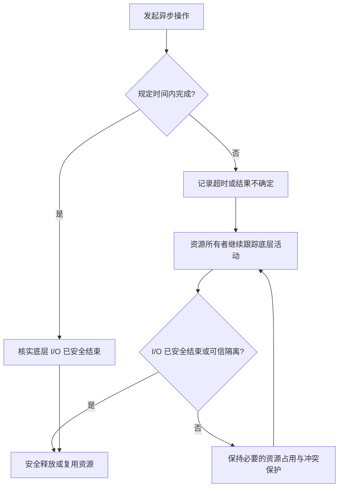

<p class="figure-caption">图 2-1 异步操作超时与资源安全释放流程</p>

对异步操作应区分超时、取消、异常和正常结束；不能仅凭调用方返回、Future/Task 取消或连接状态判断底层 I/O 已安全结束。

### 2.1.5 性能与资源有界原则

性能设计围绕明确的负载与质量要求展开，而不是无依据地增加并发或缓存。

<p class="table-caption">表 2-5 性能与资源有界设计要求</p>

| 设计要求 | 具体规定 |
|---|---|
| 负载模型 | 明确请求规模、并发规模、数据量及运行条件 |
| 容量约束 | 队列、线程、Task、连接、缓存及存储资源应有合理边界 |
| 背压 | 资源不足时明确等待、拒绝、丢弃或降级策略及适用条件 |
| 缓存 | 明确缓存用途、权威数据来源、失效与容量策略 |
| 性能指标 | 明确时延、吞吐、资源占用及测量口径 |
| 性能取舍 | 不得以违反正确性、安全性和可靠性约束换取性能 |

### 2.1.6 故障可控与恢复原则

设计应覆盖正常运行及合理预期的异常场景，明确故障影响范围和恢复条件。

<p class="table-caption">表 2-6 故障与恢复设计要求</p>

| 设计要求 | 具体规定 |
|---|---|
| 故障识别 | 明确可能的超时、通信失败、存储失败、任务异常和进程崩溃 |
| 故障隔离 | 限制故障传播，避免无关组件或资源被错误影响 |
| 状态可信 | 不将未知状态解释为确定成功或失败 |
| 重试与恢复 | 明确允许重试的条件，禁止可能产生危险副作用的盲目重试 |
| 持久化恢复 | 规定异常中断后的数据一致性及状态恢复规则 |
| 生命周期 | 明确启动、就绪、运行、关闭和重启期间的异常处理 |
| 失效行为 | 无法恢复时应有明确的降级、阻塞或停止服务条件 |

### 2.1.7 横切能力非侵入式原则

日志、审计、指标、追踪、权限校验等横切能力应与核心业务逻辑分离，优先通过统一的边界组件、装饰器、中间件或独立服务实现，不应将重复的技术处理流程散布在业务代码中。非侵入式不等于隐藏业务约束：凡影响业务准入、执行结果、事务一致性或故障处理的规则，必须在业务契约中明确，并保留必要的显式调用点。

<p class="table-caption">表 2-7 横切能力非侵入式设计要求</p>

| 设计要求 | 具体规定 |
|---|---|
| 职责分离 | 业务组件负责业务规则与状态转换；横切组件负责统一的记录、采集、校验与传输机制 |
| 边界统一 | 在服务入口、应用服务边界、消息发布边界等明确位置接入横切能力，避免各业务分支重复编排 |
| 最小侵入 | 不为记录日志、采集指标或传播追踪上下文而改变业务方法的核心控制流程和返回语义 |
| 审计正确性 | 审计事件的业务含义及产生时机由业务契约定义；持久化、投递、重试等通用机制与业务处理解耦，同时保证要求的一致性 |
| 故障影响 | 明确横切能力故障时的阻断、降级或重试规则；不得默认其失败不会影响业务，也不得默默吞掉必须处理的错误 |
| 可读性与验证 | 业务代码能够直接体现主流程；横切处理可独立测试，端到端测试验证其与业务契约一致 |

不为追求形式上的非侵入而引入复杂框架或过多抽象；简单、清晰的显式边界优先于难以追踪的隐式执行机制。

### 2.1.8 公共能力复用与冗余控制原则

优先使用符合需求的标准库、成熟软件包、现有工具及公共组件；相同且稳定的职责才提炼为公共能力，不重复发明、不为假设性扩展提前设计框架。

<p class="table-caption">表 2-8 公共能力复用与冗余控制要求</p>

| 设计要求 | 具体规定 |
|---|---|
| 复用优先 | 先评估现成组件是否满足功能、安全、性能及维护要求，再决定是否自行实现。 |
| 提炼公共职责 | 多模块存在稳定相同的职责时统一实现；业务规则留在所属业务模块。 |
| 控制依赖 | 核查成熟度、许可证、版本、安全维护及引入成本。 |
| 控制抽象 | 避免仅为减少少量重复而引入复杂框架或多层转发。 |
| 清理冗余 | 统一能力落地后删除重复、废弃和不必要的兼容实现。 |

### 2.1.9 图表表达与设计一致性原则

设计优先使用合适的图形和表格表达结构、流程、时序、状态及约束，图表不能代替必要的精确定义。

<p class="table-caption">表 2-9 图表表达与一致性设计要求</p>

| 设计要求 | 具体规定 |
|---|---|
| 视图完整 | 使用 4+1 架构视图组织系统设计，覆盖适用内容 |
| 图形选择 | 根据表达目的选择结构图、状态图、时序图、活动图等 |
| 图表一致 | 图形、表格和正文不得相互矛盾 |
| 跨章节一致 | 同一接口、状态、参数及资源规则保持一致 |
| 设计深度 | 明确影响系统行为的契约，允许自主选择内部实现细节 |
| 可验证性 | 关键设计要求应能够对应测试条件与验收证据 |

### 2.1.10 软件设计工作流程

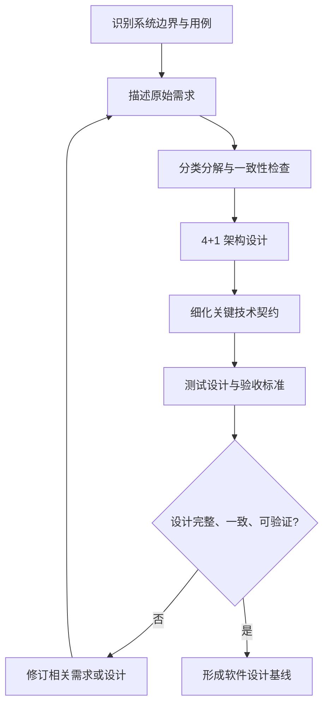

<p class="figure-caption">图 2-2 软件设计编制流程</p>

工作流程允许迭代，不要求传统瀑布式阶段。发现缺口或冲突时直接修订相关需求、架构视图或契约，不通过追加覆盖性条款解决。

### 2.1.11 规范性参考文献及项目无关性

本章为跨项目通用设计与编制规范，不得写入具体仓库、服务、业务协议、接口文件路径或项目专有指标。设计正文引用具体项目的源码、配置和协议文件时，应放在相关业务章节或接口/数据契约章节。

- **《符号体系.md》**：数学量类型、变量命名、标量/矢量/矩阵/张量、下标和公式运算的规范性依据。统计业务中的普通标量同样遵守其标量与阵列的区分原则。
- **《软件系统建模图形与表达规范.md》**：业务流程、DFD、活动/状态/时序图、算法图、伪代码和图元语义的规范性依据。

规范性引用以文件标题和相应章节为准，不复制全文；引用之间存在冲突时先识别并修订冲突，不擅自切换符号或重新解释图元。任何设计实例的具体接口名称、消息字段和技术约束均在第三章及后续适当章节给出。

## 2.2 需求体系及描述规范

需求采用“识别用例 → 逐条描述原始需求 → 分类分解 → 总分一致性检查”的方法。用例应从外部使用者及运行场景出发，覆盖适用的部署、启动、正常使用、配置、运维、正常关闭、重启及异常恢复过程；不局限于业务 RPC，也不将内部技术机制机械列为用例。用例识别属于需求分析，第 4 章用例视图负责表达参与者、边界及用例关系。

<p class="table-caption">表 2-10 原始需求描述字段</p>

| 字段 | 描述要求 |
|---|---|
| 编号 | 唯一原始需求标识，例如 `UR-01` |
| 名称 | 准确概括使用者需要的能力或运行场景 |
| 请求方（Requester） | 发起操作的外部系统、服务或接口，如外部客户端、上层服务、进程管理系统；消息和周期自动触发时可以没有直接请求方，标记“不适用” |
| 触发方式（Trigger） | 标明触发类型、事件来源、触发条件及必要的周期或接口；允许多个类型组合，区分外部触发和内部自动步骤 |
| 输入（Input） | 请求方向本系统提供的数据、参数和信息 |
| 反馈（Response） | 本系统返回请求方的确认、状态、结果及错误信息 |
| 目标方（Destination） | 接收本系统业务输出的外部系统、消息中间件或现场设备；没有时标记“不适用” |
| 业务输出（Output） | 本系统发往目标方的数据、消息或控制指令；没有时标记“不适用” |
| 业务流程（Flow） | 用 Mermaid 表达主要控制流程、数据输入/输出及重要异常，已表达的动作不重复 |
| 业务规则（Business Rules） | 补充主流程未精确定义的术语、公式、算法、初始化、阈值和边界；允许文字分条、LaTeX、图、伪代码或表格，不重复业务流程 |
| 关键约束（Constraints） | 性能、可靠性、安全、审计、可观测性、错误信息、缓存、I/O 与背压等可验证的非功能要求 |

反馈与业务输出必须分开：反馈面向请求方，业务输出面向目标方；请求方与目标方可有多个，且请求方断连不必然撤销已接受的业务操作。

### 2.2.1 触发方式分类与标注规则

原始需求必须列出实际适用的触发方式；同一需求可以组合多种触发方式，不能把处理流程中的普通步骤误写成独立触发。触发方式描述“何时、由什么启动”，不预先决定线程、定时器或队列等内部实现。

- **消息触发（Message）**：外部消息到达，例如实时消息或可靠消息；标明消息来源与订阅范围。
- **周期触发（Periodic）**：达到配置周期，例如实时周期输出或变化加周期保底；标明周期来源及生效条件。
- **API 触发（API）**：收到明确的外部接口请求，例如任务启动或配置应用接口；标明接口和调用方。
- **状态触发（State）**：受监控对象的状态发生满足条件的变化，例如外部依赖从不可用恢复可用；标明状态条件，不把普通循环迭代误列为触发。
- **生命周期触发（Lifecycle）**：服务进入启动、关闭、重启或配置生效等阶段；标明阶段及必要前置条件。

周期触发与消息触发可以同时存在：消息到达更新数据，周期到达决定何时输出。若无外部直接请求方，Requester 写“不适用（自动触发）”，但仍须列出消息生产者或状态来源；触发方式不替代 Input、Response 与 Output 的定义。

### 2.2.2 原始需求四节结构与写作原则

各 UR 固定为四节：**基本信息与触发方式、业务流程、业务规则、关键约束**。根据语义选择最清晰的表达形式；文字、公式、图形、伪代码和表格地位平等；**业务流程图已清楚表达的处理不得在后两节复述**。规则和约束必须有唯一规范定义，其他章节仅引用。

1. **基本信息与触发方式**：表格列出 Requester、Trigger、Input、Response、Destination、Output。Trigger 采用第 2.2.1 节分类，明确事件来源、触发条件及周期或 API。
2. **业务流程**：Mermaid Flowchart 或适用的 UML 活动图表达触发入口、主要处理、判断、数据输入输出、重要异常及恢复出口；复杂算法通过“预定义过程”节点指向第三节，不在总流程中堆叠实现细节。
3. **业务规则**：仅描述流程图无法精确表达的算法、公式、阈值、初始化、状态不变量、顺序及边界。允许文字分条定义、算法流程图、DFG、LaTeX 公式、表格或明确标为 `text` 的伪代码；必须说明输入、输出、初始值、边界及终止条件。无额外内容时标注“无额外规则”。
4. **关键约束**：**优先给出定量要求**（带单位、作用范围、测量窗口、默认值或硬上限、验收方法）；不能合理量化的才采用具有明确判定条件的定性要求。**仅放可核验的非功能要求**，按性能与容量、可靠性与恢复、安全与授权、审计、可观测性、错误信息、缓存与有效期、I/O 资源安全、背压与过载分类；无关分类可以省略或说明不适用。约束应给出故障条件、正确结果、测量或验收口径，不得用抽象口号代替。

### 2.2.3 业务图形元素与数据语义

参照《软件系统建模图形与表达规范.md》第 5.1 节 Flowchart、第 7.1 节 DFD 与第 8.1 节算法规范。业务活动图的控制流箭头表示处理顺序，DFD 箭头表示数据流，**两者不得混用**。图中应以不同形状区分处理、判断和数据。

| 元素 | Mermaid 写法 | 语义 |
|---|---|---|
| 开始/结束 | `A([开始/结束])` | 明确入口和完成/失败出口 |
| 处理 Process | `B["更新缓存"]` | 矩形，表达动作而非数据 |
| 判断 Decision | `C{"已过期?"}` | 菱形，分支标明条件 |
| 输入/输出 Data | `D[/"采样消息"/]` | 平行四边形，表达数据输入/输出 |
| 预定义子过程 | `E[["计算统计指标"]]` | 双边矩形，引用业务规则的算法说明 |
| 数据存储 | `F[("最新值缓存")]` | 存储节点；仅在理解读写关系必要时出现 |

不因形式要求增加无意义数据节点。数据来源、存储及复杂数据变换应单独绘制 DFD，避免业务活动图变成混杂的控制/数据流图。Mermaid 第一行初始化配置、图编号和图题仍须符合第一章。

### 2.2.4 业务规则、输出定义与关键约束的具体要求

- **业务规则**：定义与边界条件优先文字分条；涉及数学关系必须使用 LaTeX 独立公式；复杂步骤按需使用 Flowchart/DFG 或伪代码补充。表达形式不限于图和表；精确定义阈值、边界、初始化、更新基准和不可变条件，不复述主流程动作。算法必须能够独立据输入判断预期输出。
- **性能与容量**：优先用定量指标给出负载范围、时延/吞吐口径、并发及资源上限；必须区分设计目标、默认配置、不可突破的资源上限和验收实测值；未确定的阈值不得虚构。
- **可靠性及 I/O**：明确超时、结果不确定、重试、恢复、安全收敛及资源释放条件。调用返回或 Task 取消不代表底层 I/O 已结束。
- **错误信息**：定义错误类别、错误码或结果、对象与关联标识、发生阶段、可检索证据及敏感信息脱敏；禁止把 UNKNOWN 伪装为成功或明确失败。
- **缓存与背压**：规定缓存键、容量、更新/覆盖、过期、丢弃、等待、拒绝、暂停消费及恢复条件；所有超限策略必须可观测。
- **安全与审计**：列出认证、授权、控制边界以及需审计的操作、事件产生时机、关联 ID、可信保存与失败处理；运行日志不能代替审计。
- **可观测性**：指标、统计窗口、状态、事件、更新时间、无数据语义及告警；可结合真实场景验收。

**指标、计算和输出契约完整性（强制）：**凡使用“计算、统计、比较、阈值、状态、错误、容量、返回结果”等词定义业务能力，必须形成封闭的输出集合；不得用“等”“包括但不限于”替代本版本必须实现的清单。每个指标/派生字段至少定义以下内容；其中数学计算不得仅写在表格单元格内，必须另列可渲染的 LaTeX 公式：

| 必填字段 | 内容 |
|---|---|
| 唯一标识、类型和单位 | 与公开接口字段或指标名一致；明示 `counter/gauge/histogram`、计量单位 |
| 统计层级和数据来源 | 系统 / 进程 / 组件 / 任务 / 消费者；事件记录点、分子和分母来源 |
| 计算公式与口径 | 累计/窗口/瞬时，窗口端点、去重规则、事件计数次数、百分位算法 |
| 触发、初始化和重置 | 何时采集/计算、初始值、首个周期、进程重启、配置热更新 |
| 边界与缺失 | 零分母、空样本、UNKNOWN、超时、重复投递、源不可达的值域与 `unavailable` 语义 |
| 输出与验收 | 指标名、采样时间、窗口、可用性表达、配置边界及给定数据可独立验算的实例 |

**示例与可复算性（强制）：**当业务规则涉及多种计数口径、状态转换、时间窗口、边界分支或重试等易混淆情形时，至少给出一个具体输入—处理过程—预期输出的完整算例。算例必须标明初始条件、计量单位、每一步事件及最终结果；若同时存在样本条数、批次数、I/O 尝试次数等不同统计单位，须分别列出，禁止混用。算例应覆盖易误解的边界（例如重试成功仍有失败尝试记录），且结果必须可直接转化为确定性测试断言。算例是对定义的验证，不得取代规范性定义，也不应重复流程图中的全部步骤；涉及计算关系仍按第一章使用 LaTeX。

**数学定义与表达门禁：**业务规则的文字定义应独立成段或分条；涉及计算时，必须在定义后给出独立 LaTeX 公式，逐一释义变量、单位、取值域以及零分母、空样本和无效值。算法图与伪代码是可选的精度增强手段，不得要求所有业务规则使用表格。公式与中文混排遵守第一章 §1.3.1。

**约束定量优先门禁（强制）：**关键约束首先给出数值、单位、统计范围、采样方法、允许误差、测试条件和通过标准；可配置阈值应列出默认值及合法范围。仅当约束本质上无法定量（例如禁止错误 ACK）时，才用可判定的定性约束。不得用“及时、足够、合理、有界、尽可能、低延迟、高可靠”等词代替具体要求；未完成基准测试的数值应标明“设计验收目标，尚未实测”，不得声称达标。

**完备性门禁：**业务规则涉及的状态枚举、错误分类/错误信息字段、缓存容量及淘汰策略、I/O 结果、背压策略、审计与统计输出均应列举封闭集合和边界输入；凡无法根据文档构造确定预期结果的要求，视为需求未完成，不得标记为可编码。参数可以配置，但必须说明合法范围、默认/缺省行为及越界错误；性能数值未经验证时不得伪称已达标。每项约束必须可追溯至可执行的 UC/System 场景。

每项业务规则和关键约束须能由 UC/场景及第 14 章测试追溯；第 5～13 章详述实现契约时应引用 UR，不得另造冲突定义。

统一样式：

```text
### 3.x UR-xx 需求名称
#### 3.x.1 基本信息与触发方式
Requester / Trigger / Input / Response / Destination / Output
#### 3.x.2 业务流程
Mermaid 活动流程图，含重要异常及数据输入输出
#### 3.x.3 业务规则
可用文字、LaTeX、伪代码、图或表格精确定义算法、初始化与边界，不重复流程
#### 3.x.4 关键约束
按性能、可靠性、安全、审计、可观测性、错误、缓存、I/O、背压列可验证要求
```

本节也是第三章及后续章节的强制完整性验收标准。

<p class="table-caption">表 2-11 分类需求体系与描述重点</p>

| 类别 | 核心问题 | 典型要求 |
|---|---|---|
| 功能需求（Functionality） | 系统提供什么行为 | 对外能力、业务流程、业务规则、输入输出与状态反馈 |
| 性能需求（Performance） | 运行速度与资源上限 | 时延、吞吐、并发、调度、公平性、容量、背压、资源消耗、扩展能力 |
| 可靠性需求（Reliability） | 故障时如何保持正确与恢复 | 容错、超时、重试、请求关联、事务、持久化、故障恢复、可用性、未结束操作的资源管理 |
| 安全需求（Safety & Security） | 如何防止危险或非法控制 | 控制权、互锁、失效安全、认证、授权、通信及数据安全 |
| 横切能力（Cross-cutting Concerns） | 如何观测、管理与追责 | 审计（操作证据、可靠投递、完整性、追溯）、日志、指标、追踪、配置、版本、可测试性、可维护性 |

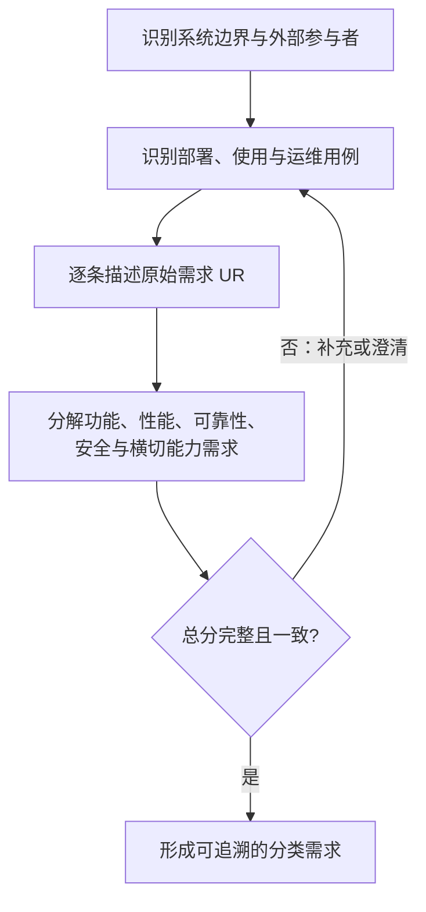

<p class="figure-caption">图 2-3 需求识别、分解与一致性检查流程</p>

分类需求必须从原始需求的输入、反馈、业务输出、规则和约束中推导，不得遗漏、矛盾或未经确认增加能力；多条原始需求的共同约束可以合并，但必须保留来源编号。每条分类需求应给出可核验条件，性能要求还需明确测量口径，不虚构现场阈值。审计应独立于普通日志定义，不得以运行日志代替审计证据。

需求分类与设计专题是不同维度：启动、正常关闭、重启及 Reload 属于跨需求的运行生命周期设计，统一在进程视图展开；相应行为和质量约束分别由原始需求及分类需求追溯。

## 2.3 4+1 架构视图：内涵、外延与表达规范

<p class="table-caption">表 2-12 4+1 架构视图的职责与成果</p>

| 视图 | 关注范围 | 主要成果 | 不应混淆 |
|---|---|---|---|
| 用例视图（+1） | 参与者、系统边界、典型/异常场景 | 系统上下文、用例、业务流程 | 不负责线程调度 |
| 逻辑视图（Logical） | 组件职责、模型、接口、状态规则、依赖 | 组件图、类/数据关系、状态图 | 不等于源码目录树 |
| 进程视图（Process） | 进程、线程、Event Loop、Task、协作、生命周期、同步、并发、资源、背压、缓存、故障恢复 | 运行结构图、任务所有权表、时序/状态/活动图、资源预算 | Task 不等于 OS 线程；图名须区分标准 UML 与示意图 |
| 开发视图（Development） | 软件模块边界、层次、静态依赖、公共契约与复用关系 | 模块图、依赖图、模块职责表 | 不描述真实并发拓扑，也不列现有代码修改清单 |
| 物理视图（Physical/Deployment） | 节点、进程部署、存储、网络、控制权和现场外部依赖 | 部署图、网络/故障域/外部依赖表 | 不是现场设备内部物理结构模型 |

### 2.3.1 用例视图的场景编写规范

用例以参与者的完整业务目标为单位组织，而非以原始需求、RPC 或内部模块为单位逐条改名。一项用例可以关联多项原始需求；一项原始需求也可以由多个业务场景共同覆盖。用例视图回答“在具体业务场景中系统如何工作”，不代替逻辑视图、进程视图和数据设计。

<p class="table-caption">表 2-13 业务场景用例的必备描述要素</p>

| 要素 | 编写规定 |
|---|---|
| 用例身份与目标 | 给出唯一编号、业务场景名称及参与者要达成的可观察目标；名称使用业务活动，不使用内部机制命名 |
| 参与者与触发条件 | 列明实际发起操作的外部角色；内部定时任务、恢复及发布等自动步骤不得虚构外部参与者 |
| 前置条件 | 列明系统就绪、授权、配置或数据存在等必要条件；不得混入未确认的实现假设 |
| 主业务流程 | 以 Mermaid 业务活动图（flowchart）为主要表达，覆盖触发、校验、关键处理、反馈及后置结果；以判断节点表达重要分支，避免大段编号文字复述 |
| 分支与异常流程 | 在活动图中呈现影响业务结果的主要异常出口；罕见或不宜展开的异常在简明说明表中概括，避免为了完整而画出所有技术异常 |
| 后置条件 | 明确成功和失败之后的业务状态、外部可见结果、未完成事项及后续查询方式 |
| 需求追溯 | 标明相关 UR；核对全部 UR 在真实场景中得到覆盖，但不要求 UR 与 UC 一一对应 |

跨用例共享的内部机制（如存储、审计发布和调度）应作为相关业务流程中的自动步骤或支撑行为描述；只有存在独立业务目标时才另立用例。应避免将一串 gRPC 方法名或 CRUD 操作直接当作完整用例，也不得在用例章节展开线程、锁、表结构及类方法等实现细节。

用例的正文采用“一张业务活动图 + 一张简明用例说明表”的表达形式。活动图包含主路径、必要判断以及重要异常分支；图中节点使用业务动作，不展开展示内部类、锁和数据库事务。说明表只填写参与者、业务目标、前置条件、主要异常、后置条件及关联需求。业务分支已在图中完整表达时，不再重复书写大段“主业务流程”和“异常流程”；复杂跨参与者消息时序可在独立小节补充时序图。图题和表题按文档约定独立编号。

进程视图应按四个设计专题组织，而不是按需求类别重复划分：

<p class="table-caption">表 2-14 进程视图的四类设计专题</p>

| 专题 | 必须明确的设计对象 | 推荐表达 |
|---|---|---|
| 运行时结构 | 进程、线程、Event Loop、Task、线程池、组件与资源所有权 | 分层运行结构图、Task 职责表 |
| 运行生命周期（Runtime Lifecycle） | 启动、初始化、就绪、运行、Reload、正常关闭、重启及其阶段转换 | 生命周期状态图、启动/关闭/Reload 时序图 |
| 并发与资源管理 | Task 协作、队列、通知、同步、调度、容量限额、背压、缓存及释放 | 任务协作时序图、资源与背压策略表 |
| 异常与恢复 | 超时、取消、故障隔离、未收敛 I/O、崩溃恢复与降级 | 故障状态图、异常裁决矩阵 |

各专题共享同一运行模型，明确创建者、所有者、同步关系和退出条件；不因分节而重复定义状态或资源。生命周期是进程视图的独立设计专题，不是第六类需求。

图表仅使用其可准确表达的语义：结构关系用 Mermaid Flowchart；行为交互用 Sequence Diagram；状态约束用 State Diagram；条件控制用活动/流程图。图题说明对象、范围及图类型。关键质量属性贯穿各视图，不能只写在单独的“非功能要求”段落。

## 2.4 测试设计方法、组织及验收规范

测试设计以测试层级组织物理目录，以 Marker 描述测试层级、测试专题与运行场景。测试文件名应清楚表达验证对象或行为；测试文件及其标记、验证说明统一登记在测试矩阵中。需求、用例及重要技术契约必须能追溯到实际测试，不为同一目的建立重复测试体系。

<p class="table-caption">表 2-15 测试层级与目录规范</p>

| 层级 Marker | 物理目录 | 验证范围 |
|---|---|---|
| `unit` | `unit/` | 状态转换、业务规则、纯逻辑，无外部服务依赖 |
| `component` | `component/` | 单组件职责及其可控依赖 |
| `integration` | `integration/` | 组件之间及真实外部依赖的接口协作 |
| `system` | `system/` | 独立进程、完整业务场景及端到端行为 |

<p class="table-caption">表 2-16 测试 Marker 与矩阵编制规范</p>

| 事项 | 规范 |
|---|---|
| 层级 Marker | 每项测试必须且仅属于 `unit`、`component`、`integration`、`system` 之一，与目录对应 |
| 专题 Marker | 标识可靠性、安全、性能等验证主题，可与层级及场景 Marker 叠加；无专项主题时可为空 |
| 场景 Marker | 标识并发、超时、恢复、负载、现场等执行条件或情境；有相应场景时标记 |
| 测试矩阵 | 至少包含“测试文件名、层级 Marker、专题 Marker、场景 Marker、测试说明”五列；每项重要测试应有可定位的文件归属 |
| 标记粒度 | 标记以具体测试函数或类为准；同文件可包含不同专题与场景，矩阵列出涉及的 Marker |
| 运行条件 | 通过 Fixture 和环境准备明确外部依赖；现场专用测试与常规回归分离，未执行不视为通过 |
| 执行规则 | 提供按目录、Marker 及其布尔组合的 pytest 命令；所有 Marker 在项目配置中注册 |
| 可追溯性 | 测试说明与需求、用例或技术契约对应；行为变更时同步检查测试及矩阵 |
| 验收证据 | 保留运行环境、命令、实际结果、指标和未验证项，禁止把设计目标当作测试结果 |

目录划分测试层级，专题与场景通过 Marker 横向组合；可靠性测试不单独设第五类目录。测试矩阵用于定位和筛选测试，不预设每个实现文件必须存在，也不要求每个文件仅能有一种测试场景。

### 2.4.1 测试依据及 System 覆盖要求

各层级测试必须依据已确认的设计成果编制；System Test 以用例视图为主基线，以原始需求及技术契约补充覆盖，不得由测试人员凭经验任意缩减范围。

<p class="table-caption">表 2-17 各测试层级的设计依据</p>

| 测试层级 | 主要依据 | 验证重点 |
|---|---|---|
| Unit | 详细设计、函数及算法契约 | 纯逻辑、状态转换、参数及边界规则 |
| Component | 逻辑视图、组件职责及内部接口契约 | 单组件行为、依赖协作及异常处理 |
| Integration | 接口与通信契约、开发视图、物理视图 | 真实接口调用、跨组件通信及外部依赖 |
| **System** | **用例视图（UC）及原始需求（UR）**，并补充接口、运行、部署、安全及性能约束 | **从真实受测服务进程及其通信入口验证业务目标、异常、边界与恢复行为** |

System Test 必须遵守以下规定：

1. **用例覆盖率 100%**：每项 UC 至少有一项 System Test 作为验证证据；同一测试可以覆盖多个 UC，同一 UC 可以由多个测试覆盖，**不按测试数量与 UC 数量的大小关系判定覆盖**。
2. **规定场景覆盖率 100%**：每项 UC 明确的主流程、关键分支、异常流程、边界和恢复场景均必须有对应 System Test；不能仅以一条正常路径代表整个 UC 已覆盖。
3. **需求覆盖率 100%**：每项 UR 必须能够经一个或多个 UC 追溯至 System Test；若某项需求未能被 UC 覆盖，必须先补全用例，不得直接以技术测试代替业务用例。
4. **技术约束补充覆盖**：用例未充分表达的性能、容量、并发、安全、权限、超时和可靠性要求，依据对应技术契约补充测试；不得因 UC 未逐项列出而豁免。
5. **真实系统边界**：System Test 通过真实受测服务进程和适用的外部依赖、通信链路执行；Mock 不得代替本次明确纳入验收范围的基础设施及通信链路。
6. **覆盖与通过分开裁定**：测试已关联不等于已执行；失败、跳过及未运行均不得计为通过。验收报告分别给出需求覆盖、用例及场景覆盖、执行情况和通过情况；缺少真实环境时标记 `NOT_RUN`，不得用模拟结果替代。
7. **变更同步**：任何 UR、UC、接口或行为约束的新增、删除、调整，必须同步核查 System Test、测试矩阵和验收条款；新增 UC 不得留下无测试映射。

<p class="table-caption">表 2-18 System Test 追溯矩阵规范</p>

| 字段 | 要求 |
|---|---|
| UR 编号 | 被验证的原始需求编号，可列多个 |
| UC 编号与场景 | 用例编号及主流程、异常、边界或恢复场景标识 |
| 技术契约 | 相关接口、配置、运行或安全约束的章节编号；没有则记“—” |
| 测试文件名／测试标识 | 可定位的 System Test 文件名及测试函数或参数化场景标识 |
| 层级／专题／场景 Marker | 层级固定为 `system`，其余按第 2.4 节定义填写 |
| 验证内容与预期结果 | 从用户可观察行为与副作用表述判定依据 |
| 执行环境及结果 | 真实依赖、执行证据、`PASS`／`FAIL`／`SKIP`／`NOT_RUN` 等状态 |

追溯链为 **UR → UC／用例场景 → System Test → 执行结果与证据**，技术契约作为补充依据进入相应测试。第 4 章负责编制完整 UC 和场景，第 14 章依据本规范给出实际测试矩阵及验收安排，两章必须双向核对。

# 3. 软件需求

本章先完整描述各运行场景的原始需求（UR），再从其业务规则与约束中提取分类需求（FR、PR、RR、SR、CR）。分类需求不新增未获确认的业务能力；数值阈值未确定时保留可测量指标，不将待测量值视为已满足的验收标准。

## 3.1 原始需求

原始需求覆盖部署与运行生命周期、控制使用、状态与配置管理、审计及异常恢复。请求方可以是外部系统，也可以是系统内部事件触发者；业务输出与返回请求方的反馈分别描述。

<p class="table-caption">表 3-1 原始需求索引</p>

| 编号 | 名称 | 请求方 |
|---|---|---|
| UR-01 | 启动服务 | 进程管理系统 |
| UR-02 | 正常关闭服务 | 进程管理系统 |
| UR-03 | 重启服务 | 进程管理系统 |
| UR-04 | 单点控制 | gRPC 客户端（Orca、Gateway 等） |
| UR-05 | 批量控制 | gRPC 客户端 |
| UR-06 | 查询命令结果 | gRPC 客户端 |
| UR-07 | 查询服务基本信息 | CLI、gRPC 客户端 |
| UR-08 | 查询服务运行状态 | CLI、gRPC 客户端 |
| UR-09 | 查询设备列表 | CLI、gRPC 客户端 |
| UR-10 | 查询设备详情 | CLI、gRPC 客户端 |
| UR-11 | 热重载设备配置 | gRPC 调用方 |
| UR-12 | 查询配置状态 | gRPC 调用方 |
| UR-13 | 本地命令与审计记录管理 | 内部命令状态变化（自动触发） |
| UR-14 | 发布命令审计事件 | 内部已持久化审计事件（自动触发） |
| UR-15 | 异常退出后恢复服务 | 进程管理系统（异常重启触发） |

### 3.1.1 UR-01 启动服务

#### 3.1.1.1 基本信息与触发方式

| 字段 | 内容 |
|---|---|
| Requester | 进程管理系统 |
| Trigger | 外部事件：进程管理系统启动/停止/重启 |
| Input | 启动请求、已部署配置及运行环境 |
| Response | 启动结果、就绪状态或失败原因 |
| Destination | 不适用 |
| Output | 不适用（启动不主动写入设备） |

#### 3.1.1.2 业务流程

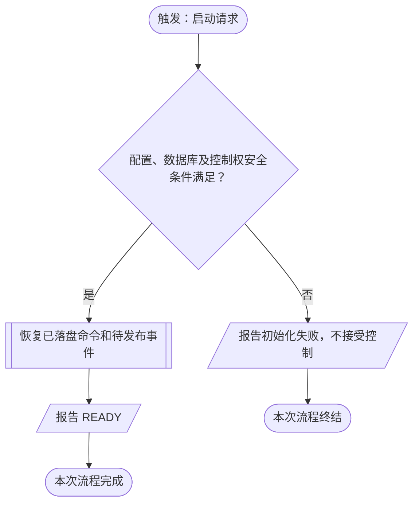

<p class="figure-caption">图 3-1 UR-01 启动服务业务流程</p>

#### 3.1.1.3 业务规则

校验配置与运行依赖；恢复历史命令；满足准入条件后开放命令接口；启动失败不得错误报告就绪

#### 3.1.1.4 关键约束

恢复期间不得重复现场写入；单实例控制权唯一；配置文件缺失、格式或版本不兼容、模板引用失效、数据库不可用时不得就绪或接受命令，并报告明确原因；启动本身不生成命令审计。

### 3.1.2 UR-02 正常关闭服务

#### 3.1.2.1 基本信息与触发方式

| 字段 | 内容 |
|---|---|
| Requester | 进程管理系统 |
| Trigger | 外部事件：进程管理系统启动/停止/重启 |
| Input | 停止信号、关闭期限 |
| Response | 退出状态、未完成工作和异常信息 |
| Destination | 不适用 |
| Output | 不适用 |

#### 3.1.2.2 业务流程

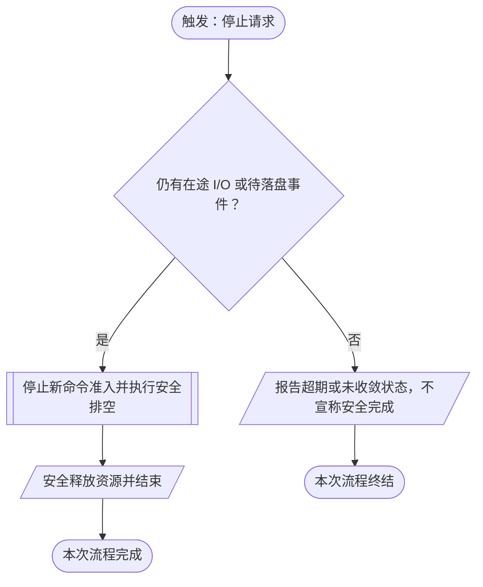

<p class="figure-caption">图 3-2 UR-02 正常关闭服务业务流程</p>

#### 3.1.2.3 业务规则

停止接受新命令；未开始的命令按规则终结；已发起的操作等待安全结束；处理既有待发布审计事件至规定关闭期限，关闭存储资源；关闭本身不生成审计事件

#### 3.1.2.4 关键约束

停止阶段有界等待并报告超时；底层 I/O 未安全结束或可信隔离前不得释放冲突资源；关闭期限届满时对无法收敛 I/O 保持设备阻塞及必要资源所有权，不得假定取消成功，不得以正常安全退出掩盖未结束执行；正常关闭应在规定期限内尽量排空终态与待投递事件；未能落盘时报告明确剩余量和失败状态，异常退出不能保证内存事件不丢失。

### 3.1.3 UR-03 重启服务

#### 3.1.3.1 基本信息与触发方式

| 字段 | 内容 |
|---|---|
| Requester | 进程管理系统 |
| Trigger | 外部事件：进程管理系统启动/停止/重启 |
| Input | 进程管理系统发出的重启请求；磁盘上的完整配置文件集合及本地持久化状态 |
| Response | 重启后的运行状态、恢复结果和告警 |
| Destination | 不适用 |
| Output | 不适用 |

#### 3.1.3.2 业务流程

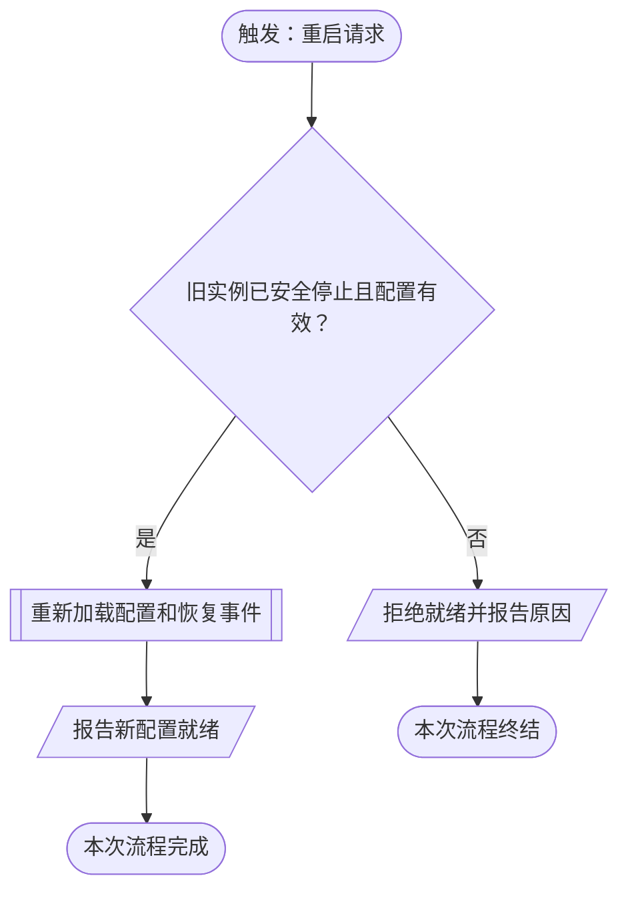

<p class="figure-caption">图 3-3 UR-03 重启服务业务流程</p>

#### 3.1.3.3 业务规则

先完成停止流程，再启动新的服务进程；重新读取并校验全部依赖配置文件，按新文件内容运行；不得因重启再次执行已接受命令

#### 3.1.3.4 关键约束

配置缺失、schema_version 不兼容、引用版本不匹配或数据库故障时拒绝就绪；不得因进程重启重复控制；跨进程控制权和旧 I/O 隔离未证实前拒绝可能冲突的操作。

### 3.1.4 UR-04 单点控制

#### 3.1.4.1 基本信息与触发方式

| 字段 | 内容 |
|---|---|
| Requester | gRPC 客户端（Orca、Gateway 等） |
| Trigger | API：授权 gRPC 请求到达 |
| Input | device_id、point_id、目标值、可选有效期及超时 |
| Response | 回显客户端生成的 request_id、Commander 生成的 command_id 和已接受状态；执行结果通过查询接口获取 |
| Destination | 现场 PLC |
| Output | 向指定可写测点发送一次控制写入 |

#### 3.1.4.2 业务流程

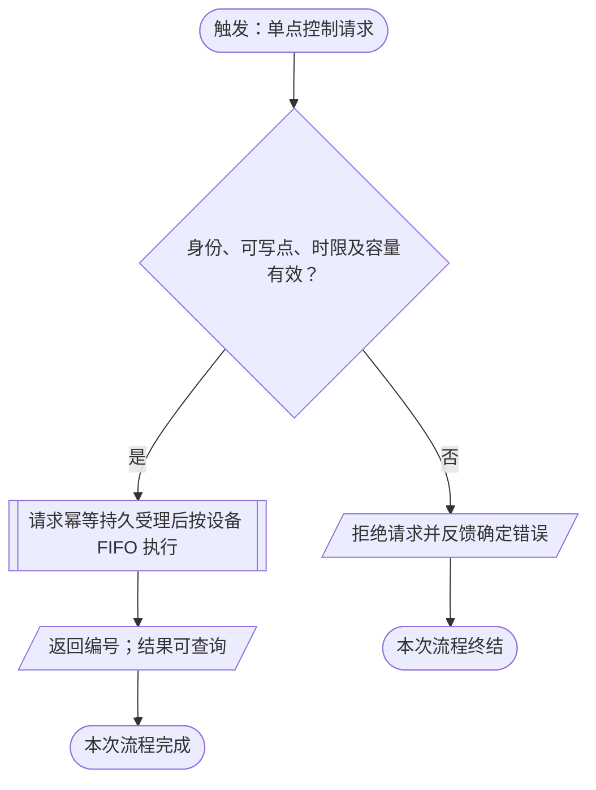

<p class="figure-caption">图 3-4 UR-04 单点控制业务流程</p>

#### 3.1.4.3 业务规则

校验已认证调用方权限、设备、点位及设定值；接受时先根据客户端 request_id 完成持久的请求指纹与幂等登记，Commander 生成 command_id 后按设备 FIFO 执行；在受理身份未可恢复时不得返回 accepted=true；排队超时或有效期届满后不再写入；可能已发出但结果无法确认的写入终结 UNKNOWN。

#### 3.1.4.4 关键约束

排队期限从首次接受时起算并覆盖设备 FIFO 与全局额度等待，执行期限从实际开始写入起算，有效期以请求中规定的绝对截止时间为准；同一时刻以持久化的终态裁决为准，已终结不再执行；RPC 超时或取消不撤销已接受命令；不能自动重试结果未知的写入；资源与审计留存有界。

### 3.1.5 UR-05 批量控制

#### 3.1.5.1 基本信息与触发方式

| 字段 | 内容 |
|---|---|
| Requester | gRPC 客户端 |
| Trigger | API：授权 gRPC 请求到达 |
| Input | 有序控制项目列表（每项包含设备、点位、目标值及可选超时/有效期） |
| Response | 回显客户端生成的 request_id、与输入逐项对应的 command_id 和已接受状态，或整批拒绝原因；最终逐点结果由查询接口返回 |
| Destination | 现场 PLC（可涉及多个设备） |
| Output | 分别向各目标测点发送控制写入 |

#### 3.1.5.2 业务流程

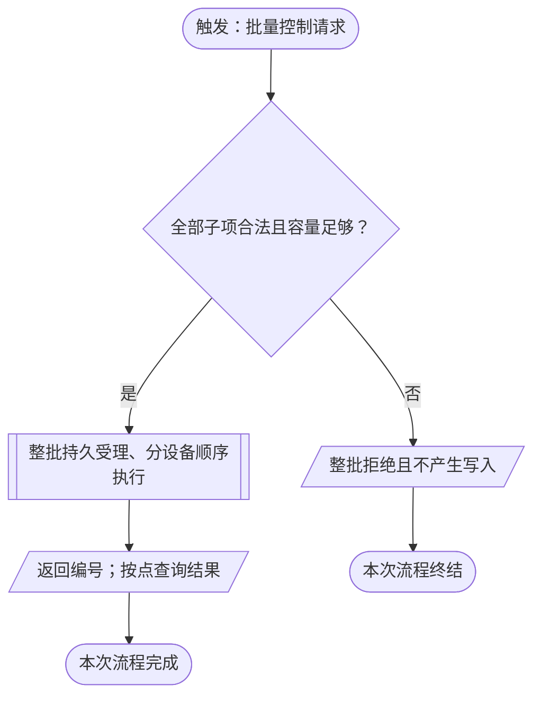

<p class="figure-caption">图 3-5 UR-05 批量控制业务流程</p>

#### 3.1.5.3 业务规则

按客户端 request_id 完成幂等冲突检查，再整批校验并持久原子受理；Commander 为各点生成 command_id；按设备 FIFO 执行，合格时优先 write_many，不支持时顺序 write_one；跨设备不保证原子性；按协议实际可确认的粒度记录每点结果，部分成功与整体失败如实报告，无法判定的点标记 UNKNOWN，不自动重试可能已写入的点。

#### 3.1.5.4 关键约束

每次接受的批量请求及其子命令身份稳定；单设备不能跨其他已排队命令合并；各子命令的排队期限、执行期限和有效期独立判定，RPC 断开不撤销已接受命令；任一操作超时不代表底层 I/O 已结束；批量容量、整体接收与逐点结果均须可核验。

### 3.1.6 UR-06 查询命令结果

#### 3.1.6.1 基本信息与触发方式

| 字段 | 内容 |
|---|---|
| Requester | gRPC 客户端 |
| Trigger | API：授权 gRPC 请求到达 |
| Input | command_id，或客户端生成的 request_id（单点或批量请求）；二者至少提供其一 |
| Response | 命令或整批子命令的完整请求信息、最新状态、结果、错误及相关时间；保证期内无匹配返回 NOT_FOUND；标识冲突返回明确错误 |
| Destination | 不适用 |
| Output | 不适用 |

#### 3.1.6.2 业务流程

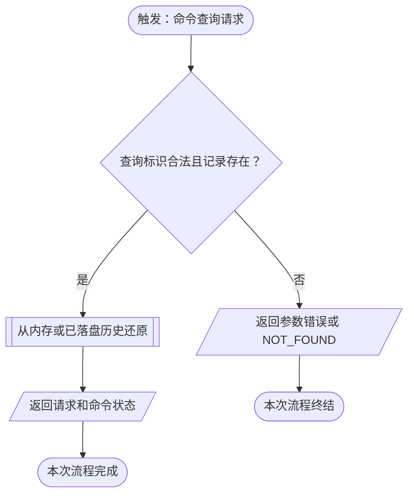

<p class="figure-caption">图 3-6 UR-06 查询命令结果业务流程</p>

#### 3.1.6.3 业务规则

通过 command_id 查询单命令；通过客户端 request_id 查询单点或整批请求的命令 ID 与结果；响应丢失仍能用先前保存的 request_id 查询，NOT_FOUND 不证明没有执行；读取本地已保存事件并还原，不访问现场设备。

#### 3.1.6.4 关键约束

终态不可擅自改写；保留期限内的历史结果可跨重启查询；记录清理后返回 NOT_FOUND；查询应受授权控制

### 3.1.7 UR-07 查询服务基本信息

#### 3.1.7.1 基本信息与触发方式

| 字段 | 内容 |
|---|---|
| Requester | gRPC 调用方 |
| Trigger | API：授权 gRPC 请求到达 |
| Input | 查询请求 |
| Response | 服务标识、软件版本、启动信息及当前实际生效的依赖配置文件清单（路径或逻辑标识、schema_version；对具有 file_version 的文件返回其版本） |
| Destination | 不适用 |
| Output | 不适用 |

#### 3.1.7.2 业务流程

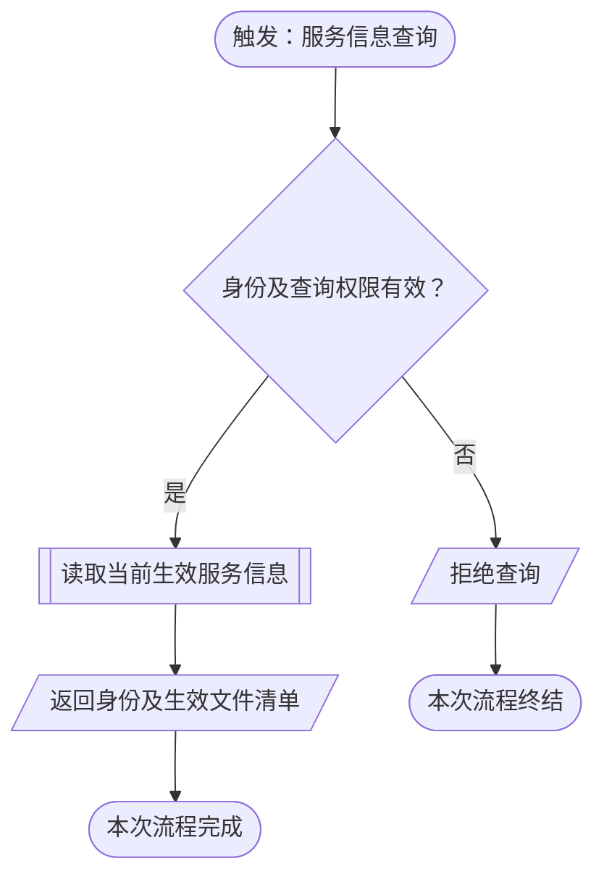

<p class="figure-caption">图 3-7 UR-07 查询服务基本信息业务流程</p>

#### 3.1.7.3 业务规则

返回当前服务实例的基本身份信息和当前实际生效的配置文件版本；不能把磁盘上尚未生效的版本报告为生效版本

#### 3.1.7.4 关键约束

不得为查询触发设备连接；敏感信息按权限过滤

### 3.1.8 UR-08 查询服务运行状态

#### 3.1.8.1 基本信息与触发方式

| 字段 | 内容 |
|---|---|
| Requester | gRPC 调用方 |
| Trigger | API：授权 gRPC 请求到达 |
| Input | 查询请求 |
| Response | 进程存活/业务就绪、设备阻塞数、在途 I/O、设备与全局队列积压、存储已用/上限与预留空间、未确认审计事件数、最老待投递事件等待时长、发布失败/恢复告警 |
| Destination | 不适用 |
| Output | 不适用 |

#### 3.1.8.2 业务流程

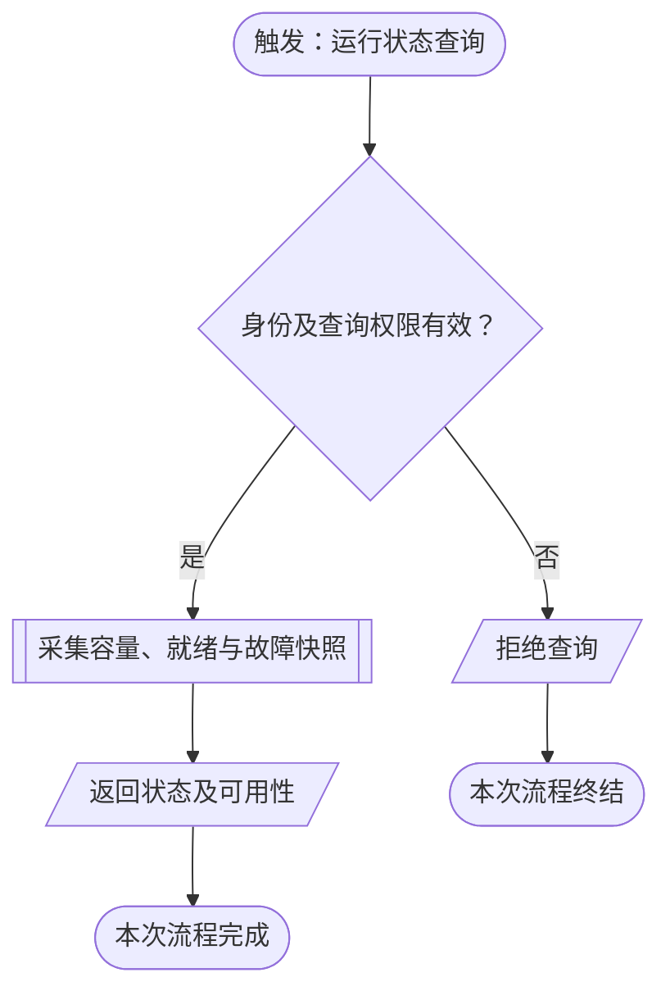

<p class="figure-caption">图 3-8 UR-08 查询服务运行状态业务流程</p>

#### 3.1.8.3 业务规则

区分进程存活、业务可用与外部依赖状态；统计口径明确

#### 3.1.8.4 关键约束

查询不触发现场 I/O；统计及健康状态不得虚报

### 3.1.9 UR-09 查询设备列表

#### 3.1.9.1 基本信息与触发方式

| 字段 | 内容 |
|---|---|
| Requester | gRPC 调用方 |
| Trigger | API：授权 gRPC 请求到达 |
| Input | 筛选条件、分页参数 |
| Response | 设备列表、状态摘要及下一页标识 |
| Destination | 不适用 |
| Output | 不适用 |

#### 3.1.9.2 业务流程

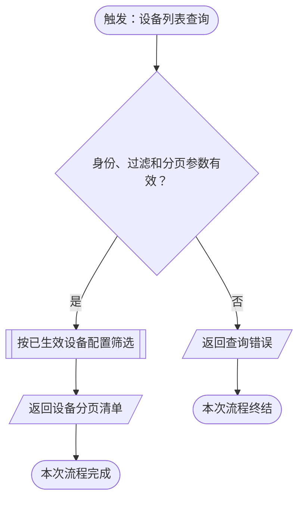

<p class="figure-caption">图 3-9 UR-09 查询设备列表业务流程</p>

#### 3.1.9.3 业务规则

返回服务配置管理的设备；支持筛选与分页

#### 3.1.9.4 关键约束

只读查询；地址与敏感字段依权限可见；不得主动连接设备

### 3.1.10 UR-10 查询设备详情

#### 3.1.10.1 基本信息与触发方式

| 字段 | 内容 |
|---|---|
| Requester | gRPC 调用方 |
| Trigger | API：授权 gRPC 请求到达 |
| Input | device_id |
| Response | 设备协议、连接、执行、阻塞、错误、生效配置状态，以及当前生效点表中配置为允许写入的测点信息（标识、数据类型及已配置的写入约束）；不返回只读/查询点 |
| Destination | 不适用 |
| Output | 不适用 |

#### 3.1.10.2 业务流程

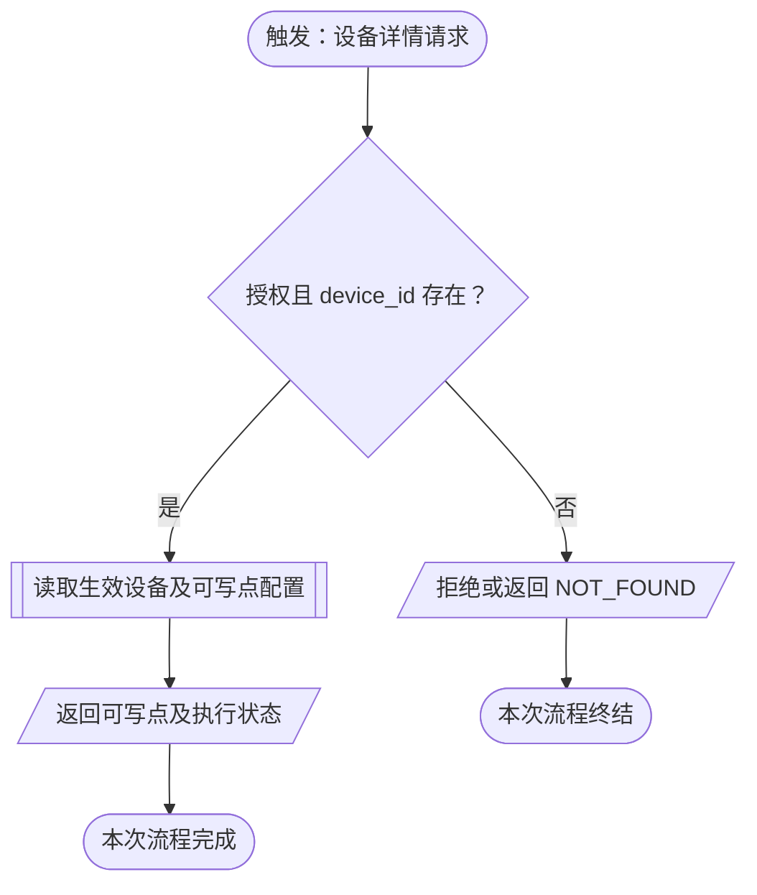

<p class="figure-caption">图 3-10 UR-10 查询设备详情业务流程</p>

#### 3.1.10.3 业务规则

返回指定设备详情及该设备当前生效配置中的可写入测点清单；清单仅来自已加载配置，不执行现场读取；设备不存在给出明确错误

#### 3.1.10.4 关键约束

不得主动连接设备；只列出明确标记为可写的测点，不包含只读点或仅查询点；敏感地址按权限过滤；状态来源清晰

### 3.1.11 UR-11 热重载设备配置

#### 3.1.11.1 基本信息与触发方式

| 字段 | 内容 |
|---|---|
| Requester | gRPC 调用方 |
| Trigger | API：授权 gRPC 请求到达 |
| Input | 配置校验请求或热重载请求；以磁盘候选配置为对象 |
| Response | 请求状态、受影响设备及应用结果、失败原因 |
| Destination | 不适用 |
| Output | 不适用 |

#### 3.1.11.2 业务流程

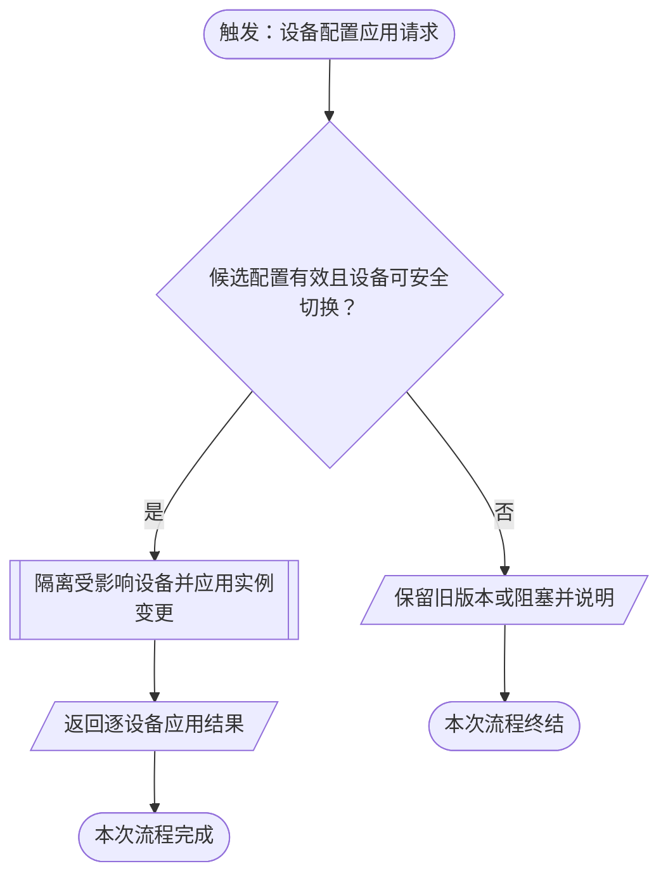

<p class="figure-caption">图 3-11 UR-11 热重载设备配置业务流程</p>

#### 3.1.11.3 业务规则

独立配置校验请求只读校验候选文件并返回错误位置与原因；热重载必须重新读取并校验候选文件，复用通用配置校验能力；除 commander.yaml 外的依赖配置文件均可热重载；逐设备先停止新执行准入、等待受影响 I/O 安全结束或可信隔离，再原子切换该设备配置；失败设备保留旧生效配置或保持阻塞，其他设备独立报告；不得通过热重载修改 commander.yaml 的服务级设置；不存热重载请求历史、不生成命令审计。

#### 3.1.11.4 关键约束

不允许热重载时更换正在执行命令使用的设备、点位或连接语义；删除设备必须待在途 I/O 安全结束并处置待执行命令；新增设备校验通过才开放准入；逐设备真实生效版本独立可见，遵循 CommonService 快照 revision 契约；候选配置与已生效配置必须可区分。

### 3.1.12 UR-12 查询配置状态

#### 3.1.12.1 基本信息与触发方式

| 字段 | 内容 |
|---|---|
| Requester | gRPC 调用方 |
| Trigger | API：授权 gRPC 请求到达 |
| Input | 设备筛选、是否包含设备级详情 |
| Response | 当前磁盘候选配置与实际生效文件的版本清单、整体/设备级应用状态和错误 |
| Destination | 不适用 |
| Output | 不适用 |

#### 3.1.12.2 业务流程

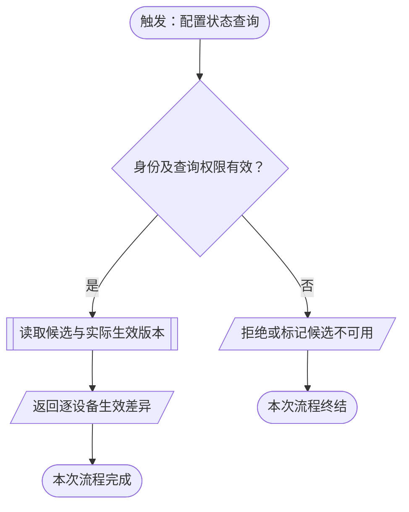

<p class="figure-caption">图 3-12 UR-12 查询配置状态业务流程</p>

#### 3.1.12.3 业务规则

以文件标识、schema_version 及适用的 file_version 展示候选与实际生效配置；部分失败时如实展示设备差异及是否需要重启，遵循 CommonService 快照 revision 契约

#### 3.1.12.4 关键约束

只读；不得将部分生效误报为全局成功

### 3.1.13 UR-13 本地命令与审计记录管理

#### 3.1.13.1 基本信息与触发方式

| 字段 | 内容 |
|---|---|
| Requester | 内部命令接收、状态变化与查询流程（自动触发） |
| Trigger | 内部事件：命令状态或落盘事件达到处理条件 |
| Input | 仅控制命令的客户端 request_id 与服务端 command_id、规范化请求、命令状态及结果，以及对应命令审计事件和投递确认；不包含配置热重载请求或状态 |
| Response | 存储成功或失败、查询可用性及容量告警（通过操作结果和运行状态反馈） |
| Destination | 不适用（本地存储属于本系统内部资源） |
| Output | 不适用 |

#### 3.1.13.2 业务流程

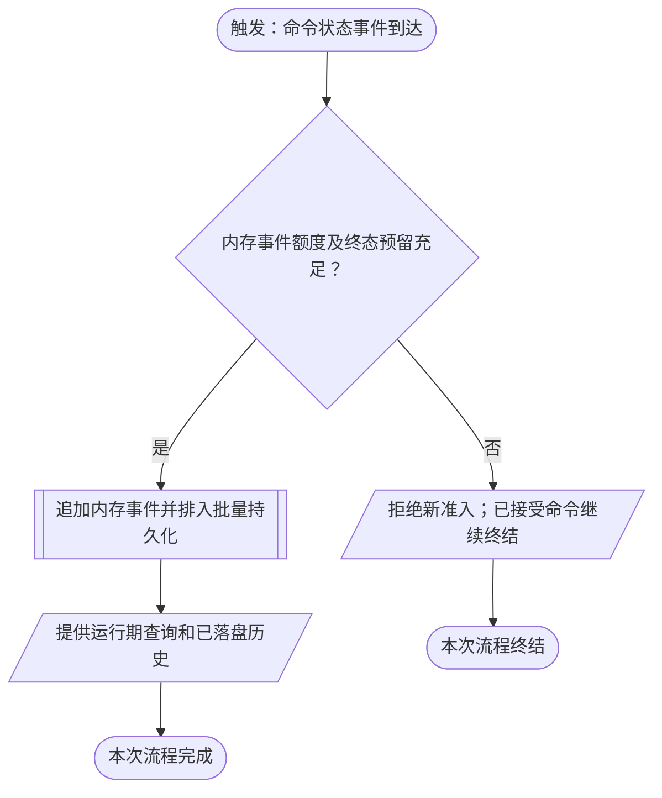

<p class="figure-caption">图 3-13 UR-13 本地命令与审计记录管理业务流程</p>

#### 3.1.13.3 业务规则

控制命令首次 ACCEPTED 事件完整保存可信调用方、请求身份、设备、目标变量和下发值；后续只追加状态/结果增量事件；单表同时支持命令查询、故障恢复及未发布事件；不重复存储可通过配置版本取得的设备/测点属性；按整条命令事件组清理，不记录启动、关闭、热重载事件。

#### 3.1.13.4 关键约束

本地最大存储容量、终态预留容量、查询保留期、清理周期和告警水位均须可配置；按最早符合条件的完整命令组优先清理，只有终态、全部相关事件已发布确认、超过查询保留期时才可删除；未终结命令、未确认投递或查询保留期内的记录不可覆盖或提前删除；无法安全清理或达到准入阈值时拒绝新命令并告警，同时预留已接收命令的内存终结事件容量，并在存储恢复后重试落盘；异常崩溃前未落盘部分不保证保留。

### 3.1.14 UR-14 发布命令审计事件

#### 3.1.14.1 基本信息与触发方式

| 字段 | 内容 |
|---|---|
| Requester | 本地已持久化审计事件（自动触发） |
| Trigger | 内部事件：命令状态或落盘事件达到处理条件 |
| Input | 仅已持久化的命令 ACCEPTED、状态变化及最终结果增量事件，含稳定 event_id、事件顺序、可信调用方、设备/测点、设定值（首次事件）及状态/结果（后续事件） |
| Response | 消息中间件的发布确认或失败状态；运行状态可查询积压与错误 |
| Destination | JetStream 审计消息服务 |
| Output | 向消息中间件发送命令接收、状态变化及执行结果事件，供下游长期/永久存储 |

#### 3.1.14.2 业务流程

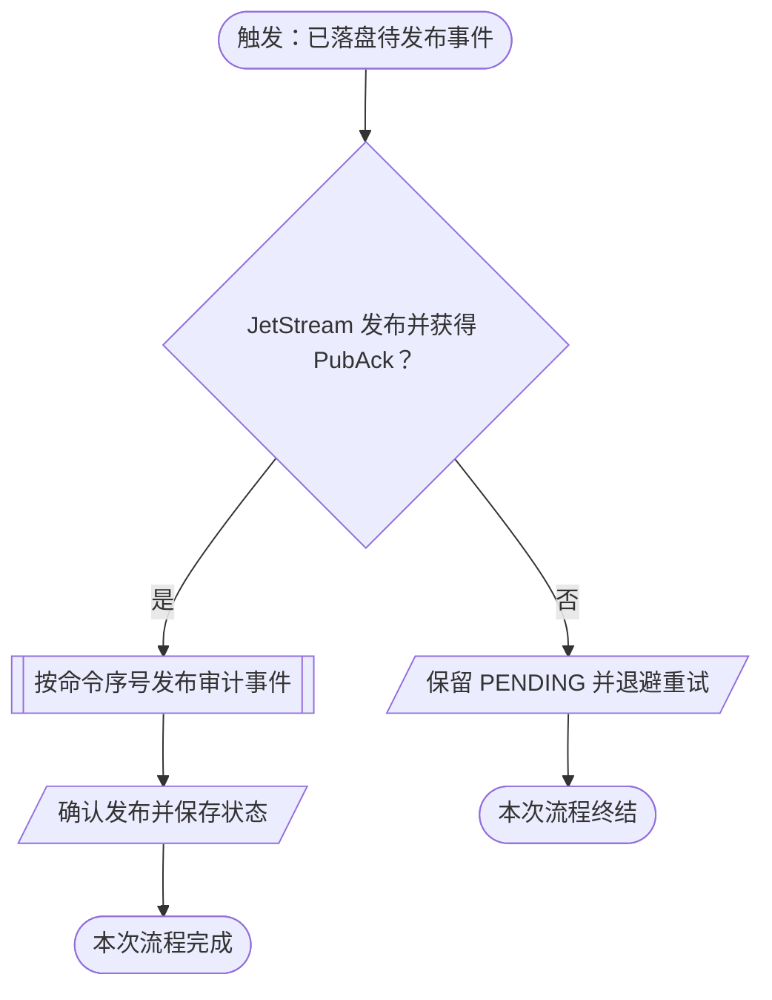

<p class="figure-caption">图 3-14 UR-14 发布命令审计事件业务流程</p>

#### 3.1.14.3 业务规则

事件先在内存记录并后台落盘，仅在 SQLite 落盘之后异步发布；同一命令按事件序号顺序发布；发布确认不代表下游已永久保存，后者属于下游系统职责

#### 3.1.14.4 关键约束

发布失败保留并按有界退避持续重试；未获 JetStream 发布确认绝不删除；按每条命令顺序发布，重复投递用 event_id 识别；积压量、最老积压时间及存储占用达到配置告警水位时报警，触及安全准入容量上限时拒绝新控制命令；消息中间件成功确认不代表下游已完成永久保存。

### 3.1.15 UR-15 异常退出后恢复服务

#### 3.1.15.1 基本信息与触发方式

| 字段 | 内容 |
|---|---|
| Requester | 进程管理系统（异常重启触发） |
| Trigger | 外部事件：进程管理系统启动/停止/重启 |
| Input | 本地持久化的统一命令事件及磁盘配置文件集合 |
| Response | 恢复结果、业务就绪状态、异常阻塞及告警 |
| Destination | 不适用 |
| Output | 不适用 |

#### 3.1.15.2 业务流程

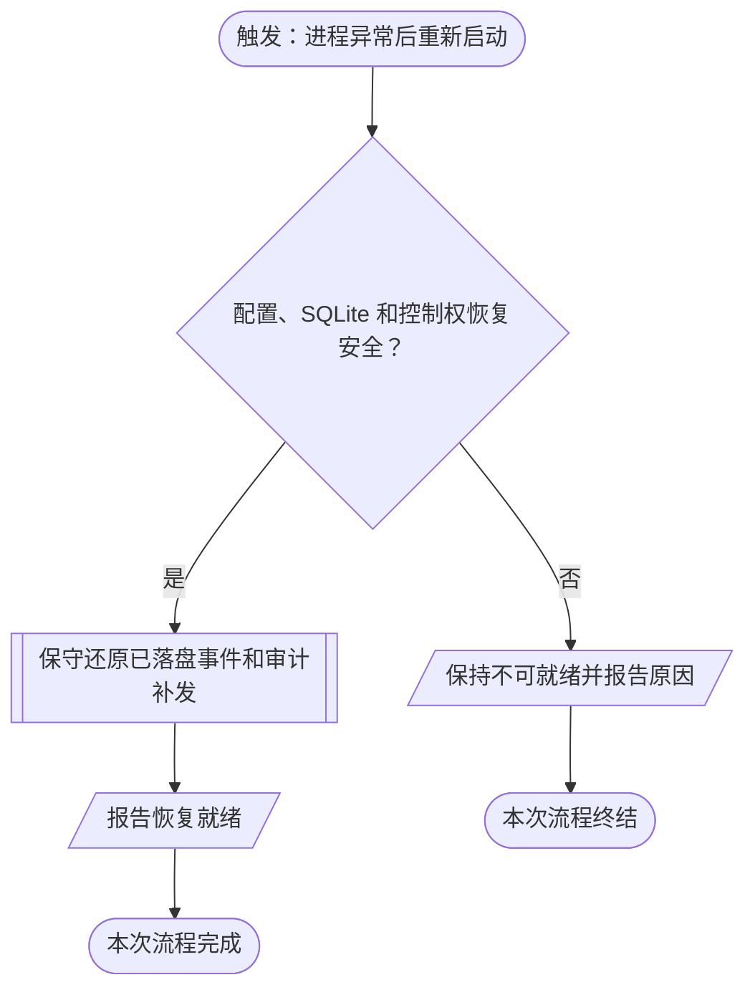

<p class="figure-caption">图 3-15 UR-15 异常退出后恢复服务业务流程</p>

#### 3.1.15.3 业务规则

重新加载并校验配置，核实完整事件和发布状态；未实际开始写入者按规则终结，可能已写入者保守终结 UNKNOWN；不重新发出旧写入；恢复未确认审计事件；对于旧配置下未安全结束的 I/O，隔离或维持相应设备阻塞后才允许在新配置下执行。

#### 3.1.15.4 关键约束

旧进程的 I/O 和设备控制权未确认安全结束/隔离前不得新建冲突写入；配置版本失配、引用失效或存储不可用不得就绪；UNKNOWN 不因晚到确认自动改写。

## 3.2 功能需求

Commander 必须实现 `src/contracts/common.proto` 中的 `CommonService` 全部 9 个 RPC，以及 `src/contracts/commander.proto` 中的 `CommanderService` 全部 7 个 RPC；字段、类型和传输层语义由 Contracts 统一定义。第 9 章描述业务映射和实现要求。Contracts v1_20 正式接口已包含 SubmitCommands、GetRequestResult 与单点 request_id 字段；Validate/Reload 仍由 CommonService 快照 RPC 承担。


<p class="table-caption">表 3-17 功能需求</p>

| 编号 | 需求 | 可验证要求 | 来源原始需求 |
|---|---|---|---|
| FR-01 | 启动、停止与重启 | 启动时校验配置、依赖及恢复状态后才就绪；停止时拒绝新命令并处置在途操作；重启先停止再重新读取全部配置文件，不沿用旧配置快照 | UR-01、UR-02、UR-03 |
| FR-02 | 单点控制 | 接收设备、可写点、目标值及可选时间约束；Commander 生成 command_id，返回接收或拒绝结果并调度一次写入 | UR-04 |
| FR-03 | 批量控制（Contracts v1_20 已冻结接口） | 整批校验并原子接受，逐项分配 command_id；按照设备 FIFO 执行；具备条件时优先 write_many，不支持时按序 write_one；返回逐项状态，跨设备不承诺原子执行 | UR-05 |
| FR-04 | 命令结果查询 | Contracts v1_20 支持按 command_id 和 request_id 分别查询单条命令与完整请求；返回初始请求和最新状态，未留存则 NOT_FOUND；不访问现场设备 | UR-04、UR-05、UR-06、UR-13 |
| FR-05 | 服务基本信息查询 | 返回服务标识、软件版本、启动信息及当前实际生效的依赖文件标识、schema_version 及适用的 file_version；不把未生效的磁盘文件标记为生效 | UR-07 |
| FR-06 | 运行状态查询 | 返回进程与业务就绪、命令及执行资源、阻塞、存储容量、审计积压和故障状态；区分存活与可用 | UR-08 |
| FR-07 | 设备列表查询 | 返回已配置设备、状态摘要、筛选与分页结果；不主动连接现场设备 | UR-09 |
| FR-08 | 设备详情查询 | 按 device_id 返回设备连接、执行、阻塞、错误及配置状态；列出当前生效点表中全部配置为可写的点标识、类型及写入约束；排除只读和仅查询点 | UR-10 |
| FR-09 | 设备配置热重载（由 CommonService 快照 RPC 承载） | 允许设备实例增删、连接参数、可写点表/约束及模板引用逐设备热更新；受影响设备在旧 I/O 安全结束或隔离后切换，失败保持旧版本或阻塞；commander.yaml 必须重启；不保留操作历史或命令审计 | UR-11 |
| FR-10 | 配置状态查询（由 CommonService.GetConfigSnapshot 承载） | 返回磁盘候选和当前生效的配置文件标识、schema_version 及适用的 file_version，逐设备显示应用结果、差异及是否需要重启；遵循 CommonService 快照 revision 契约 | UR-12 |
| FR-11 | 本地命令记录管理 | 内存原子追加已接受命令的首次事件，随后后台落盘，并以增量事件记录状态和结果；仅保留控制命令及其审计事件，供查询和恢复；按安全清理规则有限留存 | UR-04、UR-05、UR-06、UR-13 |
| FR-12 | 命令审计发布 | 直接将本地追加的命令事件（接受、状态变化和终结）按命令顺序向 JetStream 发布，并维护发布确认及待补发状态 | UR-13、UR-14 |
| FR-13 | 异常退出后恢复 | 重载配置并核对本地存储，恢复命令和待发布事件；未开始写入者按规则终结，可能已发送者终结为 UNKNOWN，不自动重发旧命令 | UR-15 |

## 3.3 性能需求

<p class="table-caption">表 3-18 性能需求</p>

| 编号 | 需求 | 可验证要求 | 来源原始需求 |
|---|---|---|---|
| PR-01 | 控制与查询响应 | 分别统计接收持久化、排队、连接、写入、结果查询的耗时；按指定负载报告分布，不能用协议写入耗时代替端到端耗时 | UR-04、UR-05、UR-06 |
| PR-02 | 有界执行容量 | 限定未完成命令数、设备排队数和全局在途 I/O 并发；同设备保持顺序，不同设备可在容量范围内并发 | UR-04、UR-05 |
| PR-03 | 本地存储容量 | 明确统一命令事件、查询索引及待发布事件的空间上限和保留期限；容量不足且不能安全清理时拒绝新控制请求 | UR-04、UR-05、UR-13、UR-14 |
| PR-04 | 批写效率 | 在相同设备、执行顺序和协议能力条件下优先 write_many；不满足条件时顺序 write_one，不因合并而改变 FIFO | UR-05 |
| PR-05 | 生命周期耗时 | 测量启动就绪、正常停止、重启恢复及异常恢复的耗时和未收敛资源数量 | UR-01、UR-02、UR-03、UR-15 |

设计与验收基准硬件为普通台式机：6 核 CPU、16 GiB 内存、512 GB NVMe SSD、Linux；Commander、SQLite 与 NATS 可同机部署。设计负载为 100 台可控设备、每台 10 Hz、每批最多 10 点，持续 1,000 批次/s、最多 10,000 点/s。以下数值是设计目标，均非已验证测试结果。

<p class="table-caption">表 3-19 性能及本地存储数值基线</p>

| 指标 | 设计值 | 验收口径与边界 |
|---|---|---|
| 控制请求接收响应 | P99 ≤ 100 ms | 从 RPC 到幂等持久受理反馈；不含设备排队和协议写入，性能目标需计入异步数据库事务确认 |
| 命令结果查询 | P99 ≤ 100 ms | 本地已保留数据的单次查询 |
| 基本信息与设备详情查询 | P99 ≤ 200 ms | 不触发现场 I/O |
| 审计事件发布确认 | P99 ≤ 1 s | NATS 正常运行、无历史积压时，从本地提交至 JetStream 确认 |
| 单设备在途 I/O | 1 | 未安全结束或隔离前不得释放同设备执行资源 |
| 全局在途 I/O | 100 | 包括超时后仍未安全结束的底层 I/O |
| 单设备等待队列 | 最多 10 批次 | 超出容量拒绝新控制请求；还需服从时间有效期 |
| 全局等待队列 | 最多 1,000 批次 | 与单设备队列约束共同生效 |
| 单批最大控制点数 | 10 点 | 批量控制请求上限 |
| 本地命令事件容量上限 | 64 GiB | 包含 SQLite 主库、索引及相关本地落盘开销；磁盘剩余空间另须满足安全要求 |
| 终结与恢复预留容量 | 6.4 GiB | 从 64 GiB 预算预留，不用于新请求准入 |
| 新命令准入停止阈值 | 90% | 达到阈值先安全清理；不足时拒绝新请求 |
| 容量预警阈值 | 80% | 持续监控并告警 |
| 已终结命令查询保留期 | 1,800 s（30 min） | 自终结起算；相关事件均发布确认后才允许按完整命令组删除 |
| 请求查询保留期 | 1,800 s（30 min） | 自请求首次接受起算；不承诺基于服务端编号实现客户端自动去重 |
| 安全清理周期 | 60 s | 按最早符合条件的完整命令事件组分批清理 |
| 启动就绪目标 | ≤ 10 s | 本地配置、存储正常；不要求全部现场设备预连接 |
| 正常关闭目标 | ≤ 10 s | 不以强制终止未收敛 I/O 达成指标 |

控制执行端到端时延受排队、连接和现场协议写入影响，不以接收响应 P99 代替；现场写入性能须单独验收。按满载 10,000 点/s 和 30 分钟计算，最多约 1,800 万个点级命令，实际事件数、SQLite 索引和写入压力取决于业务状态变化及记录大小。64 GiB 为目标硬件上的设计预算，持续吞吐及实际存储行大小必须通过性能验收确认，不保证所有协议环境都能达到上述持续吞吐；无法安全清理时必须拒绝新请求，不得覆盖未终结或未发布事件。

## 3.4 可靠性需求

<p class="table-caption">表 3-20 可靠性需求</p>

| 编号 | 需求 | 可验证要求 | 来源原始需求 |
|---|---|---|---|
| RR-01 | 持久幂等准入与有界缓存 | 整批先完成权限/参数校验、执行容量预留，再使用异步 SQLite 事务持久登记请求指纹、request_id 和全部 command_id；COMMIT 确认后才返回 accepted=true；后续状态事件保持有界缓存 | UR-04、UR-05、UR-13 |
| RR-02 | 控制请求标识 | 客户端生成 request_id，Commander 分配 command_id；调用方身份与 request_id 组成幂等键，同键同内容返回历史受理结果，同键异内容拒绝；持久登记支持跨重启恢复 | UR-04、UR-05、UR-13 |
| RR-03 | 单设备顺序与批量结果 | 同设备 FIFO，跨设备并行；合格批次优先 write_many，否则按序 write_one；按可确认的物理粒度保留逐点证据 | UR-04、UR-05 |
| RR-04 | 不确定结果 | 可能发送但结果无法确认时使用 UNKNOWN，不自动重发；已确认状态不受晚到结果覆盖 | UR-04、UR-05、UR-06、UR-15 |
| RR-05 | I/O 所有权 | 超时或取消不代表底层 I/O 结束；在安全结束或可信隔离前保留冲突资源保护 | UR-02、UR-04、UR-05、UR-15 |
| RR-06 | 配置一致性 | 配置校验、受影响设备隔离、版本绑定与热更新规则保持不变 | UR-01、UR-03、UR-11、UR-12、UR-15 |
| RR-07 | 受理持久化、结果持久化与容量 | 请求身份与批次子命令 ID 在异步 SQLite 事务 COMMIT 后才能受理；后续状态和审计由 PersistenceWorker 有界批量提交，失败记录待落盘事件并限制新准入；满足保留期后清理完整记录组 | UR-06、UR-13、UR-14 |
| RR-08 | 审计投递 | 仅已落盘的事件进入 JetStream 发布；稳定 event_id、PubAck 后确认、失败退避重试；异常崩溃允许未落盘审计丢失 | UR-13、UR-14、UR-15 |
| RR-09 | 停止与恢复 | 正常停机有界排空；超时明确报告未落盘；异常崩溃允许丢失易失记录；对已落盘未终结命令保守恢复且绝不自动重发现场控制 | UR-01、UR-02、UR-03、UR-15 |

**可靠性边界：**运行期间内存持有最新状态，SQLite 对已受理请求的唯一标识、请求指纹和 command_id 集合提供可恢复的权威登记，并承担异步结果历史及审计 Outbox。已返回 accepted=true 的请求身份不得在崩溃后丢失；最新执行结果尚未落盘时只可恢复为 UNKNOWN 或可证明的未发送状态。SQLite 受理事务失败时拒绝新准入；已受理控制可继续安全收敛并报告持久化 DEGRADED。

## 3.5 安全需求

<p class="table-caption">表 3-21 安全需求</p>

| 编号 | 需求 | 可验证要求 | 来源原始需求 |
|---|---|---|---|
| SR-01 | 请求身份与授权 | gRPC 采用 mTLS 验证客户端证书；从证书可信身份映射 caller_id，并按 commander.yaml 中 control/query/reload 权限授权；认证失败与权限不足分别返回 UNAUTHENTICATED、PERMISSION_DENIED；不得信任自报 caller_id；控制前复核设备、点位、数据类型、目标值及有效期约束 | UR-04、UR-05、UR-11 |
| SR-02 | 设备写入保护 | 只允许向生效配置声明可写的测点写入；同设备 FIFO、批量调用及热重载不得产生冲突现场操作 | UR-04、UR-05、UR-10、UR-11 |
| SR-03 | 不确定执行的安全策略 | 状态未知时不自动重试可能已发送的写入；底层 I/O 未安全结束或隔离前不得释放冲突资源 | UR-02、UR-04、UR-05、UR-15 |
| SR-04 | 控制实例唯一性 | 启动、重启及异常恢复期间，不能在现场控制权不确定时接受可能冲突的写入 | UR-01、UR-03、UR-15 |
| SR-05 | 查询信息保护 | 服务、设备列表与详情中的地址和其他敏感信息按请求方权限过滤；查询不得触发现场读取或连接 | UR-07、UR-09、UR-10 |

## 3.6 横切能力需求

<p class="table-caption">表 3-22 横切能力需求</p>

| 编号 | 需求 | 可验证要求 | 来源原始需求 |
|---|---|---|---|
| CR-01 | 命令审计内容 | 仅控制命令的接受、状态变化和终结产生业务审计，包含 request_id、command_id、目标设备/点、目标值、状态、结果及时间；启动、关闭、热重载不产生该类事件 | UR-01、UR-02、UR-04、UR-05、UR-11、UR-13 |
| CR-02 | 审计投递与追踪 | 在统一命令事件记录中保存稳定事件标识、待投递状态及确认结果；向 JetStream 发布命令增量事件，支持重投去重及积压监测；下游负责长期保存 | UR-08、UR-13、UR-14、UR-15 |
| CR-03 | 运行状态与诊断 | 提供进程存活、业务就绪、阻塞设备数、在途 I/O、队列积压、存储水位与预留、未确认事件数及最老积压时长、恢复结果和错误原因；日志与命令通过 request_id、command_id 关联 | UR-01、UR-03、UR-04、UR-06、UR-08、UR-13、UR-15 |
| CR-04 | 配置文件版本可追踪 | 展示每个实际生效依赖文件的标识、schema_version 及适用的 file_version；对候选文件及逐设备热重载结果单独报告，遵循 CommonService 快照 revision 契约，不持久化热重载请求历史 | UR-03、UR-07、UR-11、UR-12 |
| CR-05 | 非侵入式实现 | 日志、审计投递、指标等通用机制在边界或专用组件实现；业务逻辑只声明必需的业务事件和失败策略，不在每个业务路径重复投递与监控逻辑 | UR-04、UR-05、UR-08、UR-13、UR-14 |

## 3.7 总—分一致性检查结果

<p class="table-caption">表 3-23 原始需求与分类需求追溯结果</p>

| 原始需求 | 功能 FR | 性能 PR | 可靠性 RR | 安全 SR | 横切 CR | 结果 |
|---|---|---|---|---|---|---|
| UR-01 启动 | FR-01 | PR-05 | RR-06、RR-09 | SR-04 | CR-01、CR-03 | 已覆盖 |
| UR-02 关闭 | FR-01 | PR-05 | RR-05、RR-09 | SR-03 | CR-01 | 已覆盖 |
| UR-03 重启 | FR-01 | PR-05 | RR-06、RR-09 | SR-04 | CR-03、CR-04 | 已覆盖 |
| UR-04 单点 | FR-02、FR-11 | PR-01、PR-02、PR-03 | RR-01～RR-05 | SR-01～SR-03 | CR-01、CR-03、CR-05 | 已覆盖 |
| UR-05 批量 | FR-03、FR-11 | PR-01～PR-04 | RR-01～RR-05 | SR-01～SR-03 | CR-01、CR-05 | 已覆盖 |
| UR-06 结果查询 | FR-04 | PR-01 | RR-04、RR-07 | — | CR-03 | 已覆盖 |
| UR-07 基本信息 | FR-05 | — | — | SR-05 | CR-04 | 已覆盖 |
| UR-08 运行状态 | FR-06 | — | — | — | CR-02、CR-03、CR-05 | 已覆盖 |
| UR-09 设备列表 | FR-07 | — | — | SR-05 | — | 已覆盖 |
| UR-10 设备详情 | FR-08 | — | — | SR-02、SR-05 | — | 已覆盖 |
| UR-11 热重载 | FR-09 | — | RR-06 | SR-01、SR-02 | CR-01、CR-04 | 已覆盖 |
| UR-12 配置查询 | FR-10 | — | RR-06 | — | CR-04 | 已覆盖 |
| UR-13 本地记录 | FR-04、FR-11、FR-12 | PR-03 | RR-01、RR-02、RR-07、RR-08 | — | CR-01～CR-03、CR-05 | 已覆盖 |
| UR-14 审计发布 | FR-12 | PR-03 | RR-07、RR-08 | — | CR-02、CR-05 | 已覆盖 |
| UR-15 异常恢复 | FR-13 | PR-05 | RR-04～RR-06、RR-08、RR-09 | SR-03、SR-04 | CR-02～CR-04 | 已覆盖 |

<p class="table-caption">表 3-24 一致性检查结论</p>

| 检查项 | 结果 |
|---|---|
| UR 覆盖 | 15/15 项至少关联一条分类需求，无遗漏 |
| 分类需求来源 | FR 13 项、PR 5 项、RR 9 项、SR 5 项、CR 5 项，均标注 UR 来源 |
| 控制标识 | UR-04/05 的 request_id 由授权调用方生成，command_id 由 Commander 生成；caller_id 由 mTLS 认证身份映射 |
| 热重载边界 | 不热重载 commander.yaml；不记录热重载请求历史、不生成命令业务审计 |
| 设备详情点表 | 仅返回当前生效配置中的可写点及其写入约束，无只读/查询点 |
| 审计与存储 | 本地有限留存供查询/恢复/补发；JetStream 负责可靠投递，下游负责长期保存 |
| 配置版本 | 以各文件 schema_version 及适用的 file_version 标识当前生效版本，遵循 CommonService 快照 revision 契约 |
| 设计负载 | 100 台、每台 10 Hz、每批最多 10 点，目标 1000 批/s、10000 点/s；历史第七轮实测 1160–1192 批/s（本版未复测） |
| 数值目标与验证状态 | 历史第七轮验收曾报告 144 passed 及静态检查通过；本版配置契约更新后尚未重新验收，真实 PLC、root netem 和长稳 soak 仍需独立验证 |

检查结论：15/15 项 UR 已建立分类需求追溯；补齐服务端请求标识、查询保留期限、逐点未知结果、热重载字段边界、事件完整性与清理准入约束。数值性能、容量和留存期限已定义；历史版本完成过实验室负载验收，本版变更尚未重新验收，现场 PLC 和长稳运行仍需独立验证。

# 4. 用例视图

## 4.1 系统边界与参与者

Commander 面向两类外部交互入口：操作系统终端（Terminal）负责启动、停止与重启服务进程；gRPC 调用方负责控制、查询及设备配置热重载。不同业务系统、Web 和诊断 CLI 只要通过 gRPC 接口访问 Commander，均归入同一“gRPC 调用方”类别。现场设备、SQLite、NATS JetStream 及下游审计存储是外部依赖或业务输出目的地，不额外建模为发起用例的参与者。

<p class="figure-caption">图 4-1 Commander 系统边界与外部交互</p>

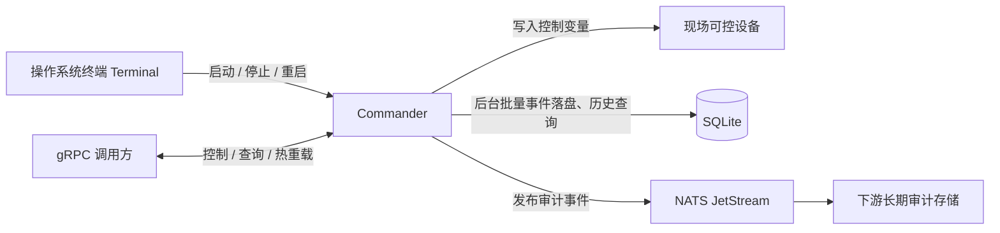

<p class="table-caption">表 4-1 外部交互角色及边界</p>

| 类别 | 交互方式 | 职责及边界 |
|---|---|---|
| 操作系统终端 | 进程启动、停止、重启命令 | 触发服务生命周期；异常退出后的恢复是后续启动过程的内部处理 |
| gRPC 调用方 | 对外 gRPC 契约 | 发起控制、结果和配置查询、设备查询、热重载；调用方身份由可信认证上下文确定 |
| 现场设备与协议适配器 | 外部执行依赖 | 提供协议层写入结果，不能将通信成功误认为物理控制目标达成 |
| SQLite | 后台持久化依赖 | 批量追加历史命令事件、支持历史查询、保存发布确认元数据；不阻塞控制执行 |
| NATS JetStream 与下游系统 | 外部事件投递目的地 | 接收命令审计事件；下游负责长期保存，不是 Commander 用例发起者 |

## 4.2 业务场景与完整用例

本节按第 2.3.1 节的通用规范组织。用例描述实际业务目标及端到端过程，不要求与第 3.1 节原始需求一一对应。自动审计发布、本地事件维护属于相关业务场景的共同支撑步骤，不虚构独立的外部请求方。

<p class="table-caption">表 4-2 场景用例与冻结需求映射</p>

| 用例 | 完整业务场景 | 参与者 | 涉及原始需求 |
|---|---|---|---|
| UC-01 | 服务首次启动并进入就绪状态 | 操作系统终端 | UR-01、UR-07、UR-08、UR-13、UR-14 |
| UC-02 | 下发单点或批量控制并取得结果 | gRPC 调用方 | UR-04、UR-05、UR-06、UR-13、UR-14 |
| UC-03 | 查询设备及可写变量 | gRPC 调用方 | UR-09、UR-10 |
| UC-04 | 查询服务基本信息、运行状态及配置状态 | gRPC 调用方 | UR-07、UR-08、UR-12 |
| UC-05 | 修改设备配置并热重载 | gRPC 调用方 | UR-11、UR-12 |
| UC-06 | 服务正常停止 | 操作系统终端 | UR-02、UR-13、UR-14 |
| UC-07 | 重启服务并按新配置运行 | 操作系统终端 | UR-03、UR-01、UR-15 |
| UC-08 | 异常退出后的重新启动与恢复 | 操作系统终端（重新启动时） | UR-15、UR-01、UR-13、UR-14 |

### 4.2.1 UC-01 服务首次启动并进入就绪状态

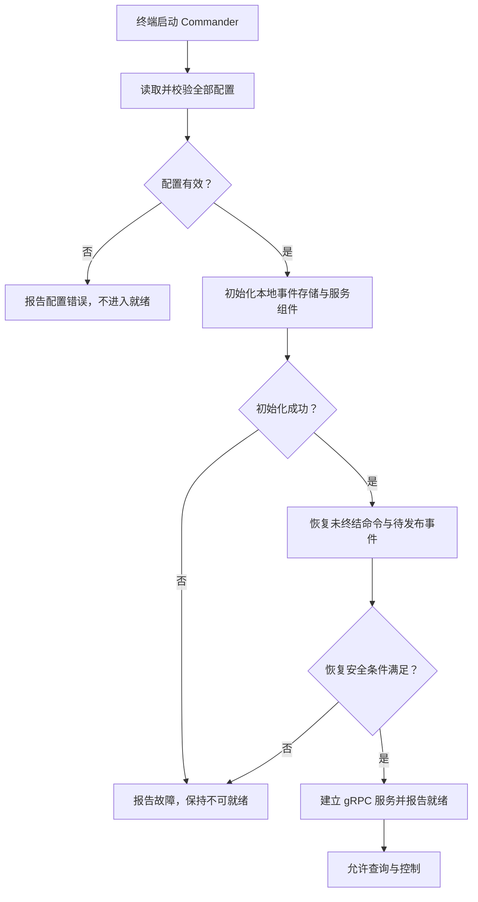

<p class="figure-caption">图 4-2 UC-01 服务首次启动并进入就绪状态业务活动图</p>

<p class="table-caption">表 4-3 UC-01 业务场景说明</p>

| 要素 | 内容 |
|---|---|
| 参与者与目标 | 操作系统终端发起启动，使 Commander 根据现有配置建立可信的本地运行状态并对 gRPC 请求提供服务。 |
| 前置条件 | 进程可启动；指定配置目录与本地持久化路径可访问。 |
| 主要异常 | 关键配置缺失或不兼容、存储不可用、恢复安全条件不满足、mTLS 证书无效或监听端口被占用时不得报告业务就绪；返回明确故障并保持安全状态。 |
| 后置条件 | 服务就绪，或者明确处于失败/不可就绪状态；启动行为本身不生成命令业务审计事件。 |
| 关联需求 | UR-01、UR-07、UR-08、UR-13、UR-14 |

### 4.2.2 UC-02 下发控制指令并获取执行结果

```mermaid
%%{init: {"flowchart": {"useMaxWidth": true}}}%%
flowchart TD
    A["gRPC 调用方提交单点或批量控制"] --> B["认证、授权及请求参数校验"]
    B --> C{"合法且容量允许？"}
    C -->|否| X["拒绝请求并反馈原因"]
    C -->|是| D["验证客户端 request_id，生成逐点 command_id"]
    D --> E{"ACCEPTED 已在有界内存日志原子登记并预留后续容量？"}
    E -->|否| Y["拒绝执行，报告内存准入异常"]
    E -->|是| F["返回请求及命令编号"]
    F --> G["设备 FIFO 等待执行"]
    G --> H{"取得执行资格？"}
    H -->|超期或失效| I["追加未执行终态"]
    H -->|是| J{"支持批量写入？"}
    J -->|是| K["调用 write_many"]
    J -->|否| L["依序调用 write_one"]
    K --> M["根据可信证据裁决逐点结果"]
    L --> M
    M --> N{"执行结果？"}
    N -->|确定成功| O["SUCCEEDED"]
    N -->|确定失败| P["FAILED"]
    N -->|无法确认| Q["UNKNOWN 并保护未结束 I/O"]
    O --> R["追加结果事件"]
    P --> R
    Q --> R
    I --> R
    E -.->|后台落盘后事件| S["异步可靠发布至 JetStream"]
    R -.-> S
    R --> T["调用方按编号查询最新结果"]
```

<p class="figure-caption">图 4-3 UC-02 下发控制指令并获取执行结果业务活动图</p>

<p class="table-caption">表 4-4 UC-02 业务场景说明</p>

| 要素 | 内容 |
|---|---|
| 参与者与目标 | gRPC 调用方提交单点或批量设定值，获知接收身份，并在后续查询中取得逐点命令结果。 |
| 前置条件 | Commander 已就绪；调用方获授权；目标设备与可写点属于当前生效配置。 |
| 主要异常 | mTLS 认证失败或控制权限不足直接拒绝；接受前参数、配置或容量校验失败则拒绝、不产生已接受命令；排队超时或有效期届满按未执行终结；现场写入结果不确定时标记 `UNKNOWN`，不盲目重试；RPC 断连不撤销已接受命令；提交前保存的 request_id 可用于查询；同 ID 重提按指纹幂等处理，不允许新 ID 自动重试；内存 ACCEPTED 未成功记录时不得执行现场写入；SQLite 受理事务故障时拒绝新的命令受理；已持久受理者按恢复规程处理；JetStream 故障时保留未确认事件重试；批量整体与逐点结果不得相互冒认。 |
| 后置条件 | 已受理请求的身份、全部 command_id 与幂等占位在 accepted=true 前可恢复；结果事件和审计可异步落盘，崩溃后对写入不确定的命令保留 UNKNOWN，不自动补发。 |
| 关联需求 | UR-04、UR-05、UR-06、UR-13、UR-14 |

### 4.2.3 UC-03 查询设备及可写变量

```mermaid
%%{init: {"flowchart": {"useMaxWidth": true}}}%%
flowchart TD
    A["gRPC 调用方请求设备列表"] --> B["身份与查询权限校验"]
    B --> C{"通过？"}
    C -->|否| X["拒绝查询"]
    C -->|是| D["按当前生效配置筛选设备"]
    D --> E{"查询条件有效？"}
    E -->|否| Y["返回参数错误"]
    E -->|是| F["返回设备列表"]
    F --> G["调用方选择设备查询详情"]
    G --> H{"设备存在？"}
    H -->|否| Z["返回设备不存在"]
    H -->|是| I["返回设备详情及可写点和写入约束"]
```

<p class="figure-caption">图 4-4 UC-03 查询设备及可写变量业务活动图</p>

<p class="table-caption">表 4-5 UC-03 业务场景说明</p>

| 要素 | 内容 |
|---|---|
| 参与者与目标 | gRPC 调用方定位可控设备，并读取其可写点标识及写入约束，为后续控制选择合法目标。 |
| 前置条件 | 服务可提供配置查询，调用方具有查询权限。 |
| 主要异常 | 认证失败、设备不存在、参数或分页条件错误、权限不足时返回相应错误；配置正在切换时，以明确的生效配置快照响应，不混合不同版本。 |
| 后置条件 | 调用方获得当前可控范围；整个流程不触发现场读取、写入或连接建立。 |
| 关联需求 | UR-09、UR-10 |

### 4.2.4 UC-04 查询服务信息与运行状态

```mermaid
%%{init: {"flowchart": {"useMaxWidth": true}}}%%
flowchart TD
    A["gRPC 调用方发起查询"] --> B["认证并校验 query 权限"]
    B --> C{"通过？"}
    C -->|否| X["拒绝查询"]
    C -->|是| D{"查询类别？"}
    D -->|基本信息| E["读取服务身份与生效配置文件版本"]
    D -->|运行状态| F["读取队列、I/O、存储及审计指标"]
    D -->|配置状态| G["读取候选文件与实际生效状态"]
    E --> H["返回信息快照"]
    F --> H
    G --> I{"候选配置可读？"}
    I -->|是| H
    I -->|否| J["标记候选配置异常，不覆盖生效状态"]
    J --> H
```

<p class="figure-caption">图 4-5 UC-04 查询服务信息与运行状态业务活动图</p>

<p class="table-caption">表 4-6 UC-04 业务场景说明</p>

| 要素 | 内容 |
|---|---|
| 参与者与目标 | gRPC 调用方了解服务身份、当前生效配置、运行容量及待处理异常，以支持运维判断。 |
| 前置条件 | gRPC 查询入口可用，调用方具有相应查询权限。 |
| 主要异常 | 认证或查询授权失败时拒绝；候选文件不可读取或不合法时明确报告，不能覆盖生效版本信息；不可观测指标应标记不可用，不虚构正常值。 |
| 后置条件 | 返回可供判断的当前快照；查询不变更配置，也不产生命令审计事件。 |
| 关联需求 | UR-07、UR-08、UR-12 |

### 4.2.5 UC-05 修改设备配置并热重载

```mermaid
%%{init: {"flowchart": {"useMaxWidth": true}}}%%
flowchart TD
    A["gRPC 调用方修改候选配置"] --> B["请求配置校验"]
    B --> C["调用 Core 配置解析与校验"]
    C --> D{"校验通过？"}
    D -->|否| X["返回错误，不改变运行配置"]
    D -->|是| E["返回校验报告"]
    E --> F["调用方请求配置应用"]
    F --> G["重新读取并校验候选配置"]
    G --> H{"有效且未更改 commander.yaml？"}
    H -->|否| Y["拒绝热重载，保留原配置"]
    H -->|是| I["隔离受影响设备并等待 I/O 安全结束"]
    I --> J{"具备安全切换条件？"}
    J -->|否| Z["保留旧配置或阻塞受影响设备"]
    J -->|是| K["切换受影响设备配置"]
    K --> L{"切换成功？"}
    L -->|否| Z
    L -->|是| M["返回实际生效版本与设备结果"]
```

<p class="figure-caption">图 4-6 UC-05 修改设备配置并热重载业务活动图</p>

<p class="table-caption">表 4-7 UC-05 业务场景说明</p>

| 要素 | 内容 |
|---|---|
| 参与者与目标 | gRPC 调用方完成候选配置校验，并在运行期间应用 `configs/services/commander.yaml` 之外的有效配置变更。 |
| 前置条件 | Commander 已运行；候选文件可访问；调用方具备 reload 权限。 |
| 主要异常 | 认证或授权失败直接拒绝；校验不通过时返回错误位置与原因；候选文件在两次操作间变化，以配置应用阶段的重新校验结果为准；旧 I/O 无法安全结束、配置应用失败或并发热重载冲突时，受影响设备保留旧配置或阻塞并报告，不宣称全部成功。 |
| 后置条件 | 实际生效配置与反馈一致；配置校验与热重载不产生命令审计事件。 |
| 关联需求 | UR-11、UR-12 |

### 4.2.6 UC-06 服务正常停止

```mermaid
%%{init: {"flowchart": {"useMaxWidth": true}}}%%
flowchart TD
    A["终端请求停止服务"] --> B["停止接受新控制请求"]
    B --> C["妥善处理已接受命令及事件落盘"]
    C --> D["停止调度与审计发布任务"]
    D --> E{"在途 I/O 能安全结束或隔离？"}
    E -->|是| F["安全释放可释放资源"]
    F --> G["退出进程并报告停止结果"]
    E -->|否| H["维持冲突保护并报告停止受阻"]
    H --> I["未确认事件留存，禁止虚报安全退出"]
```

<p class="figure-caption">图 4-7 UC-06 服务正常停止业务活动图</p>

<p class="table-caption">表 4-8 UC-06 业务场景说明</p>

| 要素 | 内容 |
|---|---|
| 参与者与目标 | 操作系统终端要求服务停止，使现有命令得到妥善终结或安全保护，并释放能够安全释放的资源。 |
| 前置条件 | Commander 进程正在运行。 |
| 主要异常 | 关闭期限到达时不能假定在途 I/O 已安全结束；必须按资源所有权和安全隔离规则处理，且不得丢弃未终结命令或未确认审计事件。 |
| 后置条件 | 进程安全退出或明确报告无法安全完成的停止条件；停止操作本身不产生命令业务审计。 |
| 关联需求 | UR-02、UR-13、UR-14 |

### 4.2.7 UC-07 重启服务并加载新配置

```mermaid
%%{init: {"flowchart": {"useMaxWidth": true}}}%%
flowchart TD
    A["终端执行重启"] --> B["停止原服务或处理原进程退出"]
    B --> C["重新启动并读取全部配置文件"]
    C --> D{"新配置校验通过？"}
    D -->|否| X["报告重启失败，不宣称新配置生效"]
    D -->|是| E["恢复本地事件与旧 I/O 安全状态"]
    E --> F{"恢复及初始化完成？"}
    F -->|否| Y["保持不可就绪并报告原因"]
    F -->|是| G["开启 gRPC 服务"]
    G --> H["报告新生效配置文件版本"]
```

<p class="figure-caption">图 4-8 UC-07 重启服务并加载新配置业务活动图</p>

<p class="table-caption">表 4-9 UC-07 业务场景说明</p>

| 要素 | 内容 |
|---|---|
| 参与者与目标 | 操作系统终端要求重启 Commander，使服务重新读取全部配置并按新版本运行。 |
| 前置条件 | 当前服务运行或已停止；新的配置文件已经放置到指定位置。 |
| 主要异常 | 新配置校验失败、服务初始化失败或历史 I/O 安全边界不满足时拒绝宣称就绪；不得默认沿用旧版本冒充新版本。 |
| 后置条件 | 服务按新配置就绪，或明确失败；重启操作本身不产生命令业务审计。 |
| 关联需求 | UR-03、UR-01、UR-15 |

### 4.2.8 UC-08 异常退出后的恢复

```mermaid
%%{init: {"flowchart": {"useMaxWidth": true}}}%%
flowchart TD
    A["进程异常退出后重新启动"] --> B["读取配置、事件与未发布审计"]
    B --> C{"配置、证书、数据库可用？"}
    C -->|否| X["恢复失败：不得进入 READY"]
    C -->|是| D["识别未终结命令并保守裁决"]
    D --> E["检查旧实例控制权及在途 I/O 安全性"]
    E --> F{"全部必要安全条件满足？"}
    F -->|否| X
    F -->|是| G["恢复查询与审计补发任务"]
    G --> H["使用原 event_id 重投未确认事件"]
    H --> I{"关键恢复组件就绪？"}
    I -->|否| X
    I -->|是| J["恢复成功：进入 READY"]
```

<p class="figure-caption">图 4-9 UC-08 异常退出后的恢复业务活动图</p>

<p class="table-caption">表 4-10 UC-08 业务场景说明</p>

| 要素 | 内容 |
|---|---|
| 参与者与目标 | 服务异常退出后，操作系统终端重新启动 Commander；恢复本地可查询结果与未发布事件，同时避免旧写入副作用。 |
| 前置条件 | 存在异常中断后遗留的本地持久化记录或未确认审计事件。 |
| 主要异常 | 存储损坏、配置不兼容、旧实例隔离无法确认或设备执行安全条件不满足时恢复失败；不得用旧配置含义覆盖当前配置，亦不能将未知命令改判成功；发布确认丢失时允许凭稳定 event_id 重投并由下游去重。 |
| 后置条件 | 恢复成功则进入 READY 并提供查询与审计补发；恢复失败不得进入 READY，报告明确原因。 |
| 关联需求 | UR-15、UR-01、UR-13、UR-14 |

## 4.3 控制用例的主要交互

单点和批量共用“校验 → 异步数据库事务幂等受理 → 队列调度 → 现场写入 → 结果记录与异步审计”的主路径。请求接受与现场执行相互独立；调用方断连不取消已接受的命令。拒绝发生在持久受理之前，不能虚构 command_id 或已接受审计事件。

<p class="figure-caption">图 4-10 控制请求接受、执行与审计的典型时序</p>

```mermaid
%%{init: {"sequence": {"useMaxWidth": true}}}%%
sequenceDiagram
    participant C as gRPC调用方
    participant A as 控制服务
    participant E as 命令事件存储
    participant D as 设备执行调度
    participant P as 现场协议适配器
    participant J as JetStream发布器
    C->>A: 设备 / 可写点 / 目标值 / 时限
    A->>A: mTLS身份确认、control授权、配置与容量校验
    A->>A: 验证客户端 request_id 并生成稳定 command_id
    A->>E: SQLite 异步事务持久登记请求/指纹/command_ids
    E-->>A: COMMIT 完成，受理身份可恢复
    A-->>C: 接受结果、request_id及command_id
    par 设备队列执行
        A->>D: 已接受命令
        D->>E: 追加开始执行事件
        D->>P: write_many 或 write_one
        P-->>D: 协议可确认结果或不确定结果
        D->>E: 追加终态 / 逐点结果
    and 审计异步投递
        E-->>J: 读取待发布事件
        J->>J: 按同一命令事件顺序投递
        J->>E: PubAck 后记录投递确认
    end
```

<p class="table-caption">表 4-11 控制用例关键分支与异常结果</p>

| 场景 | 处理及对外结果 | 对应约束 |
|---|---|---|
| RPC 接受响应丢失，调用方未得到编号 | 以提交前已保存的 request_id 查询；同 ID 同内容幂等，不得生成新 ID 自动重发 | UR-04～UR-06 |
| SQLite 受理事务失败 | 不得返回 accepted=true 或执行现场写入；无已受理命令 | UR-04、UR-05、UR-13 |
| 参数、权限、容量或配置校验不通过 | 接受前拒绝，无控制写入 | UR-04、UR-05 |
| 整批输入部分无效 | 整批拒绝，不接受任何子命令 | UR-05 |
| 同设备连续合格点写入 | 优先一次 write_many；协议不支持则按 FIFO 顺序 write_one | UR-05 |
| 批量部分结果不确定 | 按实际证据逐点报告；无法确认的点为 UNKNOWN | UR-05 |
| 排队期限或有效期在写入前届满 | 终结为确定未执行的失败；不执行现场写入 | UR-04、UR-05 |
| 写入可能已发出但确认丢失 | 记录 UNKNOWN，不盲目重试；维持未安全结束 I/O 的冲突保护 | UR-04、UR-05 |
| RPC 取消或响应丢失 | 已确认受理命令继续处理；调用方持有 request_id，可查询记录；同一 ID 不允许产生第二次执行 | UR-04～UR-06 |

## 4.4 用例覆盖检查

<p class="table-caption">表 4-12 用例覆盖及边界检查结果</p>

| 检查内容 | 结果 |
|---|---|
| UR 到 UC 映射 | 8 个完整场景覆盖 UR-01～UR-15，15/15 覆盖；无一一对应假设 |
| 对外查询行为 | UC-02 的结果查询、UC-03 和 UC-04；均不得触发现场读写 |
| 控制接受与可靠存储 | UC-02；受理确认以异步 SQLite 请求身份持久事务及容量预留为前提，后续状态事件后台异步持久化 |
| 异步审计链路 | UC-02 产生事件，UC-01、UC-06～UC-08 处理恢复与补发；JetStream 确认与下游永久保存明确分界 |
| 热重载非审计边界 | UC-05 不生成命令审计或热重载操作历史 |
| 生命周期边界 | UC-01、UC-06～UC-08 不向现场重发历史控制指令 |

# 5. 逻辑视图

本章只规定逻辑组件的职责、依赖、核心协作、状态语义和错误分类。运行时 Task、并发同步、SQLite 事务、配置文件切换和 JetStream 确认的实现机制，分别由第 6、10～12 章规定，不在此重复。

## 5.1 逻辑组件、职责与依赖

<p class="figure-caption">图 5-1 内存优先的 Commander 逻辑分层</p>

```mermaid
%%{init: {"flowchart": {"useMaxWidth": true}}}%%
flowchart TB
  RPC["gRPC 接入：鉴权与控制请求"] --> CTRL["CommandControl"]
  CTRL --> MEM["BufferedJournal：内存命令状态"]
  CTRL --> DISP["QueuedExecutor：设备 FIFO / 全局额度"]
  DISP --> MEM
  DISP --> PLC["协议 Session / PLC"]
  MEM --> Q["PersistenceQueue：待落盘事件"]
  Q --> WORK["PersistenceWorker：定时/定量批量写"]
  WORK --> DB[("SQLite WAL/FULL：历史 + Outbox")]
  DB --> AUD["AuditDelivery"]
  AUD --> JS["JetStream"]
  RPC --> QUERY["命令查询"]
  QUERY --> MEM
  QUERY --> DB
```

<p class="table-caption">表 5-1 组件职责与关键边界</p>

| 组件 | 责任 | 约束 |
|---|---|---|
| CommandControl / BufferedJournal | 已受理请求的内存运行态、CONNECTING、EXECUTING 与终态；运行时查询 | 受理时等待异步 SQLite COMMIT；后续运行态在 Event Loop 原子更新，不阻塞现场 I/O |
| QueuedExecutor / Session | 设备 FIFO、连接复用、写入调度、UNKNOWN 与在途 I/O 所有权 | 不自动重发，跨设备可并行 |
| PersistenceQueue | 有界待落盘事件与尚未发生阶段的容量预留 | 满额拒绝新准入，不能阻止已接受命令终结 |
| PersistenceWorker | 单常驻 Task 周期/阈值批量提交，失败重试、停机排空 | 单 writer 线程执行 SQLite；未确认提交不出队 |
| SQLite Repository | 请求身份/内容指纹/子命令 ID 持久受理；历史查询、保守恢复与审计 Outbox | 受理事务在响应前 COMMIT；后续事件批量异步追加 |
| AuditDelivery | 只发布后台落盘后事件；PubAck 后更新发布状态 | JetStream 故障不改变现场结果 |
| 生命周期管理 | 启停、任务监督、存储降级、缓存积压与排空报告 | 异常崩溃不可丢失已确认受理身份；未落盘执行证据需保守裁决 |

## 5.2 关键业务协作

<p class="figure-caption">图 5-2 控制与持久化解耦流程</p>

```mermaid
%%{init: {"sequence": {"useMaxWidth": true}}}%%
sequenceDiagram
  participant C as 调用方
  participant M as 内存状态
  participant P as PLC
  participant W as PersistenceWorker
  participant S as SQLite
  participant J as JetStream
  C->>M: 提交客户端 request_id 与控制内容
  M->>S: 异步持久受理请求指纹和 command_id
  S-->>M: COMMIT 确认
  M-->>C: 回显 request_id / command_id
  M->>M: EXECUTING
  M->>P: 写入控制点
  P-->>M: 现场执行证据
  M->>M: 更新最终结果
  C->>M: 查询当前结果
  M-->>C: 内存中的最新状态
  W->>M: 提取顺序事件批次
  W->>S: 后台批量事务
  S-->>W: 提交确认
  S->>J: 由审计任务异步发布后台落盘后事件
```

调用方等待且只等待请求身份与幂等占位的 SQLite COMMIT 后获得受理结果，不等待现场 I/O、后续状态事件和审计的异步持久化；异常崩溃时身份不丢失，未持久化的执行结果按保守 UNKNOWN 裁决，绝不自动重发旧控制。

## 5.3 状态机与状态转换责任

箭头标注格式统一为“触发条件 / 负责模块”。状态转换裁决与事件持久化是不同职责，相关细节见第 6、10 章。

<p class="figure-caption">图 5-3 命令状态机及转换责任</p>

```mermaid
%%{init: {"state": {"useMaxWidth": true}}}%%
stateDiagram-v2
  [*] --> WAITING: ACCEPTED 事件提交 / 控制编排
  WAITING --> CONNECTING: 队首获得全局额度并准备连接 / 调度器
  CONNECTING --> EXECUTING: 开始现场写入前记录执行边界 / 调度器
  WAITING --> COMPLETED: 排队超期、过期或执行前失败 / 调度器
  CONNECTING --> COMPLETED: 连接确定失败或到期 / 结果裁决
  EXECUTING --> COMPLETED: 确认成功、失败或结果不确定 / 结果裁决
  COMPLETED --> [*]
```

<p class="figure-caption">图 5-4 设备执行状态机及转换责任</p>

```mermaid
%%{init: {"state": {"useMaxWidth": true}}}%%
stateDiagram-v2
  [*] --> IDLE
  IDLE --> BUSY: 获得执行权 / 设备调度器
  BUSY --> IDLE: I/O 已安全结束 / 会话管理
  BUSY --> BLOCKED: I/O 未安全结束 / 会话管理
  BLOCKED --> IDLE: 安全结束或可信隔离 / 会话管理
```

<p class="figure-caption">图 5-5 底层 I/O 状态机及转换责任</p>

```mermaid
%%{init: {"state": {"useMaxWidth": true}}}%%
stateDiagram-v2
  [*] --> IN_FLIGHT: 发起写入 / 协议适配器
  IN_FLIGHT --> SETTLED: 确认底层执行结束 / 会话管理
  IN_FLIGHT --> UNCERTAIN: 超时且底层未确认结束 / 会话管理
  UNCERTAIN --> SETTLED: 收到安全结束证据 / 会话管理
  UNCERTAIN --> ISOLATED: 可信隔离完成 / 会话管理
  SETTLED --> [*]
  ISOLATED --> [*]
```

运行时命令状态包括 ACCEPTED、CONNECTING、EXECUTING，以及 SUCCEEDED、FAILED、UNKNOWN、INTERRUPTED、EXPIRED、CANCELLED 六种终态；SQLite 事件的终结类型统一为 COMPLETED，但通过 state/outcome 保留具体终态。SUCCEEDED 对应 CONFIRMED_SUCCESS，FAILED 对应 CONFIRMED_FAILURE，UNKNOWN 对应 UNKNOWN，INTERRUPTED、EXPIRED、CANCELLED 对应 NOT_SENT。终态不可再改变。`UNKNOWN` 是命令业务结果；`UNCERTAIN` 是底层 I/O 尚不确定安全结束的运行状态，两者不得混用。进程退出后不能假定原 Task 或锁仍然存在。

## 5.4 错误分类与语义

<p class="table-caption">表 5-2 错误大类、小类及含义</p>

| 大类 | 小类 | 含义 |
|---|---|---|
| 请求 | 参数无效、目标不存在、目标不可写 | 请求无法构成合法控制或查询 |
| 安全 | 认证失败、权限不足 | 调用方身份未获确认，或无权执行该操作 |
| 准入调度 | 队列满、排队超时、命令过期 | 无执行资格或有效期限已届满 |
| 设备会话 | 连接失败、设备阻塞 | 无法建立连接，或仍存在未安全结束的 I/O |
| 协议执行 | 确认写入失败、执行结果不确定 | 现场写入失败有证据，或可能写入但结果不可确认 |
| 本地存储 | 后台提交失败、缓存满、状态恢复异常 | SQLite 异步重试并报告 DEGRADED；缓存满拒绝新准入，已受理命令仍可在内存终结 |
| 审计投递 | 发布失败、确认丢失、积压 | 事件尚未确认传递，不能解释成现场写入失败 |
| 配置 | 配置无效、变更不允许、切换失败 | 候选配置不合法，涉及只能重启的内容，或设备无法安全切换 |
| 服务 | 未就绪、正在停止、旧实例未隔离 | 当前服务不能安全接收或执行控制 |

错误类别不直接等于命令终态。错误码与 gRPC 状态的映射在第 9 章定义；本章仅规定逻辑语义。

# 6. 进程视图

本章说明运行时执行单元的实际结构、生命周期、并发与竞态处理，不重复第五章的业务状态机。流程图和时序图中的 Task、线程分别对应不同执行上下文，普通应用组件不默认具有独立 Task。

## 6.1 进程、事件循环、Task 与线程

<p class="figure-caption">图 6-1 Commander 运行执行单元</p>

```mermaid
%%{init: {"flowchart": {"useMaxWidth": true}}}%%
flowchart TB
  subgraph PROC["Commander 单活动进程"]
    subgraph LOOP["asyncio Event Loop"]
      RPC["RPC 请求协程"]
      DEV["每设备执行 Task"]
      MEM["BufferedJournal 与有界事件队列"]
      WORK["PersistenceWorker 常驻 Task"]
      AUD["AuditDelivery 常驻 Task"]
      SUP["Watchdog"]
    end
    DB["SQLite 唯一 Writer 线程"]
  end
  RPC --> MEM
  RPC --> DEV
  DEV --> MEM
  DEV --> PLC["PLC / 协议会话"]
  MEM --> WORK
  WORK --> DB
  DB --> SQLITE[("SQLite WAL/FULL")]
  AUD --> DB
  AUD --> JS["JetStream"]
  SUP --> WORK
  SUP --> AUD
```

| 运行单元 | 方式与约束 |
|---|---|
| 请求、命令状态、设备 FIFO | 受理登记等待异步 SQLite COMMIT；已受理命令调度与运行态不等待后续事件落盘 |
| PersistenceWorker | 独立常驻 asyncio.Task；默认 50 ms 聚合、500 事件/批；达到批次阈值提前提交 |
| SQLite Repository | 独立单 Writer 线程，事务与磁盘 I/O 不占用 Event Loop |
| AuditDelivery | 独立 Task，只消费已经落盘的 Outbox |
| 生命周期监督 | 检查 Worker 是否意外终止、SQLite 故障和缓存积压；正常停机有界排空 |

## 6.2 服务运行生命周期与资源管理

<p class="figure-caption">图 6-2 服务启动及异常恢复流程</p>

```mermaid
%%{init: {"flowchart": {"useMaxWidth": true}}}%%
flowchart TD
  A["Terminal 启动或重启进程"] --> B["按启动参数读取 commander.yaml，按声明 pathname 加载直接实例与模板根并复用 Core 校验"]
  B --> C{"配置、证书及关键依赖有效?"}
  C -->|否| X["恢复失败 / 不进入 READY"]
  C -->|是| D["打开 SQLite 并恢复事件"]
  D --> E["检查旧实例隔离与未终结命令"]
  E --> F{"安全恢复条件满足?"}
  F -->|否| X
  F -->|是| G["启动设备执行、审计发布与监督任务"]
  G --> H["READY / 接受新请求"]
```

<p class="figure-caption">图 6-3 正常停止与资源关闭流程（不能安全退出时明确失败）</p>

```mermaid
%%{init: {"flowchart": {"useMaxWidth": true}}}%%
flowchart TD
  A["Terminal 请求停止"] --> B["停止新控制准入"]
  B --> C["终结未发起写入的队列命令"]
  C --> D["跟踪已发起的在途 I/O"]
  D --> E{"底层 I/O 可安全结束或隔离?"}
  E -->|否| F["报告停止受阻 / 继续保有进程内资源"]
  F --> D
  E -->|是| G["提交必要终态并处理待发布审计"]
  G --> H["结束后台 Task、关闭连接和数据库"]
  H --> I["正常退出"]
```

重启是旧进程停止后由新进程重新读取配置并执行启动流程；不能将旧 Task、线程锁或连接资源视为跨进程保留。设备配置热重载只切换受影响设备，不重载 `commander.yaml`；其配置有效性由第 11 章规定。

## 6.3 并发与资源竞争：典型场景

### 6.3.1 多设备并发与同设备 FIFO

<p class="figure-caption">图 6-4 两台设备并发、同设备顺序执行</p>

```mermaid
%%{init: {"sequence": {"useMaxWidth": true}}}%%
sequenceDiagram
  participant A as 设备 A Task
  participant B as 设备 B Task
  participant G as 全局额度
  participant P as 协议执行
  par 设备 A：A1 然后 A2
    A->>G: A1 为队首，申请额度
    G-->>A: 取得额度
    A->>P: 写入 A1
    P-->>A: 结果及 I/O 安全结束
    A->>G: 释放 A1 额度
    A->>G: A2 成为队首，申请额度
    G-->>A: 取得额度
    A->>P: 写入 A2
    P-->>A: 结果及 I/O 安全结束
    A->>G: 释放 A2 额度
  and 设备 B：B1 可并行
    B->>G: B1 为队首，申请额度
    G-->>B: 取得额度
    B->>P: 写入 B1
    P-->>B: 结果及 I/O 安全结束
    B->>G: 释放 B1 额度
  end
```

同设备 A2 不得越过 A1；设备 B 可与 A 并行，全部在途 I/O 共用最多 100 个额度。

### 6.3.2 FIFO 队首与全局额度竞争

<p class="figure-caption">图 6-5 队首等待全局额度及到期裁决</p>

```mermaid
%%{init: {"sequence": {"useMaxWidth": true}}}%%
sequenceDiagram
  participant D as 设备执行 Task
  participant G as 全局额度
  participant R as 事件存储
  D->>D: 成为设备 FIFO 队首
  D->>G: 申请额度（受共同排队期限约束）
  alt 排队期限届满
    D->>R: 追加 COMPLETED（error_code=EXPIRED），移出 FIFO
  else 获得额度且仍未到期
    G-->>D: 授予额度
    D->>D: 复查有效期、配置和执行资格
    D->>R: 记录可能执行边界
    D->>D: 进入现场执行
  end
```

单设备最多 10 批、全局最多 1000 批。排队期限覆盖设备队列与全局额度等待；获得额度后仍需最后检查有效期。

## 6.4 并发竞争与故障处理：典型场景

### 6.4.1 RPC 断开，但命令已接受

<p class="figure-caption">图 6-6 持久受理与 RPC 断开竞争</p>

```mermaid
%%{init: {"sequence": {"useMaxWidth": true}}}%%
sequenceDiagram
  participant C as gRPC 调用方
  participant S as 控制服务
  participant R as SQLite Repository
  participant D as 设备执行 Task
  C->>S: SubmitCommand(request_id, value)
  S->>R: 请求指纹 + command_id + ACCEPTED 持久登记
  R-->>S: SQLite COMMIT
  Note over C,S: gRPC 断开或响应丢失
  S->>D: 继续调度已持久受理命令
  C->>S: GetRequestResult(request_id)
  S-->>C: 同一请求及结果（UNKNOWN 如实报告）
  Note over D: 断开不撤销命令；同 request_id 不重复执行
```

### 6.4.2 排队过期与执行资格竞争

<p class="figure-caption">图 6-7 队首到期时禁止现场写入</p>

```mermaid
%%{init: {"sequence": {"useMaxWidth": true}}}%%
sequenceDiagram
  participant D as 设备执行 Task
  participant G as 全局额度
  participant R as Repository
  D->>G: 等待额度
  G-->>D: 额度可用
  D->>D: 复核排队期限与命令有效期
  alt 已过期
    D->>R: 追加 COMPLETED（error_code=EXPIRED）
    D->>G: 释放未使用额度
  else 仍有效
    D->>R: 追加可能执行事件
    D->>D: 发起现场 I/O
  end
```

### 6.4.3 现场写入完成，SQLite 后台持久化失败

<p class="figure-caption">图 6-8 结果持久化失败时禁止重复写入</p>

```mermaid
%%{init: {"sequence": {"useMaxWidth": true}}}%%
sequenceDiagram
  participant D as 设备执行 Task
  participant P as 协议适配器
  participant R as Repository
  D->>P: 写入控制值
  P-->>D: 明确执行结果
  D->>R: 追加终态事件
  R-->>D: 写入失败或提交不确定
  Note over D: 保存可用结果证据并对账重试终态持久化
  Note over D,P: 不重复现场写入，不推进冲突命令
```

### 6.4.4 I/O 超时但底层执行未结束

<p class="figure-caption">图 6-9 命令 UNKNOWN 与设备阻塞的分离</p>

```mermaid
%%{init: {"sequence": {"useMaxWidth": true}}}%%
sequenceDiagram
  participant D as 设备执行 Task
  participant S as SessionManager
  participant P as 协议适配器
  participant R as Repository
  D->>P: 发起写入
  Note over D,P: 业务执行期限届满
  D->>R: 追加 UNKNOWN 终态
  D->>S: 标记设备 BLOCKED，继续持有必要额度
  S->>P: 跟踪原 I/O 是否安全结束
  P-->>S: 可信安全结束或隔离证据
  S-->>D: 解除 BLOCKED、释放额度
  Note over D,R: UNKNOWN 仍为最终业务结果，不回写成功
```

### 6.4.5 热重载与设备执行竞争

<p class="figure-caption">图 6-10 受影响设备暂停与安全切换</p>

```mermaid
%%{init: {"sequence": {"useMaxWidth": true}}}%%
sequenceDiagram
  participant C as 配置服务
  participant D as 受影响设备 Task
  participant S as SessionManager
  participant U as 未受影响设备 Task
  C->>C: 调用 Core 重新校验候选配置
  C->>D: 暂停新执行
  par 受影响设备
    D->>S: 等待 I/O 安全结束或隔离
    S-->>D: 可安全切换
    C->>S: 切换设备配置及会话
    C->>D: 恢复执行
  and 未受影响设备
    U->>U: 保持原有执行，不受暂停影响
  end
```

# 7. 开发视图

本章规定目标生产代码的物理目录、主要模块和依赖边界。目录为目标设计，不代表目前仓库已有全部文件；实际落地应以对应职责为准，不为目录形式增设空类或多余抽象。`core` 与 `contracts` 的现有公共能力优先复用。

## 7.1 目标代码目录

```text
src/commander/
├── domain/                       # Command、执行裁决、领域异常
├── application/
│   ├── ports/                    # ControlExecutionPort、EventRepositoryPort、AuditPublisherPort
│   ├── control.py                # 认证后业务受理、持久幂等
│   ├── dispatcher.py             # 同目标 FIFO、批量执行与额度
│   ├── query.py                  # 结果与事件还原
│   └── ...                       # 会话、配置应用、审计编排和生命周期
├── infrastructure/
│   ├── adapters/
│   │   ├── inbound/              # Commander gRPC Server / 权限校验
│   │   └── outbound/             # Core Protocol Client、Gateway 仿真 Client、JetStream 审计
│   ├── persistence/              # SQLite 事件仓储、原子持久受理
│   └── config/                   # Commander Service Schema
├── assembly.py                   # 装配真实/仿真 Adapter，不执行业务裁决
└── main.py                       # 进程入口
```

Application 的 `ControlExecutionPort` 在真实目标通过 Core 协议 Adapter 实现，在仿真目标通过 Gateway `ExecuteSimulationCommand/GetSimulationExecutionResult` Adapter 实现。请求受理、重试准入、结果裁决和审计权威均在 Commander Application；SQLite、gRPC、JetStream 与协议 I/O 留 Infrastructure。现行 `infrastructure/adapters/inbound/grpc_server.py`、`event_repository.py`、`protocol_bridge.py` 等旧平铺路径只作为整改入口，迁移时清理 imports 和旧兼容导出。

## 7.2 生产模块职责与对应测试

**目标目录与现状区分**：本版本规定新增和整理后的测试统一放入 `tests/src/commander/{unit,component,integration,system}/`。当前仓库仍有既存测试位于 `tests/commander/`；该路径属于尚待迁移的代码现状，不得将目标目录记为已存在，也不能据此把历史测试判为 NOT_RUN。迁移时须同步修正导入、Fixture、Marker 与 CI 收集路径并实际执行验证。\n\n本节以下矩阵给出**整改后的目标组织**：测试文件的相对路径按 `tests/src/commander/<层级>/<文件名>` 解释，层级目录是 `tests/src/commander/` 下的子层；完整目标目录与 Marker 见第 14.2 节。

<p class="table-caption">表 7-1 生产模块及主要测试责任文件</p>

| 目标模块 | 主要职责 | 对应主要测试文件 |
|---|---|---|
| `domain/command.py` | 命令状态转换与终态裁决 | `unit/test_command_state.py` |
| `domain/execution.py` | 设备及 I/O 安全边界 | `unit/test_execution_state.py` |
| `application/control.py` | 请求幂等校验、持久受理登记、编号、容量预留及异步调度 | `component/test_control.py` |
| `application/dispatcher.py` | 同设备 FIFO、全局额度、批量写入 | `component/test_dispatcher.py` |
| `application/query.py` | 结果查询与事件还原 | `component/test_query.py` |
| `application/config.py` | Core 校验、Reload 与版本报告 | `component/test_config.py` |
| `application/session.py` | I/O 所有权与设备阻塞 | `component/test_session.py` |
| `application/runtime.py` | 启停、异常恢复、监督 | `system/test_lifecycle.py` |
| `infrastructure/adapters/inbound/grpc_server.py`（契约确认后） | 认证授权与 gRPC 契约 | `integration/test_grpc.py` |
| `infrastructure/persistence/event_repository.py` | 追加事件、事务、清理 | `component/test_repository.py` |
| `infrastructure/adapters/outbound/audit_publisher.py` | 可靠投递、PubAck 与重试 | `integration/test_nats_audit.py` |
| `infrastructure/adapters/outbound/protocol_bridge.py` | 协议写入与 I/O 完成证据 | `integration/test_protocol.py` |

## 7.3 依赖方向

<p class="figure-caption">图 7-1 源码模块依赖及公共能力复用</p>

```mermaid
%%{init: {"flowchart": {"useMaxWidth": true}}}%%
flowchart TB
  GRPC["Commander gRPC 接入"] -->|"调用业务用例"| APP["Commander Application"]
  APP -->|"调用状态规则"| DOM["Commander Domain"]
  APP -->|"使用抽象接口"| PORT["Application Ports"]
  INF["Commander Infrastructure"] -.->|"实现接口"| PORT
  INF -->|"复用配置与协议能力"| CORE["Core 公共组件"]
  GRPC -->|"使用类型化契约"| CONTRACT["contracts/ 正式 proto"]
  INF -->|"调用外部服务"| EXT["SQLite / JetStream / 现场设备"]
```

## 7.3.1 真实与仿真控制的统一执行端口

**R2 编码配置与提交语义**：Commander Service 可在 `simulation_targets` 下为模拟设备声明 `device_id -> {gateway_id,endpoint,ca_cert,client_cert,client_key}`；没有声明的设备仍使用 Core 协议 Client。所有目标设备必须属于当前显式引用的设备实例闭包，证书经 Gateway mTLS 双向认证。该映射是服务专属配置，不重复定义型号、点表、协议地址或 Generation。Outbound Gateway Adapter 位于 `infrastructure/adapters/outbound/`；`application/queued_executor.py` 通过可选的命令感知执行 Port 传递持久 `AcceptedCommand`，而不是绕过 Commander 仓储。

**请求身份**：Commander `SubmitCommands.request_id` 是批次事务身份，子命令 `command_id` 是单项不可重用的执行身份。Gateway 的 `SimulationCommandRequest.request_id` 与 Generator 的 `UpdateVariables.request_id` 使用同一个子命令 `command_id`，使批量请求中的多个点互不发生幂等键冲突；不能仅传递同一个批次 ID。

**结果裁决**：Gateway 返回 `ACCEPTED` 及非零 `effective_step` 并非输入已在模型步实际生效，更非物理功率到位。因此 Commander 的执行 Port 仅在具备 `APPLIED` 正式证据时返回 `CONFIRMED_SUCCESS`；明确 `REJECTED` 才可判 `CONFIRMED_FAILURE`，其余（包括 ACCEPTED、UNKNOWN 和传输歧义）按 UNKNOWN 处理并保留安全隔离。当前 Generator Proto 尚无步实际生效的查询证据，仿真最终成功结论不得提前宣传为已实现；编码和测试须单独评估后续证据能力，不建立假状态或兼容捷径。


Commander 是真实与仿真控制的唯一权威入口。协议 Client 的写事件只由 Gateway 转为 Commander `SubmitCommand`；不得直接由 Gateway 调用 Data Generator。Commander Application 执行同一授权、请求幂等、FIFO、请求结果裁决，再通过 `ControlExecutionPort` 分派：

| 目标 | Outbound Adapter | 执行边界 |
|---|---|---|
| 真实工业设备 | Core ProtocolPort 驱动装配 | 经既有 ADS/Modbus/IEC104 Client 写入现场 |
| 仿真设备 | GatewaySimulationExecutionAdapter | 经 Gateway 专用仿真执行 RPC 更新 Data Generator 可写模型输入 |

Gateway 仿真执行 RPC 按 Contracts v1_26 §3.3 冻结（当前尚未写入正式 Proto）；先完成 Proto、生成绑定、鉴权、幂等、UNKNOWN 和结果查询并使所有调用方同步，不能以 Gateway `UpdateVariables` 数据注入接口或直接 Generator Client 代替。未实现前仿真控制标识 NOT_IMPLEMENTED。Adapter 实现留在 Infrastructure，由 Bootstrap 注入；Application 不导入具体 Adapter。

**控制执行 Port 契约**：Application 通过 `ControlExecutionPort` 提交真实/仿真目标的设备、测点、Scalar 值、原 request_id、期望修订与截止时间，接收明确拒绝、已受理、已生效证据或 UNKNOWN；不允许把协议/gRPC 发送成功当作执行完成。真实目标 Adapter 复用 Core `ProtocolPort`，仿真目标 Adapter 调用 Gateway 正式 `ExecuteSimulationCommand/GetSimulationExecutionResult`。Adapter 在 Infrastructure；Commander 保留统一持久请求幂等、结果查询及审计；任何结果状态提升都必须有下游真实证据，不保留旧目标直连逻辑。

## 7.4 公共能力与非侵入式横切机制

<p class="table-caption">表 7-2 复用与依赖约束</p>

| 能力 | 设计要求 |
|---|---|
| YAML、Schema、领域配置校验 | 使用 Core 现有能力；Commander 仅判断本服务的切换安全性 |
| ADS / IEC104 / Modbus | 使用 Core 协议适配器；仅补足本服务需要的安全结束契约，不重造协议栈 |
| gRPC / TLS | 使用成熟 gRPC 库和拦截器；授权逻辑在边界集中实现 |
| SQLite、NATS | 使用成熟驱动，集中在基础设施模块管理事务与网络确认 |
| 审计、日志、指标、追踪 | 统一由边界、中间件或适配器实施；业务组件只提供必要语义数据 |
| 模块依赖 | 不从 Domain 反向依赖 Application、gRPC、SQLite、NATS；避免循环导入和无职责抽象 |

# 8. 物理视图（部署视图）

<p class="figure-caption">图 8-1 Commander 单活动实例部署与外部链路</p>

```mermaid
%%{init: {"flowchart": {"useMaxWidth": true}}}%%
flowchart LR
  T["操作系统终端"] -->|start/stop/restart| CMD["Commander 进程"]
  G["gRPC 调用方"] <-->|mTLS：控制/查询/校验/Reload| CMD
  CMD -->|ADS / IEC104 / Modbus| P["现场控制设备"]
  CMD <-->|WAL 事件/查询| DB[("本地 SQLite")]
  CMD -->|稳定 event_id / PubAck| JS["NATS JetStream"]
  JS -->|由下游消费并长期留存| LONG["下游审计库"]
```

<p class="table-caption">表 8-1 部署前提及故障影响</p>

| 对象 | 部署要求 | 故障处理边界 |
|---|---|---|
| 计算资源 | 验收参考：6 核、16 GiB、512 GB NVMe SSD、Linux | 100 台、10 Hz、每批 10 点为设计负载，不是实测承诺 |
| 实例与控制域 | 一个现场控制域仅一个有效写入者；进程身份和持久化卷稳定 | 数据库锁只约束共享同一文件的进程；不能证明跨主机 PLC 物理互斥 |
| SQLite | 本地持久化磁盘、WAL 与足额可用空间；按权限限制访问 | 数据库不可写时进入持久化降级并保留有界内存事件；缓存或安全准入容量耗尽时拒绝新控制，不能主动丢弃已落盘且未确认的事件 |
| gRPC 安全 | 服务端证书、可信客户端 CA 和调用方授权映射 | 未认证或证书非法拒绝访问；密钥不得入日志和配置明文 |
| 现场协议网络 | 明确防火墙、路由与设备访问权限 | 设备断连不等于命令确定失败；可能已写入时 UNKNOWN |
| JetStream | 可访问目标 stream/subject；下游可靠消费自行部署 | Publisher 获得 PubAck 才标记确认；不宣称下游已永久存储 |
| 停机/接管 | 操作系统服务管理与现场隔离规程 | 强制终止或跨主机接管必须重新确认控制权，禁止盲目写入 |

# 9. 对外接口与通信契约

## 9.1 接口全集与业务归属

本章以 `main@367481254518a2d3d79ebeeb80a41944897a7e84` 的 `src/contracts/common.proto` 和 `src/contracts/commander.proto` 为冻结基线编制。两个文件是唯一对外契约源；Commander 负责实现 Server，不修改 Proto、不复制一套独立字段定义，也不增加兼容 RPC。

- `windhub.common.v1.CommonService`：9 个 Unary RPC，提供通用服务、配置快照、指标、事件和诊断能力。
- `windhub.commander.v1.CommanderService`：7 个 Unary RPC（Contracts v1_20 已冻结），提供设备/测点查询、单点控制和结果查询。
- 复用 `ScalarValue`、`PointMetadata`、`SnapshotFile`、`ApplicationResult`、`DiagnosticStage` 等 Common 类型；参数校验必须保留 `oneof`、`optional`、`Timestamp` 及分页语义。
- Infrastructure 实现 Protobuf 到 Application 的映射；Domain/Application 不依赖生成的 Protobuf 类型。gRPC mTLS、权限、限流、截止时间和错误映射由边界统一执行。
- 现有 Proto 字段不足以表达的业务信息不得伪装在 `message`、`revision`、`error_code` 等无关字段中；必须登记契约缺口并协调 Contracts 维护方。

## 9.2 数据字段、错误与版本语义

具体字段及错误语义按 `src/contracts/common.proto`、`src/contracts/commander.proto`，本节附全部接口的业务映射，不重定义 Proto。

### 9.2.1 CommonService：全部接口实现

<p class="table-caption">表 9-1 CommonService 接口与 Commander 实现责任</p>

| RPC | 请求/响应消息（以 Proto 为准） | Commander 业务实现、异常及边界 |
|---|---|---|
| `GetServiceInfo` | `Empty` → `GetServiceInfoResponse` | 返回服务 ID、进程角色、软件与契约版本、启动时间；不进行现场 I/O；此响应不含配置文件明细 |
| `GetServiceStatus` | `Empty` → `GetServiceStatusResponse` | 返回健康状态、依赖健康列表及观测时间；存储降级、审计积压与设备阻塞应准确反映，不得混淆存活与业务就绪 |
| `GetCapabilities` | `Empty` → `GetCapabilitiesResponse` | 报告实际实现的 RPC 名、协议和功能；未实现的能力不宣称已支持 |
| `GetConfigSnapshot` | `GetConfigSnapshotRequest` → `GetConfigSnapshotResponse` | 按 `DISK`、`RUNTIME`、`CANDIDATE` 和 `candidate_id` 查询对应配置；返回文件及校验、应用结果；候选不可冒充生效版本 |
| `PushConfigSnapshot` | `PushConfigSnapshotRequest` → `PushConfigSnapshotResponse` | 对提交文件及 `expected_revision` 执行完整校验和并发版本检查，生成候选快照；不在推送时改变运行配置 |
| `ApplyConfigSnapshot` | `ApplyConfigSnapshotRequest` → `ApplyConfigSnapshotResponse` | 按 `candidate_id` 和 `expected_revision` 校验后提交文件并应用允许热更新的设备配置；准确返回 `file_commit`、逐对象结果、`effective_revision` 与 `restart_required` |
| `GetMetrics` | `GetMetricsRequest` → `GetMetricsResponse` | 根据 `scope/window_ms` 返回可测量指标；每项包含名称、数值、单位、窗口与采样时间；窗口无效时返回明确错误 |
| `GetEvents` | `GetEventsRequest` → `GetEventsResponse` | 按时间、过滤条件及分页读取运行事件；`Event` 仅含契约规定字段；不可把业务审计 Outbox 完整记录冒充为该响应 |
| `Diagnose` | `DiagnoseRequest` → `DiagnoseResponse` | 根据目标、阶段和超时完成只读诊断；按阶段返回状态、耗时、证据和局限；不得为诊断隐式发起控制写入 |

配置快照的 `revision`/`expected_revision` 是 CommonService 的乐观并发字段，与设备模板的 `file_version` 分属不同概念。应由共享配置管理层维护确定性的快照修订值；不能因为旧设计不使用“全局 revision”而拒绝实现正式契约字段。

### 9.2.2 CommanderService：全部接口实现

<p class="table-caption">表 9-2 CommanderService 接口与 Commander 实现责任</p>

| RPC | 请求/响应消息（以 Proto 为准） | Commander 业务实现、异常及边界 |
|---|---|---|
| `ListDevices` | `ListDevicesRequest` → `ListDevicesResponse` | 按 `filter/page_size/page_token` 返回配置设备的 `device_id/protocol/endpoint/revision/availability`；只读、不主动连设备 |
| `GetDevice` | `common.ObjectId` → `GetDeviceResponse` | 按 `id` 返回一个 `Device`；设备不存在返回 NOT_FOUND；此 RPC 不携带可写测点清单 |
| `ListPoints` | `ListPointsRequest` → `ListPointsResponse` | 通过 `device_id` 分页查询设备点表；映射 `PointMetadata` 的类型、单位、读写标志、地址、可选边界和修订号。是否只列可写点须与 UR-10 及契约语义一致，不得隐式忽略合法查询范围 |
| `SubmitCommand` | `SubmitCommandRequest` → `SubmitCommandResponse` | 单点提交：校验 request_id、device_id/point_id/value/expires_at/expected_revision、权限与容量；完成可恢复幂等事务后返回 request_id、command_id、accepted 等；RPC 中断不撤销已受理命令 |
| `GetCommandResult` | `GetCommandResultRequest` → `GetCommandResultResponse` | 按 `command_id` 查询状态、结果、错误、目标信息、`updated_at/io_settled`；`UNKNOWN` 与 `io_settled` 必须独立表达；不访问现场 PLC |

`ScalarValue` 的 `oneof kind` 只允许 `bool/sint64/uint64/double/string/bytes` 六种具体分支；未设置分支属于缺少控制值，须拒绝。数值类型、量程及目标点版本约束仍由 Configuration 共享有效配置与 Commander 业务校验共同保障。`expires_at` 是绝对时间，`expected_revision` 是对目标当前配置版本的前置校验字段，不得当作请求去重键。

## 9.3 服务端映射、权限与契约差异

<p class="table-caption">表 9-3 Commander 对 Contracts v1_20 的接口实现边界</p>

| 需求 | 目标正式接口 | 业务责任 |
|---|---|---|
| UR-04 单点 | `SubmitCommand` | request_id 客户端生成；可恢复幂等受理；Commander 分配 command_id |
| UR-05 批量 | `SubmitCommands` | 整批校验和持久受理、全部 command_id 一一返回、同设备 FIFO |
| UR-06 单命令查询 | `GetCommandResult` | command_id 查询，逐项结果及 io_settled |
| UR-06 请求查询 | `GetRequestResult` | request_id 查询单点或批次全部结果，支持提交响应丢失场景 |
| 公共配置/状态 | 9 个 CommonService RPC | 不新增 Validate/Reload RPC |
| 审计 | Commander Outbox + GetEvents | 不把审计发布确认等同实际控制成功 |

以上接口已由 Contracts v1_20 及当前 `src/contracts/commander.proto` 冻结发布。Commander 代码是否符合完整语义，应由独立系统测试逐项裁决。

### 9.3.1 传输错误、认证与测试要求

- 认证失败、授权不足、非法参数、目标不存在、修订冲突、容量不足、服务不可用应分别映射合适的 gRPC 状态；业务逻辑结果保留 Proto 规定的 `state/outcome/error_code`，不可将业务 UNKNOWN 误报为 gRPC 传输失败。
- `GetServiceInfo/GetServiceStatus/GetCapabilities/GetConfigSnapshot/GetMetrics/GetEvents/Diagnose` 等通用操作适用 query 权限；`PushConfigSnapshot/ApplyConfigSnapshot` 适用 reload；`SubmitCommand` 适用 control。设备/点表查询和命令结果查询适用 query。
- 验证两个 Service 共 16 个 RPC 全部注册、可调用；逐项覆盖空值/边界、`oneof`、`optional`、`Timestamp`、分页、候选快照冲突、mTLS、取消与 Deadline、UNKNOWN 与 `io_settled` 分离。
- System Test 必须包含配置快照三阶段（Get/Push/Apply）、通用指标/事件/诊断以及 Commander 单点控制完整链路；对新增批量及 request_id 查询进行独立验收；正式 Proto 已冻结，真实服务未执行则标 NOT_RUN。

## 9.4 接口协作时序

```mermaid
%%{init: {"sequence": {"useMaxWidth": true}}}%%
sequenceDiagram
  participant C as 控制客户端
  participant R as Commander RPC
  participant A as 命令应用服务
  participant P as 工业协议适配器
  C->>R: SubmitCommand
  R->>A: 校验、容量预留并受理
  A-->>R: command_id 与受理状态
  R-->>C: SubmitCommandResponse
  A->>P: 在满足调度条件后写入
  P-->>A: 确定结果或 I/O 未收敛
  C->>R: GetCommandResult(command_id)
  R->>A: 查询命令最新状态
  A-->>R: state/outcome/io_settled
  R-->>C: GetCommandResultResponse
```

<p class="figure-caption">图 9-1 单点受理、现场写入与结果查询时序</p>

```mermaid
%%{init: {"sequence": {"useMaxWidth": true}}}%%
sequenceDiagram
  participant C as 配置客户端
  participant R as CommonService
  participant M as 配置管理器
  C->>R: GetConfigSnapshot(DISK/RUNTIME)
  R->>M: 读取快照与修订
  M-->>C: 快照结果（经 RPC）
  C->>R: PushConfigSnapshot(files, expected_revision)
  R->>M: 校验直接源及引用闭包
  M-->>C: candidate_id/validation（经 RPC）
  C->>R: ApplyConfigSnapshot(candidate_id, expected_revision)
  R->>M: 提交文件并按设备安全应用
  M-->>C: apply_results/restart_required（经 RPC）
```

<p class="figure-caption">图 9-2 配置快照读取、推送与应用时序</p>


## 9.5 请求级持久受理、批量执行与结果查询

### 9.5.1 标识及幂等受理

单点与批量请求都由客户端在提交前生成并保留 `request_id`；作用域为“认证调用方 + Commander 实例 + request_id”，请求指纹包含有序全部控制项、值、期限、目标及配置修订。相同 ID 和相同内容只返回原受理记录，不再次写入；相同 ID 不同内容报告冲突。Commander 在受理返回前完成异步数据库事务，将请求指纹、全部子命令 ID 与受理状态可恢复地登记；数据库不能提交则拒绝受理。数据库操作可以异步，但 `accepted=true` 不能先于可恢复身份登记。取消和超时不撤销已受理命令；未知结果不能自动重发。标识清理后查询 NOT_FOUND 不证明先前请求未执行。

**取消与持久化门禁。** 单个 RPC 的取消不能撤销已进入准入事务的控制；准入任务须独立持有至 T1 全部落盘并完成排队，或以可信未发送证据拒绝。对 SQLite 的等待具有可配置上限，超时不调度现场 I/O，保守记录 `INTERRUPTED/NOT_SENT`。重复提交在认证调用方和请求 ID 作用域内核对全部有序子项的规范 SHA-256 指纹，过期的同内容历史请求只返回原结果，不再次按当前有效期校验或重发。\n\n### 9.5.2 批次执行

`SubmitCommands` 输入必须是非空有序控制项列表，最大条数由服务可配置限额约束。整批校验权限、期限、点位、类型、修订及容量；任何一项不合法则整批拒绝、没有可执行命令。受理后按索引返回全部稳定 command_id；同设备 FIFO、跨设备并行。只有同一个已受理批次中同一设备符合 Core Driver 原生 `WRITE_MANY` 能力时才调用 `write_many`；其他情况顺序 `write_one`，绝不跨用户批次合并。Core ADS 原生批写不保证多个点的物理事务原子性，逐项区分确认成功、确认失败、UNKNOWN 与未发送。

### 9.5.3 查询与恢复

`GetCommandResult` 按 command_id 查询单点；`GetRequestResult` 按原客户端 request_id 返回所有子项、聚合状态、各子项 io_settled 与全批 io_settled。只读查询不连接现场。聚合状态保留部分成功、部分失败及 UNKNOWN，不允许因为一项成功将全批标为成功。全部 I/O 安全收敛时方可全批 io_settled=true。响应丢失时先查询，NOT_FOUND 不允许解释为可安全重试；持久记录恢复后，可能已送达但无确证的子项须保持 UNKNOWN。

### 9.5.4 访问控制与传播

SubmitCommand 和 SubmitCommands 需要 control 权限；GetCommandResult 和 GetRequestResult 需要 query 权限及相应调用方/目标范围授权。CLI、Web Server、Gateway 等跨模块控制调用方须使用正式 Contracts RPC 和客户端请求 ID，不自行实现第二个请求状态机。增加接口时同步所有调用者、测试和配置；本设计不修改 Core、总体架构，也不自行定义 Proto。

```mermaid
sequenceDiagram
    participant U as 控制客户端
    participant C as Commander
    participant P as Core 协议 Driver
    U->>C: SubmitCommands(request_id, items)
    C->>C: 整批校验 + 持久幂等受理
    C-->>U: accepted + command_ids
    C->>P: write_many 或 write_one
    P-->>C: 逐项确认及 UNKNOWN
    U->>C: GetRequestResult(request_id)
    C-->>U: 请求状态及全部逐点结果
```

<p class="figure-caption">图 9-5 请求级异步提交、驱动写入与结果查询</p>

## 9.6 冻结基础契约核对（规范性）

正式线协议为 Contracts v1_20 与 `src/contracts/commander.proto`。单点 `request_id` 位于请求字段 6、响应字段 7；批量接口为 `SubmitCommands` 与 `GetRequestResult`，已冻结，不是拟议接口。Commander Server 实现 7 专属 RPC 与 9 Common RPC。

**批量受理与执行**：客户端提交前保存 `request_id`，幂等命名空间为可信认证身份、Commander 实例、request_id。整批先验证权限、点表、值、有效期、修订和容量，异步 SQLite 单事务登记原始指纹及有序 command_id；COMMIT 前不得返回 accepted=true。重复同键同内容不再次写入，异内容冲突拒绝。执行按设备 FIFO、设备间并行、逐项非原子；单点、批量结果以及 UNKNOWN 均通过已有查询 RPC 获取。

**原生批写准入**：以 Core v1_33 的驱动能力为准，ADS 支持 WRITE_MANY 原生 Sum Write；当前 Modbus 与 IEC104 不支持原生 WRITE_MANY。仅驱动声明支持且同设备、同顺序、满足协议分组约束时调用 write_many，否则有序 write_one；逐项记录可证明结果，不把物理批写解释为事务。连接、关闭和悬置 I/O 由 Commander 持有，RPC 取消不代表底层收敛。

**故障与配置**：受理后断联不撤销已持久请求，查询 NOT_FOUND 不代表从未写入，未知命令不得换 ID 重试。恢复不得再次派发可能已到达的 I/O，io_settled 只有全部活动安全收敛时为真。core.configuration 共享子包按总体设计 v1_15 第 5 章提供共享源闭包、source_manifest 和只读版本快照；Commander 对专属文件执行 Apply，公共文件仅由唯一协调写入方经跨进程锁、持久事务标志和崩溃回滚机制提交。区分 DISK/CANDIDATE/RUNTIME，SOURCE_CHANGED 时拒绝混合快照。

**独立测试**：System ST 必须覆盖真实 mTLS caller 隔离、非法子项整批零 I/O、COMMIT 前后断联、重启结果查询、ADS 原生批写与其他协议拒绝/回退、部分 UNKNOWN、io_settled、存储故障和审计积压。每项 ST 关联 UC、UR、Marker 与可执行断言；缺真实环境标 NOT_RUN。

# 10. 核心技术与数据契约

## 10.1 数据模型、身份与来源权威

运行时由 BufferedJournal 保存最新执行状态、已登记的客户端 request_id、服务端 command_id、接收顺序及待落盘增量事件；SQLite 提供已受理身份/指纹/子命令 ID 的可恢复权威登记。T1 ACCEPTED 必须先在异步 SQL 事务 COMMIT 后可对外确认；T2 EXECUTING、T3 终态可先更新内存再批量落盘，但恢复必须对缺失执行证据保守判定 UNKNOWN，不得重发现场写入。

内存队列有固定上限。整批入队前必须预留其后 CONNECTING、EXECUTING、COMPLETED 等必要事件容量，确保已接收命令有空间记录终态。达到容量上限拒绝新命令；已终结、已落盘的缓存可回收。内存中的事件尚未落盘时，进程异常退出允许丢失。

## 10.2 核心业务算法与确定性规则

单个 PersistenceWorker 在主 Event Loop 中定期/定量提取事件快照；对同一 request_id 的全部 T1 ACCEPTED 事件不得在批量大小边界处拆开，须交由 SQLite 唯一 Writer 线程在同一事务内追加；事务成功后才从待落盘队列确认移除；失败保留原 event_id 及事件序列并重试。批次按生成顺序落盘，依靠 event_id 唯一约束和 INSERT OR IGNORE 等幂等策略避免重复追加。

SQLite 需持久保存 request_id、可信 caller_id、规范化指纹、command_id 有序集合及 ACCEPTED 的原子关系，以 command_events 的可信 caller_id、request_id、顺序下标和 SHA-256 指纹实现唯一性约束；保留 repository_meta、WAL/FULL、终态约束及待发布索引，不为展示目的复制命令模型。SQLite 不再承担运行时命令状态的唯一权威；已落盘历史查询和审计 Outbox 继续使用该表。receive_seq 由运行时内存分配，后台写入持久化水位，重启从最新落盘水位继续。

| 阶段 | 内存行为 | SQLite 行为 |
|---|---|---|
| T1 接受 | 整批校验并容量预留；生成稳定 command_ids；COMMIT 后返回 accepted | SQLite 同一事务持久请求指纹、全部 command_id 与 ACCEPTED |
| T2 执行 | 在现场写入前记录 EXECUTING | 后台批量落盘，不阻塞 PLC |
| T3 终态 | 按物理执行证据生成 SUCCEEDED/FAILED/UNKNOWN 等终态并支持即时查询 | 后台批量落盘 |
| JetStream 审计 | 不读取尚未落盘的事件 | 仅读取已落盘 PENDING，PubAck 后标记 PUBLISHED |

## 10.3 数据处理、通信与可靠性

默认持久化周期 50 ms、每次目标 500 事件（完整 T1 请求不得拆分）、待持久化队列容量默认 100000；`dispatcher.max_request_id_bytes` 默认 128 字节，`repository.accept_commit_timeout_ms` 默认 10000 ms。上述均是 commander.yaml 的可配置参数，修改需重启。完整命令组在全部终结、审计事件确认发布、保留期届满后按既有规则清理。SQLite 不可用期间允许已受理命令继续执行并更新内存；后台重试和运行状态报警，达到内存容量上限后拒绝新准入。

正常停止先停止准入并安全处置在途命令，再在有界期限内排空 PersistenceWorker，随后排空审计并关闭连接、数据库。排空失败时返回明确失败及剩余事件数量，不得报告成功停止。强制退出或突然断电不能保证内存事件保存。

## 10.4 一致性与故障边界

重启只根据已经成功写入 SQLite 的受理身份及执行证据恢复。已落盘 EXECUTING 且未终结命令恢复为 UNKNOWN；仅有 ACCEPTED/CONNECTING 的记录不能单凭缺失 EXECUTING 就断言未发送，除非存在能够证明底层 I/O 未启动的持久收敛证据，否则也保守标为 UNKNOWN；**这些恢复结果不是对实际物理执行情况的绝对证明**：若崩溃前内存 T2 与 PLC 写入已发生但未落盘，SQLite 无法获知事实。无论恢复为何状态，禁止自动重新下发旧命令。

已落盘但尚未发布的审计事件继续由 JetStream Outbox 补发；尚未落盘的事件明确不保证恢复。物理设备会话、I/O 资源所有权和旧进程隔离规则继续按第 6 章执行。

# 11. 配置与动态生效

## 11.1 配置文件或配置源体系

Commander 专属服务配置为 `configs/services/commander.yaml`。服务配置只指定**直接依赖**的实例配置文件 pathname 与模板定位 pathname，不列出由设备实例、设备型号、协议模板或点表等**间接引用**的文件。共享配置不复制到 Commander 私有目录。

<p class="table-caption">表 11-1 配置源与所有权</p>

| 配置源 | 类别和用途 | 装载来源及生效 |
|---|---|---|
| `commander.yaml` | 服务专属：网络、安全、调度、SQLite、审计及配置入口 | 启动参数明确传入服务配置路径；服务级变更需要重启 |
| `config_sources.instances.devices` | 直接依赖的共享设备实例文件 | 显式 pathname；设备级安全热更新 |
| `config_sources.templates.root` | 直接依赖的共享模板定位根目录 | 显式 pathname；作为实例引用的解析边界 |
| 设备型号、协议、点表、业务点和单位模板 | 通过实例和模板引用链到达的间接依赖 | 仅按引用 ID、精确版本及 Core 规则解析，不重复声明路径 |

设备实例 `model: {id, version}` 指向设备型号；型号引用 `protocol` 和 `point_table` 等版本化模板。Commander 只消费控制所需的协议、点表和设备信息，不执行采集任务；间接加载的文件必须属于已声明模板根目录，不得搜索隐式默认目录或回退为“最新版”。

**直接配置入口封闭原则：**当前 Commander 对设备控制需要 `devices` 和模板根目录；未实际使用的 `site.yaml` 不列入。新增直接依赖必须先修改服务配置契约和实现，再增加对应测试。相对 pathname 均以部署工作根 `config_root`（包含 `configs/` 子目录）解析，必须以 `configs/` 开头；绝对配置源及任何 `..` 段一律拒绝；不依赖进程工作目录，禁止越过声明的模板根目录解析版本化模板。服务启动命令必须显式给定服务配置 pathname，不隐式读取 `configs/services/commander.yaml`。

控制请求级参数追加在 `dispatcher` 下的 `max_request_id_bytes`、`repository` 下的 `accept_commit_timeout_ms`，具体示例以 `configs/services/commander.yaml` 为准，不复制一套过期默认值。\n\n## 11.2 完整配置示例

以下是拟实施的 Commander 服务配置结构。`config_sources` 指明直接依赖；间接依赖从共享配置中的版本引用解析，不另行列出。示例相对路径以部署工作根 `config_root` 为基准，不包含 `..`。

```yaml
# Commander 服务专属配置；服务字段变更后重启生效
schema_version: 1                      # 整数；当前版本为 1

config_sources:
  instances:
    devices: configs/instances/devices.yaml # 必填：直接使用的设备实例文件 pathname
  templates:
    root: configs/templates                 # 必填：模板解析根目录 pathname

grpc:
  listen_host: "0.0.0.0"               # 监听地址
  listen_port: 50052                   # 1..65535
  max_active_rpcs: 256                 # 正整数

security:
  ca_cert: "/etc/wind-hub/certs/ca.pem"
  server_cert: "/etc/wind-hub/certs/commander.pem"
  server_key: "/etc/wind-hub/certs/commander.key"
  callers:                             # 证书 URI SAN 不允许重复
    - caller_id: ems
      certificate_identity: "spiffe://wind-hub/ems"
      permissions: [control, query]    # control / query / reload
    - caller_id: maintenance
      certificate_identity: "spiffe://wind-hub/maintenance"
      permissions: [query, reload]

dispatcher:
  max_concurrency: 100                 # 正整数；未收敛 I/O 仍占额度
  max_pending_per_device: 10          # 正整数；单设备排队上限
  max_pending_global: 1000            # 正整数；全局排队上限
  max_batch_size: 10                  # 内部批量编排上限；非现有 gRPC 批量接口

repository:
  sqlite_path: "/var/lib/wind-hub/commander/events.db"
  max_storage_bytes: 68719476736      # 64 GiB
  reserved_storage_bytes: 6871947674  # 正整数，须小于 max_storage_bytes
  retention_seconds: 1800             # 正整数
  cleanup_interval_seconds: 60        # 正整数
  storage_warning_ratio: 0.80         # 0 < warning < stop < 1
  admission_stop_ratio: 0.90
  persistence_interval_ms: 50         # 正整数
  persistence_batch_size: 500         # 正整数
  persistence_max_events: 100000      # 正整数，有界内存事件容量

audit:
  nats_servers: ["nats://127.0.0.1:4222"]
  stream: COMMAND_AUDIT               # 预先创建的 JetStream Stream
  subject: windhub.commander.audit    # 须落在 Stream 的 subject 范围内
  retry_base_ms: 100                  # 正整数
  retry_max_ms: 5000                  # >= retry_base_ms

timeouts:
  queue_default_ms: 1000              # 设备 FIFO + 全局额度共享期限
  write_default_ms: 500               # 业务写入期限不等于 I/O 安全结束
  connect_ms: 3000                    # 正整数

shutdown:
  grace_seconds: 10                   # 正整数；排空超时必须报告失败
```

以上参数为本设计的拟定默认值；业务服务自身及 `core.configuration` 所定义的服务级 Schema 必须保持一致。没有显式声明 `config_sources.instances.devices` 或 `config_sources.templates.root` 时直接拒绝启动，不能使用回退值。共享实例与模板使用 `schema_version`、`file_version`、版本引用关系；服务配置不据此自动添加未使用的共享文件。

## 11.3 配置读取、修改与应用

1. 启动入口显式接收 `commander.yaml` pathname，读取并校验服务配置及全部直接配置源路径；对空值、不可读文件、路径逃逸或引用缺失返回带路径的明确错误。
2. `core.configuration` 根据 `devices.yaml` 中的型号版本引用，在**声明的模板根目录内**递归解析需要的型号、协议、点表及其有效引用闭包。间接加载不是对目录的全量扫描；不加载无引用的共享文件。
3. 校验类型、点地址、权限、引用版本及覆盖项；引用解析失败不得回退至其他目录、默认模板或最新版本。
4. `GetConfigSnapshot` 区分 `DISK`、`RUNTIME`、`CANDIDATE`；`PushConfigSnapshot` 校验候选及其引用闭包；`ApplyConfigSnapshot` 检查 `expected_revision` 并提交文件，再对受影响设备安全生效。
5. `expected_revision` 和 `revision` 是正式 CommonService 的快照并发语义；使用稳定修订值保证提交条件，不能以“遵循 CommonService 快照 revision 契约”为由省略。磁盘已提交版本、候选与运行版本可能不同，响应必须准确报告。

## 11.4 生效范围与异常处理

<p class="table-caption">表 11-2 配置变更生效及故障裁决</p>

| 变更或异常 | 生效方式 | 失败或边界处理 |
|---|---|---|
| `grpc/security/dispatcher/repository/audit/timeouts/shutdown/config_sources` | 服务重启 | `ApplyConfigSnapshot.restart_required=true`；不热替换直接源路径 |
| `devices.yaml` 设备条目、实例覆盖项 | 受影响设备热更新 | 旧命令按已绑定修订处理；未收敛 I/O 不解除阻塞 |
| 版本化型号/协议/点表 | 通过设备实例引用版本切换间接生效 | 未引用的模板文件改变不触发无关设备 Reload |
| 路径不存在、文件不可读、版本引用缺失、越界引用 | 不生效 | 返回具体配置源或引用路径；不使用默认路径代替 |
| 候选与磁盘修订冲突 | 不提交 | 返回冲突并保留当前运行快照 |
| 部分设备应用失败 | 按逐对象结果报告 | 未受影响设备继续运行；失败设备不采用未确认的新配置 |

变更模板根目录、实例 pathname 是**服务级配置变化**，只能经重启加载；Reload 不得自行发现磁盘上其他实例文件。设备引用切换前必须核实未结束 I/O 资源安全结束或可信隔离。

## 11.5 配置安全与访问权限

服务配置和共享文件须按部署身份限定读权限，证书私钥仅 Commander 服务身份可读；配置快照接口执行 `query/reload` 授权，并避免将私钥载荷向无权限客户端输出。拒绝非预期绝对路径、符号链接逃逸及模板解析根目录越界，错误日志可报告安全的相对路径但不得输出凭据。配置推送、应用和失败均记录调用方、修订和对象级结果；配置变更不能绕过受控控制域安全边界。

# 12. 外部适配与集成契约

## 12.1 外部依赖与适配能力

<p class="table-caption">表 12-1 依赖及适配边界</p>

| 外部依赖或协议 | 用途 | 能力与限制 | 确认及错误语义 |
|---|---|---|---|
| Modbus TCP | 控制可写寄存器或线圈 | 点表地址、功能码和数量以共享配置为准；不得向只读 Input Register 写入 | 仅协议响应成功可判协议层写入完成，不代表物理效果已验证 |
| ADS | 向配置设备写入符号或地址 | 连接身份、数据类型及地址由协议与点表映射确定 | 返回 ADS 错误须区分确定拒绝与写入后 I/O 不确定 |
| IEC 60870-5-104 | 对受支持的遥控点下发命令 | 具体命令类型、选择/执行语义及确认由适配器能力与点表决定 | 负确认与超时分别裁决，不以发送成功代替设备确认 |
| SQLite | 请求幂等受理、状态事件历史与审计 Outbox | 单 Writer、受理事务与增量事件批处理、WAL/FULL | 已回执受理身份承诺可恢复；后续未落盘执行结果按 UNKNOWN 恢复 |
| NATS JetStream | 可靠发布命令审计事件 | 只发布已持久化的事件 | PubAck 代表流接收，不代表下游永久存储 |

## 12.2 数据/控制映射与冲突规则

由已生效共享点表的 `point_id` 定位协议地址和数据类型；再用共享协议参数与设备实例 `endpoint/overrides` 组装实际写入请求。`ScalarValue` 仅接受 Contracts 的六类分支，具体范围、比例和编码由点表与协议适配器确认；未经验证的点表声明不得自动赋予现场控制权。已接受命令绑定当前配置修订；执行前复核权限和版本，不能在热更新后对旧地址重新解释同一控制。拒绝不可写点、无有效映射、编码越界或写入方式不被适配器支持的目标。

## 12.3 资源与连接生命周期

每设备写入严格 FIFO，设备间在全局额度内并发；连接按需建立、可复用，连接身份唯一。连接建立和写入均受独立期限约束；逻辑超时后，若底层任务未有可信安全结束证据，继续保留 I/O 所有权和必要额度，设备进入阻塞，不自动重试已尝试的写入。只有确认安全结束或可信隔离后才能释放冲突资源，不能以 Task 取消、RPC 返回、TCP 连接关闭本身作为唯一证据。配置生效和服务关闭同样遵守该约束。

# 13. 安全、可观测性与运行指标

## 13.1 身份认证、授权与安全边界

gRPC 强制 mTLS；以已验证客户端证书 URI SAN 映射 `caller_id` 并检查 `control/query/reload` 权限。未认证返回 `UNAUTHENTICATED`，已认证无权限返回 `PERMISSION_DENIED`；客户端 metadata 中的身份、`operator_id` 或 `trace_id` 不能替代可信身份。设备/点表控制需通过当前已生效白名单、类型、范围及修订校验；对失效权限的排队命令在写前复核。跨主机不能仅凭 SQLite 文件锁证明控制权独占；无法确认旧活动实例及在途 I/O 已安全隔离时，新实例不得开放控制写入。

## 13.2 审计、日志与事件

审计是命令状态事件的可靠传播，不以普通运行日志替代。接受事件记录稳定 `event_id/event_seq`、客户端提供的 `request_id` 与 Commander 分配的 `command_id`、可信 `caller_id`、设备/点 ID、设定值和时间；执行和完成事件记录状态、结果、错误及时间。发布元数据（状态、尝试数、发布时间）不改变业务事件载荷。日志使用 `timestamp/level/component/event/command_id/device_id/error_code`，可保留可信 `caller_id/trace_id`，不得记录私钥和敏感凭据。

<p class="table-caption">表 13-1 审计事件与持久化裁决</p>

| 事件与情况 | 必要信息或行为 |
|---|---|
| `ACCEPTED` | 调用身份、命令身份、目标和值、接受时间 |
| `CONNECTING/EXECUTING` | 相同命令及稳定事件身份、状态变更时间 |
| `COMPLETED` | 最终业务结果、错误信息、时间及 I/O 状态证据 |
| SQLite 暂时故障 | 拒绝新的请求受理；先前已受理请求的新增执行/审计事件有界排队，恢复后后台批量提交，超限明确降级 |
| NATS/PubAck 失败 | 已落盘 PENDING 保留并重试同一事件 ID；下游以 event_id 去重 |
| 长时间积压 | 保留待发布数量及最老等待时间；达到持久化容量门禁拒绝新的控制 |

```mermaid
%%{init: {"flowchart": {"useMaxWidth": true}}}%%
flowchart LR
  A["SQLite 已提交审计事件"] --> B["AuditPublisher"]
  B --> C["NATS JetStream"]
  C -->|PubAck| D["SQLite 标记已发布"]
  B -->|失败 / 超时| E["保留 PENDING 并重试同一事件 ID"]
  E --> B
```

<p class="figure-caption">图 13-1 审计持久化事件与 JetStream 发布闭环</p>

## 13.3 运行指标、窗口及失效语义

最小必选指标按下表封闭定义；传输结构按 `common.proto` 的 `Metric`，额外状态优先通过 `GetServiceStatus` 或事件表达，不能臆造 `Metric` 的可用性字段。

<p class="table-caption">表 13-2 运行指标清单</p>

| 指标 | 类型及单位 | 作用域及来源 | 口径、窗口及缺失处理 |
|---|---|---|---|
| `control_accepted_total` | Counter，次 | 服务级；原子受理成功事件 | 进程启动归零；窗口计数需按时间裁剪，无样本返回 0 |
| `control_completed_total` | Counter，次 | 服务级；业务终态事件 | 按 outcome 分类报告，UNKNOWN 独立；同一命令只计一次 |
| `control_accept_latency_ms` | Histogram，ms | gRPC 受理路径 | 从进入入口到完成受理响应；无样本不返回 P99 值 |
| `result_query_latency_ms` | Histogram，ms | GetCommandResult | 从入口至返回；无样本不返回 P99 |
| `device_queue_depth` | Gauge，条 | 设备 FIFO | 当前排队数量；设备不存在不返回该设备项 |
| `pending_global` | Gauge，条 | 全局调度 | 当前在等待的数量；启动初始为 0 |
| `io_inflight` | Gauge，个 | 适配器及 I/O Owner | 包含逻辑超时但底层未安全结束的 I/O |
| `blocked_devices` | Gauge，台 | 设备状态 | 按当前 BLOCKED 设备计数 |
| `repository_used_bytes` | Gauge，B | SQLite 文件及 WAL | 不可读时不返回伪 0，并提供依赖降级状态 |
| `repository_writable` | Gauge，布尔（0/1） | SQLite Writer | 1 表示探测确认可写，0 表示确认不可写；未知不造值 |
| `audit_pending_count` | Gauge，条 | SQLite Outbox | 已落盘尚未发布确认的审计事件 |
| `audit_oldest_age_ms` | Gauge，ms | SQLite Outbox | 无待发布事件时为 0；仓库不可读时不返回 |
| `config_apply_failures` | Counter，次 | 配置应用 | 失败的应用操作计数，重启归零 |
| `service_ready` | Gauge，布尔（0/1） | 运行状态 | 是否满足业务 READY，进程存活不等于业务就绪 |

窗口指标由 `GetMetricsRequest.window_ms` 指定；累计 Counter 的基础值按进程生命周期计，窗口模式以窗口内事件时间裁剪，Histogram 百分位采用可复核的最近秩法。重启不跨进程续算易失指标；无数据时不捏造分位值。`sampled_at` 为采样时刻，`window_ms` 为指标实际窗口。指标名称按最终代码统一登记并由测试验证字段完整性。

## 13.4 链路诊断、健康与证据边界

`CommonService.Diagnose` 为只读诊断：根据目标与请求阶段检查 Commander 配置解析状态、设备连接/协议能力、SQLite 写入健康、JetStream 审计连接及队列积压。每阶段填入 `stage/status/duration_ms/error_code/message/evidence/observed_at/source`；超时列出局限，阶段不支持时明确报告，不应返回虚假的成功。诊断不得隐式对 PLC 写控制量。`GetServiceStatus` 负责依赖健康与业务就绪；`GetMetrics` 负责定量运行数据；`GetEvents` 提供运行事件，三者不得混作同一审计凭证。失去关键持久化服务或无法证明控制权安全时，业务健康应反映受限准入或停止，而不是仅报告进程仍存活。

# 14. 测试体系、物理组织与验收

## 14.1 测试依据与裁定

依据 §2.4，以第 3 章 UR、第四章 UC 和第 5～13 章技术契约为测试依据。每项验收分别记录覆盖状态（COVERED / GAP）、执行状态（EXECUTED / NOT_RUN / SKIP）及执行结果（PASS / FAIL）；尚未执行的设计测试一律为 NOT_RUN，不得将 Mock 通过视为真实协议、真实 SQLite、真实 NATS JetStream 或独立进程链路通过。System Test 必须覆盖全部 UC 的主路径、关键分支、边界、异常及恢复。现场写入测试只在授权的隔离环境执行；协议模拟器不得替代对真实现场 PLC 的最终验收。性能按第 3.3 节规定的负载、分位值和测量边界报告实测数据。

第 11 章显式 pathname 及引用闭包规则属于 System Test 必测范围；路径缺失时不能默默加载默认目录。

当前下列矩阵均为**目标测试设计**，不表示测试文件已存在或测试已执行。当前 `src/contracts/commander.proto` 不包含批量提交及按 `request_id` 查询接口，相关 gRPC 端到端覆盖标记为 GAP，待统一 Contracts 决策，不得以应用层测试冒充正式 RPC 覆盖。

## 14.2 测试目录与 Marker

```text
tests/
└── src/
    └── commander/
    ├── unit/
    ├── component/
    ├── integration/
    └── system/
```

物理目录首先按业务模块 `commander/` 归属，在模块内按测试层级划分 `unit/`、`component/`、`integration/`、`system/`。层级 Marker 固定为 `unit`、`component`、`integration`、`system`，与物理目录一致且每条测试仅属于一层。专题 Marker 使用 `reliability`、`security`、`performance`；场景 Marker 使用 `normal`、`exception`、`concurrency`、`timeout`、`recovery`、`storage`、`load`、`field`。专题和场景标记按实际断言选择，并在 `pytest` 配置统一注册。Unit/Component 可使用替身；Integration/System 对所要求的真实依赖必须使用真实组件并记录条件。

## 14.3 测试文件矩阵

表中仅填写测试文件名；迁移完成后的目标物理路径统一为 `tests/src/commander/<层级>/<测试文件名>`，由层级 Marker 确定，不在文件名列重复书写路径。

<p class="table-caption">表 14-1 测试文件矩阵</p>

| 测试文件名 | 层级 Marker | 专题 Marker | 场景 Marker | 测试说明 |
|---|---|---|---|---|
| `test_command_state.py` | `unit` | `reliability` | `normal`、`exception` | 命令状态合法转换、终态不变及非法转换 |
| `test_execution_state.py` | `unit` | `reliability` | `timeout`、`recovery` | 设备阻塞及 I/O 安全结束的状态规则 |
| `test_admission.py` | `unit` | — | `normal`、`exception` | 控制参数、有效期、容量准入约束 |
| `test_error_classification.py` | `unit` | — | `exception` | 错误分类、确定失败与未知结果的区分 |
| `test_control.py` | `component` | `security` | `normal`、`exception` | 服务端编号、接受语义、拒绝路径与权限边界 |
| `test_dispatcher.py` | `component` | `reliability` | `concurrency`、`timeout` | 同设备 FIFO、全局额度、排队期限竞争 |
| `test_session.py` | `component` | `reliability` | `timeout`、`recovery` | I/O 取消、未结束资源所有权、解除阻塞 |
| `test_repository.py` | `component` | `reliability` | `storage`、`exception` | 事件追加、最新状态查询、过期与容量保护 |
| `test_query.py` | `component` | — | `normal`、`exception` | 命令状态还原、设备可写点和基本信息查询 |
| `test_config.py` | `component` | `reliability` | `normal`、`exception` | 复用 Core 配置校验、热重载条件及失败保留 |
| `test_audit.py` | `component` | `reliability` | `timeout`、`recovery` | 审计事件选择、发布重试与积压处理 |
| `test_auth.py` | `component` | `security` | `normal`、`exception` | 证书身份到 caller_id 的映射及操作授权 |
| `test_grpc.py` | `integration` | `security` | `normal`、`exception` | 按 `contracts/` 正式 proto 验证 Server、真实 mTLS 与授权拒绝 |
| `test_sqlite.py` | `integration` | `reliability` | `storage`、`recovery` | 真实事务、提交失败、数据库重开及恢复 |
| `test_nats_audit.py` | `integration` | `reliability` | `timeout`、`recovery` | JetStream 断连、PubAck 丢失、重投与去重 |
| `test_protocol.py` | `integration` | `reliability` | `normal`、`exception` | `write_many` 优先、`write_one` 降级及逐点结果 |
| `test_hot_reload.py` | `integration` | `reliability` | `concurrency`、`exception` | 配置校验后变更、重新校验、在途 I/O 与热重载竞争 |
| `test_lifecycle.py` | `system` | `reliability` | `normal`、`exception` | UC-01/06/07 启动、停止、重启及失败路径 |
| `test_control_flow.py` | `system` | — | `normal`、`exception` | UC-02 异步接受、设备写入及结果查询 |
| `test_query.py` | `system` | — | `normal`、`exception` | UC-03/04 设备、可写点、服务及配置状态查询 |
| `test_concurrency.py` | `system` | `reliability` | `concurrency`、`timeout` | 多设备并发、同设备串行、过期与额度竞争 |
| `test_crash_recovery.py` | `system` | `reliability` | `recovery`、`exception` | UC-08 进程崩溃、历史命令与安全恢复判定 |
| `test_capacity.py` | `system` | `reliability` | `storage`、`load` | 本地容量、保留期、清理、审计积压与准入保护 |
| `test_performance.py` | `system` | `performance` | `load` | 100 台设备、10 Hz、批量 10 点及响应 P99 |
| `test_field_protocol.py` | `system` | `reliability` | `field` | 授权现场窗口下真实设备写入、超时与安全结束 |
| `test_common_service.py` | `integration` | `security` | `normal`、`exception` | CommonService 9 个 RPC 的请求响应、认证、配置快照版本冲突与分页 |
| `test_commander_service.py` | `integration` | `security` | `normal`、`exception` | CommanderService 5 个 RPC、ScalarValue 六类型、版本/时限、结果状态映射 |
| `test_grpc_end_to_end.py` | `system` | `reliability` | `normal`、`exception`、`recovery` | 14 RPC 完整注册；配置 Get/Push/Apply，设备/点表，单点控制、结果查询、指标/事件/诊断 |

补充配置源测试要求：直接源缺失、空 pathname、`../` 相对路径解析、工作目录改变、模板根目录逃逸、间接引用缺失及版本不匹配、未引用模板不加载、变更直接 pathname 必须重启、热更新只影响引用设备。上述场景应归入现有配置测试文件和相应 `system`/`integration` 测试项，不单设新目录。

## 14.4 System Test 用例及场景追溯矩阵

表中的 System Test 文件在完成目录迁移后应位于 `tests/src/commander/system/`，测试函数标识相对于该目录。

<p class="table-caption">表 14-2 System Test 追溯矩阵</p>

| UR | UC 与规定场景 | 技术契约 | 测试文件/标识 | Marker | 预期结果 | 真实环境及执行结果 |
|---|---|---|---|---|---|---|
| UR-01 | UC-01-S01 正常启动 | §6.2、§10.4、§11 | `test_lifecycle.py::test_start_ready` | `system`、`normal` | 有效配置、SQLite 与认证依赖初始化成功后 READY，启动不向 PLC 写入 | 独立进程、真实 SQLite；NOT_RUN |
| UR-01 | UC-01-S02 启动依赖失败 | §6.2、§11、§13 | `test_lifecycle.py::test_start_invalid_config` | `system`、`exception` | 配置缺失、引用失效或证书无效时拒绝 READY 并报告原因 | 独立进程、真实配置；NOT_RUN |
| UR-02 | UC-06-S01 正常停止 | §6.2、§10.3、§12 | `test_lifecycle.py::test_graceful_shutdown` | `system`、`normal` | 拒绝新命令、安全结束 I/O、按期限排空并报告未完成项 | 独立进程、真实 SQLite/NATS；NOT_RUN |
| UR-02 | UC-06-S02 未收敛 I/O | §5.3、§6.4、§13.4 | `test_lifecycle.py::test_shutdown_unsettled_io` | `system`、`timeout` | 不把超时当作 I/O 安全结束，不虚报安全退出 | 独立进程、可控阻塞的真实协议链路；NOT_RUN |
| UR-03 | UC-07-S01 重启并重新加载配置 | §6.2、§11 | `test_lifecycle.py::test_restart_new_config` | `system`、`recovery` | 重新校验磁盘配置，不重发旧命令，真实报告生效版本 | 独立进程、真实配置与 SQLite；NOT_RUN |
| UR-04 | UC-02-S01 单点接受/执行/查询 | §5.2～§5.4、§9.3、§10、§12 | `test_control_flow.py::test_submit_and_query` | `system`、`normal` | SQLite 持久受理后返回 request_id/command_id；单点按协议执行、可按两类 ID 查询，后续事件后台落盘后发布审计 | 真实 gRPC、PLC 协议模拟从站、SQLite、NATS；NOT_RUN |
| UR-04 | UC-02-S02 超期、断连及未知结果 | §6.3～§6.4、§9.3、§10.4 | `test_concurrency.py::test_expiration_and_unknown` | `system`、`timeout`、`exception` | 到期前未发写入；可能发出而结果不明为 UNKNOWN；断连不撤销已接受命令 | 独立 gRPC 客户端、可注入延迟的真实协议链路；NOT_RUN |
| UR-05 | UC-02-S03 批量原子接受及逐点结果 | §3.1、§6.3、§9.4 | `test_control_flow.py::test_batch_acceptance` | `system`、`normal`、`exception` | 应用层批量及对外 `SubmitCommands` RPC 均须通过真实 gRPC 和状态查询验收，不能仅凭应用层测试判定需求 PASS | 应用层+真实协议；RPC 已冻结；真实系统验收状态由独立测试证据裁定，未执行记 NOT_RUN |
| UR-06 | UC-02-S04 查询/保留/不存在 | §9.3～§9.4、§10 | `test_control_flow.py::test_result_query` | `system`、`normal`、`exception` | 按 command_id 与 request_id 查询；逐项返回完整命令、状态、io_settled；过期 NOT_FOUND | 真实 gRPC、SQLite；真实系统验证 NOT_RUN |
| UR-07、UR-08 | UC-04-S01 查询服务信息与状态 | §9.2、§13.3 | `test_grpc_end_to_end.py::test_service_info_status` | `system`、`normal`、`exception` | 返回实际服务身份、依赖健康；不能把存活等同业务就绪 | 真实 gRPC/mTLS；NOT_RUN |
| UR-09、UR-10 | UC-03-S01 设备、详情及点表 | §9.3、§11 | `test_query.py::test_devices_and_points` | `system`、`normal`、`exception` | 设备分页、详情与点表元数据正确；查询不连接现场；非法 ID 明确失败 | 真实 gRPC、共享配置；NOT_RUN |
| UR-11 | UC-05-S01 推送、校验和应用配置 | §6.4.5、§9.2、§11 | `test_grpc_end_to_end.py::test_config_snapshot_apply` | `system`、`normal`、`concurrency` | Push 校验候选；Apply 安全切换且明确 restart_required；在途 I/O 不受错误替换 | 真实 gRPC、配置目录、协议链路；NOT_RUN |
| UR-11 | UC-05-S02 版本冲突与失败保留 | §9.2、§11 | `test_grpc_end_to_end.py::test_config_revision_conflict` | `system`、`exception` | expected_revision 冲突不覆盖有效快照；失败设备保留旧版本或阻塞 | 真实 gRPC、配置目录；NOT_RUN |
| UR-12 | UC-04-S02 配置状态和候选差异 | §9.2、§11 | `test_grpc_end_to_end.py::test_config_snapshot_scopes` | `system`、`normal`、`exception` | DISK/RUNTIME/CANDIDATE 可区分，不将候选视为已生效 | 真实 gRPC、配置目录；NOT_RUN |
| UR-13 | UC-02-S05 存储故障及容量保护 | §10.1～§10.4 | `test_capacity.py::test_persistence_and_admission` | `system`、`reliability`、`storage` | SQLite 故障时已接受控制可终结；内存队列满拒新；异常崩溃只恢复已落盘事件 | 独立进程、真实 SQLite/故障注入；NOT_RUN |
| UR-14 | UC-02-S06 审计确认、重投与积压 | §10.2、§12 | `test_capacity.py::test_audit_retry` | `system`、`reliability`、`recovery` | 仅已落盘事件发布；PubAck 后确认；丢确认可用同一 event_id 重投 | 真实 NATS JetStream、SQLite；NOT_RUN |
| UR-15 | UC-08-S01 崩溃恢复与控制权隔离 | §6.2、§10.4、§13.4 | `test_crash_recovery.py::test_crash_recovery` | `system`、`reliability`、`recovery` | 已落盘未终结事件保守裁决；不重发旧写入；隔离未确认不 READY | 独立进程、真实 SQLite/NATS、协议链路；NOT_RUN |
| UR-04、UR-05、UR-08 | UC-02-S07 负载及资源边界 | §3.3、§6.3、§13.3 | `test_performance.py::test_nominal_load` | `system`、`performance`、`load` | 记录 100 设备、10 Hz、最多 10 点负载下的吞吐/P99/资源上限；批量 RPC 独立统计吞吐、受理时延和逐点执行 | 真实负载进程、SQLite/NATS；真实性能验收未执行则标 NOT_RUN |
| UR-07、UR-08 | UC-04-S03 指标、事件、诊断 | §9.2、§13.3 | `test_grpc_end_to_end.py::test_metrics_events_diagnose` | `system`、`normal`、`exception` | GetMetrics/GetEvents/Diagnose 完成真实调用且不触发控制写入 | 独立进程、真实 gRPC/mTLS；NOT_RUN |

本矩阵覆盖 UC-01～UC-08 及 UR-01～UR-15 的目标场景；UC-02 的批量提交和按 request_id 查询已由 Contracts v1_20 设计定义，正式 Proto 已冻结；真实系统行为仍须独立验收。测试实施时须将上述目标标识与真实测试函数保持同步，记录每项的环境、执行命令、结果和未验证项。


## 14.5 新接口专项验收矩阵

| 需求 | System 场景 | 必须验证 |
|---|---|---|
| UR-04 | UC-02-S01：单点持久受理 | accepted 前 SQLite COMMIT、客户端 request_id、服务端 command_id；数据库不可用拒绝 |
| UR-05 | UC-02-S03：整批原子受理 | 输入混合非法整批拒绝，合法时 command_ids 与输入按序一致，不跨批次合并 |
| UR-05 | UC-02-S03：协议执行 | ADS 原生 WRITE_MANY/Modbus、IEC104 顺序 write_one；同设备 FIFO、跨设备受控并行 |
| UR-06 | UC-02-S04：请求级查询 | 丢失响应后用 request_id 查全部结果，UNKNOWN 不盲目重发；授权越权拒绝 |
| UR-04/05 | UC-02-S05：幂等与恢复 | 同 caller+ID 同指纹不新增命令，异指纹冲突；跨进程重启仍保留受理身份 |
| UR-06/13/15 | UC-02-S05 / UC-08-S01：故障恢复 | 内存结果丢失保守 UNKNOWN；受理 ID 可恢复；审计后续异步且不丢已提交受理身份 |

新建与迁移后的测试应在 `tests/src/commander/` 对应层级实现并关联此矩阵；还需实际 RPC 协议字段 Descriptor 与权限校验。表内同一 UC 场景的不同测试条件，须分别提供稳定测试标识，不能用单个通过结果覆盖未执行的条件。


## 14.6 请求状态与执行验收矩阵


| 需求与用例 | 可观察系统行为 | 必需测试证据 |
|---|---|---|
| UR-04 / UC-02 单点 | request_id 客户端必填、已持久受理才返回 accepted、单 command_id | SQLite COMMIT 失败时不执行/不受理；正常持久化、RPC 断联与重启后查询 |
| UR-05 / UC-02 批量 | 整批拒绝不执行任何子项；整批受理后按索引全部 command_id | 非法项目混入、容量不足、配置版本冲突、真实 ADS WRITE_MANY / Modbus IEC104 顺序 write_one |
| UR-06 / UC-02 请求查询 | 只读 GetRequestResult、状态使用 Contracts v1_20 第 12.2.1 节固定值域 | 未开始/执行中/全部成功/全部未发送/全失败/部分/UNKNOWN 的穷举矩阵；request_id 查询与 command_id 结果一致 |
| UR-04～06 / UC-02 幂等 | caller + Commander 实例 + request_id 为唯一键；请求指纹包含完整顺序和值 | 同键相同指纹重复提交、同键不同指纹冲突、跨重启重复、越权查询拒绝 |
| UR-13～14 / 审计 | 持久受理身份与后续事件/审计分离；崩溃不丢已确认受理事实 | 受理后执行前断电；写入可能发生而 EXECUTING 事件未落盘，恢复 UNKNOWN、绝不自动再次写 |
| 配置与性能 / UC-07～08 | 来源与模板由 core.configuration 共享子包装配，Commander 只拥有本服务控制运行/权限与私有 Apply | config_root + configs/... 及候选隔离、持久受理的时延 P99、队列与全局并发额定负载 |

**状态约束：**请求级聚合状态和 Commander 单项控制状态不是同一个枚举。前者严格使用 Contracts v1_20 第 12.2.1 节规定的 `ACCEPTED/EXECUTING/SUCCEEDED/FAILED/NOT_SENT/PARTIAL/UNKNOWN`；后者仍按第 5 章单命令状态机和 `outcome/io_settled` 描述。尚有未终结子项时不得返回已终结的请求级状态。底层 I/O 安全收敛与业务结果确认是两种证据；`UNKNOWN` 可伴随 `io_settled=true`，但不能以它作为指令成功或安全重新执行的证据。

**验收可执行性：**测试文件的目标统一目录为 `tests/src/commander/`（历史测试仍存在 `tests/commander/`），遵守各层级 Marker；每项正常/异常/恢复/边界场景至少有唯一可定位的测试 ID 和明确预期。两个 RPC 已存在于真实 Proto；只有对应真实服务或系统测试未执行时标 NOT_RUN；相应 Unit/Integration/System 均不得以 Mock 替代全部真实链路。编码实现可以重构内部模块，但必须保留此处外部不变量，禁止私下引入独立的 Core 批量 Command API。
