<h1 class="title">Configuration Service 软件设计</h1>

<p class="subtitle">v1_15 · 20261118 · 全系统配置库与 SQLite 结构化存储</p>

<style>
body {
  font-family: "Microsoft YaHei";
  font-size: 16px;
  line-height: 1.75;
  color: #24292f;
}
.title {
  font-family: "Microsoft YaHei";
  font-size: 32px;
  line-height: 1.30;
  font-weight: 700;
  text-align: center;
}
.subtitle {
  font-family: "Microsoft YaHei";
  font-size: 18px;
  line-height: 1.50;
  font-weight: 400;
  text-align: center;
}
h1 {
  font-family: "Microsoft YaHei";
  font-size: 28px;
  line-height: 1.40;
  font-weight: 700;
}
h2 {
  font-family: "Microsoft YaHei";
  font-size: 22px;
  line-height: 1.40;
  font-weight: 700;
}
h3 {
  font-family: "Microsoft YaHei";
  font-size: 18px;
  line-height: 1.50;
  font-weight: 700;
}
h4 {
  font-family: "Microsoft YaHei";
  font-size: 16px;
  line-height: 1.50;
  font-weight: 700;
}
p, li {
  font-family: "Microsoft YaHei";
  font-size: 16px;
  line-height: 1.75;
}
.figure-caption,
.formula-caption {
  font-family: "Microsoft YaHei";
  font-size: 14px;
  line-height: 1.50;
  font-weight: 600;
  text-align: center;
  margin: 0.65em 0 0.35em 0;
}
.table-caption {
  font-family: "Microsoft YaHei";
  font-size: 13px;
  line-height: 1.40;
  font-weight: 500;
  text-align: center;
  margin: 0.65em 0 0.35em 0;
}
.mermaid,
.mermaid text,
.mermaid .label {
  font-family: "Microsoft YaHei" !important;
  font-size: 14px !important;
  line-height: 1.20;
}
table {
  width: 100%;
  border-collapse: collapse;
  font-family: "Microsoft YaHei";
  font-size: 13px;
  line-height: 1.45;
}
table th,
table th p,
table th li {
  font-family: "Microsoft YaHei";
  font-size: 13px;
  line-height: 1.40;
  font-weight: 600;
}
table td,
table td p,
table td li,
table td strong,
table td b {
  font-family: "Microsoft YaHei";
  font-size: 13px;
  line-height: 1.45;
  font-weight: 400;
}
table th,
table td {
  padding: 0.40em 0.60em;
  vertical-align: top;
}
code, pre {
  font-family: "Cascadia Code";
  font-size: 14px;
  line-height: 1.50;
}
p code, li code, td code {
  color: #24292f;
  background: #f3f4f6;
  padding: 0.08em 0.28em;
  border-radius: 3px;
}
pre {
  color: #c9d1d9;
  background: #0d1117;
  padding: 1em;
  border-radius: 6px;
  overflow-x: auto;
}
pre code {
  color: inherit;
  background: transparent;
  padding: 0;
}
.hljs-comment, .hljs-quote,
.token.comment, .token.prolog, .token.doctype, .token.cdata {
  color: #8b949e;
  font-style: italic;
}
.hljs-keyword, .hljs-selector-tag, .hljs-literal,
.token.keyword, .token.boolean { color: #ff7b72; }
.hljs-string, .hljs-doctag, .hljs-regexp,
.token.string, .token.char, .token.regex { color: #a5d6ff; }
.hljs-number, .token.number { color: #79c0ff; }
.hljs-title, .hljs-function, .token.function { color: #d2a8ff; }
.hljs-title.class_, .hljs-type, .hljs-built_in,
.token.class-name, .token.builtin { color: #ffa657; }
.hljs-variable, .hljs-attr, .hljs-property,
.token.variable, .token.property, .token.attr-name { color: #7ee787; }
.hljs-operator, .hljs-punctuation,
.token.operator, .token.punctuation { color: #c9d1d9; }
</style>

---

## 目录

1. [文档约定](#1-文档约定)
2. [软件设计指导原则与编制方法](#2-软件设计指导原则与编制方法)
3. [软件需求](#3-软件需求)
4. [用例视图](#4-用例视图)
5. [逻辑视图](#5-逻辑视图)
6. [进程视图](#6-进程视图)
7. [开发视图](#7-开发视图)
8. [物理视图](#8-物理视图部署视图)
9. [对外接口与通信契约](#9-对外接口与通信契约)
10. [SQLite 数据模型与 YAML 契约](#10-sqlite-数据模型与-yaml-契约)
11. [服务自身配置与动态生效](#11-服务自身配置与动态生效)
12. [外部适配与集成](#12-外部适配与集成)
13. [安全与可观测性](#13-安全与可观测性)
14. [测试与验收](#14-测试与验收)

---

# 1. 文档约定

本章是全文的固定排版与表达规范。文档修订、补充和派生版本均应遵守本章，不再根据个人习惯调整字体、字号、行距、图题、表题、公式或代码样式。

本文开头的 `<style>...</style>` 是 HTML `style` 元素，其中包含内部 CSS 样式表，本文简称为 CSS 样式块。第 1.1～1.4 节规定目标样式；CSS 样式块通过 `h1`、`h2`、`p`、`table`、`th`、`td`、`pre`、`code` 等选择器，将规范应用到 Markdown 渲染后生成的 HTML 元素。

## 1.1 字体约定

<p class="table-caption">表 1-1 文档字体与排版规范</p>

| 文档元素 | 字体 | 字号 | 行间距/行高 | 字重 | 对齐方式 |
|---|---|---:|---:|---:|---|
| 文档标题 | Microsoft YaHei | 32 px | 1.30 | 700 | 居中 |
| 文档副标题 | Microsoft YaHei | 18 px | 1.50 | 400 | 居中 |
| 一级标题 | Microsoft YaHei | 28 px | 1.40 | 700 | 左对齐 |
| 二级标题 | Microsoft YaHei | 22 px | 1.40 | 700 | 左对齐 |
| 三级标题 | Microsoft YaHei | 18 px | 1.50 | 700 | 左对齐 |
| 四级标题 | Microsoft YaHei | 16 px | 1.50 | 700 | 左对齐 |
| 正文 | Microsoft YaHei | 16 px | 1.75 | 400 | 左对齐 |
| 图题 | Microsoft YaHei | 14 px | 1.50 | 600 | 居中 |
| 图内文字 | Microsoft YaHei | 14 px | 1.20 | 400 | 按图形布局 |
| 表题 | Microsoft YaHei | 13 px | 1.40 | 500 | 居中 |
| 表头 | Microsoft YaHei | 13 px | 1.40 | 600 | 左对齐 |
| 表格正文 | Microsoft YaHei | 13 px | 1.45 | 400 | 左对齐 |
| 公式题 | Microsoft YaHei | 14 px | 1.50 | 600 | 居中 |
| 代码文字 | Cascadia Code | 14 px | 1.50 | 400 | 左对齐 |

以上规范已经通过本文开头的 CSS 样式块固定。其中，正文为 `16 px`；表题、表头和表格正文均为 `13 px`。表头字重为 `600`，低于标题字重；表格正文行高为 `1.45`，因此表格在字号、字重和行距上均明显弱于正文。英文业务对象、数据库对象和程序标识符仍按所在文本元素的字号排版，但使用行内代码形式，例如 `Asset`、`Connection`、`task_id`。

## 1.2 绘图约定

1. 上下文图、第 0 层及更深层 DFD、总体流程图和关系流程图统一使用 Mermaid。
2. 每一个 Mermaid 图都必须在 Mermaid 代码块第一行加入初始化配置，统一只设置 `useMaxWidth: true`。初始化配置格式为：

```text
%%{init: {"<Mermaid 图类型配置域>": {"useMaxWidth": true}}}%%
```

其中 `<Mermaid 图类型配置域>` 必须根据实际 Mermaid 图类型替换，不得固定写成 `flowchart`，也不得使用与实际图类型不匹配的配置域。

<p class="table-caption">表 1-2 Mermaid 图类型与初始化配置</p>

| Mermaid 图类型 | 图声明 | 第一行初始化配置 |
|---|---|---|
| Flowchart | `flowchart TB/LR/...` | `%%{init: {"flowchart": {"useMaxWidth": true}}}%%` |
| Sequence Diagram | `sequenceDiagram` | `%%{init: {"sequence": {"useMaxWidth": true}}}%%` |
| State Diagram | `stateDiagram-v2` | `%%{init: {"state": {"useMaxWidth": true}}}%%` |
| Class Diagram | `classDiagram` | `%%{init: {"class": {"useMaxWidth": true}}}%%` |
| ER Diagram | `erDiagram` | `%%{init: {"er": {"useMaxWidth": true}}}%%` |

若后续使用其他 Mermaid 图类型，也必须遵守同一规则：

```text
实际图类型
    ↓
确定该图类型对应的 Mermaid 配置域
    ↓
第一行写入：
%%{init: {"对应配置域": {"useMaxWidth": true}}}%%
```

不得额外加入 `wrap` 等非统一配置；如确有特殊需要，应在对应图的局部设计说明中单独论证。

3. 每张图必须有图编号和图题，编号采用“章节号-本章图序号”，例如“图 7-2”。
4. 图题必须使用普通图题样式，不得使用 Markdown 标题。统一写法为：

```html
<p class="figure-caption">图 1-1 图题</p>
```

## 1.3 公式约定

1. 行内公式使用单美元符号，例如 `$E_1$`。
2. 独立公式使用双美元符号，例如：

```text
$$
\mathrm{Entity}=E_1\land(E_2\lor E_3\lor E_4)\land E_5
$$
```

3. 正式公式不得放入代码块。
4. 不使用 `\[` 与 `\]` 作为公式定界符。
5. 变量下标统一写成 `E_1`、`R_1`；逻辑“与”和“或”统一写成 `\land`、`\lor`。
6. 公式必须使用 LaTeX，不使用普通文本模拟数学符号。
7. 需要编号的公式使用“式（章节号-本章公式序号）”，式题采用普通公式题样式：

```html
<p class="formula-caption">式（8-1）实体判断逻辑</p>
```

### 1.3.1 中文文字与 LaTeX 公式混排和渲染

1. 数学量、指标计算式、分段定义与不等式使用 LaTeX；符号的字体、上下标及几何量/阵列类型遵从规范性参考文献《符号体系.md》。业务字段名使用行内代码表示；数学变量与业务字段之间必须建立明确映射，不能把标量、向量、张量混用。
2. 简短符号可使用行内 `$...$`，完整指标定义、分式、求和、分段函数及多行等式应使用独立的 `$$...$$`；独立公式定界符必须独占一行，公式块前后各留一个空行。不得把独立公式置于 Markdown 表格单元、列表行、HTML 标签内部或围栏代码块中。
3. 中文解释写在公式外的自然段或独立列表项中。数学环境中仅为短标签使用 `\text{...}`；不把长段中文及中文标点塞入公式，不让 `$` 跨越换行或 Markdown 表格列界。
4. 表格单元格仅放简短行内变量或公式；含 `|`、分段、多行、复杂上下标、分式的定义一律移到表格外。若一条规则包含先决条件、数学定义和异常处理，采用“文字定义 → 独立公式 → 文字边界说明”布局。
5. 所有数学符号必须在第一次出现处定义，包括物理/业务含义、类型、单位、取值域、采样或统计时刻；公式运算中单位必须一致，必要时写出秒与毫秒之间的换算。
6. 必须在最终 Markdown 渲染器中检查中文与行内公式、独立公式与列表边界、下标、上下标、百分位、分式、转义字符和 Mermaid/HTML 混排。静态代码围栏检查不能替代实际渲染验收。若渲染器不支持某类语法，应先调整表达方式，不得以不可渲染公式交付。

## 1.4 代码约定

1. 多行代码必须使用带语言标识的围栏代码块，例如 `python`、`sql`、`json`、`yaml`、`mermaid` 或 `text`。
2. 单个标识符、字段名、命令和短代码使用行内代码，例如 `PRIMARY KEY`、`Connection`。
3. 伪代码必须明确标记为 `text` 或在正文中说明“以下为伪代码”；不得使读者误认为它可以直接运行。
4. 代码块统一使用深色背景，颜色为 `#0D1117`；普通代码文字颜色为 `#C9D1D9`。
5. 语法高亮统一采用表 1-3 的配色。Markdown 渲染器应使用 Highlight.js 或 Prism 可识别的语言标识；渲染器不支持高亮时，至少保留代码背景色和普通代码文字颜色。

<p class="table-caption">表 1-3 代码语法高亮配色</p>

| 语法元素 | 颜色 | 十六进制 |
|---|---|---|
| 代码背景 | 深黑蓝 | `#0D1117` |
| 普通文字、运算符和标点 | 浅灰 | `#C9D1D9` |
| 注释 | 灰色 | `#8B949E` |
| 关键字和布尔值 | 红色 | `#FF7B72` |
| 字符串和正则表达式 | 浅蓝 | `#A5D6FF` |
| 数值 | 蓝色 | `#79C0FF` |
| 函数名 | 紫色 | `#D2A8FF` |
| 类型、类名和内置对象 | 橙色 | `#FFA657` |
| 变量、属性和字段 | 绿色 | `#7EE787` |


---


# 2. 软件设计指导原则与编制方法

本章规定本设计书的编制准则，不是特定系统的内部实现说明，也不要求按传统瀑布流程开发。后续章节必须以需求为依据；非适用事项应注明理由，不机械增加模块或抽象。

### 2.0 规范性参考文献与优先级

本设计书的公式和图形表达必须参考并遵守下列项目规范，引用文件为本设计的规范性依据，而非可选阅读材料：

| 规范文献 | 适用范围 | 强制规则 |
|---|---|---|
| 《符号体系.md》（v1_1） | 数学公式、标量、矢量、矩阵、张量、时间导数等 | 同一物理或数学量必须保持符号和对象层级一致，不得因编码便利擅自换符号；统计标量可新增本文件局部符号，但须显式定义、不与既有符号冲突 |
| 《软件系统建模图形与表达规范.md》（v0_2） | 业务流程、算法流程、DFD、状态、时序、伪代码、图题及图形语义 | 按建模目的选图；流程图区分过程、判断、输入输出、子过程与存储；数据流与控制流不得混用；Mermaid 初始化及图题遵循对应条款 |
| “项目对外接口定义”、“项目专用接口定义”、“项目数据契约” | 对外 RPC 和采样数据契约 | 实际字段、枚举、消息结构以代码库当前已冻结契约为准，不在需求书臆造字段或新接口 |

规范发生冲突时：实际对外数据契约按已冻结 Contract 执行；符号记法遵从《符号体系》；绘图遵从《软件系统建模图形与表达规范》；本章补充具体业务编制与验收口径。若仍存在冲突，应明确列出待决差异而不能暗中选取一种表述。

## 2.1 总则

本节规定软件设计书的编制原则、设计深度和工作流程。软件设计以需求为依据，以架构视图组织设计内容，以明确的行为与接口契约约束实现，并通过测试与验收验证设计目标。优先采用简单、安全、高效的方案，避免无依据的功能扩展和过度设计。

### 2.1.1 需求驱动原则

软件设计必须来源于已确认的需求，不应从技术方案反向编造需求。

<p class="table-caption">表 2-1 需求驱动设计要求</p>

| 设计要求 | 具体规定 |
|---|---|
| 需求依据 | 关键功能、技术机制和质量约束应能够追溯至需求 |
| 设计范围 | 不擅自增加功能或扩大系统职责 |
| 需求分解 | 原始需求与分类需求保持完整、一致 |
| 设计取舍 | 同样满足需求时，优先选择职责更少、依赖更少的方案 |
| 需求变更 | 新增或改变系统行为时，先核对需求，再修订相关设计 |

### 2.1.2 职责与边界明确原则

系统及组件必须具有清晰的职责、依赖方向和状态所有权。

<p class="table-caption">表 2-2 职责与边界设计要求</p>

| 设计要求 | 具体规定 |
|---|---|
| 系统边界 | 明确本系统负责什么、不负责什么 |
| 组件职责 | 重要职责有明确的负责组件，避免重复承担 |
| 状态所有权 | 关键状态具有明确的权威来源和修改责任 |
| 接口边界 | 区分内部接口、对外接口与外部依赖 |
| 依赖控制 | 避免循环依赖和不必要的跨层访问 |
| 简单性 | 不因假设性的扩展需要增加抽象、兼容层或冗余实现 |

### 2.1.3 行为与契约确定原则

设计应消除影响正确性的重要歧义，但不规定无关的私有方法。

<p class="table-caption">表 2-3 行为与契约设计要求</p>

| 设计对象 | 必须明确的内容 |
|---|---|
| 业务操作 | 触发条件、输入、反馈、业务输出及处理规则 |
| 接口 | 参数、类型、返回值、错误、超时及版本语义 |
| 状态 | 状态定义、转换条件、终态与非法转换 |
| 数据 | 数据结构、约束、所有权、一致性与生命周期 |
| 并发操作 | 执行顺序、同步条件、互斥范围与竞争裁决 |
| 异常操作 | 失败条件、处理结果、恢复行为及禁止行为 |

同一契约应有唯一的规范定义位置，其他章节通过引用关联，不重复规定矛盾规则。

### 2.1.4 资源与异步操作安全原则

异步操作的业务结果、底层执行活动和资源生命周期必须分别判断。

<p class="table-caption">表 2-4 异步操作与资源管理原则</p>

| 概念 | 定义及设计要求 |
|---|---|
| 操作逻辑终结 | 业务层已形成最终处理结果，不代表底层活动已经结束 |
| 底层 I/O 安全结束 | 有可信证据表明相关 I/O 不再继续执行或产生新的相关资源访问 |
| 安全隔离 | 通过可验证措施，使未结束操作无法与后续操作发生有害冲突 |
| 资源所有权 | 明确谁创建、持有、跟踪和释放资源 |
| 资源安全释放 | 满足安全结束或可信隔离条件后，才允许释放或复用可能产生冲突的资源 |

核心原则：操作超时不等于底层 I/O 结束；未确认 I/O 安全结束或隔离前，不得释放可能引发冲突操作的执行资源。

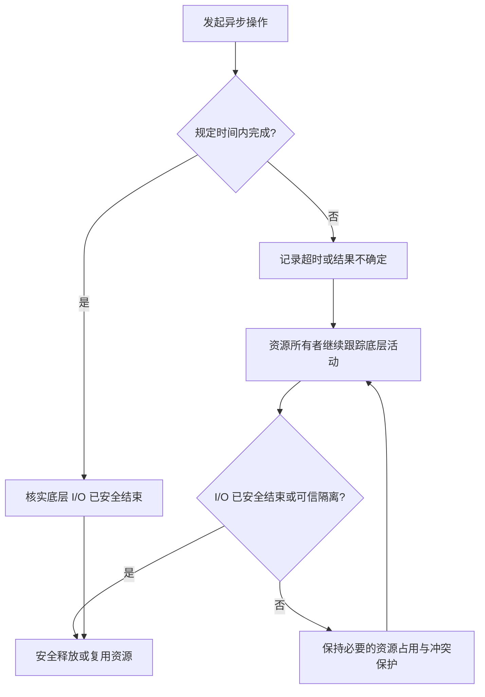

<p class="figure-caption">图 2-1 异步操作超时与资源安全释放流程</p>

对异步操作应区分超时、取消、异常和正常结束；不能仅凭调用方返回、Future/Task 取消或连接状态判断底层 I/O 已安全结束。

### 2.1.5 性能与资源有界原则

性能设计围绕明确的负载与质量要求展开，而不是无依据地增加并发或缓存。

<p class="table-caption">表 2-5 性能与资源有界设计要求</p>

| 设计要求 | 具体规定 |
|---|---|
| 负载模型 | 明确请求规模、并发规模、数据量及运行条件 |
| 容量约束 | 队列、线程、Task、连接、缓存及存储资源应有合理边界 |
| 背压 | 资源不足时明确等待、拒绝、丢弃或降级策略及适用条件 |
| 缓存 | 明确缓存用途、权威数据来源、失效与容量策略 |
| 性能指标 | 明确时延、吞吐、资源占用及测量口径 |
| 性能取舍 | 不得以违反正确性、安全性和可靠性约束换取性能 |

### 2.1.6 故障可控与恢复原则

设计应覆盖正常运行及合理预期的异常场景，明确故障影响范围和恢复条件。

<p class="table-caption">表 2-6 故障与恢复设计要求</p>

| 设计要求 | 具体规定 |
|---|---|
| 故障识别 | 明确可能的超时、通信失败、存储失败、任务异常和进程崩溃 |
| 故障隔离 | 限制故障传播，避免无关组件或资源被错误影响 |
| 状态可信 | 不将未知状态解释为确定成功或失败 |
| 重试与恢复 | 明确允许重试的条件，禁止可能产生危险副作用的盲目重试 |
| 持久化恢复 | 规定异常中断后的数据一致性及状态恢复规则 |
| 生命周期 | 明确启动、就绪、运行、关闭和重启期间的异常处理 |
| 失效行为 | 无法恢复时应有明确的降级、阻塞或停止服务条件 |

### 2.1.7 横切能力非侵入式原则

日志、审计、指标、追踪、权限校验等横切能力应与核心业务逻辑分离，优先通过统一的边界组件、装饰器、中间件或独立服务实现，不应将重复的技术处理流程散布在业务代码中。非侵入式不等于隐藏业务约束：凡影响业务准入、执行结果、事务一致性或故障处理的规则，必须在业务契约中明确，并保留必要的显式调用点。

<p class="table-caption">表 2-7 横切能力非侵入式设计要求</p>

| 设计要求 | 具体规定 |
|---|---|
| 职责分离 | 业务组件负责业务规则与状态转换；横切组件负责统一的记录、采集、校验与传输机制 |
| 边界统一 | 在服务入口、应用服务边界、消息发布边界等明确位置接入横切能力，避免各业务分支重复编排 |
| 最小侵入 | 不为记录日志、采集指标或传播追踪上下文而改变业务方法的核心控制流程和返回语义 |
| 审计正确性 | 审计事件的业务含义及产生时机由业务契约定义；持久化、投递、重试等通用机制与业务处理解耦，同时保证要求的一致性 |
| 故障影响 | 明确横切能力故障时的阻断、降级或重试规则；不得默认其失败不会影响业务，也不得默默吞掉必须处理的错误 |
| 可读性与验证 | 业务代码能够直接体现主流程；横切处理可独立测试，端到端测试验证其与业务契约一致 |

不为追求形式上的非侵入而引入复杂框架或过多抽象；简单、清晰的显式边界优先于难以追踪的隐式执行机制。

### 2.1.8 公共能力复用与冗余控制原则

优先使用符合需求的标准库、成熟软件包、现有工具及公共组件；相同且稳定的职责才提炼为公共能力，不重复发明、不为假设性扩展提前设计框架。

<p class="table-caption">表 2-8 公共能力复用与冗余控制要求</p>

| 设计要求 | 具体规定 |
|---|---|
| 复用优先 | 先评估现成组件是否满足功能、安全、性能及维护要求，再决定是否自行实现。 |
| 提炼公共职责 | 多模块存在稳定相同的职责时统一实现；业务规则留在所属业务模块。 |
| 控制依赖 | 核查成熟度、许可证、版本、安全维护及引入成本。 |
| 控制抽象 | 避免仅为减少少量重复而引入复杂框架或多层转发。 |
| 清理冗余 | 统一能力落地后删除重复、废弃和不必要的兼容实现。 |

### 2.1.9 图表表达与设计一致性原则

设计优先使用合适的图形和表格表达结构、流程、时序、状态及约束，图表不能代替必要的精确定义。

<p class="table-caption">表 2-9 图表表达与一致性设计要求</p>

| 设计要求 | 具体规定 |
|---|---|
| 视图完整 | 使用 4+1 架构视图组织系统设计，覆盖适用内容 |
| 图形选择 | 根据表达目的选择结构图、状态图、时序图、活动图等 |
| 图表一致 | 图形、表格和正文不得相互矛盾 |
| 跨章节一致 | 同一接口、状态、参数及资源规则保持一致 |
| 设计深度 | 明确影响系统行为的契约，允许自主选择内部实现细节 |
| 可验证性 | 关键设计要求应能够对应测试条件与验收证据 |

### 2.1.10 软件设计工作流程

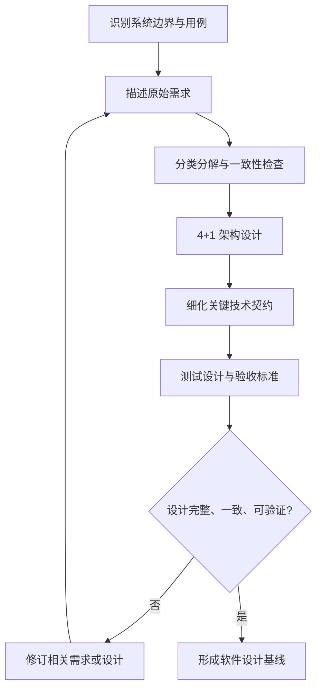

<p class="figure-caption">图 2-2 软件设计编制流程</p>

工作流程允许迭代，不要求传统瀑布式阶段。发现缺口或冲突时直接修订相关需求、架构视图或契约，不通过追加覆盖性条款解决。

### 2.1.11 规范性参考文献及项目无关性

本章为跨项目通用设计与编制规范，不得写入具体仓库、服务、业务协议、接口文件路径或项目专有指标。设计正文引用具体项目的源码、配置和协议文件时，应放在相关业务章节或接口/数据契约章节。

- **《符号体系.md》**：数学量类型、变量命名、标量/矢量/矩阵/张量、下标和公式运算的规范性依据。统计业务中的普通标量同样遵守其标量与阵列的区分原则。
- **《软件系统建模图形与表达规范.md》**：业务流程、DFD、活动/状态/时序图、算法图、伪代码和图元语义的规范性依据。

规范性引用以文件标题和相应章节为准，不复制全文；引用之间存在冲突时先识别并修订冲突，不擅自切换符号或重新解释图元。任何设计实例的具体接口名称、消息字段和技术约束均在第三章及后续适当章节给出。

## 2.2 需求体系及描述规范

需求采用“识别用例 → 逐条描述原始需求 → 分类分解 → 总分一致性检查”的方法。用例应从外部使用者及运行场景出发，覆盖适用的部署、启动、正常使用、配置、运维、正常关闭、重启及异常恢复过程；不局限于业务 RPC，也不将内部技术机制机械列为用例。用例识别属于需求分析，第 4 章用例视图负责表达参与者、边界及用例关系。

<p class="table-caption">表 2-10 原始需求描述字段</p>

| 字段 | 描述要求 |
|---|---|
| 编号 | 唯一原始需求标识，例如 `UR-01` |
| 名称 | 准确概括使用者需要的能力或运行场景 |
| 请求方（Requester） | 发起操作的外部系统、服务或接口，如外部客户端、上层服务、进程管理系统；消息和周期自动触发时可以没有直接请求方，标记“不适用” |
| 触发方式（Trigger） | 标明触发类型、事件来源、触发条件及必要的周期或接口；允许多个类型组合，区分外部触发和内部自动步骤 |
| 输入（Input） | 请求方向本系统提供的数据、参数和信息 |
| 反馈（Response） | 本系统返回请求方的确认、状态、结果及错误信息 |
| 目标方（Destination） | 接收本系统业务输出的外部系统、消息中间件或现场设备；没有时标记“不适用” |
| 业务输出（Output） | 本系统发往目标方的数据、消息或控制指令；没有时标记“不适用” |
| 业务流程（Flow） | 用 Mermaid 表达主要控制流程、数据输入/输出及重要异常，已表达的动作不重复 |
| 业务规则（Business Rules） | 补充主流程未精确定义的术语、公式、算法、初始化、阈值和边界；允许文字分条、LaTeX、图、伪代码或表格，不重复业务流程 |
| 关键约束（Constraints） | 性能、可靠性、安全、审计、可观测性、错误信息、缓存、I/O 与背压等可验证的非功能要求 |

反馈与业务输出必须分开：反馈面向请求方，业务输出面向目标方；请求方与目标方可有多个，且请求方断连不必然撤销已接受的业务操作。

### 2.2.1 触发方式分类与标注规则

原始需求必须列出实际适用的触发方式；同一需求可以组合多种触发方式，不能把处理流程中的普通步骤误写成独立触发。触发方式描述“何时、由什么启动”，不预先决定线程、定时器或队列等内部实现。

- **消息触发（Message）**：外部消息到达，例如实时消息或可靠消息；标明消息来源与订阅范围。
- **周期触发（Periodic）**：达到配置周期，例如实时周期输出或变化加周期保底；标明周期来源及生效条件。
- **API 触发（API）**：收到明确的外部接口请求，例如任务启动或配置应用接口；标明接口和调用方。
- **状态触发（State）**：受监控对象的状态发生满足条件的变化，例如外部依赖从不可用恢复可用；标明状态条件，不把普通循环迭代误列为触发。
- **生命周期触发（Lifecycle）**：服务进入启动、关闭、重启或配置生效等阶段；标明阶段及必要前置条件。

周期触发与消息触发可以同时存在：消息到达更新数据，周期到达决定何时输出。若无外部直接请求方，Requester 写“不适用（自动触发）”，但仍须列出消息生产者或状态来源；触发方式不替代 Input、Response 与 Output 的定义。

### 2.2.2 原始需求四节结构与写作原则

各 UR 固定为四节：**基本信息与触发方式、业务流程、业务规则、关键约束**。根据语义选择最清晰的表达形式；文字、公式、图形、伪代码和表格地位平等；**业务流程图已清楚表达的处理不得在后两节复述**。规则和约束必须有唯一规范定义，其他章节仅引用。

1. **基本信息与触发方式**：表格列出 Requester、Trigger、Input、Response、Destination、Output。Trigger 采用第 2.2.1 节分类，明确事件来源、触发条件及周期或 API。
2. **业务流程**：Mermaid Flowchart 或适用的 UML 活动图表达触发入口、主要处理、判断、数据输入输出、重要异常及恢复出口；复杂算法通过“预定义过程”节点指向第三节，不在总流程中堆叠实现细节。
3. **业务规则**：仅描述流程图无法精确表达的算法、公式、阈值、初始化、状态不变量、顺序及边界。允许文字分条定义、算法流程图、DFG、LaTeX 公式、表格或明确标为 `text` 的伪代码；必须说明输入、输出、初始值、边界及终止条件。无额外内容时标注“无额外规则”。
4. **关键约束**：**优先给出定量要求**（带单位、作用范围、测量窗口、默认值或硬上限、验收方法）；不能合理量化的才采用具有明确判定条件的定性要求。**仅放可核验的非功能要求**，按性能与容量、可靠性与恢复、安全与授权、审计、可观测性、错误信息、缓存与有效期、I/O 资源安全、背压与过载分类；无关分类可以省略或说明不适用。约束应给出故障条件、正确结果、测量或验收口径，不得用抽象口号代替。

### 2.2.3 业务图形元素与数据语义

参照《软件系统建模图形与表达规范.md》第 5.1 节 Flowchart、第 7.1 节 DFD 与第 8.1 节算法规范。业务活动图的控制流箭头表示处理顺序，DFD 箭头表示数据流，**两者不得混用**。图中应以不同形状区分处理、判断和数据。

| 元素 | Mermaid 写法 | 语义 |
|---|---|---|
| 开始/结束 | `A([开始/结束])` | 明确入口和完成/失败出口 |
| 处理 Process | `B["更新缓存"]` | 矩形，表达动作而非数据 |
| 判断 Decision | `C{"已过期?"}` | 菱形，分支标明条件 |
| 输入/输出 Data | `D[/"采样消息"/]` | 平行四边形，表达数据输入/输出 |
| 预定义子过程 | `E[["计算统计指标"]]` | 双边矩形，引用业务规则的算法说明 |
| 数据存储 | `F[("最新值缓存")]` | 存储节点；仅在理解读写关系必要时出现 |

不因形式要求增加无意义数据节点。数据来源、存储及复杂数据变换应单独绘制 DFD，避免业务活动图变成混杂的控制/数据流图。Mermaid 第一行初始化配置、图编号和图题仍须符合第一章。

### 2.2.4 业务规则、输出定义与关键约束的具体要求

- **业务规则**：定义与边界条件优先文字分条；涉及数学关系必须使用 LaTeX 独立公式；复杂步骤按需使用 Flowchart/DFG 或伪代码补充。表达形式不限于图和表；精确定义阈值、边界、初始化、更新基准和不可变条件，不复述主流程动作。算法必须能够独立据输入判断预期输出。
- **性能与容量**：优先用定量指标给出负载范围、时延/吞吐口径、并发及资源上限；必须区分设计目标、默认配置、不可突破的资源上限和验收实测值；未确定的阈值不得虚构。
- **可靠性及 I/O**：明确超时、结果不确定、重试、恢复、安全收敛及资源释放条件。调用返回或 Task 取消不代表底层 I/O 已结束。
- **错误信息**：定义错误类别、错误码或结果、对象与关联标识、发生阶段、可检索证据及敏感信息脱敏；禁止把 UNKNOWN 伪装为成功或明确失败。
- **缓存与背压**：规定缓存键、容量、更新/覆盖、过期、丢弃、等待、拒绝、暂停消费及恢复条件；所有超限策略必须可观测。
- **安全与审计**：列出认证、授权、控制边界以及需审计的操作、事件产生时机、关联 ID、可信保存与失败处理；运行日志不能代替审计。
- **可观测性**：指标、统计窗口、状态、事件、更新时间、无数据语义及告警；可结合真实场景验收。

**指标、计算和输出契约完整性（强制）：**凡使用“计算、统计、比较、阈值、状态、错误、容量、返回结果”等词定义业务能力，必须形成封闭的输出集合；不得用“等”“包括但不限于”替代本版本必须实现的清单。每个指标/派生字段至少定义以下内容；其中数学计算不得仅写在表格单元格内，必须另列可渲染的 LaTeX 公式：

| 必填字段 | 内容 |
|---|---|
| 唯一标识、类型和单位 | 与公开接口字段或指标名一致；明示 `counter/gauge/histogram`、计量单位 |
| 统计层级和数据来源 | 系统 / 进程 / 组件 / 任务 / 消费者；事件记录点、分子和分母来源 |
| 计算公式与口径 | 累计/窗口/瞬时，窗口端点、去重规则、事件计数次数、百分位算法 |
| 触发、初始化和重置 | 何时采集/计算、初始值、首个周期、进程重启、配置热更新 |
| 边界与缺失 | 零分母、空样本、UNKNOWN、超时、重复投递、源不可达的值域与 `unavailable` 语义 |
| 输出与验收 | 指标名、采样时间、窗口、可用性表达、配置边界及给定数据可独立验算的实例 |

**示例与可复算性（强制）：**当业务规则涉及多种计数口径、状态转换、时间窗口、边界分支或重试等易混淆情形时，至少给出一个具体输入—处理过程—预期输出的完整算例。算例必须标明初始条件、计量单位、每一步事件及最终结果；若同时存在样本条数、批次数、I/O 尝试次数等不同统计单位，须分别列出，禁止混用。算例应覆盖易误解的边界（例如重试成功仍有失败尝试记录），且结果必须可直接转化为确定性测试断言。算例是对定义的验证，不得取代规范性定义，也不应重复流程图中的全部步骤；涉及计算关系仍按第一章使用 LaTeX。

**数学定义与表达门禁：**业务规则的文字定义应独立成段或分条；涉及计算时，必须在定义后给出独立 LaTeX 公式，逐一释义变量、单位、取值域以及零分母、空样本和无效值。算法图与伪代码是可选的精度增强手段，不得要求所有业务规则使用表格。公式与中文混排遵守第一章 §1.3.1。

**约束定量优先门禁（强制）：**关键约束首先给出数值、单位、统计范围、采样方法、允许误差、测试条件和通过标准；可配置阈值应列出默认值及合法范围。仅当约束本质上无法定量（例如禁止错误 ACK）时，才用可判定的定性约束。不得用“及时、足够、合理、有界、尽可能、低延迟、高可靠”等词代替具体要求；未完成基准测试的数值应标明“设计验收目标，尚未实测”，不得声称达标。

**完备性门禁：**业务规则涉及的状态枚举、错误分类/错误信息字段、缓存容量及淘汰策略、I/O 结果、背压策略、审计与统计输出均应列举封闭集合和边界输入；凡无法根据文档构造确定预期结果的要求，视为需求未完成，不得标记为可编码。参数可以配置，但必须说明合法范围、默认/缺省行为及越界错误；性能数值未经验证时不得伪称已达标。每项约束必须可追溯至可执行的 UC/System 场景。

每项业务规则和关键约束须能由 UC/场景及第 14 章测试追溯；第 5～13 章详述实现契约时应引用 UR，不得另造冲突定义。

统一样式：

```text
### 3.x UR-xx 需求名称
#### 3.x.1 基本信息与触发方式
Requester / Trigger / Input / Response / Destination / Output
#### 3.x.2 业务流程
Mermaid 活动流程图，含重要异常及数据输入输出
#### 3.x.3 业务规则
可用文字、LaTeX、伪代码、图或表格精确定义算法、初始化与边界，不重复流程
#### 3.x.4 关键约束
按性能、可靠性、安全、审计、可观测性、错误、缓存、I/O、背压列可验证要求
```

本节也是第三章及后续章节的强制完整性验收标准。

<p class="table-caption">表 2-11 分类需求体系与描述重点</p>

| 类别 | 核心问题 | 典型要求 |
|---|---|---|
| 功能需求（Functionality） | 系统提供什么行为 | 对外能力、业务流程、业务规则、输入输出与状态反馈 |
| 性能需求（Performance） | 运行速度与资源上限 | 时延、吞吐、并发、调度、公平性、容量、背压、资源消耗、扩展能力 |
| 可靠性需求（Reliability） | 故障时如何保持正确与恢复 | 容错、超时、重试、请求关联、事务、持久化、故障恢复、可用性、未结束操作的资源管理 |
| 安全需求（Safety & Security） | 如何防止危险或非法控制 | 控制权、互锁、失效安全、认证、授权、通信及数据安全 |
| 横切能力（Cross-cutting Concerns） | 如何观测、管理与追责 | 审计（操作证据、可靠投递、完整性、追溯）、日志、指标、追踪、配置、版本、可测试性、可维护性 |

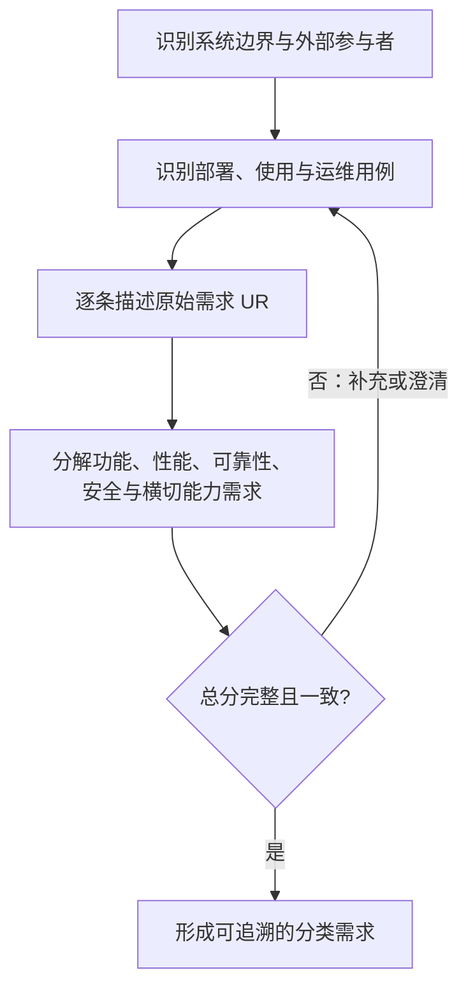

<p class="figure-caption">图 2-3 需求识别、分解与一致性检查流程</p>

分类需求必须从原始需求的输入、反馈、业务输出、规则和约束中推导，不得遗漏、矛盾或未经确认增加能力；多条原始需求的共同约束可以合并，但必须保留来源编号。每条分类需求应给出可核验条件，性能要求还需明确测量口径，不虚构现场阈值。审计应独立于普通日志定义，不得以运行日志代替审计证据。

需求分类与设计专题是不同维度：启动、正常关闭、重启及 Reload 属于跨需求的运行生命周期设计，统一在进程视图展开；相应行为和质量约束分别由原始需求及分类需求追溯。

## 2.3 4+1 架构视图：内涵、外延与表达规范

<p class="table-caption">表 2-12 4+1 架构视图的职责与成果</p>

| 视图 | 关注范围 | 主要成果 | 不应混淆 |
|---|---|---|---|
| 用例视图（+1） | 参与者、系统边界、典型/异常场景 | 系统上下文、用例、业务流程 | 不负责线程调度 |
| 逻辑视图（Logical） | 组件职责、模型、接口、状态规则、依赖 | 组件图、类/数据关系、状态图 | 不等于源码目录树 |
| 进程视图（Process） | 进程、线程、Event Loop、Task、协作、生命周期、同步、并发、资源、背压、缓存、故障恢复 | 运行结构图、任务所有权表、时序/状态/活动图、资源预算 | Task 不等于 OS 线程；图名须区分标准 UML 与示意图 |
| 开发视图（Development） | 软件模块边界、层次、静态依赖、公共契约与复用关系 | 模块图、依赖图、模块职责表 | 不描述真实并发拓扑，也不列现有代码修改清单 |
| 物理视图（Physical/Deployment） | 节点、进程部署、存储、网络、控制权和现场外部依赖 | 部署图、网络/故障域/外部依赖表 | 不是现场设备内部物理结构模型 |

### 2.3.1 用例视图的场景编写规范

用例以参与者的完整业务目标为单位组织，而非以原始需求、RPC 或内部模块为单位逐条改名。一项用例可以关联多项原始需求；一项原始需求也可以由多个业务场景共同覆盖。用例视图回答“在具体业务场景中系统如何工作”，不代替逻辑视图、进程视图和数据设计。

<p class="table-caption">表 2-13 业务场景用例的必备描述要素</p>

| 要素 | 编写规定 |
|---|---|
| 用例身份与目标 | 给出唯一编号、业务场景名称及参与者要达成的可观察目标；名称使用业务活动，不使用内部机制命名 |
| 参与者与触发条件 | 列明实际发起操作的外部角色；内部定时任务、恢复及发布等自动步骤不得虚构外部参与者 |
| 前置条件 | 列明系统就绪、授权、配置或数据存在等必要条件；不得混入未确认的实现假设 |
| 主业务流程 | 以 Mermaid 业务活动图（flowchart）为主要表达，覆盖触发、校验、关键处理、反馈及后置结果；以判断节点表达重要分支，避免大段编号文字复述 |
| 分支与异常流程 | 在活动图中呈现影响业务结果的主要异常出口；罕见或不宜展开的异常在简明说明表中概括，避免为了完整而画出所有技术异常 |
| 后置条件 | 明确成功和失败之后的业务状态、外部可见结果、未完成事项及后续查询方式 |
| 需求追溯 | 标明相关 UR；核对全部 UR 在真实场景中得到覆盖，但不要求 UR 与 UC 一一对应 |

跨用例共享的内部机制（如存储、审计发布和调度）应作为相关业务流程中的自动步骤或支撑行为描述；只有存在独立业务目标时才另立用例。应避免将一串 gRPC 方法名或 CRUD 操作直接当作完整用例，也不得在用例章节展开线程、锁、表结构及类方法等实现细节。

用例的正文采用“一张业务活动图 + 一张简明用例说明表”的表达形式。活动图包含主路径、必要判断以及重要异常分支；图中节点使用业务动作，不展开展示内部类、锁和数据库事务。说明表只填写参与者、业务目标、前置条件、主要异常、后置条件及关联需求。业务分支已在图中完整表达时，不再重复书写大段“主业务流程”和“异常流程”；复杂跨参与者消息时序可在独立小节补充时序图。图题和表题按文档约定独立编号。

进程视图应按四个设计专题组织，而不是按需求类别重复划分：

<p class="table-caption">表 2-14 进程视图的四类设计专题</p>

| 专题 | 必须明确的设计对象 | 推荐表达 |
|---|---|---|
| 运行时结构 | 进程、线程、Event Loop、Task、线程池、组件与资源所有权 | 分层运行结构图、Task 职责表 |
| 运行生命周期（Runtime Lifecycle） | 启动、初始化、就绪、运行、Reload、正常关闭、重启及其阶段转换 | 生命周期状态图、启动/关闭/Reload 时序图 |
| 并发与资源管理 | Task 协作、队列、通知、同步、调度、容量限额、背压、缓存及释放 | 任务协作时序图、资源与背压策略表 |
| 异常与恢复 | 超时、取消、故障隔离、未收敛 I/O、崩溃恢复与降级 | 故障状态图、异常裁决矩阵 |

各专题共享同一运行模型，明确创建者、所有者、同步关系和退出条件；不因分节而重复定义状态或资源。生命周期是进程视图的独立设计专题，不是第六类需求。

图表仅使用其可准确表达的语义：结构关系用 Mermaid Flowchart；行为交互用 Sequence Diagram；状态约束用 State Diagram；条件控制用活动/流程图。图题说明对象、范围及图类型。关键质量属性贯穿各视图，不能只写在单独的“非功能要求”段落。

## 2.4 测试设计方法、组织及验收规范

测试设计以测试层级组织物理目录，以 Marker 描述测试层级、测试专题与运行场景。测试文件名应清楚表达验证对象或行为；测试文件及其标记、验证说明统一登记在测试矩阵中。需求、用例及重要技术契约必须能追溯到实际测试，不为同一目的建立重复测试体系。

<p class="table-caption">表 2-15 测试层级与目录规范</p>

| 层级 Marker | 物理目录 | 验证范围 |
|---|---|---|
| `unit` | `unit/` | 状态转换、业务规则、纯逻辑，无外部服务依赖 |
| `component` | `component/` | 单组件职责及其可控依赖 |
| `integration` | `integration/` | 组件之间及真实外部依赖的接口协作 |
| `system` | `system/` | 独立进程、完整业务场景及端到端行为 |

<p class="table-caption">表 2-16 测试 Marker 与矩阵编制规范</p>

| 事项 | 规范 |
|---|---|
| 层级 Marker | 每项测试必须且仅属于 `unit`、`component`、`integration`、`system` 之一，与目录对应 |
| 专题 Marker | 标识可靠性、安全、性能等验证主题，可与层级及场景 Marker 叠加；无专项主题时可为空 |
| 场景 Marker | 标识并发、超时、恢复、负载、现场等执行条件或情境；有相应场景时标记 |
| 测试矩阵 | 至少包含“测试文件名、层级 Marker、专题 Marker、场景 Marker、测试说明”五列；每项重要测试应有可定位的文件归属 |
| 标记粒度 | 标记以具体测试函数或类为准；同文件可包含不同专题与场景，矩阵列出涉及的 Marker |
| 运行条件 | 通过 Fixture 和环境准备明确外部依赖；现场专用测试与常规回归分离，未执行不视为通过 |
| 执行规则 | 提供按目录、Marker 及其布尔组合的 pytest 命令；所有 Marker 在项目配置中注册 |
| 可追溯性 | 测试说明与需求、用例或技术契约对应；行为变更时同步检查测试及矩阵 |
| 验收证据 | 保留运行环境、命令、实际结果、指标和未验证项，禁止把设计目标当作测试结果 |

目录划分测试层级，专题与场景通过 Marker 横向组合；可靠性测试不单独设第五类目录。测试矩阵用于定位和筛选测试，不预设每个实现文件必须存在，也不要求每个文件仅能有一种测试场景。

### 2.4.1 测试依据及 System 覆盖要求

各层级测试必须依据已确认的设计成果编制；System Test 以用例视图为主基线，以原始需求及技术契约补充覆盖，不得由测试人员凭经验任意缩减范围。

<p class="table-caption">表 2-17 各测试层级的设计依据</p>

| 测试层级 | 主要依据 | 验证重点 |
|---|---|---|
| Unit | 详细设计、函数及算法契约 | 纯逻辑、状态转换、参数及边界规则 |
| Component | 逻辑视图、组件职责及内部接口契约 | 单组件行为、依赖协作及异常处理 |
| Integration | 接口与通信契约、开发视图、物理视图 | 真实接口调用、跨组件通信及外部依赖 |
| **System** | **用例视图（UC）及原始需求（UR）**，并补充接口、运行、部署、安全及性能约束 | **从真实受测服务进程及其通信入口验证业务目标、异常、边界与恢复行为** |

System Test 必须遵守以下规定：

1. **用例覆盖率 100%**：每项 UC 至少有一项 System Test 作为验证证据；同一测试可以覆盖多个 UC，同一 UC 可以由多个测试覆盖，**不按测试数量与 UC 数量的大小关系判定覆盖**。
2. **规定场景覆盖率 100%**：每项 UC 明确的主流程、关键分支、异常流程、边界和恢复场景均必须有对应 System Test；不能仅以一条正常路径代表整个 UC 已覆盖。
3. **需求覆盖率 100%**：每项 UR 必须能够经一个或多个 UC 追溯至 System Test；若某项需求未能被 UC 覆盖，必须先补全用例，不得直接以技术测试代替业务用例。
4. **技术约束补充覆盖**：用例未充分表达的性能、容量、并发、安全、权限、超时和可靠性要求，依据对应技术契约补充测试；不得因 UC 未逐项列出而豁免。
5. **真实系统边界**：System Test 通过真实受测服务进程和适用的外部依赖、通信链路执行；Mock 不得代替本次明确纳入验收范围的基础设施及通信链路。
6. **覆盖与通过分开裁定**：测试已关联不等于已执行；失败、跳过及未运行均不得计为通过。验收报告分别给出需求覆盖、用例及场景覆盖、执行情况和通过情况；缺少真实环境时标记 `NOT_RUN`，不得用模拟结果替代。
7. **变更同步**：任何 UR、UC、接口或行为约束的新增、删除、调整，必须同步核查 System Test、测试矩阵和验收条款；新增 UC 不得留下无测试映射。

<p class="table-caption">表 2-18 System Test 追溯矩阵规范</p>

| 字段 | 要求 |
|---|---|
| UR 编号 | 被验证的原始需求编号，可列多个 |
| UC 编号与场景 | 用例编号及主流程、异常、边界或恢复场景标识 |
| 技术契约 | 相关接口、配置、运行或安全约束的章节编号；没有则记“—” |
| 测试文件名／测试标识 | 可定位的 System Test 文件名及测试函数或参数化场景标识 |
| 层级／专题／场景 Marker | 层级固定为 `system`，其余按第 2.4 节定义填写 |
| 验证内容与预期结果 | 从用户可观察行为与副作用表述判定依据 |
| 执行环境及结果 | 真实依赖、执行证据、`PASS`／`FAIL`／`SKIP`／`NOT_RUN` 等状态 |

追溯链为 **UR → UC／用例场景 → System Test → 执行结果与证据**，技术契约作为补充依据进入相应测试。第 4 章负责编制完整 UC 和场景，第 14 章依据本规范给出实际测试矩阵及验收安排，两章必须双向核对。

# 3. 软件需求

## 3.1 职责及需求边界

Configuration 是全系统唯一权威配置库，SQLite 保存发布修订、目录快照成员、不可变配置对象及固定依赖闭包。**CLI 每次仅上传指定 `configs/` 根目录的完整 YAML 集合**；首次初始化和日常更新完全同一语义。Configuration 不接收“只包含变化文件”的部分配置发布为正常正式入口。发布完成后由 Configuration 通过 NATS Core 广播，不逐个调用业务模块；不保证全系统同时生效。

| ID | 需求 | 权威结果 |
|---|---|---|
| UR-01 | 完整目录单次候选上传、校验、CAS 原子发布 | 完整目录视图及 revision_id |
| UR-02 | 不可变版本、当前成员集与历史依赖 | 版本身份及可重建闭包 |
| UR-03 | 指定修订的完整模块依赖包及按 PointTable ID 的历史闭包 | 完整 YAML 文件集/哈希 |
| UR-04 | 查询、废弃、统计及备份 | 目录/版本/统计/备份 |
| UR-05 | 公共 gRPC 运行管理和权限 | Common RPC |
| UR-06 | 发布成功后的 NATS 广播、故障对账基础设施 | `wh.config.changed` 修订提示 |

Configuration 自身由本地独立 Service YAML 引导，不把其数据库访问参数存入正在启动的 SQLite。存储、Collector、Sink 和业务管理模块必须使用正式的配置读接口，无权隐式写入版本库。

## 3.2 UR-01 完整目录配置发布

### 3.2.1 触发、输入和输出

Requester：授权 CLI；Trigger：`wind-hub config publish --root PATH`；Input：经过 CLI 安全扫描的**全部合法 YAML 文件**、每文件相对路径及完整 UTF-8 正文、`expected_revision_id` 和请求幂等 ID；通过一次有界 Unary RPC 上传；Response：候选完整性/逐字段错误/发布修订；Destination：Configuration SQLite；Output：发布后的目录成员快照。首次与后续更新不设两种更新模式。

### 3.2.2 业务流程

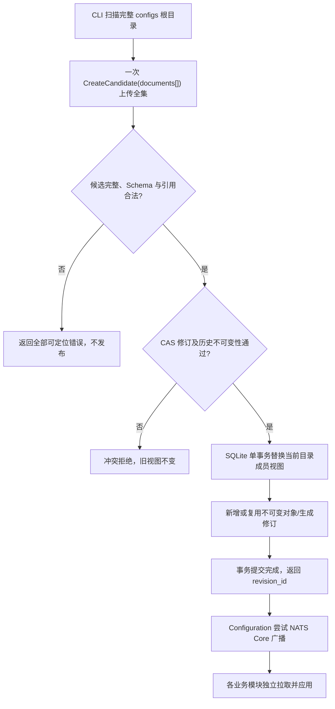

<p class="figure-caption">图 3-1 完整目录快照发布流程</p>

### 3.2.3 业务规则

1. **完整性**：CLI 在上传前稳定扫描根目录，拒绝根外路径、符号链接逃逸、不可读文件、大小超限、文件名冲突和不受支持的 YAML；空目录默认拒绝。CLI 用单次 `CreateCandidate(documents[])` 携带**全部成员**，每个 `file_name` 是根目录相对路径。gRPC Unary 消息天然整包接收或拒绝；不引入分片协议。服务端独立计算有序目录 Manifest 哈希并校验文件类型、字段、身份和引用；请求异常不得创建部分候选。
2. **全集语义**：输入列出所有本次目录成员，而不是差异清单。服务端比较完整候选与当前有效目录成员集合：新增纳入、改变生成新不可变版本、缺失从当前视图移除、相同内容复用旧版本记录。**没有实际变更则幂等返回原修订，不生成无意义广播**。
3. **历史并存**：同一对象的不同 `file_version` 可以同在目录；当前业务引用确定生效版本，不能自动选择版本号最大者。历史对象不因离开当前目录成员集而物理删除；被当前对象引用的文件从目录移除时校验失败。
4. **不可变**：`config_type + config_id + file_version` 是全局唯一不可变身份；同一身份不同规范化正文/依赖版本必须冲突。PointTable ID 额外固定完整转换语义闭包，不能因推荐版本变化而漂移。
5. **原子性**：当前目录成员、不可变对象、依赖投影、revision 和审计在一个 SQLite 事务内提交；CAS 和请求幂等受唯一约束保护。不得出现部分发布。配置库提交成功是业务发布事实，后续 NATS 广播失败**不能回滚**。
6. **模块生效**：Configuration 不对任何模块发出逐个 gRPC Apply，不维护在线模块名单；收到广播的模块按确定修订查询**自身完整**闭包并独立应用。模块运行失败不更改 Configuration 的发布结果。

### 3.2.4 关键约束

根目录文件数、单请求最大字节、候选 TTL、引用深度和 Manifest 均有上限。超过可配置 Unary gRPC 容量时明确拒绝 `RESOURCE_EXHAUSTED`，不可无声忽略文件；首版不引入分片上传。正式 Contracts 复用当前 `CreateCandidate`、`PublishCandidate` RPC，**更新其完整目录全集语义**并同步服务端、CLI、数据库和测试；不保留单文件增量发布路径。

## 3.3 UR-02 不可变版本、引用与全局修订

### 3.3.1 基本信息与触发方式

Requester：CLI、历史数据业务模块；Trigger：API；Input：配置类型、逻辑 ID、版本或全局 revision；Response：版本元数据、引用、快照 revision；Destination：不适用；Output：不适用（只读）。

### 3.3.2 业务流程

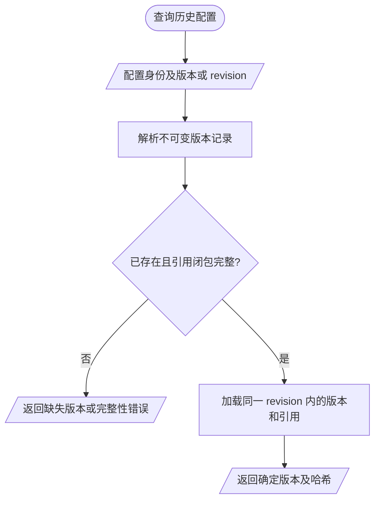

<p class="figure-caption">图 3-2 历史版本及引用查询</p>

### 3.3.3 业务规则

1. `config_type + config_id + file_version` 唯一定位不可变配置；`content_hash` 标识结构化配置的规范化语义，`revision` 标识一次原子发布的全局视图。
2. `file_version` 按项目统一格式 `MAJOR.MINOR.PATCH`；文件名采用 `<type>_<info>_vMAJOR.MINOR.PATCH.yaml`。`schema_version` 与 `file_version` 不可混为同一含义。
3. 所有外键式配置引用绑定明确的版本身份；查询指定 revision 的依赖闭包时，禁止混用后续发布产生的“最新”版本。
4. 不引入独立 `SemanticPoint` 第三层；`BusinessPoint` 就是同类设备跨型号、真实与仿真复用的标准业务语义；`Point` 属于 PointTable，显式引用唯一业务标准。不同位置/相别/叶片/统计边界必须区分标准业务身份。
5. `latest/recommended` 是可变别名，不是可变历史正文；改变推荐指针需单独提交新全局 revision，并接受 CAS 检查。

### 3.3.4 关键约束

历史版本永久可解析（除经独立批准的未来归档政策）；引用目标缺失、版本漂移、循环引用和相同版本哈希不一致必须 fail-closed。配置库 schema 迁移与业务配置版本发布相互独立。

## 3.4 UR-03 配置检索、重建 YAML 与导出

### 3.4.1 基本信息与触发方式

Requester：CLI、Collector、Sink、Storage 及其他授权模块；Trigger：API；Input：配置对象身份、精确版本或全局修订、引用闭包选择、分页或文件批量边界；Response：**唯一格式**的 YAML 文件内容（UTF-8 bytes）、文件名、配置身份、`file_version`、`schema_version`、`revision_id`、配置内容哈希和 YAML 字节哈希；Destination：请求方；Output：可直接落盘的完整 YAML 文档或按修订一致获取的多文档集合。

### 3.4.2 业务流程

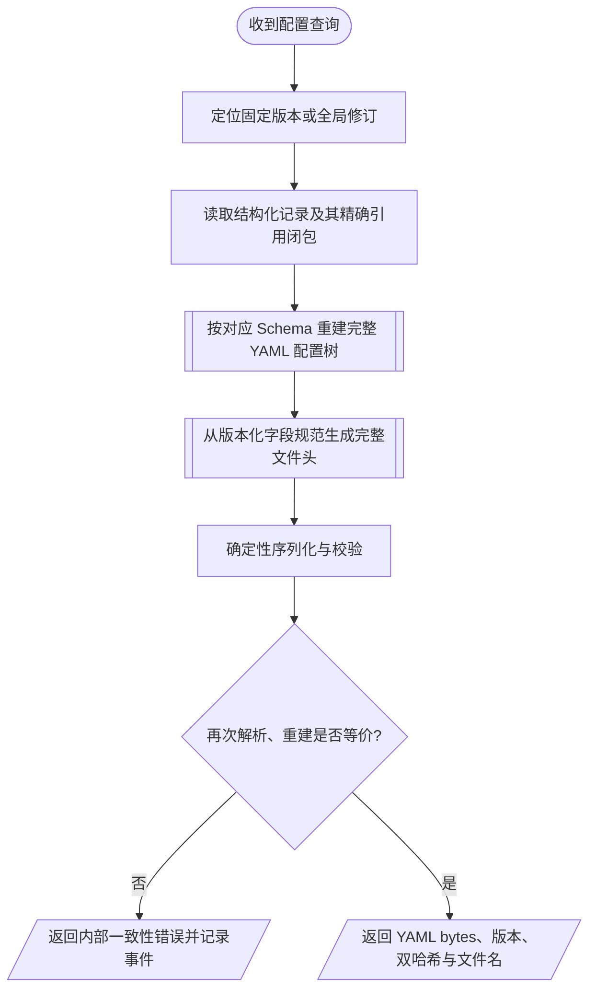

<p class="figure-caption">图 3-3 配置库到唯一 YAML 输出的业务流程</p>

### 3.4.3 业务规则

1. **仅一种输出格式**：每份 YAML 均包含完整文件头注释和完整配置正文，不提供任何多模式输出选择，也不要求业务模块补充注释。
2. 文件头由配置类型的**已发布 Schema 版本**驱动，列出所有可配置字段的路径、必填性、数据类型、允许值/范围、单位、默认值（若有）、有效示例、引用含义及敏感字段说明；即使某可选字段在正文中未出现，Header 仍应说明它。配置库不得凭空生成不存在的默认值。
3. YAML 正文必须符合当前业务模块的加载契约，保留 `schema_version`、`file_version`、配置引用和嵌套数据类型；不得注入额外业务键。规范化导出不保证原文件缩进、原手写注释、映射顺序或锚点逐字节不变，但必须保证**语义及数据类型完整往返**。
4. 配置内容哈希根据规范化的类型化配置对象计算；另返回对实际 YAML bytes 的 SHA-256。文件头规范修改只允许改变 YAML 字节哈希，不允许改变同一版本的配置内容哈希。为保证历史版本完整可重建，Header 定义应绑定对应的已发布 Schema 版本。
5. 按固定 `revision_id` 导出的多文件依赖包，必须来自同一已提交快照，且按确定顺序交付；历史引用不得自动升级到当前推荐版本。查询结果允许由客户端保存为本地文件，文件名遵守项目版本格式。

### 3.4.4 关键约束

配置检索的版本选择、授权、最大返回字节数、批量文件数、引用深度及并发受服务配置限制。对无法表示为受支持 YAML 类型、存在不完整引用或往返校验失败的对象必须拒绝导出并报告可定位错误，不能产生不可重建的“部分成功”配置。涉及密钥的字段仅提供受控引用，Header 不得披露秘密值。

## 3.5 UR-04 配置库管理、统计与备份

### 3.5.1 基本信息与触发方式

Requester：管理 CLI；Trigger：API、Lifecycle；Input：类型/身份过滤、废弃请求、备份请求；Response：对象清单、引用信息、存储容量与备份路径；Destination：受控本地备份位置；Output：备份文件及元数据。

### 3.5.2 业务流程

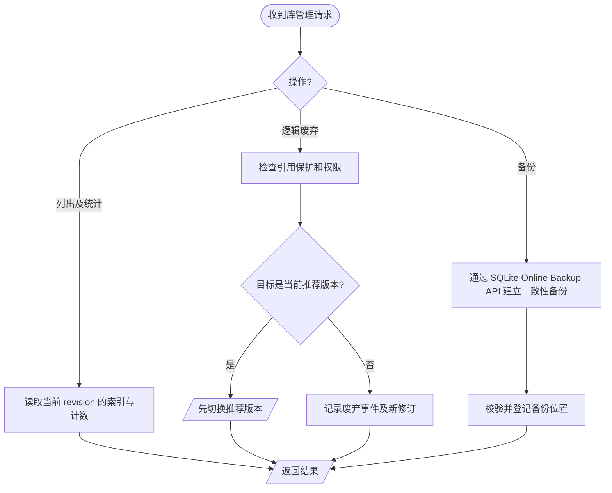

<p class="figure-caption">图 3-4 配置库管理流程</p>

### 3.5.3 业务规则

支持按配置类别/应用/设备类别/版本查询目录、引用者及被引用对象；可逻辑废弃但首版不支持删除已发布历史版本；返回总配置对象数、各类型版本数、数据库文件大小、可用容量及最近备份时间；备份返回任务 ID、状态、服务端绝对路径、大小与校验结果。备份不等于在线恢复；恢复是独立受控运维流程。

### 3.5.4 关键约束

只允许备份到自身 YAML 配置指定的根目录，禁止路径遍历；容量不足停止发布而保留只读查询能力；备份期间不能阻塞长期读服务。完整性验证失败时不可声明备份完成。

## 3.6 UR-05 Common APIs

### 3.6.1 基本信息与触发方式

Requester：CLI、监控及获授权的诊断客户端；Trigger：API、Lifecycle；Input：现有 `src/contracts/common.proto` 所定义请求；Response：其标准消息结构；Destination：调用方；Output：不适用。

### 3.6.2 业务流程

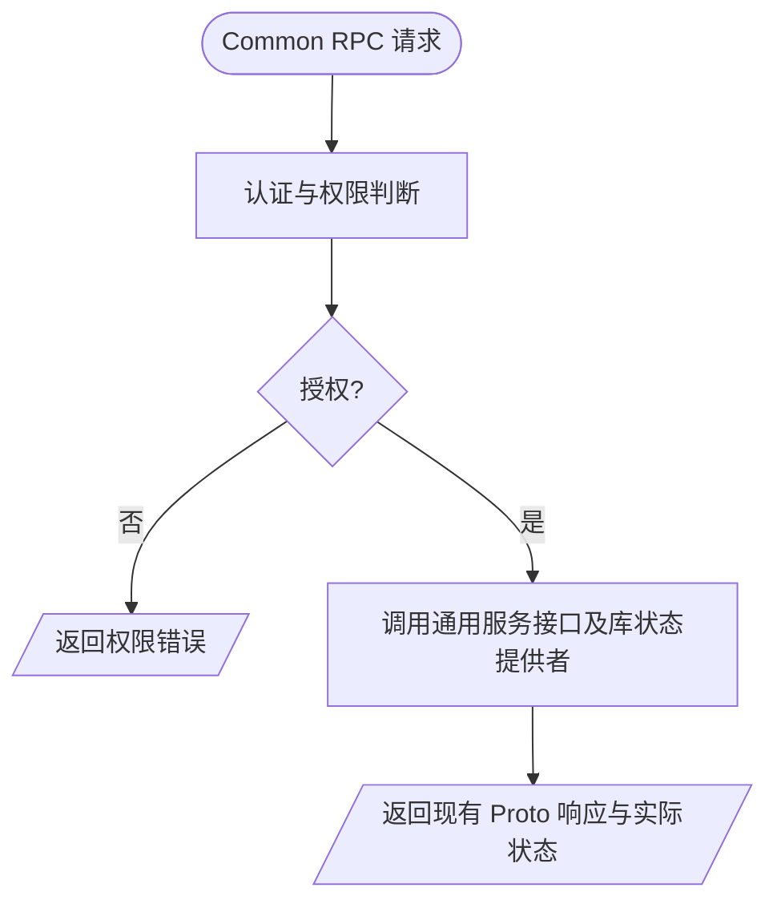

<p class="figure-caption">图 3-5 Common RPC 处理流程</p>

### 3.6.3 业务规则

完整实现以下 9 个现行公共 RPC，其字段以现有 `common.proto` 为准。

| RPC | Configuration Service 专属内容与输出 |
|---|---|
| `GetServiceInfo` | `service_id`、`process_role`、`software_version`、`contract_version`、`started_at` |
| `GetServiceStatus` | `health`、`observed_at`、SQLite 可读/可写及剩余容量等 `dependencies`；不能把进程存活视为业务健康 |
| `GetCapabilities` | 实际已注册 `rpc_names`、`protocols`、`features`，仅声明已实现能力 |
| `GetConfigSnapshot` | 本服务**自身引导 YAML** 的 DISK/RUNTIME/CANDIDATE 状态、修订和校验；不是配置库中所有业务配置 |
| `PushConfigSnapshot` | 本服务自身 YAML 的候选校验与提交；与仓库级业务配置导入严格区分 |
| `ApplyConfigSnapshot` | 本服务自身配置生效结果、`effective_revision`、`restart_required` |
| `GetMetrics` | 通过标准 `Metric(name,value,unit,window_ms,sampled_at)` 输出版本数、发布速率、访问延迟、SQLite 文件大小、失败数、备份结果及服务容量 |
| `GetEvents` | 发布/冲突/容量告警/备份/授权失败事件，标准时间过滤与分页 |
| `Diagnose` | SQLite 连接、完整性检查、WAL 和磁盘读写状态，返回各阶段证据、总体状态与限制 |

### 3.6.4 关键约束

公共接口与业务配置专用 RPC 命名不可混淆；应用级查询不重复实现 Common 接口。RPC 数据类型、错误、认证、Deadline、取消及资源释放必须遵守当前公共契约；运行指标输出不能每次执行全库重扫描。

## 3.7 分类需求与不在范围内事项

| 类别 | 可验收要求 |
|---|---|
| 一致性 | 事务提交、版本不可变、同 revision 引用闭包、CAS |
| 安全 | 内部网络隔离、权限分离、敏感值只存引用、审计 |
| 可靠性 | SQLite 重启恢复、WAL 故障处理、只读降级、一致性备份 |
| 资源 | 请求、版本、大小、并发、备份配额由自身 YAML 配置 |
| 独立性 | 本服务只通过 NATS Core 广播修订提示；各业务模块独立拉取与生效，不逐个调度设备控制 |

不纳入首版：审批工作流、分布式多写节点、任意 SQL 执行、管理业务服务进程、逐模块 gRPC 通知和跨模块同步生效、备份自动覆盖恢复。

# 4. 用例视图

## 4.1 系统上下文

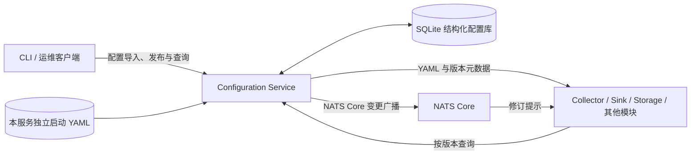

<p class="figure-caption">图 4-1 系统上下文及职责边界</p>

## 4.2 用例—需求总表

| 用例 | 外部目标 | 原始需求 |
|---|---|---|
| UC-01 | 导入全系统配置、原子发布并取得全局修订 | UR-01 |
| UC-02 | 查询历史版本、引用及推荐版本 | UR-02 |
| UC-03 | 按固定修订获取**完整 Header + 配置正文**的 YAML | UR-03 |
| UC-04 | 查询容量、废弃标记并执行一致性备份 | UR-04 |
| UC-05 | 9 个 Common RPC 准确报告自身配置、健康和指标 | UR-05 |

## 4.3 关键用例场景

| 场景 | 输入/激励 | 预期输出及可见状态 |
|---|---|---|
| UC-01-S01 | 一组相互引用的 YAML 文件 | 同一 revision 原子发布；关系约束完整 |
| UC-01-S02 | 同一身份/版本的不同内容并发发布 | 拒绝冲突、原版本不变 |
| UC-01-S03 | 发布事务中强制杀进程 | 重新启动后仅完整旧快照或完整新快照可见 |
| UC-02-S01 | 发布三级语义配置及相关设备点表 | 精确版本外键成立、可按历史版本追踪 |
| UC-02-S02 | 查询历史引用 | 返回固定历史版本而非当前推荐版本 |
| UC-03-S01 | 按精确版本导出配置 | 唯一 YAML 格式含完整 Header、完整正文、正确双哈希 |
| UC-03-S02 | 导出后重新导入 | 结构化对象、值/类型、关系与内容哈希一致；对可选字段、Unicode、空值等逐项验证 |
| UC-03-S03 | 不同 revision 批量导出 | 每个依赖包内部版本闭包一致、无需猜测外部配置 |
| UC-04-S01 | 废弃存在历史引用的版本 | 不破坏历史读取和引用闭包 |
| UC-04-S02 | 数据库在线备份及恢复校验 | 备份包含 meta、Schema 及全部历史配置，恢复后一致 |
| UC-05-S01 | 服务正常、数据库只读/迁移失败 | 9 RPC 覆盖；健康与指标准确反映状态 |

## 4.4 UC 与 System Test 追溯基线

UC-01～UC-05 每种正常、错误和崩溃场景均须在真实 CLI 启动的 Configuration 进程上执行，不以 Mock 取代数据库事务、gRPC 连接或系统恢复；测试矩阵见第 14 章。

# 5. 逻辑视图

## 5.1 组件结构与职责

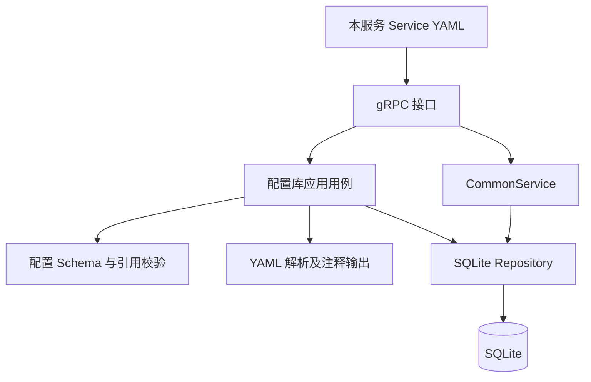

<p class="figure-caption">图 5-1 逻辑组件及依赖</p>

| 组件 | 职责 |
|---|---|
| API Adapter | gRPC 协议、授权与错误映射 |
| Application | 候选、发布、查询、废弃、备份业务编排 |
| Core 配置 Schema / 验证器 | 共享对象结构、引用一致性与类型验证 |
| YAML Serializer | 确定性导入导出与文档化文件头 |
| SQLite Repository | 事务、关系持久化、CAS、版本索引 |
| CommonService | 服务自身管理、运行状态、度量与诊断 |

## 5.2 核心对象与关系

结构化关系以 SQLite 为权威。图 5-2 和图 5-3 均为标准 ER 图，包含主要字段、主键（PK）、外键（FK）与基数。完整列约束、历史引用及事务规则统一见 §10；此处不再建立第二套字段定义。

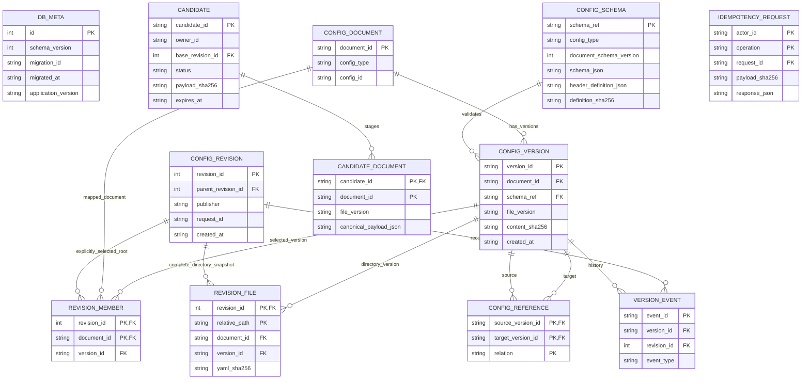

<p class="figure-caption">图 5-2 配置库版本、修订与引用关系 ER 图（DB_META 为单行系统元数据）</p>

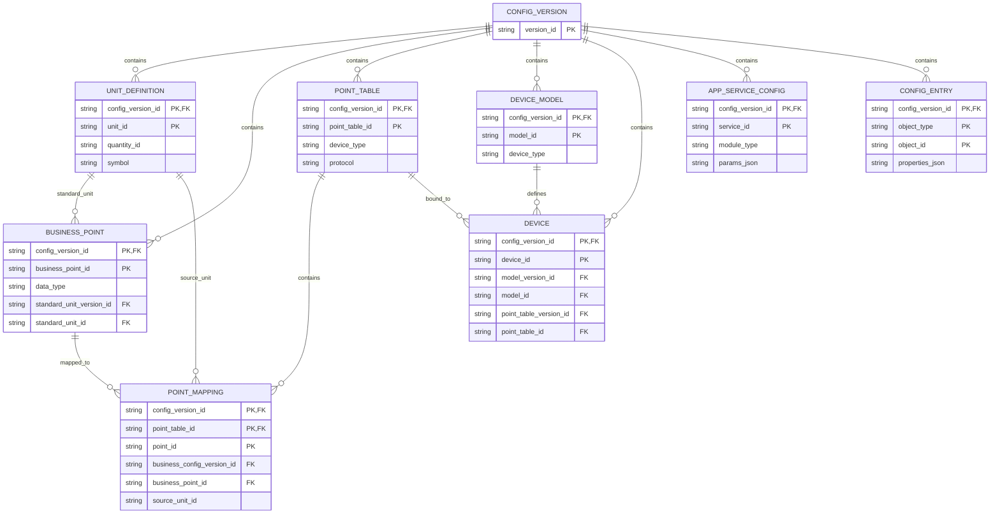

<p class="figure-caption">图 5-3 配置领域对象及应用配置关系 ER 图</p>

图中跨版本业务外键是**复合外键**，其目标由 `config_version_id` 与业务身份共同确定，不允许用只有名称的自由字符串代替数据库约束。ER 图中的实体名使用单数标记，实际 SQLite 表名以第 10 章的复数名称为准。`DB_META` 由数据库初始化和迁移逻辑管理，不参与业务发布修订。

## 5.3 状态模型

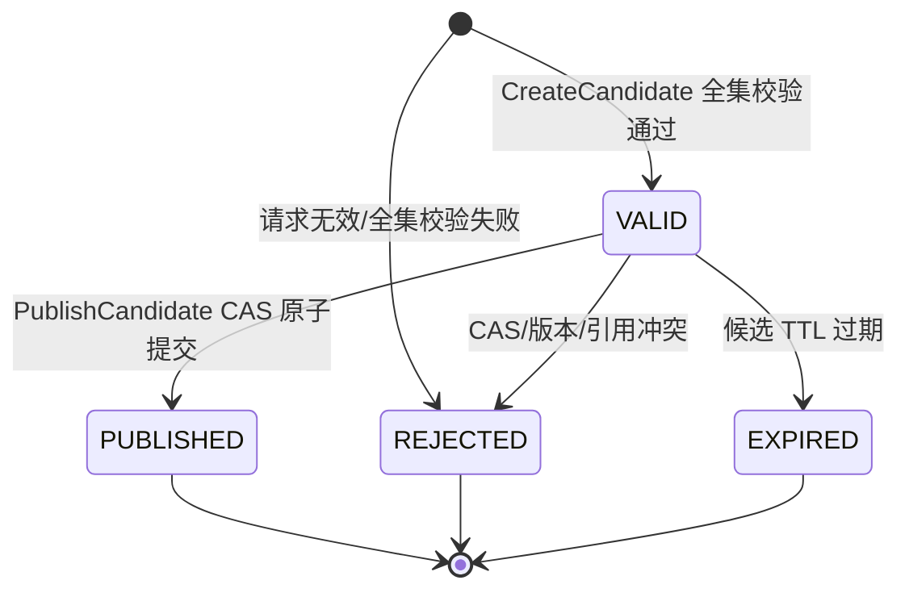

<p class="figure-caption">图 5-4 发布版本状态机</p>

候选数据未发布不可读；`DEPRECATED` 仅拒绝新绑定，不删除历史。推荐版本变更新增修订记录而不修改历史内容。

## 5.4 核心逻辑协作

系统发布为 `scan directory → upload manifest/chunks → finalize/validate → BEGIN IMMEDIATE → CAS → insert/reuse immutable versions → replace complete revision_files membership → commit → best-effort NATS broadcast`。所有读请求在单个一致性 SQLite 读事务内完成。业务模块对其实际配置生效自行负责。

# 6. 进程视图

## 6.1 运行时结构

首版一个独立 Python 服务进程，承载 gRPC 服务器、轻量应用服务与 SQLite 写入适配器；使用 SQLite WAL 和单写者串行事务。不设计专门的协调进程、集群或分布式锁。

## 6.2 运行生命周期

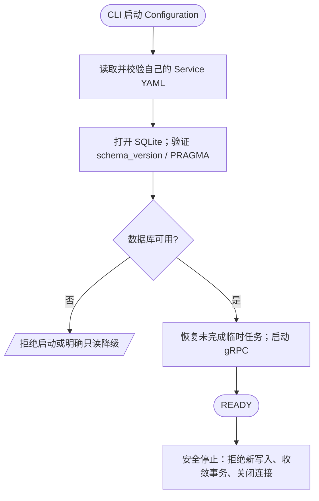

<p class="figure-caption">图 6-1 启动与停止流程</p>

## 6.3 并发、资源、背压与缓存

SQLite 单写者；读者使用 WAL 一致性快照。控制并发 RPC 数、每次请求字节数、候选文档数、依赖闭包最大节点数、备份任务数、连接数和事务超时。禁止在 event loop 中执行长时间阻塞 SQLite I/O；线程池与连接归属由 Adapter 管理。

## 6.4 异常、崩溃与恢复

提交前崩溃：未提交事务回滚；提交后回复丢失：以 `request_id` 和提交 revision 查询实际结果；数据库不可写时拒绝发布、允许安全只读查询并上报 DEGRADED；完整性检查失败时 fail-closed，不自动重建或覆盖数据库。恢复备份必须停写、保留审计并验证恢复内容。

# 7. 开发视图

## 7.1 目标模块组织

```text
src/configuration_service/
  domain/                 # 配置身份、版本及不可变关系
  application/            # 发布、查询、导出、废弃、备份用例
  infrastructure/
    adapters/
      inbound/grpc/       # Common + Configuration Service Server
      outbound/sqlite/    # 事务及表仓储
      outbound/yaml/      # YAML 输入与带注释输出
  interfaces/             # 对外 DTO 或应用边界（按实际需要）
```

仅为目标结构，不表示上述目录已存在。不增设独立 `/src/configuration` 或 `/src/typings`；共享的通用配置解析能力继续复用 `core.configuration`。代码文件名不含版本号。

## 7.2 模块职责与测试归属

| 测试层 | 路径 | 内容 |
|---|---|---|
| Unit | `tests/src/configuration_service/unit/` | 版本、引用、类型映射、YAML 输出 |
| Component | `tests/src/configuration_service/component/` | SQLite Repository 事务、Migration、备份 |
| Integration | `tests/src/configuration_service/integration/` | 真实 gRPC、内网隔离、共享 Core Schema |
| System | `tests/src/configuration_service/system/` | CLI 进程、发布、崩溃、恢复和历史下载 |

## 7.3 静态依赖与公共能力复用

公共协议定义在 `src/contracts/`（专用 `.proto` 新增时仍放该处）；业务逻辑不直接依赖 gRPC 或 SQL；SQLite/YAML 细节只通过 Adapter 进入应用。修改现有契约时必须同步检查 CLI、各模块调用方、配置、测试及注释。

# 8. 物理视图（部署视图）

## 8.1 部署拓扑

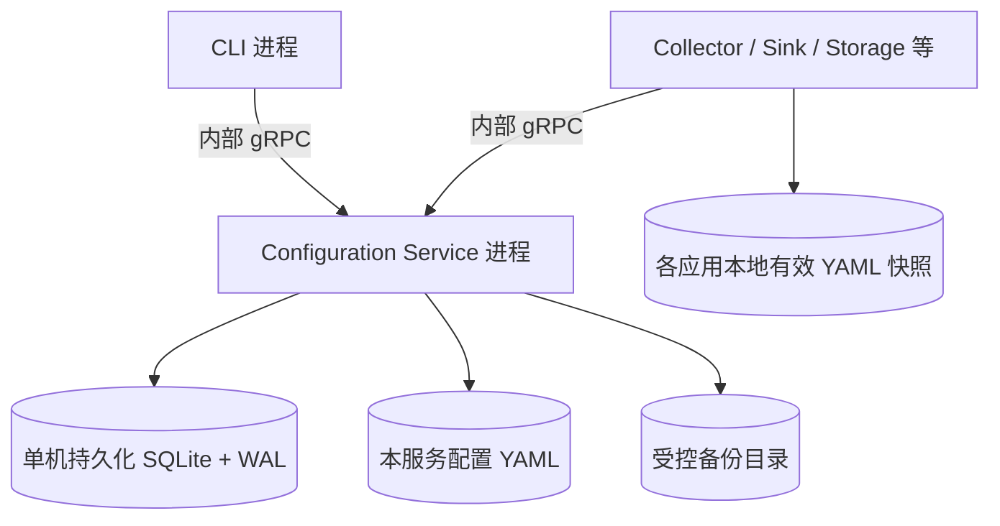

<p class="figure-caption">图 8-1 单实例部署拓扑</p>

## 8.2 部署身份、资源与故障域

数据库主文件、WAL、SHM 及备份根目录放置在可持久化卷；生产进程持有唯一数据库写权限，禁止多个独立 Configuration 实例同时作应用层写者。本服务内部 gRPC 无证书配置，监听地址与访问令牌由启动配置和部署环境限定；CLI 仍负责启动/停止与模块配置协调。单节点服务宕机时其他模块可使用已验证本地快照运行；无快照且无服务端则启动失败。

# 9. gRPC 接口实现与调用方适配

## 9.1 唯一接口契约来源

**对外 RPC 的方法名、请求/响应字段、类型、可选性、枚举、分页、错误码、认证授权及版本规则统一归属《Contracts 软件设计》与 `src/contracts/*.proto`。** 本设计只规定 Configuration Service 如何实现这些契约，不独立冻结第二套通信协议。现有 `src/contracts/common.proto::CommonService` 的 9 个 RPC 直接复用；新增 Configuration Repository RPC 应先在 Contracts 设计与 Proto 中定稿，再同步实现。本次以《Contracts 软件设计 v1_31》新增 Repository 专章，逐一给出建议请求和响应字段，作为后续 Contracts 修订输入；**该目标契约尚未写入正式 Proto**。

| 入口类别 | 契约权威 | 本模块实现职责 | 关联需求 |
|---|---|---|---|
| `CommonService` 9 RPC | 现有 `common.proto` | 真实返回服务信息、状态、能力、配置自身快照、指标、事件和诊断 | UR-05 |
| 配置上传/发布 | 待新增 Repository Proto | 候选校验、幂等、CAS、SQLite 原子提交及审计 | UR-01 |
| 配置版本/引用查询 | 待新增 Repository Proto | 固定修订一致读、精确 FK 闭包、分页 | UR-02/04 |
| 配置获取/批量获取 | 待新增 Repository Proto | 唯一带 Header YAML、正文往返校验、双哈希 | UR-03 |
| 容量/备份 | 待新增 Repository Proto | SQLite 实际占用、Online Backup API、持久化任务 | UR-04 |

## 9.2 服务端输入校验与输出组装

接口错误区分为两层：**候选文档内容校验失败**（YAML/Schema 结构、可定位字段错误）使用 `CreateCandidateResponse.valid=false` 和 `issues`，不创建持久候选；**RPC 请求契约错误**（空 `request_id`、缺少必填 presence、不支持的枚举值）返回 `INVALID_ARGUMENT`；配额超限返回 `RESOURCE_EXHAUSTED`；不可变 `file_version` 冲突返回 `ALREADY_EXISTS`；全局修订 CAS 冲突返回 `ABORTED`。所有业务拒绝不得通过未分类异常错误映射为 `INTERNAL`。


| 操作 | 输入校验及装配 | 输出与错误处理 |
|---|---|---|
| 候选上传 | 校验请求身份、YAML 格式、完整性、配置类型 Schema、引用闭包、最大字节数 | 候选 ID、逐文件/逐字段问题；不产生可见业务修订 |
| 候选发布 | CAS 检查基准修订、锁定候选及请求幂等键 | 原子提交的 `revision_id`、已发布版本身份；冲突拒绝、绝不部分发布 |
| 配置读取 | 校验授权；精确版本或修订；解析实际存储行与规范字段字典 | 完整 Header + YAML 正文、版本、修订、内容哈希、字节哈希、规范文件名 |
| 配置包读取 | 同一 SQLite 快照下解析依赖闭包；校验数量/深度/大小 | 确定排序的多文件结果；任何依赖不完整则整体失败 |
| 版本/引用列表 | 强制分页、版本固定、精确 FK 关系 | 版本、目标身份、废弃标记及下一页游标 |
| 废弃和推荐指针 | 权限及 CAS 检查；不得覆盖历史版本内容 | 新修订和效果说明；现有历史依赖始终可解析 |
| 容量/备份 | 校验管理权限及受控备份目录；实际 SQLite 状态 | 准确统计或可查询的任务状态、路径、字节数与哈希 |

所有输出必须符合 Contracts 中的字段及 gRPC Status 约定；**不得根据本表推断当前已有新 RPC 实现**。失败类型至少区分参数非法、身份不存在、内容冲突、CAS 竞争、权限不足、容量不足、数据库不可用和内部一致性错误。

## 9.3 Common APIs 具体实现

| 现有 RPC | 本服务必须提供的真实信息 |
|---|---|
| `GetServiceInfo` | 服务 ID、角色、软件/契约版本、进程启动时间 |
| `GetServiceStatus` | 整体健康、SQLite 连接与读写、数据库 Schema 迁移状态、磁盘容量、观测时间 |
| `GetCapabilities` | 已注册并实际可调用的 RPC、协议和功能标识 |
| `GetConfigSnapshot` | **本服务自身引导 YAML** 的 DISK/RUNTIME/CANDIDATE 配置及其校验证据，不能混淆为全库配置版本 |
| `PushConfigSnapshot` | 本服务自身候选启动配置校验，不调用全库发布事务 |
| `ApplyConfigSnapshot` | 自身服务配置的受控生效与 `restart_required`，不能声称已协调其他业务模块 |
| `GetMetrics` | 数据库 Schema 版本、库大小、配置/版本数、读写速率、错误率、备份与容量指标 |
| `GetEvents` | 发布、冲突、迁移、备份、故障和权限事件，按正式契约分页 |
| `Diagnose` | 数据库文件访问、完整性、外键、迁移状态、依赖路径、可用磁盘等分阶段诊断 |

## 9.4 全量发布、广播与模块独立生效

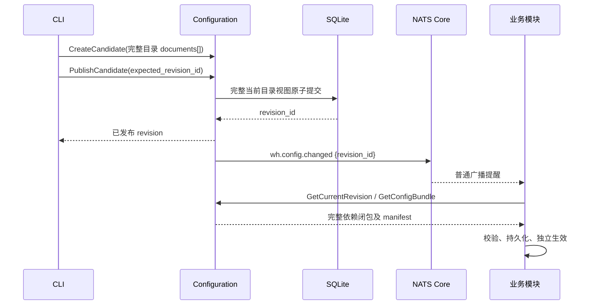

<p class="figure-caption">图 9-1 全量目录发布与非阻断广播</p>

发布者只负责 SQLite 原子提交及发送一次 NATS Core 广播，不逐个联系模块。某一模块离线或应用失败不影响其他模块，也不改变发布事务。广播投递失败不回滚已提交修订，模块建立订阅后、重连后和周期性对账时从 Configuration 查询最新修订。本节定义目标能力，现有服务仅实现既有 `CreateCandidate/PublishCandidate` 等 RPC，尚需新增目录候选协议、修订查询和 NATS 发布 Adapter。

# 10. SQLite 数据模型与 YAML 契约

## 10.1 SQLite 关系模型、约束与版本

图 5-2、5-3 定义实体关系；本节是**字段、索引、外键和事务的唯一规范定义**。实际 DDL 必须实现表中的列、约束、索引及触发器；ER 图用于结构核对，不取代 DDL。

### 10.1.1 `db_meta`、版本化 Schema 与迁移

| 表 | 列及 SQLite 类型 | 约束与语义 |
|---|---|---|
| `db_meta` | `id INTEGER`, `schema_version INTEGER`, `migration_id TEXT`, `migrated_at TEXT`, `application_version TEXT` | `id=1` 单行 PK；其余 NOT NULL；数据库物理 Schema 版本为正整数 |
| `config_schemas` | `schema_ref TEXT`, `config_type TEXT`, `document_schema_version INTEGER`, `schema_json TEXT`, `header_definition_json TEXT`, `definition_sha256 TEXT`, `created_at TEXT` | PK `schema_ref`；`schema_json` 和字段说明均为规范化且不可变的 Schema；`UNIQUE(config_type,document_schema_version)`；同一配置类型及文档 Schema 版本只允许一份权威定义，不同内容不得复用同一 `schema_ref` |
| `schema_migrations` | `migration_id TEXT`, `from_version INTEGER`, `to_version INTEGER`, `applied_at TEXT`, `checksum TEXT` | PK `migration_id`；迁移顺序连续，校验执行文件校验和 |

数据库首次初始化和每一次迁移必须在**同一个事务**内更新 `db_meta.schema_version` 与 `PRAGMA user_version`，成功后进行 `foreign_key_check` 与 `integrity_check`。启动时执行 `PRAGMA foreign_keys=ON`，验证表结构、索引、FK、迁移校验和与两个版本号。仅凭 `CREATE TABLE IF NOT EXISTS` 不得判定迁移成功。高于支持版本、结构漂移、迁移不完整时拒绝写入且报告可诊断状态；是否允许只读须证明读格式兼容，不能无条件降级。

Schema 发布由**随软件版本交付并签名/校验的受控 Schema 包**完成：启动/迁移时在受控事务中登记新 `schema_ref`，不提供任意 gRPC 上传可执行 Schema 的能力。业务配置发布只可选用已登记的 `config_type + document_schema_version`；历史 Schema 不得删除或改写。字段说明应包含允许的动态映射键/数组元素规则及所有可配置字段，且能自动生成完整 Header。

`config_schemas` 是配置类型的机器可执行约束与 Header 字段说明的**不可变快照**；`config_versions.schema_ref` 绑定其确定版本，保证未来升级仍能解释历史文档。该表自身不属于业务配置修订，变更必须经受控 Schema 发布及审计。库 Schema 版本、文档 Schema 版本、字段说明定义及全局配置修订不得混用。

### 10.1.2 版本、候选、修订与管理表

| 表 | 字段及 SQLite 类型 | 主键、唯一性及关系 |
|---|---|---|
| `config_documents` | `document_id TEXT`, `config_type TEXT`, `config_id TEXT` | PK `document_id`；`UNIQUE(config_type,config_id)`；非空、规范身份 |
| `config_versions` | `version_id TEXT`, `document_id TEXT`, `schema_ref TEXT`, `file_version TEXT`, `content_sha256 TEXT`, `created_at TEXT` | PK `version_id`；FK 至 documents/schemas；`UNIQUE(document_id,file_version)`；版本和内容及其子行不可变；`UNIQUE(document_id,version_id)` 供复合 FK |
| `revisions` | `revision_id INTEGER`, `parent_revision_id INTEGER`, `publisher TEXT`, `request_id TEXT`, `created_at TEXT` | PK 自增；parent FK；成功写事务的全局连续视图；`(publisher,request_id)` 唯一仅限发布用途 |
| `revision_members` | `revision_id INTEGER`, `document_id TEXT`, `version_id TEXT` | PK(`revision_id`,`document_id`)；显式推荐/根选择版本，与目录文件全集分离 |
| `revision_files` | `revision_id INTEGER`, `relative_path TEXT`, `document_id TEXT`, `version_id TEXT`, `yaml_sha256 TEXT` | PK(`revision_id`,`relative_path`)；复合 FK(`document_id`,`version_id`)，允许同一对象不同文件版本在一修订并存，不能目录路径重复 |
| `config_references` | `source_version_id TEXT`, `target_version_id TEXT`, `relation TEXT` | 三字段复合 PK；双端 FK 至 config_versions；引用版本固定、不随推荐版本改变；按 target 建反向索引 |
| `candidates` | `candidate_id TEXT`, `owner_id TEXT`, `base_revision_id INTEGER`, `status TEXT`, `manifest_sha256 TEXT`, `created_at TEXT`, `expires_at TEXT` | PK；FK base revision；状态 `VALID/REJECTED/PUBLISHED/EXPIRED`，CreateCandidate 校验通过后冻结候选 |
| `candidate_documents` | `candidate_id TEXT`, `relative_path TEXT`, `document_id TEXT`, `config_type TEXT`, `config_id TEXT`, `file_version TEXT`, `schema_ref TEXT`, `canonical_payload_json TEXT`, `yaml_sha256 TEXT`, `content_sha256 TEXT` | PK(`candidate_id`,`relative_path`)；同一候选可包含同一对象不同文件版本；路径不可重复、正文必须无损重建 |
| `idempotency_requests` | `actor_id TEXT`, `operation TEXT`, `request_id TEXT`, `payload_sha256 TEXT`, `response_json TEXT`, `completed_at TEXT` | PK(`actor_id`,`operation`,`request_id`)；记录**操作最终提交证据**；同键不同 payload 拒绝；和业务更新同事务写入 |
| `version_events` | `event_id TEXT`, `version_id TEXT`, `revision_id INTEGER`, `event_type TEXT`, `reason TEXT`, `actor_id TEXT`, `created_at TEXT` | PK；FK version/revision；`DEPRECATED` 事件只追加，废弃状态是按 revision 推导的视图 |
| `audit_events` | `event_id TEXT`, `actor_id TEXT`, `operation TEXT`, `target_id TEXT`, `revision_id INTEGER`, `outcome TEXT`, `created_at TEXT`, `detail_json TEXT` | PK；审计只追加、受控保留；不保存秘密原文 |
| `backup_tasks` | `task_id TEXT`, `actor_id TEXT`, `request_id TEXT`, `state TEXT`, `path TEXT`, `size_bytes INTEGER`, `sha256 TEXT`, `created_at TEXT`, `finished_at TEXT`, `error TEXT`, `database_schema_version INTEGER`, `integrity_verified INTEGER` | PK；任务状态持久化；受控目录；启动与完成更新事务化 |

**修订语义（唯一规则）**：`revision_files` 是**当前目录内全部文件/版本的唯一权威成员集合**；`revision_members` 仅表示显式指定的推荐/根选择版本，不是目录全集，不另建 `recommended_versions` 第二张权威表。新 revision 在同一事务按输入 Manifest 完全替换 `revision_files` 文件集合，并独立记录显式推荐/根选择视图后一次提交；空库起始修订为 `0`（虚拟初始状态，无成员，非业务发布）。`SetRecommendedVersion` 产生新 revision 并替换一条成员。`config_versions` 和 `config_references` 永不更改；`version_events` 不改变历史版本内容。

**固定引用闭包**：某个已发布源版本引用目标版本 `B@v1` 时，即使当前 revision 推荐 `B@v2`，`GetConfigBundle` 仍必须读取 `B@v1`。因此“同一 revision”是指**根配置选用的修订一致且读取期间拥有一个 SQLite 快照**，绝不表示所有依赖都强制等于 `revision_members` 的当前推荐版本。闭包允许同时包含同一文档的两个固定历史版本；输出以 `(config_id,version_id)` 唯一标识文件，不能按 config_id 覆盖。

**废弃规则**：只记录 `version_events`，保留已经存在的历史引用和查询；禁止将已废弃版本加入新发布的引用，除非发布策略明确授权；禁止废弃当前 revision 中仍被推荐的版本（需先切换推荐目标）。`DeprecateConfigVersion` 与 `SetRecommendedVersion` 均形成新 revision；原版本和旧 revision 不可被改写。

**目录全集与多版本共存的迁移要求**：原 `revision_members` 只有推荐/根选择版本，不能表示一个根目录中同对象多版本并存。目标新增 `revision_files` 为完整文件目录的唯一成员集合，`candidate_documents` 增加 `relative_path` 及 YAML 哈希并将主键改为 `(candidate_id,relative_path)`；该调整不增加第三张候选文件表。发布时服务端依 `CreateCandidate(documents[])` 的完整集合一次性生成全量 Manifest 和 `revision_files`，对旧版本表、Projection、查询及测试执行原子 Schema 迁移，不保留两套候选存储方案。已使用历史修订的根成员必须按可证明的原身份规则迁移；无法无损重建的旧修订不能虚构文件路径，应明确拒绝迁移并保留旧库备份。

### 10.1.3 领域对象、业务键与外键

| 表 | 不可变版本内键及内容 | 关联约束 |
|---|---|---|
| `unit_definitions` | PK(`config_version_id`,`unit_id`)；`quantity_id`,`symbol`,`scale_to_base`,`offset_to_base`,`base_unit_id` | 对应确切 Units 文档版本，单位换算系数有限，基准单位及量纲关系完整 |
| `business_points` | PK(`config_version_id`,`business_point_id`)；`data_type`,`standard_unit_version_id`,`standard_unit_id`,`description` | 复合 FK(`standard_unit_version_id`,`standard_unit_id`)→unit_definitions；标准业务 ID 在本目录唯一，跨同类型号/真实/仿真复用 |
| `point_tables` | PK(`config_version_id`,`point_table_id`)；`device_type`,`protocol`,`parent_version_id`,`parent_point_table_id` | 父表复合 FK；继承链无循环，同名字段合并规则固定 |
| `point_mappings` | PK(`config_version_id`,`point_table_id`,`point_id`)；`business_config_version_id`,`business_point_id`,`source_type`,`source_unit_version_id`,`source_unit_id`,`scale`,`offset`,`address_json`,`point_groups_json` | 到 point_tables 的联合 FK、business_points 的两列联合 FK 与 unit_definitions 的双列联合 FK；`UNIQUE(config_version_id,point_table_id,business_point_id)` 在展开继承的有效点表上必须成立；`scale` 有限非零，`offset` 有限 |
| `device_models` | PK(`config_version_id`,`model_id`)；`device_type`,`properties_json` | 归属版本；结构与引用校验 |
| `devices` | PK(`config_version_id`,`device_id`)；`model_version_id`,`model_id`,`point_table_version_id`,`point_table_id`,`properties_json` | 两组复合 FK，设备类别与关联型号/点表一致 |
| `app_service_configs` | PK(`config_version_id`,`service_id`)；`module_type`,`params_json` | 所有模块 Service 配置；对应 Schema 的全字段检查 |
| `config_entries` | PK(`config_version_id`,`object_type`,`object_id`)；`properties_json` | 承载 Site、Task、Delivery、Protocol 等登记类型；不得接受无 Schema 自由内容 |

对于全部关系表，`config_version_id` 均 FK 到 config_versions。SQLite 支持的外键必须由**目标联合 PK/UNIQUE**真实保证；跨版本引用的 `config_references` 还必须完整包含语义/单位、模板及应用依赖，不得只保留领域专用 FK。

### 10.1.4 无损重建的结构化存储契约

**配置对象持久化采用规范化 JSON 值及关系投影，不存储 YAML 原文作为权威。** `candidate_documents.canonical_payload_json` 用于候选阶段；已发布版本由上述领域关系行及 `config_entries`/`app_service_configs` 重建。每个配置类型应具有**唯一的字段级映射规范**，明确哪些键落独立列、哪些嵌套键落 JSON、哪些字段按存在标志表达。所有嵌套映射、列表、字符串、布尔、整数、有限浮点及 `null` 均须往返保持类型、值和字段出现/缺省的差别。JSON 的 `true` 与整数 `1`、`null` 与缺失键不能互相替换；`json_valid` 不能代替业务 Schema 校验。

为防止关系投影遗漏字段，每个配置类别必须具备 `encode_to_rows` / `decode_from_rows` 的双向测试：发布前构建关系行后，立即从拟提交数据重建配置对象并核对语义哈希；发布后重新打开 SQLite 查询同一版本复测。**如果任何已支持配置类型不能无损还原，则禁止发布该版本**；不得静默丢弃字段或用默认值填充遗漏项。

配置文件之间的引用同时在 `config_references` 保存精确目标版本；对应业务行的外键、源 YAML 引用身份和 ConfigReference 必须三者一致。在数据库关系插入与版本发布的同一事务完成校验。

### 10.1.5 S2 持久化约束与查询快照

**数据库单实例所有权**：进程初始化时先独占锁定 SQLite 数据库旁的 `.lock` 文件，锁的生命周期等于服务进程生命周期；失败不得启动第二个写者。锁仅用于进程所有权，不替代 `BEGIN IMMEDIATE` 的数据库写锁，退出服务时必须明确释放。

**无损候选状态**：`candidate_documents` 必须保留 `config_type`、`config_id` 与完整规范化正文，不以不可逆 `document_id` 哈希代替身份字段。重启后发布候选可从 SQLite 独立重建，而不依赖内存中的待发布对象。

**跨版本投影入库**：发布事务在所有配置版本、关系投影和固定引用入库后才提交。使用仅限当前写事务的 `PRAGMA defer_foreign_keys=ON` 延迟检查，不得让业务数据的插入顺序影响正确性；事务失败全部回滚。

**历史分页**：`ListConfigs` 固定全局 `revision_id`；`ListConfigVersions` 在第一页同时固定版本行水位与废弃事件修订水位，并将两者纳入不透明游标。后续页不能因新版本或新的废弃事件漏项。

**多根依赖查询**：同一 SQLite 只读事务解析所有根配置、历史固定引用与依赖拓扑；按 `version_id` 去重，同时保留同一文档不同版本；循环、缺失及超过闭包配额必须整体失败。

**备份与恢复**：每个备份任务状态持久化；SQLite Online Backup API 生成独占权限的临时文件，完成 `integrity_check`、`foreign_key_check`、数据库版本核对、SHA-256 后原子更名。只有保存数据库 Schema 版本和 `integrity_verified=1` 才能进入 `SUCCEEDED`；重启后残留 `QUEUED/RUNNING` 标为 `INTERRUPTED`，不假定成功。

数据库迁移仅通过显式版本脚本执行。首版 Schema 版本为 1，尚不存在其他版本的迁移脚本；遇到未知版本直接拒绝启动，不自动推测升级。

### 10.1.6 版本号、文件名与存储权限

`db_meta.schema_version` 描述 SQLite 物理表结构；`config_schemas.document_schema_version` 为对应 YAML 的 `schema_version`；`file_version` 为业务内容版本；`revision_id` 为配置库全局推荐视图。`content_sha256` 对由已发布 Schema 规范化的**完整类型化业务正文**计算，序列化规则与 Schema 一起冻结；`yaml_sha256` 对实际返回的完整 Header + 正文 UTF-8 字节计算。数据库迁移不自动改变已发布业务修订。

SQLite 文件及 WAL/SHM 必须使用受控权限；远端不得通过任意文件路径读写数据库。应用服务配置不回传密钥私值，而回传安全引用；导出 Header 不暴露秘密。Service YAML、配置库、日志、备份必须有明确权限与容量管理。

## 10.2 导入、发布、查询与数据一致性规则

1. 导入 YAML 时使用安全加载器，拒绝重复键、非受支持的自定义标签、非有限浮点及隐式类型歧义；原文的注释、缩进、锚点无需逐字保留。`schema_version`、`file_version` 按每一文档类型验证，严禁将数据库 `schema_version` 用作配置正文版本。
2. 导入的每个配置必须匹配**已注册、不可变**的 `config_schemas.schema_ref`。对于新增应用配置，先注册完整 Schema/字段描述并完成映射验收，不得把未知业务字段默默丢弃。
3. 先在候选阶段完成结构、字段、版本、单位类型、引用、继承环、逻辑字段唯一性校验；发布事务内重检 CAS、目标版本和当前废弃状态，避免候选到发布之间的竞态。
4. 完整目录候选必须持久化完整候选 Manifest 和全部文件正文，重启后按已确认内容继续或作为 `EXPIRED`；过期候选不可发布。`validate_only` 不入库。发布后崩溃的 `request_id` 必须通过 `idempotency_requests` 返回**已提交结果**，重复同键不同请求正文一律拒绝。
5. 单写事务采用 `BEGIN IMMEDIATE`、受控超时和事务边界；原子提交版本行、领域关系、引用、完整 `revision_files` 和显式选择版本、审计与幂等结果。`COMMIT` 未确认时必须查询持久化操作证据，不得凭客户端超时判定写入失败或自动重新生成第二次 revision。
6. 使用同一只读事务完成 `GetConfigBundle` 依赖闭包解析，闭包查询采用固定 `version_id`，绝不能覆盖两个不同版本的同名文档。闭包中出现同一身份的多版本时应提供不同确定文件路径与 manifest 项；业务模块若不支持该场景则明确返回 `FAILED_PRECONDITION`，而不是静默选择最新。
7. 分页必须绑定查询谓词、排序与选定 revision；游标应校验篡改及过期，默认/最大页数、候选数、依赖闭包长度、YAML 最大字节数和并发由自身 Service YAML 控制。
8. 业务引用是精确版本引用；新版本引用旧文档是合法历史关系，不要求与当前推荐指针相同。配置文件正文若使用相对模板名称，发布时必须解析成确定版本并保留原始引用表达与版本绑定，以便往返时仍能生成业务模块实际支持的 YAML 格式。
9. 对 SQLite 文件实行单进程写者原则、WAL、`busy_timeout`、`foreign_keys=ON` 和权限隔离；数据库锁、磁盘满、存储损坏时应明确失败或受控只读，不凭默认行为无界重试。
10. SQLite 物理数据表创建不属于业务配置发布操作；全部 DDL 按 `db_meta` 版本升级。业务配置版本发布只增加数据行，不运行随意的 `ALTER TABLE`。

## 10.3 唯一 YAML 交换格式及完整 Header

**导入与导出均采用现有模块可解析的 YAML 配置正文。导出仅有一种格式：完整注释 Header + 完整配置正文。** 不存在输出模式参数、简洁模式、客户端补 Header 选项。

Header 生成依据：配置身份绑定的 Schema 版本及其字段定义，包括所有可配置路径、名称、是否必填、类型、范围/枚举、单位、默认值（如果定义）、示例和引用规则；对于应用配置的自定义字段，必须由已注册模块 Schema 提供说明。敏感字段仅说明安全引用规则。Header 是可读说明，不是数据校验的权威；业务模块仅依据 YAML 正文加载。

```yaml
# 文件类型：风机标准业务字段（示例）
# schema_version: 必填；integer；允许 1；示例 1
# file_version: 必填；semver MAJOR.MINOR.PATCH；示例 1.0.0
# business_points: 必填；mapping；设备类别内标准字段目录
# business_points.<id>.data_type: 必填；标准数据类型
# business_points.<id>.unit: 必填；标准单位 ID，引用已发布 Units
# business_points.<id>.description: 可选；string；说明性文字；示例 发电机绕组温度
# 注：本文件头由 Configuration Service 按其已发布 Schema 版本生成
schema_version: 1
file_version: 1.0.0
business_points:
  generator_temperature:
    data_type: float32
    unit: celsius
    description: 发电机温度
```

<p class="figure-caption">示例 10-1 带完整 Header 的单一 YAML 交付格式（节选示例；正式 Header 必须覆盖目标类型所有字段）</p>

**往返保证：** 对任意成功发布的配置版本 `C`，由数据库重建并导出 YAML `Y`，再按同版本 Schema 解析 `Y` 得到 `C'`，必须满足：

$$
\operatorname{Canonical}(C')=\operatorname{Canonical}(C)
$$

原 YAML 的注释、缩进、键顺序、锚点不要求字节保留，但值、类型、可选字段的存在性与显式 null、嵌套映射/列表、配置身份、精确引用和版本必须等价；导出-导入后内容哈希相等。`yaml_sha256` 校验实际交付字节，和内容哈希分开计算。重复键、未知字段、隐式日期转换、非有限浮点、超范围整数、歧义布尔等必须按配置 Schema 的确定规则处理，禁止静默截断或强制字符串化。

**历史可重建性：** Header 字段说明及序列化规则应可按配置 Schema 版本定位；即使服务当前版本升级，同一历史配置仍能在受支持迁移和旧 Schema 下完整导出。完整 Header 必须可用程序检验其覆盖目标 Schema 的所有可配置属性。

## 10.4 一致性、变更与故障边界

一次 revision 的可见版本集和引用闭包在 SQLite 事务提交时原子成立。客户端用 `revision` 获取依赖包，并以 config/hash 检查本地快照。发布后的 CLI 生效协调可部分成功，不回滚已发布 revision；CLI 记录每个业务模块自身 `ApplyConfigSnapshot` 结果。重复请求通过持久化 `request_id` 返回原结果；同 `request_id` 不同内容拒绝。SQLite 备份由官方 Online Backup API 实现；不得用正在写入的单个 `.db` 文件复制来声称一致性备份。

### 10.4.1 实现分层、固定引用和运行恢复的编码要求

Configuration Application 只能依赖领域模型及 `RepositoryPort`、`DocumentCodecPort`、`BackupPort`。SQLite、YAML 和 gRPC 的实现放在 Infrastructure，入口负责依赖注入。代码静态门禁须对 Configuration Service 独立执行分层检查，不允许从 Application 直接 import 其 Infrastructure。

**精确版本引用格式**：新型结构化配置使用 `config_sources` 的固定版本引用列表，例如：

```yaml
schema_version: 1
file_version: 1.0.0
config_sources:
  - config_type: units
    config_id: units_standard
    file_version: 1.1.0
semantic_points:
  temperature:
    data_type: float32
    unit: celsius
    description: 温度
```

引用在候选校验及发布时解析成不可变 `config_versions.version_id`，而不是向使用者暴露数据库内部主键。业务点本身就是标准语义；设备类别点表依赖 BusinessPoint 和 Units 的不可变版本；唯一关系不成立、被引用版本不存在、已废弃或出现循环时，禁止发布。旧格式的目录型 `config_sources` 只允许在能消除歧义并固定到已发布版本时转换，不能依赖运行时可变的“最新”文件。

**配置重建**：版本表和领域关系表均写入确定的结构化记录；不规则应用专属字段落入版本化 JSON 对象列。每个已发布文档另保留规范化对象树，用于验证外部完整 YAML 重建的哈希、类型、缺省与显式 null；这不是保留 YAML 原始文件文本。新增领域关系映射后，不允许仅依靠规范化对象树掩盖缺失的外键。

**运行启动**：Configuration Service 自身 YAML 不进入配置库。CLI 通过既有受保护 Common RPC 调用协调业务模块生效，提交前取得目标模块当前完整快照，仅覆盖清单指定的文件，不得删除未指定的既有文件。备份采用独立受限线程池，重复调度同一任务时不得重复启动文件操作；服务结束前完成资源收敛。

### 10.4.2 固定版本依赖与关系投影的准入边界

版本化模型关系不得凭设备名称、点表文件名或未发布目录路径推测。设备实例中的 `model.id/model.version` 绑定已发布的 `device_models` 记录；型号中 `point_table.id/point_table.version` 绑定已发布的 `point_tables` 记录。上述两个绑定均存在且对应关系完整，才写入带复合外键的 `devices` 行。

点表的 `device_type` 必须由自身显式定义，或者由**同一发布候选中准确引用该点表版本且设备类型唯一的 DeviceModel** 推导；不得自动填入虚构类型。业务点和单位的固定版本依赖齐备时，才生成 `point_mappings` 外键行。

未导入关联模板的历史 YAML 可保留完整规范化文档记录用于迁移和导出，但其关系投影仍属于 **未绑定**，不能视为完整的结构化配置准入通过。完整验收场景必须联合发布设备实例、型号、点表及需要的单位和语义目录；孤立导入的版本不得被判定为已满足完整的 Device/Point 关系覆盖。

遗留 `config_sources.templates.root` 仅支持明确授权的 `configs/templates` 根目录及其映射配置类型；不能把任意路径当成全部模板的别名。正式新配置应使用精确的 `config_type + config_id + file_version` 引用。

运行健康检查覆盖 SQLite、外键、WAL 与磁盘可用空间；持久化审计包括业务操作成功及请求拒绝。Repository RPC 使用有界内存窗口记录实际请求数、失败次数、处理耗时，并提供请求速率、平均延迟与 P95 延迟；数据库、备份及审计计数来自 SQLite 持久化记录。无样本时的延迟零值应解释为无观测样本，不能作为已证明的零延迟。

### 10.4.3 校验、错误码和运行中数据库身份

- **嵌套 YAML Schema**：数组字段 `type=array` 必须定义并递归验证 `items`，数组元素中的 `required`、`properties`、`enum` 和 `additionalProperties` 同对象字段执行统一规则。目标模块 Service Schema 如采用 `security.callers` 数组，元素统一为 `caller_id`、`token_env` 和 `permissions`（字符串数组）；Configuration 自身引导配置使用 `security.token_sources` 与 `security.permissions`。导出 Header 和机器 Schema 必须保持一致。
- **Schema 注册**：同一 `config_type + document_schema_version` 对应唯一不变的 Schema 定义。重复一致定义可幂等；内容冲突必须以领域 `RepositoryConflictError` 拒绝，不能泄漏裸 SQLite 异常。内置 Schema 定义升级必须按受控迁移处理，不能在同一版本号上静默修改已使用的数据模型。
- **认证与授权**：无有效受控访问令牌属于 `UNAUTHENTICATED`；已验证令牌主体没有相应角色时属于 `PERMISSION_DENIED`。Common 与 Repository 接口应共用同一认证判定语义。
- **容量错误码**：Bundle 的 YAML 总字节数和版本引用闭包数量超限，以及单文件导出超限，均为 `RESOURCE_EXHAUSTED`；不得作为非法请求参数返回 `INVALID_ARGUMENT`。
- **运行中数据库身份**：服务完成初始化后绑定 SQLite 数据库文件的设备号与 inode。每次建立新连接前检查文件仍存在且身份不变；外部移除或替换数据库时必须使健康检查返回不健康，诊断返回失败，拒绝由 SQLite 自动新建的空数据库被误判为可用。允许停机后按正式恢复流程重新初始化，不允许运行中无感切换数据库。

### 10.4.4 YAML 集合契约及 gRPC 传输容量

- 每个 `type=array` 的 Schema 字段必须声明 `items`，元素按类型、必填字段、枚举和未知字段规则递归校验；缺少 `items` 不得降级成任意数组。内置 `service.servers`、`service.scenarios`、`scenario.scenarios` 和明确版本引用列表 `config_sources` 均提供元素类型定义。
- `security.callers` 数组元素的 `caller_id`、`token_env`、`permissions` 为目标必填字段（与代码迁移同步更新 Schema），Header 及机器 Schema 必须一致。
- `max_bundle_bytes` 仅约束导出 YAML 正文字节总量。单文件和 Bundle 在进行导出后的重新解析之前检查内容字节数，超限返回 `RESOURCE_EXHAUSTED`。
- gRPC `max_send_message_length` 不得直接等于 YAML 内容配额；必须为 Protobuf 文件身份、版本、哈希、manifest 等传输字段保留有界余量，且不得提高应用层 YAML 配额。恰好等于 YAML 配额的有效 Bundle 应完整返回。
- Point Mapping 行的 `device_type` 与相应 PointTable 经过验证的设备类型保持一致，不得引用其他投影分支中声明的局部变量。

# 11. 服务自身配置与动态生效

## 11.1 配置源及启动约束

**Configuration Service 使用自己的 Service YAML**。它是例外的最小引导配置，不由自身 Configuration Repository 管理、获取或更新。其他业务模块的所有配置，包括其他 Service YAML，均在 Configuration Repository 统一管理并以 YAML 下载/缓存。

## 11.2 完整示例

下面为待实施契约的完整示例；字段默认值、边界及权限应与正式配置 Schema 保持一致。

```yaml
# Configuration Service 自身启动配置；由部署人员维护
# schema_version: 必填整数；当前服务配置 Schema=1
# file_version: 必填；MAJOR.MINOR.PATCH
# service_id: 必填唯一字符串
# grpc.host: 必填 IP/主机名；示例 127.0.0.1
# grpc.port: 必填 TCP 端口 1..65535
# grpc: 内部标准 gRPC，不启用 TLS；跨主机必须使用隔离网络与防火墙
# repository.sqlite_path: 必填；SQLite 数据库文件绝对路径
# repository.backup_root: 必填；备份目录绝对路径
# nats.servers: 必填；NATS Core 连接列表，用于发布修订通知
# nats.subject: 固定 wh.config.changed；普通 Pub/Sub 广播，不使用 Queue Group
# nats.connect_timeout_ms: 正整数 ms；广播连接超时
# security.cursor_secret_file: 必填；受控绝对路径，至少 32 字节随机值
# security.token_sources: 必填；调用身份到令牌来源的映射（仅保存 env: 环境变量名）
# security.permissions: 必填；按已验证令牌主体映射 query/publish/admin 权限
# limits.max_request_bytes: 单 RPC 最大请求字节数；正整数
# limits.max_documents_per_publication: 单次发布文档数；正整数
# limits.max_dependencies: 单次完整引用闭包条目数；正整数
# limits.max_bundle_bytes: 单次配置包最大 YAML 响应字节数；正整数，且小于 gRPC 传输上限
# limits.max_candidates: 待处理候选数；正整数
# limits.candidate_ttl_seconds: 候选有效时间；正整数，秒
# limits.max_concurrent_queries: 最大并发只读请求；正整数
# limits.write_timeout_ms: 写事务最大等待时间；正整数，毫秒
# limits.max_backup_jobs: 最大同时运行备份任务；正整数
schema_version: 1
file_version: 1.0.0
service_id: configuration-main
grpc:
  host: 127.0.0.1
  port: 51060
repository:
  sqlite_path: /var/lib/wind-hub/configuration/configuration.db
  backup_root: /var/backups/wind-hub/configuration
nats:
  servers: [nats://127.0.0.1:4222]
  subject: wh.config.changed
  connect_timeout_ms: 2000
security:
  cursor_secret_file: /etc/wind-hub/configuration/cursor-secret
  token_sources:
    wind-hub-cli-admin: env:WIND_HUB_CONFIG_CLI_ADMIN_TOKEN
    wind-hub-collector: env:WIND_HUB_CONFIG_COLLECTOR_TOKEN
  permissions:
    wind-hub-cli-admin: [query, publish, admin]
    wind-hub-collector: [query]
limits:
  max_request_bytes: 1048576
  max_documents_per_publication: 100
  max_dependencies: 1000
  max_bundle_bytes: 4194304
  max_candidates: 128
  candidate_ttl_seconds: 3600
  max_concurrent_queries: 32
  write_timeout_ms: 10000
  max_backup_jobs: 1
  page_size: 100
  max_workers: 16
```

配置的 `security.token_sources` 是本轮目标新增 Schema，当前 `configuration_service.settings` 尚未支持，编码时必须同步更新启动配置校验和 CLI/模块令牌注入，不得将示例称为现行可直接运行配置。

**本引导配置不属于 CLI 根目录全量发布的业务 YAML。** 配置发布后，NATS 广播失败不回滚已提交的 SQLite 修订；模块依赖订阅后查询、重连和周期对账恢复。NATS 连接配置也须列入正式 Configuration 自身 Service Schema 与运维诊断。

## 11.2.1 启动配置的不可动态变更项

SQLite 文件路径、gRPC/NATS 连接地址及访问控制策略属于**重启生效**配置。`PushConfigSnapshot` 只创建受控候选；`ApplyConfigSnapshot` 对上述字段必须返回 `restart_required=true`，不得在仍使用旧连接时半途切换数据库或访问策略。Candidate/运行态/磁盘态及失败回滚语义完全遵照现有 `common.proto`；启动配置不再作为配置库的业务文档发布。直接由已认证的管理员管理本机引导 YAML，不允许普通查询方读取密钥或实际敏感路径。

## 11.3 配置读取、修改与应用

启动时从 CLI 指定的绝对路径读取自身 YAML；按运行时 Schema 校验、打开 SQLite 与内部 gRPC 服务。自身 `GetConfigSnapshot`/`PushConfigSnapshot`/`ApplyConfigSnapshot` 仅围绕此启动文件的 DISK/RUNTIME/CANDIDATE 三种状态；对影响数据库路径、身份、监听地址、TLS 的更改，返回 `restart_required=true`，不在运行中热切换未收敛资源。

## 11.4 生效范围与异常处理

其他业务配置经 Repository 发布后，只形成新 revision；CLI 在 Repository 事务外向业务模块发起应用指定 revision，业务模块自行持久化本地有效 YAML 快照。Configuration 服务不可用时，业务模块可继续使用此前已验证的本地快照；尚无有效快照则不得使用不明默认配置启动。

## 11.5 配置安全

自身 YAML 中私钥只保留路径；库中其他应用参数只保存密钥引用。完整 Header YAML 导出注释也不得包含秘密实际值。

## 11.6 BusinessPoint、PointTable 与不可变身份闭包

Configuration 是全局业务语义、PointTable 及历史配置的唯一权威版本存储方。标准 BusinessPoint 定义稳定业务含义、数据类型及标准单位，不根据设备型号或仿真标记复制造成语义别名。候选校验要求每个 Point 明确引用一个存在的 BusinessPoint，同一有效 PointTable 不得重复引用同一业务身份；标准单位与源工程单位必须量纲一致。

**PointTable 规范身份**：从点表配置的 `template_id` 和 `file_version` 生成 `point_table_<template_id>_v<file_version>`，作为 SampleBatch 的唯一语义版本身份。其文件名须按同一规范推导；若逻辑 ID、版本和文件名不一致则发布拒绝。现行点表不显式携带所有标准目录依赖版本，目标发布时必须将 BusinessPoint/Units 的准确版本和内容哈希固定到 PointTable 不可变关系闭包；如果同时存在多个候选标准目录版本且无明确引用，则拒绝模糊绑定，不能默认选最大版本。

**数据包的 `point_table_id` 是唯一的数据解释身份，不另传全局 `config_revision_id` 或 `data_version`**。同一 ID 必须确定唯一且不可变的点表内容（点位集合、类型、比例/偏移、单位），以及准确固定的 BusinessPoint 与 Units 等依赖**版本闭包**；若任何解释语义变化，必须注册新 `point_table_id`，不可只改同名 YAML 内容或变更其引用的推荐版本。Configuration 的全局 `revision_id` 仍用于配置发布、查询当前推荐视图及业务模块运行生效，不是遥测数据版本。

Configuration 必须支持按精确 `point_table_id` 拉取不可变完整解释闭包的正式 `GetPointTableBundle` 查询能力（字段见 Contracts §10.3.13），包括已不再推荐但历史消息仍引用的 ID；删除策略不得物理清除仍可重放的历史定义。现有 `GetConfigBundle(roots,revision_id)` 不等价于按 PointTable ID 的专用查询，目标接口尚未实现，编码之前需补齐 Contracts、配置库、权限及缓存失效测试。

## 11.6.1 目录快照与广播故障恢复设计

每个发布修订必须持久化本次目录成员 Manifest（相对路径、配置身份及版本、内容哈希、逻辑引用），不能仅保留变化对象集合。Configuration 启动后根据 SQLite 当前修订恢复状态。提交成功后执行 NATS `wh.config.changed` 广播，消息 UTF-8 JSON **仅含** `{"revision_id":<uint64>}`，使用 Core Pub/Sub，所有业务模块独立订阅，禁止 Queue Group 负载分发。通知失败必须写日志和指标但不回滚已提交视图；不新增逐模块通知 RPC，也不对模块运行状态做跨进程事务。

业务模块启动时先订阅再查询最新已发布修订；接收通知时合并为最大待处理目标修订，按固定修订拉取自身完整根引用闭包并校验哈希；配置恢复、重连与周期性对账均必须查权威 revision。一个模块不可达/应用失败不阻塞其他模块更新；冷启动无有效本地快照时不报 READY，已存在有效本地快照可按各模块的受控降级规则继续运行。

## 11.7 客户端访问权限与拉取性能

Collector、Sink、Storage（后续）仅获得必要配置身份的查询权限；CLI/授权管理端才具有发布权限。独立的 内网隔离与应用授权 身份认证、RPC 角色和配置资源作用域不能混淆。历史版本闭包读取应有大小/数量限制，并允许 Sink 按不可变 `point_table_id` 复用已校验缓存，以避免逐条样本跨进程查询配置库。缓存以不可变 PointTable ID 为键；过期数据不能改用最新推荐点表解释。

# 12. 外部适配与集成

## 12.1 外部依赖

| 对象 | 方向 | 契约 |
|---|---|---|
| SQLite | 本服务 ↔ 数据库文件 | 本地事务、WAL、FK、备份 |
| CLI | CLI → 本服务 | 内部 gRPC 发布/查询 |
| 业务模块 | 模块 → 本服务 | 依确定版本/revision 只读配置 YAML |
| Core | 本服务 → 公共 Schema | 共享配置对象解析及版本约束 |
| 文件系统 | 本服务 ↔ | 仅本服务 YAML 引导文件与备份输出，不作为业务配置权威库 |

## 12.2 配置数据与控制映射

Kafka 消息中点表版本和 Store Schema 身份契约由 Collector/Sink/Storage 所属设计确定；本服务提供按精确身份或 PointTable ID 返回 BusinessPoint/PointTable 配置的能力，不解析采样数据、不直接创建 TDengine 表。公共服务的 `GetConfigSnapshot` 不代替 Repository 专用 `GetConfig`。

## 12.3 资源生命周期

业务配置版本发布只占用 SQLite 事务；读取使用一致性快照；备份独立有限任务；进程停止等待在途写事务结束，已提交日志由 WAL 恢复。SQLite 不允许多个进程绕过 Configuration 服务直接写库。

# 13. 安全与可观测性

## 13.1 身份认证与权限

内部网络隔离与操作权限验证；统一使用 `query`、`publish`、`admin` 三类权限。Configuration Service 自身 YAML 配置读取、候选与应用归 `admin`，不另设 `self_config` 角色。敏感 YAML 内容按客户端权限过滤/拒绝；禁止任意 SQL 执行与服务器任意文件路径读取。

## 13.2 审计、日志与事件

审计发布者、请求 ID、提交 revision、配置类别、结果及失败原因，禁止记录敏感正文。配置变更协调由 CLI 记录，Configuration 不把模块应用结果混进发布状态。日志与事件具备可追溯 correlation ID。

## 13.3 运行指标、窗口及失效语义

| Metric 名称（建议） | 单位 | 口径 |
|---|---|---|
| `repository_documents` | count | 当前唯一配置文档数；即时 |
| `repository_versions` | count | 已发布版本数量；即时 |
| `repository_revisions` | count | 已成功提交的全局修订数；即时 |
| `repository_sqlite_bytes` | bytes | SQLite 主文件 + WAL 大小（两者均可观测才报告） |
| `repository_disk_free_bytes` | bytes | 数据卷当前可用字节数 |
| `publication_success_total` | count | 进程生命周期内成功事务数；累计 |
| `publication_failure_total` | count | 非成功发布事务数；累计 |
| `grpc_requests_total` | count | 各 RPC/状态码请求数；累计 |
| `grpc_latency_ms` | ms | 统计窗口中的处理延迟，窗口随 Metric 返回 |
| `backup_success_total` | count | 可验证完成的备份数；累计 |

全局库对象统计可由轻量维护计数或有界索引查询获取，不在每次 `GetMetrics` 中扫描全部业务配置行。窗口指标明确 `window_ms`、采样时间；无法取得准确值时缺项并上报依赖健康，不造零值。

## 13.4 健康与诊断

`GetServiceStatus` 返回总体健康及 SQLite 可读、可写、可用空间、备份目录、NATS 广播连接及最近广播失败等依赖状态和观测时间。`Diagnose` 有界检查存储连接、索引和引用完整性、日志/WAL 及受控路径可用性；异常不返回敏感文件内容。进程存活与业务 READY 分开判定。

# 14. 测试与验收

## 14.1 测试依据与裁定

覆盖 UR-01～UR-05、UC-01～UC-05 及其异常场景。所有结果用 PASS/FAIL/SKIP/NOT_RUN，实际验证前均为 **NOT_RUN**；设计文档不等同于代码交付。

## 14.2 测试目录与 Marker

测试按 `tests/src/configuration_service/{unit,component,integration,system}/` 组织，分别标注现有 pytest `unit`、`component`、`integration`、`system` Marker；专题 Marker 必须先在项目配置登记。真实进程由 CLI 启动，测试管理其 SQLite 数据目录与证书环境。

## 14.3 测试文件矩阵

| 层级 | 目标测试文件（拟议） | 核心检查 |
|---|---|---|
| Unit | `test_schema_and_semantics.py` | 三级语义、业务复合 FK、点表源类型/标准类型映射与版本隔离 |
| Unit | `test_yaml_roundtrip.py` | 所有配置类别的 YAML→SQLite→YAML→解析等价；不允许只比较导出文本 |
| Unit | `test_yaml_header.py` | 生成 Header 字段覆盖率 100%；类型、范围、单位、默认值及示例正确；敏感值不泄露 |
| Component | `test_sqlite_schema_migrations.py` | `db_meta`、`PRAGMA user_version`、首次初始化、迁移、版本超前/漂移拒绝 |
| Component | `test_sqlite_revision.py` | 完整 ER 表结构、复合 FK、事务、WAL、版本不可变、CAS、并发与只读降级 |
| Component | `test_sqlite_backup.py` | Online Backup API；完整恢复 meta、FK、版本引用及不可变正文 |
| Integration | `test_grpc_repository.py` | 按正式 Contracts Proto 覆盖每个 RPC 输入、响应、错误、分页和鉴权 |
| Integration | `test_grpc_common.py` | 现有 9 Common RPC、配置自身快照、健康/诊断/指标 |
| System | `test_cli_configuration_repository.py` | CLI 上传发布、真实业务进程获取统一 YAML 并应用 |
| System | `test_restart_recovery.py` | 发布崩溃、数据库迁移中断、重启恢复、重复 request_id、备份恢复 |

**YAML 往返测试准入**：从仓库当前 `configs/` 收集全部有效配置类型的真实样例，并按模块、类型、`schema_version`、`file_version` 建立参数化矩阵；覆盖共享语义、设备/点表、Service、Instance、Template、Task、Delivery、安全引用与非典型值。一次测试链路必须实际经过 SQLite 结构化插入、提交、重新打开数据库、获取指定版本、生成带完整 Header 的 YAML、再次解析并比较规范化结构和内容哈希。错误样例必须分别验证必填缺失、重复映射键、未知字段、失效引用、不同版本同名键、Unicode、显式 null、空列表、边界数值和精度。未经真实配置类别覆盖不得声称“所有 YAML 可重建”。

## 14.4 System Test 场景追溯

| 系统测试 | 关联用例 | 验收条件 |
|---|---|---|
| ST-01 批量原子发布 | UC-01 | 旧/新配置修订完整可见，无中间状态 |
| ST-02 同版本不同内容冲突 | UC-01 | 拒绝覆盖；历史哈希不变 |
| ST-03 三级语义对象与引用 | UC-02 | 复合 FK、精确版本与历史引用可追溯 |
| ST-04 全部应用 Service YAML | UC-01/03 | Collector/Sink/Storage/Commander/Gateway/DG 等配置往返正确 |
| ST-05 单一 YAML 格式与完整 Header | UC-03 | Header 覆盖 Schema 所有字段，正文无遗漏；完整往返、双哈希一致 |
| ST-06 只读历史快照 | UC-02/03 | 固定 revision 不混用最新推荐版，旧 Schema 可重建 |
| ST-07 逻辑废弃及引用保护 | UC-04 | 废弃不破坏历史读取及引用闭包 |
| ST-08 数据库 Schema 与备份 | UC-04 | `db_meta` 与 `user_version` 一致，迁移与备份恢复可检验 |
| ST-09 公共和专用 RPC | UC-05 | 9 个 Common RPC + Contracts 已冻结专用接口全面验证 |
| ST-10 故障降级与重启 | UC-03/05 | 模块本地已确认快照可用；无快照明确失败 |

验证门禁包括 Ruff check、Ruff format、项目规定 Mypy/Pyright、import-linter、相关 pytest、生成 Proto 同步检查。新增 Proto/配置结构必须同步检查所有调用方、CLI、测试和注释；不得通过忽略规则掩盖错误。此阶段无代码改动、无静态门禁实测，所有测试标记 NOT_RUN。


## 14.5 编码准入与设计一致性门禁

以下条件构成开始生产编码前的**设计与接口冻结门禁**，不代表代码测试已通过：

| 门禁 | 需要的证据 | 未达标时 |
|---|---|---|
| G1 合同唯一性 | Contracts 新版专用 RPC 的字段号、presence、错误码、权限、流式/批量上限、请求幂等语义已冻结且能写入 Proto | 不开始对外接口编码 |
| G2 配置类型闭包 | 仓库实际 `configs/` 的配置类型、嵌套字段、Schema 来源、相互引用已列明；包含各应用 Service YAML | 不宣称支持全类型配置 |
| G3 关系模型无损 | 每类 `encode_to_rows/decode_from_rows` 都有详细字段映射及完整往返测试用例；没有字段丢失 | 不执行正式数据迁移/导入 |
| G4 版本与事务 | 候选、幂等、完整 revision 映射、历史引用、废弃和推荐变更符合本文件唯一规则 | 不发布真实配置 |
| G5 启动与安全 | 自身 YAML 引导不循环依赖；密钥不经下载泄露；备份权限、恢复、数据库迁移规则固定 | 不部署生产服务 |
| G6 跨模块同步 | 语义点和业务点身份变更涉及的 Core/Collector/Sink/Storage/CLI 契约和调用方修改清单已明确；冻结模块改变须单独批准 | 禁止默认改动冻结模块 |
| G7 测试准入 | 每项 UR/UC、RPC、异常、崩溃和 YAML 往返均有可执行验收用例 | 不认定为可验收实现 |

本设计属于**目标行为基线**。新 Proto、SQLite DDL、全量 YAML 映射及真实运行测试尚未执行，不能把文档审校当成实现 PASS。进入实施前应以最新分支 HEAD 再次核实源码和配置样例；若 G1–G3 的实现映射出现新的未覆盖类型，先补齐设计、测试约束，再编码。
## 附录 B：内部 gRPC 适配范围

本模块遵从《wind-hub 总体逻辑架构设计》§5.3.2 的统一内部通信规则：业务模块间不配置 TLS/客户端证书；仅使用受控内网 Endpoint，并对变更、控制及敏感查询执行服务端令牌权限验证。现有代码与测试的证书要求属于待移除实现，正式配置字段、客户端、权限测试须与总体设计同步迁移。本模块不得削弱自身业务安全状态机和故障恢复规则。
