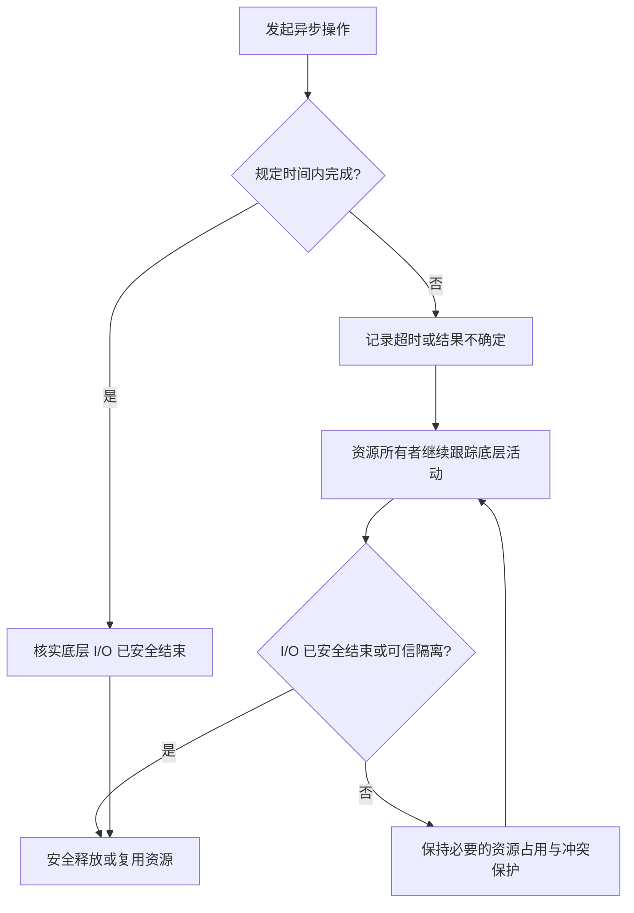
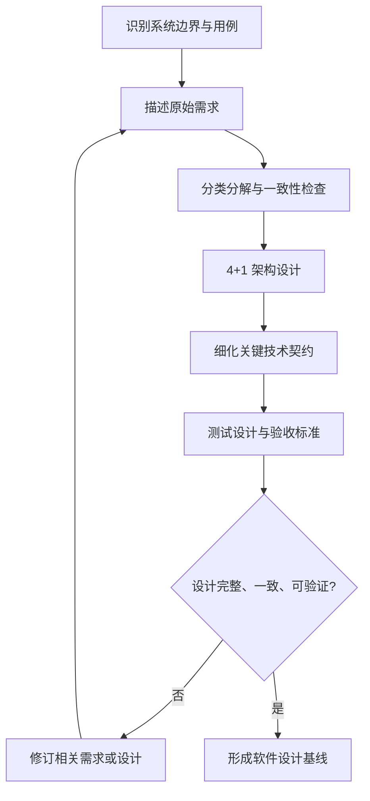
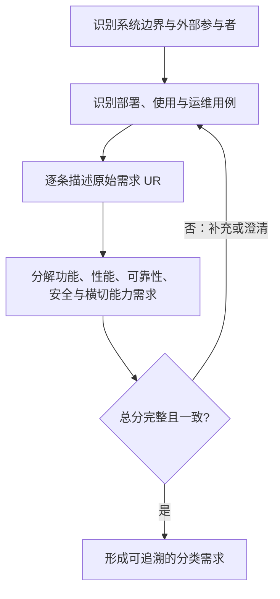
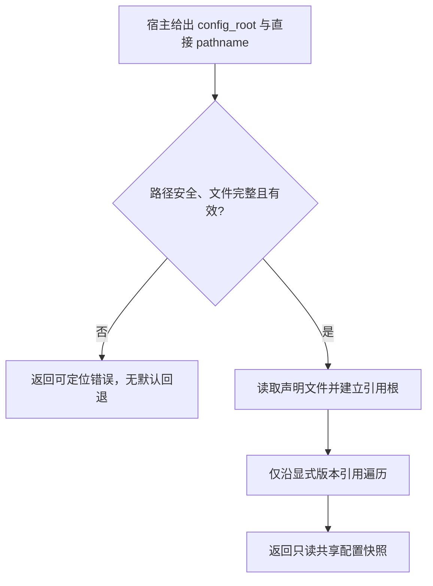
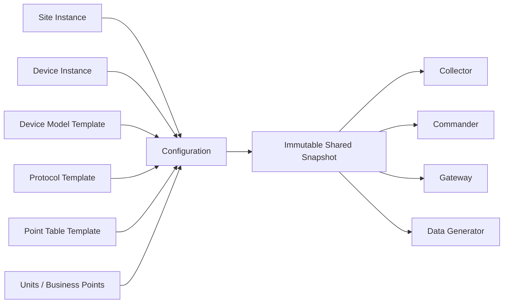
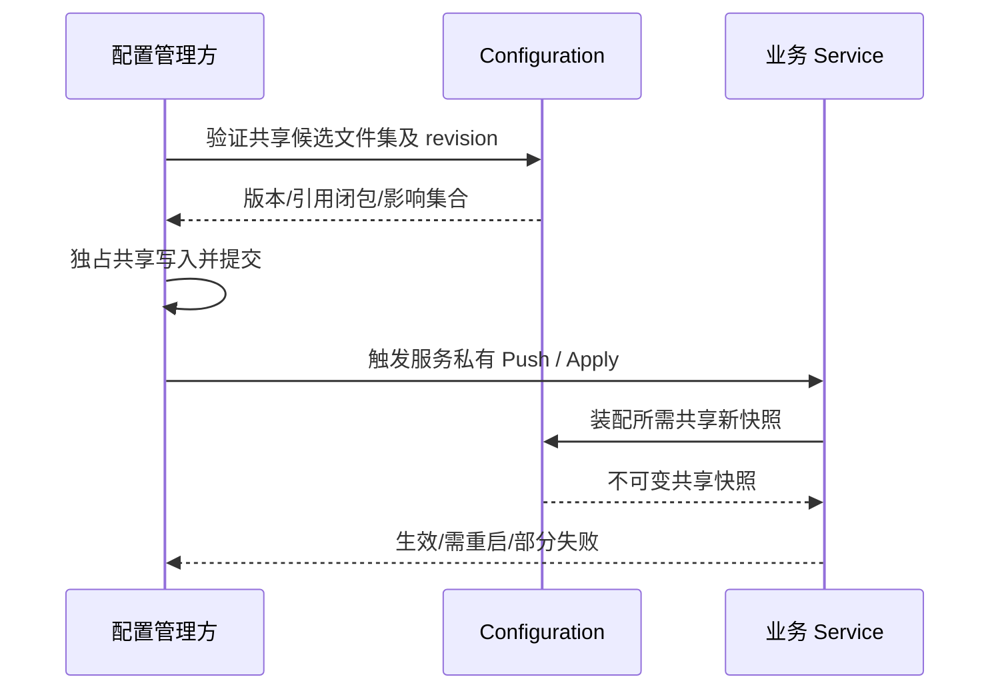
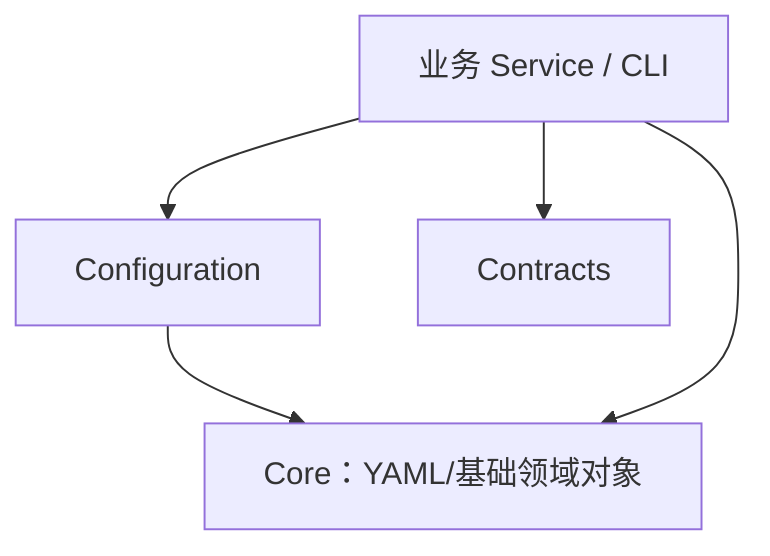

<h1 class="title">Configuration 软件设计</h1>

<p class="subtitle">v1_1 · 20261109 · 基础设计职责提取</p>

<style>
body {
  font-family: "Microsoft YaHei";
  font-size: 16px;
  line-height: 1.75;
  color: #24292f;
}
.title {
  font-family: "Microsoft YaHei";
  font-size: 32px;
  line-height: 1.30;
  font-weight: 700;
  text-align: center;
}
.subtitle {
  font-family: "Microsoft YaHei";
  font-size: 18px;
  line-height: 1.50;
  font-weight: 400;
  text-align: center;
}
h1 {
  font-family: "Microsoft YaHei";
  font-size: 28px;
  line-height: 1.40;
  font-weight: 700;
}
h2 {
  font-family: "Microsoft YaHei";
  font-size: 22px;
  line-height: 1.40;
  font-weight: 700;
}
h3 {
  font-family: "Microsoft YaHei";
  font-size: 18px;
  line-height: 1.50;
  font-weight: 700;
}
h4 {
  font-family: "Microsoft YaHei";
  font-size: 16px;
  line-height: 1.50;
  font-weight: 700;
}
p, li {
  font-family: "Microsoft YaHei";
  font-size: 16px;
  line-height: 1.75;
}
.figure-caption,
.formula-caption {
  font-family: "Microsoft YaHei";
  font-size: 14px;
  line-height: 1.50;
  font-weight: 600;
  text-align: center;
  margin: 0.65em 0 0.35em 0;
}
.table-caption {
  font-family: "Microsoft YaHei";
  font-size: 13px;
  line-height: 1.40;
  font-weight: 500;
  text-align: center;
  margin: 0.65em 0 0.35em 0;
}
.mermaid,
.mermaid text,
.mermaid .label {
  font-family: "Microsoft YaHei" !important;
  font-size: 14px !important;
  line-height: 1.20;
}
table {
  width: 100%;
  border-collapse: collapse;
  font-family: "Microsoft YaHei";
  font-size: 13px;
  line-height: 1.45;
}
table th,
table th p,
table th li {
  font-family: "Microsoft YaHei";
  font-size: 13px;
  line-height: 1.40;
  font-weight: 600;
}
table td,
table td p,
table td li,
table td strong,
table td b {
  font-family: "Microsoft YaHei";
  font-size: 13px;
  line-height: 1.45;
  font-weight: 400;
}
table th,
table td {
  padding: 0.40em 0.60em;
  vertical-align: top;
}
code, pre {
  font-family: "Cascadia Code";
  font-size: 14px;
  line-height: 1.50;
}
p code, li code, td code {
  color: #24292f;
  background: #f3f4f6;
  padding: 0.08em 0.28em;
  border-radius: 3px;
}
pre {
  color: #c9d1d9;
  background: #0d1117;
  padding: 1em;
  border-radius: 6px;
  overflow-x: auto;
}
pre code {
  color: inherit;
  background: transparent;
  padding: 0;
}
.hljs-comment, .hljs-quote,
.token.comment, .token.prolog, .token.doctype, .token.cdata {
  color: #8b949e;
  font-style: italic;
}
.hljs-keyword, .hljs-selector-tag, .hljs-literal,
.token.keyword, .token.boolean { color: #ff7b72; }
.hljs-string, .hljs-doctag, .hljs-regexp,
.token.string, .token.char, .token.regex { color: #a5d6ff; }
.hljs-number, .token.number { color: #79c0ff; }
.hljs-title, .hljs-function, .token.function { color: #d2a8ff; }
.hljs-title.class_, .hljs-type, .hljs-built_in,
.token.class-name, .token.builtin { color: #ffa657; }
.hljs-variable, .hljs-attr, .hljs-property,
.token.variable, .token.property, .token.attr-name { color: #7ee787; }
.hljs-operator, .hljs-punctuation,
.token.operator, .token.punctuation { color: #c9d1d9; }
</style>

---

## 目录

1. [文档约定](#1-文档约定)
2. [软件设计指导原则与编制方法](#2-软件设计指导原则与编制方法)
3. [软件需求](#3-软件需求)
4. [公共能力使用场景（用例视图）](#4-公共能力使用场景用例视图)
5. [总体架构设计](#5-总体架构设计)
6. [通用配置数据处理设计](#6-通用配置数据处理设计)
7. [通用工业协议通信设计](#7-通用工业协议通信设计)
8. [非侵入式横切能力设计](#8-非侵入式横切能力设计)
9. [通用基础服务能力设计](#9-通用基础服务能力设计)
10. [共享领域对象设计](#10-共享领域对象设计)
11. [通信链路诊断设计](#11-通信链路诊断设计)
12. [公共 API 稳定性与演进](#12-公共-api-稳定性与演进)
13. [安全、性能与运行边界](#13-安全性能与运行边界)
14. [测试设计、追溯与验收](#14-测试设计追溯与验收)
---

# 1. 文档约定

本章是全文的固定排版与表达规范。文档修订、补充和派生版本均应遵守本章，不再根据个人习惯调整字体、字号、行距、图题、表题、公式或代码样式。

本文开头的 `<style>...</style>` 是 HTML `style` 元素，其中包含内部 CSS 样式表，本文简称为 CSS 样式块。第 1.1～1.4 节规定目标样式；CSS 样式块通过 `h1`、`h2`、`p`、`table`、`th`、`td`、`pre`、`code` 等选择器，将规范应用到 Markdown 渲染后生成的 HTML 元素。

## 1.1 字体约定

<p class="table-caption">表 1-1 文档字体与排版规范</p>

| 文档元素 | 字体 | 字号 | 行间距/行高 | 字重 | 对齐方式 |
|---|---|---:|---:|---:|---|
| 文档标题 | Microsoft YaHei | 32 px | 1.30 | 700 | 居中 |
| 文档副标题 | Microsoft YaHei | 18 px | 1.50 | 400 | 居中 |
| 一级标题 | Microsoft YaHei | 28 px | 1.40 | 700 | 左对齐 |
| 二级标题 | Microsoft YaHei | 22 px | 1.40 | 700 | 左对齐 |
| 三级标题 | Microsoft YaHei | 18 px | 1.50 | 700 | 左对齐 |
| 四级标题 | Microsoft YaHei | 16 px | 1.50 | 700 | 左对齐 |
| 正文 | Microsoft YaHei | 16 px | 1.75 | 400 | 左对齐 |
| 图题 | Microsoft YaHei | 14 px | 1.50 | 600 | 居中 |
| 图内文字 | Microsoft YaHei | 14 px | 1.20 | 400 | 按图形布局 |
| 表题 | Microsoft YaHei | 13 px | 1.40 | 500 | 居中 |
| 表头 | Microsoft YaHei | 13 px | 1.40 | 600 | 左对齐 |
| 表格正文 | Microsoft YaHei | 13 px | 1.45 | 400 | 左对齐 |
| 公式题 | Microsoft YaHei | 14 px | 1.50 | 600 | 居中 |
| 代码文字 | Cascadia Code | 14 px | 1.50 | 400 | 左对齐 |

以上规范已经通过本文开头的 CSS 样式块固定。其中，正文为 `16 px`；表题、表头和表格正文均为 `13 px`。表头字重为 `600`，低于标题字重；表格正文行高为 `1.45`，因此表格在字号、字重和行距上均明显弱于正文。英文业务对象、数据库对象和程序标识符仍按所在文本元素的字号排版，但使用行内代码形式，例如 `Asset`、`Connection`、`task_id`。

## 1.2 绘图约定

1. 上下文图、第 0 层及更深层 DFD、总体流程图和关系流程图统一使用 Mermaid。
2. 每一个 Mermaid 图都必须在 Mermaid 代码块第一行加入初始化配置，统一只设置 `useMaxWidth: true`。初始化配置格式为：

```text
%%{init: {"<Mermaid 图类型配置域>": {"useMaxWidth": true}}}%%
```

其中 `<Mermaid 图类型配置域>` 必须根据实际 Mermaid 图类型替换，不得固定写成 `flowchart`，也不得使用与实际图类型不匹配的配置域。

<p class="table-caption">表 1-2 Mermaid 图类型与初始化配置</p>

| Mermaid 图类型 | 图声明 | 第一行初始化配置 |
|---|---|---|
| Flowchart | `flowchart TB/LR/...` | `%%{init: {"flowchart": {"useMaxWidth": true}}}%%` |
| Sequence Diagram | `sequenceDiagram` | `%%{init: {"sequence": {"useMaxWidth": true}}}%%` |
| State Diagram | `stateDiagram-v2` | `%%{init: {"state": {"useMaxWidth": true}}}%%` |
| Class Diagram | `classDiagram` | `%%{init: {"class": {"useMaxWidth": true}}}%%` |
| ER Diagram | `erDiagram` | `%%{init: {"er": {"useMaxWidth": true}}}%%` |

若后续使用其他 Mermaid 图类型，也必须遵守同一规则：

```text
实际图类型
    ↓
确定该图类型对应的 Mermaid 配置域
    ↓
第一行写入：
%%{init: {"对应配置域": {"useMaxWidth": true}}}%%
```

不得额外加入 `wrap` 等非统一配置；如确有特殊需要，应在对应图的局部设计说明中单独论证。

3. 每张图必须有图编号和图题，编号采用“章节号-本章图序号”，例如“图 7-2”。
4. 图题必须使用普通图题样式，不得使用 Markdown 标题。统一写法为：

```html
<p class="figure-caption">图 1-1 图题</p>
```

## 1.3 公式约定

1. 行内公式使用单美元符号，例如 `$E_1$`。
2. 独立公式使用双美元符号，例如：

```text
$$
\mathrm{Entity}=E_1\land(E_2\lor E_3\lor E_4)\land E_5
$$
```

3. 正式公式不得放入代码块。
4. 不使用 `\[` 与 `\]` 作为公式定界符。
5. 变量下标统一写成 `E_1`、`R_1`；逻辑“与”和“或”统一写成 `\land`、`\lor`。
6. 公式必须使用 LaTeX，不使用普通文本模拟数学符号。
7. 需要编号的公式使用“式（章节号-本章公式序号）”，式题采用普通公式题样式：

```html
<p class="formula-caption">式（8-1）实体判断逻辑</p>
```

### 1.3.1 中文文字与 LaTeX 公式混排和渲染

1. 数学量、指标计算式、分段定义与不等式使用 LaTeX；符号的字体、上下标及几何量/阵列类型遵从规范性参考文献《符号体系.md》。业务字段名使用行内代码表示；数学变量与业务字段之间必须建立明确映射，不能把标量、向量、张量混用。
2. 简短符号可使用行内 `$...$`，完整指标定义、分式、求和、分段函数及多行等式应使用独立的 `$$...$$`；独立公式定界符必须独占一行，公式块前后各留一个空行。不得把独立公式置于 Markdown 表格单元、列表行、HTML 标签内部或围栏代码块中。
3. 中文解释写在公式外的自然段或独立列表项中。数学环境中仅为短标签使用 `\text{...}`；不把长段中文及中文标点塞入公式，不让 `$` 跨越换行或 Markdown 表格列界。
4. 表格单元格仅放简短行内变量或公式；含 `|`、分段、多行、复杂上下标、分式的定义一律移到表格外。若一条规则包含先决条件、数学定义和异常处理，采用“文字定义 → 独立公式 → 文字边界说明”布局。
5. 所有数学符号必须在第一次出现处定义，包括物理/业务含义、类型、单位、取值域、采样或统计时刻；公式运算中单位必须一致，必要时写出秒与毫秒之间的换算。
6. 必须在最终 Markdown 渲染器中检查中文与行内公式、独立公式与列表边界、下标、上下标、百分位、分式、转义字符和 Mermaid/HTML 混排。静态代码围栏检查不能替代实际渲染验收。若渲染器不支持某类语法，应先调整表达方式，不得以不可渲染公式交付。

## 1.4 代码约定

1. 多行代码必须使用带语言标识的围栏代码块，例如 `python`、`sql`、`json`、`yaml`、`mermaid` 或 `text`。
2. 单个标识符、字段名、命令和短代码使用行内代码，例如 `PRIMARY KEY`、`Connection`。
3. 伪代码必须明确标记为 `text` 或在正文中说明“以下为伪代码”；不得使读者误认为它可以直接运行。
4. 代码块统一使用深色背景，颜色为 `#0D1117`；普通代码文字颜色为 `#C9D1D9`。
5. 语法高亮统一采用表 1-3 的配色。Markdown 渲染器应使用 Highlight.js 或 Prism 可识别的语言标识；渲染器不支持高亮时，至少保留代码背景色和普通代码文字颜色。

<p class="table-caption">表 1-3 代码语法高亮配色</p>

| 语法元素 | 颜色 | 十六进制 |
|---|---|---|
| 代码背景 | 深黑蓝 | `#0D1117` |
| 普通文字、运算符和标点 | 浅灰 | `#C9D1D9` |
| 注释 | 灰色 | `#8B949E` |
| 关键字和布尔值 | 红色 | `#FF7B72` |
| 字符串和正则表达式 | 浅蓝 | `#A5D6FF` |
| 数值 | 蓝色 | `#79C0FF` |
| 函数名 | 紫色 | `#D2A8FF` |
| 类型、类名和内置对象 | 橙色 | `#FFA657` |
| 变量、属性和字段 | 绿色 | `#7EE787` |


---


# 2. 软件设计指导原则与编制方法

本章规定本设计书的编制准则，不是特定系统的内部实现说明，也不要求按传统瀑布流程开发。后续章节必须以需求为依据；非适用事项应注明理由，不机械增加模块或抽象。

### 2.0 规范性参考文献与优先级

本设计书的公式和图形表达必须参考并遵守下列项目规范，引用文件为本设计的规范性依据，而非可选阅读材料：

| 规范文献 | 适用范围 | 强制规则 |
|---|---|---|
| 《符号体系.md》（v1_1） | 数学公式、标量、矢量、矩阵、张量、时间导数等 | 同一物理或数学量必须保持符号和对象层级一致，不得因编码便利擅自换符号；统计标量可新增本文件局部符号，但须显式定义、不与既有符号冲突 |
| 《软件系统建模图形与表达规范.md》（v0_2） | 业务流程、算法流程、DFD、状态、时序、伪代码、图题及图形语义 | 按建模目的选图；流程图区分过程、判断、输入输出、子过程与存储；数据流与控制流不得混用；Mermaid 初始化及图题遵循对应条款 |
| “项目对外接口定义”、“项目专用接口定义”、“项目数据契约” | 对外 RPC 和采样数据契约 | 实际字段、枚举、消息结构以代码库当前已冻结契约为准，不在需求书臆造字段或新接口 |

规范发生冲突时：实际对外数据契约按已冻结 Contract 执行；符号记法遵从《符号体系》；绘图遵从《软件系统建模图形与表达规范》；本章补充具体业务编制与验收口径。若仍存在冲突，应明确列出待决差异而不能暗中选取一种表述。

## 2.1 总则

本节规定软件设计书的编制原则、设计深度和工作流程。软件设计以需求为依据，以架构视图组织设计内容，以明确的行为与接口契约约束实现，并通过测试与验收验证设计目标。优先采用简单、安全、高效的方案，避免无依据的功能扩展和过度设计。

### 2.1.1 需求驱动原则

软件设计必须来源于已确认的需求，不应从技术方案反向编造需求。

<p class="table-caption">表 2-1 需求驱动设计要求</p>

| 设计要求 | 具体规定 |
|---|---|
| 需求依据 | 关键功能、技术机制和质量约束应能够追溯至需求 |
| 设计范围 | 不擅自增加功能或扩大系统职责 |
| 需求分解 | 原始需求与分类需求保持完整、一致 |
| 设计取舍 | 同样满足需求时，优先选择职责更少、依赖更少的方案 |
| 需求变更 | 新增或改变系统行为时，先核对需求，再修订相关设计 |

### 2.1.2 职责与边界明确原则

系统及组件必须具有清晰的职责、依赖方向和状态所有权。

<p class="table-caption">表 2-2 职责与边界设计要求</p>

| 设计要求 | 具体规定 |
|---|---|
| 系统边界 | 明确本系统负责什么、不负责什么 |
| 组件职责 | 重要职责有明确的负责组件，避免重复承担 |
| 状态所有权 | 关键状态具有明确的权威来源和修改责任 |
| 接口边界 | 区分内部接口、对外接口与外部依赖 |
| 依赖控制 | 避免循环依赖和不必要的跨层访问 |
| 简单性 | 不因假设性的扩展需要增加抽象、兼容层或冗余实现 |

### 2.1.3 行为与契约确定原则

设计应消除影响正确性的重要歧义，但不规定无关的私有方法。

<p class="table-caption">表 2-3 行为与契约设计要求</p>

| 设计对象 | 必须明确的内容 |
|---|---|
| 业务操作 | 触发条件、输入、反馈、业务输出及处理规则 |
| 接口 | 参数、类型、返回值、错误、超时及版本语义 |
| 状态 | 状态定义、转换条件、终态与非法转换 |
| 数据 | 数据结构、约束、所有权、一致性与生命周期 |
| 并发操作 | 执行顺序、同步条件、互斥范围与竞争裁决 |
| 异常操作 | 失败条件、处理结果、恢复行为及禁止行为 |

同一契约应有唯一的规范定义位置，其他章节通过引用关联，不重复规定矛盾规则。

### 2.1.4 资源与异步操作安全原则

异步操作的业务结果、底层执行活动和资源生命周期必须分别判断。

<p class="table-caption">表 2-4 异步操作与资源管理原则</p>

| 概念 | 定义及设计要求 |
|---|---|
| 操作逻辑终结 | 业务层已形成最终处理结果，不代表底层活动已经结束 |
| 底层 I/O 安全结束 | 有可信证据表明相关 I/O 不再继续执行或产生新的相关资源访问 |
| 安全隔离 | 通过可验证措施，使未结束操作无法与后续操作发生有害冲突 |
| 资源所有权 | 明确谁创建、持有、跟踪和释放资源 |
| 资源安全释放 | 满足安全结束或可信隔离条件后，才允许释放或复用可能产生冲突的资源 |

核心原则：操作超时不等于底层 I/O 结束；未确认 I/O 安全结束或隔离前，不得释放可能引发冲突操作的执行资源。



<p class="figure-caption">图 2-1 异步操作超时与资源安全释放流程</p>

对异步操作应区分超时、取消、异常和正常结束；不能仅凭调用方返回、Future/Task 取消或连接状态判断底层 I/O 已安全结束。

### 2.1.5 性能与资源有界原则

性能设计围绕明确的负载与质量要求展开，而不是无依据地增加并发或缓存。

<p class="table-caption">表 2-5 性能与资源有界设计要求</p>

| 设计要求 | 具体规定 |
|---|---|
| 负载模型 | 明确请求规模、并发规模、数据量及运行条件 |
| 容量约束 | 队列、线程、Task、连接、缓存及存储资源应有合理边界 |
| 背压 | 资源不足时明确等待、拒绝、丢弃或降级策略及适用条件 |
| 缓存 | 明确缓存用途、权威数据来源、失效与容量策略 |
| 性能指标 | 明确时延、吞吐、资源占用及测量口径 |
| 性能取舍 | 不得以违反正确性、安全性和可靠性约束换取性能 |

### 2.1.6 故障可控与恢复原则

设计应覆盖正常运行及合理预期的异常场景，明确故障影响范围和恢复条件。

<p class="table-caption">表 2-6 故障与恢复设计要求</p>

| 设计要求 | 具体规定 |
|---|---|
| 故障识别 | 明确可能的超时、通信失败、存储失败、任务异常和进程崩溃 |
| 故障隔离 | 限制故障传播，避免无关组件或资源被错误影响 |
| 状态可信 | 不将未知状态解释为确定成功或失败 |
| 重试与恢复 | 明确允许重试的条件，禁止可能产生危险副作用的盲目重试 |
| 持久化恢复 | 规定异常中断后的数据一致性及状态恢复规则 |
| 生命周期 | 明确启动、就绪、运行、关闭和重启期间的异常处理 |
| 失效行为 | 无法恢复时应有明确的降级、阻塞或停止服务条件 |

### 2.1.7 横切能力非侵入式原则

日志、审计、指标、追踪、权限校验等横切能力应与核心业务逻辑分离，优先通过统一的边界组件、装饰器、中间件或独立服务实现，不应将重复的技术处理流程散布在业务代码中。非侵入式不等于隐藏业务约束：凡影响业务准入、执行结果、事务一致性或故障处理的规则，必须在业务契约中明确，并保留必要的显式调用点。

<p class="table-caption">表 2-7 横切能力非侵入式设计要求</p>

| 设计要求 | 具体规定 |
|---|---|
| 职责分离 | 业务组件负责业务规则与状态转换；横切组件负责统一的记录、采集、校验与传输机制 |
| 边界统一 | 在服务入口、应用服务边界、消息发布边界等明确位置接入横切能力，避免各业务分支重复编排 |
| 最小侵入 | 不为记录日志、采集指标或传播追踪上下文而改变业务方法的核心控制流程和返回语义 |
| 审计正确性 | 审计事件的业务含义及产生时机由业务契约定义；持久化、投递、重试等通用机制与业务处理解耦，同时保证要求的一致性 |
| 故障影响 | 明确横切能力故障时的阻断、降级或重试规则；不得默认其失败不会影响业务，也不得默默吞掉必须处理的错误 |
| 可读性与验证 | 业务代码能够直接体现主流程；横切处理可独立测试，端到端测试验证其与业务契约一致 |

不为追求形式上的非侵入而引入复杂框架或过多抽象；简单、清晰的显式边界优先于难以追踪的隐式执行机制。

### 2.1.8 公共能力复用与冗余控制原则

优先使用符合需求的标准库、成熟软件包、现有工具及公共组件；相同且稳定的职责才提炼为公共能力，不重复发明、不为假设性扩展提前设计框架。

<p class="table-caption">表 2-8 公共能力复用与冗余控制要求</p>

| 设计要求 | 具体规定 |
|---|---|
| 复用优先 | 先评估现成组件是否满足功能、安全、性能及维护要求，再决定是否自行实现。 |
| 提炼公共职责 | 多模块存在稳定相同的职责时统一实现；业务规则留在所属业务模块。 |
| 控制依赖 | 核查成熟度、许可证、版本、安全维护及引入成本。 |
| 控制抽象 | 避免仅为减少少量重复而引入复杂框架或多层转发。 |
| 清理冗余 | 统一能力落地后删除重复、废弃和不必要的兼容实现。 |

### 2.1.9 图表表达与设计一致性原则

设计优先使用合适的图形和表格表达结构、流程、时序、状态及约束，图表不能代替必要的精确定义。

<p class="table-caption">表 2-9 图表表达与一致性设计要求</p>

| 设计要求 | 具体规定 |
|---|---|
| 视图完整 | 使用 4+1 架构视图组织系统设计，覆盖适用内容 |
| 图形选择 | 根据表达目的选择结构图、状态图、时序图、活动图等 |
| 图表一致 | 图形、表格和正文不得相互矛盾 |
| 跨章节一致 | 同一接口、状态、参数及资源规则保持一致 |
| 设计深度 | 明确影响系统行为的契约，允许自主选择内部实现细节 |
| 可验证性 | 关键设计要求应能够对应测试条件与验收证据 |

### 2.1.10 软件设计工作流程



<p class="figure-caption">图 2-2 软件设计编制流程</p>

工作流程允许迭代，不要求传统瀑布式阶段。发现缺口或冲突时直接修订相关需求、架构视图或契约，不通过追加覆盖性条款解决。

### 2.1.11 规范性参考文献及项目无关性

本章为跨项目通用设计与编制规范，不得写入具体仓库、服务、业务协议、接口文件路径或项目专有指标。设计正文引用具体项目的源码、配置和协议文件时，应放在相关业务章节或接口/数据契约章节。

- **《符号体系.md》**：数学量类型、变量命名、标量/矢量/矩阵/张量、下标和公式运算的规范性依据。统计业务中的普通标量同样遵守其标量与阵列的区分原则。
- **《软件系统建模图形与表达规范.md》**：业务流程、DFD、活动/状态/时序图、算法图、伪代码和图元语义的规范性依据。

规范性引用以文件标题和相应章节为准，不复制全文；引用之间存在冲突时先识别并修订冲突，不擅自切换符号或重新解释图元。任何设计实例的具体接口名称、消息字段和技术约束均在第三章及后续适当章节给出。

## 2.2 需求体系及描述规范

需求采用“识别用例 → 逐条描述原始需求 → 分类分解 → 总分一致性检查”的方法。用例应从外部使用者及运行场景出发，覆盖适用的部署、启动、正常使用、配置、运维、正常关闭、重启及异常恢复过程；不局限于业务 RPC，也不将内部技术机制机械列为用例。用例识别属于需求分析，第 4 章用例视图负责表达参与者、边界及用例关系。

<p class="table-caption">表 2-10 原始需求描述字段</p>

| 字段 | 描述要求 |
|---|---|
| 编号 | 唯一原始需求标识，例如 `UR-01` |
| 名称 | 准确概括使用者需要的能力或运行场景 |
| 请求方（Requester） | 发起操作的外部系统、服务或接口，如外部客户端、上层服务、进程管理系统；消息和周期自动触发时可以没有直接请求方，标记“不适用” |
| 触发方式（Trigger） | 标明触发类型、事件来源、触发条件及必要的周期或接口；允许多个类型组合，区分外部触发和内部自动步骤 |
| 输入（Input） | 请求方向本系统提供的数据、参数和信息 |
| 反馈（Response） | 本系统返回请求方的确认、状态、结果及错误信息 |
| 目标方（Destination） | 接收本系统业务输出的外部系统、消息中间件或现场设备；没有时标记“不适用” |
| 业务输出（Output） | 本系统发往目标方的数据、消息或控制指令；没有时标记“不适用” |
| 业务流程（Flow） | 用 Mermaid 表达主要控制流程、数据输入/输出及重要异常，已表达的动作不重复 |
| 业务规则（Business Rules） | 补充主流程未精确定义的术语、公式、算法、初始化、阈值和边界；允许文字分条、LaTeX、图、伪代码或表格，不重复业务流程 |
| 关键约束（Constraints） | 性能、可靠性、安全、审计、可观测性、错误信息、缓存、I/O 与背压等可验证的非功能要求 |

反馈与业务输出必须分开：反馈面向请求方，业务输出面向目标方；请求方与目标方可有多个，且请求方断连不必然撤销已接受的业务操作。

### 2.2.1 触发方式分类与标注规则

原始需求必须列出实际适用的触发方式；同一需求可以组合多种触发方式，不能把处理流程中的普通步骤误写成独立触发。触发方式描述“何时、由什么启动”，不预先决定线程、定时器或队列等内部实现。

- **消息触发（Message）**：外部消息到达，例如实时消息或可靠消息；标明消息来源与订阅范围。
- **周期触发（Periodic）**：达到配置周期，例如实时周期输出或变化加周期保底；标明周期来源及生效条件。
- **API 触发（API）**：收到明确的外部接口请求，例如任务启动或配置应用接口；标明接口和调用方。
- **状态触发（State）**：受监控对象的状态发生满足条件的变化，例如外部依赖从不可用恢复可用；标明状态条件，不把普通循环迭代误列为触发。
- **生命周期触发（Lifecycle）**：服务进入启动、关闭、重启或配置生效等阶段；标明阶段及必要前置条件。

周期触发与消息触发可以同时存在：消息到达更新数据，周期到达决定何时输出。若无外部直接请求方，Requester 写“不适用（自动触发）”，但仍须列出消息生产者或状态来源；触发方式不替代 Input、Response 与 Output 的定义。

### 2.2.2 原始需求四节结构与写作原则

各 UR 固定为四节：**基本信息与触发方式、业务流程、业务规则、关键约束**。根据语义选择最清晰的表达形式；文字、公式、图形、伪代码和表格地位平等；**业务流程图已清楚表达的处理不得在后两节复述**。规则和约束必须有唯一规范定义，其他章节仅引用。

1. **基本信息与触发方式**：表格列出 Requester、Trigger、Input、Response、Destination、Output。Trigger 采用第 2.2.1 节分类，明确事件来源、触发条件及周期或 API。
2. **业务流程**：Mermaid Flowchart 或适用的 UML 活动图表达触发入口、主要处理、判断、数据输入输出、重要异常及恢复出口；复杂算法通过“预定义过程”节点指向第三节，不在总流程中堆叠实现细节。
3. **业务规则**：仅描述流程图无法精确表达的算法、公式、阈值、初始化、状态不变量、顺序及边界。允许文字分条定义、算法流程图、DFG、LaTeX 公式、表格或明确标为 `text` 的伪代码；必须说明输入、输出、初始值、边界及终止条件。无额外内容时标注“无额外规则”。
4. **关键约束**：**优先给出定量要求**（带单位、作用范围、测量窗口、默认值或硬上限、验收方法）；不能合理量化的才采用具有明确判定条件的定性要求。**仅放可核验的非功能要求**，按性能与容量、可靠性与恢复、安全与授权、审计、可观测性、错误信息、缓存与有效期、I/O 资源安全、背压与过载分类；无关分类可以省略或说明不适用。约束应给出故障条件、正确结果、测量或验收口径，不得用抽象口号代替。

### 2.2.3 业务图形元素与数据语义

参照《软件系统建模图形与表达规范.md》第 5.1 节 Flowchart、第 7.1 节 DFD 与第 8.1 节算法规范。业务活动图的控制流箭头表示处理顺序，DFD 箭头表示数据流，**两者不得混用**。图中应以不同形状区分处理、判断和数据。

| 元素 | Mermaid 写法 | 语义 |
|---|---|---|
| 开始/结束 | `A([开始/结束])` | 明确入口和完成/失败出口 |
| 处理 Process | `B["更新缓存"]` | 矩形，表达动作而非数据 |
| 判断 Decision | `C{"已过期?"}` | 菱形，分支标明条件 |
| 输入/输出 Data | `D[/"采样消息"/]` | 平行四边形，表达数据输入/输出 |
| 预定义子过程 | `E[["计算统计指标"]]` | 双边矩形，引用业务规则的算法说明 |
| 数据存储 | `F[("最新值缓存")]` | 存储节点；仅在理解读写关系必要时出现 |

不因形式要求增加无意义数据节点。数据来源、存储及复杂数据变换应单独绘制 DFD，避免业务活动图变成混杂的控制/数据流图。Mermaid 第一行初始化配置、图编号和图题仍须符合第一章。

### 2.2.4 业务规则、输出定义与关键约束的具体要求

- **业务规则**：定义与边界条件优先文字分条；涉及数学关系必须使用 LaTeX 独立公式；复杂步骤按需使用 Flowchart/DFG 或伪代码补充。表达形式不限于图和表；精确定义阈值、边界、初始化、更新基准和不可变条件，不复述主流程动作。算法必须能够独立据输入判断预期输出。
- **性能与容量**：优先用定量指标给出负载范围、时延/吞吐口径、并发及资源上限；必须区分设计目标、默认配置、不可突破的资源上限和验收实测值；未确定的阈值不得虚构。
- **可靠性及 I/O**：明确超时、结果不确定、重试、恢复、安全收敛及资源释放条件。调用返回或 Task 取消不代表底层 I/O 已结束。
- **错误信息**：定义错误类别、错误码或结果、对象与关联标识、发生阶段、可检索证据及敏感信息脱敏；禁止把 UNKNOWN 伪装为成功或明确失败。
- **缓存与背压**：规定缓存键、容量、更新/覆盖、过期、丢弃、等待、拒绝、暂停消费及恢复条件；所有超限策略必须可观测。
- **安全与审计**：列出认证、授权、控制边界以及需审计的操作、事件产生时机、关联 ID、可信保存与失败处理；运行日志不能代替审计。
- **可观测性**：指标、统计窗口、状态、事件、更新时间、无数据语义及告警；可结合真实场景验收。

**指标、计算和输出契约完整性（强制）：**凡使用“计算、统计、比较、阈值、状态、错误、容量、返回结果”等词定义业务能力，必须形成封闭的输出集合；不得用“等”“包括但不限于”替代本版本必须实现的清单。每个指标/派生字段至少定义以下内容；其中数学计算不得仅写在表格单元格内，必须另列可渲染的 LaTeX 公式：

| 必填字段 | 内容 |
|---|---|
| 唯一标识、类型和单位 | 与公开接口字段或指标名一致；明示 `counter/gauge/histogram`、计量单位 |
| 统计层级和数据来源 | 系统 / 进程 / 组件 / 任务 / 消费者；事件记录点、分子和分母来源 |
| 计算公式与口径 | 累计/窗口/瞬时，窗口端点、去重规则、事件计数次数、百分位算法 |
| 触发、初始化和重置 | 何时采集/计算、初始值、首个周期、进程重启、配置热更新 |
| 边界与缺失 | 零分母、空样本、UNKNOWN、超时、重复投递、源不可达的值域与 `unavailable` 语义 |
| 输出与验收 | 指标名、采样时间、窗口、可用性表达、配置边界及给定数据可独立验算的实例 |

**示例与可复算性（强制）：**当业务规则涉及多种计数口径、状态转换、时间窗口、边界分支或重试等易混淆情形时，至少给出一个具体输入—处理过程—预期输出的完整算例。算例必须标明初始条件、计量单位、每一步事件及最终结果；若同时存在样本条数、批次数、I/O 尝试次数等不同统计单位，须分别列出，禁止混用。算例应覆盖易误解的边界（例如重试成功仍有失败尝试记录），且结果必须可直接转化为确定性测试断言。算例是对定义的验证，不得取代规范性定义，也不应重复流程图中的全部步骤；涉及计算关系仍按第一章使用 LaTeX。

**数学定义与表达门禁：**业务规则的文字定义应独立成段或分条；涉及计算时，必须在定义后给出独立 LaTeX 公式，逐一释义变量、单位、取值域以及零分母、空样本和无效值。算法图与伪代码是可选的精度增强手段，不得要求所有业务规则使用表格。公式与中文混排遵守第一章 §1.3.1。

**约束定量优先门禁（强制）：**关键约束首先给出数值、单位、统计范围、采样方法、允许误差、测试条件和通过标准；可配置阈值应列出默认值及合法范围。仅当约束本质上无法定量（例如禁止错误 ACK）时，才用可判定的定性约束。不得用“及时、足够、合理、有界、尽可能、低延迟、高可靠”等词代替具体要求；未完成基准测试的数值应标明“设计验收目标，尚未实测”，不得声称达标。

**完备性门禁：**业务规则涉及的状态枚举、错误分类/错误信息字段、缓存容量及淘汰策略、I/O 结果、背压策略、审计与统计输出均应列举封闭集合和边界输入；凡无法根据文档构造确定预期结果的要求，视为需求未完成，不得标记为可编码。参数可以配置，但必须说明合法范围、默认/缺省行为及越界错误；性能数值未经验证时不得伪称已达标。每项约束必须可追溯至可执行的 UC/System 场景。

每项业务规则和关键约束须能由 UC/场景及第 14 章测试追溯；第 5～13 章详述实现契约时应引用 UR，不得另造冲突定义。

统一样式：

```text
### 3.x UR-xx 需求名称
#### 3.x.1 基本信息与触发方式
Requester / Trigger / Input / Response / Destination / Output
#### 3.x.2 业务流程
Mermaid 活动流程图，含重要异常及数据输入输出
#### 3.x.3 业务规则
可用文字、LaTeX、伪代码、图或表格精确定义算法、初始化与边界，不重复流程
#### 3.x.4 关键约束
按性能、可靠性、安全、审计、可观测性、错误、缓存、I/O、背压列可验证要求
```

本节也是第三章及后续章节的强制完整性验收标准。

<p class="table-caption">表 2-11 分类需求体系与描述重点</p>

| 类别 | 核心问题 | 典型要求 |
|---|---|---|
| 功能需求（Functionality） | 系统提供什么行为 | 对外能力、业务流程、业务规则、输入输出与状态反馈 |
| 性能需求（Performance） | 运行速度与资源上限 | 时延、吞吐、并发、调度、公平性、容量、背压、资源消耗、扩展能力 |
| 可靠性需求（Reliability） | 故障时如何保持正确与恢复 | 容错、超时、重试、请求关联、事务、持久化、故障恢复、可用性、未结束操作的资源管理 |
| 安全需求（Safety & Security） | 如何防止危险或非法控制 | 控制权、互锁、失效安全、认证、授权、通信及数据安全 |
| 横切能力（Cross-cutting Concerns） | 如何观测、管理与追责 | 审计（操作证据、可靠投递、完整性、追溯）、日志、指标、追踪、配置、版本、可测试性、可维护性 |



<p class="figure-caption">图 2-3 需求识别、分解与一致性检查流程</p>

分类需求必须从原始需求的输入、反馈、业务输出、规则和约束中推导，不得遗漏、矛盾或未经确认增加能力；多条原始需求的共同约束可以合并，但必须保留来源编号。每条分类需求应给出可核验条件，性能要求还需明确测量口径，不虚构现场阈值。审计应独立于普通日志定义，不得以运行日志代替审计证据。

需求分类与设计专题是不同维度：启动、正常关闭、重启及 Reload 属于跨需求的运行生命周期设计，统一在进程视图展开；相应行为和质量约束分别由原始需求及分类需求追溯。

## 2.3 4+1 架构视图：内涵、外延与表达规范

<p class="table-caption">表 2-12 4+1 架构视图的职责与成果</p>

| 视图 | 关注范围 | 主要成果 | 不应混淆 |
|---|---|---|---|
| 用例视图（+1） | 参与者、系统边界、典型/异常场景 | 系统上下文、用例、业务流程 | 不负责线程调度 |
| 逻辑视图（Logical） | 组件职责、模型、接口、状态规则、依赖 | 组件图、类/数据关系、状态图 | 不等于源码目录树 |
| 进程视图（Process） | 进程、线程、Event Loop、Task、协作、生命周期、同步、并发、资源、背压、缓存、故障恢复 | 运行结构图、任务所有权表、时序/状态/活动图、资源预算 | Task 不等于 OS 线程；图名须区分标准 UML 与示意图 |
| 开发视图（Development） | 软件模块边界、层次、静态依赖、公共契约与复用关系 | 模块图、依赖图、模块职责表 | 不描述真实并发拓扑，也不列现有代码修改清单 |
| 物理视图（Physical/Deployment） | 节点、进程部署、存储、网络、控制权和现场外部依赖 | 部署图、网络/故障域/外部依赖表 | 不是现场设备内部物理结构模型 |

### 2.3.1 用例视图的场景编写规范

用例以参与者的完整业务目标为单位组织，而非以原始需求、RPC 或内部模块为单位逐条改名。一项用例可以关联多项原始需求；一项原始需求也可以由多个业务场景共同覆盖。用例视图回答“在具体业务场景中系统如何工作”，不代替逻辑视图、进程视图和数据设计。

<p class="table-caption">表 2-13 业务场景用例的必备描述要素</p>

| 要素 | 编写规定 |
|---|---|
| 用例身份与目标 | 给出唯一编号、业务场景名称及参与者要达成的可观察目标；名称使用业务活动，不使用内部机制命名 |
| 参与者与触发条件 | 列明实际发起操作的外部角色；内部定时任务、恢复及发布等自动步骤不得虚构外部参与者 |
| 前置条件 | 列明系统就绪、授权、配置或数据存在等必要条件；不得混入未确认的实现假设 |
| 主业务流程 | 以 Mermaid 业务活动图（flowchart）为主要表达，覆盖触发、校验、关键处理、反馈及后置结果；以判断节点表达重要分支，避免大段编号文字复述 |
| 分支与异常流程 | 在活动图中呈现影响业务结果的主要异常出口；罕见或不宜展开的异常在简明说明表中概括，避免为了完整而画出所有技术异常 |
| 后置条件 | 明确成功和失败之后的业务状态、外部可见结果、未完成事项及后续查询方式 |
| 需求追溯 | 标明相关 UR；核对全部 UR 在真实场景中得到覆盖，但不要求 UR 与 UC 一一对应 |

跨用例共享的内部机制（如存储、审计发布和调度）应作为相关业务流程中的自动步骤或支撑行为描述；只有存在独立业务目标时才另立用例。应避免将一串 gRPC 方法名或 CRUD 操作直接当作完整用例，也不得在用例章节展开线程、锁、表结构及类方法等实现细节。

用例的正文采用“一张业务活动图 + 一张简明用例说明表”的表达形式。活动图包含主路径、必要判断以及重要异常分支；图中节点使用业务动作，不展开展示内部类、锁和数据库事务。说明表只填写参与者、业务目标、前置条件、主要异常、后置条件及关联需求。业务分支已在图中完整表达时，不再重复书写大段“主业务流程”和“异常流程”；复杂跨参与者消息时序可在独立小节补充时序图。图题和表题按文档约定独立编号。

进程视图应按四个设计专题组织，而不是按需求类别重复划分：

<p class="table-caption">表 2-14 进程视图的四类设计专题</p>

| 专题 | 必须明确的设计对象 | 推荐表达 |
|---|---|---|
| 运行时结构 | 进程、线程、Event Loop、Task、线程池、组件与资源所有权 | 分层运行结构图、Task 职责表 |
| 运行生命周期（Runtime Lifecycle） | 启动、初始化、就绪、运行、Reload、正常关闭、重启及其阶段转换 | 生命周期状态图、启动/关闭/Reload 时序图 |
| 并发与资源管理 | Task 协作、队列、通知、同步、调度、容量限额、背压、缓存及释放 | 任务协作时序图、资源与背压策略表 |
| 异常与恢复 | 超时、取消、故障隔离、未收敛 I/O、崩溃恢复与降级 | 故障状态图、异常裁决矩阵 |

各专题共享同一运行模型，明确创建者、所有者、同步关系和退出条件；不因分节而重复定义状态或资源。生命周期是进程视图的独立设计专题，不是第六类需求。

图表仅使用其可准确表达的语义：结构关系用 Mermaid Flowchart；行为交互用 Sequence Diagram；状态约束用 State Diagram；条件控制用活动/流程图。图题说明对象、范围及图类型。关键质量属性贯穿各视图，不能只写在单独的“非功能要求”段落。

## 2.4 测试设计方法、组织及验收规范

测试设计以测试层级组织物理目录，以 Marker 描述测试层级、测试专题与运行场景。测试文件名应清楚表达验证对象或行为；测试文件及其标记、验证说明统一登记在测试矩阵中。需求、用例及重要技术契约必须能追溯到实际测试，不为同一目的建立重复测试体系。

<p class="table-caption">表 2-15 测试层级与目录规范</p>

| 层级 Marker | 物理目录 | 验证范围 |
|---|---|---|
| `unit` | `unit/` | 状态转换、业务规则、纯逻辑，无外部服务依赖 |
| `component` | `component/` | 单组件职责及其可控依赖 |
| `integration` | `integration/` | 组件之间及真实外部依赖的接口协作 |
| `system` | `system/` | 独立进程、完整业务场景及端到端行为 |

<p class="table-caption">表 2-16 测试 Marker 与矩阵编制规范</p>

| 事项 | 规范 |
|---|---|
| 层级 Marker | 每项测试必须且仅属于 `unit`、`component`、`integration`、`system` 之一，与目录对应 |
| 专题 Marker | 标识可靠性、安全、性能等验证主题，可与层级及场景 Marker 叠加；无专项主题时可为空 |
| 场景 Marker | 标识并发、超时、恢复、负载、现场等执行条件或情境；有相应场景时标记 |
| 测试矩阵 | 至少包含“测试文件名、层级 Marker、专题 Marker、场景 Marker、测试说明”五列；每项重要测试应有可定位的文件归属 |
| 标记粒度 | 标记以具体测试函数或类为准；同文件可包含不同专题与场景，矩阵列出涉及的 Marker |
| 运行条件 | 通过 Fixture 和环境准备明确外部依赖；现场专用测试与常规回归分离，未执行不视为通过 |
| 执行规则 | 提供按目录、Marker 及其布尔组合的 pytest 命令；所有 Marker 在项目配置中注册 |
| 可追溯性 | 测试说明与需求、用例或技术契约对应；行为变更时同步检查测试及矩阵 |
| 验收证据 | 保留运行环境、命令、实际结果、指标和未验证项，禁止把设计目标当作测试结果 |

目录划分测试层级，专题与场景通过 Marker 横向组合；可靠性测试不单独设第五类目录。测试矩阵用于定位和筛选测试，不预设每个实现文件必须存在，也不要求每个文件仅能有一种测试场景。

### 2.4.1 测试依据及 System 覆盖要求

各层级测试必须依据已确认的设计成果编制；System Test 以用例视图为主基线，以原始需求及技术契约补充覆盖，不得由测试人员凭经验任意缩减范围。

<p class="table-caption">表 2-17 各测试层级的设计依据</p>

| 测试层级 | 主要依据 | 验证重点 |
|---|---|---|
| Unit | 详细设计、函数及算法契约 | 纯逻辑、状态转换、参数及边界规则 |
| Component | 逻辑视图、组件职责及内部接口契约 | 单组件行为、依赖协作及异常处理 |
| Integration | 接口与通信契约、开发视图、物理视图 | 真实接口调用、跨组件通信及外部依赖 |
| **System** | **用例视图（UC）及原始需求（UR）**，并补充接口、运行、部署、安全及性能约束 | **从真实受测服务进程及其通信入口验证业务目标、异常、边界与恢复行为** |

System Test 必须遵守以下规定：

1. **用例覆盖率 100%**：每项 UC 至少有一项 System Test 作为验证证据；同一测试可以覆盖多个 UC，同一 UC 可以由多个测试覆盖，**不按测试数量与 UC 数量的大小关系判定覆盖**。
2. **规定场景覆盖率 100%**：每项 UC 明确的主流程、关键分支、异常流程、边界和恢复场景均必须有对应 System Test；不能仅以一条正常路径代表整个 UC 已覆盖。
3. **需求覆盖率 100%**：每项 UR 必须能够经一个或多个 UC 追溯至 System Test；若某项需求未能被 UC 覆盖，必须先补全用例，不得直接以技术测试代替业务用例。
4. **技术约束补充覆盖**：用例未充分表达的性能、容量、并发、安全、权限、超时和可靠性要求，依据对应技术契约补充测试；不得因 UC 未逐项列出而豁免。
5. **真实系统边界**：System Test 通过真实受测服务进程和适用的外部依赖、通信链路执行；Mock 不得代替本次明确纳入验收范围的基础设施及通信链路。
6. **覆盖与通过分开裁定**：测试已关联不等于已执行；失败、跳过及未运行均不得计为通过。验收报告分别给出需求覆盖、用例及场景覆盖、执行情况和通过情况；缺少真实环境时标记 `NOT_RUN`，不得用模拟结果替代。
7. **变更同步**：任何 UR、UC、接口或行为约束的新增、删除、调整，必须同步核查 System Test、测试矩阵和验收条款；新增 UC 不得留下无测试映射。

<p class="table-caption">表 2-18 System Test 追溯矩阵规范</p>

| 字段 | 要求 |
|---|---|
| UR 编号 | 被验证的原始需求编号，可列多个 |
| UC 编号与场景 | 用例编号及主流程、异常、边界或恢复场景标识 |
| 技术契约 | 相关接口、配置、运行或安全约束的章节编号；没有则记“—” |
| 测试文件名／测试标识 | 可定位的 System Test 文件名及测试函数或参数化场景标识 |
| 层级／专题／场景 Marker | 层级固定为 `system`，其余按第 2.4 节定义填写 |
| 验证内容与预期结果 | 从用户可观察行为与副作用表述判定依据 |
| 执行环境及结果 | 真实依赖、执行证据、`PASS`／`FAIL`／`SKIP`／`NOT_RUN` 等状态 |

追溯链为 **UR → UC／用例场景 → System Test → 执行结果与证据**，技术契约作为补充依据进入相应测试。第 4 章负责编制完整 UC 和场景，第 14 章依据本规范给出实际测试矩阵及验收安排，两章必须双向核对。

# 3. 软件需求

本模块是风电软件体系的 wind-hub **共享配置语义库**，以 Python 包 `src/configuration/` 被各业务模块显式使用；不启动独立进程、gRPC Server、数据库或后台服务。总体架构 v1_0、Core v1_27、Contracts v1_8 为上位约束。Core 仅处理通用 YAML、结构差异与通用领域原语，Configuration 承担 wind-hub 的 Instance、Template、版本引用和有效配置装配，业务服务保留服务配置及运行生效判定。对外业务 RPC 由各服务根据 Contracts 实现。

## 3.1 原始需求及边界

| UR | 需求 | 输入/触发 | 业务输出/权威 | 禁止事项 |
|---|---|---|---|---|
| UR-01 | 显式配置源解析 | 服务在启动、Push 或 Apply 时传入配置根及指定的 pathname | 校验后的绝对文件身份和引用入口 | 默认猜测实例/模板文件名 |
| UR-02 | 版本化模板与引用图 | 输入实例及模板版本 ID | 不可变、可追溯的依赖引用闭包 | 跨版本自动择优或扫描无关文件 |
| UR-03 | 有效设备配置装配 | 输入设备、站点、模板、单位及业务点 | 可校验、可溯源、只读共享快照 | 重复定义设备、点表、协议和单位 |
| UR-04 | 共享版本与修改边界 | 候选源文件集、版本和期望 revision | 冲突检测、只读候选装配及文件集校验 | 擅自控制业务服务 Apply 或假定全局事务 |
| UR-05 | 安全、错误与诊断证据 | 非法路径、循环引用、缺失文件、重复 ID | 具体源文件/引用边及稳定错误类别 | 捕获后自动替换默认模板 |
| UR-06 | 共享配置一致性 | 多服务引用同一文件、并发写入、配置来源切换 | 引用快照、变更影响集合、显式协调责任 | 把不同服务运行态视为单一原子事务 |

## 3.2 UR-01 显式路径输入

### 3.2.1 触发、流程与规则

Requester 为 Collector、Commander、Gateway、Data Generator、Sink Service 等业务宿主；生命周期启动或配置候选检查触发。输入必须包含宿主明确给出的配置根 `config_root` 与至少一份服务拥有的直接引用文件 pathname。Configuration 不根据模块名称推导 `instances/*.yaml` 或模板根，不读取调用方没有声明的实例文件。直接路径相对于显式 `config_root` 解析；拒绝绝对路径、`..`、越界符号链接、重复/不规则文件及不受支持的扩展名。服务配置自身读取和权限由宿主负责，Configuration 只处理已提交的共享配置来源。



<p class="figure-caption">图 3-1 显式路径装配活动图</p>

### 3.2.2 关键约束

`Service` 类型、所需直接文件种类由具体宿主定义，例如 Commander 需要设备实例与模板根；Data Generator 还需场景实例；Sink Service 的 Sink/Delivery 私有配置及模板由 Sink 自己校验。Configuration 不强制全部服务使用完全相同的直接文件集。路径解析与当前进程工作目录无关；禁止 `../`、硬编码固定目录和多级配置透传。

## 3.3 UR-02 版本化引用

### 3.3.1 触发、流程与规则

每个共享文档定义 `schema_version` 与 `file_version`；版本化 Template 额外定义 `template_id`。引用由 `{id,version}` 精确匹配，不使用“最新”或目录排序。已提交的同一版本内容不可被默默覆盖。遍历设备型号→协议/点表以及相关单位、业务点的实际引用，需检测缺失、循环、同键异内容和不支持的模板类别；无引用文件不自动装载。

### 3.3.2 关键约束

`VersionedTemplateRepository` 和 `SharedDocumentLoader` 的逻辑归属是 Configuration；Core 的 YAML 读写和校验原语只作为底层依赖。不得让业务模块各自实现第二套模板仓库，也不得把业务引用枚举移动回 Core。

## 3.4 UR-03 有效配置装配

### 3.4.1 触发、流程与规则

针对每台设备，按统一的模板与实例语义获得有效协议参数、点表和单位映射。实例允许的显式覆盖优先于设备型号参数、协议模板默认值及合法通用默认值；不得在点位类型、物理地址、读写权限等禁止覆盖的字段上进行绕过。配置的每个最终值保留其来源（文件、版本、引用链和覆盖层），以支持诊断和变更影响识别。



<p class="figure-caption">图 3-2 共享配置装配及业务模块消费关系</p>

### 3.4.2 关键约束

Configuration 只输出共享业务域配置，不生成 Collector Task、Commander Command、Gateway 实例状态、Data Generator Generation 或 Sink Delivery。服务依照自身设计实现私有配置合成和生效判定。对不存在的公共模板类型如 Sink 专属模板，不能声称 Configuration 自动装配；由 Sink Service 私有配置域管理。

## 3.5 UR-04 / UR-06 版本、并发与所有权

### 3.5.1 业务规则

`GetConfigSnapshot`、`PushConfigSnapshot`、`ApplyConfigSnapshot` 是业务服务的正式 CommonService RPC，由服务持有 candidate、revision、desired_state、actual_state 及运行时 Apply。Configuration 可提供共享引用图、输入文件快照、确定性文件集校验和变更影响计算的无业务原语；无权替代服务对多文件提交、重启提示或设备 I/O 安全收敛的业务裁决。

当多个服务共同引用一个共享文件时：同一物理配置集合应有明确且唯一的写入协调方，不允许两个 Service 各自以局部 CAS 替换相同公共文件。若缺乏跨服务协调机制，各 Service 的 Apply **不得修改公共共享文档**，只允许修改其自身专属文件集；共享文件变更须经显式配置管理流程、锁定/CAS 和受影响服务重新加载。Configuration 本身不隐含全局一致性事务，Core `save_yaml` 仅保证单文件原子替换。



<p class="figure-caption">图 3-3 共享配置修改与业务服务生效责任时序</p>

### 3.5.2 关键约束

跨服务的各个运行态不保证瞬间同时切换；Configuration 不拥有 NATS、RPC、设备连接、业务进程的生命周期。候选快照与正式文件的版本比较应使用明确范围及稳定内容哈希，不得跨域偷换 revision；同版本模板不可就地修改。

## 3.6 UR-05 错误、缓存及资源

Configuration 提供显式错误类型：`INVALID_PATH`、`SCHEMA_ERROR`、`REFERENCE_NOT_FOUND`、`VERSION_MISMATCH`、`REFERENCE_CYCLE`、`CONFLICT`、`INVALID_OVERRIDE`、`SOURCE_CHANGED`。对单个调用返回完整可定位错误（文件、引用链、字段路径），不输出凭证值。解析失败不得修改共享文件、旧快照或服务运行态。缓存仅以精确路径/版本/内容身份命中；候选和已生效快照不得混用，变更须显式失效。并发加载可共享只读内容，不得暴露可变全局单例。

# 4. 用例视图

## 4.1 参与者与用例

| UC | 参与者 | 过程 | 输出 |
|---|---|---|---|
| UC-01 | 业务模块 | 显式传入实例路径、模板根并装配 | 共享快照与完整引用集合 |
| UC-02 | 业务模块 | 对设备模型版本/协议/点表进行解析 | 有效配置与来源 |
| UC-03 | 配置管理方 | 验证修改后的共享文件集 | 冲突及影响集合 |
| UC-04 | 业务服务 | 应用新的共享快照 | 各自决定热更新或重启 |
| UC-05 | 运维诊断 | 查询装配失败的引用链 | 稳定错误证据 |

## 4.2 典型异常场景

| 场景 | 触发 | 判定 |
|---|---|---|
| UC-01-S01 | 未显式传入 Instance pathname | 拒绝；不得读取固定默认文件 |
| UC-02-S01 | 精确版本模板缺失 | 拒绝；不得替换为最新版本 |
| UC-02-S02 | 模板循环引用或重复标识不同内容 | 拒绝；列出冲突源 |
| UC-03-S01 | 两服务竞争覆盖同一共享文件 | 非唯一写入方拒绝提交 |
| UC-04-S01 | 有效文件集已提交，部分业务服务重启失败 | 保留已提交事实；逐服务报告实际状态，不宣称全局回滚 |

# 5. 逻辑视图

## 5.1 核心组件

| 组件 | 责任 | 不负责 |
|---|---|---|
| `SharedDocumentLoader` | 按显式来源解析共享实例、基础校验与引用闭包 | 猜测目录、管理业务进程 |
| `VersionedTemplateRepository` | 依据 ID/版本找到唯一不可变 Template | 模板自动升级、复用业务 Adapter |
| `EffectiveConfigResolver`（逻辑责任） | 解析版本引用、覆盖规则，生成设备有效配置 | 采集/控制业务规则 |
| `SharedSnapshotBuilder`（逻辑责任） | 生成不可变共享快照及来源证据 | 对外 gRPC、运行热更新 |
| `SharedChangeInspector`（逻辑责任） | 检查候选源与修订、影响集合 | 替 Service 持久 Apply 或提供全局分布式事务 |

其中后三项是**逻辑职责**，不要求新增同名代码类；可直接复用现有 `build_shared_snapshot`、`resolve_effective_device` 等成熟接口，不得为目录层次重写稳定代码。

## 5.2 静态依赖



<p class="figure-caption">图 5-1 Configuration 的单向依赖</p>

禁止 Core→Configuration、Configuration→Contracts、Configuration→任何业务模块的内部实现。Configuration 不定义自己的传输消息、RPC、审计业务状态机、协议 Driver。

# 6. 公共 API 与数据契约

下表规定**稳定语义接口**，不假定全部名称都必须新建。准确 Python 签名在编码阶段依据既有 API 统一，不得另建功能重复的包装器。

| 语义入口 | 输入 | 输出/失败 | 使用者 |
|---|---|---|---|
| `SharedDocumentLoader` | 配置根、显式共享路径集合、模板根 | 解析文档与引用关系；失败含来源 | Collector/Commander/Gateway/Data Generator |
| `VersionedTemplateRepository` | 模板根、类别、ID、精确版本 | 唯一模板内容与版本元数据 | 共享装配 |
| `resolve_effective_device` | 共享文档、设备身份、模板引用闭包 | 有效设备配置及来源 | Collector/Commander/Gateway |
| `build_shared_snapshot` | 已校验文件集、引用上下文 | 不可变共享业务快照 | 业务服务 |
| `compare_shared_sources`（逻辑能力） | 两份引用闭包与内容身份 | 变化文件、受影响设备和冲突 | 配置管理方/Service |

业务服务不得因调用 API 而把 Service 专属配置的逻辑和权限判断迁入 Configuration。时间戳、版本号及有限默认值遵守源文件规范；配置参数不得强制绑定固定设备数、点数或目录名。

# 7. 运行视图

Configuration 无后台循环、网络端口或独立内存状态存储。每次装配由调用方控制超时与并发；大型配置的读取、校验、解析不得阻塞拥有实时采集/控制 I/O 的高优先级执行循环。候选检查用隔离快照，已生效配置在调用方明确切换前不可变。故障不自动触发服务重启。

# 8. 开发视图

目标为 `src/configuration/` 统一共享装配边界。Core 继续提供 `src/core/infrastructure/config/` 下的通用 YAML/差异原语；Contracts 继续提供 `src/contracts/` 的跨进程消息。不得额外设置 `core/configuration` 镜像目录、第二个 `SharedDocumentLoader` 或业务 Service 私有共享模板解析器。

# 9. 物理部署视图

Configuration 与调用方同进程、同容器；存储来自显式文件系统根。多容器共享文件时需部署明确的单写入方和配置发布/读取机制；不得假定共享容器根目录、跨文件原子写或全服务同步应用。

# 10. 版本与配置示例

以下仅为结构示例，字段由对应业务 Service 明确声明，不作为所有服务的统一必填字段清单。

```yaml
config_sources:
  instances:
    devices: configs/instances/devices.yaml
  templates:
    root: configs/templates
```

相对路径解释以本次输入的配置根为唯一基准，禁止再次拼接 `configs/`。Data Generator 可增设 `instances.scenarios`、Sink 可改为专属 `instances.sinks`、`instances.deliveries`；此类业务专属引用不应强制进入公共 Schema。模板版本和业务枚举由实际模板与业务配置拥有者决定。

# 11. 一致性与变更管理

修改共享路径结构、模板版本规则、领域字段或 Configuration 公开接口时必须审查全部调用方的加载、校验、故障处理及文档。更改某 Service 的私有 Schema 不强制改变公共层。当前设计冻结总体架构 v1_0、Core v1_27、Contracts v1_8 的职责关系，不额外创设公共 RPC。

# 12. 安全、可靠性与可观测

路径越界/符号链接与绝对路径不允许；Template ID 与版本不可来自未校验路径拼接。错误含来源文件和引用边，不含私密配置值。候选失败不得覆盖正式配置。配置清单、解析耗时、版本及变更影响由调用方根据 Core 横切能力观测，不引入 Configuration 自己的常驻指标服务。

# 13. 跨业务设计追溯

| 消费模块 | 公共引用装配 | 私有职责 | 不得重复 |
|---|---|---|---|
| Collector | 设备、协议、点表、站点快照 | Task/采样/发布/热重载 | 设备型号解析器 |
| Commander | 可控点、协议参数、版本 | 控制授权、FIFO、审计及恢复 | 共享设备模板仓库 |
| Gateway | 设备变量映射的公共来源 | 协议 Server、租约、控制转发 | Core 业务配置加载 |
| Data Generator | 设备点位/单位来源 | Scenario/Generation/输出映射 | 共享设备解析器 |
| Sink Service | 必要时只读引用共享公共数据；自身 Sink/Delivery 配置独立 | 交付模板、订阅、ACK、输出适配器 | 强迫公共设备模板解释 Sink 私有模板 |
| CLI | 必要的只读共享配置检查 | 多服务 RPC 编排及本地命令 | 在 CLI 重新实现 Template 业务解析 |

# 14. 测试与验收设计

| 测试 | Marker | 场景 | 判定 |
|---|---|---|---|
| `test_source_paths.py` | `unit`、`security` | 显式路径/越界/符号链接/默认路径 | 拒绝非法路径，成功不依赖 cwd |
| `test_template_refs.py` | `unit`、`contract` | 版本精确匹配/循环/缺失/同 ID 冲突 | 拒绝错误、不静默回退 |
| `test_snapshot.py` | `component`、`reliability` | 原版本/覆盖顺序/只读快照/候选隔离 | 快照稳定、来源可追踪 |
| `test_multiservice_config.py` | `integration`、`concurrency` | 两 Service 使用共享设备模板 | 统一有效配置、不重复解析 |
| `test_shared_writer.py` | `system`、`reliability` | 单写入方与不同 Service 应用 | 写入不冲突，部分生效如实上报 |

测试统一置于 `tests/src/configuration/`。按项目注册的 Marker 执行，例如 `pytest tests/src/configuration -m "unit or component"`、`pytest tests/src/configuration -m "integration or system"`；实际运行前不得标 PASS。不得通过 skip/ignore 放宽契约。Configuration 设计为目标描述，本轮未实现/修改代码、未执行测试。

## 14.1 设计审查结论

本设计从 Core v1_27 已明确归属于 Configuration 的共享配置语义**提取并展开**，不移走 Core 通用 YAML 读写/差异/领域基础能力，不扩展业务模块状态机。设计边界已与总体架构一致；模块内具体 API 签名须在正式编码前对照已稳定公共接口，不得重复发明新抽象。


## 14.2 v1_1 模板正文规范恢复（2026-11-09）

修正 v1_0 在复制第 1、2 章时截断第 2 章后段的错误；本版直接完整复制 Core v1_27 的两章原文，Configuration 第 3～14 章业务设计内容保持不变。所有后续修订必须继续保留第 1、2 章完整文本。
