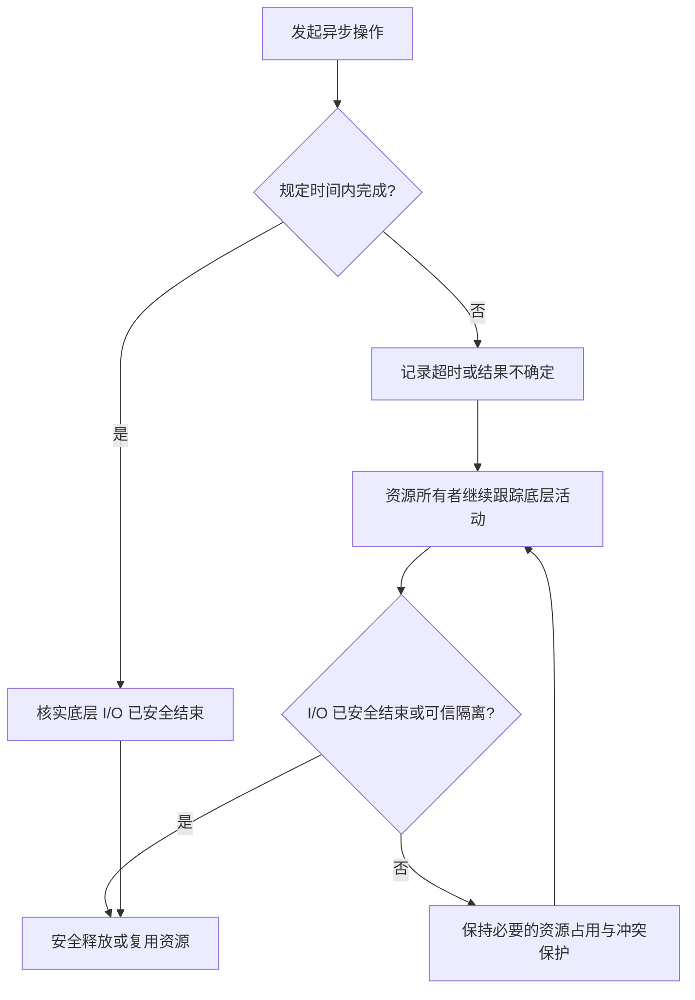
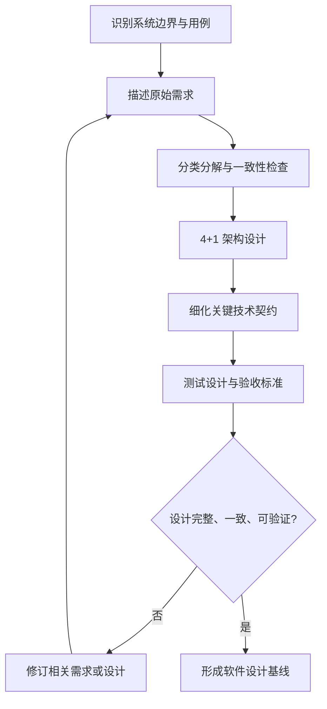
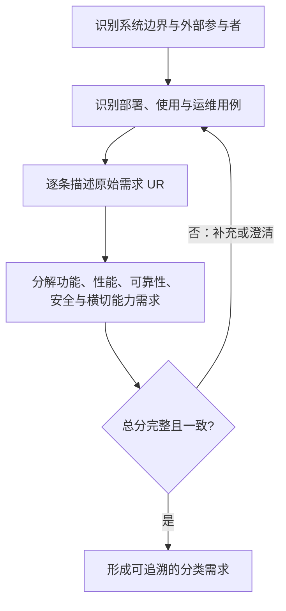
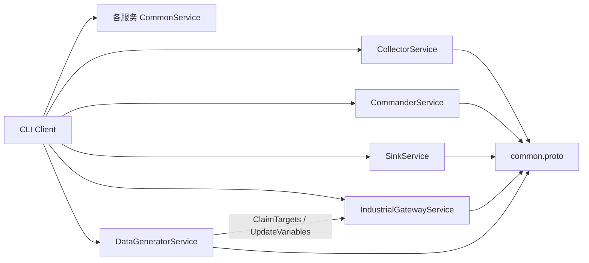
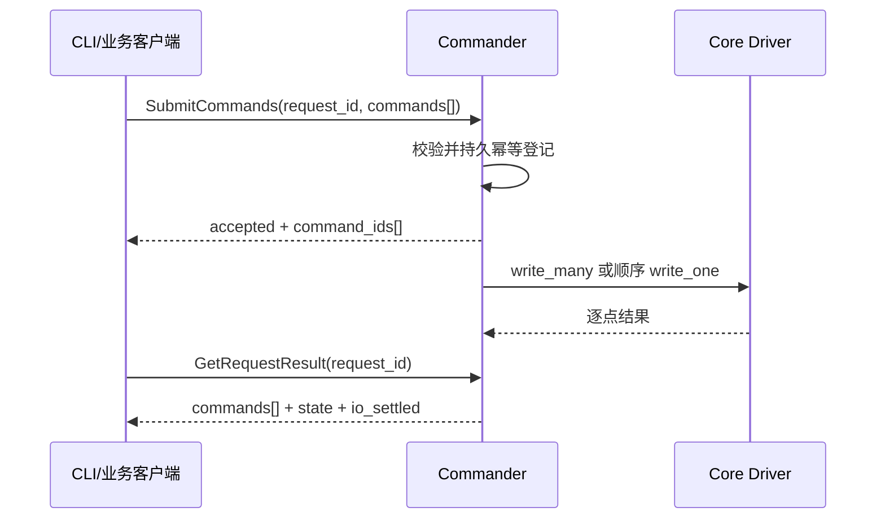
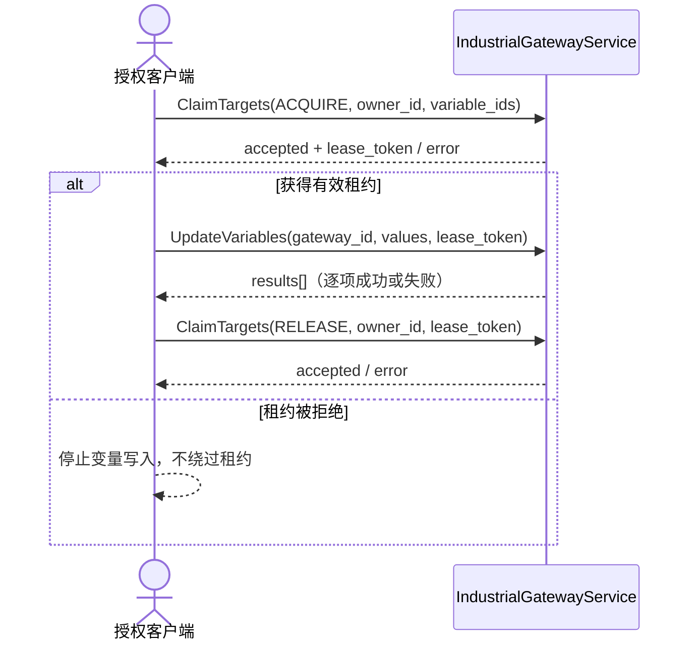

<h1 class="title">Contracts 软件设计</h1>

<p class="subtitle">v1_11 · 20261109 · main@14e3be66（现行 RPC 与 SampleBatch v2）</p>

<style>
body {
  font-family: "Microsoft YaHei";
  font-size: 16px;
  line-height: 1.75;
  color: #24292f;
}
.title {
  font-family: "Microsoft YaHei";
  font-size: 32px;
  line-height: 1.30;
  font-weight: 700;
  text-align: center;
}
.subtitle {
  font-family: "Microsoft YaHei";
  font-size: 18px;
  line-height: 1.50;
  font-weight: 400;
  text-align: center;
}
h1 {
  font-family: "Microsoft YaHei";
  font-size: 28px;
  line-height: 1.40;
  font-weight: 700;
}
h2 {
  font-family: "Microsoft YaHei";
  font-size: 22px;
  line-height: 1.40;
  font-weight: 700;
}
h3 {
  font-family: "Microsoft YaHei";
  font-size: 18px;
  line-height: 1.50;
  font-weight: 700;
}
h4 {
  font-family: "Microsoft YaHei";
  font-size: 16px;
  line-height: 1.50;
  font-weight: 700;
}
p, li {
  font-family: "Microsoft YaHei";
  font-size: 16px;
  line-height: 1.75;
}
.figure-caption,
.formula-caption {
  font-family: "Microsoft YaHei";
  font-size: 14px;
  line-height: 1.50;
  font-weight: 600;
  text-align: center;
  margin: 0.65em 0 0.35em 0;
}
.table-caption {
  font-family: "Microsoft YaHei";
  font-size: 13px;
  line-height: 1.40;
  font-weight: 500;
  text-align: center;
  margin: 0.65em 0 0.35em 0;
}
.mermaid,
.mermaid text,
.mermaid .label {
  font-family: "Microsoft YaHei" !important;
  font-size: 14px !important;
  line-height: 1.20;
}
table {
  width: 100%;
  border-collapse: collapse;
  font-family: "Microsoft YaHei";
  font-size: 13px;
  line-height: 1.45;
}
table th,
table th p,
table th li {
  font-family: "Microsoft YaHei";
  font-size: 13px;
  line-height: 1.40;
  font-weight: 600;
}
table td,
table td p,
table td li,
table td strong,
table td b {
  font-family: "Microsoft YaHei";
  font-size: 13px;
  line-height: 1.45;
  font-weight: 400;
}
table th,
table td {
  padding: 0.40em 0.60em;
  vertical-align: top;
}
code, pre {
  font-family: "Cascadia Code";
  font-size: 14px;
  line-height: 1.50;
}
p code, li code, td code {
  color: #24292f;
  background: #f3f4f6;
  padding: 0.08em 0.28em;
  border-radius: 3px;
}
pre {
  color: #c9d1d9;
  background: #0d1117;
  padding: 1em;
  border-radius: 6px;
  overflow-x: auto;
}
pre code {
  color: inherit;
  background: transparent;
  padding: 0;
}
.hljs-comment, .hljs-quote,
.token.comment, .token.prolog, .token.doctype, .token.cdata {
  color: #8b949e;
  font-style: italic;
}
.hljs-keyword, .hljs-selector-tag, .hljs-literal,
.token.keyword, .token.boolean { color: #ff7b72; }
.hljs-string, .hljs-doctag, .hljs-regexp,
.token.string, .token.char, .token.regex { color: #a5d6ff; }
.hljs-number, .token.number { color: #79c0ff; }
.hljs-title, .hljs-function, .token.function { color: #d2a8ff; }
.hljs-title.class_, .hljs-type, .hljs-built_in,
.token.class-name, .token.builtin { color: #ffa657; }
.hljs-variable, .hljs-attr, .hljs-property,
.token.variable, .token.property, .token.attr-name { color: #7ee787; }
.hljs-operator, .hljs-punctuation,
.token.operator, .token.punctuation { color: #c9d1d9; }
</style>

---

## 目录

1. 文档约定
2. 软件设计指导原则与编制方法
3. 范围、权威来源及接口总览
4. 公共契约：`common.proto`
5. Collector 采集服务：`collector.proto`
6. Commander 现场控制服务：`commander.proto`
7. Sink Service 派发服务：`sink_service.proto`
8. Industrial Gateway 工业网关：`industrial_gateway.proto`
9. Data Generator 数据生成服务：`data_generator.proto`
10. 跨 Proto 一致性与兼容演进
11. 开发组织与测试验收
12. 设计核查与待决项

---

# 1. 文档约定

本章是全文的固定排版与表达规范。文档修订、补充和派生版本均应遵守本章，不再根据个人习惯调整字体、字号、行距、图题、表题、公式或代码样式。

本文开头的 `<style>...</style>` 是 HTML `style` 元素，其中包含内部 CSS 样式表，本文简称为 CSS 样式块。第 1.1～1.4 节规定目标样式；CSS 样式块通过 `h1`、`h2`、`p`、`table`、`th`、`td`、`pre`、`code` 等选择器，将规范应用到 Markdown 渲染后生成的 HTML 元素。

## 1.1 字体约定

<p class="table-caption">表 1-1 文档字体与排版规范</p>

| 文档元素 | 字体 | 字号 | 行间距/行高 | 字重 | 对齐方式 |
|---|---|---:|---:|---:|---|
| 文档标题 | Microsoft YaHei | 32 px | 1.30 | 700 | 居中 |
| 文档副标题 | Microsoft YaHei | 18 px | 1.50 | 400 | 居中 |
| 一级标题 | Microsoft YaHei | 28 px | 1.40 | 700 | 左对齐 |
| 二级标题 | Microsoft YaHei | 22 px | 1.40 | 700 | 左对齐 |
| 三级标题 | Microsoft YaHei | 18 px | 1.50 | 700 | 左对齐 |
| 四级标题 | Microsoft YaHei | 16 px | 1.50 | 700 | 左对齐 |
| 正文 | Microsoft YaHei | 16 px | 1.75 | 400 | 左对齐 |
| 图题 | Microsoft YaHei | 14 px | 1.50 | 600 | 居中 |
| 图内文字 | Microsoft YaHei | 14 px | 1.20 | 400 | 按图形布局 |
| 表题 | Microsoft YaHei | 13 px | 1.40 | 500 | 居中 |
| 表头 | Microsoft YaHei | 13 px | 1.40 | 600 | 左对齐 |
| 表格正文 | Microsoft YaHei | 13 px | 1.45 | 400 | 左对齐 |
| 公式题 | Microsoft YaHei | 14 px | 1.50 | 600 | 居中 |
| 代码文字 | Cascadia Code | 14 px | 1.50 | 400 | 左对齐 |

以上规范已经通过本文开头的 CSS 样式块固定。其中，正文为 `16 px`；表题、表头和表格正文均为 `13 px`。表头字重为 `600`，低于标题字重；表格正文行高为 `1.45`，因此表格在字号、字重和行距上均明显弱于正文。英文业务对象、数据库对象和程序标识符仍按所在文本元素的字号排版，但使用行内代码形式，例如 `Asset`、`Connection`、`task_id`。

## 1.2 绘图约定

1. 上下文图、第 0 层及更深层 DFD、总体流程图和关系流程图统一使用 Mermaid。
2. 每一个 Mermaid 图都必须在 Mermaid 代码块第一行加入初始化配置，统一只设置 `useMaxWidth: true`。初始化配置格式为：

```text
%%{init: {"<Mermaid 图类型配置域>": {"useMaxWidth": true}}}%%
```

其中 `<Mermaid 图类型配置域>` 必须根据实际 Mermaid 图类型替换，不得固定写成 `flowchart`，也不得使用与实际图类型不匹配的配置域。

<p class="table-caption">表 1-2 Mermaid 图类型与初始化配置</p>

| Mermaid 图类型 | 图声明 | 第一行初始化配置 |
|---|---|---|
| Flowchart | `flowchart TB/LR/...` | `%%{init: {"flowchart": {"useMaxWidth": true}}}%%` |
| Sequence Diagram | `sequenceDiagram` | `%%{init: {"sequence": {"useMaxWidth": true}}}%%` |
| State Diagram | `stateDiagram-v2` | `%%{init: {"state": {"useMaxWidth": true}}}%%` |
| Class Diagram | `classDiagram` | `%%{init: {"class": {"useMaxWidth": true}}}%%` |
| ER Diagram | `erDiagram` | `%%{init: {"er": {"useMaxWidth": true}}}%%` |

若后续使用其他 Mermaid 图类型，也必须遵守同一规则：

```text
实际图类型
    ↓
确定该图类型对应的 Mermaid 配置域
    ↓
第一行写入：
%%{init: {"对应配置域": {"useMaxWidth": true}}}%%
```

不得额外加入 `wrap` 等非统一配置；如确有特殊需要，应在对应图的局部设计说明中单独论证。

3. 每张图必须有图编号和图题，编号采用“章节号-本章图序号”，例如“图 7-2”。
4. 图题必须使用普通图题样式，不得使用 Markdown 标题。统一写法为：

```html
<p class="figure-caption">图 1-1 图题</p>
```

## 1.3 公式约定

1. 行内公式使用单美元符号，例如 `$E_1$`。
2. 独立公式使用双美元符号，例如：

```text
$$
\mathrm{Entity}=E_1\land(E_2\lor E_3\lor E_4)\land E_5
$$
```

3. 正式公式不得放入代码块。
4. 不使用 `\[` 与 `\]` 作为公式定界符。
5. 变量下标统一写成 `E_1`、`R_1`；逻辑“与”和“或”统一写成 `\land`、`\lor`。
6. 公式必须使用 LaTeX，不使用普通文本模拟数学符号。
7. 需要编号的公式使用“式（章节号-本章公式序号）”，式题采用普通公式题样式：

```html
<p class="formula-caption">式（8-1）实体判断逻辑</p>
```

## 1.4 代码约定

1. 多行代码必须使用带语言标识的围栏代码块，例如 `python`、`sql`、`json`、`yaml`、`mermaid` 或 `text`。
2. 单个标识符、字段名、命令和短代码使用行内代码，例如 `PRIMARY KEY`、`Connection`。
3. 伪代码必须明确标记为 `text` 或在正文中说明“以下为伪代码”；不得使读者误认为它可以直接运行。
4. 代码块统一使用深色背景，颜色为 `#0D1117`；普通代码文字颜色为 `#C9D1D9`。
5. 语法高亮统一采用表 1-3 的配色。Markdown 渲染器应使用 Highlight.js 或 Prism 可识别的语言标识；渲染器不支持高亮时，至少保留代码背景色和普通代码文字颜色。

<p class="table-caption">表 1-3 代码语法高亮配色</p>

| 语法元素 | 颜色 | 十六进制 |
|---|---|---|
| 代码背景 | 深黑蓝 | `#0D1117` |
| 普通文字、运算符和标点 | 浅灰 | `#C9D1D9` |
| 注释 | 灰色 | `#8B949E` |
| 关键字和布尔值 | 红色 | `#FF7B72` |
| 字符串和正则表达式 | 浅蓝 | `#A5D6FF` |
| 数值 | 蓝色 | `#79C0FF` |
| 函数名 | 紫色 | `#D2A8FF` |
| 类型、类名和内置对象 | 橙色 | `#FFA657` |
| 变量、属性和字段 | 绿色 | `#7EE787` |


---


# 2. 软件设计指导原则与编制方法

本章规定本设计书的编制准则，不是特定系统的内部实现说明，也不要求按传统瀑布流程开发。后续章节必须以需求为依据；非适用事项应注明理由，不机械增加模块或抽象。

## 2.1 总则

本节规定软件设计书的编制原则、设计深度和工作流程。软件设计以需求为依据，以架构视图组织设计内容，以明确的行为与接口契约约束实现，并通过测试与验收验证设计目标。优先采用简单、安全、高效的方案，避免无依据的功能扩展和过度设计。

### 2.1.1 需求驱动原则

软件设计必须来源于已确认的需求，不应从技术方案反向编造需求。

<p class="table-caption">表 2-1 需求驱动设计要求</p>

| 设计要求 | 具体规定 |
|---|---|
| 需求依据 | 关键功能、技术机制和质量约束应能够追溯至需求 |
| 设计范围 | 不擅自增加功能或扩大系统职责 |
| 需求分解 | 原始需求与分类需求保持完整、一致 |
| 设计取舍 | 同样满足需求时，优先选择职责更少、依赖更少的方案 |
| 需求变更 | 新增或改变系统行为时，先核对需求，再修订相关设计 |

### 2.1.2 职责与边界明确原则

系统及组件必须具有清晰的职责、依赖方向和状态所有权。

<p class="table-caption">表 2-2 职责与边界设计要求</p>

| 设计要求 | 具体规定 |
|---|---|
| 系统边界 | 明确本系统负责什么、不负责什么 |
| 组件职责 | 重要职责有明确的负责组件，避免重复承担 |
| 状态所有权 | 关键状态具有明确的权威来源和修改责任 |
| 接口边界 | 区分内部接口、对外接口与外部依赖 |
| 依赖控制 | 避免循环依赖和不必要的跨层访问 |
| 简单性 | 不因假设性的扩展需要增加抽象、兼容层或冗余实现 |

### 2.1.3 行为与契约确定原则

设计应消除影响正确性的重要歧义，但不规定无关的私有方法。

<p class="table-caption">表 2-3 行为与契约设计要求</p>

| 设计对象 | 必须明确的内容 |
|---|---|
| 业务操作 | 触发条件、输入、反馈、业务输出及处理规则 |
| 接口 | 参数、类型、返回值、错误、超时及版本语义 |
| 状态 | 状态定义、转换条件、终态与非法转换 |
| 数据 | 数据结构、约束、所有权、一致性与生命周期 |
| 并发操作 | 执行顺序、同步条件、互斥范围与竞争裁决 |
| 异常操作 | 失败条件、处理结果、恢复行为及禁止行为 |

同一契约应有唯一的规范定义位置，其他章节通过引用关联，不重复规定矛盾规则。

### 2.1.4 资源与异步操作安全原则

异步操作的业务结果、底层执行活动和资源生命周期必须分别判断。

<p class="table-caption">表 2-4 异步操作与资源管理原则</p>

| 概念 | 定义及设计要求 |
|---|---|
| 操作逻辑终结 | 业务层已形成最终处理结果，不代表底层活动已经结束 |
| 底层 I/O 安全结束 | 有可信证据表明相关 I/O 不再继续执行或产生新的相关资源访问 |
| 安全隔离 | 通过可验证措施，使未结束操作无法与后续操作发生有害冲突 |
| 资源所有权 | 明确谁创建、持有、跟踪和释放资源 |
| 资源安全释放 | 满足安全结束或可信隔离条件后，才允许释放或复用可能产生冲突的资源 |

核心原则：操作超时不等于底层 I/O 结束；未确认 I/O 安全结束或隔离前，不得释放可能引发冲突操作的执行资源。



<p class="figure-caption">图 2-1 异步操作超时与资源安全释放流程</p>

对异步操作应区分超时、取消、异常和正常结束；不能仅凭调用方返回、Future/Task 取消或连接状态判断底层 I/O 已安全结束。

### 2.1.5 性能与资源有界原则

性能设计围绕明确的负载与质量要求展开，而不是无依据地增加并发或缓存。

<p class="table-caption">表 2-5 性能与资源有界设计要求</p>

| 设计要求 | 具体规定 |
|---|---|
| 负载模型 | 明确请求规模、并发规模、数据量及运行条件 |
| 容量约束 | 队列、线程、Task、连接、缓存及存储资源应有合理边界 |
| 背压 | 资源不足时明确等待、拒绝、丢弃或降级策略及适用条件 |
| 缓存 | 明确缓存用途、权威数据来源、失效与容量策略 |
| 性能指标 | 明确时延、吞吐、资源占用及测量口径 |
| 性能取舍 | 不得以违反正确性、安全性和可靠性约束换取性能 |

### 2.1.6 故障可控与恢复原则

设计应覆盖正常运行及合理预期的异常场景，明确故障影响范围和恢复条件。

<p class="table-caption">表 2-6 故障与恢复设计要求</p>

| 设计要求 | 具体规定 |
|---|---|
| 故障识别 | 明确可能的超时、通信失败、存储失败、任务异常和进程崩溃 |
| 故障隔离 | 限制故障传播，避免无关组件或资源被错误影响 |
| 状态可信 | 不将未知状态解释为确定成功或失败 |
| 重试与恢复 | 明确允许重试的条件，禁止可能产生危险副作用的盲目重试 |
| 持久化恢复 | 规定异常中断后的数据一致性及状态恢复规则 |
| 生命周期 | 明确启动、就绪、运行、关闭和重启期间的异常处理 |
| 失效行为 | 无法恢复时应有明确的降级、阻塞或停止服务条件 |

### 2.1.7 横切能力非侵入式原则

日志、审计、指标、追踪、权限校验等横切能力应与核心业务逻辑分离，优先通过统一的边界组件、装饰器、中间件或独立服务实现，不应将重复的技术处理流程散布在业务代码中。非侵入式不等于隐藏业务约束：凡影响业务准入、执行结果、事务一致性或故障处理的规则，必须在业务契约中明确，并保留必要的显式调用点。

<p class="table-caption">表 2-7 横切能力非侵入式设计要求</p>

| 设计要求 | 具体规定 |
|---|---|
| 职责分离 | 业务组件负责业务规则与状态转换；横切组件负责统一的记录、采集、校验与传输机制 |
| 边界统一 | 在服务入口、应用服务边界、消息发布边界等明确位置接入横切能力，避免各业务分支重复编排 |
| 最小侵入 | 不为记录日志、采集指标或传播追踪上下文而改变业务方法的核心控制流程和返回语义 |
| 审计正确性 | 审计事件的业务含义及产生时机由业务契约定义；持久化、投递、重试等通用机制与业务处理解耦，同时保证要求的一致性 |
| 故障影响 | 明确横切能力故障时的阻断、降级或重试规则；不得默认其失败不会影响业务，也不得默默吞掉必须处理的错误 |
| 可读性与验证 | 业务代码能够直接体现主流程；横切处理可独立测试，端到端测试验证其与业务契约一致 |

不为追求形式上的非侵入而引入复杂框架或过多抽象；简单、清晰的显式边界优先于难以追踪的隐式执行机制。

### 2.1.8 公共能力复用与冗余控制原则

优先使用符合需求的标准库、成熟软件包、现有工具及公共组件；相同且稳定的职责才提炼为公共能力，不重复发明、不为假设性扩展提前设计框架。

<p class="table-caption">表 2-8 公共能力复用与冗余控制要求</p>

| 设计要求 | 具体规定 |
|---|---|
| 复用优先 | 先评估现成组件是否满足功能、安全、性能及维护要求，再决定是否自行实现。 |
| 提炼公共职责 | 多模块存在稳定相同的职责时统一实现；业务规则留在所属业务模块。 |
| 控制依赖 | 核查成熟度、许可证、版本、安全维护及引入成本。 |
| 控制抽象 | 避免仅为减少少量重复而引入复杂框架或多层转发。 |
| 清理冗余 | 统一能力落地后删除重复、废弃和不必要的兼容实现。 |

### 2.1.9 图表表达与设计一致性原则

设计优先使用合适的图形和表格表达结构、流程、时序、状态及约束，图表不能代替必要的精确定义。

<p class="table-caption">表 2-9 图表表达与一致性设计要求</p>

| 设计要求 | 具体规定 |
|---|---|
| 视图完整 | 使用 4+1 架构视图组织系统设计，覆盖适用内容 |
| 图形选择 | 根据表达目的选择结构图、状态图、时序图、活动图等 |
| 图表一致 | 图形、表格和正文不得相互矛盾 |
| 跨章节一致 | 同一接口、状态、参数及资源规则保持一致 |
| 设计深度 | 明确影响系统行为的契约，允许自主选择内部实现细节 |
| 可验证性 | 关键设计要求应能够对应测试条件与验收证据 |

### 2.1.10 软件设计工作流程



<p class="figure-caption">图 2-2 软件设计编制流程</p>

工作流程允许迭代，不要求传统瀑布式阶段。发现缺口或冲突时直接修订相关需求、架构视图或契约，不通过追加覆盖性条款解决。

## 2.2 需求体系及描述规范

需求采用“识别用例 → 逐条描述原始需求 → 分类分解 → 总分一致性检查”的方法。用例应从外部使用者及运行场景出发，覆盖适用的部署、启动、正常使用、配置、运维、正常关闭、重启及异常恢复过程；不局限于业务 RPC，也不将内部技术机制机械列为用例。用例识别属于需求分析，第 4 章用例视图负责表达参与者、边界及用例关系。

<p class="table-caption">表 2-10 原始需求描述字段</p>

| 字段 | 描述要求 |
|---|---|
| 编号 | 唯一原始需求标识，例如 `UR-01` |
| 名称 | 准确概括使用者需要的能力或运行场景 |
| 请求方（Requester） | 发起操作的外部系统、服务或接口，如 CLI、gRPC 客户端、进程管理系统；不要求是自然人 |
| 输入（Input） | 请求方向本系统提供的数据、参数和信息 |
| 反馈（Response） | 本系统返回请求方的确认、状态、结果及错误信息 |
| 目标方（Destination） | 接收本系统业务输出的外部系统、消息中间件或现场设备；没有时标记“不适用” |
| 业务输出（Output） | 本系统发往目标方的数据、消息或控制指令；没有时标记“不适用” |
| 业务规则（Business Rules） | 正常与异常业务处理、前置条件、执行顺序及结果判定 |
| 约束（Constraints） | 性能、可靠性、安全和横切能力的要求，尤其审计；描述应独立于具体技术实现 |

反馈与业务输出必须分开：反馈面向请求方，业务输出面向目标方；请求方与目标方可有多个，且请求方断连不必然撤销已接受的业务操作。

<p class="table-caption">表 2-11 分类需求体系与描述重点</p>

| 类别 | 核心问题 | 典型要求 |
|---|---|---|
| 功能需求（Functionality） | 系统提供什么行为 | 对外能力、业务流程、业务规则、输入输出与状态反馈 |
| 性能需求（Performance） | 运行速度与资源上限 | 时延、吞吐、并发、调度、公平性、容量、背压、资源消耗、扩展能力 |
| 可靠性需求（Reliability） | 故障时如何保持正确与恢复 | 容错、超时、重试、请求关联、事务、持久化、故障恢复、可用性、未结束操作的资源管理 |
| 安全需求（Safety & Security） | 如何防止危险或非法控制 | 控制权、互锁、失效安全、认证、授权、通信及数据安全 |
| 横切能力（Cross-cutting Concerns） | 如何观测、管理与追责 | 审计（操作证据、可靠投递、完整性、追溯）、日志、指标、追踪、配置、版本、可测试性、可维护性 |



<p class="figure-caption">图 2-3 需求识别、分解与一致性检查流程</p>

分类需求必须从原始需求的输入、反馈、业务输出、规则和约束中推导，不得遗漏、矛盾或未经确认增加能力；多条原始需求的共同约束可以合并，但必须保留来源编号。每条分类需求应给出可核验条件，性能要求还需明确测量口径，不虚构现场阈值。审计应独立于普通日志定义，不得以运行日志代替审计证据。

需求分类与设计专题是不同维度：启动、正常关闭、重启及 Reload 属于跨需求的运行生命周期设计，统一在进程视图展开；相应行为和质量约束分别由原始需求及分类需求追溯。

## 2.3 4+1 架构视图：内涵、外延与表达规范

<p class="table-caption">表 2-12 4+1 架构视图的职责与成果</p>

| 视图 | 关注范围 | 主要成果 | 不应混淆 |
|---|---|---|---|
| 用例视图（+1） | 参与者、系统边界、典型/异常场景 | 系统上下文、用例、业务流程 | 不负责线程调度 |
| 逻辑视图（Logical） | 组件职责、模型、接口、状态规则、依赖 | 组件图、类/数据关系、状态图 | 不等于源码目录树 |
| 进程视图（Process） | 进程、线程、Event Loop、Task、协作、生命周期、同步、并发、资源、背压、缓存、故障恢复 | 运行结构图、任务所有权表、时序/状态/活动图、资源预算 | Task 不等于 OS 线程；图名须区分标准 UML 与示意图 |
| 开发视图（Development） | 软件模块边界、层次、静态依赖、公共契约与复用关系 | 模块图、依赖图、模块职责表 | 不描述真实并发拓扑，也不列现有代码修改清单 |
| 物理视图（Physical/Deployment） | 节点、进程部署、存储、网络、控制权和现场外部依赖 | 部署图、网络/故障域/外部依赖表 | 不是现场设备内部物理结构模型 |

### 2.3.1 用例视图的场景编写规范

用例以参与者的完整业务目标为单位组织，而非以原始需求、RPC 或内部模块为单位逐条改名。一项用例可以关联多项原始需求；一项原始需求也可以由多个业务场景共同覆盖。用例视图回答“在具体业务场景中系统如何工作”，不代替逻辑视图、进程视图和数据设计。

<p class="table-caption">表 2-13 业务场景用例的必备描述要素</p>

| 要素 | 编写规定 |
|---|---|
| 用例身份与目标 | 给出唯一编号、业务场景名称及参与者要达成的可观察目标；名称使用业务活动，不使用内部机制命名 |
| 参与者与触发条件 | 列明实际发起操作的外部角色；内部定时任务、恢复及发布等自动步骤不得虚构外部参与者 |
| 前置条件 | 列明系统就绪、授权、配置或数据存在等必要条件；不得混入未确认的实现假设 |
| 主业务流程 | 以 Mermaid 业务活动图（flowchart）为主要表达，覆盖触发、校验、关键处理、反馈及后置结果；以判断节点表达重要分支，避免大段编号文字复述 |
| 分支与异常流程 | 在活动图中呈现影响业务结果的主要异常出口；罕见或不宜展开的异常在简明说明表中概括，避免为了完整而画出所有技术异常 |
| 后置条件 | 明确成功和失败之后的业务状态、外部可见结果、未完成事项及后续查询方式 |
| 需求追溯 | 标明相关 UR；核对全部 UR 在真实场景中得到覆盖，但不要求 UR 与 UC 一一对应 |

跨用例共享的内部机制（如存储、审计发布和调度）应作为相关业务流程中的自动步骤或支撑行为描述；只有存在独立业务目标时才另立用例。应避免将一串 gRPC 方法名或 CRUD 操作直接当作完整用例，也不得在用例章节展开线程、锁、表结构及类方法等实现细节。

用例的正文采用“一张业务活动图 + 一张简明用例说明表”的表达形式。活动图包含主路径、必要判断以及重要异常分支；图中节点使用业务动作，不展开展示内部类、锁和数据库事务。说明表只填写参与者、业务目标、前置条件、主要异常、后置条件及关联需求。业务分支已在图中完整表达时，不再重复书写大段“主业务流程”和“异常流程”；复杂跨参与者消息时序可在独立小节补充时序图。图题和表题按文档约定独立编号。

进程视图应按四个设计专题组织，而不是按需求类别重复划分：

<p class="table-caption">表 2-14 进程视图的四类设计专题</p>

| 专题 | 必须明确的设计对象 | 推荐表达 |
|---|---|---|
| 运行时结构 | 进程、线程、Event Loop、Task、线程池、组件与资源所有权 | 分层运行结构图、Task 职责表 |
| 运行生命周期（Runtime Lifecycle） | 启动、初始化、就绪、运行、Reload、正常关闭、重启及其阶段转换 | 生命周期状态图、启动/关闭/Reload 时序图 |
| 并发与资源管理 | Task 协作、队列、通知、同步、调度、容量限额、背压、缓存及释放 | 任务协作时序图、资源与背压策略表 |
| 异常与恢复 | 超时、取消、故障隔离、未收敛 I/O、崩溃恢复与降级 | 故障状态图、异常裁决矩阵 |

各专题共享同一运行模型，明确创建者、所有者、同步关系和退出条件；不因分节而重复定义状态或资源。生命周期是进程视图的独立设计专题，不是第六类需求。

图表仅使用其可准确表达的语义：结构关系用 Mermaid Flowchart；行为交互用 Sequence Diagram；状态约束用 State Diagram；条件控制用活动/流程图。图题说明对象、范围及图类型。关键质量属性贯穿各视图，不能只写在单独的“非功能要求”段落。

## 2.4 测试设计方法、组织及验收规范

测试设计以测试层级组织物理目录，以 Marker 描述测试层级、测试专题与运行场景。测试文件名应清楚表达验证对象或行为；测试文件及其标记、验证说明统一登记在测试矩阵中。需求、用例及重要技术契约必须能追溯到实际测试，不为同一目的建立重复测试体系。

<p class="table-caption">表 2-15 测试层级与目录规范</p>

| 层级 Marker | 物理目录 | 验证范围 |
|---|---|---|
| `unit` | `unit/` | 状态转换、业务规则、纯逻辑，无外部服务依赖 |
| `component` | `component/` | 单组件职责及其可控依赖 |
| `integration` | `integration/` | 组件之间及真实外部依赖的接口协作 |
| `system` | `system/` | 独立进程、完整业务场景及端到端行为 |

<p class="table-caption">表 2-16 测试 Marker 与矩阵编制规范</p>

| 事项 | 规范 |
|---|---|
| 层级 Marker | 每项测试必须且仅属于 `unit`、`component`、`integration`、`system` 之一，与目录对应 |
| 专题 Marker | 标识可靠性、安全、性能等验证主题，可与层级及场景 Marker 叠加；无专项主题时可为空 |
| 场景 Marker | 标识并发、超时、恢复、负载、现场等执行条件或情境；有相应场景时标记 |
| 测试矩阵 | 至少包含“测试文件名、层级 Marker、专题 Marker、场景 Marker、测试说明”五列；每项重要测试应有可定位的文件归属 |
| 标记粒度 | 标记以具体测试函数或类为准；同文件可包含不同专题与场景，矩阵列出涉及的 Marker |
| 运行条件 | 通过 Fixture 和环境准备明确外部依赖；现场专用测试与常规回归分离，未执行不视为通过 |
| 执行规则 | 提供按目录、Marker 及其布尔组合的 pytest 命令；所有 Marker 在项目配置中注册 |
| 可追溯性 | 测试说明与需求、用例或技术契约对应；行为变更时同步检查测试及矩阵 |
| 验收证据 | 保留运行环境、命令、实际结果、指标和未验证项，禁止把设计目标当作测试结果 |

目录划分测试层级，专题与场景通过 Marker 横向组合；可靠性测试不单独设第五类目录。测试矩阵用于定位和筛选测试，不预设每个实现文件必须存在，也不要求每个文件仅能有一种测试场景。

### 2.4.1 测试依据及 System 覆盖要求

各层级测试必须依据已确认的设计成果编制；System Test 以用例视图为主基线，以原始需求及技术契约补充覆盖，不得由测试人员凭经验任意缩减范围。

<p class="table-caption">表 2-17 各测试层级的设计依据</p>

| 测试层级 | 主要依据 | 验证重点 |
|---|---|---|
| Unit | 详细设计、函数及算法契约 | 纯逻辑、状态转换、参数及边界规则 |
| Component | 逻辑视图、组件职责及内部接口契约 | 单组件行为、依赖协作及异常处理 |
| Integration | 接口与通信契约、开发视图、物理视图 | 真实接口调用、跨组件通信及外部依赖 |
| **System** | **用例视图（UC）及原始需求（UR）**，并补充接口、运行、部署、安全及性能约束 | **从真实 CLI 操作入口验证完整业务目标、关键异常、边界与恢复行为** |

System Test 必须遵守以下规定：

1. **用例覆盖率 100%**：每项 UC 至少有一项 System Test 作为验证证据；同一测试可以覆盖多个 UC，同一 UC 可以由多个测试覆盖，**不按测试数量与 UC 数量的大小关系判定覆盖**。
2. **规定场景覆盖率 100%**：每项 UC 明确的主流程、关键分支、异常流程、边界和恢复场景均必须有对应 System Test；不能仅以一条正常路径代表整个 UC 已覆盖。
3. **需求覆盖率 100%**：每项 UR 必须能够经一个或多个 UC 追溯至 System Test；若某项需求未能被 UC 覆盖，必须先补全用例，不得直接以技术测试代替业务用例。
4. **技术约束补充覆盖**：用例未充分表达的性能、容量、并发、安全、权限、超时和可靠性要求，依据对应技术契约补充测试；不得因 UC 未逐项列出而豁免。
5. **真实系统边界**：System Test 通过真实 CLI 进程和真实通信/运行基础设施执行。涉及 containerd、iSulad、systemd 的用例必须分别在对应真实管理器上验证；允许在真实容器或 Service Unit 中运行模拟下游业务组件，Mock 不得代替运行基础设施验收。
6. **覆盖与通过分开裁定**：测试已关联不等于已执行；失败、跳过及未运行均不得计为通过。验收报告分别给出需求覆盖、用例及场景覆盖、执行情况和通过情况；缺少真实环境时标记 `NOT_RUN`，不得用模拟结果替代。
7. **变更同步**：任何 UR、UC、接口或行为约束的新增、删除、调整，必须同步核查 System Test、测试矩阵和验收条款；新增 UC 不得留下无测试映射。

<p class="table-caption">表 2-18 System Test 追溯矩阵规范</p>

| 字段 | 要求 |
|---|---|
| UR 编号 | 被验证的原始需求编号，可列多个 |
| UC 编号与场景 | 用例编号及主流程、异常、边界或恢复场景标识 |
| 技术契约 | 相关接口、配置、运行或安全约束的章节编号；没有则记“—” |
| 测试文件名／测试标识 | 可定位的 System Test 文件名及测试函数或参数化场景标识 |
| 层级／专题／场景 Marker | 层级固定为 `system`，其余按第 2.4 节定义填写 |
| 验证内容与预期结果 | 从用户可观察行为与副作用表述判定依据 |
| 执行环境及结果 | 真实依赖、执行证据、`PASS`／`FAIL`／`SKIP`／`NOT_RUN` 等状态 |

追溯链为 **UR → UC／用例场景 → System Test → 执行结果与证据**，技术契约作为补充依据进入相应测试。第 4 章负责编制完整 UC 和场景，第 14 章依据本规范给出实际测试矩阵及验收安排，两章必须双向核对。


# 3. 范围、权威来源及接口总览

本设计针对 `src/contracts/` 六份 `.proto` 文件的公开 wire 契约，不定义各服务内部业务实现，不单独部署服务进程。**当前核查基线为 GitHub `luoshaozhuo/wind-hub` 的 `main@14e3be661cfd1d30417144d3f4cfa928d313eaa5`；六份 Proto、`contracts.sample_batch.SampleBatch(schema_version=2)` 及 `contracts.scalar_codec` 均已在此主干存在。`main@cac23d84` 为 v1_6 编写时的历史审查基线，不再作为现行实施状态依据**；本设计是可审阅的中文说明，若出现字段偏差，必须修正文档，不得按文档另造并行 Proto。

**边界声明**：Contracts 维护包名、RPC 签名、消息及字段编号、存在性和跨服务兼容约束；Collector、Commander、Sink Service、Industrial Gateway、Data Generator 各自实现 Server；CLI 以及 Data Generator 等调用方使用相应 Client。认证、业务校验、租约状态机、故障恢复及性能预算的具体规则由服务设计负责，Contracts 约束其对外表达方式。

<p class="table-caption">表 3-1 Proto 和 RPC 总览</p>

| 文件 | package | service | RPC 数 | 数据/操作边界 |
|---|---|---|---:|---|
| `common.proto` | `windhub.common.v1` | `CommonService` | 9 | 五个服务共用管理、配置、指标、事件、诊断 |
| `collector.proto` | `windhub.collector.v1` | `CollectorService` | 11 | 主动设备读、任务启停、总召 |
| `commander.proto` | `windhub.commander.v1` | `CommanderService` | 7 | 可控点元数据、现场写入与结果 |
| `sink_service.proto` | `windhub.sink.v1` | `SinkService` | 4 | Delivery 查询和启停 |
| `industrial_gateway.proto` | `windhub.gateway.v1` | `IndustrialGatewayService` | 8 | Gateway 内存变量读写与租约 |
| `data_generator.proto` | `windhub.data_generator.v1` | `DataGeneratorService` | 6 | 生成任务查询与启停 |

**45 个唯一 Unary RPC（v1_11 目标设计；正式 Proto 待同步实现）**，即公共 9 + 专属 11+7+4+8+6。公共 9 项由各业务服务分别注册，因此这是“唯一接口定义数”，不是所有服务实例注册方法的总和。六份 Proto 当前均以 `proto3` 定义，业务 Proto 通过 `import "contracts/common.proto"` 复用公共消息。

## 3.1 模块间的调用关系



<p class="figure-caption">图 3-1 Contracts 的服务定义与主要调用方（逻辑依赖示意图）</p>

## 3.2 契约语义与非契约事项

| 事项 | 设计规则 |
|---|---|
| 读取语义 | Collector `ReadPoints` 主动请求现场协议读取（`worker.submit_read`），可能触发真实设备 I/O；Gateway `ReadVariables` 读取网关内部变量；Commander `GetCommandResult` 查询命令结果；三个接口不能等同或宣称均为缓存查询 |
| 写入语义 | Commander `SubmitCommand` 是现场控制；Gateway `UpdateVariables` 是受租约约束的网关内部值更新；Start/Stop 系列是任务或对象状态控制 |
| 公共配置 | `PushConfigSnapshot` 只表达校验/候选；`ApplyConfigSnapshot` 分离磁盘提交与运行时生效 |
| 字段规则 | `optional` 与 `oneof` 保留未设置与具体默认值的区别；普通 proto3 标量缺席不具备独立 presence |
| 状态表达 | 当前多处状态是 `string`，本设计不擅自将其改为 enum，也不推断所有允许值；精确取值需对应业务模块规范 |
| Transport | 所有 RPC 为 Unary；gRPC 状态与响应体内 `accepted`、`status`、`error_code` 是不同维度 |

# 4. 公共契约：`common.proto`

## 4.1 文件定义与职责

`syntax = "proto3"`；`package windhub.common.v1`；`service CommonService`；全部 RPC 为 Unary。
涉及时间字段时采用 `google.protobuf.Timestamp`（相应文件显式导入 Timestamp 的情况以源码为准）。

## 4.2 RPC 全量清单及业务边界

<p class="table-caption">表 4-1 `CommonService` RPC 输入、输出及行为</p>

| RPC | 请求消息 | 响应消息 | 业务语义 / 约束 |
|---|---|---|---|
| `GetServiceInfo` | `Empty` | `GetServiceInfoResponse` | 查询身份、角色、软件与契约版本及启动时间 |
| `GetServiceStatus` | `Empty` | `GetServiceStatusResponse` | 查询健康和依赖；不等同于进程存活 |
| `GetCapabilities` | `Empty` | `GetCapabilitiesResponse` | 声明当前服务支持的接口、协议与功能 |
| `GetConfigSnapshot` | `GetConfigSnapshotRequest` | `GetConfigSnapshotResponse` | 读取磁盘、运行或候选配置及生效证据 |
| `PushConfigSnapshot` | `PushConfigSnapshotRequest` | `PushConfigSnapshotResponse` | 校验并暂存候选，不直接宣称生效 |
| `ApplyConfigSnapshot` | `ApplyConfigSnapshotRequest` | `ApplyConfigSnapshotResponse` | 文件提交与运行生效分别报告 |
| `GetMetrics` | `GetMetricsRequest` | `GetMetricsResponse` | 按作用域与窗口查询指标 |
| `GetEvents` | `GetEventsRequest` | `GetEventsResponse` | 按时间与过滤条件分页查事件 |
| `Diagnose` | `DiagnoseRequest` | `DiagnoseResponse` | 运行服务支持的诊断并返回分阶段证据 |

## 4.3 消息与字段逐项定义

以下逐字段同时说明 wire 类型和业务含义。**类型、字段号、optional/repeated/oneof 来自 main Proto；中文语义属于基于字段名称、注释、调用关系整理的用途说明；源代码未明示的值域、状态机、授权判据不由本设计臆定。** 对于 Proto 未给出枚举或精确取值的 string 字段，不虚构合法值，须由拥有该状态的业务模块定义并经过契约协同。 `proto3` 非 optional 基本标量没有显式存在性，客户端不能通过零值证明字段被主动设置。

表中字段类型完整保留 `repeated`、`optional`、`oneof` 标识；`Timestamp` 指 `google.protobuf.Timestamp`；`common.X` 指 `windhub.common.v1.X`。字段号为 wire schema 的组成部分，不是显示顺序。

<p class="table-caption">表 4-2 `common.proto` 消息字段契约（含语义）</p>

| 消息 | 字段（编号） | 类型 | 存在性 / 基数 | 含义与使用约束 |
|---|---|---|---|---|
| `ScalarValue` | `bool_value` (1) | `bool` | `oneof kind` 分支 | 布尔型数值分支；与其它 kind 分支互斥，false 也是明确赋值 |
| `ScalarValue` | `sint64_value` (2) | `sint64` | `oneof kind` 分支 | 有符号 64 位整数数值分支，适用于正负整数 |
| `ScalarValue` | `uint64_value` (3) | `uint64` | `oneof kind` 分支 | 无符号 64 位整数数值分支，不能承载负数 |
| `ScalarValue` | `double_value` (4) | `double` | `oneof kind` 分支 | 双精度浮点数分支；开发分支统一编解码器明确拒绝 NaN/Infinity，业务层仍须执行量程约束 |
| `ScalarValue` | `string_value` (5) | `string` | `oneof kind` 分支 | 字符串数值分支；不等于未经解析的 JSON 值 |
| `ScalarValue` | `bytes_value` (6) | `bytes` | `oneof kind` 分支 | 原始 bytes 数值分支；不保证是 UTF-8 文本 |
| `AddressField` | `key` (1) | `string` | proto3 单值 | 地址或配置属性名，与 value 成对组成键值项 |
| `AddressField` | `value` (2) | `ScalarValue` | 单值（消息字段有消息 presence） | 承载该项实际数值；类型由 ScalarValue 的 kind 分支确定 |
| `Empty` | — | — | 无字段 | 空消息；用于无需请求参数的公共查询，不能借空消息传递隐藏的业务输入 |
| `ObjectId` | `id` (1) | `string` | proto3 单值 | 对应 GetDevice/GetTask/GetDelivery/GetGateway/GetGeneration 等 RPC 的对象 ID，具体类型取决于 RPC |
| `Pagination` | `page_size` (1) | `uint32` | proto3 单值 | 请求单页返回上限；服务端可限制实际页大小；0 的具体处理须统一约定 |
| `Pagination` | `page_token` (2) | `string` | proto3 单值 | 继续查询下一页的游标；首次查询通常为空，不能当作页码 |
| `OperationRequest` | `id` (1) | `string` | proto3 单值 | 所请求启停的业务对象 ID；不是操作记录 ID |
| `OperationRequest` | `expected_revision` (2) | `string` | proto3 单值 | 调用方期望的当前修订标识，用于防止并发配置/对象变更冲突；不等于文件版本 |
| `OperationResult` | `operation_id` (1) | `string` | proto3 单值 | 服务端返回的操作标识，供本次操作追踪；不等于目标对象 ID |
| `OperationResult` | `accepted` (2) | `bool` | proto3 单值 | 是否受理本次请求；受理不等于操作已完成或成功 |
| `OperationResult` | `desired_state` (3) | `string` | proto3 单值 | 目标对象被请求达到的期望运行状态 |
| `OperationResult` | `actual_state` (4) | `string` | proto3 单值 | 服务端观测到的目标对象实际运行状态，可与期望状态不同 |
| `OperationResult` | `revision` (5) | `string` | proto3 单值 | 操作处理后服务端报告的目标对象修订标识 |
| `OperationResult` | `error_code` (6) | `string` | proto3 单值 | 业务错误分类编码，具体取值由服务端定义 |
| `OperationResult` | `message` (7) | `string` | proto3 单值 | 面向调用方的处理说明或错误详情，不作为稳定机器协议 |

<p class="table-caption">表 4-2 `common.proto` 消息字段契约（含语义）（续 1）</p>

| 消息 | 字段（编号） | 类型 | 存在性 / 基数 | 含义与使用约束 |
|---|---|---|---|---|
| `PointMetadata` | `point_id` (1) | `string` | proto3 单值 | 设备内测点标识；结合设备标识唯一定位测点 |
| `PointMetadata` | `data_type` (2) | `string` | proto3 单值 | 测点/变量数据类型标识；实际可用值由服务或共享点表定义 |
| `PointMetadata` | `unit` (3) | `string` | proto3 单值 | 测点物理量单位标识；应与共享单位配置保持一致 |
| `PointMetadata` | `readable` (4) | `bool` | proto3 单值 | 设备或测点是否允许通过其业务读取路径读取的属性 |
| `PointMetadata` | `writable` (5) | `bool` | proto3 单值 | 测点或工业协议层是否可写的属性；不自动授权 gRPC 更新 |
| `PointMetadata` | `address` (6) | `AddressField` | `repeated` | 协议地址或扩展地址属性键值列表；不是逻辑测点 ID |
| `PointMetadata` | `minimum` (7) | `double` | `optional` | 配置的数值下限；仅设置时生效，0 不表示未配置 |
| `PointMetadata` | `maximum` (8) | `double` | `optional` | 配置的数值上限；仅设置时生效，0 不表示未配置 |
| `PointMetadata` | `revision` (9) | `string` | proto3 单值 | 对象或快照当前修订标识；用于变更追踪或乐观并发检查，具体作用域依消息确定 |
| `Sample` | `point_id` (1) | `string` | proto3 单值 | 设备内测点标识；结合设备标识唯一定位测点 |
| `Sample` | `value` (2) | `ScalarValue` | `optional` | 测点实际样本数值；optional 未设置表示无值，不能与数值 0 混同 |
| `Sample` | `quality` (3) | `string` | proto3 单值 | 样本质量标记；可用取值需与产生样本的模块约定 |
| `Sample` | `sample_timestamp` (4) | `Timestamp` | 单值（消息字段有消息 presence） | 源样本产生或采集的时间戳，不是请求返回时间 |
| `Sample` | `queried_at` (5) | `Timestamp` | 单值（消息字段有消息 presence） | 服务读取或组装查询结果的时间戳，与采样时间分开 |
| `Sample` | `freshness` (6) | `string` | proto3 单值 | 样本来源/新鲜度状态，不与 quality 混同；ReadPoints 的主动读取在当前实现标记 LIVE |
| `Sample` | `error_code` (7) | `string` | proto3 单值 | 业务错误分类编码，具体取值由服务端定义 |
| `Sample` | `error_message` (8) | `string` | proto3 单值 | 错误的可读说明；不替代机器可判定的错误码 |
| `Evidence` | `name` (1) | `string` | proto3 单值 | 诊断证据项目名称 |
| `Evidence` | `value` (2) | `string` | proto3 单值 | 对应证据值的文本表达；需结合证据名称解释 |
| `DiagnosticStage` | `stage` (1) | `string` | proto3 单值 | 本次诊断阶段名称或标识 |
| `DiagnosticStage` | `status` (2) | `string` | proto3 单值 | 本消息代表的执行或诊断状态；合法值须由业务服务约定 |
| `DiagnosticStage` | `duration_ms` (3) | `uint64` | proto3 单值 | 本诊断阶段已测量耗时，单位毫秒 |
| `DiagnosticStage` | `error_code` (4) | `string` | proto3 单值 | 业务错误分类编码，具体取值由服务端定义 |
| `DiagnosticStage` | `message` (5) | `string` | proto3 单值 | 面向调用方的处理说明或错误详情，不作为稳定机器协议 |
| `DiagnosticStage` | `evidence` (6) | `Evidence` | `repeated` | 本阶段获得的具体证据列表，不是整体诊断结论 |
| `DiagnosticStage` | `observed_at` (7) | `Timestamp` | 单值（消息字段有消息 presence） | 该健康/诊断状态实际被观测的时间 |
| `DiagnosticStage` | `source` (8) | `string` | proto3 单值 | 产生诊断、事件或证据的来源组件/服务标识 |

<p class="table-caption">表 4-2 `common.proto` 消息字段契约（含语义）（续 2）</p>

| 消息 | 字段（编号） | 类型 | 存在性 / 基数 | 含义与使用约束 |
|---|---|---|---|---|
| `GetServiceInfoResponse` | `service_id` (1) | `string` | proto3 单值 | 服务实例/逻辑服务身份标识 |
| `GetServiceInfoResponse` | `process_role` (2) | `string` | proto3 单值 | 同一逻辑服务中进程所承担的运行角色 |
| `GetServiceInfoResponse` | `software_version` (3) | `string` | proto3 单值 | 服务端软件发布版本 |
| `GetServiceInfoResponse` | `contract_version` (4) | `string` | proto3 单值 | 服务端声明支持的接口契约版本，不是软件版本 |
| `GetServiceInfoResponse` | `started_at` (5) | `Timestamp` | 单值（消息字段有消息 presence） | 服务进程本次启动的时间戳 |
| `DependencyHealth` | `name` (1) | `string` | proto3 单值 | 对应对象、属性、指标或证据项的人类可读或机器约定名称 |
| `DependencyHealth` | `health` (2) | `string` | proto3 单值 | 本服务或依赖的健康状态；不等价于操作系统进程状态 |
| `DependencyHealth` | `detail` (3) | `string` | proto3 单值 | 对应依赖健康的补充说明 |
| `GetServiceStatusResponse` | `health` (1) | `string` | proto3 单值 | 本服务或依赖的健康状态；不等价于操作系统进程状态 |
| `GetServiceStatusResponse` | `dependencies` (2) | `DependencyHealth` | `repeated` | 本服务依赖组件的逐项健康信息列表 |
| `GetServiceStatusResponse` | `observed_at` (3) | `Timestamp` | 单值（消息字段有消息 presence） | 该健康/诊断状态实际被观测的时间 |
| `GetCapabilitiesResponse` | `rpc_names` (1) | `string` | `repeated` | 当前服务声明可用的 RPC 名称集合，用于客户端能力发现 |
| `GetCapabilitiesResponse` | `protocols` (2) | `string` | `repeated` | 当前服务声明支持的协议列表，不表示每台设备均支持 |
| `GetCapabilitiesResponse` | `features` (3) | `string` | `repeated` | 服务端声明的业务能力标识列表 |
| `SnapshotFile` | `relative_path` (1) | `string` | proto3 单值 | 快照内部相对于配置根的文件路径；应拒绝路径逃逸 |
| `SnapshotFile` | `content` (2) | `bytes` | proto3 单值 | 快照文件的原始字节内容；不是文件路径或摘要 |
| `SnapshotFile` | `size_bytes` (3) | `uint64` | proto3 单值 | 快照文件内容长度，单位字节，应与 content 校验一致 |
| `SnapshotFile` | `sha256` (4) | `string` | proto3 单值 | 快照文件内容 SHA-256 摘要，用于完整性校验 |
| `ValidationIssue` | `path` (1) | `string` | proto3 单值 | 校验问题定位到的配置相对路径或字段路径 |
| `ValidationIssue` | `code` (2) | `string` | proto3 单值 | 校验或诊断发现的机器可读问题编码 |
| `ValidationIssue` | `message` (3) | `string` | proto3 单值 | 面向调用方的处理说明或错误详情，不作为稳定机器协议 |

<p class="table-caption">表 4-2 `common.proto` 消息字段契约（含语义）（续 3）</p>

| 消息 | 字段（编号） | 类型 | 存在性 / 基数 | 含义与使用约束 |
|---|---|---|---|---|
| `ApplicationResult` | `object_id` (1) | `string` | proto3 单值 | 应用结果所对应的配置/运行对象标识 |
| `ApplicationResult` | `status` (2) | `string` | proto3 单值 | 本消息代表的执行或诊断状态；合法值须由业务服务约定 |
| `ApplicationResult` | `error_code` (3) | `string` | proto3 单值 | 业务错误分类编码，具体取值由服务端定义 |
| `ApplicationResult` | `message` (4) | `string` | proto3 单值 | 面向调用方的处理说明或错误详情，不作为稳定机器协议 |
| `GetConfigSnapshotRequest` | `scope` (1) | `SnapshotScope` | proto3 单值 | 快照范围枚举：UNSPECIFIED=0、DISK=1、RUNTIME=2、CANDIDATE=3 |
| `GetConfigSnapshotRequest` | `candidate_id` (2) | `string` | proto3 单值 | Push 后暂存候选快照的标识；只用于对应候选的查询或 Apply |
| `GetConfigSnapshotResponse` | `snapshot_id` (1) | `string` | proto3 单值 | 本次返回的配置快照标识，便于记录和核对 |
| `GetConfigSnapshotResponse` | `revision` (2) | `string` | proto3 单值 | 本次所返回快照的修订标识，用于配置一致性与冲突检查 |
| `GetConfigSnapshotResponse` | `files` (3) | `SnapshotFile` | `repeated` | 该范围内快照文件及其原始字节内容集合 |
| `GetConfigSnapshotResponse` | `validation` (4) | `ValidationIssue` | `repeated` | 每项配置校验问题列表；与整体 valid 状态配合使用 |
| `GetConfigSnapshotResponse` | `application_id` (5) | `string` | proto3 单值 | 一次配置应用过程的标识，供运行状态关联 |
| `GetConfigSnapshotResponse` | `apply_results` (6) | `ApplicationResult` | `repeated` | 运行快照所报告的逐对象配置生效结果 |
| `GetConfigSnapshotResponse` | `last_error` (7) | `string` | proto3 单值 | 最近一次配置快照或应用的错误摘要 |
| `PushConfigSnapshotRequest` | `files` (1) | `SnapshotFile` | `repeated` | 待校验并暂存的完整候选配置文件集合，非增量补丁 |
| `PushConfigSnapshotRequest` | `expected_revision` (2) | `string` | proto3 单值 | 调用方期望的当前修订标识，用于防止并发配置/对象变更冲突；不等于文件版本 |
| `PushConfigSnapshotResponse` | `candidate_id` (1) | `string` | proto3 单值 | Push 后暂存候选快照的标识；只用于对应候选的查询或 Apply |
| `PushConfigSnapshotResponse` | `valid` (2) | `bool` | proto3 单值 | 候选是否通过服务端完整校验；不代表已提交磁盘 |
| `PushConfigSnapshotResponse` | `validation` (3) | `ValidationIssue` | `repeated` | 每项配置校验问题列表；与整体 valid 状态配合使用 |
| `PushConfigSnapshotResponse` | `base_revision` (4) | `string` | proto3 单值 | 候选快照校验所依据的正式配置修订标识 |
| `ApplyConfigSnapshotRequest` | `candidate_id` (1) | `string` | proto3 单值 | Push 后暂存候选快照的标识；只用于对应候选的查询或 Apply |
| `ApplyConfigSnapshotRequest` | `expected_revision` (2) | `string` | proto3 单值 | 调用方期望的当前修订标识，用于防止并发配置/对象变更冲突；不等于文件版本 |

<p class="table-caption">表 4-2 `common.proto` 消息字段契约（含语义）（续 4）</p>

| 消息 | 字段（编号） | 类型 | 存在性 / 基数 | 含义与使用约束 |
|---|---|---|---|---|
| `ApplyConfigSnapshotResponse` | `file_commit` (1) | `string` | proto3 单值 | 正式配置文件集合提交的结果，与运行生效结果分开 |
| `ApplyConfigSnapshotResponse` | `apply_results` (2) | `ApplicationResult` | `repeated` | 逐对象运行生效结果；可能与文件提交结论不同 |
| `ApplyConfigSnapshotResponse` | `effective_revision` (3) | `string` | proto3 单值 | Apply 后服务端报告的正式配置修订标识 |
| `ApplyConfigSnapshotResponse` | `restart_required` (4) | `bool` | proto3 单值 | 服务端判定本次配置变更是否必须重启进程才能完全生效 |
| `ApplyConfigSnapshotResponse` | `application_id` (5) | `string` | proto3 单值 | 一次配置应用过程的标识，供运行状态关联 |
| `GetMetricsRequest` | `scope` (1) | `string` | proto3 单值 | 指标所属设备、业务对象或进程范围，由服务端解析 |
| `GetMetricsRequest` | `window_ms` (2) | `uint64` | proto3 单值 | 指标查询/返回的统计窗口长度，单位毫秒 |
| `Metric` | `name` (1) | `string` | proto3 单值 | 对应对象、属性、指标或证据项的人类可读或机器约定名称 |
| `Metric` | `value` (2) | `double` | proto3 单值 | 指标数值；单位、窗口和时间由其他字段分别说明 |
| `Metric` | `unit` (3) | `string` | proto3 单值 | 测点物理量单位标识；应与共享单位配置保持一致 |
| `Metric` | `window_ms` (4) | `uint64` | proto3 单值 | 指标查询/返回的统计窗口长度，单位毫秒 |
| `Metric` | `sampled_at` (5) | `Timestamp` | 单值（消息字段有消息 presence） | 本项指标的采样或统计计算时间戳 |
| `GetMetricsResponse` | `metrics` (1) | `Metric` | `repeated` | 返回的逐项运行指标集合 |
| `GetEventsRequest` | `from_time` (1) | `Timestamp` | 单值（消息字段有消息 presence） | 事件查询起始时间；边界包含规则由服务端说明 |
| `GetEventsRequest` | `to_time` (2) | `Timestamp` | 单值（消息字段有消息 presence） | 事件查询截止时间；边界包含规则由服务端说明 |
| `GetEventsRequest` | `filter` (3) | `string` | proto3 单值 | 事件筛选条件；需使用服务端支持的过滤语法 |
| `GetEventsRequest` | `page_size` (4) | `uint32` | proto3 单值 | 请求单页返回上限；服务端可限制实际页大小；0 的具体处理须统一约定 |
| `GetEventsRequest` | `page_token` (5) | `string` | proto3 单值 | 继续查询下一页的游标；首次查询通常为空，不能当作页码 |
| `Event` | `event_id` (1) | `string` | proto3 单值 | 事件的稳定标识，用于定位和关联记录 |
| `Event` | `timestamp` (2) | `Timestamp` | 单值（消息字段有消息 presence） | 事件发生或记录的时间戳；与事件查询时间范围对照使用 |
| `Event` | `severity` (3) | `string` | proto3 单值 | 事件严重级别标识，取值应遵守服务端统一约定 |
| `Event` | `source` (4) | `string` | proto3 单值 | 产生诊断、事件或证据的来源组件/服务标识 |
| `Event` | `error_code` (5) | `string` | proto3 单值 | 业务错误分类编码，具体取值由服务端定义 |
| `Event` | `message` (6) | `string` | proto3 单值 | 面向调用方的处理说明或错误详情，不作为稳定机器协议 |

<p class="table-caption">表 4-2 `common.proto` 消息字段契约（含语义）（续 5）</p>

| 消息 | 字段（编号） | 类型 | 存在性 / 基数 | 含义与使用约束 |
|---|---|---|---|---|
| `GetEventsResponse` | `events` (1) | `Event` | `repeated` | 符合查询条件的事件列表 |
| `GetEventsResponse` | `next_page_token` (2) | `string` | proto3 单值 | 响应的下一页游标；为空表示当前未提供后续页 |
| `DiagnoseRequest` | `target_id` (1) | `string` | proto3 单值 | 本次诊断针对的对象标识，含义依服务而异 |
| `DiagnoseRequest` | `stages` (2) | `string` | `repeated` | 调用方要求检查的阶段名称；不支持阶段应明确报告 |
| `DiagnoseRequest` | `timeout_ms` (3) | `uint32` | proto3 单值 | 调用方请求的操作超时预算，单位毫秒；不等于 gRPC deadline |
| `DiagnoseRequest` | `correlation_id` (4) | `string` | proto3 单值 | 调用方提供的链路关联标识，用于诊断证据追踪，不表示执行成功 |
| `DiagnoseResponse` | `overall_status` (1) | `string` | proto3 单值 | 依据已得到的阶段证据判定的总体诊断状态；证据不足不得判成功 |
| `DiagnoseResponse` | `stages` (2) | `DiagnosticStage` | `repeated` | 服务端实际完成或尝试的每个诊断阶段及证据 |
| `DiagnoseResponse` | `limitations` (3) | `string` | `repeated` | 本次诊断未覆盖、证据不足或无法确认的事项列表 |

本文件共有 **32 种消息类型**（按上述列表统计），共 **122 个字段定义**。

## 4.4 关键交互、失败及跨模块边界

- `ScalarValue` 六个互斥分支均在 `oneof kind`，不设置分支不能解释成数值 0；`PointMetadata.minimum/maximum` 和 `Sample.value` 的 `optional` 有独立存在性。
- `SnapshotScope` 为本文件**唯一枚举**：`SNAPSHOT_SCOPE_UNSPECIFIED=0`、`SNAPSHOT_SCOPE_DISK=1`、`SNAPSHOT_SCOPE_RUNTIME=2`、`SNAPSHOT_SCOPE_CANDIDATE=3`。候选查询带 `candidate_id`。
- `SnapshotFile.content` 为字节序列；`relative_path`、`size_bytes`、`sha256` 明确表示文件内容与校验元数据。`Push` 应校验文件集合完整性、相对路径和期望版本；合法性由 Server 判定。
- `ApplyConfigSnapshotResponse.file_commit` 与 `apply_results[]` 不得合并为单一布尔值，`restart_required` 独立表达；运行状态支持后续 `GetConfigSnapshot(scope=RUNTIME)` 查询。
- `DiagnoseResponse.stages[]` 使用 `DiagnosticStage`，每阶段包含状态、耗时、错误、证据、观测时间、来源；缺失证据通过 `limitations[]` 表达，不得把未检查当成 PASS。

# 5. Collector 采集服务：`collector.proto`

## 5.1 文件定义与职责

`syntax = "proto3"`；`package windhub.collector.v1`；`service CollectorService`；全部 RPC 为 Unary。
依赖 `contracts/common.proto`，复用 `common.ObjectId`、`common.OperationRequest/OperationResult`、`common.Sample/PointMetadata/ScalarValue` 等类型；不得复制公共消息到专属 Proto。
涉及时间字段时采用 `google.protobuf.Timestamp`（相应文件显式导入 Timestamp 的情况以源码为准）。

## 5.2 RPC 全量清单及业务边界

<p class="table-caption">表 5-1 `CollectorService` RPC 输入、输出及行为</p>

| RPC | 请求消息 | 响应消息 | 业务语义 / 约束 |
|---|---|---|---|
| `ListDevices` | `ListDevicesRequest` | `ListDevicesResponse` | 查询采集设备列表 |
| `GetDevice` | `DeviceQuery` | `GetDeviceResponse` | 按设备 ID 查询配置与状态 |
| `ListPoints` | `ListPointsRequest` | `ListPointsResponse` | 分页列举设备测点元数据 |
| `GetPoint` | `PointQuery` | `GetPointResponse` | 查询单测点元数据 |
| `ReadPoints` | `ReadPointsRequest` | `ReadPointsResponse` | 在设备上主动执行协议读，逐点报告读取结果及错误；一次 Unary |
| `ListTasks` | `ListTasksRequest` | `ListTasksResponse` | 列举采集任务 |
| `GetTask` | `common.ObjectId` | `GetTaskResponse` | 读取采集任务详情 |
| `StartTask` | `common.OperationRequest` | `common.OperationResult` | 变更采集任务期望运行状态 |
| `StopTask` | `common.OperationRequest` | `common.OperationResult` | 停止任务，手动停止不应自动恢复 |
| `GetPublishingStatus` | `GetPublishingStatusRequest` | `GetPublishingStatusResponse` | 读取 NATS 发布与背压状态 |
| `InterrogateDevice` | `InterrogateDeviceRequest` | `InterrogateDeviceResponse` | 显式触发 IEC104 总召，区别于按点主动读取 |

## 5.3 消息与字段逐项定义

以下逐字段同时说明 wire 类型和业务含义。**类型、字段号、optional/repeated/oneof 来自 main Proto；中文语义属于基于字段名称、注释、调用关系整理的用途说明；源代码未明示的值域、状态机、授权判据不由本设计臆定。** 对于 Proto 未给出枚举或精确取值的 string 字段，不虚构合法值，须由拥有该状态的业务模块定义并经过契约协同。 `proto3` 非 optional 基本标量没有显式存在性，客户端不能通过零值证明字段被主动设置。

表中字段类型完整保留 `repeated`、`optional`、`oneof` 标识；`Timestamp` 指 `google.protobuf.Timestamp`；`common.X` 指 `windhub.common.v1.X`。字段号为 wire schema 的组成部分，不是显示顺序。

<p class="table-caption">表 5-2 `collector.proto` 消息字段契约（含语义）</p>

| 消息 | 字段（编号） | 类型 | 存在性 / 基数 | 含义与使用约束 |
|---|---|---|---|---|
| `DeviceQuery` | `device_id` (1) | `string` | proto3 单值 | 设备标识；作用域由对应服务配置确定 |
| `PointQuery` | `device_id` (1) | `string` | proto3 单值 | 设备标识；作用域由对应服务配置确定 |
| `PointQuery` | `point_id` (2) | `string` | proto3 单值 | 设备内测点标识；结合设备标识唯一定位测点 |
| `ListDevicesRequest` | `filter` (1) | `string` | proto3 单值 | 服务端可识别的筛选表达式，语法尚未在 Proto 中枚举 |
| `ListDevicesRequest` | `page_size` (2) | `uint32` | proto3 单值 | 请求单页返回上限；服务端可限制实际页大小；0 的具体处理须统一约定 |
| `ListDevicesRequest` | `page_token` (3) | `string` | proto3 单值 | 继续查询下一页的游标；首次查询通常为空，不能当作页码 |
| `Device` | `device_id` (1) | `string` | proto3 单值 | 设备标识；作用域由对应服务配置确定 |
| `Device` | `protocol` (2) | `string` | proto3 单值 | 设备使用的工业通信协议标识，例如 ADS、Modbus、IEC104 |
| `Device` | `endpoint` (3) | `string` | proto3 单值 | 设备或网关对外通信地址；具体编码形式由服务配置契约定义 |
| `Device` | `task_id` (4) | `string` | proto3 单值 | 关联采集任务的标识，用于进一步查询 Task |
| `Device` | `actual_state` (5) | `string` | proto3 单值 | Collector 观测到的设备/采集运行状态 |
| `Device` | `revision` (6) | `string` | proto3 单值 | 设备对应配置修订标识 |
| `ListDevicesResponse` | `devices` (1) | `Device` | `repeated` | 符合过滤条件的设备摘要集合 |
| `ListDevicesResponse` | `next_page_token` (2) | `string` | proto3 单值 | 响应的下一页游标；为空表示当前未提供后续页 |
| `GetDeviceResponse` | `device` (1) | `Device` | 单值（消息字段有消息 presence） | 被查询的单台设备元信息与运行信息 |
| `ListPointsRequest` | `device_id` (1) | `string` | proto3 单值 | 设备标识；作用域由对应服务配置确定 |
| `ListPointsRequest` | `filter` (2) | `string` | proto3 单值 | 服务端可识别的筛选表达式，语法尚未在 Proto 中枚举 |
| `ListPointsRequest` | `page_size` (3) | `uint32` | proto3 单值 | 请求单页返回上限；服务端可限制实际页大小；0 的具体处理须统一约定 |
| `ListPointsRequest` | `page_token` (4) | `string` | proto3 单值 | 继续查询下一页的游标；首次查询通常为空，不能当作页码 |
| `ListPointsResponse` | `points` (1) | `common.PointMetadata` | `repeated` | 设备点表的测点元数据，不含当前采样值 |
| `ListPointsResponse` | `next_page_token` (2) | `string` | proto3 单值 | 响应的下一页游标；为空表示当前未提供后续页 |

<p class="table-caption">表 5-2 `collector.proto` 消息字段契约（含语义）（续 1）</p>

| 消息 | 字段（编号） | 类型 | 存在性 / 基数 | 含义与使用约束 |
|---|---|---|---|---|
| `GetPointResponse` | `point` (1) | `common.PointMetadata` | 单值（消息字段有消息 presence） | 指定设备与测点的元数据 |
| `ReadPointsRequest` | `device_id` (1) | `string` | proto3 单值 | 设备标识；作用域由对应服务配置确定 |
| `ReadPointsRequest` | `point_ids` (2) | `string` | `repeated` | 请求主动读取现场设备的测点 ID；必须在本次读取中进行权限、可读性和数量校验 |
| `ReadPointsRequest` | `timeout_ms` (3) | `uint32` | proto3 单值 | 调用方请求的操作超时预算，单位毫秒；不等于 gRPC deadline |
| `ReadPointsResponse` | `device_id` (1) | `string` | proto3 单值 | 设备标识；作用域由对应服务配置确定 |
| `ReadPointsResponse` | `samples` (2) | `common.Sample` | `repeated` | 本次主动读取的逐点结果；协议超时、无响应及逐点错误通过 Sample 字段表达 |
| `ReadPointsResponse` | `queried_at` (3) | `Timestamp` | 单值（消息字段有消息 presence） | 服务读取或组装查询结果的时间戳，与采样时间分开 |
| `Task` | `task_id` (1) | `string` | proto3 单值 | 单个采集任务的唯一标识 |
| `Task` | `device_id` (2) | `string` | proto3 单值 | 该采集任务所关联的设备标识 |
| `Task` | `desired_state` (3) | `string` | proto3 单值 | 任务目标运行状态；人工停止应保留停止意图 |
| `Task` | `actual_state` (4) | `string` | proto3 单值 | 任务当前实际执行状态，可能尚未达到期望 |
| `Task` | `revision` (5) | `string` | proto3 单值 | 任务配置或状态变更的修订标识 |
| `Task` | `last_error` (6) | `string` | proto3 单值 | 最近一次服务端记录的错误信息，不代替当前响应状态 |
| `ListTasksRequest` | `filter` (1) | `string` | proto3 单值 | 服务端可识别的筛选表达式，语法尚未在 Proto 中枚举 |
| `ListTasksRequest` | `page_size` (2) | `uint32` | proto3 单值 | 请求单页返回上限；服务端可限制实际页大小；0 的具体处理须统一约定 |
| `ListTasksRequest` | `page_token` (3) | `string` | proto3 单值 | 继续查询下一页的游标；首次查询通常为空，不能当作页码 |
| `ListTasksResponse` | `tasks` (1) | `Task` | `repeated` | 采集任务列表，每项包含期望与实际状态 |
| `ListTasksResponse` | `next_page_token` (2) | `string` | proto3 单值 | 响应的下一页游标；为空表示当前未提供后续页 |
| `GetTaskResponse` | `task` (1) | `Task` | 单值（消息字段有消息 presence） | 目标采集任务的详情 |
| `GetPublishingStatusRequest` | `channel` (1) | `string` | proto3 单值 | 数据发布、转发通道名称或查询过滤条件 |

<p class="table-caption">表 5-2 `collector.proto` 消息字段契约（含语义）（续 2）</p>

| 消息 | 字段（编号） | 类型 | 存在性 / 基数 | 含义与使用约束 |
|---|---|---|---|---|
| `PublishingStatus` | `channel` (1) | `string` | proto3 单值 | 数据发布、转发通道名称或查询过滤条件 |
| `PublishingStatus` | `nats_connected` (2) | `bool` | proto3 单值 | 当前发布通道与 NATS 的连接状态；不证明目标 Sink 消费成功 |
| `PublishingStatus` | `published` (3) | `uint64` | proto3 单值 | 通道报告的发布计数；具体累积或窗口口径由 Collector 约定 |
| `PublishingStatus` | `failed` (4) | `uint64` | proto3 单值 | 通道报告的发布失败计数 |
| `PublishingStatus` | `backpressure` (5) | `uint64` | proto3 单值 | 通道报告的背压/受限计数，具体计数口径由 Collector 约定 |
| `PublishingStatus` | `last_error` (6) | `string` | proto3 单值 | 最近一次服务端记录的错误信息，不代替当前响应状态 |
| `GetPublishingStatusResponse` | `channels` (1) | `PublishingStatus` | `repeated` | 请求范围内的各 NATS 发布通道状态 |
| `InterrogateDeviceRequest` | `device_id` (1) | `string` | proto3 单值 | 设备标识；作用域由对应服务配置确定 |
| `InterrogateDeviceRequest` | `common_address` (2) | `uint32` | `optional` | IEC104 总召公共地址；optional 未设置与明确传 0 不同 |
| `InterrogateDeviceRequest` | `timeout_ms` (3) | `uint32` | proto3 单值 | 调用方请求的操作超时预算，单位毫秒；不等于 gRPC deadline |
| `InterrogateDeviceResponse` | `status` (1) | `string` | proto3 单值 | 本次 IEC104 总召操作结果状态 |
| `InterrogateDeviceResponse` | `samples` (2) | `common.Sample` | `repeated` | 总召返回的测点样本，不等同于 Collector 周期采集缓存 |
| `InterrogateDeviceResponse` | `missing_point_ids` (3) | `string` | `repeated` | 预计但在本次总召中未获得的测点 ID 集合 |
| `InterrogateDeviceResponse` | `error_code` (4) | `string` | proto3 单值 | 业务错误分类编码，具体取值由服务端定义 |
| `InterrogateDeviceResponse` | `error_message` (5) | `string` | proto3 单值 | 错误的可读说明；不替代机器可判定的错误码 |

本文件共有 **20 种消息类型**（按上述列表统计），共 **56 个字段定义**。

## 5.4 关键交互、失败及跨模块边界

- `ReadPoints` 调用主动设备协议 I/O（不读取 Collector 周期采集缓存作为该接口的替代品），返回逐点 `Sample` 列表及一次查询时间；超时、安全未收敛、逐点失败与质量必须分别如实表达。当前 Proto 未定义流式订阅；持续监视由客户端受控周期调用 Unary，并计入现场设备负载。
- `ReadPointsRequest.timeout_ms` 是请求字段，不等于默认 gRPC deadline；两者须由调用方与服务端协调，不得在契约中擅设新 RPC。
- `InterrogateDevice` 明确存在单独 RPC，`common_address` 是 `optional uint32`；它可以触发 IEC104 总召，不得以 `ReadPoints` 代替。
- `StartTask/StopTask` 通过 `common.OperationRequest.id/expected_revision` 操作任务；`OperationResult` 分别报告受理、期望状态、实际状态及版本。

# 6. Commander 现场控制服务：`commander.proto`

## 6.1 文件定义与职责

`syntax = "proto3"`；`package windhub.commander.v1`；`service CommanderService`；全部 RPC 为 Unary。
依赖 `contracts/common.proto`，复用 `common.ObjectId`、`common.OperationRequest/OperationResult`、`common.Sample/PointMetadata/ScalarValue` 等类型；不得复制公共消息到专属 Proto。
涉及时间字段时采用 `google.protobuf.Timestamp`（相应文件显式导入 Timestamp 的情况以源码为准）。

## 6.2 RPC 全量清单及业务边界

<p class="table-caption">表 6-1 `CommanderService` RPC 输入、输出及行为</p>

| RPC | 请求消息 | 响应消息 | 业务语义 / 约束 |
|---|---|---|---|
| `ListDevices` | `ListDevicesRequest` | `ListDevicesResponse` | 列举可控设备 |
| `GetDevice` | `common.ObjectId` | `GetDeviceResponse` | 读取可控设备元数据 |
| `ListPoints` | `ListPointsRequest` | `ListPointsResponse` | 列举可写点及写入约束，非实时值 |
| `SubmitCommand` | `SubmitCommandRequest` | `SubmitCommandResponse` | 单点提交，客户端 request_id 幂等受理 |
| `SubmitCommands` | `SubmitCommandsRequest` | `SubmitCommandsResponse` | 原子受理有序批次、异步逐点执行 |
| `GetRequestResult` | `GetRequestResultRequest` | `GetRequestResultResponse` | 按 request_id 查询单点或批次全部结果 |
| `GetCommandResult` | `GetCommandResultRequest` | `GetCommandResultResponse` | 凭 command_id 查询权威状态和 I/O 收敛 |

## 6.3 消息与字段逐项定义

以下逐字段同时说明 wire 类型和业务含义。**类型、字段号、optional/repeated/oneof 来自 main Proto；中文语义属于基于字段名称、注释、调用关系整理的用途说明；源代码未明示的值域、状态机、授权判据不由本设计臆定。** 对于 Proto 未给出枚举或精确取值的 string 字段，不虚构合法值，须由拥有该状态的业务模块定义并经过契约协同。 `proto3` 非 optional 基本标量没有显式存在性，客户端不能通过零值证明字段被主动设置。

表中字段类型完整保留 `repeated`、`optional`、`oneof` 标识；`Timestamp` 指 `google.protobuf.Timestamp`；`common.X` 指 `windhub.common.v1.X`。字段号为 wire schema 的组成部分，不是显示顺序。

<p class="table-caption">表 6-2 `commander.proto` 消息字段契约（含语义）</p>

| 消息 | 字段（编号） | 类型 | 存在性 / 基数 | 含义与使用约束 |
|---|---|---|---|---|
| `ListDevicesRequest` | `filter` (1) | `string` | proto3 单值 | 服务端可识别的筛选表达式，语法尚未在 Proto 中枚举 |
| `ListDevicesRequest` | `page_size` (2) | `uint32` | proto3 单值 | 请求单页返回上限；服务端可限制实际页大小；0 的具体处理须统一约定 |
| `ListDevicesRequest` | `page_token` (3) | `string` | proto3 单值 | 继续查询下一页的游标；首次查询通常为空，不能当作页码 |
| `Device` | `device_id` (1) | `string` | proto3 单值 | 设备标识；作用域由对应服务配置确定 |
| `Device` | `protocol` (2) | `string` | proto3 单值 | 设备使用的工业通信协议标识，例如 ADS、Modbus、IEC104 |
| `Device` | `endpoint` (3) | `string` | proto3 单值 | 设备或网关对外通信地址；具体编码形式由服务配置契约定义 |
| `Device` | `revision` (4) | `string` | proto3 单值 | 可控设备当前配置修订号；控制请求可据此进行前置检查 |
| `Device` | `availability` (5) | `string` | proto3 单值 | Commander 对设备是否可执行控制的可用性判断 |
| `ListDevicesResponse` | `devices` (1) | `Device` | `repeated` | 可控设备摘要列表，不包含现场实时读值 |
| `ListDevicesResponse` | `next_page_token` (2) | `string` | proto3 单值 | 响应的下一页游标；为空表示当前未提供后续页 |
| `GetDeviceResponse` | `device` (1) | `Device` | 单值（消息字段有消息 presence） | 目标可控设备的连接元信息及可用性 |
| `ListPointsRequest` | `device_id` (1) | `string` | proto3 单值 | 设备标识；作用域由对应服务配置确定 |
| `ListPointsRequest` | `page_size` (2) | `uint32` | proto3 单值 | 请求单页返回上限；服务端可限制实际页大小；0 的具体处理须统一约定 |
| `ListPointsRequest` | `page_token` (3) | `string` | proto3 单值 | 继续查询下一页的游标；首次查询通常为空，不能当作页码 |
| `ListPointsResponse` | `points` (1) | `common.PointMetadata` | `repeated` | 可写点位及类型/范围约束；不返回当前现场值 |
| `ListPointsResponse` | `next_page_token` (2) | `string` | proto3 单值 | 响应的下一页游标；为空表示当前未提供后续页 |
| `SubmitCommandRequest` | `device_id` (1) | `string` | proto3 单值 | 设备标识；作用域由对应服务配置确定 |
| `SubmitCommandRequest` | `point_id` (2) | `string` | proto3 单值 | 目标设备内拟写入的可控点标识 |
| `SubmitCommandRequest` | `value` (3) | `common.ScalarValue` | 单值（消息字段有消息 presence） | 拟下发的目标值，必须包含有效 ScalarValue.kind |
| `SubmitCommandRequest` | `expires_at` (4) | `Timestamp` | 单值（消息字段有消息 presence） | 控制命令失效的绝对时间戳；过期命令不应继续执行 |
| `SubmitCommandRequest` | `expected_revision` (5) | `string` | proto3 单值 | 提交时期待设备/点配置未被并发修改的修订条件 |
| `SubmitCommandRequest` | `request_id` (6) | `string` | proto3 单值，业务必填 | 客户端生成的唯一幂等请求标识 |

<p class="table-caption">表 6-2 `commander.proto` 消息字段契约（含语义）（续 1）</p>

| 消息 | 字段（编号） | 类型 | 存在性 / 基数 | 含义与使用约束 |
|---|---|---|---|---|
| `SubmitCommandResponse` | `command_id` (1) | `string` | proto3 单值 | Commander 分配的命令 ID；取得后可用于结果查询 |
| `SubmitCommandResponse` | `accepted` (2) | `bool` | proto3 单值 | 是否受理本次请求；受理不等于操作已完成或成功 |
| `SubmitCommandResponse` | `state` (3) | `string` | proto3 单值 | 当前命令执行状态，不等于完成结论 |
| `SubmitCommandResponse` | `outcome` (4) | `string` | proto3 单值 | 当前命令结果判定；与 state 区分 |
| `SubmitCommandResponse` | `error_code` (5) | `string` | proto3 单值 | 业务错误分类编码，具体取值由服务端定义 |
| `SubmitCommandResponse` | `message` (6) | `string` | proto3 单值 | 面向调用方的处理说明或错误详情，不作为稳定机器协议 |
| `SubmitCommandResponse` | `request_id` (7) | `string` | proto3 单值 | 回显客户端请求标识；command_id 仍由 Commander 生成 |
| `GetCommandResultRequest` | `command_id` (1) | `string` | proto3 单值 | 欲查询的 Commander 命令唯一标识 |
| `GetCommandResultResponse` | `command_id` (1) | `string` | proto3 单值 | 本条结果对应的 Commander 命令 ID，应与请求 command_id 一致 |
| `GetCommandResultResponse` | `state` (2) | `string` | proto3 单值 | 命令最新权威执行状态 |
| `GetCommandResultResponse` | `outcome` (3) | `string` | proto3 单值 | 最新执行结果判定，UNKNOWN 不可擅自解释为失败 |
| `GetCommandResultResponse` | `error_code` (4) | `string` | proto3 单值 | 业务错误分类编码，具体取值由服务端定义 |
| `GetCommandResultResponse` | `message` (5) | `string` | proto3 单值 | 面向调用方的处理说明或错误详情，不作为稳定机器协议 |
| `GetCommandResultResponse` | `device_id` (6) | `string` | proto3 单值 | 设备标识；作用域由对应服务配置确定 |
| `GetCommandResultResponse` | `point_id` (7) | `string` | proto3 单值 | 设备内测点标识；结合设备标识唯一定位测点 |
| `GetCommandResultResponse` | `updated_at` (8) | `Timestamp` | 单值（消息字段有消息 presence） | 此命令状态/结果最近一次记录更新的时间 |
| `GetCommandResultResponse` | `io_settled` (9) | `bool` | proto3 单值 | 底层 I/O 是否已安全收敛；不等于仅客户端已收到终态 |

上一版当前 Proto 的 Commander 已发布消息为 10 种、字段 37 个；v1_11 目标新增消息及字段以 §6.5 为准，实施时必须同步更新 Descriptor 全量计数，不得将设计目标视为当前已发布 Proto。

## 6.4 关键交互、失败及跨模块边界

- `ListPoints` 返回可写点元数据与约束，不表示当前现场值；当前没有 Commander 现场读取 RPC。
- v1_11 新契约要求调用方提供 `SubmitCommandRequest.request_id=6`，响应 `request_id=7` 回显；`command_id` 仍由 Commander 分配；`accepted` 与 `state/outcome` 分离。
- `GetCommandResult` 的 `io_settled` 是独立布尔字段；`state` 或 `outcome` 已终结，不代表底层 I/O 已安全终止。超时、断连但未收到 `command_id` 时不能臆造 ID 查询或盲目重提。
- `expires_at` 是 `Timestamp`，`expected_revision` 关联配置前置校验，不能当作幂等标识。


## 6.5 v1_10 批量提交、请求级查询及幂等契约

本节为**拟实施的跨模块契约升级**，覆盖 §6.2～6.4 中涉及旧单点限制的历史表述；其余已发布字段不变。所有接口保持 Unary。对应 Commander 由原 5 个 RPC 增为 7 个 RPC；全项目由 43 增至 45 个唯一 RPC。

<p class="table-caption">表 6-3 v1_10 Commander 新增消息与字段</p>

| 消息 | 字段（编号） | 类型 | 存在性 | 语义 |
|---|---|---|---|---|
| `SubmitCommandsRequest` | `request_id` (1) | `string` | 业务必填 | 客户端生成的请求幂等键 |
| `SubmitCommandsRequest` | `commands` (2) | `repeated CommandItem` | 非空有界 | 原始提交顺序，不允许重排 |
| `CommandItem` | `device_id` (1) | `string` | 业务必填 | 目标设备 |
| `CommandItem` | `point_id` (2) | `string` | 业务必填 | 可写点 ID |
| `CommandItem` | `value` (3) | `common.ScalarValue` | 消息 presence | 已设置 oneof 分支的控制值 |
| `CommandItem` | `expires_at` (4) | `Timestamp` | 可选消息 | 绝对有效期 |
| `CommandItem` | `expected_revision` (5) | `string` | proto3 单值 | 配置前置版本 |
| `SubmitCommandsResponse` | `request_id` (1) | `string` | 单值 | 回显客户端请求标识 |
| `SubmitCommandsResponse` | `accepted` (2) | `bool` | 单值 | 整批受理，并非完成 |
| `SubmitCommandsResponse` | `command_ids` (3) | `repeated string` | 有序 | 与请求 commands 按索引一一对应；拒绝时为空 |
| `SubmitCommandsResponse` | `state` (4) | `string` | 单值 | 请求级受理和执行状态 |
| `SubmitCommandsResponse` | `error_code` (5) | `string` | 单值 | 拒绝、容量或版本冲突编码 |
| `SubmitCommandsResponse` | `message` (6) | `string` | 单值 | 人可读诊断信息 |
| `GetRequestResultRequest` | `request_id` (1) | `string` | 业务必填 | 单点或批量请求标识 |
| `GetRequestResultResponse` | `request_id` (1) | `string` | 单值 | 对应请求 ID |
| `GetRequestResultResponse` | `state` (2) | `string` | 单值 | 请求聚合状态，不掩盖部分失败或 UNKNOWN |
| `GetRequestResultResponse` | `commands` (3) | `repeated GetCommandResultResponse` | 有序 | 全部子命令的状态、结果及 I/O 收敛 |
| `GetRequestResultResponse` | `updated_at` (4) | `Timestamp` | 消息 presence | 最近状态更新时间 |
| `GetRequestResultResponse` | `io_settled` (5) | `bool` | 单值 | 所有子命令 I/O 已安全收敛 |

单点消息另新增 `SubmitCommandRequest.request_id=6`（客户端业务必填）及 `SubmitCommandResponse.request_id=7`（回显）。单点与批量在相同调用方身份和 Commander 实例作用域内使用统一请求 ID 命名空间。`command_id` 始终由 Commander 分配，不由调用方提供。

**幂等与响应丢失。** 客户端提交前生成并保存 `request_id`；Commander 用“认证调用方 + request_id”定位原请求，并将原始请求规范化内容（包括输入序号、目标、值、有效期、修订要求）绑定指纹。同 ID/同内容不得重复执行，仅返回首次受理记录；同 ID/不同内容必须拒绝并报告冲突。同 ID 已受理的请求即使处于 UNKNOWN 也绝不自动重发现场控制。接受与持久幂等占位需要同一原子事务，且应在返回 accepted=true 前确认持久提交；可异步等待数据库落盘，不允许阻塞 gRPC 事件循环。无法登记则不确认受理。历史记录保留期限与清理策略应由 Commander 单一规定，超过期限返回 NOT_FOUND 不意味着先前没有执行。若提交响应丢失，客户端仍可按本地 request_id 查询，但 NOT_FOUND 不能被解释为安全重试依据。

**批次原子受理与逐点非原子执行。** 任一控制项目非法、授权失败、请求过期、版本不匹配或容量不足，整个请求拒绝且不产生可执行子命令。受理后一次确定全部 command_id，按请求原始顺序映射索引。每设备 FIFO、设备之间并行。Core Driver 声明原生 WRITE_MANY 且满足同一批次/设备限制时可写多点；否则依次 write_one。原生 WRITE_MANY 不提供事务性，结果必须逐点区分 CONFIRMED_SUCCESS、CONFIRMED_FAILURE、UNKNOWN 与未发送状态，不能把整批受理解释为整批物理完成。

**查询边界。** GetCommandResult 继续用 command_id 查单条；GetRequestResult 通过 request_id 返回所有子命令，查询不产生现场 I/O。调用方身份应有读回权限，未授权拒绝；记录不存在或已过保留期返回 NOT_FOUND。请求聚合 state 应准确表示未完成、部分成功、部分未知和终结；只有全部子命令底层 I/O 确认安全停止才允许 io_settled=true。查询结果不等于实际设备机械/电气最终到位。

**契约迁移。** 本设计需在正式实施时同步修改 `commander.proto`、生成绑定、Commander、CLI、Web Server、Gateway 等调用方、测试与配置。新单点 request_id 业务必填使未更新客户端面临明确拒绝，不能默许空串作为幂等键。此处**没有修改 Proto**，不得声称新接口已部署。



<p class="figure-caption">图 6-2 幂等受理、协议批写与请求级结果查询</p>

# 7. Sink Service 派发服务：`sink_service.proto`

## 7.1 文件定义与职责

`syntax = "proto3"`；`package windhub.sink.v1`；`service SinkService`；全部 RPC 为 Unary。
依赖 `contracts/common.proto`，复用 `common.ObjectId`、`common.OperationRequest/OperationResult`、`common.Sample/PointMetadata/ScalarValue` 等类型；不得复制公共消息到专属 Proto。

## 7.2 RPC 全量清单及业务边界

<p class="table-caption">表 7-1 `SinkService` RPC 输入、输出及行为</p>

| RPC | 请求消息 | 响应消息 | 业务语义 / 约束 |
|---|---|---|---|
| `ListDeliveries` | `ListDeliveriesRequest` | `ListDeliveriesResponse` | 按通道分页查询 Delivery |
| `GetDelivery` | `common.ObjectId` | `GetDeliveryResponse` | 获取单个 Delivery 配置和运行状态 |
| `StartDelivery` | `common.OperationRequest` | `common.OperationResult` | 启动指定 Delivery |
| `StopDelivery` | `common.OperationRequest` | `common.OperationResult` | 停止指定 Delivery，不推断所有通道同步停止 |

## 7.3 消息与字段逐项定义

以下逐字段同时说明 wire 类型和业务含义。**类型、字段号、optional/repeated/oneof 来自 main Proto；中文语义属于基于字段名称、注释、调用关系整理的用途说明；源代码未明示的值域、状态机、授权判据不由本设计臆定。** 对于 Proto 未给出枚举或精确取值的 string 字段，不虚构合法值，须由拥有该状态的业务模块定义并经过契约协同。 `proto3` 非 optional 基本标量没有显式存在性，客户端不能通过零值证明字段被主动设置。

表中字段类型完整保留 `repeated`、`optional`、`oneof` 标识；`Timestamp` 指 `google.protobuf.Timestamp`；`common.X` 指 `windhub.common.v1.X`。字段号为 wire schema 的组成部分，不是显示顺序。

<p class="table-caption">表 7-2 `sink_service.proto` 消息字段契约（含语义）</p>

| 消息 | 字段（编号） | 类型 | 存在性 / 基数 | 含义与使用约束 |
|---|---|---|---|---|
| `ListDeliveriesRequest` | `channel` (1) | `string` | proto3 单值 | 按 Realtime/Reliable 通道筛选 Delivery，实际可用字符串值由 Sink 定义 |
| `ListDeliveriesRequest` | `page_size` (2) | `uint32` | proto3 单值 | 请求单页返回上限；服务端可限制实际页大小；0 的具体处理须统一约定 |
| `ListDeliveriesRequest` | `page_token` (3) | `string` | proto3 单值 | 继续查询下一页的游标；首次查询通常为空，不能当作页码 |
| `Delivery` | `delivery_id` (1) | `string` | proto3 单值 | Sink 中某一 Delivery 的唯一标识 |
| `Delivery` | `channel` (2) | `string` | proto3 单值 | 该 Delivery 所属的数据转发通道类别 |
| `Delivery` | `sink_id` (3) | `string` | proto3 单值 | 该 Delivery 使用的目标 Sink 实例标识 |
| `Delivery` | `process_role` (4) | `string` | proto3 单值 | 负责该 Delivery 的转发进程角色 |
| `Delivery` | `desired_state` (5) | `string` | proto3 单值 | 目标对象被请求达到的期望运行状态 |
| `Delivery` | `actual_state` (6) | `string` | proto3 单值 | 服务端观测到的目标对象实际运行状态，可与期望状态不同 |
| `Delivery` | `revision` (7) | `string` | proto3 单值 | 该 Delivery 当前配置/状态修订标识 |
| `Delivery` | `last_error` (8) | `string` | proto3 单值 | 最近一次服务端记录的错误信息，不代替当前响应状态 |
| `Delivery` | `config` (9) | `common.AddressField` | `repeated` | 当前 Delivery 的配置属性键值项；字段值经 ScalarValue 编码 |
| `ListDeliveriesResponse` | `deliveries` (1) | `Delivery` | `repeated` | 符合查询条件的 Delivery 列表 |
| `ListDeliveriesResponse` | `next_page_token` (2) | `string` | proto3 单值 | 响应的下一页游标；为空表示当前未提供后续页 |
| `GetDeliveryResponse` | `delivery` (1) | `Delivery` | proto3 单值 | 指定 Delivery 的配置及当前运行状态 |

本文件共有 **4 种消息类型**（按上述列表统计），共 **15 个字段定义**。

## 7.4 关键交互、失败及跨模块边界

- `Delivery` 包含 `channel` 与 `process_role`：区分 Realtime/Reliable 归属，不能因一个运行角色健康推断另一角色健康。
- `Delivery.config` 是 `repeated common.AddressField`，不是嵌套 YAML 文档或 Proto `map`。
- `StartDelivery/StopDelivery` 使用通用 `OperationRequest`，其响应 `accepted` 与 `desired_state/actual_state` 不要求瞬间相同。
- 当前专属 Proto 未定义单独重放 DLQ、修改 Delivery 配置或读取 Sink 存储数据的 RPC；相关任务不能凭空加到 Client。

# 8. Industrial Gateway 工业网关：`industrial_gateway.proto`

## 8.1 文件定义与职责

`syntax = "proto3"`；`package windhub.gateway.v1`；`service IndustrialGatewayService`；全部 RPC 为 Unary。
依赖 `contracts/common.proto`，复用 `common.ObjectId`、`common.OperationRequest/OperationResult`、`common.Sample/PointMetadata/ScalarValue` 等类型；不得复制公共消息到专属 Proto。

## 8.2 RPC 全量清单及业务边界

<p class="table-caption">表 8-1 `IndustrialGatewayService` RPC 输入、输出及行为</p>

| RPC | 请求消息 | 响应消息 | 业务语义 / 约束 |
|---|---|---|---|
| `ListGateways` | `ListGatewaysRequest` | `ListGatewaysResponse` | 分页查询 Gateway 实例 |
| `GetGateway` | `common.ObjectId` | `GetGatewayResponse` | 查询单个 Gateway 状态和映射摘要 |
| `StartGateway` | `common.OperationRequest` | `common.OperationResult` | 启动 Gateway 业务实例，不代表启动容器 |
| `StopGateway` | `common.OperationRequest` | `common.OperationResult` | 停止 Gateway 业务实例，不代表停止进程 |
| `ListVariables` | `ListVariablesRequest` | `ListVariablesResponse` | 发现 Gateway 内部变量及工业读写属性 |
| `ReadVariables` | `ReadVariablesRequest` | `ReadVariablesResponse` | 读取 Gateway 当前变量，非真实 PLC 主动读取 |
| `UpdateVariables` | `UpdateVariablesRequest` | `UpdateVariablesResponse` | 按有效 lease_token 批量更新内部变量，逐项结果 |
| `ClaimTargets` | `ClaimTargetsRequest` | `ClaimTargetsResponse` | 原子申请、续期、释放目标租约 |

## 8.3 消息与字段逐项定义

以下逐字段同时说明 wire 类型和业务含义。**类型、字段号、optional/repeated/oneof 来自 main Proto；中文语义属于基于字段名称、注释、调用关系整理的用途说明；源代码未明示的值域、状态机、授权判据不由本设计臆定。** 对于 Proto 未给出枚举或精确取值的 string 字段，不虚构合法值，须由拥有该状态的业务模块定义并经过契约协同。 `proto3` 非 optional 基本标量没有显式存在性，客户端不能通过零值证明字段被主动设置。

表中字段类型完整保留 `repeated`、`optional`、`oneof` 标识；`Timestamp` 指 `google.protobuf.Timestamp`；`common.X` 指 `windhub.common.v1.X`。字段号为 wire schema 的组成部分，不是显示顺序。

<p class="table-caption">表 8-2 `industrial_gateway.proto` 消息字段契约（含语义）</p>

| 消息 | 字段（编号） | 类型 | 存在性 / 基数 | 含义与使用约束 |
|---|---|---|---|---|
| `ListGatewaysRequest` | `filter` (1) | `string` | proto3 单值 | 服务端可识别的筛选表达式，语法尚未在 Proto 中枚举 |
| `ListGatewaysRequest` | `page_size` (2) | `uint32` | proto3 单值 | 请求单页返回上限；服务端可限制实际页大小；0 的具体处理须统一约定 |
| `ListGatewaysRequest` | `page_token` (3) | `string` | proto3 单值 | 继续查询下一页的游标；首次查询通常为空，不能当作页码 |
| `Gateway` | `gateway_id` (1) | `string` | proto3 单值 | Gateway 业务实例的标识 |
| `Gateway` | `endpoint` (2) | `string` | proto3 单值 | 设备或网关对外通信地址；具体编码形式由服务配置契约定义 |
| `Gateway` | `mapping_summary` (3) | `string` | proto3 单值 | 当前 Gateway 变量到工业协议地址映射的摘要，不是完整映射表 |
| `Gateway` | `desired_state` (4) | `string` | proto3 单值 | Gateway 业务实例期望运行状态，不代表容器启停 |
| `Gateway` | `actual_state` (5) | `string` | proto3 单值 | Gateway 业务实例实际状态 |
| `Gateway` | `revision` (6) | `string` | proto3 单值 | Gateway 业务实例配置/状态修订标识 |
| `Gateway` | `last_error` (7) | `string` | proto3 单值 | 最近一次服务端记录的错误信息，不代替当前响应状态 |
| `ListGatewaysResponse` | `gateways` (1) | `Gateway` | `repeated` | 当前可查询的 Gateway 业务实例列表 |
| `ListGatewaysResponse` | `next_page_token` (2) | `string` | proto3 单值 | 响应的下一页游标；为空表示当前未提供后续页 |
| `GetGatewayResponse` | `gateway` (1) | `Gateway` | 单值（消息字段有消息 presence） | 指定 Gateway 实例的配置与运行状态 |
| `ListVariablesRequest` | `gateway_id` (1) | `string` | proto3 单值 | Gateway 业务实例的标识 |
| `ListVariablesRequest` | `filter` (2) | `string` | proto3 单值 | 服务端可识别的筛选表达式，语法尚未在 Proto 中枚举 |
| `ListVariablesRequest` | `page_size` (3) | `uint32` | proto3 单值 | 请求单页返回上限；服务端可限制实际页大小；0 的具体处理须统一约定 |
| `ListVariablesRequest` | `page_token` (4) | `string` | proto3 单值 | 继续查询下一页的游标；首次查询通常为空，不能当作页码 |
| `Variable` | `variable_id` (1) | `string` | proto3 单值 | Gateway 内部变量唯一标识，需结合 gateway_id 定位 |
| `Variable` | `name` (2) | `string` | proto3 单值 | 供识别变量用途的名称 |
| `Variable` | `data_type` (3) | `string` | proto3 单值 | 测点/变量数据类型标识；实际可用值由服务或共享点表定义 |
| `Variable` | `readable` (4) | `bool` | proto3 单值 | 工业协议变量的读取属性，不等于任意调用者具有 gRPC 授权 |
| `Variable` | `writable` (5) | `bool` | proto3 单值 | 工业协议访问侧的可写属性，不自动允许 gRPC UpdateVariables |
| `Variable` | `address` (6) | `common.AddressField` | `repeated` | 该变量绑定的工业协议地址属性，不是 gRPC 修改目标 |

<p class="table-caption">表 8-2 `industrial_gateway.proto` 消息字段契约（含语义）（续 1）</p>

| 消息 | 字段（编号） | 类型 | 存在性 / 基数 | 含义与使用约束 |
|---|---|---|---|---|
| `ListVariablesResponse` | `variables` (1) | `Variable` | `repeated` | Gateway 变量定义列表，不包含样本数值 |
| `ListVariablesResponse` | `next_page_token` (2) | `string` | proto3 单值 | 响应的下一页游标；为空表示当前未提供后续页 |
| `ReadVariablesRequest` | `gateway_id` (1) | `string` | proto3 单值 | Gateway 业务实例的标识 |
| `ReadVariablesRequest` | `variable_ids` (2) | `string` | `repeated` | 需要认领或读取的 Gateway 变量标识集合 |
| `ReadVariablesResponse` | `gateway_id` (1) | `string` | proto3 单值 | Gateway 业务实例的标识 |
| `ReadVariablesResponse` | `values` (2) | `common.Sample` | `repeated` | 读取 Gateway 内存变量的当前样本；不主动读取真实 PLC |
| `VariableUpdate` | `variable_id` (1) | `string` | proto3 单值 | Gateway 内变量标识；与 gateway_id 共同定位目标 |
| `VariableUpdate` | `value` (2) | `common.ScalarValue` | 单值（消息字段有消息 presence） | 本次拟设置的变量值，编码为 ScalarValue |
| `UpdateVariablesRequest` | `gateway_id` (1) | `string` | proto3 单值 | Gateway 业务实例的标识 |
| `UpdateVariablesRequest` | `values` (2) | `VariableUpdate` | `repeated` | 同一 Gateway 上拟更新的多个变量及目标值 |
| `UpdateVariablesRequest` | `lease_token` (3) | `string` | proto3 单值 | 对目标变量具有当前所有权的栅栏令牌；必须由 Gateway ClaimTargets 颁发 |
| `ClaimTargetsRequest` | `gateway_id` (1) | `string` | proto3 单值 | Gateway 业务实例的标识 |
| `ClaimTargetsRequest` | `owner_id` (2) | `string` | proto3 单值 | 认领所有者的业务身份，续期与释放必须使用原所有者 |
| `ClaimTargetsRequest` | `variable_ids` (3) | `string` | `repeated` | 需要作为一个集合原子认领的目标变量 ID |
| `ClaimTargetsRequest` | `action` (4) | `string` | proto3 单值 | 租约动作：ACQUIRE / RENEW / RELEASE（来自 Proto 注释语义；string 未枚举） |
| `ClaimTargetsRequest` | `lease_token` (5) | `string` | proto3 单值 | 续期或释放时提交先前获得的租约令牌；旧令牌不能写入 |
| `ClaimTargetsRequest` | `lease_ms` (6) | `uint32` | proto3 单值 | 申请的租约 TTL 毫秒数；以服务端实际限制为准 |
| `ClaimTargetsResponse` | `accepted` (1) | `bool` | proto3 单值 | 本次目标认领/续期/释放是否被服务端接受 |
| `ClaimTargetsResponse` | `lease_token` (2) | `string` | proto3 单值 | 本次认领后服务端返回的授权租约令牌；不得作为日志公开字段 |
| `ClaimTargetsResponse` | `error_code` (3) | `string` | proto3 单值 | 业务错误分类编码，具体取值由服务端定义 |
| `ClaimTargetsResponse` | `message` (4) | `string` | proto3 单值 | 面向调用方的处理说明或错误详情，不作为稳定机器协议 |

<p class="table-caption">表 8-2 `industrial_gateway.proto` 消息字段契约（含语义）（续 2）</p>

| 消息 | 字段（编号） | 类型 | 存在性 / 基数 | 含义与使用约束 |
|---|---|---|---|---|
| `VariableUpdateResult` | `variable_id` (1) | `string` | proto3 单值 | Gateway 内变量标识；与 gateway_id 共同定位目标 |
| `VariableUpdateResult` | `success` (2) | `bool` | proto3 单值 | 本次对该变量的更新是否成功；某项失败不回滚其他有效项 |
| `VariableUpdateResult` | `error_code` (3) | `string` | proto3 单值 | 业务错误分类编码，具体取值由服务端定义 |
| `VariableUpdateResult` | `message` (4) | `string` | proto3 单值 | 面向调用方的处理说明或错误详情，不作为稳定机器协议 |
| `UpdateVariablesResponse` | `results` (1) | `VariableUpdateResult` | `repeated` | 逐变量更新结果集合；不等于工业客户端已读取到新值 |

本文件共有 **15 种消息类型**（按上述列表统计），共 **49 个字段定义**。

## 8.4 关键交互、失败及跨模块边界

- 变量 ID 作用域由 `gateway_id + variable_id` 确定；`ListVariables`、`ReadVariables`、`UpdateVariables` 均围绕 Gateway 变量空间，不等于主动读写现场 PLC。
- `ClaimTargetsRequest.action` 在当前 Proto 中为 **string**，不是 enum；注释规定 ACQUIRE 原子领取全部目标，RENEW/RELEASE 必须提供原令牌并匹配 owner 身份；租约 TTL 由服务端限制，旧令牌不授权更新。
- `UpdateVariablesRequest.lease_token = 3` 是**必需的业务栅栏凭据**（proto3 字符串未携带编译期 required 修饰）；客户端不得省略该字段尝试写入。
- `UpdateVariablesResponse.results[]` 按变量逐项表达 `success/error_code/message`；某项失败不回滚独立有效项。当前 Proto 没有全批原子回滚语义。
- `Variable.writable` 表示工业协议暴露的写权限，不等同于 gRPC 更新授权；CLI 是否能独立领取 Generation 风格租约须由 Gateway 权限与 owner 规则另行决定，不应在 Contracts 文档中默许。



<p class="figure-caption">图 8-1 Gateway 租约保护下的变量更新时序图</p>

# 9. Data Generator 数据生成服务：`data_generator.proto`

## 9.1 文件定义与职责

`syntax = "proto3"`；`package windhub.data_generator.v1`；`service DataGeneratorService`；全部 RPC 为 Unary。
依赖 `contracts/common.proto`，复用 `common.ObjectId`、`common.OperationRequest/OperationResult`、`common.Sample/PointMetadata/ScalarValue` 等类型；不得复制公共消息到专属 Proto。
涉及时间字段时采用 `google.protobuf.Timestamp`（相应文件显式导入 Timestamp 的情况以源码为准）。

## 9.2 RPC 全量清单及业务边界

<p class="table-caption">表 9-1 `DataGeneratorService` RPC 输入、输出及行为</p>

| RPC | 请求消息 | 响应消息 | 业务语义 / 约束 |
|---|---|---|---|
| `ListDevices` | `ListDevicesRequest` | `ListDevicesResponse` | 列举虚拟设备 |
| `GetDevice` | `common.ObjectId` | `GetDeviceResponse` | 读取虚拟设备详情 |
| `ListScenarios` | `ListScenariosRequest` | `ListScenariosResponse` | 列举生成场景及版本 |
| `GetGeneration` | `common.ObjectId` | `GetGenerationResponse` | 查询生成任务状态 |
| `StartGeneration` | `StartGenerationRequest` | `StartGenerationResponse` | 按场景与可选版本创建生成任务 |
| `StopGeneration` | `StopGenerationRequest` | `StopGenerationResponse` | 按 generation_id 停止生成任务 |

## 9.3 消息与字段逐项定义

以下逐字段同时说明 wire 类型和业务含义。**类型、字段号、optional/repeated/oneof 来自 main Proto；中文语义属于基于字段名称、注释、调用关系整理的用途说明；源代码未明示的值域、状态机、授权判据不由本设计臆定。** 对于 Proto 未给出枚举或精确取值的 string 字段，不虚构合法值，须由拥有该状态的业务模块定义并经过契约协同。 `proto3` 非 optional 基本标量没有显式存在性，客户端不能通过零值证明字段被主动设置。

表中字段类型完整保留 `repeated`、`optional`、`oneof` 标识；`Timestamp` 指 `google.protobuf.Timestamp`；`common.X` 指 `windhub.common.v1.X`。字段号为 wire schema 的组成部分，不是显示顺序。

<p class="table-caption">表 9-2 `data_generator.proto` 消息字段契约（含语义）</p>

| 消息 | 字段（编号） | 类型 | 存在性 / 基数 | 含义与使用约束 |
|---|---|---|---|---|
| `ListDevicesRequest` | `filter` (1) | `string` | proto3 单值 | 服务端可识别的筛选表达式，语法尚未在 Proto 中枚举 |
| `ListDevicesRequest` | `page_size` (2) | `uint32` | proto3 单值 | 请求单页返回上限；服务端可限制实际页大小；0 的具体处理须统一约定 |
| `ListDevicesRequest` | `page_token` (3) | `string` | proto3 单值 | 继续查询下一页的游标；首次查询通常为空，不能当作页码 |
| `Device` | `device_id` (1) | `string` | proto3 单值 | 设备标识；作用域由对应服务配置确定 |
| `Device` | `protocol` (2) | `string` | proto3 单值 | 设备使用的工业通信协议标识，例如 ADS、Modbus、IEC104 |
| `Device` | `endpoint` (3) | `string` | proto3 单值 | 设备或网关对外通信地址；具体编码形式由服务配置契约定义 |
| `Device` | `generation_id` (4) | `string` | proto3 单值 | 当前关联的生成任务标识，用于 GetGeneration 查询 |
| `Device` | `actual_state` (5) | `string` | proto3 单值 | 该虚拟设备当前数据生成/输出运行状态 |
| `ListDevicesResponse` | `devices` (1) | `Device` | `repeated` | 数据生成器管理的虚拟设备列表 |
| `ListDevicesResponse` | `next_page_token` (2) | `string` | proto3 单值 | 响应的下一页游标；为空表示当前未提供后续页 |
| `GetDeviceResponse` | `device` (1) | `Device` | 单值（消息字段有消息 presence） | 指定虚拟设备及关联任务信息 |
| `ListScenariosRequest` | `page_size` (1) | `uint32` | proto3 单值 | 请求单页返回上限；服务端可限制实际页大小；0 的具体处理须统一约定 |
| `ListScenariosRequest` | `page_token` (2) | `string` | proto3 单值 | 继续查询下一页的游标；首次查询通常为空，不能当作页码 |
| `Scenario` | `scenario_id` (1) | `string` | proto3 单值 | 可选择的数据生成场景唯一标识 |
| `Scenario` | `active_version` (2) | `string` | proto3 单值 | 当前启用的场景版本，区别于可选历史版本 |
| `Scenario` | `available_versions` (3) | `string` | `repeated` | 该场景可选择的版本集合 |
| `Scenario` | `device_ids` (4) | `string` | `repeated` | 该场景覆盖的虚拟设备标识集合 |
| `Scenario` | `description` (5) | `string` | proto3 单值 | 该场景用途或生成行为的文字描述 |
| `ListScenariosResponse` | `scenarios` (1) | `Scenario` | `repeated` | 数据生成场景列表 |
| `ListScenariosResponse` | `next_page_token` (2) | `string` | proto3 单值 | 响应的下一页游标；为空表示当前未提供后续页 |

<p class="table-caption">表 9-2 `data_generator.proto` 消息字段契约（含语义）（续 1）</p>

| 消息 | 字段（编号） | 类型 | 存在性 / 基数 | 含义与使用约束 |
|---|---|---|---|---|
| `Generation` | `generation_id` (1) | `string` | proto3 单值 | 本次已创建数据生成任务的唯一标识 |
| `Generation` | `scenario_id` (2) | `string` | proto3 单值 | 任务使用的场景标识 |
| `Generation` | `scenario_version` (3) | `string` | proto3 单值 | 任务启动时确定的场景版本 |
| `Generation` | `desired_state` (4) | `string` | proto3 单值 | 任务的目标运行状态 |
| `Generation` | `actual_state` (5) | `string` | proto3 单值 | 任务的当前实际运行状态 |
| `Generation` | `started_at` (6) | `Timestamp` | 单值（消息字段有消息 presence） | 该生成任务最近一次开始运行的时间戳 |
| `Generation` | `last_error` (7) | `string` | proto3 单值 | 最近一次服务端记录的错误信息，不代替当前响应状态 |
| `GetGenerationResponse` | `generation` (1) | `Generation` | 单值（消息字段有消息 presence） | 指定生成任务的完整当前状态 |
| `StartGenerationRequest` | `scenario_id` (1) | `string` | proto3 单值 | 选择要运行的场景 ID |
| `StartGenerationRequest` | `scenario_version` (2) | `string` | `optional` | 可选场景版本；未设置时由服务端选择当前 active_version |
| `StartGenerationRequest` | `expected_revision` (3) | `string` | proto3 单值 | 场景/配置的乐观并发检查修订值 |
| `StartGenerationResponse` | `generation_id` (1) | `string` | proto3 单值 | 服务端为本次启动操作建立/返回的 Generation ID |
| `StartGenerationResponse` | `accepted` (2) | `bool` | proto3 单值 | 是否受理本次请求；受理不等于操作已完成或成功 |
| `StartGenerationResponse` | `actual_state` (3) | `string` | proto3 单值 | 响应时任务的实际状态，不保证已经稳定运行 |
| `StartGenerationResponse` | `error_code` (4) | `string` | proto3 单值 | 业务错误分类编码，具体取值由服务端定义 |
| `StartGenerationResponse` | `message` (5) | `string` | proto3 单值 | 面向调用方的处理说明或错误详情，不作为稳定机器协议 |
| `StopGenerationRequest` | `generation_id` (1) | `string` | proto3 单值 | 需要停止的既有生成任务 ID |
| `StopGenerationRequest` | `expected_revision` (2) | `string` | proto3 单值 | 停止操作的乐观并发前置条件 |
| `StopGenerationResponse` | `accepted` (1) | `bool` | proto3 单值 | 是否受理本次请求；受理不等于操作已完成或成功 |
| `StopGenerationResponse` | `actual_state` (2) | `string` | proto3 单值 | 响应时所观察到的生成任务实际运行状态 |
| `StopGenerationResponse` | `error_code` (3) | `string` | proto3 单值 | 业务错误分类编码，具体取值由服务端定义 |
| `StopGenerationResponse` | `message` (4) | `string` | proto3 单值 | 面向调用方的处理说明或错误详情，不作为稳定机器协议 |

本文件共有 **13 种消息类型**（按上述列表统计），共 **42 个字段定义**。

## 9.4 关键交互、失败及跨模块边界

- `StartGenerationRequest.scenario_version` 是 `optional string`；缺席可表示采用活跃版本，不能把未提供与显式空字符串混为一谈。
- `StartGenerationResponse.generation_id` 由 Server 返回；`StopGeneration` 需要 `generation_id`，不以 `scenario_id` 代替。
- 生成任务的 `desired_state`、`actual_state` 是状态读数，非实时生成样本；当前 `DataGeneratorService` 没有实时样本读取 RPC。
- Data Generator 同时是 Gateway 客户端：使用 `ClaimTargets` 领取/续期/释放目标，再携带令牌调用 `UpdateVariables`；其自身 Proto 不重复声明这两个 Gateway RPC。一个目标输出不可被多个 Generation 非法占用的判定由实际服务业务规则负责。

# 10. 跨 Proto 一致性与兼容演进

## 10.1 变更准则

| 变更 | 必须保持的约束 |
|---|---|
| 字段新增 | 使用未分配的新字段号；明确缺省/缺席解释与旧客户端行为 |
| 字段删除 | 对已发布的字段编号和名称使用 `reserved`，避免复用；先检查调用方 |
| 类型/oneof/optional 变化 | 对 wire 兼容、presence、生成语言行为及实际业务做差异评估；不直接覆盖已发布契约 |
| RPC 变更 | 先核对所有 Client、Servicer、Stub、实现、权限、配置、测试和文档，再讨论兼容策略 |
| 状态语义 | 当前诸多状态采用 `string`，不得擅自扩大或改写有限状态集合；可在下一次受控变更中定义明确枚举 |
| 生成产物 | 以同一 `.proto` 输入可重复生成 Python `*_pb2.py`、`*_pb2_grpc.py` 和项目使用的类型声明，禁止手工维护另一套字段 |

## 10.2 关键跨模块读写语义

| 业务需求 | 应调用的 RPC | 禁止替代 |
|---|---|---|
| 主动现场测点读取 | `CollectorService.ReadPoints` | 会触发真实设备 I/O；不能把 Commander `ListPoints` 或 Gateway `ReadVariables` 当成现场读取 |
| Gateway 内部变量值 | `IndustrialGatewayService.ReadVariables` | 不误称 PLC 现场主动读取 |
| 真实 PLC 控制 | `CommanderService.SubmitCommand` + `GetCommandResult` | 当前 RPC 每次提交一个测点；Commander 内部可将同一受理批次按 Driver 能力选择 `write_one/write_many`，但**不能声称已有多测点提交 RPC**；不通过 Gateway `UpdateVariables` 代发现场命令 |
| 模拟值注入网关 | `ClaimTargets` + `UpdateVariables` | 不允许无令牌写入 |
| 采集 / 派发 / 仿真任务启停 | 对应 `StartTask/StopTask`、`StartDelivery/StopDelivery`、`StartGeneration/StopGeneration` | 不与系统进程启停混淆 |
| 服务配置管理 | 公共 Get/Push/Apply 配置快照 | 不用独立 CLI 本地文件替代 Server 权威 |

## 10.3 错误、取消及权限边界

Transport 层 `INVALID_ARGUMENT`、`NOT_FOUND`、`PERMISSION_DENIED`、`FAILED_PRECONDITION`、`ABORTED`、`UNIMPLEMENTED`、`UNAVAILABLE`、`DEADLINE_EXCEEDED` 与 RPC 返回的 `accepted`、`error_code`、`status` 分别保留原意。调用超时或取消不意味着已受理写操作未执行。服务端负责 mTLS、对象级授权、实际租约裁决、资源释放和真实副作用审计；Contracts 定义可传输的证据，不宣称由 Proto 完成这些机制。


## 10.4 字段解释、状态与缺省值的裁决规则

<p class="table-caption">表 10-3 易混淆字段的规范来源及解释边界</p>

| 字段或字段族 | 已定义的事实 | 必须由所属 Service 确认的事项 | 客户端处理要求 |
|---|---|---|---|
| `health`、`status`、`actual_state`、`desired_state`、`outcome` | wire 类型为 `string`，并非统一枚举 | 各字段可用状态集合、状态转换、终态及失败判据 | 原样显示服务返回值；未知新值不得自动解释为成功 |
| `accepted`、`success` | `bool`；与 gRPC 调用是否成功不同 | 受理/提交的具体时点及逐项成功的后置条件 | 不以 `accepted=true` 推断操作已完成 |
| `revision`、`expected_revision`、`base_revision`、`effective_revision` | wire 类型为 `string` | 对象修订、配置快照修订的作用域与竞争冲突条件 | 不将 `file_version` 或 `contract_version` 代替 revision |
| `sample_timestamp`、`queried_at`、`observed_at`、`updated_at` | `Timestamp` 类型；不同消息有不同观测事件 | 未产生源采样时间时的空值政策、时间精度与时钟来源 | 不用本地显示时间伪装成源样本时间 |
| `Sample.value` | `optional ScalarValue` | 质量不合格、无值、失效的业务组合规则 | 使用 presence 判断有无值；不得把无值填充成 0 |
| `ScalarValue.kind` | 六个互斥 `oneof` 分支 | 各业务点允许的具体数据类型、量程与特殊浮点值策略 | 未选择分支不能被视为合法写入值 |
| `ClaimTargetsRequest.action` | `string`；源码注释提到 `ACQUIRE`、`RENEW`、`RELEASE` | 动作大小写、非法动作错误、租约时长及 owner 准入 | 不自行扩充动作集合；依服务端结果判定 |
| `lease_token` | Gateway 更新请求字段号 3，为有效租约栅栏凭据 | CLI 是否有资格作为 owner；过期、续期及撤销机制 | 未获授权租约不得发 `UpdateVariables`；超时不盲重试 |
| `page_token`、`next_page_token` | `string` 游标 | 游标有效期、空值、页大小上限及失效错误 | 不用页码代替；终止于空 `next_page_token` |
| `error_code`、`message` | `string` 错误码和描述 | 可机器判定的错误码全集及稳定性 | 判断分支以 gRPC code、稳定业务码及明确状态为准，不解析自然语言 `message` |

**裁决原则：** 本文件冻结当前 Proto 的字段编号、类型、存在性、RPC 签名与源注释已明确的行为；上表“必须确认”的内容属于业务语义协调项，不能在不修改对应服务设计或协议的情况下自称已经冻结。各服务若需要跨模块稳定的状态值，应先形成受控状态字典，再更新相应契约测试。

## 10.5 变更兼容性判定

- **字段号是 wire 身份**：新增字段使用新号码；删除已发布字段时保留 `reserved` 编号和名称；同名异号、同号异义均禁止。
- **不能仅以 Proto 编译成功判定兼容**：`optional` presence、`oneof` 分支、数值范围、默认值、JSON 映射和旧版生成代码均需分别检验。
- **响应增加字段**：旧客户端可以忽略未知字段，但不能据此认定新业务的必要条件已经得到旧客户端满足。
- **请求新增强制业务字段**：例如 Gateway `lease_token`，即使 wire 上仍为 proto3 普通字符串，也可能破坏旧客户端的业务调用；必须列出迁移与失败表现。
- **权限与副作用变化**：RPC 名称不变并不代表业务兼容，需使用真实 Client/Server 测试鉴权、租约、幂等/重复提交及超时后的权威结果查询。


## 10.6 NATS 双通道批量采样线协议（主干已发布，实链路验收独立裁定）

本节是 Collector 与 Sink Service 之间的跨模块线协议。**当前 `main@14e3be66` 已包含 `contracts.sample_batch.SampleBatch(schema_version=2)`，旧 `src/contracts/sample_message.py` 不存在，正式契约为批量信封，不保留旧单点线协议作为兼容入口。**原 `main@cac23d84` 的 `SampleMessage(schema_version=1)` 属历史基线。已入主干不等于真实 Collector→NATS→Sink 联调、旧 Durable 迁移或持续 10 Hz 性能通过；本次修订未执行这些验收，需依据对应独立报告裁定。本协议不增加 gRPC RPC，六份 Proto 当前已发布为 43 个唯一 Unary；v1_8 新契约设计目标为 45 个。

### 10.6.1 结构与身份

| 层级 | 字段 | 约束 |
|---|---|---|
| 信封 | `schema_version` | 固定为批量线协议版本 `2`；未知版本拒绝，不回退到单点解码 |
| 信封 | `batch_id` | 非空；同一来源、任务、设备和通道内唯一且跨重发稳定；相同幂等键不能指向不同样本集合或内容 |
| 信封 | `mode` | `realtime` / `reliable`；必须与实际 NATS 通道一致 |
| 信封 | `wind_farm_id`、`collector_id`、`task_id`、`device_id` | 均非空；同批次同设备、同任务、同来源；标识必须符合 NATS 安全 Token 规则 |
| 信封 | `publish_time` | 带时区的 UTC 时间；不得以发布时刻冒充采样时刻 |
| 信封 | `samples` | 非空、有界的有序测点数组；同批重复 `point_id` 或 `sample_id` 均为非法输入，整条源批次按确定性错误处理，不得静默去重后错误 ACK |
| 单点 | `point_id`、`sample_id` | 非空；同一来源下每次真实采样拥有稳定 `sample_id`，重发保持不变；不得用新 ID 掩盖同一采样记录 |
| 单点 | `value`、`quality`、`sample_time` | 值支持有限浮点、整数、布尔、字符串或显式 null；`quality` 为小写 `good/bad/uncertain`；采样时间带时区并规范至 UTC |
| 单点 | `receive_time` | 可选，存在时须有效 UTC 时间；不得替代 `sample_time` |
| 单点 | `max_staleness_ms` | 仅 Realtime 必填且为正整数；Reliable 禁止携带该字段 |

信封与单点均使用严格 UTF-8 JSON，拒绝多余字段、重复 JSON 键、非法 JSON、NaN/Infinity、非法或无时区的 ISO 时间字符串（禁止把整数/数字字符串当 Epoch 时间）、无效值类型及超限消息。源身份四元组必须为不含空白、点号及 NATS 通配符的单一 Subject Token；**批内 `point_id` 不进入 NATS Subject，允许包含点号，不得套用 Subject Token 的限制**，但必须非空且拒绝控制字符。`batch_id` 与 `sample_id` 也必须非空且排除 CR/LF、NUL 等控制字符；特别是 `batch_id` 可能用作 JetStream `Nats-Msg-Id`，不能直接接收不安全 Header 值。上述规则由 Contracts 严格校验，非法 ID 不得进入发布队列。身份判等以 `(wind_farm_id, collector_id, task_id, device_id, mode, batch_id)` 为完整批次键；同键不同序列化内容属于契约冲突，不得覆盖既有成功进度。`value` 字段必须显式出现；JSON `null` 是合法的“无样本值”，而缺失 `value` 是非法 Schema，不得转成数值 0。布尔值不能因 Python `bool` 是 `int` 子类而被当作整数；JSON 数字应区分整数和有限浮点，禁止解析后丢失整数精度。读取后的单点质量与有效期必须独立判断，不可用批次级时间/质量覆盖。

### 10.6.2 Subject、过滤与发布责任

```text
Realtime: wh.rt.batch.<wind_farm_id>.<collector_id>.<device_id>
Reliable: wh.hist.batch.<wind_farm_id>.<collector_id>.<device_id>
```

上述 Subject 已由当前 `src/contracts/sample_batch.py` 中 `SampleBatch.subject()` 定义；Collector 发布、Sink 消费及 Stream/Consumer 配置仍须在实际部署中按该模式交叉验证，不能仅以 Schema 存在推定链路通过。发布/消费均应按新 Subject、`schema_version` 及 `mode` 校验；不得把旧版 `wh.rt.<farm>.<collector>.<device>.<point>` 或 `wh.hist.<farm>.<collector>.<device>.<point>` 误当批量消息。上线切换前仍须验证 JetStream Stream/Consumer 的 Subject 过滤和未确认历史数据处置。

**按采样事件即时成批：**Collector `poll` 模式每次完成一个 Task 的采集周期，就把该周期所得测点集合作为一个源批次交给发布队列；例如 Task `interval=0.1 s`，正常设备/网络条件下按约 10 Hz 逐周期发布，不跨周期攒成 1 s 才发送。超出可配置点数或字节上限时只允许在**同一周期内**拆为多个子批，绝不把多个周期合为一个业务批次。`subscribe/listen` 的原生回调批次按实际事件提交，不能把非固定周期推送虚报成有保证的 10 Hz。`ReadPoints` gRPC 是一次性主动读点，返回本次全部点值作为一个 Unary 响应，不额外触发 NATS 发布或设置服务端长期采样频率；持续 10 Hz 的 gRPC 读取由调用方按约 100 ms 发送独立请求，受真实 I/O 耗时与背压约束。发布队列异步发送，若 Broker/下游不可用，**不能承诺每 100 ms 均得到成功确认**，必须暴露积压、超期、背压和失败。Realtime 使用 NATS Core，Reliable 使用 JetStream PubAck。任何发送失败、确认未知或队列背压，不得标记为已确认发布；**同一采样批次在首次进入有界待发队列时确立不可变身份**，重试使用相同 `batch_id`、样本集合及单点 `sample_id`，不能重建批次时调用新的随机 ID 或重新写入原始采样时间。Realtime 的本地 NATS `publish()` 返回只代表客户端接受请求，不等于 Broker 或 Sink 已确认；Reliable 必须依据 JetStream PubAck 单独记账。Collector 不承担 Sink 下游交付 ACK。

**三种采集模式的源批次契约：**

| Collector 来源模式 | 源事件定义 | 传输批次触发原则 |
|---|---|---|
| `poll` | 一次 Task 周期主动批读完成 | 立即形成独立源批次；`interval=0.1 s` 时正常按约 10 Hz 提交，不跨周期并包 |
| `subscribe` | 一次 PLC 原生通知回调 | 一次通知所含有效测点即一批；同一设备不同通知块独立送达时不等待凑齐 |
| `listen` | 一次协议被动接收消息集合 | 一次原生事件成批，无事件不发布、不补造重复采样 |

`subscribe` 的原生触发可按协议能力选择 `cyclic` 或 `on_change`，两者使用相同的 `SampleBatch` 线协议及源事件身份；**触发方式属于 Core 协议配置，不是本 Schema 新增字段，也不是 Sink 输出策略**。主干所依赖的 Core ADS 设计采用原生周期/变化通知注册，实际 TwinCAT 设备的 `on_change` 原生行为、恢复及热更新**尚未通过系统测试**；通知按 ADS 数据块比较，块内可能包含并未独立变化的其他点。无论来源为何，每个源事件均不能跨回调/周期合并以凑够目标点数；仅因单条 NATS 消息容量上限可在事件内部拆为子批。Sink 可以独立按周期/变化/保底策略输出，不能反向改变 Collector 采样事件时间与质量。Metrics 统计周期不参与发布批次的触发。

### 10.6.3 容量与版本迁移

`max_samples_per_batch`、`max_batch_bytes`、生产/消费队列容量及超时必须是可配置参数，并受 NATS Server 实际 `max_payload` 约束。v1_6 起源开发分支在修订当时的 Collector Service 配置默认值：Realtime 每批 100 点、Reliable 每批 500 点，完整 JSON 信封上限 1,048,576 字节，发布队列容量 2048 条，Reliable 入队超时 2 秒；当时 Sink 通过 CLI 启动参数设置每批最大 500 点和 1,048,576 字节（当时未从专属 YAML 装配）。上述值均为**可调整的当前默认值而非固定业务上限**。必须验证发送方批次上限不超过接收方上限，并以真实负载验收 10 Hz 逐批流量、Broker 限制及调度超期；首轮性能基准建议 Realtime 100 点/批、Reliable 500 点/批。每批字节数包括序列化后的完整信封；超限必须明确拒绝或按同设备、同来源、同通道安全拆批。拆批规则必须确定性：在同一原始采样批次中按预先确定的测点顺序、编码后实际字节容量分组，创建稳定且彼此不同的子批 `batch_id`，且每个原始 `sample_id` 恰属于一个子批；对已经形成的子批重投不得重新分组、替换内容或产生新身份。

本次迁移采用明确切换点：先部署支持版本 2 的消费者与 Stream/Consumer 配置，**完成旧版可靠 Stream 及各 Durable Consumer 的未确认数据处置和留存检查**，再启用 Collector 的版本 2 发布；验收后删除版本 1 的生产发布/消费代码和旧订阅规则，不保留无限期双写、模糊格式探测或无版本兼容回退。迁移期间不得将旧单测点 JSON 误当批量消息，**不得在有未确认历史数据时直接删除旧 Consumer/Stream 或静默丢弃旧 backlog**；需要有可审计的排空、持久迁移或显式风险裁决方案。

### 10.6.4 实时与可靠消费

- **Realtime：**每个测点根据各自 `sample_time` 与 `max_staleness_ms` 判定时效；相同源身份与测点的乱序/重复按照稳定时间和样本 ID 处理；背压、过期、质量变化与目标输出按 Sink 设计执行，不伪称可靠消费。
- **Reliable：**一条 JetStream 源批次消息是一份 ACK 责任；批内部分成功时保留可复核的逐点结果及剩余责任。只有全部条目已获得下游明确确认或持久 DLQ 确认，才可 ACK 原批次；未决条目按有界重投恢复，不能因单点失败提前 ACK。**无法解码、版本不兼容、身份/Subject 不一致等整批永久错误**无合法逐点结果，必须将原始源消息及错误证据持久写入 DLQ 并得到确认后方可 ACK；DLQ 故障时保留原消息未确认责任。
- **交付语义：**使用稳定 `batch_id/sample_id`、Delivery 标识与实际目标去重能力；身份相同但内容不同时拒绝无声覆盖。若下游不支持去重，须按 Sink Service 设计的显式准入策略处理（明确允许 at-least-once 重复或拒绝 Reliable 配置），不宣称端到端 exactly-once。
- **指标：**分别统计源消息数、源测点数、目标写批次数、逐点确认数及错误数，避免把“批次发送成功”误计为所有测点已成功持久交付。
- **跨批次边界：**Collector 的每次采样周期独立产生新的批次身份，不跨周期合并样本；`GetPublishingStatus.published` 在开发分支表示已提交/确认的源**消息批次数**，不是测点数。测点吞吐量应另用点级指标判定。不得使用 1 s Metrics 统计发布周期替代任务本身的交付频率。

### 10.6.5 与 Core、configuration 的边界

Contracts 是 **wire schema 和 RPC 消息**的唯一权威，不导入 Core 或 configuration。Core 定义模块无关的领域数值、质量、协议结果；configuration 通过 Core YAML 原语解释 wind-hub 实例/模板并合成有效配置；业务模块在边界将 Core 的领域对象映射为 Contracts 消息。当前主干已存在 `contracts.scalar_codec`；原 v1_6 的“开发分支迁移、尚未运行类型及全仓依赖检查”是当时验收快照，不应解释为当前仍未实施或已经由本次文档修订验证通过。`SampleBatch` 的编码、解码、版本及 Subject 逻辑位于 Contracts；Core 不实现消息发布，Contracts 不承担业务消息投递或 ACK。

### 10.6.6 冻结与验收门禁

1. Contracts：版本、字段、类型、缺值/null、时间/质量/TTL、Subject、重复 ID、相同 ID 不同内容、超限与确定性拆批、重放及非法数据均有严格单测与契约测试；编解码回环符合定义。契约测试新建于 `tests/src/contracts/`，历史 `tests/contracts/` 需清点覆盖再迁移；不把修改目录文字视为已完成迁移。
2. Collector：按 `poll` 周期或 `subscribe/listen` 原生回调即时成批（而非跨周期合并），确认未知时不提前计数、重投 ID 不变；必须测试 10 Hz 逐周期提交、原生单块通知、消息集合、超限仅拆本事件、样本时间与 Broker 延迟分离。ADS `on_change` 的原生常量选择已编码，但必须在真实 PLC 验证、热更新与故障恢复后才可标记 PASS。
3. Sink：Realtime 逐点 TTL、Reliable 部分成功/失败、崩溃恢复、DLQ 持久确认及 ACK 边界通过独立测试。
4. Core/configuration：静态依赖单向、标量转换仅一个权威实现；配置来源、版本、覆盖优先级和参数调整可追溯。
5. 本节验收门禁继续有效：当前主干已发布批量传输和公共标量编解码，真实联调、全部静态检查及部署性能的通过状态应引用各模块独立验收证据；**代码已发布不等于本次文档复核重新完成这些测试**。
6. 下游设计一致性门禁：CLI 的 Collector `ReadPoints` 必须按一次性现场主动读取解释，不得称为缓存查询；原 CLI v1_4 和 Sink v1_22 中的旧文案已在本设计工作分支分别修订为 CLI v1_6、Sink v1_26。此处只说明设计修订，不推定对应生产代码及端到端测试通过。Web Admin 仍必须经 Web Server 访问业务；不得因本次基础层代码审查而认定全部业务设计一致性已经关闭。

# 11. 开发组织与测试验收

## 11.1 代码与依赖组织

`src/contracts/` 统一保存六份 Proto 与生成的 Python 绑定；服务模块仅实现 Server 适配，CLI 与 Data Generator 使用生成 Stub，Core 可承载共享客户端技术能力，但不能自行重新定义与 Contracts 不一致的消息。Contracts 不新增进程、数据库、线程池或配置树。

## 11.2 契约验证矩阵

<p class="table-caption">表 11-1 验收任务与判据</p>

| 验证对象 | 层级 | 主要判据 |
|---|---|---|
| 六份 Proto 编译、导入与生成 | unit | 实际 `protoc`/构建命令成功，生成结果可导入 |
| 45 个目标 RPC Descriptor（现行 Proto 43，新增 2 待实施） | unit | 方法名、package、请求/响应类型、Unary 签名与第 3～9 章一致 |
| 每个消息与字段 | unit | 本设计列举的消息/字段号/类型/repeated/optional/oneof 与 Descriptor 全量对应；新增遗漏时报错 |
| CommonService 五服务注册 | integration | 五种服务真实启动后可发现并调用公共 9 个接口；UNIMPLEMENTED 有明确结果 |
| 五种专属 Service | integration | 11/5/4/8/6 方法按各模块边界真实 Client/Server 验证 |
| Gateway 租约与变量更新 | system | ACQUIRE/RENEW/RELEASE、过期拒绝、owner 约束、令牌写入及部分成功均有真实证据 |
| CLI 与 Data Generator 调用方 | system | 不使用已删除/杜撰 RPC，调用参数符合最新字段和权限规则 |
| 兼容演进及全量调用方 | system | 对比基线、代码生成、静态检查及受影响端到端用例；未执行记 NOT_RUN |

## 11.3 分文件契约测试矩阵

<p class="table-caption">表 11-2 六份 Proto 的独立验证范围</p>

| Proto | 应验证的 RPC（全部） | 字段与行为边界 | 预期测试目录与层级 |
|---|---|---|---|
| `common.proto` | `GetServiceInfo`、`GetServiceStatus`、`GetCapabilities`、`GetConfigSnapshot`、`PushConfigSnapshot`、`ApplyConfigSnapshot`、`GetMetrics`、`GetEvents`、`Diagnose` | `ScalarValue.oneof`、可选字段、`SnapshotScope`、文件提交/运行生效分离、分页、诊断证据、五服务注册 | `tests/src/contracts/unit/` Descriptor；`tests/contracts/integration/` Server 边界；`tests/contracts/system/` 配置流程 |
| `collector.proto` | `ListDevices`、`GetDevice`、`ListPoints`、`GetPoint`、`ReadPoints`、`ListTasks`、`GetTask`、`StartTask`、`StopTask`、`GetPublishingStatus`、`InterrogateDevice` | 主动协议读与现场总召区分；采样值 presence；任务期望/实际状态与发布状态 | `tests/src/contracts/unit/`；`tests/collector/integration/`；`tests/collector/system/` |
| `commander.proto` | `ListDevices`、`GetDevice`、`ListPoints`、`SubmitCommand`、`GetCommandResult` | 点表可写元数据；`ScalarValue` 取值；受理与结果区分；`command_id`、`io_settled`、超时 UNKNOWN | `tests/src/contracts/unit/`；`tests/commander/integration/`；`tests/commander/system/` |
| `sink_service.proto` | `ListDeliveries`、`GetDelivery`、`StartDelivery`、`StopDelivery` | Delivery 配置及 Realtime/Reliable 角色；修订冲突；期望/实际状态 | `tests/src/contracts/unit/`；`tests/sink_service/integration/`；`tests/sink_service/system/` |
| `industrial_gateway.proto` | `ListGateways`、`GetGateway`、`StartGateway`、`StopGateway`、`ListVariables`、`ReadVariables`、`UpdateVariables`、`ClaimTargets` | 变量读/写权限分离；`ACQUIRE/RENEW/RELEASE`；旧令牌拒绝、逐项成功及跨客户端隔离 | `tests/src/contracts/unit/`；`tests/industrial_gateway/integration/`；`tests/industrial_gateway/system/` |
| `data_generator.proto` | `ListDevices`、`GetDevice`、`ListScenarios`、`GetGeneration`、`StartGeneration`、`StopGeneration` | 场景版本 optional；任务 ID 与设备 ID 区分；生成任务启停；通过 Gateway 而非本服务的变量更新 | `tests/src/contracts/unit/`；`tests/data_generator/integration/`；`tests/data_generator/system/` |

上表路径为**设计建议的测试归属**，不是声称仓库中已经存在这些文件。实施时以仓库真实目录规范确定落地路径，不为目录迁移引入重复测试。六份 Proto 的所有 RPC 均必须形成可定位的测试函数或参数化测试 ID。状态机、现场 I/O、租约等业务行为由对应模块的系统测试承担，Contracts 的 Descriptor 测试不能代替。

## 11.4 边界和负面测试

<p class="table-caption">表 11-3 必测异常与验收断言</p>

| 场景 | 输入或故障 | 必须验证 |
|---|---|---|
| 默认值与 presence | `ScalarValue` 未选择分支；`Sample.value` 缺失与 `double_value=0` | 缺值与合法零值严格区分，编码/解码保持一致 |
| 枚举与未知状态 | `SnapshotScope` 未指定；服务返回未识别的字符串状态 | 不把未知或未指定项隐式判作成功；业务服务按自身契约返回错误 |
| 列表分页 | 空列表、连续多页、错误或过期 token | 不重复、不漏项；token 非页码；错误明确可定位 |
| 配置冲突 | 过期 `expected_revision`、校验失败、运行态部分生效 | 校验失败不产生可 Apply 候选；磁盘提交与运行生效分开呈现 |
| Collector 主动读取 | 协议超时、设备不支持、逐点错误、I/O 未收敛 | 不伪造测点值；`ReadPoints` 通过协议真实读取，失败证据与总召结果独立 |
| Commander 写入 | 拒绝、提交超时、已受理未完成、I/O 未收敛 | 不因 Transport 超时宣称控制未执行，不盲目重投 |
| Gateway 租约 | 冲突 owner、令牌过期、重复目标、释放后写入 | 服务端拒绝无效租约及旧令牌；不绕过 `ClaimTargets` |
| Gateway 批量更新 | 有效与无效变量混合、响应逐项失败 | 不把部分成功当整批成功；已有有效写入不因其他项失败回滚 |
| 跨版本兼容 | 旧客户端调用新增强制业务字段的服务端 | 业务层明确拒绝并有迁移说明；不能只以 wire 可解析为 PASS |
| 权限与取消 | 未认证/无权限、RPC 被取消、服务端 I/O 继续 | 无权限不产生副作用；取消不被误解成远端安全终结 |

## 11.5 覆盖判定与验收证据

至少分别报告：6/6 Proto 文件、45/45 目标唯一 RPC（目前已发布 43/43，新增 2 个在实施后单独验证）、消息类型与字段的 Descriptor 全量对比结果，以及各模块实际运行的集成/系统用例与未执行项。逐字段检查必须校验**消息全限定名、字段名、字段号、类型、label/presence、oneof、引用消息/枚举类型**；不得仅比较名称和数量。对于当前 `.proto` 未定义的业务状态可用值，不应通过测试强行补造不存在的 enum。

验收报告须标识源 commit、测试代码版本、工具版本、执行命令、测试环境、PASS/FAIL/SKIP/NOT_RUN 数量和未解决问题。真实服务系统用例缺失时，Contracts 静态验证可通过，但不得宣称全部业务接口端到端验收通过。

## 11.6 执行门禁与证据

Contracts 文档验收不等于真实代码测试通过。提交前执行项目规定的 Proto 编译、Ruff Lint、Ruff Format、Mypy/Pyright、import-linter 及相应 pytest；必须提供实测命令、环境、结果、覆盖范围与 `NOT_RUN` 条目，不得用忽略规则掩盖问题。System Test 使用真实 gRPC 连接及符合权限边界的服务实例，Mock 不能替代全部集成验证。

# 12. 设计核查与待决项

<p class="table-caption">表 12-1 正式版设计审查记录</p>

| 审查项 | 结果 | 依据及限制 |
|---|---|---|
| 基线确认 | PASS（文档及源码存在性核对） | 当前 `main@14e3be66` 的六份 Proto、`sample_batch.py` 与 `scalar_codec.py` 已发布；不将原 `main@cac23d84` 时点的迁移描述用于判断当前代码状态 |
| RPC 完整性 | PARTIAL（目标设计） | 已发布的 43 个 RPC 属历史源码基线；本版目标为 Common 9、Collector 11、Commander 7、Sink 4、Gateway 8、Data Generator 6，合计 45 个唯一 Unary；新增 Commander 2 RPC 及单点 request_id 尚未实施 |
| 字段可读性 | PASS（文档核对） | 字段编号、类型、存在性和用途说明；未定义值域不冒充已冻结契约 |
| 文档格式 | PASS（静态检查） | 第 1、2 章保留；表格列数与 Markdown 围栏检查；图表编号及 Mermaid 初始化配置检查 |
| 一致性与兼容 | PARTIAL（设计审查） | Core/Contracts 代码归属和批量发布/消费已改造；`ReadPoints` 没有服务端周期参数；Sink 仍缺少逐点永久错误 DLQ 的完整闭环，可靠内存队列尚无崩溃重启持久恢复证明 |
| 自动化编译与运行验收 | NOT_RUN | 本次仅修改设计文档，未在本次修订中运行 `protoc`、pytest、Ruff、类型检查或真实 gRPC 服务测试；现有 RPC 与新增批量线协议尚需各自验证 |

## 12.1 需要由业务设计明确的语义

1. 多处 `string` 状态字段的允许值、状态转换及终态，由实际业务 Service 规定；在未形成统一字典前，不能假定同名字段跨服务共用完全一致的值域。
2. Gateway 的 `ClaimTargets` 按源注释为 Generation 颁发 fencing token。CLI 等非 Generation 客户端能否成为租约 owner，须由 Gateway 权限模型裁定；本设计不默许其直接领取租约。
3. `page_size=0`、失效分页游标、字符串修订作用域、时间戳缺失以及可机器处理的 `error_code` 值域，须由相关服务及客户端共同确认，不在字段说明中写死未经确认的规则。

以上事项不阻止以当前六份 Proto 作为已发布 RPC 基线；`SampleBatch` 与 `contracts.scalar_codec` 均已进入主干，**本轮文档修订未独立执行编译、静态检查、功能测试、系统联调及 10 Hz 性能验收；应以现有独立报告为准，不得根据本次文字更新宣称这些门禁通过**。Commander 的现有 `SubmitCommand` 仅支持逐次提交一个点；其内部 `QueuedExecutor` 可根据 Driver `WRITE_MANY` 能力对同一受理批次执行多点原生写入或逐点 `write_one()`。若要对外一次 RPC 提交多个点，须另行正式定义、生成并验收对应 Proto，不得假称已有。


### 12.2 v1_7 现行状态校正记录（2026-11-09）

- **变更性质：**仅纠正截至 `main@14e3be661cfd1d30417144d3f4cfa928d313eaa5` 的代码位置、迁移阶段、下游设计版本和历史审查描述；不改六份 Proto 的 RPC/字段/编号，不改 SampleBatch v2 序列化、身份、Subject、ACK 或业务重复契约。
- **可直接核实：**`src/contracts/sample_batch.py` 已存在，`src/contracts/sample_message.py` 不存在，`src/contracts/scalar_codec.py` 已存在；`SampleBatch.subject()` 对 realtime/reliable 产生设备级 `wh.rt.batch`/`wh.hist.batch` Subject。
- **历史事实仍保留：**`main@cac23d84` 对应旧审查时点；`§10.6.3` 的旧流量和默认值快照不等于当前 Service 参数实测；旧 JetStream Durable 和 backlog 的安全迁移规则仍然有效。
- **未验证项：**本次未运行 Ruff、Mypy、import-linter、pytest、真机协议测试、JetStream 数据迁移和 10 Hz 长稳容量测试；不能因代码已入主干宣称全部通过。


### 12.3 v1_8 设计决策历史与冻结范围（2026-11-09）

用户批准在 Core v1_27、总体架构 v1_0 不变前提下增加 Commander 批量提交和请求级结果查询。本版定义新目标契约，未修改任何 Proto。RPC 目标总量 45（Common 9、Collector 11、Commander 7、Sink 4、Gateway 8、Data Generator 6）；原 43 仅指此前已发布基线。§6.5 为新字段编号和交互语义依据；须在后续实施阶段单独编译与验收。


### 12.4 v1_9 契约设计一致性校正（2026-11-09）

将全文的 RPC Descriptor、完整性验收及审查表统一为目标 45 个唯一 Unary（当前 Proto 仍为 43）；消除旧版“43 RPC 已覆盖设计全部需求”的歧义。仅增加 Commander 两个设计目标 RPC、单点 request_id 字段与 §6.5 所述消息；不变更其他模块 RPC 或 SampleBatch v2。§6.5 为新增消息和字段唯一权威，源码实施与独立验收不在本轮范围。第 1～2 章完全不变。


## 12.5 v1_10 目标 Proto 定义与全量验收闭包

**协议裁决：** `commander.proto` 同一 package `windhub.commander.v1` 增加 `SubmitCommands(SubmitCommandsRequest)->SubmitCommandsResponse`、`GetRequestResult(GetRequestResultRequest)->GetRequestResultResponse` 两个 Unary RPC。原五个方法及字段号不改，`SubmitCommandRequest.request_id=6`、`SubmitCommandResponse.request_id=7` 新增业务必填/回显。`CommandItem`、`SubmitCommandsRequest/Response`、`GetRequestResultRequest/Response` 共五种新增消息（§6.5 定义），并显式使用已导入的 `google.protobuf.Timestamp`、`common.ScalarValue`。原 10 种 Commander 消息 + 新增 5 种 = **15 种消息**；原 37 字段 + 单点 2 字段 + 新五种消息 19 字段 = **58 字段**。总接口目标 **45 RPC**，其中 Commander 7，其他模块专属和 Common 共 38。上述数字属于设计目标，需在真实 Descriptor 检查后裁定实现通过。

**请求级结果身份：** 一次单点 SubmitCommand 与一次 SubmitCommands 都在 caller+Commander 实例作用域内以客户端提供的 request_id 标识。request_id 一旦受理并返回 accepted，就将其规范指纹、全部 command_id 与创建时状态持久存储；同 ID/同内容的重复提交不重新执行，异内容拒绝。保留期内调用方按原 ID 查询，过期只返回 NOT_FOUND，不承诺无限期永久去重；客户端不能因为 NOT_FOUND 自动创建新 ID 重发可能执行过的动作。Caller 作用域必须由认证身份得出，不接受调用方自报身份代替鉴权。

<p class="table-caption">表 12-2 Contracts 新接口设计验收矩阵</p>

| 目标 | 层级/Marker | 精确判定 |
|---|---|---|
| 45 RPC Descriptor | unit/contract | 六 Proto 的 service、method、input/output type、Unary 逐项对照；新增 Commander 2 RPC，其他不变化 |
| 15 Commander 消息、58 字段 | unit/contract | 逐字段核验 tag/type/label/presence，旧 tag 不重分配，新 request_id=6/7 |
| 客户端 request_id | integration/security | 空 ID 拒绝、调用身份绑定、授权隔离、同 ID 不同内容冲突；单点和批次同命名空间 |
| 批次整体验证 | component/contract | 非空有界、逐项合法性、顺序一致；一个非法全部拒绝无可执行命令 |
| 批次查询结果 | integration/reliability | GetRequestResult 子结果与输入索引一致，单点结果对照 GetCommandResult；逐点 UNKNOWN/io_settled 如实表达 |
| 受理事务与断联 | system/reliability | accepted 前身份及子命令 ID 已可恢复；响应丢失、崩溃后按 request_id 查询，不再次写入现场 |
| 全调用方升级 | system/contract | Commander、Gateway、CLI、Web Server 及其他正式控制客户端都须送稳定 ID；无业务伪兼容或私有请求状态机 |

**门禁：**六份 Proto 的 Descriptor 需达到目标 45/45，旧包名、字段号、类型不能漂移；所有新增 RPC 均有正常、拒绝、超时、权限、部分成功、UNKNOWN、跨重启与并发的可追溯场景。新增接口尚未编码时整项标 NOT_RUN，不得以旧 43/43 的静态符合性代替新版验收。测试目标目录 `tests/src/contracts/` 及业务 `tests/src/commander/`，每个场景保留源需求与 UC 编号。

**设计冻结说明：**Configuration v1_2 仅负责共享配置；Commander v1_17 承担全部控制状态、幂等与审计；Core v1_27 的 WRITE_MANY 是可选物理执行优化，不能改变本契约整批准入或逐点结果。与 Collector、Sink、Gateway 和 Data Generator 的现有 RPC/消息字段无冲突。


### 12.6 v1_11 字段计数与规范表述复核（2026-11-09）

新增消息确认为 5 种、19 字段：CommandItem(5)、SubmitCommandsRequest(2)、SubmitCommandsResponse(6)、GetRequestResultRequest(1)、GetRequestResultResponse(5)；加原单点请求/响应各新增 1 字段，共新增 21 字段。原 37 字段变为目标 58 字段；Commander 目标 RPC 7，项目总目标 45。更正 v1_10 表 12-2 的数量误差，字段号与消息语义不变。第 1～2 章原文保留。
