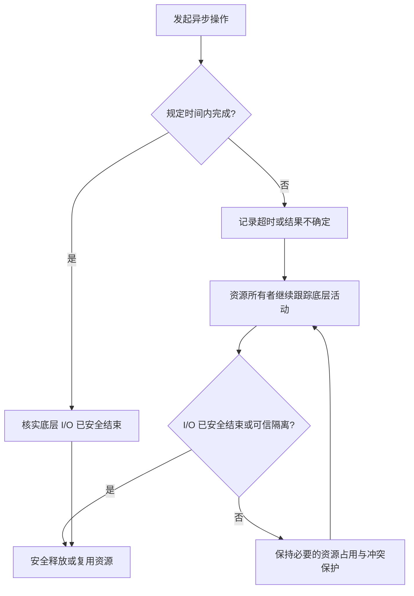
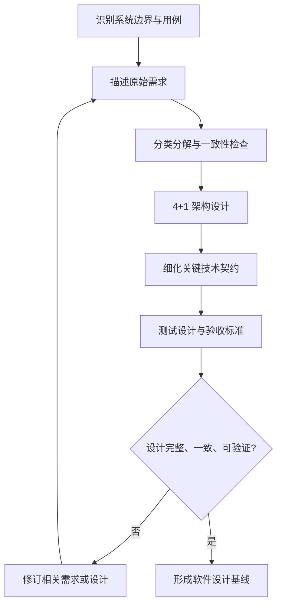
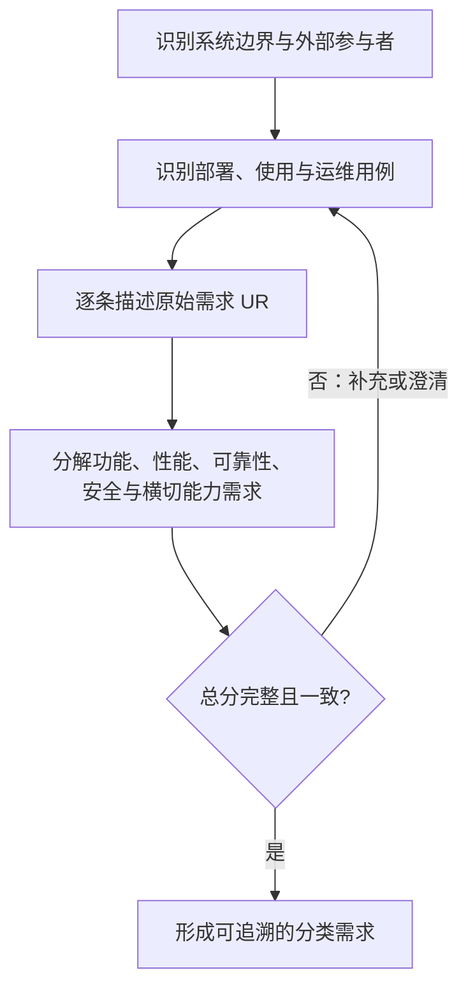
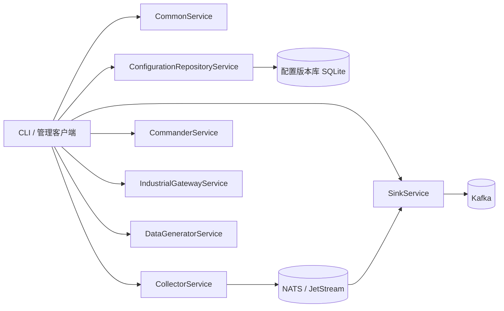

<h1 class="title">Contracts 软件设计</h1>

<p class="subtitle">v1_40 · 20261119 · Storage RPC 接口扩展</p>

<style>
body {
  font-family: "Microsoft YaHei";
  font-size: 16px;
  line-height: 1.75;
  color: #24292f;
}
.title {
  font-family: "Microsoft YaHei";
  font-size: 32px;
  line-height: 1.30;
  font-weight: 700;
  text-align: center;
}
.subtitle {
  font-family: "Microsoft YaHei";
  font-size: 18px;
  line-height: 1.50;
  font-weight: 400;
  text-align: center;
}
h1 {
  font-family: "Microsoft YaHei";
  font-size: 28px;
  line-height: 1.40;
  font-weight: 700;
}
h2 {
  font-family: "Microsoft YaHei";
  font-size: 22px;
  line-height: 1.40;
  font-weight: 700;
}
h3 {
  font-family: "Microsoft YaHei";
  font-size: 18px;
  line-height: 1.50;
  font-weight: 700;
}
h4 {
  font-family: "Microsoft YaHei";
  font-size: 16px;
  line-height: 1.50;
  font-weight: 700;
}
p, li {
  font-family: "Microsoft YaHei";
  font-size: 16px;
  line-height: 1.75;
}
.figure-caption,
.formula-caption {
  font-family: "Microsoft YaHei";
  font-size: 14px;
  line-height: 1.50;
  font-weight: 600;
  text-align: center;
  margin: 0.65em 0 0.35em 0;
}
.table-caption {
  font-family: "Microsoft YaHei";
  font-size: 13px;
  line-height: 1.40;
  font-weight: 500;
  text-align: center;
  margin: 0.65em 0 0.35em 0;
}
.mermaid,
.mermaid text,
.mermaid .label {
  font-family: "Microsoft YaHei" !important;
  font-size: 14px !important;
  line-height: 1.20;
}
table {
  width: 100%;
  border-collapse: collapse;
  font-family: "Microsoft YaHei";
  font-size: 13px;
  line-height: 1.45;
}
table th,
table th p,
table th li {
  font-family: "Microsoft YaHei";
  font-size: 13px;
  line-height: 1.40;
  font-weight: 600;
}
table td,
table td p,
table td li,
table td strong,
table td b {
  font-family: "Microsoft YaHei";
  font-size: 13px;
  line-height: 1.45;
  font-weight: 400;
}
table th,
table td {
  padding: 0.40em 0.60em;
  vertical-align: top;
}
code, pre {
  font-family: "Cascadia Code";
  font-size: 14px;
  line-height: 1.50;
}
p code, li code, td code {
  color: #24292f;
  background: #f3f4f6;
  padding: 0.08em 0.28em;
  border-radius: 3px;
}
pre {
  color: #c9d1d9;
  background: #0d1117;
  padding: 1em;
  border-radius: 6px;
  overflow-x: auto;
}
pre code {
  color: inherit;
  background: transparent;
  padding: 0;
}
.hljs-comment, .hljs-quote,
.token.comment, .token.prolog, .token.doctype, .token.cdata {
  color: #8b949e;
  font-style: italic;
}
.hljs-keyword, .hljs-selector-tag, .hljs-literal,
.token.keyword, .token.boolean { color: #ff7b72; }
.hljs-string, .hljs-doctag, .hljs-regexp,
.token.string, .token.char, .token.regex { color: #a5d6ff; }
.hljs-number, .token.number { color: #79c0ff; }
.hljs-title, .hljs-function, .token.function { color: #d2a8ff; }
.hljs-title.class_, .hljs-type, .hljs-built_in,
.token.class-name, .token.builtin { color: #ffa657; }
.hljs-variable, .hljs-attr, .hljs-property,
.token.variable, .token.property, .token.attr-name { color: #7ee787; }
.hljs-operator, .hljs-punctuation,
.token.operator, .token.punctuation { color: #c9d1d9; }
</style>

---

## 目录

1. [文档约定](#1-文档约定)
2. [软件设计指导原则与编制方法](#2-软件设计指导原则与编制方法)
3. [范围、现行基线及接口总览](#3-范围现行基线及接口总览)
4. [公共契约 common.proto](#4-公共契约-commonproto)
5. [Collector 采集服务 collector.proto](#5-collector-采集服务-collectorproto)
6. [Commander 控制服务 commander.proto](#6-commander-控制服务-commanderproto)
7. [Sink Service 派发服务 sink_service.proto](#7-sink-service-派发服务-sink_serviceproto)
8. [Industrial Gateway 服务 industrial_gateway.proto](#8-industrial-gateway-服务-industrial_gatewayproto)
9. [Data Generator 服务 data_generator.proto](#9-data-generator-服务-data_generatorproto)
10. [Configuration Repository 新增接口契约](#10-configuration-repository-新增接口契约)
11. [跨契约一致性与演进](#11-跨契约一致性与演进)
12. [测试、生成与验收](#12-测试生成与验收)
13. [Commander 扩展契约补充规则](#13-commander-扩展契约补充规则)
14. [Storage Service RPC 契约](#14-storage-service-rpc-契约)

---

# 1. 文档约定

本章是全文的固定排版与表达规范。文档修订、补充和派生版本均应遵守本章，不再根据个人习惯调整字体、字号、行距、图题、表题、公式或代码样式。

本文开头的 `<style>...</style>` 是 HTML `style` 元素，其中包含内部 CSS 样式表，本文简称为 CSS 样式块。第 1.1～1.4 节规定目标样式；CSS 样式块通过 `h1`、`h2`、`p`、`table`、`th`、`td`、`pre`、`code` 等选择器，将规范应用到 Markdown 渲染后生成的 HTML 元素。

## 1.1 字体约定

<p class="table-caption">表 1-1 文档字体与排版规范</p>

| 文档元素 | 字体 | 字号 | 行间距/行高 | 字重 | 对齐方式 |
|---|---|---:|---:|---:|---|
| 文档标题 | Microsoft YaHei | 32 px | 1.30 | 700 | 居中 |
| 文档副标题 | Microsoft YaHei | 18 px | 1.50 | 400 | 居中 |
| 一级标题 | Microsoft YaHei | 28 px | 1.40 | 700 | 左对齐 |
| 二级标题 | Microsoft YaHei | 22 px | 1.40 | 700 | 左对齐 |
| 三级标题 | Microsoft YaHei | 18 px | 1.50 | 700 | 左对齐 |
| 四级标题 | Microsoft YaHei | 16 px | 1.50 | 700 | 左对齐 |
| 正文 | Microsoft YaHei | 16 px | 1.75 | 400 | 左对齐 |
| 图题 | Microsoft YaHei | 14 px | 1.50 | 600 | 居中 |
| 图内文字 | Microsoft YaHei | 14 px | 1.20 | 400 | 按图形布局 |
| 表题 | Microsoft YaHei | 13 px | 1.40 | 500 | 居中 |
| 表头 | Microsoft YaHei | 13 px | 1.40 | 600 | 左对齐 |
| 表格正文 | Microsoft YaHei | 13 px | 1.45 | 400 | 左对齐 |
| 公式题 | Microsoft YaHei | 14 px | 1.50 | 600 | 居中 |
| 代码文字 | Cascadia Code | 14 px | 1.50 | 400 | 左对齐 |

以上规范已经通过本文开头的 CSS 样式块固定。其中，正文为 `16 px`；表题、表头和表格正文均为 `13 px`。表头字重为 `600`，低于标题字重；表格正文行高为 `1.45`，因此表格在字号、字重和行距上均明显弱于正文。英文业务对象、数据库对象和程序标识符仍按所在文本元素的字号排版，但使用行内代码形式，例如 `Asset`、`Connection`、`task_id`。

## 1.2 绘图约定

1. 上下文图、第 0 层及更深层 DFD、总体流程图和关系流程图统一使用 Mermaid。
2. 每一个 Mermaid 图都必须在 Mermaid 代码块第一行加入初始化配置，统一只设置 `useMaxWidth: true`。初始化配置格式为：

```text
%%{init: {"<Mermaid 图类型配置域>": {"useMaxWidth": true}}}%%
```

其中 `<Mermaid 图类型配置域>` 必须根据实际 Mermaid 图类型替换，不得固定写成 `flowchart`，也不得使用与实际图类型不匹配的配置域。

<p class="table-caption">表 1-2 Mermaid 图类型与初始化配置</p>

| Mermaid 图类型 | 图声明 | 第一行初始化配置 |
|---|---|---|
| Flowchart | `flowchart TB/LR/...` | `%%{init: {"flowchart": {"useMaxWidth": true}}}%%` |
| Sequence Diagram | `sequenceDiagram` | `%%{init: {"sequence": {"useMaxWidth": true}}}%%` |
| State Diagram | `stateDiagram-v2` | `%%{init: {"state": {"useMaxWidth": true}}}%%` |
| Class Diagram | `classDiagram` | `%%{init: {"class": {"useMaxWidth": true}}}%%` |
| ER Diagram | `erDiagram` | `%%{init: {"er": {"useMaxWidth": true}}}%%` |

若后续使用其他 Mermaid 图类型，也必须遵守同一规则：

```text
实际图类型
    ↓
确定该图类型对应的 Mermaid 配置域
    ↓
第一行写入：
%%{init: {"对应配置域": {"useMaxWidth": true}}}%%
```

不得额外加入 `wrap` 等非统一配置；如确有特殊需要，应在对应图的局部设计说明中单独论证。

3. 每张图必须有图编号和图题，编号采用“章节号-本章图序号”，例如“图 7-2”。
4. 图题必须使用普通图题样式，不得使用 Markdown 标题。统一写法为：

```html
<p class="figure-caption">图 1-1 图题</p>
```

## 1.3 公式约定

1. 行内公式使用单美元符号，例如 `$E_1$`。
2. 独立公式使用双美元符号，例如：

```text
$$
\mathrm{Entity}=E_1\land(E_2\lor E_3\lor E_4)\land E_5
$$
```

3. 正式公式不得放入代码块。
4. 不使用 `\[` 与 `\]` 作为公式定界符。
5. 变量下标统一写成 `E_1`、`R_1`；逻辑“与”和“或”统一写成 `\land`、`\lor`。
6. 公式必须使用 LaTeX，不使用普通文本模拟数学符号。
7. 需要编号的公式使用“式（章节号-本章公式序号）”，式题采用普通公式题样式：

```html
<p class="formula-caption">式（8-1）实体判断逻辑</p>
```

### 1.3.1 中文文字与 LaTeX 公式混排和渲染

1. 数学量、指标计算式、分段定义与不等式使用 LaTeX；符号的字体、上下标及几何量/阵列类型遵从规范性参考文献《符号体系.md》。业务字段名使用行内代码表示；数学变量与业务字段之间必须建立明确映射，不能把标量、向量、张量混用。
2. 简短符号可使用行内 `$...$`，完整指标定义、分式、求和、分段函数及多行等式应使用独立的 `$$...$$`；独立公式定界符必须独占一行，公式块前后各留一个空行。不得把独立公式置于 Markdown 表格单元、列表行、HTML 标签内部或围栏代码块中。
3. 中文解释写在公式外的自然段或独立列表项中。数学环境中仅为短标签使用 `\text{...}`；不把长段中文及中文标点塞入公式，不让 `$` 跨越换行或 Markdown 表格列界。
4. 表格单元格仅放简短行内变量或公式；含 `|`、分段、多行、复杂上下标、分式的定义一律移到表格外。若一条规则包含先决条件、数学定义和异常处理，采用“文字定义 → 独立公式 → 文字边界说明”布局。
5. 所有数学符号必须在第一次出现处定义，包括物理/业务含义、类型、单位、取值域、采样或统计时刻；公式运算中单位必须一致，必要时写出秒与毫秒之间的换算。
6. 必须在最终 Markdown 渲染器中检查中文与行内公式、独立公式与列表边界、下标、上下标、百分位、分式、转义字符和 Mermaid/HTML 混排。静态代码围栏检查不能替代实际渲染验收。若渲染器不支持某类语法，应先调整表达方式，不得以不可渲染公式交付。

## 1.4 代码约定

1. 多行代码必须使用带语言标识的围栏代码块，例如 `python`、`sql`、`json`、`yaml`、`mermaid` 或 `text`。
2. 单个标识符、字段名、命令和短代码使用行内代码，例如 `PRIMARY KEY`、`Connection`。
3. 伪代码必须明确标记为 `text` 或在正文中说明“以下为伪代码”；不得使读者误认为它可以直接运行。
4. 代码块统一使用深色背景，颜色为 `#0D1117`；普通代码文字颜色为 `#C9D1D9`。
5. 语法高亮统一采用表 1-3 的配色。Markdown 渲染器应使用 Highlight.js 或 Prism 可识别的语言标识；渲染器不支持高亮时，至少保留代码背景色和普通代码文字颜色。

<p class="table-caption">表 1-3 代码语法高亮配色</p>

| 语法元素 | 颜色 | 十六进制 |
|---|---|---|
| 代码背景 | 深黑蓝 | `#0D1117` |
| 普通文字、运算符和标点 | 浅灰 | `#C9D1D9` |
| 注释 | 灰色 | `#8B949E` |
| 关键字和布尔值 | 红色 | `#FF7B72` |
| 字符串和正则表达式 | 浅蓝 | `#A5D6FF` |
| 数值 | 蓝色 | `#79C0FF` |
| 函数名 | 紫色 | `#D2A8FF` |
| 类型、类名和内置对象 | 橙色 | `#FFA657` |
| 变量、属性和字段 | 绿色 | `#7EE787` |


---


# 2. 软件设计指导原则与编制方法

本章规定本设计书的编制准则，不是特定系统的内部实现说明，也不要求按传统瀑布流程开发。后续章节必须以需求为依据；非适用事项应注明理由，不机械增加模块或抽象。

### 2.0 规范性参考文献与优先级

本设计书的公式和图形表达必须参考并遵守下列项目规范，引用文件为本设计的规范性依据，而非可选阅读材料：

| 规范文献 | 适用范围 | 强制规则 |
|---|---|---|
| 《符号体系.md》（v1_1） | 数学公式、标量、矢量、矩阵、张量、时间导数等 | 同一物理或数学量必须保持符号和对象层级一致，不得因编码便利擅自换符号；统计标量可新增本文件局部符号，但须显式定义、不与既有符号冲突 |
| 《软件系统建模图形与表达规范.md》（v0_2） | 业务流程、算法流程、DFD、状态、时序、伪代码、图题及图形语义 | 按建模目的选图；流程图区分过程、判断、输入输出、子过程与存储；数据流与控制流不得混用；Mermaid 初始化及图题遵循对应条款 |
| “项目对外接口定义”、“项目专用接口定义”、“项目数据契约” | 对外 RPC 和采样数据契约 | 实际字段、枚举、消息结构以代码库当前已冻结契约为准，不在需求书臆造字段或新接口 |

规范发生冲突时：实际对外数据契约按已冻结 Contract 执行；符号记法遵从《符号体系》；绘图遵从《软件系统建模图形与表达规范》；本章补充具体业务编制与验收口径。若仍存在冲突，应明确列出待决差异而不能暗中选取一种表述。

## 2.1 总则

本节规定软件设计书的编制原则、设计深度和工作流程。软件设计以需求为依据，以架构视图组织设计内容，以明确的行为与接口契约约束实现，并通过测试与验收验证设计目标。优先采用简单、安全、高效的方案，避免无依据的功能扩展和过度设计。

### 2.1.1 需求驱动原则

软件设计必须来源于已确认的需求，不应从技术方案反向编造需求。

<p class="table-caption">表 2-1 需求驱动设计要求</p>

| 设计要求 | 具体规定 |
|---|---|
| 需求依据 | 关键功能、技术机制和质量约束应能够追溯至需求 |
| 设计范围 | 不擅自增加功能或扩大系统职责 |
| 需求分解 | 原始需求与分类需求保持完整、一致 |
| 设计取舍 | 同样满足需求时，优先选择职责更少、依赖更少的方案 |
| 需求变更 | 新增或改变系统行为时，先核对需求，再修订相关设计 |

### 2.1.2 职责与边界明确原则

系统及组件必须具有清晰的职责、依赖方向和状态所有权。

<p class="table-caption">表 2-2 职责与边界设计要求</p>

| 设计要求 | 具体规定 |
|---|---|
| 系统边界 | 明确本系统负责什么、不负责什么 |
| 组件职责 | 重要职责有明确的负责组件，避免重复承担 |
| 状态所有权 | 关键状态具有明确的权威来源和修改责任 |
| 接口边界 | 区分内部接口、对外接口与外部依赖 |
| 依赖控制 | 避免循环依赖和不必要的跨层访问 |
| 简单性 | 不因假设性的扩展需要增加抽象、兼容层或冗余实现 |

### 2.1.3 行为与契约确定原则

设计应消除影响正确性的重要歧义，但不规定无关的私有方法。

<p class="table-caption">表 2-3 行为与契约设计要求</p>

| 设计对象 | 必须明确的内容 |
|---|---|
| 业务操作 | 触发条件、输入、反馈、业务输出及处理规则 |
| 接口 | 参数、类型、返回值、错误、超时及版本语义 |
| 状态 | 状态定义、转换条件、终态与非法转换 |
| 数据 | 数据结构、约束、所有权、一致性与生命周期 |
| 并发操作 | 执行顺序、同步条件、互斥范围与竞争裁决 |
| 异常操作 | 失败条件、处理结果、恢复行为及禁止行为 |

同一契约应有唯一的规范定义位置，其他章节通过引用关联，不重复规定矛盾规则。

### 2.1.4 资源与异步操作安全原则

异步操作的业务结果、底层执行活动和资源生命周期必须分别判断。

<p class="table-caption">表 2-4 异步操作与资源管理原则</p>

| 概念 | 定义及设计要求 |
|---|---|
| 操作逻辑终结 | 业务层已形成最终处理结果，不代表底层活动已经结束 |
| 底层 I/O 安全结束 | 有可信证据表明相关 I/O 不再继续执行或产生新的相关资源访问 |
| 安全隔离 | 通过可验证措施，使未结束操作无法与后续操作发生有害冲突 |
| 资源所有权 | 明确谁创建、持有、跟踪和释放资源 |
| 资源安全释放 | 满足安全结束或可信隔离条件后，才允许释放或复用可能产生冲突的资源 |

核心原则：操作超时不等于底层 I/O 结束；未确认 I/O 安全结束或隔离前，不得释放可能引发冲突操作的执行资源。



<p class="figure-caption">图 2-1 异步操作超时与资源安全释放流程</p>

对异步操作应区分超时、取消、异常和正常结束；不能仅凭调用方返回、Future/Task 取消或连接状态判断底层 I/O 已安全结束。

### 2.1.5 性能与资源有界原则

性能设计围绕明确的负载与质量要求展开，而不是无依据地增加并发或缓存。

<p class="table-caption">表 2-5 性能与资源有界设计要求</p>

| 设计要求 | 具体规定 |
|---|---|
| 负载模型 | 明确请求规模、并发规模、数据量及运行条件 |
| 容量约束 | 队列、线程、Task、连接、缓存及存储资源应有合理边界 |
| 背压 | 资源不足时明确等待、拒绝、丢弃或降级策略及适用条件 |
| 缓存 | 明确缓存用途、权威数据来源、失效与容量策略 |
| 性能指标 | 明确时延、吞吐、资源占用及测量口径 |
| 性能取舍 | 不得以违反正确性、安全性和可靠性约束换取性能 |

### 2.1.6 故障可控与恢复原则

设计应覆盖正常运行及合理预期的异常场景，明确故障影响范围和恢复条件。

<p class="table-caption">表 2-6 故障与恢复设计要求</p>

| 设计要求 | 具体规定 |
|---|---|
| 故障识别 | 明确可能的超时、通信失败、存储失败、任务异常和进程崩溃 |
| 故障隔离 | 限制故障传播，避免无关组件或资源被错误影响 |
| 状态可信 | 不将未知状态解释为确定成功或失败 |
| 重试与恢复 | 明确允许重试的条件，禁止可能产生危险副作用的盲目重试 |
| 持久化恢复 | 规定异常中断后的数据一致性及状态恢复规则 |
| 生命周期 | 明确启动、就绪、运行、关闭和重启期间的异常处理 |
| 失效行为 | 无法恢复时应有明确的降级、阻塞或停止服务条件 |

### 2.1.7 横切能力非侵入式原则

日志、审计、指标、追踪、权限校验等横切能力应与核心业务逻辑分离，优先通过统一的边界组件、装饰器、中间件或独立服务实现，不应将重复的技术处理流程散布在业务代码中。非侵入式不等于隐藏业务约束：凡影响业务准入、执行结果、事务一致性或故障处理的规则，必须在业务契约中明确，并保留必要的显式调用点。

<p class="table-caption">表 2-7 横切能力非侵入式设计要求</p>

| 设计要求 | 具体规定 |
|---|---|
| 职责分离 | 业务组件负责业务规则与状态转换；横切组件负责统一的记录、采集、校验与传输机制 |
| 边界统一 | 在服务入口、应用服务边界、消息发布边界等明确位置接入横切能力，避免各业务分支重复编排 |
| 最小侵入 | 不为记录日志、采集指标或传播追踪上下文而改变业务方法的核心控制流程和返回语义 |
| 审计正确性 | 审计事件的业务含义及产生时机由业务契约定义；持久化、投递、重试等通用机制与业务处理解耦，同时保证要求的一致性 |
| 故障影响 | 明确横切能力故障时的阻断、降级或重试规则；不得默认其失败不会影响业务，也不得默默吞掉必须处理的错误 |
| 可读性与验证 | 业务代码能够直接体现主流程；横切处理可独立测试，端到端测试验证其与业务契约一致 |

不为追求形式上的非侵入而引入复杂框架或过多抽象；简单、清晰的显式边界优先于难以追踪的隐式执行机制。

### 2.1.8 公共能力复用与冗余控制原则

优先使用符合需求的标准库、成熟软件包、现有工具及公共组件；相同且稳定的职责才提炼为公共能力，不重复发明、不为假设性扩展提前设计框架。

<p class="table-caption">表 2-8 公共能力复用与冗余控制要求</p>

| 设计要求 | 具体规定 |
|---|---|
| 复用优先 | 先评估现成组件是否满足功能、安全、性能及维护要求，再决定是否自行实现。 |
| 提炼公共职责 | 多模块存在稳定相同的职责时统一实现；业务规则留在所属业务模块。 |
| 控制依赖 | 核查成熟度、许可证、版本、安全维护及引入成本。 |
| 控制抽象 | 避免仅为减少少量重复而引入复杂框架或多层转发。 |
| 清理冗余 | 统一能力落地后删除重复、废弃和不必要的兼容实现。 |

### 2.1.9 图表表达与设计一致性原则

设计优先使用合适的图形和表格表达结构、流程、时序、状态及约束，图表不能代替必要的精确定义。

<p class="table-caption">表 2-9 图表表达与一致性设计要求</p>

| 设计要求 | 具体规定 |
|---|---|
| 视图完整 | 使用 4+1 架构视图组织系统设计，覆盖适用内容 |
| 图形选择 | 根据表达目的选择结构图、状态图、时序图、活动图等 |
| 图表一致 | 图形、表格和正文不得相互矛盾 |
| 跨章节一致 | 同一接口、状态、参数及资源规则保持一致 |
| 设计深度 | 明确影响系统行为的契约，允许自主选择内部实现细节 |
| 可验证性 | 关键设计要求应能够对应测试条件与验收证据 |

### 2.1.10 软件设计工作流程



<p class="figure-caption">图 2-2 软件设计编制流程</p>

工作流程允许迭代，不要求传统瀑布式阶段。发现缺口或冲突时直接修订相关需求、架构视图或契约，不通过追加覆盖性条款解决。

### 2.1.11 规范性参考文献及项目无关性

本章为跨项目通用设计与编制规范，不得写入具体仓库、服务、业务协议、接口文件路径或项目专有指标。设计正文引用具体项目的源码、配置和协议文件时，应放在相关业务章节或接口/数据契约章节。

- **《符号体系.md》**：数学量类型、变量命名、标量/矢量/矩阵/张量、下标和公式运算的规范性依据。统计业务中的普通标量同样遵守其标量与阵列的区分原则。
- **《软件系统建模图形与表达规范.md》**：业务流程、DFD、活动/状态/时序图、算法图、伪代码和图元语义的规范性依据。

规范性引用以文件标题和相应章节为准，不复制全文；引用之间存在冲突时先识别并修订冲突，不擅自切换符号或重新解释图元。任何设计实例的具体接口名称、消息字段和技术约束均在第三章及后续适当章节给出。

## 2.2 需求体系及描述规范

需求采用“识别用例 → 逐条描述原始需求 → 分类分解 → 总分一致性检查”的方法。用例应从外部使用者及运行场景出发，覆盖适用的部署、启动、正常使用、配置、运维、正常关闭、重启及异常恢复过程；不局限于业务 RPC，也不将内部技术机制机械列为用例。用例识别属于需求分析，第 4 章用例视图负责表达参与者、边界及用例关系。

<p class="table-caption">表 2-10 原始需求描述字段</p>

| 字段 | 描述要求 |
|---|---|
| 编号 | 唯一原始需求标识，例如 `UR-01` |
| 名称 | 准确概括使用者需要的能力或运行场景 |
| 请求方（Requester） | 发起操作的外部系统、服务或接口，如外部客户端、上层服务、进程管理系统；消息和周期自动触发时可以没有直接请求方，标记“不适用” |
| 触发方式（Trigger） | 标明触发类型、事件来源、触发条件及必要的周期或接口；允许多个类型组合，区分外部触发和内部自动步骤 |
| 输入（Input） | 请求方向本系统提供的数据、参数和信息 |
| 反馈（Response） | 本系统返回请求方的确认、状态、结果及错误信息 |
| 目标方（Destination） | 接收本系统业务输出的外部系统、消息中间件或现场设备；没有时标记“不适用” |
| 业务输出（Output） | 本系统发往目标方的数据、消息或控制指令；没有时标记“不适用” |
| 业务流程（Flow） | 用 Mermaid 表达主要控制流程、数据输入/输出及重要异常，已表达的动作不重复 |
| 业务规则（Business Rules） | 补充主流程未精确定义的术语、公式、算法、初始化、阈值和边界；允许文字分条、LaTeX、图、伪代码或表格，不重复业务流程 |
| 关键约束（Constraints） | 性能、可靠性、安全、审计、可观测性、错误信息、缓存、I/O 与背压等可验证的非功能要求 |

反馈与业务输出必须分开：反馈面向请求方，业务输出面向目标方；请求方与目标方可有多个，且请求方断连不必然撤销已接受的业务操作。

### 2.2.1 触发方式分类与标注规则

原始需求必须列出实际适用的触发方式；同一需求可以组合多种触发方式，不能把处理流程中的普通步骤误写成独立触发。触发方式描述“何时、由什么启动”，不预先决定线程、定时器或队列等内部实现。

- **消息触发（Message）**：外部消息到达，例如实时消息或可靠消息；标明消息来源与订阅范围。
- **周期触发（Periodic）**：达到配置周期，例如实时周期输出或变化加周期保底；标明周期来源及生效条件。
- **API 触发（API）**：收到明确的外部接口请求，例如任务启动或配置应用接口；标明接口和调用方。
- **状态触发（State）**：受监控对象的状态发生满足条件的变化，例如外部依赖从不可用恢复可用；标明状态条件，不把普通循环迭代误列为触发。
- **生命周期触发（Lifecycle）**：服务进入启动、关闭、重启或配置生效等阶段；标明阶段及必要前置条件。

周期触发与消息触发可以同时存在：消息到达更新数据，周期到达决定何时输出。若无外部直接请求方，Requester 写“不适用（自动触发）”，但仍须列出消息生产者或状态来源；触发方式不替代 Input、Response 与 Output 的定义。

### 2.2.2 原始需求四节结构与写作原则

各 UR 固定为四节：**基本信息与触发方式、业务流程、业务规则、关键约束**。根据语义选择最清晰的表达形式；文字、公式、图形、伪代码和表格地位平等；**业务流程图已清楚表达的处理不得在后两节复述**。规则和约束必须有唯一规范定义，其他章节仅引用。

1. **基本信息与触发方式**：表格列出 Requester、Trigger、Input、Response、Destination、Output。Trigger 采用第 2.2.1 节分类，明确事件来源、触发条件及周期或 API。
2. **业务流程**：Mermaid Flowchart 或适用的 UML 活动图表达触发入口、主要处理、判断、数据输入输出、重要异常及恢复出口；复杂算法通过“预定义过程”节点指向第三节，不在总流程中堆叠实现细节。
3. **业务规则**：仅描述流程图无法精确表达的算法、公式、阈值、初始化、状态不变量、顺序及边界。允许文字分条定义、算法流程图、DFG、LaTeX 公式、表格或明确标为 `text` 的伪代码；必须说明输入、输出、初始值、边界及终止条件。无额外内容时标注“无额外规则”。
4. **关键约束**：**优先给出定量要求**（带单位、作用范围、测量窗口、默认值或硬上限、验收方法）；不能合理量化的才采用具有明确判定条件的定性要求。**仅放可核验的非功能要求**，按性能与容量、可靠性与恢复、安全与授权、审计、可观测性、错误信息、缓存与有效期、I/O 资源安全、背压与过载分类；无关分类可以省略或说明不适用。约束应给出故障条件、正确结果、测量或验收口径，不得用抽象口号代替。

### 2.2.3 业务图形元素与数据语义

参照《软件系统建模图形与表达规范.md》第 5.1 节 Flowchart、第 7.1 节 DFD 与第 8.1 节算法规范。业务活动图的控制流箭头表示处理顺序，DFD 箭头表示数据流，**两者不得混用**。图中应以不同形状区分处理、判断和数据。

| 元素 | Mermaid 写法 | 语义 |
|---|---|---|
| 开始/结束 | `A([开始/结束])` | 明确入口和完成/失败出口 |
| 处理 Process | `B["更新缓存"]` | 矩形，表达动作而非数据 |
| 判断 Decision | `C{"已过期?"}` | 菱形，分支标明条件 |
| 输入/输出 Data | `D[/"采样消息"/]` | 平行四边形，表达数据输入/输出 |
| 预定义子过程 | `E[["计算统计指标"]]` | 双边矩形，引用业务规则的算法说明 |
| 数据存储 | `F[("最新值缓存")]` | 存储节点；仅在理解读写关系必要时出现 |

不因形式要求增加无意义数据节点。数据来源、存储及复杂数据变换应单独绘制 DFD，避免业务活动图变成混杂的控制/数据流图。Mermaid 第一行初始化配置、图编号和图题仍须符合第一章。

### 2.2.4 业务规则、输出定义与关键约束的具体要求

- **业务规则**：定义与边界条件优先文字分条；涉及数学关系必须使用 LaTeX 独立公式；复杂步骤按需使用 Flowchart/DFG 或伪代码补充。表达形式不限于图和表；精确定义阈值、边界、初始化、更新基准和不可变条件，不复述主流程动作。算法必须能够独立据输入判断预期输出。
- **性能与容量**：优先用定量指标给出负载范围、时延/吞吐口径、并发及资源上限；必须区分设计目标、默认配置、不可突破的资源上限和验收实测值；未确定的阈值不得虚构。
- **可靠性及 I/O**：明确超时、结果不确定、重试、恢复、安全收敛及资源释放条件。调用返回或 Task 取消不代表底层 I/O 已结束。
- **错误信息**：定义错误类别、错误码或结果、对象与关联标识、发生阶段、可检索证据及敏感信息脱敏；禁止把 UNKNOWN 伪装为成功或明确失败。
- **缓存与背压**：规定缓存键、容量、更新/覆盖、过期、丢弃、等待、拒绝、暂停消费及恢复条件；所有超限策略必须可观测。
- **安全与审计**：列出认证、授权、控制边界以及需审计的操作、事件产生时机、关联 ID、可信保存与失败处理；运行日志不能代替审计。
- **可观测性**：指标、统计窗口、状态、事件、更新时间、无数据语义及告警；可结合真实场景验收。

**指标、计算和输出契约完整性（强制）：**凡使用“计算、统计、比较、阈值、状态、错误、容量、返回结果”等词定义业务能力，必须形成封闭的输出集合；不得用“等”“包括但不限于”替代本版本必须实现的清单。每个指标/派生字段至少定义以下内容；其中数学计算不得仅写在表格单元格内，必须另列可渲染的 LaTeX 公式：

| 必填字段 | 内容 |
|---|---|
| 唯一标识、类型和单位 | 与公开接口字段或指标名一致；明示 `counter/gauge/histogram`、计量单位 |
| 统计层级和数据来源 | 系统 / 进程 / 组件 / 任务 / 消费者；事件记录点、分子和分母来源 |
| 计算公式与口径 | 累计/窗口/瞬时，窗口端点、去重规则、事件计数次数、百分位算法 |
| 触发、初始化和重置 | 何时采集/计算、初始值、首个周期、进程重启、配置热更新 |
| 边界与缺失 | 零分母、空样本、UNKNOWN、超时、重复投递、源不可达的值域与 `unavailable` 语义 |
| 输出与验收 | 指标名、采样时间、窗口、可用性表达、配置边界及给定数据可独立验算的实例 |

**示例与可复算性（强制）：**当业务规则涉及多种计数口径、状态转换、时间窗口、边界分支或重试等易混淆情形时，至少给出一个具体输入—处理过程—预期输出的完整算例。算例必须标明初始条件、计量单位、每一步事件及最终结果；若同时存在样本条数、批次数、I/O 尝试次数等不同统计单位，须分别列出，禁止混用。算例应覆盖易误解的边界（例如重试成功仍有失败尝试记录），且结果必须可直接转化为确定性测试断言。算例是对定义的验证，不得取代规范性定义，也不应重复流程图中的全部步骤；涉及计算关系仍按第一章使用 LaTeX。

**数学定义与表达门禁：**业务规则的文字定义应独立成段或分条；涉及计算时，必须在定义后给出独立 LaTeX 公式，逐一释义变量、单位、取值域以及零分母、空样本和无效值。算法图与伪代码是可选的精度增强手段，不得要求所有业务规则使用表格。公式与中文混排遵守第一章 §1.3.1。

**约束定量优先门禁（强制）：**关键约束首先给出数值、单位、统计范围、采样方法、允许误差、测试条件和通过标准；可配置阈值应列出默认值及合法范围。仅当约束本质上无法定量（例如禁止错误 ACK）时，才用可判定的定性约束。不得用“及时、足够、合理、有界、尽可能、低延迟、高可靠”等词代替具体要求；未完成基准测试的数值应标明“设计验收目标，尚未实测”，不得声称达标。

**完备性门禁：**业务规则涉及的状态枚举、错误分类/错误信息字段、缓存容量及淘汰策略、I/O 结果、背压策略、审计与统计输出均应列举封闭集合和边界输入；凡无法根据文档构造确定预期结果的要求，视为需求未完成，不得标记为可编码。参数可以配置，但必须说明合法范围、默认/缺省行为及越界错误；性能数值未经验证时不得伪称已达标。每项约束必须可追溯至可执行的 UC/System 场景。

每项业务规则和关键约束须能由 UC/场景及第 14 章测试追溯；第 5～13 章详述实现契约时应引用 UR，不得另造冲突定义。

统一样式：

```text
### 3.x UR-xx 需求名称
#### 3.x.1 基本信息与触发方式
Requester / Trigger / Input / Response / Destination / Output
#### 3.x.2 业务流程
Mermaid 活动流程图，含重要异常及数据输入输出
#### 3.x.3 业务规则
可用文字、LaTeX、伪代码、图或表格精确定义算法、初始化与边界，不重复流程
#### 3.x.4 关键约束
按性能、可靠性、安全、审计、可观测性、错误、缓存、I/O、背压列可验证要求
```

本节也是第三章及后续章节的强制完整性验收标准。

<p class="table-caption">表 2-11 分类需求体系与描述重点</p>

| 类别 | 核心问题 | 典型要求 |
|---|---|---|
| 功能需求（Functionality） | 系统提供什么行为 | 对外能力、业务流程、业务规则、输入输出与状态反馈 |
| 性能需求（Performance） | 运行速度与资源上限 | 时延、吞吐、并发、调度、公平性、容量、背压、资源消耗、扩展能力 |
| 可靠性需求（Reliability） | 故障时如何保持正确与恢复 | 容错、超时、重试、请求关联、事务、持久化、故障恢复、可用性、未结束操作的资源管理 |
| 安全需求（Safety & Security） | 如何防止危险或非法控制 | 控制权、互锁、失效安全、认证、授权、通信及数据安全 |
| 横切能力（Cross-cutting Concerns） | 如何观测、管理与追责 | 审计（操作证据、可靠投递、完整性、追溯）、日志、指标、追踪、配置、版本、可测试性、可维护性 |



<p class="figure-caption">图 2-3 需求识别、分解与一致性检查流程</p>

分类需求必须从原始需求的输入、反馈、业务输出、规则和约束中推导，不得遗漏、矛盾或未经确认增加能力；多条原始需求的共同约束可以合并，但必须保留来源编号。每条分类需求应给出可核验条件，性能要求还需明确测量口径，不虚构现场阈值。审计应独立于普通日志定义，不得以运行日志代替审计证据。

需求分类与设计专题是不同维度：启动、正常关闭、重启及 Reload 属于跨需求的运行生命周期设计，统一在进程视图展开；相应行为和质量约束分别由原始需求及分类需求追溯。

## 2.3 4+1 架构视图：内涵、外延与表达规范

<p class="table-caption">表 2-12 4+1 架构视图的职责与成果</p>

| 视图 | 关注范围 | 主要成果 | 不应混淆 |
|---|---|---|---|
| 用例视图（+1） | 参与者、系统边界、典型/异常场景 | 系统上下文、用例、业务流程 | 不负责线程调度 |
| 逻辑视图（Logical） | 组件职责、模型、接口、状态规则、依赖 | 组件图、类/数据关系、状态图 | 不等于源码目录树 |
| 进程视图（Process） | 进程、线程、Event Loop、Task、协作、生命周期、同步、并发、资源、背压、缓存、故障恢复 | 运行结构图、任务所有权表、时序/状态/活动图、资源预算 | Task 不等于 OS 线程；图名须区分标准 UML 与示意图 |
| 开发视图（Development） | 软件模块边界、层次、静态依赖、公共契约与复用关系 | 模块图、依赖图、模块职责表 | 不描述真实并发拓扑，也不列现有代码修改清单 |
| 物理视图（Physical/Deployment） | 节点、进程部署、存储、网络、控制权和现场外部依赖 | 部署图、网络/故障域/外部依赖表 | 不是现场设备内部物理结构模型 |

### 2.3.1 用例视图的场景编写规范

用例以参与者的完整业务目标为单位组织，而非以原始需求、RPC 或内部模块为单位逐条改名。一项用例可以关联多项原始需求；一项原始需求也可以由多个业务场景共同覆盖。用例视图回答“在具体业务场景中系统如何工作”，不代替逻辑视图、进程视图和数据设计。

<p class="table-caption">表 2-13 业务场景用例的必备描述要素</p>

| 要素 | 编写规定 |
|---|---|
| 用例身份与目标 | 给出唯一编号、业务场景名称及参与者要达成的可观察目标；名称使用业务活动，不使用内部机制命名 |
| 参与者与触发条件 | 列明实际发起操作的外部角色；内部定时任务、恢复及发布等自动步骤不得虚构外部参与者 |
| 前置条件 | 列明系统就绪、授权、配置或数据存在等必要条件；不得混入未确认的实现假设 |
| 主业务流程 | 以 Mermaid 业务活动图（flowchart）为主要表达，覆盖触发、校验、关键处理、反馈及后置结果；以判断节点表达重要分支，避免大段编号文字复述 |
| 分支与异常流程 | 在活动图中呈现影响业务结果的主要异常出口；罕见或不宜展开的异常在简明说明表中概括，避免为了完整而画出所有技术异常 |
| 后置条件 | 明确成功和失败之后的业务状态、外部可见结果、未完成事项及后续查询方式 |
| 需求追溯 | 标明相关 UR；核对全部 UR 在真实场景中得到覆盖，但不要求 UR 与 UC 一一对应 |

跨用例共享的内部机制（如存储、审计发布和调度）应作为相关业务流程中的自动步骤或支撑行为描述；只有存在独立业务目标时才另立用例。应避免将一串 gRPC 方法名或 CRUD 操作直接当作完整用例，也不得在用例章节展开线程、锁、表结构及类方法等实现细节。

用例的正文采用“一张业务活动图 + 一张简明用例说明表”的表达形式。活动图包含主路径、必要判断以及重要异常分支；图中节点使用业务动作，不展开展示内部类、锁和数据库事务。说明表只填写参与者、业务目标、前置条件、主要异常、后置条件及关联需求。业务分支已在图中完整表达时，不再重复书写大段“主业务流程”和“异常流程”；复杂跨参与者消息时序可在独立小节补充时序图。图题和表题按文档约定独立编号。

进程视图应按四个设计专题组织，而不是按需求类别重复划分：

<p class="table-caption">表 2-14 进程视图的四类设计专题</p>

| 专题 | 必须明确的设计对象 | 推荐表达 |
|---|---|---|
| 运行时结构 | 进程、线程、Event Loop、Task、线程池、组件与资源所有权 | 分层运行结构图、Task 职责表 |
| 运行生命周期（Runtime Lifecycle） | 启动、初始化、就绪、运行、Reload、正常关闭、重启及其阶段转换 | 生命周期状态图、启动/关闭/Reload 时序图 |
| 并发与资源管理 | Task 协作、队列、通知、同步、调度、容量限额、背压、缓存及释放 | 任务协作时序图、资源与背压策略表 |
| 异常与恢复 | 超时、取消、故障隔离、未收敛 I/O、崩溃恢复与降级 | 故障状态图、异常裁决矩阵 |

各专题共享同一运行模型，明确创建者、所有者、同步关系和退出条件；不因分节而重复定义状态或资源。生命周期是进程视图的独立设计专题，不是第六类需求。

图表仅使用其可准确表达的语义：结构关系用 Mermaid Flowchart；行为交互用 Sequence Diagram；状态约束用 State Diagram；条件控制用活动/流程图。图题说明对象、范围及图类型。关键质量属性贯穿各视图，不能只写在单独的“非功能要求”段落。

## 2.4 测试设计方法、组织及验收规范

测试设计以测试层级组织物理目录，以 Marker 描述测试层级、测试专题与运行场景。测试文件名应清楚表达验证对象或行为；测试文件及其标记、验证说明统一登记在测试矩阵中。需求、用例及重要技术契约必须能追溯到实际测试，不为同一目的建立重复测试体系。

<p class="table-caption">表 2-15 测试层级与目录规范</p>

| 层级 Marker | 物理目录 | 验证范围 |
|---|---|---|
| `unit` | `unit/` | 状态转换、业务规则、纯逻辑，无外部服务依赖 |
| `component` | `component/` | 单组件职责及其可控依赖 |
| `integration` | `integration/` | 组件之间及真实外部依赖的接口协作 |
| `system` | `system/` | 独立进程、完整业务场景及端到端行为 |

<p class="table-caption">表 2-16 测试 Marker 与矩阵编制规范</p>

| 事项 | 规范 |
|---|---|
| 层级 Marker | 每项测试必须且仅属于 `unit`、`component`、`integration`、`system` 之一，与目录对应 |
| 专题 Marker | 标识可靠性、安全、性能等验证主题，可与层级及场景 Marker 叠加；无专项主题时可为空 |
| 场景 Marker | 标识并发、超时、恢复、负载、现场等执行条件或情境；有相应场景时标记 |
| 测试矩阵 | 至少包含“测试文件名、层级 Marker、专题 Marker、场景 Marker、测试说明”五列；每项重要测试应有可定位的文件归属 |
| 标记粒度 | 标记以具体测试函数或类为准；同文件可包含不同专题与场景，矩阵列出涉及的 Marker |
| 运行条件 | 通过 Fixture 和环境准备明确外部依赖；现场专用测试与常规回归分离，未执行不视为通过 |
| 执行规则 | 提供按目录、Marker 及其布尔组合的 pytest 命令；所有 Marker 在项目配置中注册 |
| 可追溯性 | 测试说明与需求、用例或技术契约对应；行为变更时同步检查测试及矩阵 |
| 验收证据 | 保留运行环境、命令、实际结果、指标和未验证项，禁止把设计目标当作测试结果 |

目录划分测试层级，专题与场景通过 Marker 横向组合；可靠性测试不单独设第五类目录。测试矩阵用于定位和筛选测试，不预设每个实现文件必须存在，也不要求每个文件仅能有一种测试场景。

### 2.4.1 测试依据及 System 覆盖要求

各层级测试必须依据已确认的设计成果编制；System Test 以用例视图为主基线，以原始需求及技术契约补充覆盖，不得由测试人员凭经验任意缩减范围。

<p class="table-caption">表 2-17 各测试层级的设计依据</p>

| 测试层级 | 主要依据 | 验证重点 |
|---|---|---|
| Unit | 详细设计、函数及算法契约 | 纯逻辑、状态转换、参数及边界规则 |
| Component | 逻辑视图、组件职责及内部接口契约 | 单组件行为、依赖协作及异常处理 |
| Integration | 接口与通信契约、开发视图、物理视图 | 真实接口调用、跨组件通信及外部依赖 |
| **System** | **用例视图（UC）及原始需求（UR）**，并补充接口、运行、部署、安全及性能约束 | **从真实受测服务进程及其通信入口验证业务目标、异常、边界与恢复行为** |

System Test 必须遵守以下规定：

1. **用例覆盖率 100%**：每项 UC 至少有一项 System Test 作为验证证据；同一测试可以覆盖多个 UC，同一 UC 可以由多个测试覆盖，**不按测试数量与 UC 数量的大小关系判定覆盖**。
2. **规定场景覆盖率 100%**：每项 UC 明确的主流程、关键分支、异常流程、边界和恢复场景均必须有对应 System Test；不能仅以一条正常路径代表整个 UC 已覆盖。
3. **需求覆盖率 100%**：每项 UR 必须能够经一个或多个 UC 追溯至 System Test；若某项需求未能被 UC 覆盖，必须先补全用例，不得直接以技术测试代替业务用例。
4. **技术约束补充覆盖**：用例未充分表达的性能、容量、并发、安全、权限、超时和可靠性要求，依据对应技术契约补充测试；不得因 UC 未逐项列出而豁免。
5. **真实系统边界**：System Test 通过真实受测服务进程和适用的外部依赖、通信链路执行；Mock 不得代替本次明确纳入验收范围的基础设施及通信链路。
6. **覆盖与通过分开裁定**：测试已关联不等于已执行；失败、跳过及未运行均不得计为通过。验收报告分别给出需求覆盖、用例及场景覆盖、执行情况和通过情况；缺少真实环境时标记 `NOT_RUN`，不得用模拟结果替代。
7. **变更同步**：任何 UR、UC、接口或行为约束的新增、删除、调整，必须同步核查 System Test、测试矩阵和验收条款；新增 UC 不得留下无测试映射。

<p class="table-caption">表 2-18 System Test 追溯矩阵规范</p>

| 字段 | 要求 |
|---|---|
| UR 编号 | 被验证的原始需求编号，可列多个 |
| UC 编号与场景 | 用例编号及主流程、异常、边界或恢复场景标识 |
| 技术契约 | 相关接口、配置、运行或安全约束的章节编号；没有则记“—” |
| 测试文件名／测试标识 | 可定位的 System Test 文件名及测试函数或参数化场景标识 |
| 层级／专题／场景 Marker | 层级固定为 `system`，其余按第 2.4 节定义填写 |
| 验证内容与预期结果 | 从用户可观察行为与副作用表述判定依据 |
| 执行环境及结果 | 真实依赖、执行证据、`PASS`／`FAIL`／`SKIP`／`NOT_RUN` 等状态 |

追溯链为 **UR → UC／用例场景 → System Test → 执行结果与证据**，技术契约作为补充依据进入相应测试。第 4 章负责编制完整 UC 和场景，第 14 章依据本规范给出实际测试矩阵及验收安排，两章必须双向核对。

# 3. 范围、现行基线及接口总览

## 3.1 契约权威与目标状态

- **代码基线**：`luoshaozhuo/wind-hub`，`fix/native-process-e2e-20261116@44d41aa90564a0efe0f86ce795b9b26bab171dbc`；该提交已通过仓库接口核对。
- **契约范围**：正式 Repository Proto 已包含全局候选、发布与读取接口；新增模块修订通知 RPC 的消息及方法仍需在 `common.proto` 定义并生成代码。
- **已发布契约**：`src/contracts/common.proto`、`collector.proto`、`commander.proto`、`sink_service.proto`、`industrial_gateway.proto`、`data_generator.proto`，总计 51 个 RPC（Common 9 + Collector 11 + Commander 8 + Sink 4 + Gateway 10 + Data Generator 9）。
- **新增目标契约**：`src/contracts/configuration_repository.proto` 已手写定义 `ConfigurationRepositoryService` 的 12 个 RPC，并纳入 `scripts/generate_rpc.py`。Protobuf/gRPC Python 绑定尚待线下生成；服务端尚未实现，不能标记为运行通过。
- `src/contracts/sample_batch.py::SampleBatch(schema_version=2)` 属 Collector/Sink NATS 批量采样线协议，不计入上述 gRPC RPC 数；Sink→Kafka 输出另有 `schema_version=1` JSON 格式，也不是配置或点表版本号。

## 3.2 契约边界



<p class="figure-caption">图 3-1 合同接口的主要调用与数据边界</p>

Contracts 只规定外部可观察的消息、类型、字段、RPC、状态、版本和安全语义；各业务模块负责实现。Configuration Service 作为**全系统配置库**，存储所有共享与应用专属配置；CLI 负责配置发布后的生效协调，Configuration Service 不向各业务进程主动下发或应用配置。Configuration Service 自身使用独立 Service YAML 引导配置，避免自依赖。

## 3.3 版本与编译准则

`package` 名、RPC 名、字段号一经发布不可任意重用；已发布原有字段号不可重排。新增业务服务采用独立 `.proto`，不得侵入 `common.proto` 添加针对某一业务模块的专属字段。生成 `*_pb2.py`、`*_pb2_grpc.py` 及类型存根必须与 Proto 精确一致。此设计中的目标接口须经过编码、Descriptor 和系统验收后才转为“已发布”。

# 4. 公共契约 common.proto

## 4.1 服务定义（已发布）

`package windhub.common.v1`；任一实现 CommonService 的业务模块应提供以下 **9** 个 RPC。

| RPC | 请求 → 响应 | 输入字段与关键规则 | 输出字段与含义 |
|---|---|---|---|
| `GetServiceInfo` | `Empty → GetServiceInfoResponse` | 无 | `service_id`, `process_role`, `software_version`, `contract_version`, `started_at` |
| `GetServiceStatus` | `Empty → GetServiceStatusResponse` | 无 | `health`, `dependencies[] {name,health,detail}`, `observed_at` |
| `GetCapabilities` | `Empty → GetCapabilitiesResponse` | 无 | `rpc_names[]`, `protocols[]`, `features[]`；只宣布已实现能力 |
| `GetConfigSnapshot` | `GetConfigSnapshotRequest → GetConfigSnapshotResponse` | `scope`=DISK/RUNTIME/CANDIDATE，`candidate_id` 对候选必填 | `snapshot_id`, `revision`, `files[]`, `validation[]`, `application_id`, `apply_results[]`, `last_error` |
| `PushConfigSnapshot` | `PushConfigSnapshotRequest → PushConfigSnapshotResponse` | `files[] {relative_path,content,size_bytes,sha256}`, `expected_revision` | `candidate_id`, `valid`, `validation[]`, `base_revision` |
| `ApplyConfigSnapshot` | `ApplyConfigSnapshotRequest → ApplyConfigSnapshotResponse` | `candidate_id`, `expected_revision` | `file_commit`, `apply_results[]`, `effective_revision`, `restart_required`, `application_id` |
| `GetMetrics` | `GetMetricsRequest → GetMetricsResponse` | `scope`, `window_ms` | `metrics[] {name,value,unit,window_ms,sampled_at}` |
| `GetEvents` | `GetEventsRequest → GetEventsResponse` | `from_time`, `to_time`, `filter`, `page_size`, `page_token` | `events[] {event_id,timestamp,severity,source,error_code,message}`, `next_page_token` |
| `Diagnose` | `DiagnoseRequest → DiagnoseResponse` | `target_id`, `stages[]`, `timeout_ms`, `correlation_id` | `overall_status`, `stages[]`, `limitations[]` |

## 4.2 基础消息与 presence

`ScalarValue.oneof kind` 包含 `bool_value`、`sint64_value`、`uint64_value`、`double_value`、`string_value`、`bytes_value`；必须检查 `WhichOneof`，不得把缺失视为数值零。`PointMetadata` 字段：`point_id`、`data_type`、`unit`、`readable`、`writable`、`address[]`、`minimum`、`maximum`、`revision`；`minimum`、`maximum` 为 `optional double`。`Sample` 为 `point_id`、可选 `value`、`quality`、`sample_timestamp`、`queried_at`、`freshness`、`error_code`、`error_message`。`OperationRequest` 含 `id`/`expected_revision`，`OperationResult` 含 `operation_id`、`accepted`、期望/实际状态、修订及错误。

`SnapshotScope` 的有效业务值为 DISK/RUNTIME/CANDIDATE；UNSPECIFIED 不得被悄悄解释为其中一种。`SnapshotFile.content` 为原始字节，校验 `size_bytes`/`sha256`；`ValidationIssue` 返回精确 `path/code/message`；应用结果按对象分项，不可将“文件提交”混同“应用成功”。时间统一 `google.protobuf.Timestamp`。`GetServiceStatus.health` 是业务健康，不等于进程存活；依赖不可用必须准确反映。

## 4.3 与配置库专用契约的区别

CommonService 的三个配置 RPC **只管理当前服务自身的配置快照、候选提交和生效**。`ConfigurationRepositoryService` 的上传/发布则管理全局配置版本库，**不执行任何业务模块的配置生效**。两种 `revision` 分属不同作用域，不得混淆。配置库自身的本地引导 YAML 由 CommonService 管理，其它所有应用配置由配置库存储并通过专用 RPC 获取。

# 5. Collector 采集服务 collector.proto

## 5.1 接口及完整输入输出

`package windhub.collector.v1`；已发布 11 RPC。

| RPC | 输入 | 输出及不可省略语义 |
|---|---|---|
| `ListDevices` | `filter,page_size,page_token` | `devices[] {device_id,protocol,endpoint,task_id,actual_state,revision}`, `next_page_token` |
| `GetDevice` | `device_id` | `Device`；不存在 NOT_FOUND |
| `ListPoints` | `device_id,filter,page_size,page_token` | `PointMetadata[]`, `next_page_token` |
| `GetPoint` | `device_id,point_id` | `PointMetadata`；精确设备/点身份 |
| `ReadPoints` | `device_id,point_ids[],timeout_ms` | `device_id,samples[],queried_at`；各点失败独立报告 |
| `ListTasks` | `filter,page_size,page_token` | `tasks[] {task_id,device_id,desired_state,actual_state,revision,last_error}`, `next_page_token` |
| `GetTask` | `ObjectId.id` | `Task` |
| `StartTask` | `OperationRequest.id,expected_revision` | `OperationResult`，接受与实际运行分离 |
| `StopTask` | 同上 | `OperationResult`，安全停止与已停状态有别 |
| `GetPublishingStatus` | `channel` | `channels[] {channel,nats_connected,published,failed,backpressure,last_error}` |
| `InterrogateDevice` | `device_id,optional common_address,timeout_ms` | `status,samples[],missing_point_ids[],error_code,error_message` |

## 5.2 数据边界

Collector 负责协议数据采集及向 NATS/JetStream 发布，不负责 Sink Delivery、TDengine 入库或历史查询。`ReadPoints` 是请求时主动读取，`InterrogateDevice` 为协议总召/查询，不应混同订阅缓存。采样 `quality`、时间、缺值 presence 不得丢失；设备/点标识和单位解释必须引用已验证的有效点表。NATS 批量消息采用 `SampleBatch`（见 §11.4），Sink 不得把传输批 ID 当作业务变量 ID。

# 6. Commander 控制服务 commander.proto

## 6.1 RPC 全量定义

`package windhub.commander.v1`；已发布 8 RPC。

| RPC | 关键输入 | 关键输出 |
|---|---|---|
| `ListDevices` | `filter,page_size,page_token` | `devices[] {device_id,protocol,endpoint,revision,availability}`, `next_page_token` |
| `GetDevice` | `ObjectId.id` | `Device` |
| `ListPoints` | `device_id,page_size,page_token` | `PointMetadata[]`, `next_page_token` |
| `SubmitCommand` | `device_id,point_id,ScalarValue value,expires_at,expected_revision,request_id` | `command_id,accepted,state,outcome,error_code,message,request_id` |
| `SubmitCommands` | `request_id,commands[] {device_id,point_id,value,expires_at,expected_revision}` | `request_id,accepted,command_ids[],state,error_code,message` |
| `GetCommandResult` | `command_id` | `command_id,state,outcome,error_code,message,device_id,point_id,updated_at,io_settled` |
| `GetRequestResult` | `request_id` | `request_id,state,commands[],updated_at,io_settled` |
| `RecoverDeviceControl` | `device_id,expected_revision,request_id,isolation_attestation` | `device_id,state,decision_id,evidence_digest` |

## 6.2 安全、超时及结果语义

`request_id` 必填，幂等键作用域包含认证调用者和服务实例；同键不同内容必须冲突拒绝。`SubmitCommands` 接受阶段原子性与逐项物理执行结果独立；`command_ids` 顺序须匹配请求顺序。超时不证明设备执行失败，也不证明 I/O 收敛；`io_settled=false` 时不得释放可能导致同设备操作冲突的资源。设备恢复要求外部独立可信隔离证据，未认证、失效、冲突或过期证明均 fail-closed。`GetRequestResult` 不能越过调用者的权限查询其他调用者请求。详细聚合与 UNKNOWN 规则见 §13。

# 7. Sink Service 派发服务 sink_service.proto

`package windhub.sink.v1`；已发布 4 RPC。

| RPC | 输入 | 输出 |
|---|---|---|
| `ListDeliveries` | `channel,page_size,page_token` | `deliveries[]`, `next_page_token` |
| `GetDelivery` | `ObjectId.id` | `Delivery` |
| `StartDelivery` | `OperationRequest.id,expected_revision` | `OperationResult` |
| `StopDelivery` | `OperationRequest.id,expected_revision` | `OperationResult` |

`Delivery` 包含 `delivery_id,channel,sink_id,process_role,desired_state,actual_state,revision,last_error,config[]`；`config[]` 为 `AddressField` 列表，不应回显口令或证书私钥。支持的可靠输出目标为 Kafka，实时目标为 Redis、Modbus TCP、Industrial Gateway；不能将 Kafka 作为实时通道或把 TDengine 存储语义塞入 Sink。Storage Service 另行消费 Kafka。启动/停止 RPC 的逻辑接受不等于进程实际完成；状态、错误、关闭在途 I/O 必须可观察。

# 8. Industrial Gateway 服务 industrial_gateway.proto

`package windhub.gateway.v1`；已发布 10 RPC。

| RPC | 关键输入 | 关键输出 |
|---|---|---|
| `ListGateways` | `filter,page_size,page_token` | `gateways[] {gateway_id,endpoint,mapping_summary,desired_state,actual_state,revision,last_error}`, page token |
| `GetGateway` | `ObjectId.id` | `Gateway` |
| `StartGateway` | `OperationRequest` | `OperationResult` |
| `StopGateway` | `OperationRequest` | `OperationResult` |
| `ListVariables` | `gateway_id,filter,page_size,page_token` | `variables[] {variable_id,name,data_type,readable,writable,address[]}`, page token |
| `ReadVariables` | `gateway_id,variable_ids[]` | `gateway_id,values[] Sample` |
| `UpdateVariables` | `gateway_id,values[] {variable_id,ScalarValue value},lease_token` | `results[] {variable_id,success,error_code,message}` |
| `ClaimTargets` | `gateway_id,owner_id,variable_ids[],action,lease_token,lease_ms` | `accepted,lease_token,error_code,message` |
| `ExecuteSimulationCommand` | `gateway_id,device_id,point_id,value,request_id,expected_revision,expires_at` | `request_id,accepted,execution_id,state,error_code,message,effective_step` |
| `GetSimulationExecutionResult` | `gateway_id,request_id` | `SimulationCommandResponse` |

`ClaimTargets` 的 ACQUIRE 原子占用目标集合；RENEW/RELEASE 要求原始 token 与 owner 完全匹配。过期/旧租约不能继续写入。`UpdateVariables` 仅更新 Gateway 自有变量值，非现场控制指令；单项失败不撤回其他成功项。仿真控制仅经 Commander 授权链进入 `ExecuteSimulationCommand`，不可将 `UpdateVariables` 当作旁路。

# 9. Data Generator 服务 data_generator.proto

`package windhub.data_generator.v1`；已发布 9 RPC。

| RPC | 关键输入 | 关键输出 |
|---|---|---|
| `ListDevices` | `filter,page_size,page_token` | `devices[] {device_id,protocol,endpoint,generation_id,actual_state}`, page token |
| `GetDevice` | `ObjectId.id` | `Device` |
| `ListScenarios` | `page_size,page_token` | `scenarios[] {scenario_id,active_version,available_versions[],device_ids[],description}`, page token |
| `GetGeneration` | `ObjectId.id` | `Generation` |
| `StartGeneration` | `scenario_id,optional scenario_version,expected_revision` | `generation_id,accepted,actual_state,error_code,message` |
| `StopGeneration` | `generation_id,expected_revision` | `accepted,actual_state,error_code,message` |
| `ListVariables` | `generation_id,device_id,page_size,page_token` | `variables[] ModelVariable,next_page_token,point_table_version,generation_state` |
| `UpdateVariables` | `generation_id,device_id,request_id,values[] {point_id,value}` | `accepted,effective_step,error_code,message,request_id` |
| `GetInputExecution` | `generation_id,request_id` | `request_id,state,effective_step` |

`ModelVariable` 包含 `point_id,business_point_id,data_type,unit,role,writable,optional minimum/maximum,description,source`。`source=POINT_TABLE` 对设备点表生效；独立 `WEATHER_INPUT` 的 `business_point_id` 可为空，不能错误继承点表版本。`point_table_version` 表示设备当前点表版本而非天气 Schema 版本。`UpdateVariables` 必须拒绝非输入、不可写、重复、越界及非法值；合法输入依 `effective_step` 在模拟时间步生效，`GetInputExecution` 返回 PENDING/APPLIED/UNKNOWN 证据；不通过响应确认替代实际物理步执行。

# 10. Configuration Repository 新增接口契约

### 配置身份、发布及活动版本（最终契约）
- **不可变配置身份**：`config_type + config_id + file_version`；`schema_version` 为结构版本，`file_version` 为内容版本；同身份同版本的字节及依赖不可改写。Deployment 文件本身也应有唯一不可变身份、`file_version`、`schema_version`。
- **Service 的实例引用**：`config_sources.instances.<role>: <config_id>`；角色只用于服务业务解析，不形成 Template 直接引用。Deployment 的 `instances` 选择应按 `config_type/config_id` 作为复合键，不因文件路径和目录扫描选择版本。多个 Service 可以依赖同一实例；相同逻辑身份在一个部署修订内仅对应一个版本。
- **Deployment**：包含 `deployment_id`、`services` 的 Service ID/版本映射和 `instances` 的类型/ID/版本映射；由 CLI 一次完整目录发布，Repository 校验后在同一原子提交中将该部署的活动选择指针改为所发布清单。不存在单独二次激活操作和逐模块通知调用；只发布未被清单引用的 Template/Instance 文件不会使运行实例变更。多个部署域互不干扰。
- **有效闭包**：以 `deployment_id + service_id` 查询 Deployment 选定的 Service、其直接 Instance、Instance 的固定 Template 依赖以及任何被固定引用的单位/业务点。统一按确定性路径顺序计算闭包摘要；全局仓库修订只作为查询/事件游标，不得与服务有效闭包的状态字段混淆。
- **target_revision / active_revision**：两者类型与算法相同，均为服务有效闭包的确定性摘要（推荐 SHA-256 十六进制），而不是 repository 的 `revision_id` 或单独 YAML 的 `file_version`。成功热更新或重启并完整应用目标后两者相等；部分应用保持旧的 active_revision，同时报告可用的逐资源诊断信息。服务停机不宣称处于活动状态。
- **更新策略**：配置快照先完整获取、校验、持久缓存；Service 判断热更与静态字段。一个不允许混用的依赖单元应原子替换或整体延期，不能把新的 PointTable 与旧控制映射拼接。广播丢失由启动/重连/周期查询补偿；重复、乱序通知不得回退到旧目标。
- **启动与回退**：重启按 Deployment 最新目标解析，失败时不报告 READY；可回滚 Deployment 至旧不可变版本（仍经过正常全量发布/CAS）。禁止默认用最新推荐版本代替引用丢失。

### Proto 实施决策
**冻结的目标 RPC**：`GetServiceConfigBundle(GetServiceConfigBundleRequest) returns (GetServiceConfigBundleResponse)`；Request 必填 `deployment_id:string`、`service_id:string`，可选 `revision_id:uint64`（查询已提交仓库修订视图）；Response 包含 `repository_revision_id:uint64`、`target_revision:string`、`manifest_sha256:string`、`files:repeated ConfigYamlDocument`。`files` 包含选定 Service、直接 Instances 和完整固定 Template 闭包，每项保留现有 `ConfigYamlDocument` 的哈希及身份字段。未指定 revision 时读取权威当前已激活 Deployment 选择；不存在部署/服务/实例版本、依赖不全、引用歧义或哈希冲突必须返回明确 gRPC 错误。新 RPC 不负责应用、不返回 active_revision；该字段由对应 Service 的配置状态 RPC 报告。完整目录中 Deployment 的 Schema 与版本准入由 Configuration 实现。
`configuration_repository.proto` 应增加按 `deployment_id + service_id` 返回目标 `GetServiceConfigBundle`（名称待 Proto 命名检查）的查询，返回目标闭包摘要、对应仓库修订、Service/Instance/Template YAML 文档与每个文档的摘要；`PublishCandidate` 保持唯一事务提交点，Deployment 是上传目录的一种受管配置类型，不增加 `Activate`。`GetCurrentRevision` 仅为全局事件游标。业务服务状态的 `target_revision`、`active_revision` 应归 `common.proto` 公共字段；如果现有字段名称不同，应在全局调用方迁移时清理旧字段并重新生成 pb2/pyi，维护字段号向后兼容边界，不重新分配已占用编号。


### 2026-11-21 统一配置契约（规范性修订）
旧版 Service 直接声明模板目录、固定版本 Instance 路径以及推荐版本自动切换的描述均废止；编码阶段应同步清理旧字段和调用方。
1. 配置依赖为 Service → Instances → Templates。Service 仅引用 Instance 逻辑身份、不引用 Template；Instance 固定引用不可变 Template ID 和版本；禁止 latest 漂移引用。
2. CLI 继续全量发布；Configuration 保存不可变版本、部署选择与全局发布修订。Deployment 依据部署域明确选择 Service/Instance 的版本；发布新版本不自动激活。
3. Deployment 修改采用 CAS、request_id 幂等和闭包校验。Service 启动、收到广播及周期对账时读取自己的目标配置和固定模板闭包，验证内容摘要。离线 Service 不阻断其他服务。
4. Service 自行决定热更新或等待重启；相关配置按照一致性单元切换，失败保留可用配置。回滚仅调整 Deployment 指向的已有版本。
5. 状态报告 target_revision 和 active_revision，二者表示服务的完整有效闭包而非单独 Service 文件版本。部分热更新不能报告完全收敛，无关模块修改不能引起虚假不一致。
6. Configuration 自身引导配置本地独立，避免自引用循环。

Deployment 版本选择与服务闭包查询接口归 src/contracts/configuration_repository.proto，Configuration 实现。复用现有候选发布、修订查询与 bundle 能力；必要的新增 RPC 应规定 CAS、request_id、部署身份、闭包哈希及错误。服务状态两个修订字段归共享 Contracts，不另设激活 RPC。


## 10.1 状态与权威来源

本章定义的目标契约已写入 `src/contracts/configuration_repository.proto`，其 `package` 为 `windhub.configuration.v1`，`service` 为 `ConfigurationRepositoryService`。现有六份 Proto 不增加重复业务 RPC；CommonService 9 RPC 仍通过 `common.proto` 实现。**当前已有 Proto 源文件，但尚未生成绑定和实现服务端**，不得作为已实现能力报告。Configuration Service 只提供全系统配置存储、版本、查询、统计与备份；Configuration 在 SQLite 提交后通过 NATS Core 广播修订提示，服务不逐个协调业务模块生效。所有配置（包含各应用 Service 配置）均入库，只有 Configuration Service 自身的引导配置采用本地 YAML。

## 10.2 统一命名与消息结构

| 类型/字段 | 建议类型 | 必填与约束 | 语义 |
|---|---|---|---|
| `ConfigId` | `{config_type:string, config_id:string}` | 两字段非空且规范化 | 唯一配置文档身份，不以文件名作为身份 |
| `VersionId` | `string` | 非空，服务端产生 | 配置版本不可变内部身份 |
| `file_version` | `string` | `MAJOR.MINOR.PATCH` | 配置业务版本；由发布方提供并验证 |
| `schema_version` | `uint32` | 大于零 | YAML 结构版本；与 SQLite DB Schema 版本不同 |
| `revision_id` | `uint64` | 精确历史修订，0 仅用作空库 CAS 基线，读接口必须用 presence 指定当前 | 全局已发布快照修订 |
| `expected_revision_id` | `optional uint64` | 发布或指针变更必填，允许首次库初始化特例 | compare-and-swap 并发保护 |
| `request_id` | `string` | 写操作必填，重复同内容返回原结果 | 持久化幂等键 |
| `content_sha256` | `string`，固定 64 位小写十六进制 | 读取/发布时必须存在 | 规范化配置对象的语义哈希 |
| `yaml_sha256` | `string`，固定 64 位小写十六进制 | 返回 YAML 时必须存在 | 实际带完整 Header 的 UTF-8 YAML 字节哈希 |
| `yaml_bytes` | `bytes` | UTF-8，有上限 | **唯一**完整 Header + 配置正文格式；没有 `mode` 字段 |
| `page_size` | `uint32` | 1..服务端上限；0 使用配置默认值 | 一页条目数 |
| `page_token` | `string` | 不透明，绑定过滤条件和 revision | 稳定分页 |
| `next_page_token` | `string` | 空表示结束 | 后续页游标 |

时间统一 `google.protobuf.Timestamp`（UTC），数组顺序必须确定性。必须使用 protobuf `optional` 或 `oneof` 区分未提供与值为零；不要以空字符串模糊表达有效/无效值。修改类请求不接受自由 SQL、服务端文件系统路径或明文私钥。客户端仅有读取权限时不得访问候选发布及备份管理接口。

**配置选择器**：`GetConfig` 采用 `oneof selector { version_id; revision_id; }`，不能在同一请求同时传入两套选择依据；`revision_id` 选择该修订下绑定的配置版本。发布操作以 CAS 和版本内容冲突为准，不隐含替换历史版本。

## 10.3 ConfigurationRepositoryService：专用 RPC 定义（目标）

### 10.3.1 `CreateCandidate` — 完整目录候选（复用既有 RPC）

**不新增专用上传 RPC。** 既有 `CreateCandidateRequest` 字段 `request_id=1`、`expected_revision_id=2`、`documents=3`、`validate_only=4` 不变；但其 `documents[]` **仅代表 CLI 指定的 `configs/` 根目录内完整文件集合**，不再表示局部文件增量。

每个 `ConfigDocumentInput` 继续使用 `config_id=1`、`file_name=2`、`yaml_bytes=3`；其中 `file_name` 必须是受控根目录相对 POSIX 路径并稳定排序。服务端依据 YAML 的 `file_version` 验证唯一 `(config_type, config_id, file_version)`，允许同一逻辑对象不同文件版本同时存在；同身份/同版本不同正文禁止发布。每次请求必须携带所有文件而非差异清单，空集合默认拒绝；收到整个 Unary 消息后再按全集校验并创建持久候选，不得部分落库为有效目录。

服务端计算并保存基于 `relative_path/config_id/file_version/yaml_sha256/byte_length` 确定性排序的完整 Manifest 哈希，并执行全文件 Schema、引用、同版本不可变性及容量验证。超出请求大小/文件数限制返回 `RESOURCE_EXHAUSTED`，不隐式截断或分片；**首版不设计分片上传或续传协议**。请求幂等、validate-only 和返回 `issues` 语义保持现有字段号。

### 10.3.2 `PublishCandidate` — 原子发布

**请求**：`candidate_id:string`、`expected_revision_id:optional uint64`、`request_id:string`，均必填。

**响应**：`revision_id:uint64`、`published[]`，每项 `{config_id, version_id, file_version, content_sha256}`；`committed_at:Timestamp`；`already_applied:bool`（仅相同幂等请求重试时为真）。

**语义**：在 SQLite 单事务内验证候选、引用、CAS、版本唯一性，用单个事务替换新的**目录成员全集视图**并发布全局 revision；缺失文件退出当前目录成员视图，历史不可变版本仍保留；同一集合幂等返回原修订。发布成功后 Configuration 异步尝试 NATS Core 广播，不执行各业务模块的 `ApplyConfigSnapshot`。事务失败无部分可见结果。CAS 失败 `ABORTED`；候选不存在 `NOT_FOUND`；重复请求 ID 携带不同内容返回 `ALREADY_EXISTS`。

### 10.3.3 `ListConfigs` — 枚举配置身份

**请求**：可选 `config_type:string`、`config_id_prefix:string`、`module_type:string`、`revision_id:uint64`、`page_size`、`page_token`。

**响应**：`items[]`，每项 `{config_id, recommended_version_id, recommended_file_version, schema_version, content_sha256, deprecated:bool}`；`snapshot_revision_id:uint64`；`next_page_token:string`。

**语义**：游标锁定同一修订和过滤条件，结果按 `(config_type,config_id)` 稳定排序；缺失条目返回空列表，不是 `NOT_FOUND`。

### 10.3.4 `ListConfigVersions` — 历史版本

**请求**：`config_id:ConfigId`（必填）、可选 `include_deprecated:bool`、`page_size`、`page_token`。

**响应**：`versions[]`，每项 `{version_id, file_version, schema_version, content_sha256, created_at, deprecated, referenced_by_count}`；`next_page_token`。

**语义**：按创建序和稳定版本 ID 排序；对象不存在 `NOT_FOUND`，存在但无匹配版本返回空列表。

### 10.3.5 `GetConfig` — 单配置 YAML

**请求**：`config_id:ConfigId`，`oneof selector { version_id:string; revision_id:uint64; }`；均必填或显式有效；**无输出模式字段**。

**响应**：`config_id`、`version_id`、`schema_version`、`file_version`、`revision_id`（当以 revision 查询时必填）、`file_name:string`、`yaml_bytes:bytes`、`content_sha256`、`yaml_sha256`、`schema_ref`（用于追溯 Header 的字段说明 Schema 版本）。

**语义**：YAML 唯一格式为完整 Header + 正文；严格使用目标历史版本及其 Schema；版本未找到 `NOT_FOUND`，历史依赖断裂或重建校验失败 `FAILED_PRECONDITION` 或 `INTERNAL`（依具体故障定性）。

### 10.3.6 `GetConfigBundle` — 同修订配置依赖包

**请求**：`roots[]:ConfigId`（至少一项）、`revision_id:optional uint64`（必须显式提供且大于零）、可选 `include_dependencies:bool=true`；文件数与闭包深度上限从 Service YAML 读取。

**响应**：`revision_id`、`files[]`（字段复用 `GetConfig` 文件记录结构）、`manifest_sha256`、`total_bytes:uint64`。

**语义**：单一数据库读快照读取 revision 选出的根版本，并递归获取每条不可变引用锁定的目标版本（即使与当前推荐版本不同）；同一 config_id 的多个历史版本必须分别输出、不能覆盖；返回顺序依据稳定依赖拓扑、配置身份及 version_id，任何引用缺失则整体失败；过大返回 `RESOURCE_EXHAUSTED`，客户端可改为逐文件读取。

### 10.3.7 `ListReferences` — 引用关系

**请求**：`version_id:string`；`direction: enum {OUTBOUND, INBOUND}`；`page_size`、`page_token`。

**响应**：`edges[]`，每项 `{source_version_id, target_version_id, relation, source_config_id, target_config_id}`；`next_page_token`。

**语义**：包含历史引用及精确版本；不存在的版本 `NOT_FOUND`；边为空返回空数组。

### 10.3.8 `SetRecommendedVersion` — 修改推荐指针

**请求**：`config_id:ConfigId`、`version_id:string`、`expected_revision_id:optional uint64`、`request_id:string`。

**响应**：`revision_id:uint64`、`previous_version_id:string`（可选）、`recommended_version_id:string`、`committed_at:Timestamp`。

**语义**：只改变新 revision 内的推荐指针，不修改配置版本正文，也不主动通知或应用其他模块。不可用/逻辑废弃版本是否允许推荐由仓库的发布策略明确约束。

### 10.3.9 `DeprecateConfigVersion` — 逻辑废弃

**请求**：`version_id:string`、`reason:string`、`expected_revision_id:optional uint64`、`request_id:string`。

**响应**：`revision_id:uint64`、`version_id:string`、`deprecated:bool`、`referencing_versions_count:uint64`、`committed_at:Timestamp`。

**语义**：仅记录不可变的废弃事件和新配置修订；绝不物理删除历史正文。已有历史引用保持可解析；未来禁止新引用的规则由发布校验执行。

### 10.3.10 `GetRepositoryStats` — 库统计与容量

**请求**：可选 `scope: enum {ALL, CONFIG_TYPE}`、`config_type:string`；可选 `include_storage:bool`。

**响应**：`document_count:uint64`、`version_count:uint64`、`revision_count:uint64`、`reference_count:uint64`、`db_schema_version:uint32`、`db_file_bytes:uint64`（可用时）、`wal_file_bytes:uint64`（可用时）、`free_disk_bytes:uint64`（可用时）、`observed_at:Timestamp`、`unavailable_metrics[]:string`。

**语义**：统计口径明确；数据库 Schema 版本来自 `db_meta`，必须与 `PRAGMA user_version` 一致；无法准确读取的指标以显式不可用标记表达，不能返回伪造的 0。

### 10.3.11 `CreateBackup` — 启动备份

**请求**：`request_id:string`、可选 `label:string`；不得允许任意绝对目标路径。

**响应**：`task_id:string`、`state:enum {QUEUED,RUNNING,SUCCEEDED,FAILED,INTERRUPTED}`、`created_at:Timestamp`。

**语义**：备份根目录由 Configuration Service 自身 YAML 决定；使用 SQLite Online Backup API，包含当前 `db_meta`、所有业务表及历史版本；服务重启必须识别未结束任务，不把中断任务误标成功。

### 10.3.12 `GetBackupTask` — 查询备份状态

**请求**：`task_id:string`（必填）。

**响应**：`task_id`、`state`、`created_at`、可选 `finished_at`、`path`、`size_bytes`、`sha256`、`error_code`、`message`、`database_schema_version`、`integrity_verified:bool`。

**语义**：成功任务必须返回受控存储路径并完成数据库完整性验证；失败任务必须返回可诊断原因，不承诺客户端可以直接访问服务端路径。

### 10.3.13 `GetPointTableBundle` — 按不可变数据语义 ID 查询（目标）

**用途**：Sink/Storage 根据数据包的 `point_table_id` 获取原始 PointTable 与精确固定的 BusinessPoint/Units 依赖版本闭包，不需要知道全局 `revision_id`。由 Configuration Repository 实现，是目标新增 RPC；当前生产 Proto 尚未包含，不得与现有 `GetConfigBundle(revision_id)` 混为一谈。

**请求**：`point_table_id:string`（非空、全局唯一语义标识），可选 `expected_manifest_sha256:string`（客户端已知闭包哈希时可用于一致性复核），调用方查询权限在服务端判断。

**响应**：`point_table_id:string`、`device_type:string`、`documents[]`（同一不可变闭包全部 YAML 与各自内容哈希及文件版本）、`manifest_sha256:string`；闭包完整、排序确定，不通过当前推荐版本动态解析依赖，文件大小和总数量受已有 Repository 配额限制。未知或已合法不可读的 ID 返回 `NOT_FOUND`，哈希不匹配返回明确一致性错误；不能回退为最新同名点表。

**写入约束**：注册/发布配置时同一 `point_table_id` 如已存在，不允许以不同内容或不同依赖闭包覆盖。历史数据引用 ID 的保护须由 Configuration 统一维护；禁止通过更改 BusinessPoint/Units 的推荐版本导致旧 ID 的历史解释改变。

### 10.3.14 完整目录快照与现有 Candidate RPC 的语义扩展

正式发布链路只有 `CreateCandidate(完整 documents[])` → `PublishCandidate(candidate_id, expected_revision_id)`。完整候选必须在 Configuration 中携带**完整文件相对路径及规范化 Manifest**；发布后新的 `revision_files` 保存该修订的全部目录成员，历史 `config_versions` 只增不改。目录缺失的文件从当前目录视图移除，但历史版本仍可查询；引用被删除文件的当前有效对象时全量候选无效。

`PublishCandidate` 在同一事务内完成 CAS、版本复用或插入、完整成员集合替换、精确引用校验、不可变版本保护、审计及持久幂等。输入集合与当前版本视图没有任何语义差异时，返回当前 revision 且不重复广播。普通候选不接收“仅上传有变化文件”或“单文件 patch”的另一种正式发布语义。大于单请求上限的根目录在本版明确报错，后续若确有证据需要大目录再独立设计上传协议，不提前增加三套 RPC。

### 10.3.15 `GetCurrentRevision` — 启动及周期对账（目标新增）

请求为有 `query` 权限的空消息；响应包含 `revision_id:uint64`（允许空库 0）、`manifest_sha256:string` 和已发布时间。此 RPC 是各模块启动时在订阅 NATS 后、网络重连后及周期对账时读取的唯一全局权威；不依赖 CLI 在线。现有 `GetRepositoryStats` 不能被默认为可替代的强一致性修订查询，除非正式契约提供一致的快照字段。

### 10.3.16 NATS Core 修订事件（非 gRPC）

发布方仅 Configuration Service；Subject 固定 `wh.config.changed`；正文固定 UTF-8 JSON 对象：`{"revision_id":126}`，其中 `revision_id` 为已提交正整数，无 `config_revision_id` 或文件正文。该通知仅为**提示**：业务模块各自使用普通 Pub/Sub 订阅，不能共享 Queue Group；收到重复、乱序通知时按 Configuration 当前权威修订合并请求，不按消息顺序回退；NATS 发布失败不回滚 SQLite 提交，通过订阅后主动查询、重连和周期查询收敛。业务模块完整拉取其自身闭包，各自决定热更新或重启，不保证跨模块原子应用。

## 10.4 公共错误码与授权

| 类型 | gRPC Status | 示例 |
|---|---|---|
| 请求字段或协议参数非法 | `INVALID_ARGUMENT` | 缺失 request_id、必需字段未提供、非法枚举值或模式参数 |
| 候选 YAML/Schema 内容校验失败 | `valid=false + issues` | 可定位字段错误，不创建持久候选；不属于 RPC 参数错误 |
| 身份不存在 | `NOT_FOUND` | 配置或候选 ID 不存在 |
| 重复版本内容冲突 | `ALREADY_EXISTS` | 相同 `file_version` 不同内容 |
| CAS 并发冲突 | `ABORTED` | 预期 revision 已变化 |
| 历史引用不完整 | `FAILED_PRECONDITION` | 版本闭包缺失、不可重建 |
| 超出服务配额 | `RESOURCE_EXHAUSTED` | 批量文件数量、字节限制 |
| 未认证 | `UNAUTHENTICATED` | 缺少有效 受控客户端身份 |
| 授权不足 | `PERMISSION_DENIED` | 只读用户调用发布或备份 |
| 暂时不可用 | `UNAVAILABLE` | SQLite 无法读取或连接失效 |
| 数据库内部缺陷 | `INTERNAL` | 读取结果违反已承诺的不变量 |

权限：`query`（读配置/统计/引用）；`publish`（候选、发布、推荐指针）；`admin`（废弃、备份）。具体权限枚举与角色映射应遵从仓库现有身份认证契约，不为新模块创建无谓兼容层。


## 10.5 目标 Proto 消息结构与字段号规划

以下为已写入 `configuration_repository.proto` 的**消息与字段编号基线**；生成绑定和后续实现不得擅自修改字段号，冻结后禁止重复使用字段号。所有请求中 `ConfigId` 为嵌套消息，`Timestamp` 使用 `google.protobuf.Timestamp`，分页应由服务端校验上限。

| 消息 | 目标字段号与类型 | 有效性 |
|---|---|---|
| `ConfigId` | `1 config_type:string`, `2 config_id:string` | 均非空；不使用文件名推断身份 |
| `ConfigDocumentInput` | `1 config_id:ConfigId`, `2 file_name:string`, `3 yaml_bytes:bytes` | UTF-8、格式及大小校验 |
| `ConfigVersionRef` | `1 config_id:ConfigId`, `2 version_id:string`, `3 file_version:string`, `4 content_sha256:string` | 哈希 64 字符小写 hex |
| `ValidationIssue` | `1 document_id:string`, `2 field_path:string`, `3 error_code:string`, `4 message:string` | 多个问题独立返回 |
| `ConfigYamlDocument` | `1 config_id:ConfigId`, `2 version_id:string`, `3 schema_version:uint32`, `4 file_version:string`, `5 revision_id:uint64`, `6 file_name:string`, `7 yaml_bytes:bytes`, `8 content_sha256:string`, `9 yaml_sha256:string`, `10 schema_ref:string` | 唯一的完整 Header + YAML 正文 |
| `ReferenceEdge` | `1 source_version_id:string`, `2 target_version_id:string`, `3 relation:string`, `4 source_config_id:ConfigId`, `5 target_config_id:ConfigId` | 历史引用指向确定版本 |
| `BackupTask` | `1 task_id:string`, `2 state:BackupState`, `3 created_at:Timestamp`, `4 finished_at:Timestamp`, `5 path:string`, `6 size_bytes:uint64`, `7 sha256:string`, `8 error_code:string`, `9 message:string`, `10 database_schema_version:uint32`, `11 integrity_verified:bool` | 未完成任务不能报告成功 |

完整 RPC 请求/响应消息在 §10.3 已按字段逐项明确；从设计到实际 `.proto` 的命名/编号映射必须通过 Descriptor 测试锁定。对于有合法零值的 `revision_id`、数值容量和可选布尔，应使用 `optional` 或 `oneof` 表达 presence；**不得用默认零值猜测字段是否提供**。

### 10.5.1 每个 RPC 请求/响应字段基线

下表明确目标 Proto 中每个 RPC 独立消息的字段及顺序；方括号表示 repeated，`optional` 表示 presence；没有列出的业务字段不得由实现方私自增加。`ConfigId`、`ConfigYamlDocument`、`ValidationIssue`、`ConfigVersionRef`、`BackupTask` 等共享消息按 §10.5 使用。

| RPC | 请求消息字段（编号：类型 名称） | 响应消息字段（编号：类型 名称） |
|---|---|---|
| `CreateCandidate` | 1:string request_id；2:optional uint64 expected_revision_id；3:ConfigDocumentInput[] documents；4:bool validate_only | 1:string candidate_id；2:bool valid；3:uint64 base_revision_id；4:ValidationIssue[] issues；5:DocumentValidationResult[] document_results |
| `PublishCandidate` | 1:string candidate_id；2:optional uint64 expected_revision_id；3:string request_id | 1:uint64 revision_id；2:ConfigVersionRef[] published；3:Timestamp committed_at；4:bool already_applied |
| `ListConfigs` | 1:string config_type；2:string config_id_prefix；3:string module_type；4:optional uint64 revision_id；5:uint32 page_size；6:string page_token | 1:ConfigSummary[] items；2:uint64 snapshot_revision_id；3:string next_page_token |
| `ListConfigVersions` | 1:ConfigId config_id；2:bool include_deprecated；3:uint32 page_size；4:string page_token | 1:ConfigVersionSummary[] versions；2:string next_page_token |
| `GetConfig` | 1:ConfigId config_id；oneof selector {2:string version_id；3:uint64 revision_id} | 1:ConfigYamlDocument document |
| `GetConfigBundle` | 1:ConfigId[] roots；2:optional uint64 revision_id；3:optional bool include_dependencies | 1:uint64 revision_id；2:ConfigYamlDocument[] files；3:string manifest_sha256；4:uint64 total_bytes |
| `ListReferences` | 1:string version_id；2:ReferenceDirection direction；3:uint32 page_size；4:string page_token | 1:ReferenceEdge[] edges；2:string next_page_token |
| `SetRecommendedVersion` | 1:ConfigId config_id；2:string version_id；3:optional uint64 expected_revision_id；4:string request_id | 1:uint64 revision_id；2:optional string previous_version_id；3:string recommended_version_id；4:Timestamp committed_at |
| `DeprecateConfigVersion` | 1:string version_id；2:string reason；3:optional uint64 expected_revision_id；4:string request_id | 1:uint64 revision_id；2:string version_id；3:bool deprecated；4:uint64 referencing_versions_count；5:Timestamp committed_at |
| `GetRepositoryStats` | 1:RepositoryStatsScope scope；2:string config_type；3:bool include_storage | 1:uint64 document_count；2:uint64 version_count；3:uint64 revision_count；4:uint64 reference_count；5:uint32 db_schema_version；6:optional uint64 db_file_bytes；7:optional uint64 wal_file_bytes；8:optional uint64 free_disk_bytes；9:Timestamp observed_at；10:string[] unavailable_metrics |
| `CreateBackup` | 1:string request_id；2:string label | 1:string task_id；2:BackupState state；3:Timestamp created_at |
| `GetBackupTask` | 1:string task_id | 1:BackupTask task |

扩展消息应具备以下字段：`DocumentValidationResult {1:ConfigId config_id, 2:uint32 schema_version, 3:string file_version, 4:string content_sha256}`；`ConfigSummary {1:ConfigId config_id, 2:string recommended_version_id, 3:string recommended_file_version, 4:uint32 schema_version, 5:string content_sha256, 6:bool deprecated}`；`ConfigVersionSummary {1:string version_id, 2:string file_version, 3:uint32 schema_version, 4:string content_sha256, 5:Timestamp created_at, 6:bool deprecated, 7:uint64 referenced_by_count}`。

`ReferenceDirection` 仅允许 `OUTBOUND`、`INBOUND`（同时保留 0 号 UNSPECIFIED 并拒绝业务请求）；`RepositoryStatsScope` 仅允许 `ALL`、`CONFIG_TYPE`（同样有 0 号 UNSPECIFIED）；`BackupState` 明确定义 `QUEUED`、`RUNNING`、`SUCCEEDED`、`FAILED`、`INTERRUPTED`，保留 0 号 `UNSPECIFIED`。所有枚举值名称需在正式 Proto 与生成代码中唯一固定。

`expected_revision_id=0` 表示空库初始化期望，不得当作“忽略 CAS”；对只读接口中 `revision_id` 缺失与显式 0 必须通过 `optional`/`oneof` 辨别。权限校验发生在有副作用操作之前，服务端私有数据库路径不通过响应泄露给普通查询调用方。

## 10.5.2 简化后新增 RPC 的字段号规划

既有 `CreateCandidate` 和 `PublishCandidate` 以及 `ConfigDocumentInput` 的消息字段号**完全不变**，仅将 `documents[]` 的发布语义收敛为完整根目录。为模块启动/对账和历史 PointTable 精确读取，正式新增**两个**只读 RPC；消息布局如下（尚未写入 Proto）：

```proto
message GetCurrentRevisionRequest {}
message GetCurrentRevisionResponse {
  uint64 revision_id = 1;
  string manifest_sha256 = 2;
  google.protobuf.Timestamp committed_at = 3;
}
message GetPointTableBundleRequest {
  string point_table_id = 1;
  optional string expected_manifest_sha256 = 2;
}
message GetPointTableBundleResponse {
  string point_table_id = 1;
  string device_type = 2;
  repeated ConfigYamlDocument documents = 3;
  string manifest_sha256 = 4;
}
```

增加 `GetCurrentRevision`、`GetPointTableBundle` 两个 Unary RPC；前者服务端在一致 SQLite 事务中读取最新已提交全局修订，空库允许返回 0；后者严格定位不可变历史 PointTable 与固定 BusinessPoint/Units 闭包。两者需要 `query` 权限并有数量/字节上限，不得推测当前推荐版本。不会新增 `BeginDirectoryCandidate/AppendDirectoryFiles/FinalizeDirectoryCandidate` 或 `NotifyConfigRevision`。

## 10.6 YAML 导入导出唯一语义

**只存在一种返回格式**：含完整字段说明、取值、范围、单位及示例的注释 Header + 该版本实际配置正文，不再出现 `STANDARD` / `DOCUMENTED` / `mode` 选择。Header 来源由配置库依据**与该配置版本绑定的 Schema 定义**生成；正文来源是 SQLite 结构化表/受 Schema 约束的配置数据，并通过稳定序列化重建。返回 `yaml_sha256` 是最终传输字节哈希，`content_sha256` 是配置语义对象哈希；二者不可混用。注释中的示例不应作为实际配置键值。导出对象必须重新解析并通过同一 Schema 校验。未知字段、丢失、精度变化或布尔/整数混淆一律视为重建失败，不得悄悄默认。

## 10.7 Schema 与版本范围

SQLite 的 `db_meta.schema_version` 描述数据库结构迁移，独立于 YAML 的 `schema_version`、`file_version`，也独立于 Repository 的 `revision_id`。服务版本提升不能冒充数据库迁移成功。当前库 Schema 版本要与 `PRAGMA user_version` 一致；读到未来未知版本时 fail-closed，不得尝试降级重建表。SemanticPoint、BusinessPoint、PointTable 等关系对象被新版本引用时必须绑定不可变快照；`GetConfigBundle` 应从**一个 revision 一致的读快照**导出闭包，不能混用“各文件最新版本”。


### 10.7.1 事务、修订与幂等不变量

1. `revision_id=0` 是空库 CAS 基线而非已发布 revision。`expected_revision_id` 必须显式存在（`optional uint64`）；读请求使用 oneof 或 optional 区分未指定和 0。
2. `revision_members` 唯一表示每个修订中各文档的推荐/拟应用版本；发布与切换推荐版本必须生成新的完整成员快照，不存在另一个可变指针权威表。
3. 版本之间的引用是**不可变 `version_id → version_id`**。`GetConfigBundle` 选根时按 revision，展开依赖时按固定版本 ID，不得用推荐指针替换。相同配置身份的两个目标版本可共存于一个闭包，响应中用 config_id+version_id 区分。
4. 写请求幂等键按已认证 `actor_id + operation + request_id` 定义；同键同规范化请求返回持久化结果，同键不同内容 `ALREADY_EXISTS`。数据库提交成功但响应丢失不能创建第二次 revision。
5. `CreateCandidate` 返回的 candidate_id 只对原授权主体有效；过期、已发布、跨主体使用均拒绝。`PublishCandidate` 必须重校验 CAS、完整版本引用及目标废弃状态。
6. `DeprecateConfigVersion` 允许标记有历史引用的旧版本，但禁止标记当前推荐版本；旧历史版本仍可读取，不物理删除。CLI 生效不属于本服务 RPC。
7. 响应中 `content_sha256` 始终为 64 位小写十六进制文本；`yaml_sha256` 针对实际返回的完整 Header+正文 UTF-8 字节。完整 Header 的 Schema 定义必须不可变且可按 `schema_ref` 精确读取。Schema 定义由受控软件 Schema 包注册，并随数据库版本迁移与校验，不提供任意远程 Schema 定义上传。

### 10.7.2 查询返回大小与边界

`GetConfigBundle` 为 Unary RPC，服务 YAML 必须配置 `max_bundle_bytes` 并满足 gRPC 传输上限；超限返回 `RESOURCE_EXHAUSTED`，不得返回部分文件。客户端可以按固定版本逐一调用 `GetConfig`，但同样须明确单文件上限；大文件流式传输不属于当前 12 RPC 范围。`include_dependencies` 未提供时默认为 true，显式 false 才只返回根；列表游标必须绑定历史修订或固定索引快照。历史数据不可变，不等于动态列表自然具备稳定分页：无修订选择的 `ListConfigVersions` 必须在首屏固定可复用的查询快照标识，否则后续页不能保证一致。

### 10.7.3 面向既有模块的 YAML 兼容条件

导出文件正文保留目标业务模块的原始 YAML **字段身份、嵌套层级、数据类型、存在性及引用格式**；不能把数据库内部 `version_id` 或 `schema_ref` 注入现有不接受这些字段的配置正文。若完善 `BusinessPoint`、PointTable 或文件版本字段涉及 Core 的公共配置解析器变更，必须先升级契约并同步 Collector/Commander/Gateway/Data Generator/Sink/CLI；旧的冻结设计不能由本章擅自替代。

# 11. 跨契约一致性与演进

## 11.1 身份与业务含义

`device_id`、`point_id`、`business_point_id`、Gateway `variable_id` 不得偷换。标准业务测点与实际测点保持 PointTable 内单值对应，同类设备的 BusinessPoint 语义跨设备型号和真实/仿真场景复用。数据包仅以不可变 `point_table_id` 标识数据解释规则，不包含 `config_revision_id` 或 `data_version`；Configuration 全局 `revision_id` 仅在配置管理面使用。`schema_version` 保留，但只表示传输结构版本而非点表版本。

## 11.2 操作、结果与失败语义

gRPC `UNAUTHENTICATED`、`PERMISSION_DENIED`、`INVALID_ARGUMENT`、`NOT_FOUND`、`ALREADY_EXISTS`、`ABORTED`、`FAILED_PRECONDITION`、`RESOURCE_EXHAUSTED`、`UNAVAILABLE`、`DEADLINE_EXCEEDED`、`INTERNAL` 应依真实错误分类使用。业务操作的 `accepted` 与最终执行/生效不相等；外部取消或 Deadline 不代表底层 I/O 完成。涉及设备控制的 `UNKNOWN`/`io_settled` 不可改写为明确失败。所有返回列表稳定排序，分页 token 必须绑定查询条件及一致快照，返回空列表不等于对象不存在。

## 11.3 配置变更作用域

Configuration Repository 只负责版本与发布，不触发模块 Apply；CLI 依据全局 `revision_id` 协调目标业务模块应用配置，业务模块的 Common `GetConfigSnapshot` 反映**其自身**候选/磁盘/运行快照。配置库不可用时模块可使用已验证且持久化的本地配置快照，禁止隐式切换到未确认的最新版本。Configuration Service 本身由本地 Service YAML 启动，不依赖 SQLite 中的自身配置对象。

## 11.4 Collector→NATS→Sink 与 Sink→Kafka 的线格式权威

Contracts 是 Collector 发布与 Sink 消费的 **SampleBatch JSON 线格式唯一权威**。NATS Realtime 与 JetStream Reliable 使用同一种 Envelope 和 SampleItem Schema，由 `mode` 区分，并分别使用 `wh.rt.batch.<wind_farm_id>.<collector_id>.<device_id>`、`wh.hist.batch.<wind_farm_id>.<collector_id>.<device_id>` Subject。跨模块源格式以 §11.6 为准；Sink 对外输出以 §11.9 为准。各模块设计只引用这些唯一字段契约，不得再另定义字段含义或格式版本。

现行生产输入是 `SampleBatch(schema_version=2)`，现行 Kafka 单点 JSON 是 `schema_version=1`，均缺少目标 PointTable 身份及数据等级。新格式为**待联动实施的目标契约**，迁移时同步更改 Contracts、Collector、Sink、Kafka/Redis Adapter 与测试，禁止宣称已经上线。目标 NATS SampleBatch v3 与 Kafka/Redis 单点 JSON v2 相互独立，不能根据一个的版本推导另一个。

## 11.5 Proto 兼容规则

允许添加新字段号（保持现有号、类型、oneof presence）；不允许同包同号改语义、改变 scalar 类型、误用隐式缺省或移除现行 RPC。确需不兼容变更，应新包版本并同时完成生产端、调用方、CLI、配置及测试迁移；不保留无故兼容层。用户可见 `file_version` 并非 Proto 包版本，不能互相替代。

## 11.6 Collector→Sink：SampleBatch v3 目标线格式

**传输**：NATS/JetStream 消息体为 UTF-8 JSON 对象；单条消息为同一设备、同一采集任务、同一 PointTable 的采样批。下表规定全部字段的名称、层级和校验要求；除注明可选的字段外，均必须存在。消息按固定 Schema 严格解析，拒绝未知字段和重复 JSON 键。

| 层级 | 字段 | 类型 | 规则 |
|---|---|---|---|
| Batch | `schema_version` | integer | 固定 3；仅表示当前 JSON 契约结构版本 |
| Batch | `batch_id` | string | 必填，稳定批次身份；重发不更改 |
| Batch | `mode` | enum | `realtime` / `reliable`，必须与 NATS 通道一致 |
| Batch | `wind_farm_id`、`collector_id`、`task_id` | string | 非空来源身份；Subject 中设备/站/Collector 与包头一致 |
| Batch | `device_type`、`device_id` | string | 必填，稳定设备类型与实例身份，由生效采集计划确定 |
| Batch | `point_table_id` | string | **必填，全局唯一且不可变的完整 PointTable 语义标识**，由采集计划固定 |
| Batch | `publish_time` | RFC 3339/ISO 8601 | 带时区的 UTC 时间，批发布时刻 |
| Batch | `samples` | array | 1～500 条，每条均属于该点表；禁止重复 `point_id` / `sample_id` |
| Item | `point_id` | string | 必填，原始 PointTable 测点身份，不预先变为 BusinessPoint |
| Item | `sample_id` | string | 必填，采样幂等身份；同次消息重发保持不变 |
| Item | `value` | float/int/bool/string/null | 必须显式出现；原协议字段解码后的标量，未做比例、偏移及标准单位换算；不允许 NaN/Inf |
| Item | `quality` | enum | `good` / `bad` / `uncertain` |
| Item | `sample_time` | RFC 3339/ISO 8601 | 必填，带时区 UTC 时间 |
| Item | `receive_time` | RFC 3339/ISO 8601 | 可选，Collector 接收时间 |
| Item | `max_staleness_ms` | positive integer | **Realtime 必填；Reliable 必须省略** |

**完整示例（Realtime，v3 目标）**：

```json
{
  "schema_version": 3,
  "batch_id": "batch-0001",
  "mode": "realtime",
  "wind_farm_id": "farm-a",
  "collector_id": "collector-1",
  "task_id": "task-wtg-1",
  "device_type": "wtg",
  "device_id": "WTG001",
  "point_table_id": "point_table_modbus_wtg_v1.0.0",
  "publish_time": "2026-11-18T00:00:00Z",
  "samples": [
    {
      "point_id": "P001",
      "sample_id": "sample-0001",
      "value": 15234,
      "quality": "good",
      "sample_time": "2026-11-18T00:00:00Z",
      "receive_time": "2026-11-18T00:00:00Z",
      "max_staleness_ms": 500
    }
  ]
}
```

Reliable 包结构相同，但 `mode="reliable"`，各 Item **不出现** `max_staleness_ms`。默认完整 UTF-8 消息 ≤ 1,048,576 字节，单批默认 ≤ 500 条，部署参数允许更严格限制；超限应按采集事件安全拆批，不允许把不同点表的数据合并。UTF-8 JSON、UTC 时区、显式 null 和完整来源身份保持旧契约的严格验证。

**PointTable 身份约定**：数据包的 `point_table_id` 取 `point_table_<template_id>_v<file_version>`（不带 `.yaml`），例如现有点表 `template_id: modbus_wtg_sim`、`file_version: 1.0.0` 对应 `point_table_modbus_wtg_sim_v1.0.0`；这**一个字符串已包含不可变模板版本**，不在数据包另传版本字段。该身份由配置装配阶段从已发布点表的逻辑 ID 和版本生成并核验，禁止使用无版本的 `template_id` 代替。

**PointTable 不变性**：`point_table_id` 必须能在 Configuration 解析到确定且不可变的 Point 集合、比例/偏移、类型/源工程单位及**精确固定的 BusinessPoint/Units 依赖闭包**。如果任何改变影响样本解释或 BusinessPoint 输出语义，必须发布新的 `point_table_id`；不能沿用同一 ID 指向可变的最新依赖版本。若仅变更采集间隔或服务连接参数、不影响解释规则，可继续使用原 PointTable ID。不同全局配置修订可以共享同一 PointTable ID。

**迁移要求**：当前代码严格要求 v2，新的必填字段意味着 v3 输入不能在旧消费者下兼容解析；应以受控生产者/消费者协同切换，必要时采用新的 Subject 与 Consumer 配置隔离迁移期，不提供静默字段缺省回退。

## 11.7 数据三级语义与映射不变量

`RAW` 为协议解码出的标量，不是报文字节，允许独立于 Configuration 查询进行诊断交付（但仍要校验批次结构和来源身份）；`ENGINEERING` 为按 PointTable 变换的工程值；`BUSINESS` 为按 BusinessPoint 唯一语义和标准单位投影后的业务值。输出等级是每个 Delivery 的配置，合法值为 `raw`、`engineering`、`business`，缺省 `business`。下游编码（Kafka JSON、Modbus 寄存器、Gateway/Redis 映射）是与三级数据表达正交的 Adapter 职责。

每条 Point 在点表中必须显式设置 `business_point_id`；同一有效 PointTable 的该字段不可重复，跨不同点表允许引用同一个 BusinessPoint。BusinessPoint 不因仿真/真实、设备型号、协议地址产生别名；物理位置和统计口径不同则须定义可区分的稳定身份。Configuration 拒绝重复及无效映射；Sink 不猜测或静默回退。

## 11.8 安全契约与配置通知

内部通信使用受控内网与按角色/资源的轻量操作授权；模块之间不启用 TLS/mTLS。Configuration 在发布提交后发送 NATS Core `wh.config.changed` 修订提示；业务模块各自主动拉取完整配置包并独立生效，通知不进入 SampleBatch 采样报文。控制与管理权限不因数据格式变化而放宽。

## 11.9 Sink→下游：转换值对象、Kafka/Redis 与协议输出契约

每个 Delivery 的 `output.data_level` 为 `raw`、`engineering`、`business`，默认 `business`。Sink 在选择数据等级后生成**统一的转换后逻辑样本**，随后由 Adapter 编码到不同目标；原始值、源 `point_id`、`sample_id`、质量与时间均不可被覆盖。

| 逻辑字段 | 类型 | 规则 |
|---|---|---|
| `schema_version` | integer | Kafka/Redis 目标 JSON 固定为 2，与 SampleBatch v3 独立 |
| `data_level` | enum | `raw`、`engineering` 或 `business` |
| `wind_farm_id`、`collector_id`、`task_id`、`device_type`、`device_id`、`point_table_id` | string | 必填，与 Collector 原包一致 |
| `batch_id`、`point_id`、`sample_id` | string | 必填；`point_id` 永远为源 Point ID |
| `business_point_id` | string/null | BUSINESS 必填有效业务标准 ID；RAW、ENGINEERING 为 null |
| `unit` | string/null | RAW 为 null；ENGINEERING 为工程源单位；BUSINESS 为 BusinessPoint 标准单位 |
| `value` | scalar/null | 按等级获得的值；未经量纲转换的 RAW 不标注标准单位 |
| `quality` | enum | 原始采样质量，不因转换而伪造 good |
| `sample_time`、`publish_time` | RFC 3339/ISO 8601 | 必填 |
| `receive_time` | RFC 3339/ISO 8601/null | 无值时为 null |
| `max_staleness_ms` | positive integer/null | 原始 Realtime 过期约束；Reliable 为 null |

Kafka Reliable **每条 SampleItem 一条 JSON Record**，Key 仍是 `wind_farm_id:collector_id:device_id` 的 UTF-8 字节，Topic 由 Delivery 配置确定；一个原始 SampleBatch 可经 Kafka Producer 的批处理合并网络发送，但不得改变逐样本 Record 的身份与 ACK 归属。

**Kafka BUSINESS 输出完整示例（Kafka JSON v2，数值仅示意）**：

```json
{
  "schema_version": 2,
  "data_level": "business",
  "wind_farm_id": "farm-a",
  "collector_id": "collector-1",
  "task_id": "task-wtg-1",
  "device_type": "wtg",
  "device_id": "WTG001",
  "point_table_id": "point_table_modbus_wtg_v1.0.0",
  "batch_id": "batch-0001",
  "point_id": "P001",
  "business_point_id": "active_power",
  "sample_id": "sample-0001",
  "value": 1523.4,
  "unit": "kW",
  "quality": "good",
  "sample_time": "2026-11-18T00:00:00Z",
  "publish_time": "2026-11-18T00:00:00Z",
  "receive_time": "2026-11-18T00:00:00Z",
  "max_staleness_ms": null
}
```

Kafka 原始值模式仍使用相同 JSON v2 字段集合，仅将 `data_level="raw"`、`business_point_id=null`、`unit=null`，`value` 保持原标量；工程值模式同理保留源 `point_id`、`business_point_id=null`、附工程单位。Redis JSON Value 使用相同逻辑字段和语义，但 Redis Key/TTL、CAS 和原子更新规则由 Sink Adapter 规定；RAW/ENGINEERING/BUSINESS 在同目标输出时必须防止 Key 冲突和旧值覆盖。

Modbus TCP 输出为配置指定的寄存器值/质量镜像，Industrial Gateway 输出为受控 `UpdateVariables` 的 `variable_id/value` 参数。两者**不具备传递上述完整 JSON 元数据的能力**，必须在 Delivery 模板中显式配置 Point/BusinessPoint→目标地址映射、编码类型、写入确认和版本切换规则；不得谎称下游可以从 Modbus 寄存器恢复 `point_table_id`。如目标需要完整来源身份，必须使用支持元数据的 Sink（Kafka/Redis）或另行设计寄存器元数据地址区。

**Storage 接口约束**：Kafka 记录的 `device_type`、`device_id`、`point_table_id` 是存储建表/语义归属的充分来源标识（其正确性依赖 PointTable 不可变闭包及 Storage 设计）；`schema_version` 仅负责 JSON 字段契约，不能作为设备数据表版本；不新增 `data_version` 和 `config_revision_id`。历史重放必须依原消息携带的 `point_table_id`，缺失历史点表或依赖时拒绝解释，不得采用最新点表替代。

# 12. 测试、生成与验收

## 12.1 现行契约验证矩阵

| 契约文件 | RPC 数 | Descriptor 与联调断言 |
|---|---:|---|
| `common.proto` | 9 | 9 RPC 注册；ScalarValue oneof；三种 SnapshotScope；健康/指标/诊断；内网隔离及操作授权 |
| `collector.proto` | 11 | 设备/点/任务枚举、主动读取、总召、发布状态及分页 |
| `commander.proto` | 8 | request_id、批量接纳/执行分离、查询隔离、恢复证据、`io_settled` |
| `sink_service.proto` | 4 | Delivery 身份、状态及可靠/实时通道隔离 |
| `industrial_gateway.proto` | 10 | 租约 ClaimTargets、变量更新、仿真指令唯一链路 |
| `data_generator.proto` | 9 | 变量目录、点表身份、物理时间步、输入执行查询 |
| `configuration_repository.proto`（**目标**） | 12 | 发布、版本、bundle、完整 Header YAML、回读重建、DB 版本及备份 |

## 12.2 Configuration Repository 专项验收

1. **Descriptor**：12 RPC 的请求与响应 message 名称、字段号、presence、枚举和流式属性严格吻合本章；Common 9 RPC 不增删、其他五类既有 RPC 不变化。
2. **YAML 往返**：导入包含各种标量类型、空值、引用、列表、Unicode、浮点与字符串的 YAML，持久化 SQLite，重启后导出**唯一完整 Header + 正文**；剥离注释重解析后的业务数据与原对象在类型和值上一致，禁止只比较格式化字符串。
3. **历史稳定**：发布新版本后按旧 `version_id` 读出的语义值、旧依赖闭包和历史 Schema 解释不变；Header 与正文符合相应历史 Schema；`yaml_sha256` 等于实际响应字节 SHA-256。
4. **原子性/CAS**：多文档引用、重复版本不同内容、并发 CAS、同 request_id 不同 payload、宕机于事务提交各阶段，证明无部分可见状态。
5. **SQLite 元数据**：`db_meta.schema_version`、迁移记录与 `PRAGMA user_version` 一致；旧库可备份迁移、未来新版本拒绝打开；WAL 崩溃恢复与备份 `integrity_check` 结果可信。
6. **安全与故障**：未认证/无权限访问、输入超限、目录穿越、缺失依赖、连接中断、Deadline/取消、分页游标失效、数据库锁冲突与磁盘满均有受控输出。
7. **CLI/多进程**：生产业务进程由 CLI 启动和操作；SQLite/依赖服务由测试管理；各模块消费一致 revision，不依赖 Configuration Repository 主动通知。不得以单元 mock 代替完整链路。

## 12.3 实际执行状态与门禁

本次交付仅为设计稿，无 Proto 文件、生成物或源代码改动；所有新增 RPC 的编译、Ruff Check、Ruff Format、项目类型检查、import-linter、pytest、跨模块 System 和 YAML/SQLite 实测均为 **NOT_RUN**。待实施时，必须执行并记录退出码、构建 SHA、测试证据；不接受忽略规则掩盖静态缺陷。Claude 负责独立测试与复测，ChatGPT 负责生产编码与修复。

# 13. Commander 扩展契约补充规则

## 13.1 批量命令接受与恢复

`SubmitCommandsRequest.request_id` 作用域是认证调用方与服务实例，`commands[]` 非空且元素顺序确定对应 `command_ids[]`。接纳阶段应原子判定，执行阶段每个设备/测点分别记录 `GetCommandResultResponse`。故障、超时或异常断连导致结果未知时，必须保留查询证据，不允许凭客户端超时自动重放有副作用的指令。

## 13.2 `GetRequestResult` 聚合与权限

`GetRequestResultRequest.request_id` 查询同一请求的全体已授权命令结果；`commands[]` 与请求顺序一致，`state` 不得把混合的成功、失败、未知简化为成功。`io_settled` 为全部相关底层 I/O 可信收敛后方可为真；至少一项未收敛则为假。`updated_at` 是实际记录更新的时间，而非查询时刻。无法访问的其他调用方请求禁止通过 NOT_FOUND/权限错误泄露敏感细节。

## 13.3 `RecoverDeviceControl` 的证据与幂等

`isolation_attestation` 必须来自 Commander 外部独立可信决策方，验证身份、有效期、设备范围、epoch/fencing、撤销及防重放。恢复成功返回 `decision_id`、`evidence_digest` 并持久保存，跨重启旧证据不能重新获得写权限。全部安全属性需要 内网隔离和 SQLite 持久化复测；单凭接口设计不能宣称生产验证完成。
## 附录 A：全量配置与广播契约的迁移边界

唯一人工发布入口为 CLI 的根目录全集上传；配置库持久化目录全集、不可变对象版本与全局修订；Configuration NATS Core 广播不承诺模块在线或生效。**废止目标 `CommonService.NotifyConfigRevision` RPC**，不得在目标 Proto 中新增。既有业务服务的本地 `GetConfigSnapshot/PushConfigSnapshot/ApplyConfigSnapshot` 属于旧运行管理能力，不得继续承担集中发布路径。上述两个新增查询 RPC、现有 Candidate/Publish 语义、CLI、Configuration、模块订阅/拉取、旧调用方、生成绑定和测试必须一次性同步迁移。

## 附录 B：内部 gRPC 适配范围

本模块遵从《wind-hub 总体逻辑架构设计》§5.3.2 的统一内部通信规则：业务模块间不配置 TLS/客户端证书；仅使用受控内网 Endpoint，并对变更、控制及敏感查询执行服务端令牌权限验证。现有代码与测试的证书要求属于待移除实现，正式配置字段、客户端、权限测试须与总体设计同步迁移。本模块不得削弱自身业务安全状态机和故障恢复规则。


---

# 14. Storage Service RPC 契约

## 14.1 职责、作用域与交付

本章是 Storage Service 所有对外接口的**唯一权威**。正式代码存放 src/contracts/storage_service.proto，包名 windhub.storage.v1，生成 pb2、pb2_grpc、pyi 并纳入项目统一生成校验；Storage 实现 gRPC Server，CLI 调用生成 Stub。Storage 内不能自定义并行的 RPC 请求/响应类型。配置拉取仍使用现有 Configuration Repository RPC，不扩展该服务接口；不引入 mTLS，继承受控隔离内网与应用令牌授权。

本章为新增设计，不声称当前 main 已有对应 Proto 或可运行的 Server。当前 Sink 仍使用 raw/engineering/business；目标 raw/protocol/business 的 Producer 契约变化需要随后单独修订 Contracts 的 Kafka 数据章节及 Sink，Storage 不承担自动语义迁移。任何新服务的正常业务查询必须强制指定单一 data_level，不得默认混合等级。

## 14.2 标准 Proto 定义（字段号冻结）

~~~proto
syntax = "proto3";
package windhub.storage.v1;
import "google/protobuf/timestamp.proto";

enum StorageDataLevel {
  STORAGE_DATA_LEVEL_UNSPECIFIED = 0;
  STORAGE_DATA_LEVEL_RAW = 1;
  STORAGE_DATA_LEVEL_PROTOCOL = 2;
  STORAGE_DATA_LEVEL_BUSINESS = 3;
}
enum StorageValueKind {
  STORAGE_VALUE_KIND_UNSPECIFIED = 0;
  STORAGE_VALUE_KIND_MISSING = 1;
  STORAGE_VALUE_KIND_INT64 = 2;
  STORAGE_VALUE_KIND_UINT64 = 3;
  STORAGE_VALUE_KIND_DOUBLE = 4;
  STORAGE_VALUE_KIND_BOOL = 5;
  STORAGE_VALUE_KIND_TEXT = 6;
  STORAGE_VALUE_KIND_BYTES = 7;
}
enum StorageTaskState {
  STORAGE_TASK_STATE_UNSPECIFIED = 0;
  STORAGE_TASK_STATE_QUEUED = 1;
  STORAGE_TASK_STATE_RUNNING = 2;
  STORAGE_TASK_STATE_SUCCEEDED = 3;
  STORAGE_TASK_STATE_FAILED = 4;
  STORAGE_TASK_STATE_INTERRUPTED = 5;
}
message StorageSample {
  string wind_farm_id = 1;
  string device_type = 2;
  string device_id = 3;
  string point_table_id = 4;
  string point_id = 5;
  string business_point_id = 6;
  string sample_id = 7;
  StorageDataLevel data_level = 8;
  StorageValueKind value_kind = 9;
  oneof value {
    sint64 value_i64 = 10;
    uint64 value_u64 = 11;
    double value_f64 = 12;
    bool value_bool = 13;
    string value_text = 14;
    bytes payload_bytes = 15;
  }
  string quality = 16;
  google.protobuf.Timestamp sample_time = 17;
  google.protobuf.Timestamp publish_time = 18;
  google.protobuf.Timestamp receive_time = 19;
  string unit = 20;
  string logical_key = 21;
  string content_sha256 = 22;
}
message StorageFilter {
  string wind_farm_id = 1;
  string device_type = 2;
  string device_id = 3;
  string point_table_id = 4;
  StorageDataLevel data_level = 5;
  string point_id = 6;
  string business_point_id = 7;
  google.protobuf.Timestamp start_time = 8;
  google.protobuf.Timestamp end_time = 9;
  repeated string qualities = 10;
}
message QuerySamplesRequest {
  StorageFilter filter = 1;
  uint32 page_size = 2;
  string page_token = 3;
}
message QuerySamplesResponse {
  repeated StorageSample items = 1;
  string next_page_token = 2;
  bool complete = 3;
}
enum StorageAggregation {
  STORAGE_AGGREGATION_UNSPECIFIED = 0;
  STORAGE_AGGREGATION_COUNT = 1;
  STORAGE_AGGREGATION_MIN = 2;
  STORAGE_AGGREGATION_MAX = 3;
  STORAGE_AGGREGATION_AVG = 4;
}
message QueryAggregatesRequest {
  StorageFilter filter = 1;
  StorageAggregation aggregation = 2;
  uint64 window_ms = 3;
  uint32 page_size = 4;
  string page_token = 5;
}
message StorageAggregate {
  google.protobuf.Timestamp window_start = 1;
  google.protobuf.Timestamp window_end = 2;
  string point_id = 3;
  string business_point_id = 4;
  string point_table_id = 5;
  StorageDataLevel data_level = 6;
  string unit = 7;
  uint64 good_count = 8;
  uint64 missing_count = 9;
  optional double result = 10;
}
message QueryAggregatesResponse {
  repeated StorageAggregate items = 1;
  string next_page_token = 2;
}
message CreateExportRequest {
  string request_id = 1;
  StorageFilter filter = 2;
  string export_format = 3;
}
message CreateBackupRequest {
  string request_id = 1;
  string wind_farm_id = 2;
}
message StorageTask {
  string task_id = 1;
  StorageTaskState state = 2;
  google.protobuf.Timestamp created_at = 3;
  google.protobuf.Timestamp finished_at = 4;
  string artifact_id = 5;
  uint64 size_bytes = 6;
  string sha256 = 7;
  string error_code = 8;
  string message = 9;
}
message GetStorageTaskRequest {
  string task_id = 1;
}
message GetStorageStatsRequest {
  string wind_farm_id = 1;
}
message PartitionProgress {
  string topic = 1;
  int32 partition = 2;
  int64 committed_next_offset = 3;
  int64 last_confirmed_offset = 4;
  uint64 lag = 5;
  string block_reason = 6;
}
message GetStorageStatsResponse {
  repeated PartitionProgress partitions = 1;
  uint64 persisted_points_total = 2;
  uint64 write_unknown_total = 3;
  uint64 schema_conflicts_total = 4;
  uint32 active_queries = 5;
  uint32 active_exports = 6;
  uint32 active_backups = 7;
  string service_state = 8;
}
message ListBlockedPartitionsRequest {
  uint32 page_size = 1;
  string page_token = 2;
}
message ListBlockedPartitionsResponse {
  repeated PartitionProgress items = 1;
  string next_page_token = 2;
}
message RetryBlockedPartitionRequest {
  string request_id = 1;
  string topic = 2;
  int32 partition = 3;
  int64 expected_blocked_offset = 4;
}
message RetryBlockedPartitionResponse {
  bool accepted = 1;
  string result = 2;
}
service StorageService {
  rpc QuerySamples(QuerySamplesRequest) returns (QuerySamplesResponse);
  rpc QueryAggregates(QueryAggregatesRequest) returns (QueryAggregatesResponse);
  rpc CreateExport(CreateExportRequest) returns (StorageTask);
  rpc GetExportTask(GetStorageTaskRequest) returns (StorageTask);
  rpc CreateBackup(CreateBackupRequest) returns (StorageTask);
  rpc GetBackupTask(GetStorageTaskRequest) returns (StorageTask);
  rpc GetStorageStats(GetStorageStatsRequest) returns (GetStorageStatsResponse);
  rpc ListBlockedPartitions(ListBlockedPartitionsRequest) returns (ListBlockedPartitionsResponse);
  rpc RetryBlockedPartition(RetryBlockedPartitionRequest) returns (RetryBlockedPartitionResponse);
}
~~~

字段号、枚举数值和语义为首版冻结目标，禁止 Storage/CLI 各自重新设计。Timestamp 非 UTC、时间跨度倒置、未指定 data_level、value_kind 与 oneof 不一致、数值超域均 INVALID_ARGUMENT。StorageDataLevel UNSPECIFIED 不是 BUSINESS 默认值，业务等级不可在查询时静默替换。

## 14.3 RPC 语义、权限与时限

| RPC | 关键入参/限制 | 响应 | 权限与默认 deadline |
|---|---|---|---|
| QuerySamples | 场站、单级别、[start,end)、最多 31 日，page_size 默认 200 上限 1000 | 样本列表、续页游标 | storage.read，30s |
| QueryAggregates | 同上，窗口 1ms..31日；只允许数值 GOOD、非 NULL，同单位/语义/版本 | 分窗口聚合及 good/missing 数、分页 | storage.read，30s |
| CreateExport | request_id、Filter、export_format 固定 csv | 持久任务 ID | storage.export，10s |
| GetExportTask | task_id | 任务状态、授权 artifact_id 和 SHA256 | storage.export，10s |
| CreateBackup | request_id、场站 | 持久备份任务 | storage.backup，10s |
| GetBackupTask | task_id | 任务状态、Manifest 摘要 | storage.backup，10s |
| GetStorageStats | 可选场站 | 分区水位、诊断及资源指标 | storage.inspect，10s |
| ListBlockedPartitions | page_size 默认100、最多1000 | 分区及阻断原因 | storage.operate，10s |
| RetryBlockedPartition | request_id、Topic/Partition、expected_blocked_offset | 确认已接受重试或前置条件失败 | storage.operate，10s |

授权范围还须与请求场站匹配；权限拒绝不能泄露其他场站资源是否存在。查询分页采用不透明签名游标，绑定过滤条件、排序位置、初始查询时间上界与 15 分钟有效期。并发历史补写不承诺跨页 MVCC 一致快照；分页遍历采用 (ts,logical_key,content_sha256) 稳定顺序，同参数连续请求无遗漏已可见的键，晚到历史数据仅在新查询可见。

quality 只能为 Core Quality 已发布的 good/bad/uncertain；不可定义与 Core 不同的整数枚举或静默映射。StorageSample 的 value_kind=MISSING 时 oneof 未设置，其他类别 oneof 恰好包含对应值；bytes 只能用于正式 RAW 载荷。Aggregate 没有合法数值时 result 字段 absent，不能以 0 冒充均值。跨等级、跨不兼容单位、跨语义版本聚合一律拒绝。

CreateExport/CreateBackup 的 request_id 在持久任务仓库中幂等：同 ID 同参数返回相同任务，异参 ALREADY_EXISTS。执行期以 QUEUED/RUNNING/SUCCEEDED/FAILED/INTERRUPTED 表示，重启后必须核查在途任务并确定恢复状态。导出只在服务端固定授权目录生成 CSV，返回 artifact_id，不支持客户端任意服务器路径；首版下载可由运维 CLI 访问同机受控结果目录，远端文件流下载不在接口承诺内。备份依赖 TDengine 官方支持的可恢复备份机制，不能用 CSV 充当数据库备份。

RetryBlockedPartition **只重试相同未处理 Offset**，不提供跳过、重置、删除、强行 Commit 或绕过坏消息的能力；expected_blocked_offset 不匹配则 FAILED_PRECONDITION。

## 14.4 错误码与兼容性

| gRPC Status | 适用场景 |
|---|---|
| INVALID_ARGUMENT | 字段、时间、级别、分页或枚举非法 |
| PERMISSION_DENIED | 令牌或场站权限不足 |
| NOT_FOUND | 不存在或不可见的任务/授权对象 |
| ALREADY_EXISTS | request_id 复用但请求内容不同 |
| FAILED_PRECONDITION | 历史闭包不可得、Schema/样本冲突、阻断 Offset 已变化、游标过期 |
| RESOURCE_EXHAUSTED | 查询/导出/备份/队列超配额 |
| UNAVAILABLE | TDengine、Kafka 或必要依赖暂时不可用 |
| DEADLINE_EXCEEDED | 外部 I/O 超过有界 deadline |
| INTERNAL | 未预期内部错误；禁止向客户端透露 SQL、令牌、内部绝对路径 |

公共服务状态优先复用已发布 Common 模型；Storage 专属内部诊断原因不另建与 Common 冲突的公共服务生命周期枚举。不可在客户端返回未知状态后宣称操作未执行。

## 14.5 编码与独立验收门禁

编写正式 storage_service.proto 时同步生成 Python 代码和类型 Stub、登记接口生成一致性检查；Storage Server、CLI 命令、权限映射、错误码、任务幂等、分页稳定性和跨重启状态必须统一测试。测试必须检查枚举数值、字段号、oneof、Timestamp 存在性、请求上限、超时和 Token 作用域。未生成 Proto/未执行测试时只能标 NOT_RUN，不得将本设计更新当作生产 RPC 已实现。
