<h1 class="title">Core 软件设计</h1>

<p class="subtitle">v1_24 · 20261108 · main@cac23d84（源码基线）/ docs/foundation-core-contracts-20261108（生产整改待验收）</p>

<style>
body {
  font-family: "Microsoft YaHei";
  font-size: 16px;
  line-height: 1.75;
  color: #24292f;
}
.title {
  font-family: "Microsoft YaHei";
  font-size: 32px;
  line-height: 1.30;
  font-weight: 700;
  text-align: center;
}
.subtitle {
  font-family: "Microsoft YaHei";
  font-size: 18px;
  line-height: 1.50;
  font-weight: 400;
  text-align: center;
}
h1 {
  font-family: "Microsoft YaHei";
  font-size: 28px;
  line-height: 1.40;
  font-weight: 700;
}
h2 {
  font-family: "Microsoft YaHei";
  font-size: 22px;
  line-height: 1.40;
  font-weight: 700;
}
h3 {
  font-family: "Microsoft YaHei";
  font-size: 18px;
  line-height: 1.50;
  font-weight: 700;
}
h4 {
  font-family: "Microsoft YaHei";
  font-size: 16px;
  line-height: 1.50;
  font-weight: 700;
}
p, li {
  font-family: "Microsoft YaHei";
  font-size: 16px;
  line-height: 1.75;
}
.figure-caption,
.formula-caption {
  font-family: "Microsoft YaHei";
  font-size: 14px;
  line-height: 1.50;
  font-weight: 600;
  text-align: center;
  margin: 0.65em 0 0.35em 0;
}
.table-caption {
  font-family: "Microsoft YaHei";
  font-size: 13px;
  line-height: 1.40;
  font-weight: 500;
  text-align: center;
  margin: 0.65em 0 0.35em 0;
}
.mermaid,
.mermaid text,
.mermaid .label {
  font-family: "Microsoft YaHei" !important;
  font-size: 14px !important;
  line-height: 1.20;
}
table {
  width: 100%;
  border-collapse: collapse;
  font-family: "Microsoft YaHei";
  font-size: 13px;
  line-height: 1.45;
}
table th,
table th p,
table th li {
  font-family: "Microsoft YaHei";
  font-size: 13px;
  line-height: 1.40;
  font-weight: 600;
}
table td,
table td p,
table td li,
table td strong,
table td b {
  font-family: "Microsoft YaHei";
  font-size: 13px;
  line-height: 1.45;
  font-weight: 400;
}
table th,
table td {
  padding: 0.40em 0.60em;
  vertical-align: top;
}
code, pre {
  font-family: "Cascadia Code";
  font-size: 14px;
  line-height: 1.50;
}
p code, li code, td code {
  color: #24292f;
  background: #f3f4f6;
  padding: 0.08em 0.28em;
  border-radius: 3px;
}
pre {
  color: #c9d1d9;
  background: #0d1117;
  padding: 1em;
  border-radius: 6px;
  overflow-x: auto;
}
pre code {
  color: inherit;
  background: transparent;
  padding: 0;
}
.hljs-comment, .hljs-quote,
.token.comment, .token.prolog, .token.doctype, .token.cdata {
  color: #8b949e;
  font-style: italic;
}
.hljs-keyword, .hljs-selector-tag, .hljs-literal,
.token.keyword, .token.boolean { color: #ff7b72; }
.hljs-string, .hljs-doctag, .hljs-regexp,
.token.string, .token.char, .token.regex { color: #a5d6ff; }
.hljs-number, .token.number { color: #79c0ff; }
.hljs-title, .hljs-function, .token.function { color: #d2a8ff; }
.hljs-title.class_, .hljs-type, .hljs-built_in,
.token.class-name, .token.builtin { color: #ffa657; }
.hljs-variable, .hljs-attr, .hljs-property,
.token.variable, .token.property, .token.attr-name { color: #7ee787; }
.hljs-operator, .hljs-punctuation,
.token.operator, .token.punctuation { color: #c9d1d9; }
</style>

---

## 目录

1. [文档约定](#1-文档约定)
2. [软件设计指导原则与编制方法](#2-软件设计指导原则与编制方法)
3. [软件需求](#3-软件需求)
4. [公共能力使用场景（用例视图）](#4-公共能力使用场景用例视图)
5. [总体架构设计](#5-总体架构设计)
6. [通用配置数据处理设计](#6-通用配置数据处理设计)
7. [通用工业协议通信设计](#7-通用工业协议通信设计)
8. [非侵入式横切能力设计](#8-非侵入式横切能力设计)
9. [通用基础服务能力设计](#9-通用基础服务能力设计)
10. [共享领域对象设计](#10-共享领域对象设计)
11. [通信链路诊断设计](#11-通信链路诊断设计)
12. [公共 API 稳定性与演进](#12-公共-api-稳定性与演进)
13. [安全、性能与运行边界](#13-安全性能与运行边界)
14. [测试设计、追溯与验收](#14-测试设计追溯与验收)
---

# 1. 文档约定

本章是全文的固定排版与表达规范。文档修订、补充和派生版本均应遵守本章，不再根据个人习惯调整字体、字号、行距、图题、表题、公式或代码样式。

本文开头的 `<style>...</style>` 是 HTML `style` 元素，其中包含内部 CSS 样式表，本文简称为 CSS 样式块。第 1.1～1.4 节规定目标样式；CSS 样式块通过 `h1`、`h2`、`p`、`table`、`th`、`td`、`pre`、`code` 等选择器，将规范应用到 Markdown 渲染后生成的 HTML 元素。

## 1.1 字体约定

<p class="table-caption">表 1-1 文档字体与排版规范</p>

| 文档元素 | 字体 | 字号 | 行间距/行高 | 字重 | 对齐方式 |
|---|---|---:|---:|---:|---|
| 文档标题 | Microsoft YaHei | 32 px | 1.30 | 700 | 居中 |
| 文档副标题 | Microsoft YaHei | 18 px | 1.50 | 400 | 居中 |
| 一级标题 | Microsoft YaHei | 28 px | 1.40 | 700 | 左对齐 |
| 二级标题 | Microsoft YaHei | 22 px | 1.40 | 700 | 左对齐 |
| 三级标题 | Microsoft YaHei | 18 px | 1.50 | 700 | 左对齐 |
| 四级标题 | Microsoft YaHei | 16 px | 1.50 | 700 | 左对齐 |
| 正文 | Microsoft YaHei | 16 px | 1.75 | 400 | 左对齐 |
| 图题 | Microsoft YaHei | 14 px | 1.50 | 600 | 居中 |
| 图内文字 | Microsoft YaHei | 14 px | 1.20 | 400 | 按图形布局 |
| 表题 | Microsoft YaHei | 13 px | 1.40 | 500 | 居中 |
| 表头 | Microsoft YaHei | 13 px | 1.40 | 600 | 左对齐 |
| 表格正文 | Microsoft YaHei | 13 px | 1.45 | 400 | 左对齐 |
| 公式题 | Microsoft YaHei | 14 px | 1.50 | 600 | 居中 |
| 代码文字 | Cascadia Code | 14 px | 1.50 | 400 | 左对齐 |

以上规范已经通过本文开头的 CSS 样式块固定。其中，正文为 `16 px`；表题、表头和表格正文均为 `13 px`。表头字重为 `600`，低于标题字重；表格正文行高为 `1.45`，因此表格在字号、字重和行距上均明显弱于正文。英文业务对象、数据库对象和程序标识符仍按所在文本元素的字号排版，但使用行内代码形式，例如 `Asset`、`Connection`、`task_id`。

## 1.2 绘图约定

1. 上下文图、第 0 层及更深层 DFD、总体流程图和关系流程图统一使用 Mermaid。
2. 每一个 Mermaid 图都必须在 Mermaid 代码块第一行加入初始化配置，统一只设置 `useMaxWidth: true`。初始化配置格式为：

```text
%%{init: {"<Mermaid 图类型配置域>": {"useMaxWidth": true}}}%%
```

其中 `<Mermaid 图类型配置域>` 必须根据实际 Mermaid 图类型替换，不得固定写成 `flowchart`，也不得使用与实际图类型不匹配的配置域。

<p class="table-caption">表 1-2 Mermaid 图类型与初始化配置</p>

| Mermaid 图类型 | 图声明 | 第一行初始化配置 |
|---|---|---|
| Flowchart | `flowchart TB/LR/...` | `%%{init: {"flowchart": {"useMaxWidth": true}}}%%` |
| Sequence Diagram | `sequenceDiagram` | `%%{init: {"sequence": {"useMaxWidth": true}}}%%` |
| State Diagram | `stateDiagram-v2` | `%%{init: {"state": {"useMaxWidth": true}}}%%` |
| Class Diagram | `classDiagram` | `%%{init: {"class": {"useMaxWidth": true}}}%%` |
| ER Diagram | `erDiagram` | `%%{init: {"er": {"useMaxWidth": true}}}%%` |

若后续使用其他 Mermaid 图类型，也必须遵守同一规则：

```text
实际图类型
    ↓
确定该图类型对应的 Mermaid 配置域
    ↓
第一行写入：
%%{init: {"对应配置域": {"useMaxWidth": true}}}%%
```

不得额外加入 `wrap` 等非统一配置；如确有特殊需要，应在对应图的局部设计说明中单独论证。

3. 每张图必须有图编号和图题，编号采用“章节号-本章图序号”，例如“图 7-2”。
4. 图题必须使用普通图题样式，不得使用 Markdown 标题。统一写法为：

```html
<p class="figure-caption">图 1-1 图题</p>
```

## 1.3 公式约定

1. 行内公式使用单美元符号，例如 `$E_1$`。
2. 独立公式使用双美元符号，例如：

```text
$$
\mathrm{Entity}=E_1\land(E_2\lor E_3\lor E_4)\land E_5
$$
```

3. 正式公式不得放入代码块。
4. 不使用 `\[` 与 `\]` 作为公式定界符。
5. 变量下标统一写成 `E_1`、`R_1`；逻辑“与”和“或”统一写成 `\land`、`\lor`。
6. 公式必须使用 LaTeX，不使用普通文本模拟数学符号。
7. 需要编号的公式使用“式（章节号-本章公式序号）”，式题采用普通公式题样式：

```html
<p class="formula-caption">式（8-1）实体判断逻辑</p>
```

### 1.3.1 中文文字与 LaTeX 公式混排和渲染

1. 数学量、指标计算式、分段定义与不等式使用 LaTeX；符号的字体、上下标及几何量/阵列类型遵从规范性参考文献《符号体系.md》。业务字段名使用行内代码表示；数学变量与业务字段之间必须建立明确映射，不能把标量、向量、张量混用。
2. 简短符号可使用行内 `$...$`，完整指标定义、分式、求和、分段函数及多行等式应使用独立的 `$$...$$`；独立公式定界符必须独占一行，公式块前后各留一个空行。不得把独立公式置于 Markdown 表格单元、列表行、HTML 标签内部或围栏代码块中。
3. 中文解释写在公式外的自然段或独立列表项中。数学环境中仅为短标签使用 `\text{...}`；不把长段中文及中文标点塞入公式，不让 `$` 跨越换行或 Markdown 表格列界。
4. 表格单元格仅放简短行内变量或公式；含 `|`、分段、多行、复杂上下标、分式的定义一律移到表格外。若一条规则包含先决条件、数学定义和异常处理，采用“文字定义 → 独立公式 → 文字边界说明”布局。
5. 所有数学符号必须在第一次出现处定义，包括物理/业务含义、类型、单位、取值域、采样或统计时刻；公式运算中单位必须一致，必要时写出秒与毫秒之间的换算。
6. 必须在最终 Markdown 渲染器中检查中文与行内公式、独立公式与列表边界、下标、上下标、百分位、分式、转义字符和 Mermaid/HTML 混排。静态代码围栏检查不能替代实际渲染验收。若渲染器不支持某类语法，应先调整表达方式，不得以不可渲染公式交付。

## 1.4 代码约定

1. 多行代码必须使用带语言标识的围栏代码块，例如 `python`、`sql`、`json`、`yaml`、`mermaid` 或 `text`。
2. 单个标识符、字段名、命令和短代码使用行内代码，例如 `PRIMARY KEY`、`Connection`。
3. 伪代码必须明确标记为 `text` 或在正文中说明“以下为伪代码”；不得使读者误认为它可以直接运行。
4. 代码块统一使用深色背景，颜色为 `#0D1117`；普通代码文字颜色为 `#C9D1D9`。
5. 语法高亮统一采用表 1-3 的配色。Markdown 渲染器应使用 Highlight.js 或 Prism 可识别的语言标识；渲染器不支持高亮时，至少保留代码背景色和普通代码文字颜色。

<p class="table-caption">表 1-3 代码语法高亮配色</p>

| 语法元素 | 颜色 | 十六进制 |
|---|---|---|
| 代码背景 | 深黑蓝 | `#0D1117` |
| 普通文字、运算符和标点 | 浅灰 | `#C9D1D9` |
| 注释 | 灰色 | `#8B949E` |
| 关键字和布尔值 | 红色 | `#FF7B72` |
| 字符串和正则表达式 | 浅蓝 | `#A5D6FF` |
| 数值 | 蓝色 | `#79C0FF` |
| 函数名 | 紫色 | `#D2A8FF` |
| 类型、类名和内置对象 | 橙色 | `#FFA657` |
| 变量、属性和字段 | 绿色 | `#7EE787` |


---


# 2. 软件设计指导原则与编制方法

本章规定本设计书的编制准则，不是特定系统的内部实现说明，也不要求按传统瀑布流程开发。后续章节必须以需求为依据；非适用事项应注明理由，不机械增加模块或抽象。

### 2.0 规范性参考文献与优先级

本设计书的公式和图形表达必须参考并遵守下列项目规范，引用文件为本设计的规范性依据，而非可选阅读材料：

| 规范文献 | 适用范围 | 强制规则 |
|---|---|---|
| 《符号体系.md》（v1_1） | 数学公式、标量、矢量、矩阵、张量、时间导数等 | 同一物理或数学量必须保持符号和对象层级一致，不得因编码便利擅自换符号；统计标量可新增本文件局部符号，但须显式定义、不与既有符号冲突 |
| 《软件系统建模图形与表达规范.md》（v0_2） | 业务流程、算法流程、DFD、状态、时序、伪代码、图题及图形语义 | 按建模目的选图；流程图区分过程、判断、输入输出、子过程与存储；数据流与控制流不得混用；Mermaid 初始化及图题遵循对应条款 |
| “项目对外接口定义”、“项目专用接口定义”、“项目数据契约” | 对外 RPC 和采样数据契约 | 实际字段、枚举、消息结构以代码库当前已冻结契约为准，不在需求书臆造字段或新接口 |

规范发生冲突时：实际对外数据契约按已冻结 Contract 执行；符号记法遵从《符号体系》；绘图遵从《软件系统建模图形与表达规范》；本章补充具体业务编制与验收口径。若仍存在冲突，应明确列出待决差异而不能暗中选取一种表述。

## 2.1 总则

本节规定软件设计书的编制原则、设计深度和工作流程。软件设计以需求为依据，以架构视图组织设计内容，以明确的行为与接口契约约束实现，并通过测试与验收验证设计目标。优先采用简单、安全、高效的方案，避免无依据的功能扩展和过度设计。

### 2.1.1 需求驱动原则

软件设计必须来源于已确认的需求，不应从技术方案反向编造需求。

<p class="table-caption">表 2-1 需求驱动设计要求</p>

| 设计要求 | 具体规定 |
|---|---|
| 需求依据 | 关键功能、技术机制和质量约束应能够追溯至需求 |
| 设计范围 | 不擅自增加功能或扩大系统职责 |
| 需求分解 | 原始需求与分类需求保持完整、一致 |
| 设计取舍 | 同样满足需求时，优先选择职责更少、依赖更少的方案 |
| 需求变更 | 新增或改变系统行为时，先核对需求，再修订相关设计 |

### 2.1.2 职责与边界明确原则

系统及组件必须具有清晰的职责、依赖方向和状态所有权。

<p class="table-caption">表 2-2 职责与边界设计要求</p>

| 设计要求 | 具体规定 |
|---|---|
| 系统边界 | 明确本系统负责什么、不负责什么 |
| 组件职责 | 重要职责有明确的负责组件，避免重复承担 |
| 状态所有权 | 关键状态具有明确的权威来源和修改责任 |
| 接口边界 | 区分内部接口、对外接口与外部依赖 |
| 依赖控制 | 避免循环依赖和不必要的跨层访问 |
| 简单性 | 不因假设性的扩展需要增加抽象、兼容层或冗余实现 |

### 2.1.3 行为与契约确定原则

设计应消除影响正确性的重要歧义，但不规定无关的私有方法。

<p class="table-caption">表 2-3 行为与契约设计要求</p>

| 设计对象 | 必须明确的内容 |
|---|---|
| 业务操作 | 触发条件、输入、反馈、业务输出及处理规则 |
| 接口 | 参数、类型、返回值、错误、超时及版本语义 |
| 状态 | 状态定义、转换条件、终态与非法转换 |
| 数据 | 数据结构、约束、所有权、一致性与生命周期 |
| 并发操作 | 执行顺序、同步条件、互斥范围与竞争裁决 |
| 异常操作 | 失败条件、处理结果、恢复行为及禁止行为 |

同一契约应有唯一的规范定义位置，其他章节通过引用关联，不重复规定矛盾规则。

### 2.1.4 资源与异步操作安全原则

异步操作的业务结果、底层执行活动和资源生命周期必须分别判断。

<p class="table-caption">表 2-4 异步操作与资源管理原则</p>

| 概念 | 定义及设计要求 |
|---|---|
| 操作逻辑终结 | 业务层已形成最终处理结果，不代表底层活动已经结束 |
| 底层 I/O 安全结束 | 有可信证据表明相关 I/O 不再继续执行或产生新的相关资源访问 |
| 安全隔离 | 通过可验证措施，使未结束操作无法与后续操作发生有害冲突 |
| 资源所有权 | 明确谁创建、持有、跟踪和释放资源 |
| 资源安全释放 | 满足安全结束或可信隔离条件后，才允许释放或复用可能产生冲突的资源 |

核心原则：操作超时不等于底层 I/O 结束；未确认 I/O 安全结束或隔离前，不得释放可能引发冲突操作的执行资源。

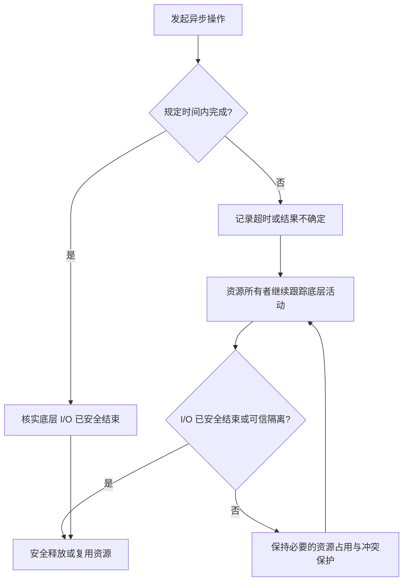

<p class="figure-caption">图 2-1 异步操作超时与资源安全释放流程</p>

对异步操作应区分超时、取消、异常和正常结束；不能仅凭调用方返回、Future/Task 取消或连接状态判断底层 I/O 已安全结束。

### 2.1.5 性能与资源有界原则

性能设计围绕明确的负载与质量要求展开，而不是无依据地增加并发或缓存。

<p class="table-caption">表 2-5 性能与资源有界设计要求</p>

| 设计要求 | 具体规定 |
|---|---|
| 负载模型 | 明确请求规模、并发规模、数据量及运行条件 |
| 容量约束 | 队列、线程、Task、连接、缓存及存储资源应有合理边界 |
| 背压 | 资源不足时明确等待、拒绝、丢弃或降级策略及适用条件 |
| 缓存 | 明确缓存用途、权威数据来源、失效与容量策略 |
| 性能指标 | 明确时延、吞吐、资源占用及测量口径 |
| 性能取舍 | 不得以违反正确性、安全性和可靠性约束换取性能 |

### 2.1.6 故障可控与恢复原则

设计应覆盖正常运行及合理预期的异常场景，明确故障影响范围和恢复条件。

<p class="table-caption">表 2-6 故障与恢复设计要求</p>

| 设计要求 | 具体规定 |
|---|---|
| 故障识别 | 明确可能的超时、通信失败、存储失败、任务异常和进程崩溃 |
| 故障隔离 | 限制故障传播，避免无关组件或资源被错误影响 |
| 状态可信 | 不将未知状态解释为确定成功或失败 |
| 重试与恢复 | 明确允许重试的条件，禁止可能产生危险副作用的盲目重试 |
| 持久化恢复 | 规定异常中断后的数据一致性及状态恢复规则 |
| 生命周期 | 明确启动、就绪、运行、关闭和重启期间的异常处理 |
| 失效行为 | 无法恢复时应有明确的降级、阻塞或停止服务条件 |

### 2.1.7 横切能力非侵入式原则

日志、审计、指标、追踪、权限校验等横切能力应与核心业务逻辑分离，优先通过统一的边界组件、装饰器、中间件或独立服务实现，不应将重复的技术处理流程散布在业务代码中。非侵入式不等于隐藏业务约束：凡影响业务准入、执行结果、事务一致性或故障处理的规则，必须在业务契约中明确，并保留必要的显式调用点。

<p class="table-caption">表 2-7 横切能力非侵入式设计要求</p>

| 设计要求 | 具体规定 |
|---|---|
| 职责分离 | 业务组件负责业务规则与状态转换；横切组件负责统一的记录、采集、校验与传输机制 |
| 边界统一 | 在服务入口、应用服务边界、消息发布边界等明确位置接入横切能力，避免各业务分支重复编排 |
| 最小侵入 | 不为记录日志、采集指标或传播追踪上下文而改变业务方法的核心控制流程和返回语义 |
| 审计正确性 | 审计事件的业务含义及产生时机由业务契约定义；持久化、投递、重试等通用机制与业务处理解耦，同时保证要求的一致性 |
| 故障影响 | 明确横切能力故障时的阻断、降级或重试规则；不得默认其失败不会影响业务，也不得默默吞掉必须处理的错误 |
| 可读性与验证 | 业务代码能够直接体现主流程；横切处理可独立测试，端到端测试验证其与业务契约一致 |

不为追求形式上的非侵入而引入复杂框架或过多抽象；简单、清晰的显式边界优先于难以追踪的隐式执行机制。

### 2.1.8 公共能力复用与冗余控制原则

优先使用符合需求的标准库、成熟软件包、现有工具及公共组件；相同且稳定的职责才提炼为公共能力，不重复发明、不为假设性扩展提前设计框架。

<p class="table-caption">表 2-8 公共能力复用与冗余控制要求</p>

| 设计要求 | 具体规定 |
|---|---|
| 复用优先 | 先评估现成组件是否满足功能、安全、性能及维护要求，再决定是否自行实现。 |
| 提炼公共职责 | 多模块存在稳定相同的职责时统一实现；业务规则留在所属业务模块。 |
| 控制依赖 | 核查成熟度、许可证、版本、安全维护及引入成本。 |
| 控制抽象 | 避免仅为减少少量重复而引入复杂框架或多层转发。 |
| 清理冗余 | 统一能力落地后删除重复、废弃和不必要的兼容实现。 |

### 2.1.9 图表表达与设计一致性原则

设计优先使用合适的图形和表格表达结构、流程、时序、状态及约束，图表不能代替必要的精确定义。

<p class="table-caption">表 2-9 图表表达与一致性设计要求</p>

| 设计要求 | 具体规定 |
|---|---|
| 视图完整 | 使用 4+1 架构视图组织系统设计，覆盖适用内容 |
| 图形选择 | 根据表达目的选择结构图、状态图、时序图、活动图等 |
| 图表一致 | 图形、表格和正文不得相互矛盾 |
| 跨章节一致 | 同一接口、状态、参数及资源规则保持一致 |
| 设计深度 | 明确影响系统行为的契约，允许自主选择内部实现细节 |
| 可验证性 | 关键设计要求应能够对应测试条件与验收证据 |

### 2.1.10 软件设计工作流程

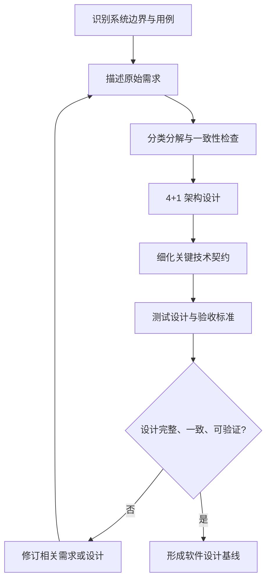

<p class="figure-caption">图 2-2 软件设计编制流程</p>

工作流程允许迭代，不要求传统瀑布式阶段。发现缺口或冲突时直接修订相关需求、架构视图或契约，不通过追加覆盖性条款解决。

### 2.1.11 规范性参考文献及项目无关性

本章为跨项目通用设计与编制规范，不得写入具体仓库、服务、业务协议、接口文件路径或项目专有指标。设计正文引用具体项目的源码、配置和协议文件时，应放在相关业务章节或接口/数据契约章节。

- **《符号体系.md》**：数学量类型、变量命名、标量/矢量/矩阵/张量、下标和公式运算的规范性依据。统计业务中的普通标量同样遵守其标量与阵列的区分原则。
- **《软件系统建模图形与表达规范.md》**：业务流程、DFD、活动/状态/时序图、算法图、伪代码和图元语义的规范性依据。

规范性引用以文件标题和相应章节为准，不复制全文；引用之间存在冲突时先识别并修订冲突，不擅自切换符号或重新解释图元。任何设计实例的具体接口名称、消息字段和技术约束均在第三章及后续适当章节给出。

## 2.2 需求体系及描述规范

需求采用“识别用例 → 逐条描述原始需求 → 分类分解 → 总分一致性检查”的方法。用例应从外部使用者及运行场景出发，覆盖适用的部署、启动、正常使用、配置、运维、正常关闭、重启及异常恢复过程；不局限于业务 RPC，也不将内部技术机制机械列为用例。用例识别属于需求分析，第 4 章用例视图负责表达参与者、边界及用例关系。

<p class="table-caption">表 2-10 原始需求描述字段</p>

| 字段 | 描述要求 |
|---|---|
| 编号 | 唯一原始需求标识，例如 `UR-01` |
| 名称 | 准确概括使用者需要的能力或运行场景 |
| 请求方（Requester） | 发起操作的外部系统、服务或接口，如外部客户端、上层服务、进程管理系统；消息和周期自动触发时可以没有直接请求方，标记“不适用” |
| 触发方式（Trigger） | 标明触发类型、事件来源、触发条件及必要的周期或接口；允许多个类型组合，区分外部触发和内部自动步骤 |
| 输入（Input） | 请求方向本系统提供的数据、参数和信息 |
| 反馈（Response） | 本系统返回请求方的确认、状态、结果及错误信息 |
| 目标方（Destination） | 接收本系统业务输出的外部系统、消息中间件或现场设备；没有时标记“不适用” |
| 业务输出（Output） | 本系统发往目标方的数据、消息或控制指令；没有时标记“不适用” |
| 业务流程（Flow） | 用 Mermaid 表达主要控制流程、数据输入/输出及重要异常，已表达的动作不重复 |
| 业务规则（Business Rules） | 补充主流程未精确定义的术语、公式、算法、初始化、阈值和边界；允许文字分条、LaTeX、图、伪代码或表格，不重复业务流程 |
| 关键约束（Constraints） | 性能、可靠性、安全、审计、可观测性、错误信息、缓存、I/O 与背压等可验证的非功能要求 |

反馈与业务输出必须分开：反馈面向请求方，业务输出面向目标方；请求方与目标方可有多个，且请求方断连不必然撤销已接受的业务操作。

### 2.2.1 触发方式分类与标注规则

原始需求必须列出实际适用的触发方式；同一需求可以组合多种触发方式，不能把处理流程中的普通步骤误写成独立触发。触发方式描述“何时、由什么启动”，不预先决定线程、定时器或队列等内部实现。

- **消息触发（Message）**：外部消息到达，例如实时消息或可靠消息；标明消息来源与订阅范围。
- **周期触发（Periodic）**：达到配置周期，例如实时周期输出或变化加周期保底；标明周期来源及生效条件。
- **API 触发（API）**：收到明确的外部接口请求，例如任务启动或配置应用接口；标明接口和调用方。
- **状态触发（State）**：受监控对象的状态发生满足条件的变化，例如外部依赖从不可用恢复可用；标明状态条件，不把普通循环迭代误列为触发。
- **生命周期触发（Lifecycle）**：服务进入启动、关闭、重启或配置生效等阶段；标明阶段及必要前置条件。

周期触发与消息触发可以同时存在：消息到达更新数据，周期到达决定何时输出。若无外部直接请求方，Requester 写“不适用（自动触发）”，但仍须列出消息生产者或状态来源；触发方式不替代 Input、Response 与 Output 的定义。

### 2.2.2 原始需求四节结构与写作原则

各 UR 固定为四节：**基本信息与触发方式、业务流程、业务规则、关键约束**。根据语义选择最清晰的表达形式；文字、公式、图形、伪代码和表格地位平等；**业务流程图已清楚表达的处理不得在后两节复述**。规则和约束必须有唯一规范定义，其他章节仅引用。

1. **基本信息与触发方式**：表格列出 Requester、Trigger、Input、Response、Destination、Output。Trigger 采用第 2.2.1 节分类，明确事件来源、触发条件及周期或 API。
2. **业务流程**：Mermaid Flowchart 或适用的 UML 活动图表达触发入口、主要处理、判断、数据输入输出、重要异常及恢复出口；复杂算法通过“预定义过程”节点指向第三节，不在总流程中堆叠实现细节。
3. **业务规则**：仅描述流程图无法精确表达的算法、公式、阈值、初始化、状态不变量、顺序及边界。允许文字分条定义、算法流程图、DFG、LaTeX 公式、表格或明确标为 `text` 的伪代码；必须说明输入、输出、初始值、边界及终止条件。无额外内容时标注“无额外规则”。
4. **关键约束**：**优先给出定量要求**（带单位、作用范围、测量窗口、默认值或硬上限、验收方法）；不能合理量化的才采用具有明确判定条件的定性要求。**仅放可核验的非功能要求**，按性能与容量、可靠性与恢复、安全与授权、审计、可观测性、错误信息、缓存与有效期、I/O 资源安全、背压与过载分类；无关分类可以省略或说明不适用。约束应给出故障条件、正确结果、测量或验收口径，不得用抽象口号代替。

### 2.2.3 业务图形元素与数据语义

参照《软件系统建模图形与表达规范.md》第 5.1 节 Flowchart、第 7.1 节 DFD 与第 8.1 节算法规范。业务活动图的控制流箭头表示处理顺序，DFD 箭头表示数据流，**两者不得混用**。图中应以不同形状区分处理、判断和数据。

| 元素 | Mermaid 写法 | 语义 |
|---|---|---|
| 开始/结束 | `A([开始/结束])` | 明确入口和完成/失败出口 |
| 处理 Process | `B["更新缓存"]` | 矩形，表达动作而非数据 |
| 判断 Decision | `C{"已过期?"}` | 菱形，分支标明条件 |
| 输入/输出 Data | `D[/"采样消息"/]` | 平行四边形，表达数据输入/输出 |
| 预定义子过程 | `E[["计算统计指标"]]` | 双边矩形，引用业务规则的算法说明 |
| 数据存储 | `F[("最新值缓存")]` | 存储节点；仅在理解读写关系必要时出现 |

不因形式要求增加无意义数据节点。数据来源、存储及复杂数据变换应单独绘制 DFD，避免业务活动图变成混杂的控制/数据流图。Mermaid 第一行初始化配置、图编号和图题仍须符合第一章。

### 2.2.4 业务规则、输出定义与关键约束的具体要求

- **业务规则**：定义与边界条件优先文字分条；涉及数学关系必须使用 LaTeX 独立公式；复杂步骤按需使用 Flowchart/DFG 或伪代码补充。表达形式不限于图和表；精确定义阈值、边界、初始化、更新基准和不可变条件，不复述主流程动作。算法必须能够独立据输入判断预期输出。
- **性能与容量**：优先用定量指标给出负载范围、时延/吞吐口径、并发及资源上限；必须区分设计目标、默认配置、不可突破的资源上限和验收实测值；未确定的阈值不得虚构。
- **可靠性及 I/O**：明确超时、结果不确定、重试、恢复、安全收敛及资源释放条件。调用返回或 Task 取消不代表底层 I/O 已结束。
- **错误信息**：定义错误类别、错误码或结果、对象与关联标识、发生阶段、可检索证据及敏感信息脱敏；禁止把 UNKNOWN 伪装为成功或明确失败。
- **缓存与背压**：规定缓存键、容量、更新/覆盖、过期、丢弃、等待、拒绝、暂停消费及恢复条件；所有超限策略必须可观测。
- **安全与审计**：列出认证、授权、控制边界以及需审计的操作、事件产生时机、关联 ID、可信保存与失败处理；运行日志不能代替审计。
- **可观测性**：指标、统计窗口、状态、事件、更新时间、无数据语义及告警；可结合真实场景验收。

**指标、计算和输出契约完整性（强制）：**凡使用“计算、统计、比较、阈值、状态、错误、容量、返回结果”等词定义业务能力，必须形成封闭的输出集合；不得用“等”“包括但不限于”替代本版本必须实现的清单。每个指标/派生字段至少定义以下内容；其中数学计算不得仅写在表格单元格内，必须另列可渲染的 LaTeX 公式：

| 必填字段 | 内容 |
|---|---|
| 唯一标识、类型和单位 | 与公开接口字段或指标名一致；明示 `counter/gauge/histogram`、计量单位 |
| 统计层级和数据来源 | 系统 / 进程 / 组件 / 任务 / 消费者；事件记录点、分子和分母来源 |
| 计算公式与口径 | 累计/窗口/瞬时，窗口端点、去重规则、事件计数次数、百分位算法 |
| 触发、初始化和重置 | 何时采集/计算、初始值、首个周期、进程重启、配置热更新 |
| 边界与缺失 | 零分母、空样本、UNKNOWN、超时、重复投递、源不可达的值域与 `unavailable` 语义 |
| 输出与验收 | 指标名、采样时间、窗口、可用性表达、配置边界及给定数据可独立验算的实例 |

**示例与可复算性（强制）：**当业务规则涉及多种计数口径、状态转换、时间窗口、边界分支或重试等易混淆情形时，至少给出一个具体输入—处理过程—预期输出的完整算例。算例必须标明初始条件、计量单位、每一步事件及最终结果；若同时存在样本条数、批次数、I/O 尝试次数等不同统计单位，须分别列出，禁止混用。算例应覆盖易误解的边界（例如重试成功仍有失败尝试记录），且结果必须可直接转化为确定性测试断言。算例是对定义的验证，不得取代规范性定义，也不应重复流程图中的全部步骤；涉及计算关系仍按第一章使用 LaTeX。

**数学定义与表达门禁：**业务规则的文字定义应独立成段或分条；涉及计算时，必须在定义后给出独立 LaTeX 公式，逐一释义变量、单位、取值域以及零分母、空样本和无效值。算法图与伪代码是可选的精度增强手段，不得要求所有业务规则使用表格。公式与中文混排遵守第一章 §1.3.1。

**约束定量优先门禁（强制）：**关键约束首先给出数值、单位、统计范围、采样方法、允许误差、测试条件和通过标准；可配置阈值应列出默认值及合法范围。仅当约束本质上无法定量（例如禁止错误 ACK）时，才用可判定的定性约束。不得用“及时、足够、合理、有界、尽可能、低延迟、高可靠”等词代替具体要求；未完成基准测试的数值应标明“设计验收目标，尚未实测”，不得声称达标。

**完备性门禁：**业务规则涉及的状态枚举、错误分类/错误信息字段、缓存容量及淘汰策略、I/O 结果、背压策略、审计与统计输出均应列举封闭集合和边界输入；凡无法根据文档构造确定预期结果的要求，视为需求未完成，不得标记为可编码。参数可以配置，但必须说明合法范围、默认/缺省行为及越界错误；性能数值未经验证时不得伪称已达标。每项约束必须可追溯至可执行的 UC/System 场景。

每项业务规则和关键约束须能由 UC/场景及第 14 章测试追溯；第 5～13 章详述实现契约时应引用 UR，不得另造冲突定义。

统一样式：

```text
### 3.x UR-xx 需求名称
#### 3.x.1 基本信息与触发方式
Requester / Trigger / Input / Response / Destination / Output
#### 3.x.2 业务流程
Mermaid 活动流程图，含重要异常及数据输入输出
#### 3.x.3 业务规则
可用文字、LaTeX、伪代码、图或表格精确定义算法、初始化与边界，不重复流程
#### 3.x.4 关键约束
按性能、可靠性、安全、审计、可观测性、错误、缓存、I/O、背压列可验证要求
```

本节也是第三章及后续章节的强制完整性验收标准。

<p class="table-caption">表 2-11 分类需求体系与描述重点</p>

| 类别 | 核心问题 | 典型要求 |
|---|---|---|
| 功能需求（Functionality） | 系统提供什么行为 | 对外能力、业务流程、业务规则、输入输出与状态反馈 |
| 性能需求（Performance） | 运行速度与资源上限 | 时延、吞吐、并发、调度、公平性、容量、背压、资源消耗、扩展能力 |
| 可靠性需求（Reliability） | 故障时如何保持正确与恢复 | 容错、超时、重试、请求关联、事务、持久化、故障恢复、可用性、未结束操作的资源管理 |
| 安全需求（Safety & Security） | 如何防止危险或非法控制 | 控制权、互锁、失效安全、认证、授权、通信及数据安全 |
| 横切能力（Cross-cutting Concerns） | 如何观测、管理与追责 | 审计（操作证据、可靠投递、完整性、追溯）、日志、指标、追踪、配置、版本、可测试性、可维护性 |

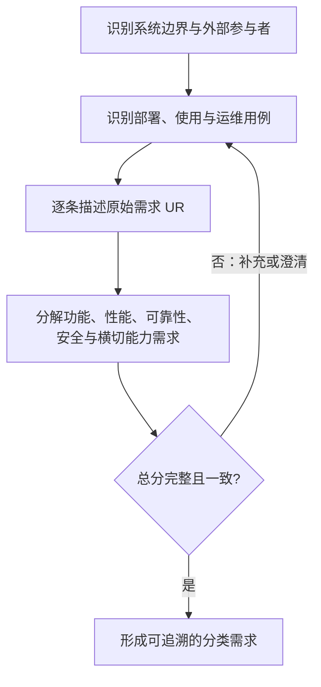

<p class="figure-caption">图 2-3 需求识别、分解与一致性检查流程</p>

分类需求必须从原始需求的输入、反馈、业务输出、规则和约束中推导，不得遗漏、矛盾或未经确认增加能力；多条原始需求的共同约束可以合并，但必须保留来源编号。每条分类需求应给出可核验条件，性能要求还需明确测量口径，不虚构现场阈值。审计应独立于普通日志定义，不得以运行日志代替审计证据。

需求分类与设计专题是不同维度：启动、正常关闭、重启及 Reload 属于跨需求的运行生命周期设计，统一在进程视图展开；相应行为和质量约束分别由原始需求及分类需求追溯。

## 2.3 4+1 架构视图：内涵、外延与表达规范

<p class="table-caption">表 2-12 4+1 架构视图的职责与成果</p>

| 视图 | 关注范围 | 主要成果 | 不应混淆 |
|---|---|---|---|
| 用例视图（+1） | 参与者、系统边界、典型/异常场景 | 系统上下文、用例、业务流程 | 不负责线程调度 |
| 逻辑视图（Logical） | 组件职责、模型、接口、状态规则、依赖 | 组件图、类/数据关系、状态图 | 不等于源码目录树 |
| 进程视图（Process） | 进程、线程、Event Loop、Task、协作、生命周期、同步、并发、资源、背压、缓存、故障恢复 | 运行结构图、任务所有权表、时序/状态/活动图、资源预算 | Task 不等于 OS 线程；图名须区分标准 UML 与示意图 |
| 开发视图（Development） | 软件模块边界、层次、静态依赖、公共契约与复用关系 | 模块图、依赖图、模块职责表 | 不描述真实并发拓扑，也不列现有代码修改清单 |
| 物理视图（Physical/Deployment） | 节点、进程部署、存储、网络、控制权和现场外部依赖 | 部署图、网络/故障域/外部依赖表 | 不是现场设备内部物理结构模型 |

### 2.3.1 用例视图的场景编写规范

用例以参与者的完整业务目标为单位组织，而非以原始需求、RPC 或内部模块为单位逐条改名。一项用例可以关联多项原始需求；一项原始需求也可以由多个业务场景共同覆盖。用例视图回答“在具体业务场景中系统如何工作”，不代替逻辑视图、进程视图和数据设计。

<p class="table-caption">表 2-13 业务场景用例的必备描述要素</p>

| 要素 | 编写规定 |
|---|---|
| 用例身份与目标 | 给出唯一编号、业务场景名称及参与者要达成的可观察目标；名称使用业务活动，不使用内部机制命名 |
| 参与者与触发条件 | 列明实际发起操作的外部角色；内部定时任务、恢复及发布等自动步骤不得虚构外部参与者 |
| 前置条件 | 列明系统就绪、授权、配置或数据存在等必要条件；不得混入未确认的实现假设 |
| 主业务流程 | 以 Mermaid 业务活动图（flowchart）为主要表达，覆盖触发、校验、关键处理、反馈及后置结果；以判断节点表达重要分支，避免大段编号文字复述 |
| 分支与异常流程 | 在活动图中呈现影响业务结果的主要异常出口；罕见或不宜展开的异常在简明说明表中概括，避免为了完整而画出所有技术异常 |
| 后置条件 | 明确成功和失败之后的业务状态、外部可见结果、未完成事项及后续查询方式 |
| 需求追溯 | 标明相关 UR；核对全部 UR 在真实场景中得到覆盖，但不要求 UR 与 UC 一一对应 |

跨用例共享的内部机制（如存储、审计发布和调度）应作为相关业务流程中的自动步骤或支撑行为描述；只有存在独立业务目标时才另立用例。应避免将一串 gRPC 方法名或 CRUD 操作直接当作完整用例，也不得在用例章节展开线程、锁、表结构及类方法等实现细节。

用例的正文采用“一张业务活动图 + 一张简明用例说明表”的表达形式。活动图包含主路径、必要判断以及重要异常分支；图中节点使用业务动作，不展开展示内部类、锁和数据库事务。说明表只填写参与者、业务目标、前置条件、主要异常、后置条件及关联需求。业务分支已在图中完整表达时，不再重复书写大段“主业务流程”和“异常流程”；复杂跨参与者消息时序可在独立小节补充时序图。图题和表题按文档约定独立编号。

进程视图应按四个设计专题组织，而不是按需求类别重复划分：

<p class="table-caption">表 2-14 进程视图的四类设计专题</p>

| 专题 | 必须明确的设计对象 | 推荐表达 |
|---|---|---|
| 运行时结构 | 进程、线程、Event Loop、Task、线程池、组件与资源所有权 | 分层运行结构图、Task 职责表 |
| 运行生命周期（Runtime Lifecycle） | 启动、初始化、就绪、运行、Reload、正常关闭、重启及其阶段转换 | 生命周期状态图、启动/关闭/Reload 时序图 |
| 并发与资源管理 | Task 协作、队列、通知、同步、调度、容量限额、背压、缓存及释放 | 任务协作时序图、资源与背压策略表 |
| 异常与恢复 | 超时、取消、故障隔离、未收敛 I/O、崩溃恢复与降级 | 故障状态图、异常裁决矩阵 |

各专题共享同一运行模型，明确创建者、所有者、同步关系和退出条件；不因分节而重复定义状态或资源。生命周期是进程视图的独立设计专题，不是第六类需求。

图表仅使用其可准确表达的语义：结构关系用 Mermaid Flowchart；行为交互用 Sequence Diagram；状态约束用 State Diagram；条件控制用活动/流程图。图题说明对象、范围及图类型。关键质量属性贯穿各视图，不能只写在单独的“非功能要求”段落。

## 2.4 测试设计方法、组织及验收规范

测试设计以测试层级组织物理目录，以 Marker 描述测试层级、测试专题与运行场景。测试文件名应清楚表达验证对象或行为；测试文件及其标记、验证说明统一登记在测试矩阵中。需求、用例及重要技术契约必须能追溯到实际测试，不为同一目的建立重复测试体系。

<p class="table-caption">表 2-15 测试层级与目录规范</p>

| 层级 Marker | 物理目录 | 验证范围 |
|---|---|---|
| `unit` | `unit/` | 状态转换、业务规则、纯逻辑，无外部服务依赖 |
| `component` | `component/` | 单组件职责及其可控依赖 |
| `integration` | `integration/` | 组件之间及真实外部依赖的接口协作 |
| `system` | `system/` | 独立进程、完整业务场景及端到端行为 |

<p class="table-caption">表 2-16 测试 Marker 与矩阵编制规范</p>

| 事项 | 规范 |
|---|---|
| 层级 Marker | 每项测试必须且仅属于 `unit`、`component`、`integration`、`system` 之一，与目录对应 |
| 专题 Marker | 标识可靠性、安全、性能等验证主题，可与层级及场景 Marker 叠加；无专项主题时可为空 |
| 场景 Marker | 标识并发、超时、恢复、负载、现场等执行条件或情境；有相应场景时标记 |
| 测试矩阵 | 至少包含“测试文件名、层级 Marker、专题 Marker、场景 Marker、测试说明”五列；每项重要测试应有可定位的文件归属 |
| 标记粒度 | 标记以具体测试函数或类为准；同文件可包含不同专题与场景，矩阵列出涉及的 Marker |
| 运行条件 | 通过 Fixture 和环境准备明确外部依赖；现场专用测试与常规回归分离，未执行不视为通过 |
| 执行规则 | 提供按目录、Marker 及其布尔组合的 pytest 命令；所有 Marker 在项目配置中注册 |
| 可追溯性 | 测试说明与需求、用例或技术契约对应；行为变更时同步检查测试及矩阵 |
| 验收证据 | 保留运行环境、命令、实际结果、指标和未验证项，禁止把设计目标当作测试结果 |

目录划分测试层级，专题与场景通过 Marker 横向组合；可靠性测试不单独设第五类目录。测试矩阵用于定位和筛选测试，不预设每个实现文件必须存在，也不要求每个文件仅能有一种测试场景。

### 2.4.1 测试依据及 System 覆盖要求

各层级测试必须依据已确认的设计成果编制；System Test 以用例视图为主基线，以原始需求及技术契约补充覆盖，不得由测试人员凭经验任意缩减范围。

<p class="table-caption">表 2-17 各测试层级的设计依据</p>

| 测试层级 | 主要依据 | 验证重点 |
|---|---|---|
| Unit | 详细设计、函数及算法契约 | 纯逻辑、状态转换、参数及边界规则 |
| Component | 逻辑视图、组件职责及内部接口契约 | 单组件行为、依赖协作及异常处理 |
| Integration | 接口与通信契约、开发视图、物理视图 | 真实接口调用、跨组件通信及外部依赖 |
| **System** | **用例视图（UC）及原始需求（UR）**，并补充接口、运行、部署、安全及性能约束 | **从真实受测服务进程及其通信入口验证业务目标、异常、边界与恢复行为** |

System Test 必须遵守以下规定：

1. **用例覆盖率 100%**：每项 UC 至少有一项 System Test 作为验证证据；同一测试可以覆盖多个 UC，同一 UC 可以由多个测试覆盖，**不按测试数量与 UC 数量的大小关系判定覆盖**。
2. **规定场景覆盖率 100%**：每项 UC 明确的主流程、关键分支、异常流程、边界和恢复场景均必须有对应 System Test；不能仅以一条正常路径代表整个 UC 已覆盖。
3. **需求覆盖率 100%**：每项 UR 必须能够经一个或多个 UC 追溯至 System Test；若某项需求未能被 UC 覆盖，必须先补全用例，不得直接以技术测试代替业务用例。
4. **技术约束补充覆盖**：用例未充分表达的性能、容量、并发、安全、权限、超时和可靠性要求，依据对应技术契约补充测试；不得因 UC 未逐项列出而豁免。
5. **真实系统边界**：System Test 通过真实受测服务进程和适用的外部依赖、通信链路执行；Mock 不得代替本次明确纳入验收范围的基础设施及通信链路。
6. **覆盖与通过分开裁定**：测试已关联不等于已执行；失败、跳过及未运行均不得计为通过。验收报告分别给出需求覆盖、用例及场景覆盖、执行情况和通过情况；缺少真实环境时标记 `NOT_RUN`，不得用模拟结果替代。
7. **变更同步**：任何 UR、UC、接口或行为约束的新增、删除、调整，必须同步核查 System Test、测试矩阵和验收条款；新增 UC 不得留下无测试映射。

<p class="table-caption">表 2-18 System Test 追溯矩阵规范</p>

| 字段 | 要求 |
|---|---|
| UR 编号 | 被验证的原始需求编号，可列多个 |
| UC 编号与场景 | 用例编号及主流程、异常、边界或恢复场景标识 |
| 技术契约 | 相关接口、配置、运行或安全约束的章节编号；没有则记“—” |
| 测试文件名／测试标识 | 可定位的 System Test 文件名及测试函数或参数化场景标识 |
| 层级／专题／场景 Marker | 层级固定为 `system`，其余按第 2.4 节定义填写 |
| 验证内容与预期结果 | 从用户可观察行为与副作用表述判定依据 |
| 执行环境及结果 | 真实依赖、执行证据、`PASS`／`FAIL`／`SKIP`／`NOT_RUN` 等状态 |

追溯链为 **UR → UC／用例场景 → System Test → 执行结果与证据**，技术契约作为补充依据进入相应测试。第 4 章负责编制完整 UC 和场景，第 14 章依据本规范给出实际测试矩阵及验收安排，两章必须双向核对。

# 3. 软件需求

Core 是 wind-hub 的**公共基础能力库**，由其他模块在进程内调用；Core 不拥有独立业务流程，不解释业务配置字段，不决定采集、控制、派发、仿真等模块的业务规则。本章以六项原始需求规定目标契约，实施状态以 `main@cac23d84c47bb9b0e893496acebfaa07abd7d6e3` 为基准核对；**目标要求不等于已实现能力**。

## 3.1 原始需求索引与职责边界

<p class="table-caption">表 3-1 Core 原始需求索引</p>

| 编号 | 原始需求 | 提供的公共能力 | 不属于 Core 的职责 |
|---|---|---|---|
| UR-01 | 通用配置数据处理 | 任意显式路径的 YAML 读写、解析、序列化；对任意 `dict` 进行结构差异比较 | 固定目录、配置项语义、业务校验、配置生效 |
| UR-02 | 通用工业协议通信 | ADS、Modbus、IEC104 协议会话及其实际支持的通信能力 | 采集调度、控制授权、业务重试与命令裁决 |
| UR-03 | 通用非侵入式横切能力 | 日志接入、指标采集、追踪、请求关联与异常观测的统一接入机制 | 业务埋点语义、业务审计、告警策略、业务状态机 |
| UR-04 | 通用基础服务能力 | 线程池、生命周期、资源管理、健康检查/重连框架、公共异常与值转换等显式服务 | 业务调度策略、全局故障恢复、业务重试与状态迁移 |
| UR-05 | 通用共享领域对象 | 多模块共用且语义稳定的数据类型、值对象与基础约束 | 采集任务、控制命令、Sink 派发等业务对象 |
| UR-06 | 通用通信链路诊断 | 网络、传输、工业协议与受控通信性能诊断 | 业务端到端链路编排、故障处置与恢复策略 |

**统一边界规则：**调用方明确传入文件路径、配置数据、诊断目标与协议参数；Core 仅执行通用操作。对象是否属于 Core 取决于其业务独立性，而非引用它的模块数量。**非侵入式横切能力与显式基础服务严格分开**：前者在边界装配，不进入业务主路径；后者允许调用方通过公开接口主动使用。

## 3.2 UR-01 通用配置数据处理

### 3.2.1 基本信息与触发方式

<p class="table-caption">表 3-2 UR-01 基本信息与触发方式</p>

| 字段 | 内容 |
|---|---|
| Requester | Collector、Commander、Sink Service、Industrial Gateway、Data Generator、CLI 等调用方 |
| Trigger | API：调用方请求解析、读取、序列化、保存或比较；Lifecycle：调用方自行决定何时调用 |
| Input | YAML 文本或文件路径；`dict[str, Any]` 配置数据；比较时的前后两份数据；必要时由调用方显式传入版本或引用解析参数 |
| Response | `dict`、YAML 文本、差异结果、成功完成或明确异常 |
| Destination | 调用方明确指定的文件路径（仅保存操作）；其他操作不适用 |
| Output | 保存操作生成 YAML 文件；不向任何业务服务自动推送配置 |

### 3.2.2 业务流程

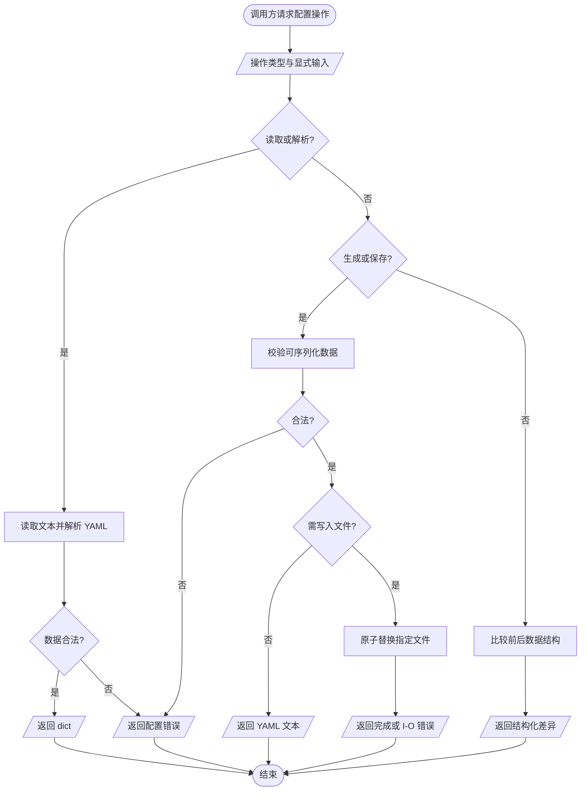
<p class="figure-caption">图 3-1 通用配置数据处理流程</p>

### 3.2.3 业务规则

**R01-1 数据模型。**公开配置数据采用 `dict[str, Any]`，嵌套值限定为：`dict`（字符串键）、`list`、`str`、`int`、有限 `float`、`bool`、`None`。`bool` 与 `int` 视为不同类型；拒绝非有限浮点数、任意 Python 对象、循环引用及无法无损表达的 YAML 专有类型。根节点必须为 `dict`；空字典有效。输入为 JSON 兼容 Python 对象，**不要求先转换为 JSON 字符串**。

**R01-2 基础操作。**公共接口至少提供以下五项彼此独立的能力：

<p class="table-caption">表 3-3 UR-01 公开基础操作</p>

| 操作 | 输入 | 成功结果 |
|---|---|---|
| `parse_yaml` | YAML 文本 | `dict` |
| `read_yaml` | 单个显式文件路径 | `dict` |
| `dump_yaml` | `dict` | YAML 文本 |
| `save_yaml` | 单个显式文件路径、`dict` | 原子保存完成 |
| `compare_config` | 旧 `dict`、新 `dict` | 结构化差异 |

`read_yaml`、`save_yaml` 均只操作调用方指定的**单个文件**。需要处理多个文件时，由调用方组织文件集合，逐个调用；Core 不预设 `services`、`instances`、`templates` 等目录，不预设 `site.yaml`、`devices.yaml`，不强制存在任何指定文件。

**R01-3 通用差异。**对 `dict` 的字符串键按递归路径比较，结果类型封闭为 `added`、`removed`、`changed`。`added` 与 `removed` 记录对应值，`changed` 记录旧值和新值；类型发生变化属于 `changed`。`list` 以位置为索引逐项比较，不假定列表元素具有业务主键；当列表长度变化时，对对应位置产生结构差异。空差异表示两份输入在约定比较语义下相等。比较不得改变原始输入；输出顺序应确定。差异路径采用可区分字符串键与数组下标的结构化路径，不能通过简单拼接引入歧义。业务模块自行解释差异是否导致热更新或重启。

**R01-4 版本与引用（可选辅助能力）。**首版必需范围为 R01-2 的五项基础操作；版本解析和引用解析属于可选扩展，不作为首版基础接口验收要求。若后续提供，解析根、引用定位规则及版本规则均由调用方指定，不内置设备型号、点表、任务、Delivery 等业务类别或固定命名规则；不存在的引用、环形引用和越界路径应报错。普通 `read_yaml`、`compare_config` 不依赖此能力。

**R01-5 读写结果与错误契约。**`parse_yaml`/`read_yaml` 均返回独立构造的配置数据；不得在返回对象中保留可供外部修改的共享内部缓存。所有操作的失败类别封闭为：`INVALID_INPUT`、`PARSE_ERROR`、`SERIALIZATION_ERROR`、`NOT_FOUND`、`PERMISSION_DENIED`、`IO_ERROR`、`REFERENCE_ERROR`。公共结果可采用异常形式表达，但必须能被调用方稳定归类；业务校验失败不由 Core 生成。写入参数必须先完成全部序列化验证，才能触及目标文件。

**R01-6 保存语义与故障阶段。**`save_yaml` 将数据整体生成规范 YAML 后，在目标同目录暂存、同步文件内容并执行原子替换；为满足断电后目录项持久化，替换成功后同步父目录。**替换前失败**时，目标文件保持原内容；**替换后父目录同步失败**时，目标路径可能已经指向新文件，不能承诺旧文件不变或新文件已持久化。错误应能区分故障发生在替换前还是替换后，供调用方重新读取、核对结果，不得自动盲目重试。无论何种阶段，不允许目标文件出现部分序列化内容。不承诺保留原 YAML 的注释、空行及排版；Core 不处理业务默认值或配置生效。

**R01-7 可复算示例。**输入旧数据 `{"enabled": true, "ports": [502, 503]}`，新数据 `{"enabled": false, "ports": [502, 504], "name": "A"}`；比较结果为 `changed: enabled (true → false)`、`changed: ports[1] (503 → 504)`、`added: name ("A")`，不生成其他差异。

### 3.2.4 关键约束

- **完整性与安全：**重复 YAML 键、非字符串键、非法根类型、非法数据类型和循环引用必须拒绝；不得静默覆盖字段或丢失数值精度。
- **写入可靠性：**单文件写入顺序为序列化验证 → 同目录暂存 → 文件 `fsync` → 原子替换 → 父目录 `fsync`。替换前失败须保持旧目标；替换后同步失败须报告结果不确定，允许新文件已可见；任何阶段不得产生部分写入的目标文件。跨文件事务不在此接口范围。
- **文件安全：**只使用明确传入的目标路径；不得自动搜索上级目录或默认配置目录。调用方负责路径授权，Core 的可选路径根约束应明确拒绝越界路径。
- **副作用与可观测性：**读取、解析、序列化及比较不得写盘；比较结果可复现；失败至少提供操作类型、目标路径（如适用）、错误类别，禁止在错误消息中泄露配置密钥值。
- **容量与性能：**首版性能验收基准见表 13-1：对 1 MiB YAML 文件与 1 万个配置叶节点进行可重复测量；阈值为待验设计目标，非现有实现实测值。Core 不限制业务文件名或目录布局，文件大小仍受宿主内存和操作系统资源约束。

## 3.3 UR-02 通用工业协议通信

### 3.3.1 基本信息与触发方式

<p class="table-caption">表 3-4 UR-02 基本信息与触发方式</p>

| 字段 | 内容 |
|---|---|
| Requester | 需要访问工业设备的业务模块 |
| Trigger | API：创建协议驱动、连接、读写、订阅、监听、召唤、查询状态、关闭；Message：协议主动上送数据到达 |
| Input | 协议名称、连接端点、协议选项、点表或协议地址、操作参数及回调 |
| Response | 协议采样、写入结果、接收/订阅句柄、通信状态或错误 |
| Destination | 指定的工业协议对端 |
| Output | 由明确请求触发的协议报文，以及订阅注册/释放等协议操作 |

### 3.3.2 业务流程

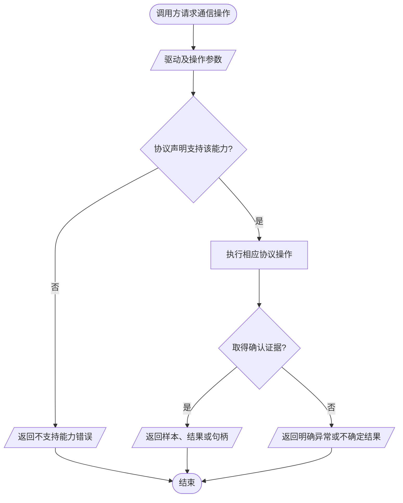
<p class="figure-caption">图 3-2 通用工业协议通信流程</p>

### 3.3.3 业务规则

**R02-1 协议边界。**首版提供 ADS、Modbus、IEC104；统一抽象对外声明真实能力集合，能力名称为 `READ`、`READ_MANY`、`WRITE`、`WRITE_MANY`、`SUBSCRIBE`、`LISTEN`、`INTERROGATE`。未声明能力必须明确拒绝，禁止以缓存或轮询伪装成协议原生能力。

**R02-2 操作契约。**公共操作覆盖连接、关闭、健康查询、单点及批量读写、按支持情况创建订阅、监听主动上送、执行召唤和更新点表。点表采用整份提交、差异增量在线验证、整份原子切换并返回明确生效状态；更新本身不触发重连。`subscribe` 表示远端原生订阅，`listen` 表示本地接收协议上送；二者不得混用。重复点及读回顺序须保持请求序列语义。

**R02-3 采样契约。**采样至少保留点标识、值、质量、来源时间、接收时间及时间来源；时间值必须带时区。质量值集合为 GOOD、BAD、UNCERTAIN。具体采样时间的 UTC 转换不能仅凭类型构造假定自动完成。

**R02-4 写入结果。**写入结果集合为 `CONFIRMED_SUCCESS`、`CONFIRMED_FAILURE`、`UNKNOWN`。`UNKNOWN` 表示证据不足，不等于操作未执行。底层协议响应仅证明对应协议层事实，不代表业务控制策略已满足。

**R02-5 能力适配语义。**协议 Driver 仅返回操作支持能力和底层可验证事实。批量读写属于协议原生批量时声明相应能力；未经声明不得悄悄拆成多个单点操作。订阅/监听句柄由创建方持有并释放；健康状态与连接开启状态不可互换。

**R02-6 业务决策归属。**采集周期、写入授权、命令幂等、业务重试、设备间并发、命令状态机和最终裁决均由 Collector、Commander 等调用模块负责；Core 只提供安全的协议通信操作与事实结果。

**R02-7 协议配置模板契约。**协议参数模板与协议点表的字段、默认值、校验和协议专有扩展由 UR-02 规定，在第 7 章协议模板数据契约中展开；UR-01 只负责通用 YAML 数据处理，不按模板分类解释字段。

### 3.3.4 关键约束

- **能力正确性：**七类能力的声明与行为一致；不支持的调用须得到可辨别异常。
- **I/O 安全：**断连、超时、取消和关闭时不得误判仍在执行的底层 I/O 已完成；句柄及连接必须具备明确释放机制。
- **结果正确性：**读回样本与请求点标识对应；写入 `UNKNOWN` 不得降级为确认成功或确认失败。
- **资源边界：**所有单次操作及点表更新均有整体 Deadline；连接、超时及并发由调用方显式配置或由具体 Driver 的公开默认值确定；Core 不代替业务模块定义全局设备调度额度。一次性读写不提供业务取消接口，持续订阅和监听采用独立停止/注销句柄。

## 3.4 UR-03 通用非侵入式横切能力

### 3.4.1 基本信息与触发方式

<p class="table-caption">表 3-5 UR-03 基本信息与触发方式</p>

| 字段 | 内容 |
|---|---|
| Requester | 各业务模块的进程入口、通信边界与基础设施装配层 |
| Trigger | Lifecycle：进程启动、关闭及横切组件装配；Request/Message：请求、事件或协议调用穿过已装配边界；Exception：边界捕获异常 |
| Input | 显式启用项、日志/指标/追踪配置、采样参数、传播上下文；不要求传入业务配置对象 |
| Response | 运行在边界上的处理器、拦截器或适配器；业务接口原有返回值及异常语义保持不变 |
| Destination | 调用方指定的日志、指标、追踪输出目标（如有） |
| Output | 非侵入式日志、指标、追踪与异常观测数据；不输出未经业务定义的审计事件 |

### 3.4.2 业务流程

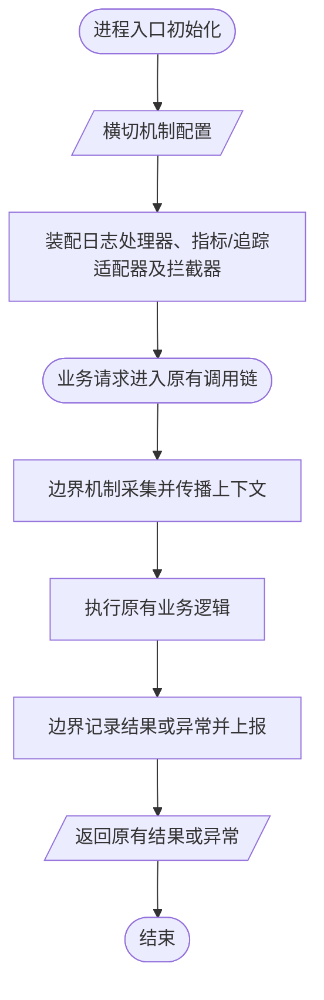
<p class="figure-caption">图 3-3 非侵入式横切能力流程</p>

### 3.4.3 业务规则

**R03-1 非侵入式接入。**横切功能优先通过 Python Logging 的 Handler/Filter/Formatter、装饰器、gRPC Interceptor、中间件、适配器包装及 OpenTelemetry 标准接入。应由进程入口或基础设施装配层完成配置；不得要求业务函数散布统一采集、上报或传播代码。

**R03-2 职责范围。**Core 提供日志、指标、追踪、请求关联和异常观测的**公共接入及传播机制**，不定义业务指标公式、Span 业务属性、审计事件、告警阈值，也不接管调用方的业务结果裁决。业务模块可定义自有标签及语义，并通过标准机制输出。

**R03-3 可插拔与兼容。**各能力应可单独启用、停用和配置。禁用时业务接口行为不变；启用后不改变原函数签名、消息协议、异常类型、返回值及业务状态机。请求关联标识仅用于观测，不作为身份或授权依据。

**R03-4 观测契约。**通用观测出口区分 `counter`、`gauge`、`histogram` 三类指标；指标名称、标签与单位由调用模块或标准集成适配器声明，Core 不凭空生成业务 KPI。无采样时不得伪造零延迟或零错误率；追踪上下文的失效或缺失不得改变业务授权结果。时间戳使用带时区时间，持续时间使用单调计时。

**R03-5 故障隔离。**一般观测后端不可用时应通过有界队列、超时或丢弃策略隔离，不得阻塞工业通信主路径；由安全、合规或业务契约明确要求的强制性审计不属于本条普通观测的静默降级范围，应由所属模块显式处理。

### 3.4.4 关键约束

- **非侵入性：**未启用横切组件时，业务调用链与返回语义不受影响；不要求业务函数直接调用埋点 API。
- **可插拔：**日志、指标、追踪及请求关联机制可独立装配；缺少可选观测后端不得导致业务模块初始化失败，除非调用方明确设置强制模式。
- **并发与保密：**关联上下文在并发请求间隔离；不记录口令、令牌或敏感配置原文，关联标识不参与鉴权。
- **资源与性能：**后台队列和出口超时须有界；采样和导出容量由调用方配置或明确文档化；不提供未经测量的性能保证。
- **实现状态（`main@cac23d84`）：** `src/core/infrastructure/crosscutting/` 已提供 Logging、Request-ID、gRPC 拦截器、观测装配和协议观测 Wrapper 等基础实现；但当前仓库中已有代码不等于所有业务宿主均完成接入，横切功能是否非侵入、是否适应故障及真实负载，仍须独立验收。不得以历史开发分支状态替代当前 main 的事实。

## 3.5 UR-04 通用基础服务能力

### 3.5.1 基本信息与触发方式

<p class="table-caption">表 3-6 UR-04 基本信息与触发方式</p>

| 字段 | 内容 |
|---|---|
| Requester | Collector、Commander、Industrial Gateway、Data Generator、Sink Service 等业务模块的装配层 |
| Trigger | API：主动申请或调用公共服务；Lifecycle：初始化、停止和资源释放；Periodic：由调用方启用的健康检测周期 |
| Input | 资源容量、超时参数、连接操作、健康检查回调、关闭/恢复回调、通用数据转换请求 |
| Response | 资源句柄、检测/转换结果、公开异常或明确生命周期状态 |
| Destination | 调用方持有的资源或通信端点；不规定业务运行目标 |
| Output | 线程池/资源生命周期操作、通用健康检测与可选重连执行、基础格式转换结果 |

### 3.5.2 业务流程

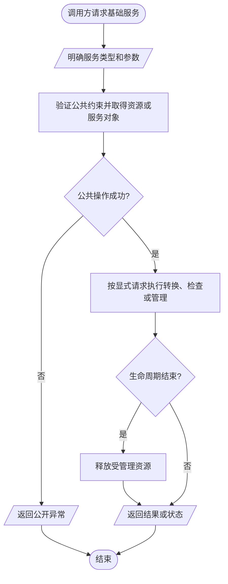
<p class="figure-caption">图 3-4 通用基础服务调用流程</p>

### 3.5.3 业务规则

**R04-1 服务范围。**Core 提供不依赖具体业务配置的线程池、异步资源生命周期辅助、周期健康检查与有条件重连框架、基础异常分类及传输中立的数值约束等复用服务；Protobuf `ScalarValue` 的编解码属于 Contracts，不属于 Core。公共服务只负责机制和通用结果，不管理 Collector/Commander 等模块的业务状态。

**R04-2 显式使用。**基础服务不同于 UR-03 横切机制，允许业务模块通过公开 API 显式调用。资源由谁创建、谁关闭、失败如何传播必须明确；不能隐式创建每设备线程池或跨业务模块共享未授权状态。

**R04-3 健康检查与重连。**健康检测、关闭、连接及恢复回调由调用方注入。Core 可根据配置执行健康探测与重连动作，但不推断业务恢复完成，也不负责采集任务重建、控制命令重试、派发补偿或业务故障裁决。

**R04-4 公共服务配置。**显式线程池参数 `max_workers` 必须为正整数；重复装配相同事件循环及相同参数可复用，冲突配置必须报错。健康检测 `interval`、`health_timeout`、`connect_timeout` 必须为正有限秒数；禁用检查时不应启动定时任务。调用方注入的恢复回调只证明回调本身返回，不代表业务已恢复。

**R04-5 转换及异常。**Core 的公共类型转换和异常类别仅承载传输中立的技术事实；错误不得被转换成虚假的业务成功、失败或已执行结论。`contracts.scalar_codec` 承担 Protobuf 边界标量转换，不得反向导入 Core。Core 不成为独立 gRPC 业务服务。

### 3.5.4 关键约束

- **生命周期：**线程池和其他资源的创建、重复装配、关闭均须有确定规则；同一事件循环相同配置复用、冲突配置显式拒绝；资源最终由所属宿主释放。
- **故障边界：**健康检查、超时、取消和重连异常不得隐藏；通用恢复成功不能代替业务服务恢复完成。
- **资源限制：**线程池 `max_workers` 为正整数；检查周期和超时必须为正有限秒数，非法值拒绝；其他并发容量由调用方显式提供或采用公开稳定默认值，不在 Core 内设置业务级配额。
- **接口稳定性：**对外暴露稳定的数据类型和错误契约；不建立仅为旧调用路径服务的永久兼容层。

## 3.6 UR-05 通用共享领域对象

### 3.6.1 基本信息与触发方式

<p class="table-caption">表 3-7 UR-05 基本信息与触发方式</p>

| 字段 | 内容 |
|---|---|
| Requester | 需要交换共同数据类型的业务模块 |
| Trigger | API：构造、转换或校验共享对象；Lifecycle：模块初始化时装配共享对象 |
| Input | 标识符、设备/测点/点表/单位等通用数据，或协议无关采样值 |
| Response | 合法领域对象、转换结果或构造校验错误 |
| Destination | 不适用 |
| Output | 无外部 I/O；向调用方提供统一类型和值语义 |

### 3.6.2 业务流程

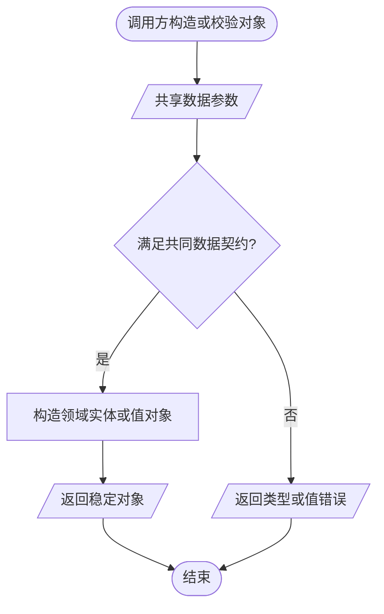
<p class="figure-caption">图 3-5 通用共享领域对象流程</p>

### 3.6.3 业务规则

**R05-1 共享范围。**保留语义稳定且跨模块共用的标识、设备、设备类型与型号、测点与点表、单位、站点、采样标量和质量枚举等基础数据定义；特定对象是否属于 Core，以**定义是否依赖具体业务流程或配置策略**为依据，不以使用方数量作为唯一依据。

**R05-2 规则范围。**Core 仅校验共享数据对象自身的结构、不变量、基础类型及单位转换等通用约束。设备模型与采集任务如何关联、配置如何生效、控制命令如何审核，不属于共享数据对象的通用规则。

**R05-3 稳定性标准。**仅当字段含义、单位、构造不变量在至少两个业务上下文中相同且不包含业务调度、重试、派发或配置生效决策时，才将对象纳入 Core。单纯被多个模块 import 不构成纳入理由；涉及协议报文字段的实体应优先以协议中立值对象对外表达。

**R05-4 业务对象边界。**采集任务、控制命令、Sink/Delivery 派发配置等业务模型应由对应模块或独立契约层定义；迁移历史模型前须检查全部调用方，不能为保持旧导入路径无故增加长期兼容层。

**R05-5 共享领域模板契约。**`configs/templates/units.yaml`、`business_points.yaml`、`device_models/*.yaml` 的内容结构、标识引用与一致性校验由 UR-05 规定，详见第 10.7 节；文件路径仅为仓库提供的配置样例布局，不是 Core 基础 YAML 接口的默认根目录。

### 3.6.4 关键约束

- **一致性：**同一基础对象在不同模块使用时应具有相同字段类型和数值含义；非法标识及类型必须稳定报错。
- **独立性：**领域对象不应持有协议连接、文件路径默认值、网络客户端或业务服务状态。
- **可维护性：**迁移共享类型时必须同步核查全部调用方、测试及公开导出，禁止留下两个语义相同且并行维护的定义。

## 3.7 UR-06 通用通信链路诊断

### 3.7.1 基本信息与触发方式

<p class="table-caption">表 3-8 UR-06 基本信息与触发方式</p>

| 字段 | 内容 |
|---|---|
| Requester | CLI、运维工具以及各业务服务 |
| Trigger | API：请求网络、传输、协议健康、点读取或性能检查；Periodic：宿主可按自定周期调用健康检查；State：宿主发现链路异常后发起诊断 |
| Input | 显式网络目标、端口、协议驱动或协议连接参数、测点集合、超时及样本次数 |
| Response | 结构化诊断结果，含状态、阶段、诊断证据或明确异常 |
| Destination | 被诊断的主机、端口、工业设备（按请求需要） |
| Output | 必要的只读系统查询、TCP 探测或受控工业协议读操作；不得自动执行业务写入 |

### 3.7.2 业务流程

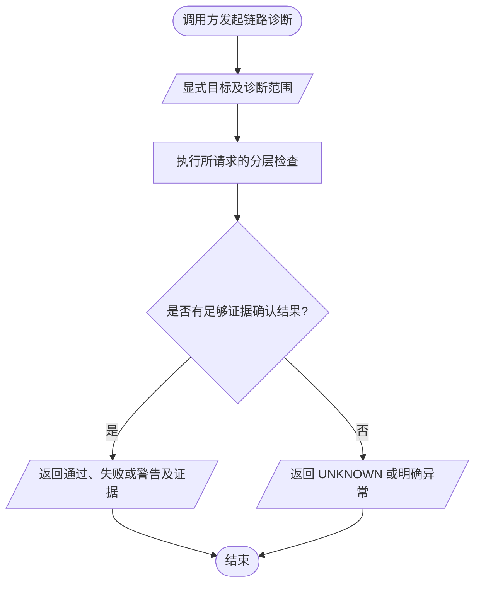
<p class="figure-caption">图 3-6 通用通信链路诊断流程</p>

### 3.7.3 业务规则

**R06-1 分层范围。**诊断对象包括网络接口、路由、本机监听端口、目标 TCP 连通性、适用的防火墙规则证据、协议连接/健康状态、协议测点读操作以及受控只读通信性能测试。各项诊断可独立调用，不强制从固定配置目录加载设备定义。

**R06-2 结果模型。**诊断状态的封闭集合为 `PASS`、`FAIL`、`WARNING`、`UNKNOWN`、`SKIPPED`；结果应包括目标、状态、诊断类别、可检索的故障发现和适用证据。`UNKNOWN` 用于证据不足，不能等同 `PASS`。本机防火墙静态规则不能单独证明实际业务流量可达。

**R06-3 检测方式。**协议健康可按具体 Driver 的实现采用主动或被动检测；`is_open()` 只反映本地状态，不能据此宣称远端设备可正常交换数据。通信基准测试必须明确请求次数、样本数、操作耗时与失败口径；没有测量结果时不得输出虚构速率。

**R06-4 可重复诊断。**可复用诊断接口以显式 `(endpoint, protocol, options, point_table)` 或已经装配好的 Driver 为输入；允许宿主先以自身规则读取配置后再调用 Core。不得强制传入配置根目录、设备 ID 或站点 ID。`SKIPPED` 表示调用方明确跳过或运行环境不具备前置条件，不等同检测成功。

**R06-5 处置归属。**Core 只返回诊断事实及通用检测结果；跨 Collector、Commander、Sink Service 等模块的端到端链路串联、告警升级、自动恢复与运维操作由业务模块或 CLI 编排。

### 3.7.4 关键约束

- **安全：**默认诊断不下发控制写指令、不修改防火墙规则、不接管生产协议连接；主动探测必须使用调用方明确指定的目标。
- **资源控制：**探测次数、扫描端口数、并发和超时应可由调用方设置，并对无效输入明确拒绝；现有 CLI 的网络扫描最多 128 个端口、并发最多 16，协议基准测试最多 200 个不同测点及 200 次采样，这些为当前入口的能力上限，不代表所有目标诊断适配器已统一；进程、连接及协议诊断句柄在结束或异常时必须释放。
- **证据准确性：**将超时、网络失败、协议失败和证据不足区分表达；不得将被动检查结果表述为主动握手成功。
- **非耦合：**诊断接口不得要求 `instances/site.yaml`、`instances/devices.yaml` 等固定路径，也不得强制调用方提供业务设备 ID 才能诊断一个已知协议端点。

## 3.8 分类需求与总—分追溯

<p class="table-caption">表 3-9 分类需求与原始需求追溯</p>

| 类别 | 编号 | 可核验要求 | 来源 |
|---|---|---|---|
| 功能 FR | FR-01 | 支持任意路径、任意合法 `dict` 的 YAML 读、解析、生成、原子保存，且不依赖设备/站点配置 | UR-01 |
| 功能 FR | FR-02 | 比较任意合法 `dict`，给出可确定排序的结构化新增、删除、修改差异 | UR-01 |
| 功能 FR | FR-03 | 通过显式协议能力声明实现工业通信，不支持操作必须拒绝 | UR-02 |
| 功能 FR | FR-04 | 提供边界装配的日志、指标、追踪、请求关联和异常观测 | UR-03 |
| 功能 FR | FR-05 | 提供线程池、Watchdog、生命周期、转换和公共异常的显式服务 | UR-04 |
| 功能 FR | FR-06 | 提供跨模块语义稳定、与业务流程无关的领域类型 | UR-05 |
| 功能 FR | FR-07 | 按显式目标执行网络、传输及协议只读诊断并返回结构化证据 | UR-06 |
| 性能 PR | PR-01 | 对外 I/O 均有可配置的正数超时；线程池容量为显式正整数；多端点扫描并发/次数有限 | UR-02、UR-04、UR-06 |
| 性能 PR | PR-02 | 普通观测出口有界队列或同步限流策略，失败不无限累积；数值验收须单列负载基准 | UR-03 |
| 可靠性 RR | RR-01 | 单文件原子保存，失败目标文件不被截断；明确区分单文件原子性与断电耐久性 | UR-01 |
| 可靠性 RR | RR-02 | 超时、取消、写入未知与会话关闭的物理事实不得误判为已完成 | UR-02、UR-04 |
| 可靠性 RR | RR-03 | 无观测后端情况下普通业务行为保持不变，异常不反向改变业务结果 | UR-03 |
| 安全 SR | SR-01 | 拒绝危险 YAML 构造、非法类型及可选根路径越界，不在错误信息中输出秘密值 | UR-01 |
| 安全 SR | SR-02 | 诊断不得暗中写设备点或改防火墙；请求关联 ID 不用于鉴权 | UR-03、UR-06 |
| 横切 CR | CR-01 | 横切能力可独立装配、启停、隔离并发上下文，不入侵业务函数 | UR-03 |
| 横切 CR | CR-02 | Core 不持有业务配置语义、业务状态机、调度策略及业务 KPI | UR-01～UR-06 |
| 基础服务 BR | BR-01 | 线程池、健康检查、重连回调和资源管理通过显式 API 提供，所有权清晰 | UR-04 |

**当前实现与设计目标差异（静态核查基线 `main@cac23d84`）：**

1. Core 已在 `src/core/infrastructure/config/generic_yaml.py` 提供 `parse_yaml/read_yaml/dump_yaml/save_yaml/compare_config`，不再把这五项描述为缺失；业务配置版本、引用图、路径装配不由 Core 解释。
2. `SharedDocumentLoader`、`build_shared_snapshot`、`resolve_effective_device`、`VersionedTemplateRepository` 实际归属独立 `src/configuration/`；各服务可依赖此共享配置层。禁止迁回 Core 或再次实现平行解析器。
3. Core 的 `diagnostic/network.py`、`diagnostic/protocol.py` 已提供网络与协议诊断入口；真实环境的正确性、权限、超时及资源收敛仍须测试。
4. `crosscutting/observability.py` 等已具备观测装配及请求关联基础；是否被所有宿主完整接入、Trace SDK 可用性和运行业务不受影响，均需独立验证。
5. **开发分支现状：**原 `core.infrastructure.rpc.scalar_codec` 已迁移为 `contracts.scalar_codec`，相应生产调用方已同步修改，Core 的 `infrastructure/rpc/` 已移除；这仅表示代码改动已经提交，导入边界、静态类型和回归测试仍需实际运行验证。`main@cac23d84` 仍保留原实现，二者不能混淆。
6. 工业协议的新增可调参数已经存在于当前解析器和 `configs/templates/protocols/*_1.1.0.yaml`；本版重点核查配置覆盖、运行生效、失效策略及故障语义，不重复添加既有字段。

本章区分现有代码事实与目标整改；第 4～13 章给出冻结的设计方向，第 14 章为后续独立验收条件。

# 4. 公共能力使用场景（用例视图）

## 4.1 参与者与边界

Core 是由宿主进程加载的 Python 基础库，不独立监听业务 RPC，不持有进程级业务状态。参与者是 Collector、Commander、Sink Service、Industrial Gateway、Data Generator、CLI 等**调用模块**及其基础设施装配层。用例描述公共能力如何被调用，不描述模块内部的业务运行流程。用例按第 2 章规定提供主路径、异常路径和可观测结果；各用例的具体测试统一追溯至第 14 章。

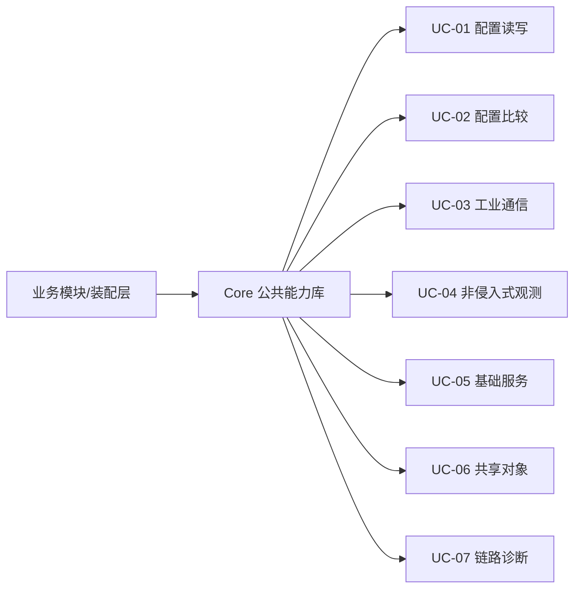
<p class="figure-caption">图 4-1 Core 公共能力用例边界</p>

<p class="table-caption">表 4-1 用例与需求对应</p>

| 编号 | 用例 | 参与者 | 需求 |
|---|---|---|---|
| UC-01 | 对指定配置文件读取、解析、保存 | 各业务模块 | UR-01 |
| UC-02 | 比较两份任意配置数据 | 各业务模块、CLI | UR-01 |
| UC-03 | 通过统一协议接口与工业设备通信 | Collector、Commander、Gateway 等 | UR-02 |
| UC-04 | 在进程边界装配非侵入式观测 | 各进程入口 | UR-03 |
| UC-05 | 显式使用线程池、健康检查及转换服务 | 各装配层 | UR-04 |
| UC-06 | 构造及传递共享领域对象 | 各业务模块 | UR-05 |
| UC-07 | 诊断明确指定的网络/协议端点 | CLI、运维及业务服务 | UR-06 |

## 4.2 UC-01 对指定配置文件读取、解析、保存

**前置条件：**调用方拥有目标路径的访问权限，明确目标路径及输入数据；业务内容已由调用方自行验证。**触发：**API。

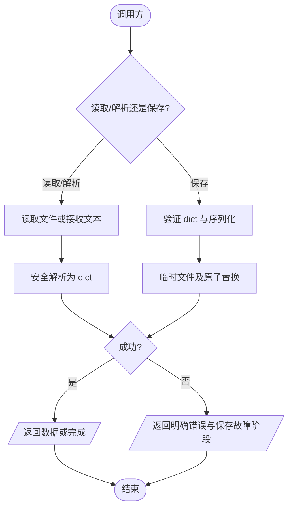
<p class="figure-caption">图 4-2 UC-01 配置文件通用读写</p>

<p class="table-caption">表 4-2 UC-01 使用场景及结果</p>

| 场景 | 行为 | 输出/后置条件 |
|---|---|---|
| 主路径 A | `read_yaml(path)` | 返回独立 `dict`，不改写文件 |
| 主路径 B | `parse_yaml(text)` / `dump_yaml(data)` | 返回数据或 YAML 文本，不进行 I/O |
| 主路径 C | `save_yaml(path, data)` | 同目录暂存、文件同步、替换、目录同步，成功后目标为新文档 |
| 异常 E1 | 重复键、非法类型、非法 YAML | 明确的解析或输入错误，不静默更正 |
| 异常 E2 | 权限/磁盘错误发生在替换之前 | 目标保持旧内容，清理临时文件 |
| 异常 E3 | 替换后目录同步失败 | 返回“结果不确定”阶段错误；调用方重新读取确认 |

## 4.3 UC-02 比较两份任意配置数据

**前置条件：**调用方提供两个合法 `dict`；无文件、目录或业务模型前置要求。**触发：**API。

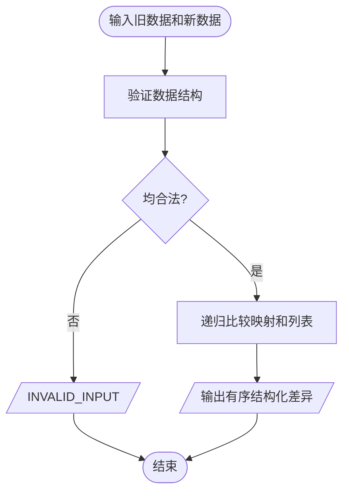
<p class="figure-caption">图 4-3 UC-02 结构化配置比较</p>

<p class="table-caption">表 4-3 UC-02 使用场景及结果</p>

| 场景 | 行为 | 输出/后置条件 |
|---|---|---|
| 主路径 | 相同或不同结构的合法 `dict` | `added/removed/changed` 差异集合，稳定排序 |
| 边界 | 空字典、嵌套列表、值类型改变 | 无差异或精确路径差异，不猜测列表业务主键 |
| 异常 | 非法数据、循环引用、非有限数字 | 明确拒绝，不修改两份输入 |

## 4.4 UC-03 通过统一协议接口与工业设备通信

**前置条件：**调用方明确协议、端点、选项和点地址；自行确定业务操作时机、权限及调度策略。**触发：**API、协议消息。

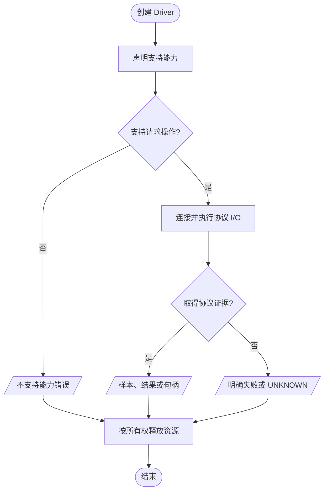
<p class="figure-caption">图 4-4 UC-03 工业协议通信</p>

<p class="table-caption">表 4-4 UC-03 使用场景及结果</p>

| 场景 | 行为 | 输出/后置条件 |
|---|---|---|
| 主路径 | 已声明能力的读写/监听/订阅 | 对应协议事实、样本或可关闭句柄 |
| 异常 E1 | 调用未声明能力 | 明确拒绝，不静默用另一种操作模拟 |
| 异常 E2 | 网络超时、取消、写入结果不明 | 保留协议事实或 `UNKNOWN`，不伪造业务结论 |
| 退出 | 操作正常、异常或取消 | 宿主释放句柄/连接；Driver 不擅自下达业务重试 |

## 4.5 UC-04 在进程边界装配非侵入式观测

**前置条件：**宿主决定启用哪些观测机制，提供导出和采样配置。**触发：**生命周期、请求边界、异常。

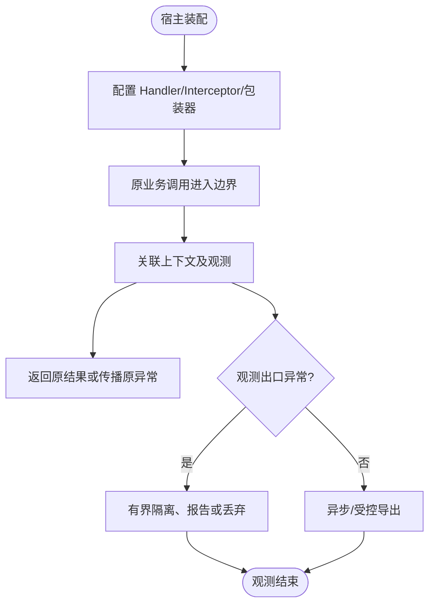
<p class="figure-caption">图 4-5 UC-04 观测机制装配</p>

<p class="table-caption">表 4-5 UC-04 使用场景及结果</p>

| 场景 | 行为 | 输出/后置条件 |
|---|---|---|
| 主路径 | 按需启用日志、指标、追踪、关联 | 业务函数不增加侵入性依赖，返回及异常语义不变 |
| 边界 | 禁用单个组件或全部组件 | 业务行为不受影响 |
| 异常 | 普通观测出口不可用 | 有界降级，不能阻塞工业通信主路径 |

## 4.6 UC-05 显式使用通用基础服务

**前置条件：**宿主提供资源容量、超时、回调和所有权。**触发：**API、生命周期或明确配置的周期。

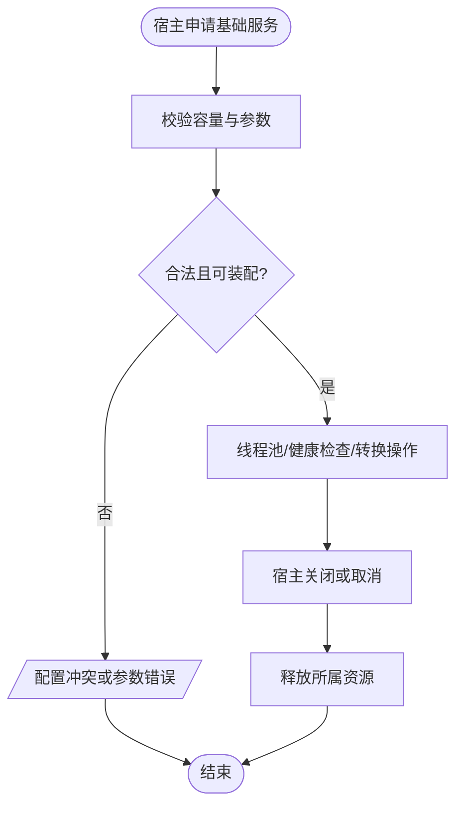
<p class="figure-caption">图 4-6 UC-05 基础服务</p>

<p class="table-caption">表 4-6 UC-05 使用场景及结果</p>

| 场景 | 行为 | 输出/后置条件 |
|---|---|---|
| 主路径 | 显式装配容量、调用公共服务 | 返回技术结果或句柄，业务规则不被修改 |
| 边界 | 同循环同参数重复装配 | 按公开规则复用，不重复创建池 |
| 异常 | 冲突配置、回调失败、取消 | 明确上报；资源最终由宿主释放 |

## 4.7 UC-06 构造及传递共享领域对象

**前置条件：**双方使用同一稳定通用类型契约。**触发：**API。

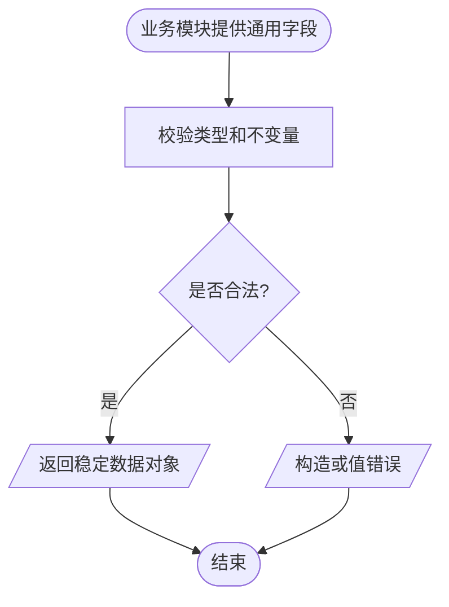
<p class="figure-caption">图 4-7 UC-06 共享对象</p>

<p class="table-caption">表 4-7 UC-06 使用场景及结果</p>

| 场景 | 行为 | 输出/后置条件 |
|---|---|---|
| 主路径 | 构建设备、点表、标识、采样值等 | 可跨模块传递的稳定类型和值语义 |
| 异常 | 标识、单位、质量或类型不合规 | 通用验证失败；不触发业务动作 |

## 4.8 UC-07 诊断明确指定的通信端点

**前置条件：**宿主明确诊断目标、范围、超时及允许的只读操作。**触发：**API、运维请求。

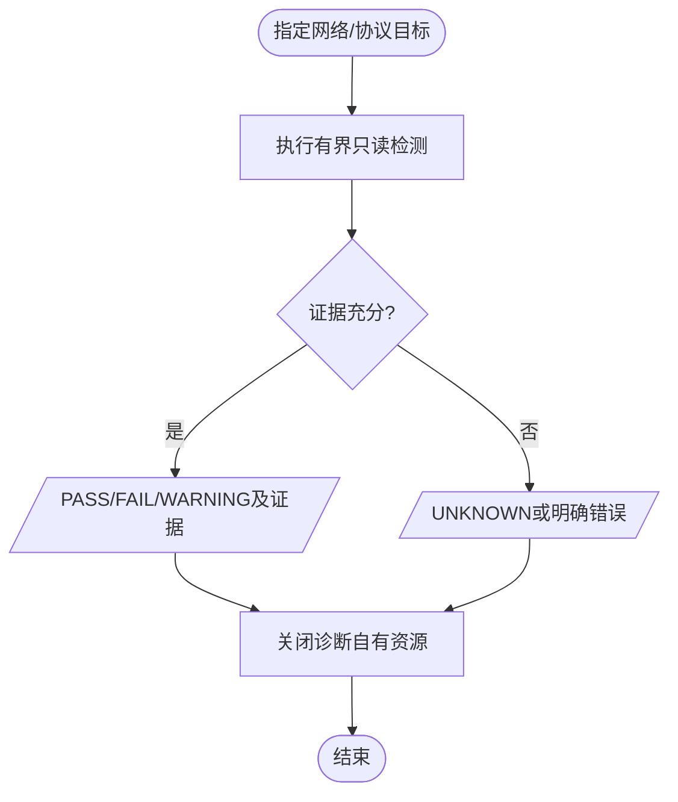
<p class="figure-caption">图 4-8 UC-07 通信诊断</p>

<p class="table-caption">表 4-8 UC-07 使用场景及结果</p>

| 场景 | 行为 | 输出/后置条件 |
|---|---|---|
| 主路径 | 网络、TCP、协议健康和可选测点读取 | 结构化诊断状态、证据和指标 |
| 边界 | 静态防火墙证据不能判定真实流量 | `UNKNOWN` 而非推断 `PASS` |
| 异常 | 超时、权限不足、协议不可达 | `FAIL`、`UNKNOWN` 或公开错误，按证据区分 |

# 5. 总体架构设计

## 5.1 架构定位与边界

Core 是由其他模块在同一 Python 进程内调用的**公共基础能力库**，不作为独立业务服务运行。Core 只负责第三章定义的六项公共能力：通用配置数据处理、工业协议通信、非侵入式横切机制、基础服务、共享领域对象和通信链路诊断。调用方拥有业务流程、业务配置语义、资源使用策略及业务状态。

Core 对外提供稳定的公共 API；不依赖 Collector、Commander、Sink Service、Industrial Gateway、Data Generator 或 CLI 的业务实现。公共机制与具体适配器分离，使业务模块能够按需使用，不引入与当前模块无关的能力。

## 5.2 逻辑架构

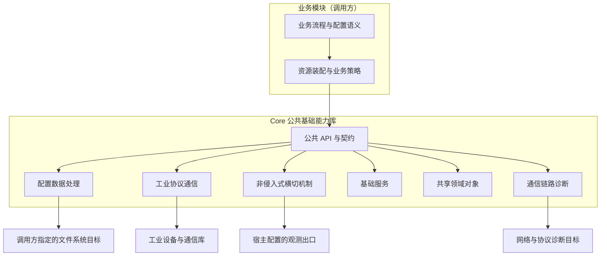
<p class="figure-caption">图 5-1 Core 公共能力逻辑架构</p>

六类组件的契约分别由第 6～11 章定义；本章不重复其 API 细节。

## 5.3 分层与依赖规则

<p class="table-caption">表 5-1 Core 分层职责与依赖约束</p>

| 逻辑层 | 职责 | 依赖约束 |
|---|---|---|
| Domain | 共享值对象、身份、单位和跨模块不变量 | 不依赖具体协议驱动、配置文件或业务服务 |
| Application | 公共能力契约、数据类型、错误类型及与外部实现无关的协调逻辑 | 依赖 Domain 和抽象接口，不依赖具体基础设施 |
| Infrastructure | YAML、协议 Driver、诊断、日志与观测的通用适配器 | 实现公共契约；可依赖第三方库，不依赖业务模块 |

分层以**减少依赖与维持稳定契约**为目的；简单、无状态的通用函数不必人为增加业务用例或多级包装。跨模块共享不等于属于 Core：具有采集任务、控制命令、数据派发等特定业务语义的模型，应归属对应业务模块或明确约定的独立契约。

## 5.4 宿主集成与资源所有权

Core 以 Python 包形式集成到宿主进程，不要求独立的 Core 进程、容器、监听端口、数据库或控制平面。调用方负责创建及关闭宿主进程，并明确配置文件路径、设备地址、通信参数、观测出口及资源容量。

- **配置资源：**Core 对调用方指定的数据和路径执行通用操作，不发现或解释业务配置树，不决定配置生效方式。
- **通信资源：**调用方装配协议 Driver 并选择所需能力；Core 提供明确的连接、关闭、句柄释放与错误契约。
- **横切能力：**优先使用日志 Handler/Filter、拦截器、装饰器与上下文传播，在宿主边界选择性装配，不改变业务流程。
- **基础服务：**显式调用公共服务并遵循明确的创建、使用及释放边界；不得隐式控制业务状态。
- **诊断资源：**由调用方提供诊断目标或已装配的协议接口；诊断自身创建的临时资源必须及时释放，默认不改变现场设备状态。

公共能力的失败不得被伪装为业务成功。观测类辅助功能需与业务主路径隔离；工业协议 I/O 和配置写入的错误应按公共契约报告给调用方，由调用方决定业务层面的重试、恢复或回滚。

## 5.5 开发视图：基础设施目录与架构边界

本节定义 Core 基础设施的模块结构及静态依赖边界。日志、Request-ID、Metric、Trace 和协议被动观测统一归属横切组件，主动通信诊断另设独立目录；Protobuf 标量编解码在开发分支已经迁至 Contracts，不再列入 Core 目录。业务模块拥有自身 RPC Server/Client、审计和指标语义。

```text
src/core/infrastructure/
├── crosscutting/              # UR-03：非侵入式观测与上下文传播
│   ├── __init__.py
│   ├── observability.py       # 装配、配置、指标和 HTTP 边界
│   ├── correlation.py         # 与传输无关的 Request-ID 上下文
│   ├── grpc_correlation.py    # grpc.aio 服务端 Request-ID 拦截器
│   ├── client_correlation.py  # grpc.aio 客户端关联及观测
│   ├── tracing.py
│   ├── observed_protocol.py
│   ├── log_setup.py
│   └── async_log.py
├── diagnostic/                # UR-06：主动、受控、只读通信诊断
│   ├── __init__.py
│   ├── network.py
│   ├── firewall.py
│   ├── protocol.py
│   └── benchmark.py
├── config/                    # UR-01
├── protocol/                  # UR-02
└── executor.py                # UR-04
```

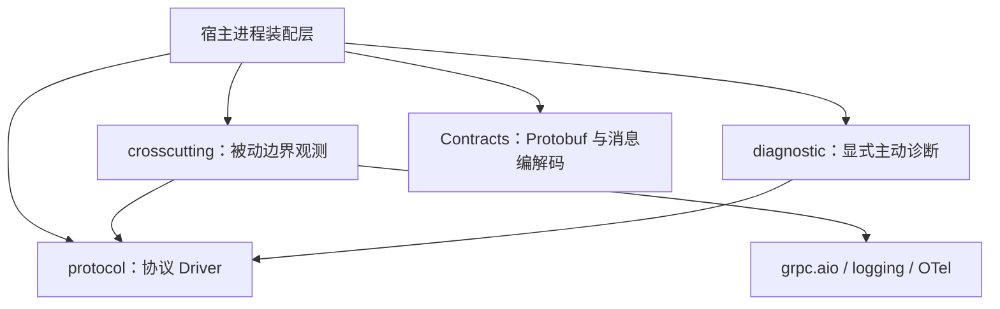
<p class="figure-caption">图 5-2 Core 横切、主动诊断、协议适配与外部 Contracts 边界（依赖为宿主到公共能力）</p>

<p class="table-caption">表 5-2 基础设施目录职责与依赖约束</p>

| 目录 | 所属需求 | 允许的内容 | 禁止事项 |
|---|---|---|---|
| `crosscutting/` | UR-03 | Logger Handler/Filter、ContextVar、HTTP/gRPC Interceptor、指标、Trace、协议 Wrapper | 主动扫描、业务审计、协议控制裁决、业务 KPI |
| `diagnostic/` | UR-06 | 接口/路由/TCP/防火墙/协议只读诊断及基准测试 | 请求关联与日志配置、全局观测装配、自动业务恢复 |
| `protocol/` | UR-02 | 工业协议 Driver、Session、Codec 与映射 | HTTP/gRPC 业务服务、业务审计与调度 |

**依赖约束：**`crosscutting` 可引用公共协议端口及第三方观测/传输库；`diagnostic` 可经公共接口访问 Driver，不得反向依赖横切装配。**目标稳定依赖方向**为 `configuration → Core`、`业务模块 → {Core, configuration, Contracts}`，Core 与 Contracts 不互相依赖。开发分支已删除反向依赖的 Core RPC 目录；仍须通过全仓导入检查验证该边界。业务模块可在装配层使用 Core 横切 API；Core 不得 import 任一业务模块、configuration 或 Contracts。公共能力只在其职责归属目录定义与导出，不建立重复实现或无业务意义的代理层。

## 5.6 Core、configuration、Contracts 的稳定协作契约

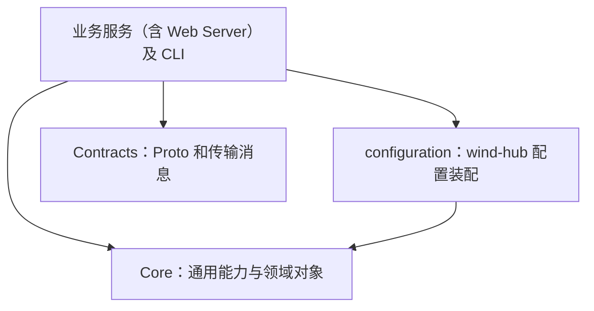

<p class="figure-caption">图 5-3 三个基础模块的目标依赖方向（不表示业务服务间的运行调用）</p>

<p class="table-caption">表 5-3 基础层职责、权威来源及边界</p>

| 范围 | 唯一权威 | 允许依赖与边界 |
|---|---|---|
| 通用 YAML 解析、保存和结构 Diff | Core `infrastructure.config` | 不解释 `services/instances/templates`，不承诺跨文件事务 |
| 设备、点表、单位和版本化模板引用的项目语义 | `src/configuration/` | 使用 Core 读写/领域类型；配置根和直接依赖均由 Service 显式传入 |
| Device、Point、值、质量及协议能力等通用领域语义 | Core `domain/application` | 不含采集任务、控制状态机、派发策略 |
| Protobuf、RPC 状态字段、NATS 消息 Schema 与跨进程标量编解码 | Contracts | Contracts 不反向导入 Core；边界转化显式处理缺值、非法数值与质量 |
| 多文件配置提交、候选快照 CAS 和热更新 | `configuration` 的共享协调机制及具体业务 Service | Core 仅确保单文件原子写入；不得把 `save_yaml` 解释成全局事务 |
| 端到端设备—NATS—Sink 诊断 | CLI、Web Server 与各业务服务的编排层 | Core 只提供网络、工业协议的局部诊断证据；Web Admin 经 Web Server 展示 |

**冻结边界：**修改 Core 或 configuration 的公开类型、接口、配置契约时，须同步核查全部调用方及测试；基础层设计优先消除真实缺口与逻辑冲突，不因目录美观或分层形式引入额外代理、复制模型及长期兼容层。Web Admin 仅通过 Web Server 的 HTTP/OpenAPI 契约间接访问服务，不直接依赖 Core、configuration 或 Contracts 的 Python 实现；Web Server 通过正式 RPC 及必要的公共能力装配访问业务服务。总体运行时关系以 `wind-hub_总体逻辑架构设计_v1_0.md` 为上位依据。


# 6. 通用配置数据处理设计

## 6.1 公开数据与操作

配置数据契约为 `dict[str, Any]` 且嵌套值仅允许 JSON 兼容类型；路径由调用方传入。以下五个接口**已在当前 `main@cac23d84` 的 `src/core/infrastructure/config/generic_yaml.py` 实现**，本节描述其稳定公共契约，而非尚待新增接口：

```python
from pathlib import Path
from typing import Any


def parse_yaml(content: str) -> dict[str, Any]: ...
def read_yaml(path: Path) -> dict[str, Any]: ...
def dump_yaml(data: dict[str, Any]) -> str: ...
def save_yaml(path: Path, data: dict[str, Any]) -> None: ...
def compare_config(old: dict[str, Any], new: dict[str, Any]) -> "ConfigDiff": ...
```

约束：五个操作均可独立使用；读取和保存各处理一个明确文件；不扫描目录、不认定文件角色、不解释参数；空 `dict` 合法。`parse_yaml` 与 `read_yaml` 都返回新构造对象；禁止配置加载时自动启动设备连接、订阅或业务服务。

## 6.2 结构差异契约

<p class="table-caption">表 6-1 差异条目公开语义</p>

| 字段 | 类型/含义 | 规则 |
|---|---|---|
| `path` | 字符串键/数组下标组成的结构化路径 | 如 `("devices", "a", "ports", 1)`，保留键和索引的类型信息 |
| `kind` | `added` / `removed` / `changed` | 三类封闭值；相同数据无条目 |
| `old_value` | 原值或“不存在”哨兵 | 新增时为“不存在” |
| `new_value` | 新值或“不存在”哨兵 | 删除时为“不存在” |

`None` 为合法配置值，不能代替“不存在”哨兵。`bool` 与 `int` 按不同类型比较；列表按序号比较，不能凭业务字段做重排或匹配。差异按结构路径的确定性规则输出；结构化路径的排序应明确字符串键与整数索引的比较规则，不能依赖 Python 将 `str` 与 `int` 直接比较。

**示例：**旧 `{"enabled": true, "ports": [502, 503]}`，新 `{"enabled": false, "ports": [502, 504], "name": "A"}`：得到 `enabled changed`、`ports[1] changed` 和 `name added`。业务模块解释哪些变化可热更新。

## 6.3 YAML 解析与格式约束

- 只启用安全解析，拒绝重复映射键、非字符串键、YAML 专有无法无损表达的值及循环引用；空文档不是空字典，须明确拒绝；合法 `{}` 可解析。
- 浮点值必须有限；序列化前验证整个数据图，不允许部分写入后才发现非法值。
- `dump_yaml` 的返回文本不承诺保留原文注释、空白及字段排版；在约定数据域内满足解析回环等价：`parse_yaml(dump_yaml(data)) == data`（等价按约定的类型语义判断）。
- 配置秘密值不由 Core 自行解密或脱敏转换；错误日志不能输出配置原文、密钥值。调用方决定字段授权及密钥来源。

## 6.4 保存流程与失败阶段

```mermaid
%%{init: {"flowchart": {"useMaxWidth": true}}}%%
flowchart TD
  A([save_yaml]) --> B["完整校验并序列化"]
  B --> C["同目录创建临时文件"]
  C --> D["写入、flush、fsync"]
  D --> E["os.replace 替换目标"]
  E --> F["fsync 父目录"]
  F --> G[/报告成功/]
  B -.错误.-> H[/替换前失败：旧目标保持/]
  C -.错误.-> H
  D -.错误.-> H
  E -.错误.-> H
  F -.错误.-> I[/替换后持久化未确认：重新读取核对/]
```
<p class="figure-caption">图 6-1 单文件原子保存及阶段性错误语义</p>

单次保存只保证单目标文件不会出现部分序列化结果；跨文件一致性、协调锁、版本提交和业务回滚不是 `save_yaml` 的隐式责任。要对多个文件进行事务化修改，调用方必须显式使用其自身协调层。替换后目录同步失败时不能声称旧内容未变，更不能自动盲重试；应携带“替换后”阶段信息。

## 6.5 可选版本与引用扩展

版本检查、引用图及依赖解析不阻塞以上五个基本接口。wind-hub 专属的 `VersionedTemplateRepository`、`SharedDocumentLoader`、`build_shared_snapshot` 等已归属 `src/configuration/`；它们可使用 Core 原语，但不因复用而改变 Core 的模块无关性。未来确需跨项目共享的版本/引用原语，须先证明不绑定模板类别、目录及业务规则，并单独设计其输入、错误与安全语义。

## 6.6 多文件使用方式

业务模块自行持有文件集合、确定比较粒度。例如读取两个任意路径分别得到 `dict`，逐文件调用 `compare_config`；若需要比较合并后的业务有效配置，则**由业务模块先完成合并**，再将两份有效 `dict` 交给 Core。Core 不提供默认目录、不自动读取依赖树，也不决定 `services/instances/templates` 的优先级。

## 6.7 项目模板装配与通用解析的边界

Core 通用 YAML 接口处理调用方传入的路径和数据，不依赖 `configs/templates` 固定目录；工程交付可包含该目录作为版本化模板实例。现有布局按 `configs/templates/` 的实际目录组织 `protocols/*.yaml`、`point_tables/*.yaml`、`device_models/*.yaml`、`units.yaml`、`business_points.yaml` 等共享模板；不把任一可选模板类别写成 Core 的硬编码发现规则。版本化模板使用 `<template_id>_<file_version>.yaml`，显式 ID/版本精确引用；`units.yaml`、`business_points.yaml` 使用文件内 `file_version`。文件系统装配、模板发布权限及任务策略归宿主负责；内容规则分别见第 7、10、8 章。`tasks` 模板属于 Collector 业务，Core 不解释其采集策略。

# 7. 通用工业协议通信设计

## 7.1 设计范围与公共通信契约

Core 为 ADS、Modbus TCP、IEC 60870-5-104（以下简称 IEC104）提供**工业协议客户端**能力。每个 Driver 独占其协议 Session，对外通过 `ProtocolPort` 暴露操作。Core 管理协议寻址、报文编解码、协议确认、连接及通信资源；采集周期、控制授权、命令幂等、业务重试、设备调度和数据发布由调用模块负责。本章不规定任何服务专属配置文件结构。

```mermaid
%%{init: {"flowchart": {"useMaxWidth": true}}}%%
flowchart TD
 A["业务模块：Collector / Commander / Gateway 等"] --> B["ProtocolRegistry：协议工厂注册"]
 B --> P["ProtocolPort：统一能力契约"]
 P --> D1["ADSDriver"]
 P --> D2["ModbusDriver"]
 P --> D3["IEC104Driver"]
 D1 --> S1["ADS Session / Codec / Notification"]
 D2 --> S2["Modbus TCP Session / Codec / Mapping"]
 D3 --> S3["IEC104 Session / Codec / Listener"]
 S1 --> E1[("ADS PLC")]
 S2 --> E2[("Modbus Server")]
 S3 --> E3[("IEC104 从站")]
```
<p class="figure-caption">图 7-1 工业协议通信组件关系</p>

<p class="table-caption">表 7-1 统一协议接口与能力声明</p>

| 接口或能力 | 统一语义 | ADS | Modbus TCP | IEC104 |
|---|---|---|---|---|
| `connect()` / `close()` | 建立/释放 Driver 所有连接 | 支持 | 支持 | 支持 |
| `is_open()` / `health()` | 本地可用性/协议健康检查 | 支持 | 支持 | 支持 |
| `read_one()` / `READ` | 单点读 | 支持 | 支持 | 支持 |
| `read_many()` / `READ_MANY` | 多逻辑点批量读 | 支持：ADS Sum Read | 支持：寄存器连续分组读取 | 不支持 |
| `write_one()` / `WRITE` | 单逻辑点写入 | 支持 | 支持 | 支持 |
| `write_many()` / `WRITE_MANY` | 多逻辑点批量写入 | 支持：ADS Sum Write | 不支持 | 不支持 |
| `subscribe()` / `SUBSCRIBE` | PLC 端原生远程通知注册 | 支持 | 不支持 | 不支持 |
| `listen()` / `LISTEN` | 本地接收设备主动上送 | 不支持 | 不支持 | 支持 |
| `interrogate()` / `INTERROGATE` | 显式站/组/计数器召唤 | 不支持 | 不支持 | 支持 |
| `update_point_table()` | 在当前就绪 Session 上增量校验完整点表，原子切换寻址缓存并返回结构化结果 | 目标统一契约 | 目标统一契约 | 目标统一契约 |

**契约规则：**`capabilities()` 是真实能力声明；不支持的操作抛 `ProtocolCapabilityError`，不得以轮询、缓存读取或单点循环伪装协议能力。`ProtocolRegistry` 只注册 Driver 工厂，创建不隐式连接。空批量读取、批量写入的特定行为按各 Driver 的声明与实现限定。

**控制写入选择：**一条命令仅涉及一个逻辑测点时，调用 `write_one()`；同一受理批次包含多个测点、目标 Driver 明确声明 `WRITE_MANY` 且批量操作满足协议限制时，调用 `write_many()`；否则由 Commander 在业务层按单设备顺序执行多次 `write_one()`，不把这种循环伪称为 Driver 原生 `WRITE_MANY`。Modbus FC16 的多寄存器数据仍是**一个逻辑测点**，不等于跨点批量写。不得合并不同控制请求来改变授权、失效时间、审计与 `UNKNOWN` 语义。

### 7.1.1 输入输出及时间质量

- 创建输入为 `ConnectionEndpoint`、对应协议的 `PointTable`、`ProtocolOptions`；这些是通信参数及点寻址定义，不表示 Core 有权解释业务服务配置。
- `ProtocolWrite(point, value)` 表示写入单个已配置点的工程标量；协议 Codec 负责严格的类型和字节编码。
- `ProtocolSample` 至少包含 `point_id`、`value`、`quality`、`timestamp`、`timestamp_source`、`receive_time`，有设备时间时还含 `device_time`；IEC104 另携带 CA、IOA、COT 等元数据。回调传入**不可变且非空的采样批次** `tuple[ProtocolSample, ...]`，不假定一次只到达一个点。
- 质量取 `GOOD`、`BAD`、`UNCERTAIN`。时间必须带时区；无可信协议设备时间时使用通信接收端 UTC 时间并标明 `local`。不将 `ProtocolSample` 构造器视为自动 UTC 转换器。
- `write_one()` / `write_many()` 的单点结果取 `CONFIRMED_SUCCESS`、`CONFIRMED_FAILURE`、`UNKNOWN`。成功仅表示规定的**协议确认条件**满足，不表示机械或电气设备已物理到位。底层写入可能已提交但未收到可靠确认时必须保留 `UNKNOWN`，不能盲目重试。
- `validate_read_many_results()` 约束批量结果数量及逐位 `point_id` 对齐，包括重复点；返回样本不得因解码质量差而静默删点。

### 7.1.2 Session 生命周期与并发边界

```mermaid
%%{init: {"stateDiagram": {"useMaxWidth": true}}}%%
stateDiagram-v2
 [*] --> Disconnected
 Disconnected --> Connecting: connect
 Connecting --> Connected: 建连与协议握手完成
 Connecting --> Disconnected: 可安全清理的连接失败
 Connecting --> Faulted: 资源清理未收敛
 Connected --> Closing: close / 连接失效 / 必须隔离的 I-O 异常
 Closing --> Disconnected: 资源完全释放
 Closing --> Faulted: 资源仍不确定
 Faulted --> Disconnected: 明确清理成功
```
<p class="figure-caption">图 7-2 协议连接与资源收敛的概念状态</p>

该图仅描述 Driver 的连接与资源状态，`Disconnected` 不是对象销毁或 UML 终止状态；Driver 可以重新 `connect()`，但已关闭的 Session 不得重新打开。该图为公共资源语义，不要求各 Driver 内部采用完全相同的状态字段。一个 Driver 只持有一个当前 Session；底层 I/O 的完成与调用方协程取消必须分别判定。关闭前收敛在途操作和推送句柄；若不能证明底层资源已释放，不得将其误标为可复用。`health()` 不执行自动重连或业务重试；恢复策略由调用方决定。

### 7.1.3 Driver、Session、Connection 资源模型

三个层次具有不同的生命周期与资源责任，不能将 `Driver.connect()` 等同于仅打开 Socket：

- **Driver** 是公开 `ProtocolPort` 的实现，持有配置、测点索引、能力声明、当前 Session，以及原生订阅或监听句柄；负责将协议原生结果转换为 `ProtocolSample` / `ProtocolWriteResult`。
- **Session** 是一个物理连接的独占资源所有者，负责协议库连接对象、执行互斥、在途任务或请求 Future、接收循环与关闭收敛。单个 Session 不得重新打开；新连接必须创建新 Session。Driver 在构造时保存待应用的初始 PointTable，但不创建 Session；`connect()` 建立新 Session、确认底层协议连接 Ready 后，调用初始化点表更新，只有 PointTable Ready 才向宿主报告 `connect()` 完成。运行中更新点表不关闭 Session。
- **Connection/Client** 是 `pyads.Connection`、`AsyncModbusTcpClient` 或 `hat.drivers.iec104.Connection`等原生对象，不向业务模块暴露其生命周期。
- **Handle** 为订阅、监听资源。ADS `SubscriptionHandle` 远程注册；IEC104 `ListenHandle` 仅本地注册。句柄依附当前 Session，重连后不得沿用旧原生句柄。

```mermaid
%%{init: {"flowchart": {"useMaxWidth": true}}}%%
flowchart TD
    Host["宿主模块：决定生命周期及恢复策略"] --> Port["ProtocolPort"]
    Port --> Driver["Driver：配置、映射、能力、句柄集合"]
    Driver --> Session["Session：唯一当前连接及 I/O 所有权"]
    Session --> Native["Connection：原生协议客户端"]
    Native --> Device["工业设备"]
    Driver --> Map["Mapping / Codec / Read-plan Cache"]
    Driver --> Handle["Subscription / Listener Handle"]
    Handle -.-> Session
```
<p class="figure-caption">图 7-3 Driver、Session、Connection 与缓存资源所有权</p>

```mermaid
%%{init: {"sequence": {"useMaxWidth": true}}}%%
sequenceDiagram
    participant Host as "宿主模块"
    participant Driver as "Protocol Driver"
    participant Session as "Protocol Session"
    participant Native as "原生 Connection"
    Host->>Driver: connect()
    Driver->>Session: 创建单次使用的 Session
    Session->>Native: open / TCP connect
    Native-->>Session: 连接成功
    Session-->>Driver: 协议会话就绪
    Note over Driver,Native: ADS 还须 PLC RUN；IEC104 还须 STARTDT
    Driver->>Driver: 首次内部点表初始化（后续重连不重复）
    Note over Driver: 编译、在线验证、切换寻址缓存
    Driver-->>Host: Connection + PointTable Ready
    Host->>Driver: close()
    Driver->>Session: 停止新 I/O，回收句柄及在途操作
    Session->>Native: close / async_close
    Native-->>Session: 原生资源已收敛
    Session-->>Driver: 安全释放
    Driver-->>Host: close 完成
```
<p class="figure-caption">图 7-4 协议连接建立与安全关闭时序</p>

通用状态转换见图 7-2。只有原生连接、活动任务和句柄资源的关闭已确认，才能从 `Closing` 转为 `Disconnected`；清理结果不确定必须处于不可复用状态。`close()` 与 `connect()` 不可在同一 Driver 上无序交错；宿主在 Watchdog 外另行触发重连时，须使用同一生命周期锁。Driver 的状态枚举是外部契约；Modbus 目前以 Session 是否打开表达可用性，不强制引入 ADS/IEC104 相同的内部状态字段。

### 7.1.4 单次操作、并发、整体 Deadline 与推送生命周期

一次性读写接口不设计业务级 `cancel()`，正常终止条件为响应完成或整体 Deadline 到期；但任务关闭或 `asyncio.timeout()` 仍可能触发底层协程取消，Session 必须继续负责原生事务的收敛。ADS、Modbus、IEC104 分别采用各自的锁和协议并发能力；统一抽象不承诺原生 I/O 可立即中止。

```mermaid
%%{init: {"sequence": {"useMaxWidth": true}}}%%
sequenceDiagram
    participant Caller as "调用方"
    participant Driver as "Driver / Codec"
    participant Session as "Session / 并发门"
    participant Native as "原生 Connection"
    Caller->>Driver: read_one / write_one（整体 Deadline）
    Driver->>Driver: 查询当前映射快照并校验
    Driver->>Session: 排队并执行协议事务
    Session->>Native: 发送原生请求
    alt 收到可信确认
        Native-->>Session: 协议响应
        Session-->>Driver: 完整响应
        Driver-->>Caller: 样本或写入确认
    else Deadline 到期或宿主任务终止
        Note over Session,Native: 等待结束不等于原生 I/O 已停止
        Session->>Session: 继续收敛事务，必要时隔离当前连接
        Driver-->>Caller: 读取超时异常；写入按证据报告 UNKNOWN 或未发送失败
    end
```
<p class="figure-caption">图 7-5 单次协议操作、整体时限与底层资源收敛</p>

<p class="table-caption">表 7-2 通信操作 Deadline 与终止契约</p>

| 操作 | 整体时限范围 | 到期与资源语义 |
|---|---|---|
| `connect()` | 建连、握手、初始点表验证直至操作就绪 | 失败不得宣称 Ready；旧 Session 必须清理或标记资源不确定 |
| `close()` | 停止受理、收敛在途 I/O、注销句柄并关闭连接 | 超时须暴露未收敛状态；不可直接将旧 Session 置空后重建 |
| `health()` | 一次检查的完整过程 | 返回不健康或超时故障，不在检查内自行重连 |
| `read_one()` / `read_many()` | 排队、全部原生子请求、解码与汇总 | 整体超时则失败；不得以缓存值或不完整批次冒充完整结果 |
| `write_one()` / `write_many()` | 排队、全部已计划子请求及协议确认 | 未发送可确认为失败；已发但确认不足记 `UNKNOWN`；批次应保留逐点已知结果和未发送范围 |
| `update_point_table()` | 差异计算、静态与在线验证、切换和受影响资源协调 | 返回明确更新状态、实际生效版本、逐点失败原因；失败时不能隐瞒部分生效 |
| `subscribe().start()` / `stop()` | 注册/注销全部相关原生句柄 | 超时必须明确残留句柄及清理状态，不静默丢弃资源 |
| `listen()` / `handle.close()` | 本地注册、排队回调停止及注销 | 不产生伪远端订阅；超时显式反馈处理未完成 |
| `interrogate()` | 召唤请求、数据接收及对应终止确认 | 超时给出不完整或失败证据，不伪造完整结果 |

**规则：**上述均采用一次操作的**整体 Deadline**，不能在子步骤、子批次或重试时重新领取完整时限；协议原生超时只是其中一个约束。调用方等待期限与原生 I/O 安全清理期限应分别记录，不能为满足响应时限而放弃底层资源所有权。每个公开 I/O 操作必须配置正数超时或使用文档明确的有界默认值。

<p class="table-caption">表 7-3 协议操作并发与能力差异约束</p>

| 项目 | 统一契约 |
|---|---|
| 并发 | ADS 原生调用串行；Modbus 单 Session 跟踪在途 Task；IEC104 发送锁、地址锁及站召锁各负其责。不得由统一接口假定全协议同一并发度。 |
| 批量读取 | ADS Sum Read、Modbus 分组读取属于真实批读；严格保留输入顺序及重复点；IEC104 不支持 `read_many()`。 |
| 批量写入 | 仅 ADS 声明 `WRITE_MANY`；逐点确认，非原子事务，已确认结果、未知结果、未发送结果不得混淆。 |
| 持续推送 | ADS `subscribe()` 的 `start()/stop()`、IEC104 `listen()` 的句柄 `close()` 是持续资源正常生命周期操作，与单次读写不存在业务取消接口是两回事。 |
| 连接隔离 | 已提交控制结果不明时不得自动重发；原生事务仍未收敛时禁止用新 Session 竞争同一设备。 |

### 7.1.5 缓存对象、失效条件及重建接口

缓存范围限定为**测点寻址元数据、解码器及读取计划**，不保存最新测量值。**Driver 管理静态映射生命周期，Session 管理原生连接及其句柄生命周期**；普通 `close()` 是一次 Session 关闭，不是销毁 Driver。

<p class="table-caption">表 7-4 三种协议的缓存对象、失效与重建</p>

| 协议 | 缓存对象 | 缓存键 | 失效条件 | 重建接口 |
|---|---|---|---|---|
| ADS | Symbol 寻址映射、解码器 | `point_id` | `update_point_table()`；Session 重建时原解析地址待确认 | `update_point_table()`；重连时由 `connect()` 重新确认 Symbol |
| ADS | Notification 区块布局 | 订阅测点集合 | `update_point_table()`；`close()` 释放订阅句柄 | `subscribe().start()` |
| Modbus TCP | 寄存器寻址索引 | `point_id` | `update_point_table()` | `update_point_table()` |
| Modbus TCP | 批量读取计划（可配置 LRU） | `tuple(point_ids)` | `update_point_table()`（受影响计划）；容量驱动的 LRU 淘汰 | `read_many()` |
| IEC104 | 测点寻址索引 | `point_id` | `update_point_table()` | `update_point_table()` |
| IEC104 | 上送反向匹配索引 | `(CA, IOA)` | `update_point_table()` | `update_point_table()` |

**资源释放与缓存规则：**

<p class="table-caption">表 7-5 Session 关闭与缓存保留规则</p>

| 操作 | Session、Connection、推送句柄 | Driver 静态寻址缓存 | Modbus 读取计划 |
|---|---|---|---|
| `update_point_table()` | 保持现有连接；协调受影响的句柄 | 增量编译并原子替换 | 只失效受影响计划（目标设计） |
| `close()` | 收敛在途 I/O，关闭 Session，注销/关闭推送句柄 | 保留；ADS 已解析地址标记为需在新 Session 中确认 | 保留 |
| `connect()` | 新建一次性 Session，建立协议连接 | ADS 重新确认 Symbol 的实际地址；Modbus、IEC104 复用静态索引 | 复用 |
| Driver 最终释放 | 必须已经安全释放所有 Session/句柄 | 全部释放 | 全部释放 |

```mermaid
%%{init: {"flowchart": {"useMaxWidth": true}}}%%
flowchart TD
    A["Driver 创建，保留静态测点定义"] --> B["connect() 建立 Session"]
    B --> C{"首次连接？"}
    C -->|是| C1["内部初始化点表并验证"]
    C -->|否| C2["保留已生效缓存；ADS 确认 Symbol"]
    C1 --> D
    C2 --> D
    D["协议读写使用当前缓存"] --> E{"触发什么操作？"}
    E -->|"update_point_table()"| F["增量验证并切换受影响缓存"]
    F --> D
    E -->|"Modbus read_many()"| G["命中或生成 LRU 读取计划"]
    G --> D
    E -->|"close()"| H["释放 Session 与推送句柄；保留静态缓存"]
    H --> I{"Driver 后续是否重连？"}
    I -->|是| B
    I -->|否，最终释放| J["释放 Driver 持有的全部缓存"]
```
<p class="figure-caption">图 7-6 驱动缓存与 Session 生命周期（点表更新内部流程见图 7-7）</p>

**边界约束：**① `close()` 不清空静态寻址索引，也不隐式调用 `update_point_table()`；② ADS 的旧 Symbol 解析地址不可在新 Session 未确认前直接用于 I/O；③ Modbus/IEC104 静态寻址映射允许跨 Session 复用；④ 旧 Session 的原生订阅句柄、Listener、Future 与在途 Task 都不是可跨连接复用的静态缓存；并发地址锁由 Driver 按地址持有，需随映射变更协调管理；⑤ Watchdog 只调用 `health/close/connect`，不调用 `update_point_table()`，不主动清缓存；⑥ Driver 最终释放须释放其所有缓存与派生资源。

### 7.1.6 `update_point_table()`：增量在线验证与整份生效

**对外契约：**宿主提交**完整 PointTable**，不提供单点更新接口。更新操作要求当前底层 Connection/Session 已 Ready；首次 `connect()` 在建链完成后执行**内部初始点表装配与验证**，使首次返回 Ready 必须满足 ConnectionReady 与 PointTableReady；内部可复用 `update_point_table()` 的校验/编译实现，但不得通过对外更新接口引入重复生命周期。**同一 Driver 后续重连**沿用已生效 PointTable 和静态缓存，绝不再次调用公开的 `update_point_table()`；ADS 仅在 `connect()` 中重新确认 Session 相关 Symbol 地址。后续显式点表更新不因点表变化而 `close()` / 新建 Session。`update_point_table()` 必须为异步接口，以支持在线验证和整体 Deadline。

```mermaid
%%{init: {"flowchart": {"useMaxWidth": true}}}%%
flowchart TD
    A["update_point_table(完整新点表)"] --> B{"Session / Connection Ready？"}
    B -->|否| X["返回 NOT_READY，保留原生效版本"]
    B -->|是| C["比较新旧点表：新增、修改、删除、未变"]
    C --> D{"有实质变化？"}
    D -->|否| U["返回 UNCHANGED"]
    D -->|是| E["增量解析受影响点并编译候选映射"]
    E --> F["执行整份候选映射跨点静态校验"]
    F --> G{"静态校验通过？"}
    G -->|否| V["返回 VALIDATION_FAILED"]
    G -->|是| H["对变化的可验证点执行协议在线校验"]
    H --> I{"在线结果满足明确策略？"}
    I -->|否| W["返回 VERIFICATION_FAILED / TIMEOUT"]
    I -->|是| J["协调受影响的在途请求与推送句柄"]
    J --> J1["预备新增订阅资源并校验，可回滚"]
    J1 --> J2{"准备阶段成功？"}
    J2 -->|否| R["清理预备资源，保持旧映射；报告失败"]
    J2 -->|是| K["原子切换映射代次与读取计划索引"]
    K --> L["激活新代次回调，停用旧代次并注销旧句柄"]
    L --> M{"资源已全部收敛？"}
    M -->|是| S["SUCCESS，applied=true，运行正常"]
    M -->|否| P["APPLY_FAILED，applied=true，运行降级并报告残留"]
```
<p class="figure-caption">图 7-7 完整点表提交、差异验证与原子更新流程</p>

**目标公开接口与类型契约**（Python 3.11；用于实现和跨模块类型检查，不表示当前代码已具备）：

```python
from dataclasses import dataclass
from enum import StrEnum
from typing import Literal

class PointTableUpdateStatus(StrEnum):
    SUCCESS = "SUCCESS"
    UNCHANGED = "UNCHANGED"
    VALIDATION_FAILED = "VALIDATION_FAILED"
    VERIFICATION_FAILED = "VERIFICATION_FAILED"
    NOT_READY = "NOT_READY"
    TIMEOUT = "TIMEOUT"
    APPLY_FAILED = "APPLY_FAILED"

@dataclass(frozen=True, slots=True)
class PointTableIssue:
    point_id: str
    code: str
    message: str
    phase: Literal["validation", "verification", "prepare", "commit", "cleanup"]

@dataclass(frozen=True, slots=True)
class PointTableUpdateResult:
    status: PointTableUpdateStatus
    applied: bool
    active_version: int | None
    point_errors: tuple[PointTableIssue, ...]
    message: str
    resource_state: Literal["READY", "DEGRADED", "FAULTED"]
    unverified_points: tuple[str, ...] = ()
    residual_resources: tuple[str, ...] = ()

async def update_point_table(
    point_table: PointTable, *, timeout: float,
) -> PointTableUpdateResult: ...
```

<p class="table-caption">表 7-6 点表更新结果字段及不变量</p>

| 字段 | 契约与判定要求 |
|---|---|
| `status` | 单次提交的最终状态；失败类别与所在阶段一一对应，不得用无差别异常替代业务可判定结果 |
| `applied` | 当前生效映射是否已经切换到本次提交的候选点表；`UNCHANGED` 返回 `false`；成功提交为 `true` |
| `active_version` | Driver 内生效映射的单调递增整数代次；首次成功初始化为 `1`，每次实际映射切换加一；未初始化为 `null`。**不是** YAML `file_version` 或 `point_table_id`，重建 Driver 后重新计数 |
| `point_errors` | 逐点错误及阶段；无具体点归属的资源失败在 `message` 与 `residual_resources` 中记录，不伪造点 ID |
| `resource_state` | `READY` 表示正常可用；`DEGRADED` 表示映射已生效但部分推送未恢复；`FAULTED` 表示资源清理不确定、禁止继续分派新 I/O |
| `unverified_points` | 因协议能力或写入专用性质无法在线核验的点，必须显式报告；不等同于验证通过或错误 |
| `residual_resources` | 仍可能活动的旧订阅/监听句柄等资源的稳定标识，不包含凭据、数据值或原生指针 |

<p class="table-caption">表 7-7 更新状态与生效语义</p>

| `status` | `applied` | `active_version` | 处理规则 |
|---|---|---|---|
| `SUCCESS` | `true` | 新代次 | 新映射和相关运行资源均已就绪 |
| `UNCHANGED` | `false` | 原代次 | 语义一致；不重新校验或重建缓存 |
| `VALIDATION_FAILED` / `VERIFICATION_FAILED` / `NOT_READY` | `false` | 原代次 | 不提交候选映射，保留旧可用配置；必要时报告点级错误 |
| `TIMEOUT` | 视提交点而定 | 实际代次 | 提交前超时不生效；提交后超时不得谎称未生效，填 `applied=true` 和残留资源，运行状态按实际标记 |
| `APPLY_FAILED` | `false` 或 `true` | 实际代次 | 预备阶段失败且清理成功为 `false`；提交后失败为 `true`，不得静默回滚或覆盖当前版本 |

**异常与超时约定：**合法调用中已识别的配置、在线验证、未就绪、执行超时及资源协调失败，以 `PointTableUpdateResult` 返回；程序错误、调用方传入非 `PointTable`、非法超时等按明确异常抛出。`timeout` 必须是有限正数，涵盖排队、验证、提交及资源协调，使用单一单调 Deadline。若到期发生在提交后，返回 `TIMEOUT` 且真实报告 `applied=true`；若清理仍未收敛则 `resource_state=FAULTED`，不接受新事务。外层协程被取消时必须保全已经发生的提交及资源所有权，由 Session 继续收敛并记录结果，不能默认当作未应用。

**跨版本稳定性：**`PointTable` 当前仅有 `point_table_id`，并无文件版本字段；因此 `active_version` 只能表示当前 Driver 的映射代次。宿主如果需要文件版本，应在自身配置快照中另外保留 `file_version` 或内容摘要，禁止将其伪装为 Driver 版本。

<p class="table-caption">表 7-8 各协议点表增量在线验证策略</p>

| 协议 | 增量在线校验方式 | 不得隐含的语义 |
|---|---|---|
| ADS | 复用当前 Session 查询新增、Symbol/类型等关键字段变化的测点，核对 Group/Offset 及可获得的类型信息 | 点表热更新不触发重连；Session 重建后须重新确认全部连接相关 Symbol 地址 |
| Modbus TCP | 对变化的**可读**测点使用连续分组读取；变更点也须参与整份地址重叠和范围校验 | 写入专用点不能以读取验证，不得写点试探；读取成功不证明写入类型正确 |
| IEC104 | 对变化的监视点采用 `read_one()` 或明确的站/组召唤，按 CA/IOA/Type ID 匹配响应 | IEC104 没有 `read_many()`；召唤不保证每个测点均返回，不能据此虚报全量验证通过 |

**更新反馈：**以表 7-6、表 7-7 为唯一契约。在线不可验证的写入专用点须写入 `unverified_points`，不得为了校验发送控制写入；在线无响应不能直接归类为地址无效。

**原子性边界：**一次请求获取一份映射代次快照；旧请求按旧代次完成或失败，新请求只看到新代次。提交点是内存映射与读取计划索引的**一次原子引用替换**，不能出现混合版本。点表更新同一 Driver 串行执行，并与 `close()`、Watchdog 重连共用生命周期互斥；旧代次在途 I/O 有明确完成/隔离策略。整体 Deadline 涵盖差异计算、在线检验和资源协调；到期不得放弃原生未收敛任务。

**ADS Notification 与 IEC104 Listener 更新事务：**

1. **准备：**根据候选映射计算受影响的订阅/监听集合，编译新布局。未变对象及其句柄不重建。ADS 可先注册暂存的新原生 Notification，但新回调必须带候选代次并保持不可对外投递；IEC104 仅预备本地地址路由索引。更新过程中维护有效旧映射与现有回调。
2. **提交前失败：**撤销已预注册的新句柄；旧映射及旧句柄继续有效。若预注册句柄无法安全撤销，返回 `APPLY_FAILED`、`applied=false`、`resource_state=FAULTED` 及残留资源，不把该失败隐藏为普通验证错误。
3. **提交：**在统一同步点切换映射引用/版本和回调代次门；新代次允许投递，旧代次从此不再向宿主投递，避免两套句柄造成重复上送。监听路由与映射同代次切换。对无法无缝排队的设备，允许切换瞬间存在**已记录的通知间隙**，不得承诺零丢失；Core 不自动以读取补偿历史数据。
4. **提交后：**注销旧 Notification/旧监听资源；已提交映射不自动回滚。注销或恢复失败返回 `APPLY_FAILED`（或 Deadline 到期 `TIMEOUT`），`applied=true`，保留新 `active_version`，报告 `residual_resources` 和 `DEGRADED/FAULTED`，不得宣称全部订阅已恢复。
5. **恢复：**宿主可显式重试受影响句柄的 `start/stop` 或请求安全关闭/重连；必须按句柄及代次幂等去重。Watchdog 只按健康规则重连，不隐式重放点表更新；恢复完成后再报告 `READY`。静态缓存不得因一般 `close()` 被清空。

不支持订阅/监听的协议仅处理映射和在途请求协调，不创建伪句柄；`UNKNOWN` 写入永不自动重发。

### 7.1.7 协议模板和点表 YAML 契约

仓库当前发布的协议模板 `configs/templates/protocols/{ads,modbus_tcp,iec104}_1.1.0.yaml` 采用 `schema_version`、`template_id`、`file_version`、`protocol`、`protocol_options`；点表模板 `configs/templates/point_tables/*.yaml` 采用相同元数据和 `points`。协议 Driver/Adapter 校验内容，UR-01 只做通用 YAML 读写。模板字段及校验职责见表 7-9；`endpoint.host/port` 属于设备实例/型号默认配置，现场密码不得进入共享模板。

<p class="table-caption">表 7-9 工业协议模板字段及校验归属</p>

| 协议 | `protocol_options` 核心参数 | `points[*].address` 关键参数 | 校验责任 |
|---|---|---|---|
| ADS | `target_net_id`、`twincat_version`、`timeout`、`max_subs_per_sum`、`max_block_bytes`、`max_delay`、`route_auto_add`、`username`、`password` | `symbol`、`data_type`、`size` | AMS ID、类型与长度合法性；实际 Symbol 地址在线确认 |
| Modbus TCP | `mode`、`slave_id`、`timeout`、`word_order`、`health_point_id` | `register_type`、`address`、`count`、`slave_id` | TCP 模式、地址区间、字序、可读健康点、寄存器跨度 |
| IEC104 | `k`、`w`、`t0`～`t3`、`read_timeout`、`command_timeout`、`interrogation_timeout`、`timezone`、`health_point` | `ca`、`ioa`、`type/type_id`、可选 `command_mode`、`confirmation` | 窗口/超时、类型与读写权限、CA/IOA 唯一性 |

**模板落地要求：**当前 `1.1.0` 协议模板及对应 Core 解析器已经包括 ADS `notification_interval/notification_queue_capacity`、Modbus TCP `read_merge_max_gap/read_plan_cache_size`、IEC104 `listener_queue_capacity`。不得再次添加同名字段或直接改写已发布版本；下一步验证其从设备实例、型号到协议模板的优先级、Driver 实际接收、计划/句柄失效及容错边界。保留现有版本号字段结构，版本升级依据实际配置契约变更规则处理，不能无理由强制覆盖用户自定义参数。`mode`、`max_subs_per_sum`、`k/w` 等已有参数仍由相应协议 Adapter 验证，通用 YAML 组件仅处理结构与序列化。配置字段的当前实现情况应由编码阶段逐项验证，不得将示例视为已实现。

```yaml
# 目标模板片段示例：configs/templates/protocols/modbus_tcp_<version>.yaml（数值仅示例，默认值以表 7-14 为准）
protocol_options:
  mode: tcp
  slave_id: 1
  timeout: 5.0
  word_order: little_endian
  health_point_id: null
  read_merge_max_gap: 2       # 允许空洞数，可改为 0
  read_plan_cache_size: 64    # 0 禁用缓存，非硬性固定 32
```

```yaml
# 目标模板片段示例：ADS、IEC104
# ADS 的 protocol_options 追加：
# notification_interval: 0.1
# notification_queue_capacity: 1000
# IEC104 的 protocol_options 追加：
# listener_queue_capacity: 256
```

**配置契约落地与兼容策略：**协议参数表 7-12、7-14、7-17 是默认值的唯一来源；加载时按“设备实例 > 型号 > 协议模板 > Driver 缺省值”合成，并在实例化 Driver **之前**验证类型、范围和协议能力。新字段必须同步出现在对应出厂 `configs/templates/protocols/*.yaml`、选项解析器、验证器、文档及用例中；任一层缺失或参数被静默忽略均不算完成。已有模板版本保持不可变，契约发生变化时发布新 `file_version` 文件，实例明确引用新版本；不得直接覆盖历史已发布模板。缺失可选字段时按参数总表采用默认值，不得用固定代码常量覆盖用户显式配置。连接参数变更仅在新的 Session 上应用；计划容量与合并策略修改须安全失效相关读取计划；通知队列与周期配置变更需通过新句柄或安全重建才能生效。`read_merge_max_gap` 等目标新增字段在解析器未实现前不得宣称支持。单次操作 `timeout` 与设备 `protocol_options.timeout` 是两类独立时限。

### 7.1.8 参数开放性与边界分类

本章出现的数值分为三类，**不得把某个现场或当前实现中的数值固定成通用算法规则**：

<p class="table-caption">表 7-10 通信参数分类与适用原则</p>

| 类型 | 例子 | 契约 |
|---|---|---|
| 协议/编码边界 | Modbus 单请求合法寄存器数、功能码、IEC104 CA/IOA 地址位数、ADS 类型长度 | 由协议和实际协议栈规定，不能以 YAML 任意突破；必须校验 |
| 运行可调参数 | Modbus `read_merge_max_gap`、`read_plan_cache_size`；ADS `max_subs_per_sum`、`max_block_bytes`、`notification_queue_capacity`；IEC104 `listener_queue_capacity`；超时和通知周期 | 由宿主配置或操作参数传入，校验类型和范围，提供明确出厂默认值；修改须同步失效依赖的计划/句柄 |
| 验收条件 | 正常批读输入规模、故障注入时点、性能基准负载 | 为测试输入或设计目标，不当作所有部署的运行硬限制 |

协议栈不支持的上限、配置值不满足各项的合法条件或超过报文可表达范围时，应在装配或更新阶段拒绝；不得静默修剪为硬编码数值。可配置项必须在 `ProtocolOptions` 和 `configs/templates/protocols/*.yaml` 中同时定义，写清默认值、合法范围、变更生效时机和可观测错误。**本文给出的默认值均属推荐初始值，除明示协议限制外均允许按现场调整。**

<p class="table-caption">表 7-11 协议参数定义唯一来源</p>

| 协议 | 参数定义位置 | 适用范围 |
|---|---|---|
| ADS | 表 7-12 | 连接、AMS 路由、Sum 读写、Notification、队列及周期 |
| Modbus TCP | 表 7-14 | 连接、寻址、读请求合并、LRU 读取计划 |
| IEC104 | 表 7-17 | 会话窗口、定时器、读取、控制、召唤及监听队列 |

**引用规则：**上述三张协议表是运行参数及出厂默认值的唯一规范来源。下文只引用对应参数名和表号，算法示例中的数值属于一次示例输入，不得视为第二份默认配置。配置运行参数与 `configs/templates/protocols/` 的相应 `protocol_options` 一一对应；`endpoint.host/port`、进程级 AMS 身份及逐次调用 `timeout` 分别由设备/宿主、AMS 本地配置及接口调用提供，不得混入设备协议选项。变更协议连接参数通常在新 Session 生效；分组与缓存参数在下一次新计划或受控重建时生效，绝不隐式重启正在工作的 Session。

## 7.2 ADS 协议通信

### 7.2.1 连接、AMS 身份与路由

ADS Driver 使用 `pyads` 及 AMS/ADS 路由。远端以 `host`、`target_net_id`、`target_port` 定位；`target_port` 为 PLC Runtime AMS 端口，默认 TwinCAT 2 使用 **801**、TwinCAT 3 使用 **851**，不是 ADS 路由器的 TCP 端口。`target_net_id` 为六段 AMS Net ID。Core 只解析连接参数，不自行选定设备所属的采集任务。

<p class="table-caption">表 7-12 ADS 可配置参数总表</p>

| 参数 / 配置位置 | 出厂默认值 | 类型与合法条件 | 用途与生效时机 |
|---|---|---|---|
| `endpoint.host`（设备实例） | 无，必填 | 非空主机名或 IP | 目标 PLC，建连时生效 |
| `endpoint.port`（实例/型号） | TwinCAT 2：801；TwinCAT 3：851 | 有效 AMS Runtime Port | 目标运行时端口，可显式覆盖 |
| `twincat_version` | `"2"` | `"2"` / `"3"` | 选择默认 Runtime Port，建连时生效 |
| `target_net_id` | 空，实际连接前必填 | 六段 0～255 十进制整数 | 远端 AMS Net ID，建连时生效 |
| `timeout` | 5 s | 正有限数 | ADS 原生请求超时；不替代外层整体 Deadline |
| `max_subs_per_sum` | 500 点 | 正整数，且请求/响应不得超设备能力 | Sum Read/Write 分块阈值；下一次请求生效 |
| `max_block_bytes` | 1024 B | 正整数，且不得超过 PLC 可接受通知区块跨度 | Notification 区块最大跨度；新建/重建订阅时生效 |
| `max_delay` | 0.06 s | 非负有限数 | Notification 最大合并等待；新建/重建订阅时生效 |
| `notification_interval`（现有配置） | 0.1 s | 正有限数，满足设备可接受的周期 | 未传 `interval` 时使用，新订阅生效 |
| `notification_queue_capacity`（现有配置） | 1000 批 | 正整数 | 每个订阅句柄的有界队列，新订阅生效 |
| `route_auto_add` | `false` | 布尔值 | 首次连接失败后是否尝试自动注册远端路由 |
| `username` | `Administrator` | 字符串；自动路由时必须有效 | 自动注册远端路由凭据，不得写入日志 |
| `password` | 空字符串 | 字符串；自动路由时须满足现场认证要求 | 自动路由凭据，禁止在共享模板中写入真实密码 |
| `ADSLocalConfig.local_ams_net_id`（进程级） | 无，按宿主配置 | 有效本机 AMS Net ID | 进程共享本机身份，不属于 `protocol_options` |
| `ADSLocalConfig.local_ip`（进程级） | 无，按宿主配置 | 本机可达 IP | 路由注册的本机地址，不属于 `protocol_options` |
| `ADSLocalConfig.request_timeout_ms`（进程级） | 宿主显式配置 | 正整数，毫秒 | 本机 AMS 请求超时；配置后优先级按本地 AMS 契约处理 |
| `ADSLocalConfig.connect_timeout_ms` / `close_timeout_ms`（进程级） | 宿主显式配置 | 正整数，毫秒 | 进程级 AMS 生命周期操作超时 |

`notification_interval`、`notification_queue_capacity` 已在当前 ADS 解析器及 `ads_1.1.0.yaml` 中声明；后续须验证其在真实订阅路径中生效及动态变更时的句柄重建语义。`endpoint.*` 和 `ADSLocalConfig.*` 不是协议模板字段，不得复制到 `protocol_options`。表中数值为出厂默认值而非固定算法约束。

进程级本地 AMS 初始化使用 `ADSLocalConfig(local_ams_net_id, local_ip, request_timeout_ms, ...)`，由宿主显式调用 `ADSDriver.initialize_local()`。同一进程重复初始化必须使用相同身份；关闭本地 AMS 端口前必须确认全部 ADS Session 及后台路由操作释放。Linux 下开启/关闭本地 AMS Port，并设置本地 AMS Net ID。不能在仍有 Session 或原生路由操作时强制关闭。

**连接流程：**

```mermaid
%%{init: {"flowchart": {"useMaxWidth": true}}}%%
flowchart TD
 A([连接 ADS]) --> B["建立 pyads Session"]
 B --> C{"打开成功?"}
 C -->|否| D{"允许首次自动添加路由?"}
 D -->|否| X[/报告连接失败/]
 D -->|是| E["注册远端 AMS 路由"] --> F{"成功?"}
 F -->|否| X
 F -->|是| B2["仅重试一次打开"] --> G{"打开成功?"}
 G -->|否| X
 C -->|是| H["设置原生超时、读取 PLC ADS 状态"]
 G -->|是| H
 H --> I{"PLC 状态为 RUN?"}
 I -->|否| X
 I -->|是| J["内部初始点表编译与 Symbol 在线校验"]
 J --> K{"点表校验成功?"}
 K -->|是| Y[/CONNECTED/]
 K -->|否| X
 X --> R["等待在途原生 I-O 收敛并清理"] --> Z([结束])
 Y --> Z
```
<p class="figure-caption">图 7-8 ADS 连接与符号校验流程</p>

地址通过 PLC Symbol 查询解析为 `IndexGroup`、`IndexOffset`；配置已指定地址时须与 Symbol 解析结果一致。初次建链底层协议 Ready 后完成**内部初始点表装配与验证**（复用相同校验机制，无需从 Watchdog 调用公开的 `update_point_table()`）；任一点必须验证而未验证通过，不能向调用方宣称整体 Ready。运行中点表热更新复用当前 Session，只增量在线解析受影响的 Symbol，不因点表变化而重连；旧 Session 因故重建时重新确认连接相关 Symbol 地址。图 7-8 中的“解析并核对”表示初次点表更新子过程，不表示热更新必须重新建链。

### 7.2.2 ADS 数据类型、单点和 Sum 读写

地址映射使用 `ADSPoint`，包含点标识、Symbol、Index Group/Offset、字节长度与数据类型。Codec 支持 `BOOL`、`SINT/USINT`、`INT/UINT`、`DINT/UDINT`、`LINT/ULINT`、`REAL/LREAL` 和定长 `STRING`；数值按当前实现的小端结构解码，字符串使用 UTF-8 并按 NUL 截断。点表在连接时解析地址并预编译解码器，避免热路径反复解析类型。

- **单点读：**使用 ADS Index Group/Offset 读目标字节。通信失败报告协议异常；读取成功但值解码失败时返回同一 `point_id` 的 `quality=BAD`、`value=None` 样本。
- **Sum Read：**按 `max_subs_per_sum` 划分输入逻辑点，以 `ADSIGRP_SUMUP_READ` 一次提交子请求地址与长度，返回逐点错误码和数据区。单点协议错误或解码错误保留原位置并产生 `BAD` 样本；总响应长度不符为协议错误。返回次序严格与请求序列一致，允许重复点。
- **单点写：**先完成类型转换和字节编码；校验失败、能证明请求尚未发出时为 `CONFIRMED_FAILURE`；已发出但异常/超时造成确认丢失时为 `UNKNOWN`；可靠 ADS 确认后为 `CONFIRMED_SUCCESS`。
- **Sum Write：**按 `max_subs_per_sum` 分块，使用 `ADSIGRP_SUMUP_WRITE` 提交地址头和载荷，并按逐点错误码生成独立结果。某点编码失败只影响该点；某块结果不明则该块可能已执行的点标为 `UNKNOWN`，后续尚未发送块标为 `CONFIRMED_FAILURE`。**Sum Write 不是跨点原子事务**，不提供全成功或全回滚保证。

### 7.2.3 ADS 原生 Notification 订阅

`subscribe(point_ids, callback, interval)` 只建立订阅句柄；`handle.start()` 才向 PLC 注册 Notification，`handle.stop()` 负责注销。通知周期由调用方 `interval` 指定；未指定时采用配置的 `notification_interval`（默认值见表 7-12），按 `IndexGroup`、连续地址跨度和 `max_block_bytes` 编译通知区块；区块内部允许地址空洞但计入跨度，地址重叠须拒绝。空点列表表示点表全部点。

```mermaid
%%{init: {"sequence": {"useMaxWidth": true}}}%%
sequenceDiagram
 participant B as 业务模块
 participant D as ADSDriver
 participant S as ADS Session
 participant P as PLC
 B->>D: subscribe(points, callback)
 D-->>B: SubscriptionHandle
 B->>D: handle.start()
 D->>S: 注册各 Notification 区块
 S->>P: ADS AddDeviceNotification
 P-->>S: Notification Handle
 loop PLC 周期通知
  P-->>S: Notification Block
  S-->>D: 原生线程回调转交事件循环
  D-->>B: callback(tuple[ProtocolSample,...])
 end
 B->>D: handle.stop()
 D->>S: 删除全部通知 Handle
 S->>P: ADS DeleteDeviceNotification
```
<p class="figure-caption">图 7-9 ADS 原生通知注册与释放</p>

接收侧采用容量由 `notification_queue_capacity` 配置的有界队列（默认值见表 7-12）；队列满时丢弃**最旧批次**后接收新批次，回调异常记录日志但不终止消费循环。此策略是 Driver 的通知缓冲实现语义，不应被误写为业务系统的数据可靠投递保证。原生回调可携带设备时间，Driver 转换为 UTC；时间缺失时使用本地接收 UTC。注册取消后仍可能迟到成功，应由独立清理任务收敛；注销失败或结果不明时不能默认为已释放。

### 7.2.4 ADS 并发、故障与资源所有权

每个 `_AdsSession` 统一串行执行阻塞 `pyads.Connection` 操作，阻塞调用进入宿主默认线程池。协程取消不意味着 ADS 原生调用立即停止，Session 必须持续持有资源并等待其收敛；关闭依次停止订阅、回收通知句柄和关闭物理 Session，无法安全关闭时进入故障状态。远程路由注册在后台线程执行时需保留任务所有权，不允许关闭本地 AMS 基础资源。`health()` 通过 PLC `read_state` 判断是否处于 `ADSSTATE_RUN`，不是仅判断本地 Socket。

### 7.2.5 ADS Session 与 Sum/Notification 并发时序

`ADSDriver` 对单台 PLC 仅持有一个 `_AdsSession`；Session 内部 `asyncio.Lock` 串行执行所有 `pyads.Connection` 阻塞 API，使用 `asyncio.to_thread`，不为每条请求开独立连接。`read_many`、`write_many` 的多个 Sum 子块按顺序提交，**不同调用方的块之间可发生交错**，不能声明整个多块操作具有事务隔离。原生线程开始运行后，即使调用方取消等待，仍要等待 Session 门内任务收敛后才能释放 Connection。

```mermaid
%%{init: {"sequence": {"useMaxWidth": true}}}%%
sequenceDiagram
    participant Caller as "调用方"
    participant Driver as "ADSDriver"
    participant Session as "_AdsSession"
    participant PLC as "ADS PLC"
    Caller->>Driver: write_many(writes)
    Driver->>Driver: 各点编码，分块 <= max_subs_per_sum
    loop 每个已准备的 Sum Write 子块
        Driver->>Session: execute(read_write, SUMUP_WRITE)
        Session->>Session: 获取 _gate
        Session->>PLC: 原生 Sum Write
        PLC-->>Session: 每个子请求的错误码
        Session-->>Driver: 原始应答
        Driver->>Driver: 逐点生成独立 WriteOutcome
    end
    Driver-->>Caller: 与原请求逐点对应的结果
```
<p class="figure-caption">图 7-10 ADS Sum Write 分块执行与逐点结果</p>

`SubscriptionHandle.start()` 在 Session 内串行注册各 Notification 块，后台原生回调通过 `call_soon_threadsafe` 投递事件循环；队列满时丢弃最旧批次；`stop()` 在注册完成或取消后执行通知注销。注册结果不确定时不得宣称 Handle 已完全释放。关闭顺序为：禁止新的 Session 操作 → 收敛 Notification 注册/注销 → 关闭 Connection → 释放进程级 AMS 资源（必须等所有 Session 和路由任务结束）。

### 7.2.6 ADS 操作完整性矩阵

<p class="table-caption">表 7-13 ADS 全部公共操作的实现与结果</p>

| 操作 | 支持 | 关键机制与返回/异常 |
|---|---|---|
| `connect()` | 是 | AMS 建链、PLC RUN、首次点表验证；重连仅重新核验 Symbol 地址；失败须收敛原生资源 |
| `close()` | 是 | 注销全部通知句柄、等待在途 ADS 操作并关闭 Session；保留 Driver 静态缓存 |
| `is_open()` / `health()` | 是 | 本地状态/`read_state`，结果区分 RUN 与通信失败；不自动重连 |
| `read_one()` | 是 | 按解析后的 Symbol 地址读取，返回单个 `ProtocolSample` |
| `read_many()` | 是 | Sum Read 按配置分块；结果严格对应输入位置，逐点错误为 `BAD` |
| `write_one()` | 是 | 单点编码及协议确认，三态结果 |
| `write_many()` | 是 | Sum Write 分块，逐点结果、非事务、未知与未发送区分 |
| `subscribe()` | 是 | `start()` 注册远端 Notification，`stop()` 注销；有界队列和明确溢出策略 |
| `listen()` | **不支持** | 抛 `ProtocolCapabilityError`；不将 Notification 冒充 Listen |
| `interrogate()` | **不支持** | 抛 `ProtocolCapabilityError`；不以读取或订阅模拟总召 |
| `update_point_table()` | 目标支持 | 当前 Session 内差异解析与在线 Symbol 校验，原子切换映射，返回结构化结果 |

**Sum 请求分块规则：**按原始请求顺序遍历测点，先完成本地寻址/编码校验，再按配置的 `max_subs_per_sum`、原生请求/响应的实际容量上限划分连续输入片段；单个逻辑点不得拆成两个 Sum 子项。`read_many()` 将子块结果按输入位置合并；`write_many()` 在已发块、未知块、未发块之间保留逐点状态。分块大小改变不影响读写逻辑点身份，不保证跨块事务原子性。

```mermaid
%%{init: {"flowchart": {"useMaxWidth": true}}}%%
flowchart TD
    A["输入有序测点/写点序列"] --> B["逐点校验地址、类型、长度"]
    B --> C["计算下一个子项的请求及响应字节开销"]
    C --> D{"加入当前块后超出配置数目或设备报文容量？"}
    D -->|否| E["追加至当前 Sum 块"]
    D -->|是且当前块非空| F["封存当前块，开新块"]
    F --> E
    D -->|单点本身超限| X["该点明确失败，不提交超长请求"]
    E --> G{"还有未处理点？"}
    G -->|是| C
    G -->|否| H["逐块执行 Sum Read / Sum Write"]
    H --> I["按输入位置汇总样本或逐点写入结果"]
```
<p class="figure-caption">图 7-11 ADS Sum 请求动态分块流程</p>

**Notification 区块编译：**仅对已选中且寻址已验证的点处理；按 `IndexGroup` 分桶，再按 `IndexOffset` 升序排列；候选区块的跨度定义为最后一项结束偏移减首项开始偏移，空洞同样占据通知区块字节；若超过 `max_block_bytes`，先封存再开启新区块。不同 Group 不得合并，地址重叠或点定义冲突必须拒绝。每个区块保存各测点相对起始偏移，通知解码只读取相应子切片。

```mermaid
%%{init: {"flowchart": {"useMaxWidth": true}}}%%
flowchart TD
    A["订阅点集合"] --> B["使用已确认的 Symbol 地址"]
    B --> C["按 IndexGroup 分桶"]
    C --> D["桶内按 Offset 排序"]
    D --> E{"与前一块同组、无重叠且总跨度不超过 max_block_bytes？"}
    E -->|是| F["追加测点并记录相对偏移"]
    E -->|否| G["封存旧块，开启新块"]
    F --> H{"还有点？"}
    G --> H
    H -->|是| E
    H -->|否| I["按区块注册远端 Notification"]
    I --> J["通知解码为各点样本批次"]
```
<p class="figure-caption">图 7-12 ADS Notification 区块分组与解码</p>

**示例（仅为算法输入，非运行硬限制）：**同一 Group 的点 `A(Offset=0,Size=2)`、`B(Offset=4,Size=2)`、`C(Offset=12,Size=4)`；`max_block_bytes=8` 时，`A+B` 的跨度为 6，可合组；加入 C 后跨度为 16，必须另建区块。若配置为 16，则三点允许同组（前提是设备支持该区块长度）。不同 Group 即使 Offset 相邻也不得合并。

## 7.3 Modbus TCP 协议通信

### 7.3.1 TCP 连接与测点地址

Core 首版只支持 **Modbus TCP 客户端**，`mode=tcp`，默认端口 **502**。协议连接由 `AsyncModbusTcpClient` 实现；同一 Driver 管理一个 Session，不自动持续重连。每个测点使用 `register_type`、`address`、`count`、`data_type`、`slave_id`、`word_order` 定义寻址和编解码，点表更新时增量校验，仅失效依赖被修改或删除寻址信息的批量读取计划。

<p class="table-caption">表 7-14 Modbus TCP 可配置参数总表及不可配置协议边界</p>

| 参数 / 配置位置 | 出厂默认值 | 类型与合法条件 | 用途与生效时机 |
|---|---|---|---|
| `mode` | `tcp` | 仅允许 `tcp` | 传输模式；首版不支持 RTU/ASCII |
| `endpoint.host`（设备实例） | 无，必填 | 非空主机名或 IP | 目标设备地址，建连时生效 |
| `endpoint.port`（实例/型号） | 502 | 1～65535 | TCP 服务端端口，可覆盖 |
| `slave_id` | 1 | 0～255；测点地址可覆盖 | Modbus Unit ID，编译测点寻址时生效 |
| `timeout` | 5 s | 正有限数 | 单次请求底层超时，不延长外层 Deadline |
| `word_order` | `little_endian` | `little_endian` / `big_endian`；测点可覆盖 | 多寄存器字序；寻址/解码计划更新时生效 |
| `health_point_id` | `null` | `null` 或点表内可读 `point_id` | 健康检查优先读点；未配置时采用明确候选规则 |
| `read_merge_max_gap`（现有配置） | 8 个地址单位 | 非负整数 | `read_many()` 分组允许的最大地址空洞；变更后相关读计划失效 |
| `read_plan_cache_size`（现有配置） | 32 项 | 非负整数，0 表示禁用缓存 | 读取计划 LRU 容量，变更后调整缓存策略 |
| 单次 FC03/FC04 寄存器读取上限（协议边界） | 不适用 | 不超过协议允许的 125 寄存器及设备/库更小限制 | 不可通过配置突破，超过则拆组 |
| 单次 FC01/FC02 位读取上限（协议边界） | 不适用 | 不超过协议允许的 2000 位及设备/库更小限制 | 不可通过配置突破，超过则拆组 |
| 测点 `address` 与 `count`（点表） | 无，按测点定义 | 合法功能码区域、地址和跨度；不得越界 | 属于 PointTable，不属于协议默认参数 |

`read_merge_max_gap`、`read_plan_cache_size` 已在当前 Modbus 解析器及 `modbus_tcp_1.1.0.yaml` 中提供；需要继续验证读计划使用、缓存失效及配置覆盖，不能仅凭解析字段存在裁定功能通过。其余连接参数来自现有协议模板或设备实例。参数默认值统一在本表定义；后续分组章节仅引用参数名。

读区域包括 Coil、Discrete Input、Holding Register、Input Register，分别使用 FC01、FC02、FC03、FC04。仅 Coil 与 Holding Register 可写；按单个逻辑点的数据长度选用 FC05（单 Coil）、FC06（单寄存器）或 FC16（多个连续寄存器）。不支持跨多个逻辑点的 `write_many`，也不支持多 Coil 一次写入、远程订阅或主动监听。

### 7.3.2 单点与连续分组批量读取

`read_one()` 对应指定区域的一次合法协议读请求；响应必须匹配功能码、包含足够数量的位或准确数量的寄存器。通讯响应异常、功能码/长度不匹配应有明确错误，不把错误数据交给业务模块。

`read_many()` 先按 `slave_id`、区域/功能码归类，再依地址排序和连续跨度合并：两个测点之间的最大空洞长度由 **`read_merge_max_gap`** 配置（默认值见表 7-14；设为 0 时禁止跨空洞合并）；跨越多个请求上限时必须拆组。每个组按连续地址请求一次，解码后按原输入 `point_ids` 顺序重新组成结果，**包括重复点**。读取计划缓存按完整请求序列建立，容量上限由 **`read_plan_cache_size`** 配置（默认值见表 7-14），点表更新只使依赖受影响测点的计划失效（目标设计，当前实现仍整体清空）。

**分组规划、执行和顺序恢复统一见本节后续“Modbus 读计划编译、分组、执行与重排”流程图。**

解码成功质量为 `GOOD`；响应数据已完整取得但测点解码失败时返回 `BAD`、`None`。Modbus TCP 原生读响应没有设备采样时间，Driver 使用收到响应时的本地 UTC 作为 `timestamp` 和 `receive_time`，`timestamp_source=local`。

### 7.3.3 写入协议确认与未知结果

写前检查测点可写性和数据类型，将工程标量严格编码成 Coil 位或寄存器数组；本地不可写、编码失败、未发出请求可确认失败。响应为 Modbus 异常码 1、2、3 时确认拒绝；其他异常码的执行状态不强作判断。成功响应要求功能码、地址及写入回显与请求一致；不一致则 Session 失效并返回 `UNKNOWN`。超时或传输异常也返回 `UNKNOWN`，不可自动重发。

- **FC05：**回显单 Coil 值必须一致。
- **FC06：**回显单寄存器值必须一致。
- **FC16：**回显写入数量必须与提交寄存器数量一致。
- **不支持范围：**多逻辑点 `write_many()` 明确拒绝；不可把 FC16 对单个逻辑点的多寄存器写入误称为多逻辑点批量写。

### 7.3.4 健康、并发和关闭

`health()` 在 TCP Session 打开时读取配置的健康测点或首个可读点。通信连接错误判不健康；若目标返回业务级 Modbus 异常响应而可证链路可达，当前协议语义仍可返回可达并附消息，**健康并不保证点值质量为 GOOD**。没有可读测点时返回不健康。

`_ModbusSession` 跟踪活动协议 Task。调用方取消后，底层事务可能仍在执行，Session 失效并进入关闭流程，直到在途任务收敛才关闭客户端；不将调用方取消等同设备未收到写入。无自动无限重试，不为每个测点独立创建 TCP 连接或持久缓存数值。

### 7.3.5 Modbus Session 并发、批读计划与写入时序

`_ModbusSession` 创建一个 `AsyncModbusTcpClient`。每个原生事务以被 Session 跟踪的 Task 执行，调用方通过 `asyncio.shield` 等待；取消后旧 Session 立即失效并启动清理，关闭流程等待所有被跟踪任务结束后再关闭客户端。**Session 本身不提供 ADS 那样的统一请求互斥锁**，不能在设计中声称所有 Modbus 请求由 Core 显式串行；协议事务并发及响应关联还取决于所用客户端的内部实现。宿主若要求设备级串行，应在设备所有权边界施加锁。

**分组规划、执行和顺序恢复统一见本节后续“Modbus 读计划编译、分组、执行与重排”流程图。**

写入属于**一个逻辑点的一次协议事务**，单 Coil 用 FC05、单寄存器用 FC06、多寄存器逻辑点用 FC16；不得把单点的 FC16 视为多个逻辑点的 `WRITE_MANY`。收到异常码 1/2/3 属确认拒绝，其余未确认的结果（超时、响应不一致、失联）归 `UNKNOWN`。关闭与重连不得自动补发这一类写入。

### 7.3.6 Modbus `read_many()` 分组算法与示例

分组是**逻辑点到一次或多次 Modbus 请求的编译问题**，不能只写“连续分组”。严格执行以下规则：

1. 按输入顺序保存 `(输入位置, point_id)`；同一测点重复出现可共享协议读取，但输出必须恢复重复位置。
2. 检查可读权限、单点寄存器类型、数量、地址范围和编码长度；一个点自身超过对应协议单帧可表示范围，直接报告配置错误，不跨请求拆分这个点。
3. 将去重后的测点按 `(slave_id, register_type)` 分桶；**不同 Unit ID 或寄存器区绝不合并**。每桶按起始地址排序，区间为 `[address, address+count)`。
4. 从首个区间建立候选组 `[start,end)`，计算下一个点与当前组的空洞长度 `gap = max(0, next.start - end)`；**仅当 `gap <= read_merge_max_gap`，且合并后的完整跨度 `next.end - start` 不超过所用功能码的单次请求上限，才能合并**。
5. 遇到不满足条件时封存当前组，从该点另起一组；同一组的重复地址只请求一次，组内不存在额外写入动作。
6. 按组执行 FC01～FC04。解码时以 `point.address - group.start` 为偏移截取数据，逐点赋质量；最后按第 1 步保存的输入位置恢复完整返回序列。
7. 读取计划缓存键为完整 `tuple(point_ids)`，值包含分桶、地址区间和位置映射；缓存容量及合并间隔由配置控制。配置调整或相关点表寻址变化时，只失效受影响计划；其他计划可复用。

```mermaid
%%{init: {"flowchart": {"useMaxWidth": true}}}%%
flowchart TD
    A["read_many 输入，记录每个请求位置"] --> B["查 read-plan LRU"]
    B --> C{"计划命中且版本有效？"}
    C -->|是| J["执行已有分组计划"]
    C -->|否| D["按 slave_id + register_type 分桶，重复点去重"]
    D --> E["每桶按 address 升序排序"]
    E --> F["候选组：start=min地址、end=max结束地址"]
    F --> G{"gap ≤ read_merge_max_gap 且新跨度 ≤ 对应功能码上限？"}
    G -->|是| H["并入组，更新 end"]
    G -->|否| I["封存旧组，从当前点开启新组"]
    H --> K{"还有测点？"}
    I --> K
    K -->|是| G
    K -->|否| L["缓存计划，按配置的 LRU 容量淘汰"]
    L --> J
    J --> M["对各组执行 FC01～FC04 并检验响应"]
    M --> N["按组内偏移解码，按输入原位置恢复重复点"]
    N --> O["返回 ProtocolSample 有序元组"]
```
<p class="figure-caption">图 7-13 Modbus 读计划编译、分组、执行与重排</p>

<p class="table-caption">表 7-15 Modbus 分组示例（Holding Register，Slave=1）</p>

| 点 | 地址区间（左闭右开） | 与前组空洞长度 | `read_merge_max_gap=2` | `read_merge_max_gap=0` |
|---|---|---:|---|---|
| A | `[100,102)` | — | G1 | G1 |
| B | `[103,105)` | 1 | G1，合并后请求 `[100,105)` | G2 |
| C | `[109,110)` | 4 | G2 | G3 |
| D（Input Register） | `[105,106)` | 不适用 | 另一区域 G3 | 另一区域 G4 |

输入序列例如 `[C,A,B,A,D]`，输出必须仍为 `[C,A,B,A,D]`；`A` 的两次出现对应同一采样值但占两个输出位置。若合并跨度超过 FC03 的寄存器上限，即使空洞符合配置，也必须拆组。**协议上限（如常用 FC03/04 单请求最多 125 寄存器、FC01/02 最多 2000 bit）不是可用配置覆盖的上限**；在原生库或设备实施了更严格限制时取更小值。

### 7.3.7 Modbus 操作完整性矩阵

<p class="table-caption">表 7-16 Modbus TCP 全部公共操作的实现与结果</p>

| 操作 | 支持 | 关键机制与返回/异常 |
|---|---|---|
| `connect()` / `close()` | 是 | TCP 建连、新一次性 Session；关闭收敛在途任务，保留静态寻址/计划缓存 |
| `is_open()` / `health()` | 是 | 本地会话状态和已配置可读健康点；未配置健康点使用有效候选点；不得自动重连 |
| `read_one()` | 是 | 按 FC01/02/03/04 单点读取和解码 |
| `read_many()` | 是 | 按 Unit ID、寄存器区及可调空洞分组，执行真实连续区间读取；输入位置和重复点保留 |
| `write_one()` | 是 | Coil/holding point，按 FC05/FC06/FC16 执行；单点多寄存器不等于多逻辑点写 |
| `write_many()` | **不支持** | 抛 `ProtocolCapabilityError` |
| `subscribe()` | **不支持** | 抛 `ProtocolCapabilityError`；不得用周期轮询伪装远端订阅 |
| `listen()` | **不支持** | 抛 `ProtocolCapabilityError`；TCP 主站请求/响应不等于主动上送监听 |
| `interrogate()` | **不支持** | 抛 `ProtocolCapabilityError` |
| `update_point_table()` | 目标支持 | 差异更新寻址索引，在线只读验证，失效受影响读取计划，不重连 |

**写入规则：**每个 `write_one()` 必须独立校验访问权限、数值编码、所选功能码、回显与整体 Deadline。`FC16` 只支持同一逻辑点内部连续寄存器的写入；**不允许把多个逻辑点聚合成一次写入来规避 `write_many()` 不支持的契约**。

## 7.4 IEC104 协议通信

### 7.4.1 会话、站地址和传输参数

IEC104 Driver 使用 `hat-drivers` 实现主站 TCP 客户端；一个 Session 可承载多个 Common Address（CA）。测点由 `(CA, IOA)` 完整定位，CA 范围 **0～65535**，IOA 范围 **0～16777215**；点表定义 Type ID，并校验监视 `M_*` 与控制 `C_*` 方向匹配，同一 `(CA, IOA)` 不允许出现歧义映射。

<p class="table-caption">表 7-17 IEC104 可配置参数总表及协议边界</p>

| 参数 / 配置位置 | 出厂默认值 | 类型与合法条件 | 用途与生效时机 |
|---|---|---|---|
| `endpoint.host`（设备实例） | 无，必填 | 非空主机名或 IP | 从站 TCP 地址，建连时生效 |
| `endpoint.port`（实例/型号） | 2404 | 1～65535 | 从站 TCP 端口，可覆盖 |
| `k` | 12 | 正整数，受协议栈窗口能力约束 | I 帧发送窗口，新 Session 生效 |
| `w` | 8 | 正整数且 `w ≤ k` | 接收确认阈值，新 Session 生效 |
| `t0` | 5 s | 正有限数 | 建连及启动数据传输等待，新 Session 生效 |
| `t1` | 5 s | 正有限数 | I 帧/控制确认传输定时器，新 Session 生效 |
| `t2` | 1 s | 正有限数且 `t2 ≤ t1` | 延迟确认定时器，新 Session 生效 |
| `t3` | 10 s | 正有限数 | TESTFR 保活定时器，新 Session 生效 |
| `read_timeout` | 2 s | 正有限数 | `read_one()` 的业务响应等待上限，不延长整体 Deadline |
| `command_timeout` | 3 s | 正有限数 | 写入每一确认阶段的内部等待上限，不延长整体 Deadline |
| `interrogation_timeout` | 5 s | 正有限数 | 每个 CA 的召唤业务等待上限，不延长整体 Deadline |
| `timezone` | `null` | `null` 或有效 IANA 时区 | CP56Time2a 时间解释，更新后适用于新解码 |
| `health_point` | `null` | `null` 或已配置监视点 `point_id` | 当前 `health()` 为被动检查，不主动读取此点 |
| `listener_queue_capacity`（现有配置） | 256 批 | 正整数 | Listener 有界队列，新建 Listener 生效 |
| 点表 `ca` / `ioa` / `type_id`（协议边界） | 无，按测点定义 | CA 0～65535；IOA 0～16777215；类型与方向匹配 | 属于 PointTable，而非 Session 默认选项 |

`listener_queue_capacity` 已在 IEC104 解析器及 `iec104_1.1.0.yaml` 中提供；需通过真实 Listener 队列容量和关闭/重建测试验证完整生效。站/组召唤的组号范围属于协议语义，不允许通过配置扩展。参数默认值只在本表定义。

`connect()` 必须等待底层 Session 开启且数据传输使能（STARTDT）后才能报告成功；收到 STOPDT 或底层断连时应使待处理读、控制和召唤请求以明确异常结束。会话内发送操作串行化；相同 `(CA, IOA)` 的在途请求通过锁避免相互覆盖，站/组召唤按 CA 串行协调。

### 7.4.2 主动单点读取与监视报文

`read_one()` 仅接受已配置的监视型 `M_*` 点，按对应 `(CA, IOA)` 发送 `C_RD_NA_1` 读取请求，以 COT、地址及 Type ID 关联匹配响应，严格检查类型和超时。超时、连接异常或取消时隔离旧 Session，避免迟到报文污染新请求；**`read_many()` 不受支持**。

本地监听 `listen(points, callback)` **只在已有连接上注册监听器**，不向远端注册、不开新 TCP 连接、不自动总召；空点列表表示监听点表内全部已配置点。`_dispatch()` 依据 COT 将自发上送、请求数据、召唤数据分流；监视类型与配置不匹配、未知 `(CA, IOA)` 或测试帧不得作为有效点值投递。多条有效报文可组成一个回调批次。

### 7.4.3 监视类型、质量及 CP56Time2a 时间

监视报文的数值和质量由 IEC104 Codec 解码。`invalid` 标志映射 `BAD`；`non_topical`、`substituted`、`blocked`、`overflow`、`adjusted` 等标志映射 `UNCERTAIN`；未出现异常质量标志映射 `GOOD`。只读接收侧不因 `BAD` 质量直接丢弃合法的监视点。

有效 `CP56Time2a` 仅在配置了设备时区且日期、夏令时标记及歧义时间校验通过时转换为 UTC，并标记 `timestamp_source=device`；设备时间缺失、无效或无法消除时区歧义时回退到接收端 UTC，标记 `local`。不依赖服务器本地时区。样本携带 `ca`、`ioa`、`cot` 便于追溯协议来源。

### 7.4.4 控制命令和确认状态

点表按 Type ID 定义控制对象；支持单点、双点、归一化、标度和浮点设定值等已编码的 `C_*` 控制类型。控制分为 `direct`（直控）与 `select_execute`（选择—执行）。发送前严格检查类型、数值及点方向，未发出时可确认失败。

```mermaid
%%{init: {"flowchart": {"useMaxWidth": true}}}%%
flowchart TD
 A([write_one]) --> B["校验点表、Type ID 与数值"]
 B --> C{"本地校验合法?"}
 C -->|否| F[/CONFIRMED_FAILURE/]
 C -->|是| D{"选择—执行模式?"}
 D -->|是| E["发送 SELECT 并等待 ACT_CON"]
 E --> S{"选择得到可信肯定确认?"}
 S -->|否且明确拒绝| F
 S -->|超时或证据不足| U[/UNKNOWN 并隔离 Session/]
 S -->|是| X["发送 EXECUTE"]
 D -->|否| X
 X --> H["按 point.confirmation 等待 ACT_CON 或 ACT_TERM"]
 H --> I{"确认信息可靠?"}
 I -->|肯定| Y[/CONFIRMED_SUCCESS/]
 I -->|明确拒绝且能确认未执行| F
 I -->|结果不确定| U
```
<p class="figure-caption">图 7-14 IEC104 控制确认与不确定结果</p>

相同地址的控制操作必须串行。`ACT_CON` / `ACT_TERM` 是两种不同确认阶段，按点配置的 `confirmation` 判定是否完成；不能把已经收到执行确认误认为物理到位。若已收到执行 `ACT_CON`、尚在等待 `ACT_TERM`，后续同地址控制请求不得绕过未结清状态。超时、连接中断、取消或否定终止不能被简单裁定为未执行；结果不明时隔离连接并返回 `UNKNOWN`（调用方主动取消可传播取消异常，但必须记录和保留后台写入结果不明证据），调用方负责后续人工或状态核对。`write_many()` 明确拒绝。

### 7.4.5 站、组和计数器召唤

`interrogate(InterrogationRequest)` 按 `kind=station/counter`、可选 CA、可选 group 执行显式召唤；站召分组范围为 **1～16**，计数器分组范围为 **1～4**。未指定 CA 时遍历点表内的已配置 CA；未知 CA 拒绝。站召发送 `C_IC_NA_1`，计数器召唤发送 `C_CI_NA_1`（计数器采用 READ 冻结码），等待对应 CA 的召唤完成证据。仅收集此次召唤范围、地址及类型匹配的监视样本；多 CA 依次处理。失败时不得把部分样本伪装为完整结果；通过 `IEC104InterrogationIncompleteError` 携带已收到的部分样本、CA 与失败原因。

### 7.4.6 上送缓存、健康与异常隔离

每个监听句柄拥有由 `listener_queue_capacity` 配置的有界队列（默认值见表 7-17）；满时置为故障并取消监听任务，**不静默丢最旧批次继续运行**。监听回调异常同样令 Listener 失效；`health()` 检查 Session 可用性及 Listener 故障，不自动发送 `C_RD_NA_1` 或重启监听。`listener.close()` 取消消费任务并在限定时间内等待回收；Driver 关闭时须使全部待读、待写、待召唤请求失败、关闭 Session 并注销 Listener。IEC104 传输层保活与业务主动读、总召必须严格区分。

### 7.4.7 IEC104 地址并发、接收循环与 Session 隔离

`_IEC104Session` 持有唯一 `hat.drivers.iec104.Connection`、接收循环 Task 与 `_send_lock`，连接必须等到 STARTDT 使能才视为打开。`IEC104Driver` 以 `(CA, IOA)` 键管理读请求 Future、控制 Future 和独立地址锁，站/组/计数器召唤以 CA 维度串行。同一 TCP 上不同地址可并发等待响应，但原生 `send` 入口经过 Session 锁；这不等同整个多地址操作原子执行。`read_many/write_many` 均明确拒绝。

```mermaid
%%{init: {"sequence": {"useMaxWidth": true}}}%%
sequenceDiagram
    participant Host as "调用方"
    participant Driver as "IEC104Driver"
    participant Session as "_IEC104Session"
    participant Peer as "IEC104 从站"
    Host->>Driver: read_one(point_id)
    Driver->>Driver: 锁定 (CA, IOA)，登记 Future
    Driver->>Session: send(C_RD_NA_1)
    Session->>Peer: 发送请求
    Peer-->>Session: 监视数据 APDU
    Session->>Driver: 唯一接收循环分发数据
    Driver->>Driver: 校验 CA/IOA/Type/COT，完成 Future
    Driver-->>Host: ProtocolSample
    Note over Host,Driver: 超时/断连/取消时隔离旧 Session，不复用悬挂 Future
```
<p class="figure-caption">图 7-15 IEC104 单点读取、Future 关联与地址锁</p>

上送与召唤由唯一接收循环按 CA、IOA、COT 分派，`listen()` 只注册本地监听句柄，不创建远端订阅。接收队列容量由 `listener_queue_capacity` 配置，溢出导致 Listener 故障并在 `health()` 中报告；与 ADS 的“满时丢旧批次”策略不同。断线/STOPDT 后先完成或失败化全部待读、控制和召唤 Future，再收敛发送与接收任务并关闭旧 Connection；清理未完成时不能接入替代 Session。点表热更新保留相同 `(CA,IOA)` 的锁，避免在途请求与更新后请求并发占用同一地址。

### 7.4.8 IEC104 监听、总召分发关系与完整操作矩阵

IEC104 的 `listen()` 和 `interrogate()` 是两个**独立入口**：监听只在当前 Session 上登记本地过滤器及消费句柄；总召主动向从站发送对应 CA/组请求并等待匹配的结束证据。相同接收循环可以接收自发、单点读取和总召报文，但必须依据 `(CA, IOA, Type ID, COT, 会话代际)` 区分归属，防止把自发报文误算成一次总召的完整结果。

```mermaid
%%{init: {"flowchart": {"useMaxWidth": true}}}%%
flowchart TD
    A["IEC104 Session 唯一接收循环"] --> B["解码 APDU 并校验 CA/IOA/Type/COT"]
    B --> C{"与哪类在途操作匹配？"}
    C -->|单点 C_RD| D["完成同地址 read_one Future"]
    C -->|召唤匹配| E["按 CA/组归集样本并等待 ACT_TERM"]
    C -->|有效监视上送| F["匹配本地 Listener 的点过滤器"]
    C -->|控制确认| G["完成对应写入确认阶段"]
    C -->|无匹配或报文异常| H["诊断计数及丢弃无效投递"]
    D --> I{"同时符合主动监听发布条件？"}
    E --> I
    F --> I
    I -->|是| J["投递有界 Listener 队列，执行 callback"]
    I -->|否| K["仅交付对应请求"]
    J --> L{"队列溢出或回调异常？"}
    L -->|是| M["Listener 故障隔离并显式报告"]
    L -->|否| N["继续接收"]
```
<p class="figure-caption">图 7-16 IEC104 统一接收循环与读取、监听、总召、控制分流</p>

<p class="table-caption">表 7-18 IEC104 全部公共操作的实现与结果</p>

| 操作 | 支持 | 关键机制与返回/异常 |
|---|---|---|
| `connect()` / `close()` | 是 | TCP + STARTDT；断链失败化待读/待写/待召唤 Future 并清理 Listener |
| `is_open()` / `health()` | 是 | 被动检查连接/STARTDT/接收循环和 Listener 状态；不自动读或总召 |
| `read_one()` | 是 | `C_RD_NA_1`，按 CA/IOA/Type/COT 匹配响应；单地址在途串行 |
| `read_many()` | **不支持** | 抛 `ProtocolCapabilityError`；不能通过多个 `read_one()` 伪装 |
| `write_one()` | 是 | 直控或选择—执行，按实际确认阶段报告三态，未完成请求保持隔离 |
| `write_many()` | **不支持** | 抛 `ProtocolCapabilityError` |
| `subscribe()` | **不支持** | 抛 `ProtocolCapabilityError`；本地 `listen()` 不属于远端注册订阅 |
| `listen()` | 是 | 本地注册监视点过滤器，接收自发报文并消费有界队列；不自动总召 |
| `interrogate()` | 是 | 站、组、计数器召唤，按 CA/组/COT/终止证据归集，部分完成须报告异常 |
| `update_point_table()` | 目标支持 | 差异更新 CA/IOA/Type 映射和反向索引，协调在途锁与 Listener，不重连 |

**站/组/计数器召唤处理：**调用方指定目标 CA（或当前配置 CA 集合）、`kind`、`group`，Driver 对每个 CA 建立受整体 Deadline 约束的召唤上下文，发出 `C_IC_NA_1` 或 `C_CI_NA_1` 并匹配确认、监视数据和终止证据；只有上下文完成才返回完整样本集合。召唤范围内某些点未上送并不自动说明不存在，且未完成时应返回包含部分样本及原因的明确异常。`interrogation_timeout` 为每次业务操作的内部上限，不能重新开始外层整体 Deadline。监听队列容量可配置，不可把监听的上送缓存当作总召结果缓存。

## 7.5 三协议差异及扩展约束

<p class="table-caption">表 7-19 三协议实现语义差异</p>

| 项目 | ADS | Modbus TCP | IEC104 |
|---|---|---|---|
| 地址标识 | AMS Net ID、Runtime Port、Symbol → Group/Offset | Unit ID、区域、寄存器地址 | CA、IOA、Type ID |
| 主动读取 | 单点、Sum Read | 单点、连续区域合并读 | C_RD_NA_1 单点 |
| 批量写入 | Sum Write，逐点确认 | 不支持多逻辑点 | 不支持多逻辑点 |
| 数据推送 | 远端 Notification 订阅 | 无原生推送 | 本地接收从站自发上送 |
| 通道健康 | PLC `read_state` 与 RUN 状态 | 读健康点/首个可读点 | 被动检查 Session 与 Listener |
| 推送缓冲上限 | 由 `notification_queue_capacity` 配置；满时淘汰最旧 | 不适用 | 由 `listener_queue_capacity` 配置；满时故障隔离 |
| 来源时间 | 读操作本地；通知可用 ADS 时间 | 本地接收时间 | 有效 CP56Time2a 或本地回退 |
| 连接清理 | 订阅、Session、本地 AMS 资源 | 在途事务收敛后关闭 TCP | 失败待决请求、Listener、Session |

协议 Driver 公开行为是长期稳定的技术契约；具体缓存容量、区块阈值等反映本章采用的实现机制，更改时必须同步评估吞吐、背压、丢数语义及测试。新增协议须显式注册工厂，逐项声明真实能力，提供完整的地址映射、Codec、Session 和资源清理，并覆盖支持、不支持、异常、超时、取消与重复调用场景。

## 7.6 协议级测试与验收重点

本节只定义技术验收口径；测试文件、Marker、UC/UR 追溯及执行结果**统一在第 14 章管理**，不在此重复编写测试清单。

<p class="table-caption">表 7-20 协议通信应验证的关键行为</p>

| 协议 | 功能主路径 | 故障与边界 |
|---|---|---|
| ADS | AMS 初始化、路由、RUN 校验、Symbol 映射、单点及 Sum 读写、Notification 批次 | Sum 子项错误、订阅积压、路由注册取消、关闭未收敛、写入结果不明 |
| Modbus TCP | 四种读取区域、连续请求合并、FC05/06/16 写入、健康点 | 响应功能码/长度/回显不符、批量重复点、客户端取消后的在途事务、非法写点 |
| IEC104 | STARTDT、监视读、监听自发上送、直控/选择执行、站组/计数器召唤 | COT/Type ID/CA/IOA 错配、控制确认超时、部分召唤、CP56 时区异常、Listener 溢出 |
| 共性 | 统一样本质量与时标、能力声明、幂等关闭、点表更新 | 未支持能力拒绝、取消不伪造完成、未知写入结果不盲目重发 |

# 8. 非侵入式横切能力设计

## 8.1 目标、装配位置及非侵入式判据

**非侵入式**指日志上下文、请求耗时、调用次数与分布式 Trace 由进程装配层和技术边界自动收集，业务函数保留原有签名、返回值、异常和执行顺序；不要求业务方法调用 `log_metric()`、`start_span()`、`set_request_id()` 等 Core 观测函数。允许**进程入口一次性注册** Handler、Filter、Interceptor 或自动埋点中间件；这种装配不属于业务逻辑侵入。对无法通过边界自动感知的业务语义事件（例如控制命令已物理执行）不伪装成通用观测结果，而由业务模块自行定义。

<p class="table-caption">表 8-1 非侵入式接入技术与职责</p>

| 能力 | 非侵入式实现位置 | 选型 | 业务代码需要修改？ |
|---|---|---|---|
| 结构化日志 | 进程入口注册 `logging.Handler`、`Filter`、`Formatter` | Python 标准库 `logging`；Core 提供 `JsonFormatter` 与有界异步 Handler | 否；已有 `logging.getLogger()` 调用不变 |
| Request-ID | HTTP/ASGI Middleware、gRPC 服务端及客户端 Interceptor、`contextvars` | `contextvars` + `grpc.aio.ServerInterceptor`，HTTP 使用 ASGI 中间件 | 否；入口装配一次 |
| 请求级耗时与调用计数 | HTTP/gRPC Interceptor、协议边界 Wrapper | `prometheus-client` Histogram/Counter（首版唯一指标后端） | 否；在边界包装 |
| 分布式 Trace | HTTP/gRPC 自动埋点及上下文传播 | `opentelemetry-api`、`opentelemetry-sdk`，可选 `opentelemetry-instrumentation-grpc`、`opentelemetry-instrumentation-fastapi`、OTLP Exporter | 否；入口装配、出站传播 |
| 异常观测 | 同一 Interceptor/Wrapper 捕获并记录，随后原样抛出 | Python `logging.exception()`、Histogram/Counter 及 Span 状态 | 否；不得吞异常或更改写入三态 |

仓库现有依赖包含 `grpcio`、`prometheus-client`；OpenTelemetry 相关包**是目标方案的新增可选依赖，当前 `pyproject.toml` 尚未声明**。不引入自建 Trace 协议。不同观测后端由宿主决定，Core 不自行启动业务网络服务，也不统一接管全局根 Logger 的所有权。

```mermaid
%%{init: {"flowchart": {"useMaxWidth": true}}}%%
flowchart LR
    IN["HTTP / gRPC / 协议调用"] --> MW["入口 Middleware / Interceptor"]
    MW --> CTX["绑定 Request-ID 与 Trace 上下文"]
    CTX --> BIZ["原业务 Handler 或 Driver"]
    BIZ --> OBS["边界计时、状态统计和异常观测"]
    OBS --> RET["原返回结果或原异常"]
    MW -.-> LOG["logging Filter / Formatter"]
    OBS -.-> MET["Prometheus 指标"]
    OBS -.-> TRC["OpenTelemetry Trace"]
```
<p class="figure-caption">图 8-1 横切能力仅在技术边界装配，不改变业务函数</p>

**约束：**禁用全部观测时，原业务依然可执行；业务模块不 import Core 具体指标 SDK 或 OTLP Exporter；不依赖 Collector/Commander 等业务包；审计日志不属于可丢弃的普通观测数据。

### 8.1.1 横切能力组件职责

<p class="table-caption">表 8-2 横切能力组件职责</p>

| 组件 | 位置 | 职责 |
|---|---|---|
| 观测装配 | `crosscutting/observability.py` | 配置、装配句柄、指标记录与 HTTP 中间件 |
| 请求关联上下文 | `crosscutting/correlation.py` | Request-ID 归一化及并发上下文隔离 |
| gRPC 关联传播 | `crosscutting/grpc_correlation.py`、`crosscutting/client_correlation.py` | gRPC 服务端与客户端拦截器 |
| Trace | `crosscutting/tracing.py` | OpenTelemetry Provider 与 Span 传播 |
| 协议被动观测 | `crosscutting/observed_protocol.py` | 包装公开协议端口，采集通用操作指标 |
| 日志 | `crosscutting/log_setup.py`、`crosscutting/async_log.py` | 日志格式、文件轮转和有界异步输出 |

横切能力对外统一由 `crosscutting/__init__.py` 明确导出；主动网络与工业协议诊断不属于横切组件。Protobuf 标量编解码属于 Contracts，Core 不再维护 `rpc/scalar_codec.py`。

## 8.2 非侵入式装配流程和公共接口

推荐将 `ObservabilitySettings`（不可变配置）、`configure_observability(settings, service_name)`（进程入口装配并返回 `ObservabilityHandle`）、`ObservabilityHandle.close()`（出口资源回收）及各技术边界拦截器作为**目标公共 API**。由宿主解析任意配置路径并将数据传入 Core；Core 不自动读取固定路径或在 import 时改变进程全局配置。

```mermaid
%%{init: {"sequence": {"useMaxWidth": true}}}%%
sequenceDiagram
    participant Main as 宿主进程入口
    participant Obs as Core 观测装配器
    participant RPC as HTTP/gRPC 容器
    participant Biz as 原业务 Handler
    participant Exp as 指标/Trace 出口
    Main->>Obs: configure_observability(settings)
    Obs-->>Main: Handler / Provider / Interceptor
    Main->>RPC: 注册 Interceptor / Middleware
    RPC->>Biz: 调用原 Handler
    Biz-->>RPC: 原结果或异常
    RPC-->>Exp: 非阻塞上报观测记录
    RPC-->>Main: 原结果或异常
    Main->>Obs: shutdown_observability()
```
<p class="figure-caption">图 8-2 进程级一次装配及业务边界自动观测</p>

统一装配 API 的服务端/客户端拦截器需分别适配 `grpc.aio`，并保证装配幂等（同一宿主重复注册不重复计数/重复输出）、不在库导入时启动后台线程、不同进程的资源独立、停止时有整体 Deadline，并在观测出口失败时隔离错误。观测装配、指标记录器、Trace 适配器、协议观测 Wrapper 及 gRPC 传播均以本章规定的公开行为和资源契约为准；组件存在不代表跨模块装配、真实出口或运行场景已经通过验收。

**统一装配器目标 API（进程入口一次调用，不改业务 Handler）：**

```python
from dataclasses import dataclass
from collections.abc import Sequence
from typing import Protocol
import grpc

GrpcClientInterceptor = (
    grpc.aio.UnaryUnaryClientInterceptor
    | grpc.aio.UnaryStreamClientInterceptor
    | grpc.aio.StreamUnaryClientInterceptor
    | grpc.aio.StreamStreamClientInterceptor
)

@dataclass(frozen=True, slots=True)
class ObservabilitySettings:
    # 解析后的 logging / correlation / metrics / tracing 子配置，见表 8-7
    logging: LoggingSettings
    correlation: CorrelationSettings
    metrics: MetricsSettings
    tracing: TracingSettings

class ObservabilityHandle(Protocol):
    @property
    def grpc_server_interceptors(self) -> Sequence[grpc.aio.ServerInterceptor]: ...

    @property
    def grpc_client_interceptors(self) -> Sequence[GrpcClientInterceptor]: ...

    def instrument_asgi(self, app: object) -> None: ...
    async def close(self, *, timeout: float) -> None: ...

def configure_observability(
    settings: ObservabilitySettings, *, service_name: str,
) -> ObservabilityHandle: ...
```

> 上述为公共接口契约示意；具体方法签名应与公开 API 定义一致，特别是 `instrument_asgi`、`close` 的输入、返回与资源所有权。

<p class="table-caption">表 8-3 统一装配器调用契约</p>

| 调用 | 输入 | 结果与责任 |
|---|---|---|
| `configure_observability(settings, service_name=...)` | 完整已校验配置；非空服务名 | 返回唯一拥有日志 Handler、指标 Registry、Tracer Provider/Exporter 等资源的句柄；不修改业务方法或自行启动 RPC 服务器 |
| `handle.grpc_server_interceptors` | 无 | 提供 gRPC 入站请求关联、调用/耗时/错误观测；适用于四种 RPC 流形态 |
| `handle.grpc_client_interceptors` | 无 | 注入传播 Metadata/Trace Context，并观测对外 RPC；不改变返回值与异常 |
| `handle.instrument_asgi(app)` | 宿主创建的 ASGI App | 装配一次 HTTP 请求关联、指标和 Trace，重复调用幂等，禁用项不注册 |
| `await handle.close(timeout=...)` | 正有限秒数 | 在整体期限内 Flush/Shutdown，记录出口不完整情况；不负责关闭业务服务和通信 Driver |

**幂等与全局状态：**同一进程、同一 `service_name`、等价规范化配置允许复用句柄，采用引用计数或可验证的唯一所有权，禁止重复注册；配置不同时立即拒绝并报告差异，不在运行中悄悄替换已有 Logger/Provider。宿主退出时只有最后一个所有者释放共享 exporter。Python `logging` 根 Handler 与 OTel Provider 是进程级资源；不得由不同服务反复 `force=True` 清空他人的 Handler。可观测性关闭或 exporter 故障不改变业务响应和错误码。指标 Registry 使用实例级归属；不把设备 ID、point ID、request ID 放入 Prometheus 高基数标签。标准 `x-request-id` 用于调用关联，Trace Context 使用 W3C `traceparent`/`tracestate`；二者互不假定等价。内部协议 Driver 若需要观测，必须由外层 Wrapper/工厂装配，直接裸用 Driver 不声称自动全链路埋点。

### 8.2.1 当前可直接使用的 gRPC 关联示例

下面是**入口装配片段**（不是完整可运行服务器），仅使用当前仓库已有的接口。业务 `Servicer` 的实现无需添加 `request_id` 参数或调用 ContextVar。

```python
import grpc
import logging

from core.infrastructure.crosscutting.correlation import RequestIdFilter
from core.infrastructure.crosscutting.grpc_correlation import RequestIdServerInterceptor

# 在进程入口装配，日志 Filter 实际绑定到 Handler。
handler = logging.StreamHandler()
handler.addFilter(RequestIdFilter())
handler.setFormatter(logging.Formatter("%(levelname)s [%(request_id)s] %(message)s"))
logging.getLogger().addHandler(handler)
server = grpc.aio.server(interceptors=[RequestIdServerInterceptor()])
# add_*_Servicer_to_server(servicer, server) 仍按既有业务代码注册。
# server.add_insecure_port(...) / await server.start() 属于宿主进程职责。
```
**示例 8-1 gRPC 服务端非侵入式 Request-ID 装配**

> 说明：进程入口应避免重复添加同类 Handler；本示例展示 Filter 的实际装配位置。服务端 `RequestIdServerInterceptor` 会从 `x-request-id` Metadata 提取或生成请求 ID，绑定到 `contextvars`，自动覆盖 Unary/Streaming Handler。出站 Metadata 传播由宿主入口装配的客户端拦截器负责，不能假定服务端拦截器自动覆盖全部出站调用。

### 8.2.2 目标统一装配示例

下例为**装配用法示意**；装配位置在宿主进程入口，不触碰 `GetStatus` 等业务 Handler。

```python
# 目标公共 API 示意：此段依赖尚未实现的 Core 装配器和宿主启动函数。
settings = load_observability_settings(config_dict["observability"])
observability = configure_observability(settings, service_name="collector")
server = grpc.aio.server(interceptors=[*observability.grpc_server_interceptors])
# 业务 Servicer 注册及 Handler 逻辑保持原样。
try:
    await run_server(server)
finally:
    await observability.close()
```
**示例 8-2 目标统一装配方式（业务代码无埋点调用）**

### 8.2.3 HTTP/FastAPI 应用接入示例

对于采用 FastAPI 的宿主，仅在应用启动/装配文件中注册自动埋点；路由函数与业务服务的签名均保持不变。以下为 **OpenTelemetry 可选依赖安装后** 可使用的框架自动埋点方式。`RequestIdASGIMiddleware` 通过 `core.infrastructure.crosscutting` 的公开入口提供；示例仅说明宿主装配边界。

```python
from fastapi import FastAPI
from opentelemetry.instrumentation.fastapi import FastAPIInstrumentor

app = FastAPI()
FastAPIInstrumentor.instrument_app(app)
# 目标 Core Request-ID 中间件：在宿主入口注册一次即可。
# app.add_middleware(RequestIdASGIMiddleware)
# 现有 @app.get(...) 路由和业务 Handler 无需增加埋点代码。
```
**示例 8-3 FastAPI 在入口装配可选 OTel 自动埋点**

HTTP 自动埋点不会替代 gRPC 出站 Metadata 注入；应用同时使用两种传输时，两侧各自安装一次边界适配器。自动装配应具备全局/应用级重复注册检测；同一入口不得混用 OTel 自动埋点与产生相同 Span 的手工拦截器。

## 8.3 日志格式、字段、输出与轮转

### 8.3.1 统一 JSON Lines 日志格式

**默认日志格式为 JSON Lines：每条 LogRecord 序列化为一行 UTF-8 JSON，输出 UTC ISO 8601 时间戳。** 可配置 `text` 以兼容终端阅读；业务原有 `logger.info()`、`logger.exception()` 用法不变。

<p class="table-caption">表 8-4 日志字段契约</p>

| 字段 | 类型 | 含义与要求 |
|---|---|---|
| `timestamp` | `str` | UTC RFC3339 / ISO 8601 格式，例如 `2026-11-06T01:00:00.000Z` |
| `level` | `str` | `DEBUG`、`INFO`、`WARNING`、`ERROR`、`CRITICAL` |
| `service` | `str` | 由宿主入口提供的服务名，不在业务 Handler 中填充 |
| `logger` | `str` | `LogRecord.name` |
| `message` | `str` | `LogRecord.getMessage()`，一行 JSON 转义换行 |
| `request_id` | `str\|null` | 由 ContextVar 自动注入；无请求时为 null |
| `trace_id`、`span_id` | `str\|null` | 当当前 OTel Span 有效时自动附加；否则为 null |
| `exception` | `str\|null` | 发生异常时的安全格式化堆栈；无异常为 null |
| `attributes` | `object` | 经白名单过滤的低敏扩展字段，默认空对象 |

```json
{"timestamp":"2026-11-06T01:00:00.000Z","level":"INFO","service":"collector","logger":"collector.grpc","message":"GetStatus completed","request_id":"a46e4ca3f7394cb69f17bc530f4d28b2","trace_id":null,"span_id":null,"exception":null,"attributes":{"rpc":"GetStatus","duration_ms":12.6}}
```
**示例 8-4 结构化日志单行格式（示例值）**

日志字段必须进行敏感信息过滤：密码、Token、证书私钥、ADS 路由凭据、协议控制指令的原始载荷、批量采样值默认禁止写入日志。`request_id` 不能用于鉴权或幂等；来自外部的 ID 必须规范化、限长并拒绝控制字符。

### 8.3.2 输出与容量

宿主可启用 `console`、`file` 两种输出；控制台建议 `stderr`。文件按 UTC 日期和容量轮转，每进程独立目录；轮转与保留期通过配置控制。默认按 Logger 级别过滤，普通日志使用有界缓冲与非阻塞投递；溢出时记录聚合丢弃计数，不允许让工业协议 I/O 等待磁盘或远程日志服务。写入强制审计记录是独立业务责任，不得使用可丢弃普通日志通道。

当前 `log_setup.py` 已实现文本格式、UTC、按日/大小轮转及保留期清理；JSON Lines Formatter、有界日志缓冲以及 Trace 字段自动注入的行为以本节契约为准。

## 8.4 指标采集方案（Prometheus）

首版统一采用项目已依赖的 `prometheus-client`，由边界 Interceptor/Wrapper 自动记录 `Counter`、`Histogram`；实例名称与标签由 Core 定义低基数公共维度，具体业务 KPI 不进入 Core。

<p class="table-caption">表 8-5 公共指标契约</p>

| Metric 名称 | 类型 | 标签（低基数） | 含义 |
|---|---|---|---|
| `windhub_rpc_requests_total` | Counter | `service`,`method`,`status` | 入站 RPC 调用数 |
| `windhub_rpc_duration_seconds` | Histogram | `service`,`method`,`status` | 完整 RPC 耗时 |
| `windhub_protocol_operations_total` | Counter | `protocol`,`operation`,`status` | 协议边界操作次数 |
| `windhub_protocol_duration_seconds` | Histogram | `protocol`,`operation`,`status` | 单次协议操作耗时 |
| `windhub_observability_dropped_total` | Counter | `channel`,`reason` | 普通观测数据丢弃量 |

`device_id`、`point_id`、`request_id`、`trace_id`、IP、设备 Symbol、异常消息**不得作为公共指标标签**；这些高基数字段保留在带采样的 Trace 或日志中。Histogram Bucket 由宿主配置，指标名称采用 `seconds` 等标准单位；Exporter 暴露接口由宿主启动，Core 不自行监听固定端口。

实现方式：gRPC/HTTP 通过 Interceptor 记录请求开始、完成或异常；协议层在 Driver 公开端口外包装计时，不修改具体 ADS/Modbus/IEC104 方法；所有 Wrapper 在 `finally` 中只做观测，不干预原业务返回和异常。批量调用记为一次请求，点数可以作为观测数值而非高基数标签。 **适用范围限定为经宿主装配的入口或包装端口**：绕过包装、直接调用未装配的 Driver 时，不能宣称已自动产生协议级观测；装配器不得反射修改私有方法或猴子补丁全局协议库。

## 8.5 分布式 Trace 与上下文传播

目标采用 OpenTelemetry API/SDK，宿主按配置选择 `always_off`、`parent_based_traceidratio` 等采样器；通过 OTLP Exporter 异步、批量导出到可配置地址。生产 Core 不依赖可用 Collector 才能启动，默认关闭远程导出（或按宿主配置开启）；SDK/Exporter 为可选安装依赖。

```mermaid
%%{init: {"sequence": {"useMaxWidth": true}}}%%
sequenceDiagram
    participant Client as HTTP/gRPC 客户端
    participant CInt as 客户端拦截器
    participant SInt as 服务端拦截器
    participant B as 原业务 Handler
    participant EXP as OTel Batch Exporter
    Client->>CInt: 发起请求
    CInt->>SInt: Metadata: traceparent / x-request-id
    SInt->>B: 绑定 ContextVar + 当前 Span
    B-->>SInt: 结果或原异常
    SInt-->>CInt: 原响应
    SInt-->>EXP: 异步批量导出 Span
```
<p class="figure-caption">图 8-3 gRPC 边界自动传播 Trace 和请求关联</p>

HTTP 使用 ASGI Middleware/可选 `opentelemetry-instrumentation-fastapi`，gRPC 使用异步服务端/客户端拦截器或可选 `opentelemetry-instrumentation-grpc`，仅启用**一种**自动埋点路径，防止重复 Span 和重复指标。`traceparent` 采用 W3C Trace Context；`x-request-id` 只承担日志关联，两者不能互相代替。异常 Span 状态必须反映真实结果，但不得把 `UNKNOWN` 写入改写成 `CONFIRMED_FAILURE`。

## 8.6 异常隔离、性能和资源回收

<p class="table-caption">表 8-6 观测运行异常与降级规则</p>

| 情况 | 规则 |
|---|---|
| 后端不可达 | 普通观测异步缓冲、有界丢弃或降级，不阻断业务；保留丢弃计数 |
| 日志格式化失败 | 观测层内部记录一次受限错误，不替换业务异常；避免递归 Logger |
| Trace/Metric SDK 未安装 | 配置禁用时无需安装；显式启用却依赖缺失则在进程启动装配阶段报配置错误 |
| 标签/日志爆炸 | 白名单标签、最大字段长度、有界队列和采样 |
| 重复装配 | 拒绝冲突配置或幂等复用，不允许双重计时、双重导出 |
| 进程退出 | 在有界 Deadline 内 Flush/Shutdown；超时报告观测资源未完整收敛，不影响核心协议安全关闭 |
| 执行时间 | 仅本地无阻塞记录，时间基准使用单调时钟；可量化附加开销按第 13 章验收 |

## 8.7 观测配置契约与 YAML 示例

观测配置属于 **UR-03 的技术配置**，由宿主从任意 YAML 路径读取并将 `observability` 子树传给 Core；不得要求 Core 固定寻找 `configs/templates`。仓库可以提供 `configs/templates/observability_1.0.0.yaml` 作为**推荐配置模板路径和文件名**，属于待新增的模板示例，而非当前 `main` 已存在文件。模板版本遵循显式 `schema_version/file_version`；Core 对内容校验，不负责业务装配路径选择。

**契约版本：**新增观测模板需要 `schema_version: 1`、`file_version`，服务装配路径由宿主显式提供；一旦发布不可修改同版本内容。`metrics.enabled=true` 时必须校验 Registry、Exporter 的资源所有权；`tracing.enabled=true` 时校验采样率、OTLP Endpoint 和依赖是否完整。

**边界：** `observability` 子树可置于服务专属配置，仓库共享模板仅提供可引用的默认技术参数；具体服务装配路径由 `config_sources` 或等价的宿主显式路径指定。不得让新模板引入 Core 对 `configs/templates` 的硬编码依赖。

<p class="table-caption">表 8-7 观测配置关键字段</p>

| 字段 | 类型/默认值 | 规则 |
|---|---|---|
| `logging.level` | `str` / `INFO` | 标准日志等级 |
| `logging.format` | `jsonl\|text` / `jsonl` | 默认结构化单行 JSON |
| `logging.console` | `bool` / `true` | 是否输出控制台 |
| `logging.file.enabled` | `bool` / `false` | 是否持久化到本地文件 |
| `logging.file.path` | `str\|null` | 启用文件时必填，路径由宿主提供 |
| `logging.file.max_size_mb` | `int` / `100` | 正整数，单文件轮转阈值 |
| `logging.file.retention_days` | `int` / `7` | 正整数，保留期限 |
| `logging.queue_capacity` | `int` / `10000` | 正整数，有界投递缓存 |
| `correlation.enabled` | `bool` / `true` | 开启入口 Request-ID 关联与出站传播 |
| `metrics.enabled` | `bool` / `false` | 启用后依赖 Prometheus 适配层 |
| `metrics.buckets_seconds` | `list[float]` / 由 Core 默认 | 严格递增、有限正数 |
| `tracing.enabled` | `bool` / `false` | 启用后依赖 OTel SDK |
| `tracing.sample_ratio` | `float` / `0.1` | 在 0～1 范围内 |
| `tracing.otlp_endpoint` | `str\|null` | 开启 OTLP 导出时必填，需有受控传输和认证配置 |

```yaml
schema_version: 1
file_version: 1.0.0
observability:
  logging:
    level: INFO
    format: jsonl
    console: true
    file:
      enabled: true
      path: logs
      max_size_mb: 100
      retention_days: 7
    queue_capacity: 10000
  correlation:
    enabled: true
  metrics:
    enabled: true
    buckets_seconds: [0.005, 0.01, 0.05, 0.1, 0.5, 1.0, 5.0]
  tracing:
    enabled: false
    sample_ratio: 0.1
    otlp_endpoint: null
```
**示例 8-5 Core 非侵入式观测 YAML 模板（待新增）**

模板只规定技术默认值；业务服务可将它与自己的服务配置合成后传入 Core。服务可自选观测 exporter/端口、日志路径和进程名；这些不得被共享模板替代为固定的运行时地址。配置敏感字段必须由受控配置源提供，不得写明文 Token 到公开模板。

## 8.8 验收要点与实际接入边界

1. 在不修改任何业务 Handler 的情况下，仅注册拦截器，即可生成 Request-ID、调用量、耗时与 Trace（启用时）；HTTP 和 gRPC 入站/出站上下文能关联；仅装配了入站适配器时，不得宣称跨服务出站传播已生效。
2. 实际日志按表 8-4 输出合法 JSON Lines；包括异常、无请求上下文、非法 `x-request-id`、中文消息、换行转义及敏感字段过滤。
3. 关停全部横切能力后，业务返回和异常与未装配时一致；Exporter 不可达或队列溢出时，不阻断协议 I/O。
4. 重复注册不造成双份日志、指标、Span；采样率及指标标签预算可配置；观测资源关闭有界。
5. `observability` YAML 的默认值、非法参数、禁用后缺失 OTel 依赖等场景可以独立校验；所有验证结果统一进入第 14 章测试追溯。

# 9. 通用基础服务能力设计

## 9.1 与横切能力的区分

基础服务以**显式 API** 提供线程池、Watchdog、技术异常与公共数据转换。它们允许宿主主动调用，不必勉强包装为非侵入式拦截器。Core 不提供“统一业务调度器”，不管理具体采集任务或控制队列。

## 9.2 线程池与资源生命周期

`configure_default_thread_pool(max_workers)` 为事件循环安装共享默认 executor。约定：参数必须为正整数；同一事件循环重复使用相同配置为幂等；冲突配置报错；不为每台设备另建线程池；资源跟随事件循环正常关闭。应用入口负责决定容量，不允许运行时无约束热替换线程池。

## 9.3 Watchdog 与重连

### 9.3.1 职责、输入与资源所有权

`WatchdogUseCase` 是**显式调用的通用基础服务**，依赖宿主注入的异步 `health`、`close`、`connect`，以及可选的 `on_success`、`on_connected`、`on_unhealthy`、`on_healthy`。不持有协议 Connection，不保存测量值，不决策采集或控制任务，也不自动重发写入。`on_success` 用于宿主重建订阅、监听或其它连接关联资源；仅连接成功不代表这些资源已恢复。

构造参数 `interval`、`health_timeout`、`connect_timeout` 均须为正值；`configure()` 可更新后续周期的这三个参数；`start()` 幂等启动周期 Task，`stop()` 取消周期 Task，`check_once()` 用于一次检测，`reconnect()` 用于显式单次受控重连。宿主可传 `lifecycle_lock` 与其他管理者共享连接生命周期互斥，避免 Watchdog 与手动断连/重连交错。

### 9.3.2 周期轮询、两次失败及重连

Watchdog 的主流程为**每隔 `interval` 调用 `health()`；连续两次失败才进行一次 `close()` → `connect()`；随后继续轮询**。健康一次立即清零失败计数；失败包括超时、返回不健康或检查异常。退避只限制自动重连的发起，不停止健康轮询。

```mermaid
%%{init: {"flowchart": {"useMaxWidth": true}}}%%
flowchart TD
    A["start() 启动周期任务"] --> B["等待 interval"]
    B --> C["health()，限制 health_timeout"]
    C --> D{"健康？"}
    D -->|是| E["连续失败数清零，复位退避"]
    E --> B
    D -->|否| F["连续失败数 +1"]
    F --> G{"连续失败次数 ≥2？"}
    G -->|否| B
    G -->|是| H{"退避到期且仍启用？"}
    H -->|否| B
    H -->|是| I["获取重连/生命周期锁"]
    I --> J["close()：收敛旧 Session"]
    J --> K{"关闭完成？"}
    K -->|否| L["记录故障并指数退避"]
    K -->|是| M["connect()：创建新 Session"]
    M --> N{"连接就绪？"}
    N -->|否| L
    N -->|是| O["清零失败数；通知宿主恢复推送"]
    L --> B
    O --> B
```
<p class="figure-caption">图 9-1 Watchdog 周期健康检查与两次失败后重连流程</p>

<p class="table-caption">表 9-1 Watchdog 轮询与重连规则</p>

| 行为 | 规则 |
|---|---|
| 轮询 | `start()` 后周期执行 `health()`，一次检查使用整体 `health_timeout` |
| 触发 | 两次**连续**不健康才自动重连；健康检查成功清零失败数 |
| 重连 | 严格先 `close()` 再 `connect()`；同一端点不允许并发重连 |
| 退避 | 失败后按 `2、4、8、16 × interval` 指数退避，最高 16 倍；期间继续健康检查 |
| 重连后 | 不调用 `update_point_table()`、不主动清除 Driver 的静态缓存；Driver `connect()` 自行确认连接相关资源 |
| 恢复 | `on_success()` 可恢复宿主订阅/监听；回调失败只重试恢复，不因此重建已健康的连接 |
| 停止 | `stop()` 停止后续健康轮询和自动重连，不等于关闭 Driver |

本图表达主机理而非对象内部枚举状态；与 `WatchdogUseCase` 的连续失败计数、重连锁、代际检查、退避和待恢复回调对应。

### 9.3.3 重连资源收敛与回调规则

主路径已经由图 9-1 给出，此处仅补充影响实现正确性的机制，不重复绘制第二张复杂时序图。

1. `health()` 仅检查连接状态，不执行隐式重连；自动重连只在连续两次失败、退避到期并且 Watchdog 仍启用时触发。
2. `_reconnect_lock` 保证同一 Watchdog 重连串行；宿主提供的 `lifecycle_lock` 用于与外部连接管理者互斥；`generation` 阻止过期健康检查发起旧代际重连。
3. 先 `close()` 旧 Session、等待原生在途操作收敛，再 `connect()` 创建新 Session；两步分别受 `connect_timeout` 约束。超时不等于底层 I/O 已停止；无法确认资源释放时不得建立竞争性新连接。
4. Watchdog **不调用 `update_point_table()`、不清理 Driver 静态寻址索引或 Modbus 读取计划缓存**。新 Session 建立时由 ADS Driver 自行重新确认 Symbol；Modbus、IEC104 可复用静态索引。
5. `on_connected` 只通知连接就绪；`on_success` 用于宿主恢复 ADS Notification 或 IEC104 Listener 等推送资源。恢复失败保留待恢复回调，下个健康周期尝试恢复，不强迫重建健康连接；`_restore_lock` 防止重复执行。
6. `stop()` 停止后续轮询与自动重连，但不等于关闭 Driver。Watchdog 不自动重发任何控制命令，尤其是 `UNKNOWN` 结果。

自动重连失败时采用 `2、4、8、16 × interval` 的有界指数退避；健康检查继续执行，任一次健康结果可清零连续失败数与退避等级。宿主负责最终关闭 Driver 和释放长期资源。

### 9.3.4 协议差异与恢复边界

<p class="table-caption">表 9-2 Watchdog 协议差异与恢复职责</p>

| 协议 | `health()` | `close/connect` 需要收敛的资源 | `on_success` 可由宿主决定的恢复动作 |
|---|---|---|---|
| ADS | 读取 PLC `ADSSTATE_RUN` | 通知句柄、pyads 原生调用、Connection；进程级 AMS 资源另行管理 | 按新 Session 重建 Notification |
| Modbus TCP | 读健康点；无可读点则不健康 | 活跃 Modbus Task、TCP Client | 恢复业务侧采集任务，不重放未知写入 |
| IEC104 | 被动检查 STARTDT 连接及 Listener 状态 | 发送/接收任务、待读写 Future、Listener、Connection | 重新建立本地 Listener；必要时由业务显式召唤 |

## 9.4 公共异常与技术转换

公开异常必须能表达配置错误、协议能力不支持、通信失败等技术类别。Contracts RPC 标量编解码器只负责可逆类型转换及数据边界检查，不引入业务控制状态机。业务模块自行定义权限、重试与业务错误映射；不得将协议未知结果改写为业务确认失败。

## 9.5 RPC 公共标量编解码的归属

**已提交的开发分支实现：**`encode_scalar()/decode_scalar()` 位于 `src/contracts/scalar_codec.py`，原 `src/core/infrastructure/rpc/scalar_codec.py` 及旧 Core RPC 包已移除，已定位的生产调用方同步改用 Contracts。新实现拒绝非有限浮点，保留 `ScalarValue.kind` 存在性和 64 位整数范围检查；静态检查、旧测试迁移与完整代码依赖扫描尚未执行，不得以文件移动替代验收。

Core 自身负责 Python 通用领域数值与校验，Contracts 负责将这些值编码为正式线协议。各业务模块的 `infrastructure/grpc/` 负责业务适配、鉴权与 gRPC Status；Contracts 不提供业务 Servicer。相关验证必须覆盖 `false/0/""/bytes`、未设置的 `oneof`、NaN/Infinity、符号与 64 位整数上下界，并更新全部受影响测试，不保留旧路径的转发代理。

# 10. 共享领域对象设计

## 10.1 收录范围与建模原则

Core 仅收录可被多个业务模块复用、字段含义及不变量稳定的领域对象。对象不得直接执行配置文件 I/O、协议通信、RPC 或业务状态迁移。对象之间须区分**直接持有**与**通过 ID 引用**；ID 引用的一致性由装配方或显式的公共校验操作检查，不能依靠 Python 对象引用自动保证。

<p class="table-caption">表 10-1 共享领域对象范围</p>

| 对象组 | 类型及主要源码 | 职责 | 边界 |
|---|---|---|---|
| 设备与站点 | `Site`、`Device`、`DeviceGroup`、`DeviceType`、`DeviceModel`（`domain/site.py`、`device.py`） | 描述现场设备、类别、型号、设备组及其稳定关系 | 不持有 Session、Watchdog、采集任务或运行状态 |
| 测点与点表 | `PointTable`、`Point`、`BusinessPoint`（`domain/point.py`） | 定义设备协议测点与跨设备标准业务量的映射 | 协议专有字段留在 `Point.ext`，由协议 Adapter 校验 |
| 单位及基础类型 | `Quantity`、`Unit`、`UnitCatalog`、`DataType`、`PointAccess`、`Protocol`、`ConnectionEndpoint` | 工程量类别、单位换算、数据类型及端点身份 | 不决定采集或控制策略 |
| 点值与质量 | `PointValue`、`Quality`、`PointScalar` | 表达跨模块可共享的工程点值、质量及时间 | 不承载采集任务执行状态和派发策略 |
| 标识 | `DeviceId`、`DeviceModelId`、`DeviceTypeId`、`DeviceGroupId`、`PointTableId`、`BusinessPointId` | 限定标识的语义类型 | `NewType` 属于静态类型标识，不是运行时实体 |

## 10.2 设备、型号与测点模型

<p class="figure-caption">图 10-1 设备、型号与测点领域类图</p>

```mermaid
%%{init: {"class": {"useMaxWidth": true}}}%%
classDiagram
    direction TB

    class Site {
        +str site_id
        +str name
        +Mapping devices
    }
    class DeviceGroup {
        +DeviceGroupId device_group_id
        +str name
    }
    class DeviceType {
        +DeviceTypeId device_type_id
        +str name
    }
    class DeviceModel {
        +DeviceModelId device_model_id
        +DeviceTypeId device_type_id
        +PointTableId point_table_id
        +str manufacturer
        +Mapping properties
        +ProtocolOptions protocol_options
    }
    class Device {
        +DeviceId device_id
        +DeviceModelId device_model_id
        +ConnectionEndpoint endpoint
        +tuple device_group_ids
        +bool enabled
        +rename(name) Device
        +change_model(model_id) Device
    }
    class PointTable {
        +PointTableId point_table_id
        +Protocol protocol
        +Mapping points
        +PointTableId parent_id
        +point(point_id) Point
    }
    class Point {
        +str point_id
        +BusinessPointId business_point_id
        +Unit source_unit
        +PointAccess access
        +float scale
        +float offset
        +Mapping ext
    }
    class BusinessPoint {
        +BusinessPointId business_point_id
        +DataType data_type
        +Unit standard_unit
        +coerce(value)
    }
    class ConnectionEndpoint {
        +str host
        +int port
    }

    Site "1" o-- "0..*" Device : devices
    Device "0..*" ..> "1" DeviceModel : device_model_id
    Device "0..*" ..> "1..*" DeviceGroup : device_group_ids
    DeviceModel "0..*" ..> "1" DeviceType : device_type_id
    DeviceModel "0..*" ..> "1" PointTable : point_table_id
    PointTable "1" *-- "0..*" Point : points
    Point "0..*" ..> "1" BusinessPoint : business_point_id
    Device "1" *-- "1" ConnectionEndpoint : endpoint
```

**图例：**实线聚合或组合表示对象直接持有的属性或集合；虚线依赖表示**通过标识符关联**，不是直接对象引用。多重性表示目标领域约束，标识符引用必须在加载或装配时验证。`PointTable.parent_id` 表示可选的点表继承引用，继承合并属于显式的配置装配过程，而非 `PointTable` 自动访问文件。

<p class="table-caption">表 10-2 设备与测点对象的身份及关系</p>

| 对象 | 关键属性 | 关系与用途 | 主要不变量 |
|---|---|---|---|
| `Site` | `site_id`、`name`、`devices` | 按 `DeviceId` 直接持有现场设备集合 | 站点身份非空；字典键必须与设备 ID 一致 |
| `DeviceGroup` | `device_group_id`、`name` | 设备按 ID 引用一个或多个分组 | 标识与名称非空；成员关系由 `Device` 表达 |
| `DeviceType` | `device_type_id`、`name` | 型号引用设备类别 | 标识与名称非空 |
| `DeviceModel` | `device_model_id`、`device_type_id`、`point_table_id`、`properties` | 一种型号引用一种设备类型和一张点表 | ID 非空；扩展属性不可变；引用在装配时可解析 |
| `Device` | `device_id`、`device_model_id`、`endpoint`、`device_group_ids` | 现场实例引用型号、分组并直接持有端点 | 设备 ID 非空；至少一个分组且不重复；端点有效 |
| `PointTable` | `point_table_id`、`protocol`、`points`、`parent_id` | 一个协议下的可复用点定义集合 | 键与 `Point.point_id` 一致；父表不能引用自身 |
| `Point` | `point_id`、`business_point_id`、`source_unit`、`access`、`scale`、`offset`、`ext` | 设备点引用标准业务点，协议扩展字段透明保存 | ID 非空；`scale` 非零且有限；`offset` 有限 |
| `BusinessPoint` | `business_point_id`、`data_type`、`standard_unit` | 跨设备的业务量语义和标准类型 | ID 非空；通过 `DataType.coerce()` 执行标量类型收敛 |
| `ConnectionEndpoint` | `host`、`port` | 逻辑连接目标，不含实际 Socket | `host` 非空；端口为空或在 1～65535 内 |

`DeviceModel.point_table_id` 指向**一张**点表，多个型号可以引用同一张点表。`PointTable` 的一个 `Point` 对应一个 `BusinessPointId`，多个设备点可以引用同一标准业务点。`Point.ext` 不定义 ADS、Modbus TCP、IEC104 的专有字段解释，相关规则由第 7 章协议 Adapter 执行。

## 10.3 工程单位、点值与质量模型

<p class="figure-caption">图 10-2 工程单位、业务点与点值类图</p>

```mermaid
%%{init: {"class": {"useMaxWidth": true}}}%%
classDiagram
    direction LR

    class Quantity {
        +str quantity_id
    }
    class Unit {
        +str unit_id
        +str symbol
        +Quantity quantity
        +float scale_to_base
        +float offset_to_base
    }
    class UnitCatalog {
        +Mapping units
        +Mapping base_units
        +unit(unit_id) Unit
        +base_unit(quantity_id) Unit
        +convert(value, source, target) float
    }
    class BusinessPoint {
        +BusinessPointId business_point_id
        +DataType data_type
        +Unit standard_unit
    }
    class Point {
        +str point_id
        +Unit source_unit
        +float scale
        +float offset
    }
    class PointValue {
        +str device_id
        +str point_id
        +PointScalar value
        +Quality quality
        +datetime timestamp
        +datetime receive_time
        +datetime device_time
        +str timestamp_source
    }
    class Quality {
        <<enumeration>>
        GOOD
        BAD
        UNCERTAIN
    }
    class DataType {
        <<enumeration>>
        BOOL
        INT8
        UINT8
        FLOAT32
        FLOAT64
        STRING
    }

    UnitCatalog "1" o-- "0..*" Unit : units
    Unit "0..*" --> "1" Quantity : quantity
    BusinessPoint --> Unit : standard_unit
    Point --> Unit : source_unit
    BusinessPoint --> DataType : data_type
    PointValue --> Quality : quality
    PointValue ..> Point : point_id
```

**图例：**`PointValue` 以 `device_id` 和 `point_id` 关联设备实例及测点，不直接持有 `Point`。`DataType` 在图中仅列举代表性枚举值，完整类型集合以公共类型契约为准；`Quality` 为完整的三态质量枚举。

<p class="table-caption">表 10-3 单位、类型及点值对象的关键契约</p>

| 对象 | 关键属性或方法 | 约束与语义 |
|---|---|---|
| `Quantity` | `quantity_id` | 工程量类别的稳定身份，允许区分相同物理量纲但业务语义不同的量 |
| `Unit` | `unit_id`、`symbol`、`quantity`、`scale_to_base`、`offset_to_base` | 转换系数有限且为正；偏置有限；单位不可变 |
| `UnitCatalog` | `units`、`base_units`、`convert()` | 每个 Quantity 声明唯一基准单位；基准单位系数为 1、偏置为 0；禁止跨 Quantity 换算 |
| `DataType` | `BOOL`、整数、浮点、字符串等 | `coerce()` 约束类型、整数范围、有限浮点及 FLOAT32 可表示范围 |
| `PointAccess` | `READ`、`WRITE`、`READ_WRITE` | 表示设备点的基础访问能力，不等同控制授权 |
| `Quality` | `GOOD`、`BAD`、`UNCERTAIN` | 通用点值质量，协议专有质量位由 Adapter 转换 |
| `PointValue` | `device_id`、`point_id`、`value`、`quality`、时间字段 | 标识非空；时间带时区并统一为 UTC；时间来源为 `device` 或 `local` |

单位转换由 `UnitCatalog.convert()` 与 `convert_value()` 负责。`Point` 的 `scale`、`offset` 仅表示点级线性工程换算；两个换算机制不能在调用链中重复应用。时间信息区分设备采样时间和本地接收时间，不能将本地读取时刻伪装成设备采样时刻。

## 10.4 对象不可变性及引用一致性

1. 共享对象以不可变数据快照为原则。对象内部的 `Mapping` 必须复制并冻结，不允许调用方在发布后原地修改；型号、点表或设备关系调整应产生新的有效快照。
2. 对象构造时检查局部不变量；对跨对象的 `device_model_id`、`device_type_id`、`point_table_id`、`business_point_id` 等引用，必须由显式装配或一致性校验确认目标存在及语义匹配。
3. 公共 Domain 不读取 YAML、不创建连接、不根据调用服务选择默认文件路径。协议点扩展配置只存储基础值，解释工作属于协议 Adapter。
4. `PointTable` 实例是完整的点表快照；第 7 章 `update_point_table()` 接收整份点表，通过内部差异处理完成增量在线校验和原子切换，不在领域对象中实现缓存或 Session 管理。
5. 同一字段的单位、质量、时间戳和访问权限语义在所有调用模块中保持一致；实际业务授权及调度策略仍由业务模块负责。

## 10.5 业务专属对象的排除与字段归属

以下现有代码不作为目标共享领域类图的稳定组成部分：`domain/task.py` 的采集任务、`application/command.py` 的控制命令业务模型、`application/sink_contract.py` 及 `domain/sink.py` 的派发和 Sink 业务模型。跨模块引用不构成其留在 Core 的理由；这些对象的归属应按第 3 章规定分别落在业务模块或独立契约层。

现有 `Device.subscribe_enabled` 和 `PointValue.task_id`、`PointValue.max_staleness_ms` 等字段带有采集或运行策略含义。**设计目标**是将业务专属策略留给调用方，不让共享对象依赖 Collector 的运行逻辑；后续接口调整需同时核对全部调用方、序列化契约与测试。此处不将未实施的字段迁移描述为已完成事实。

## 10.6 公共类型使用与兼容性

公开类型及字段变更须遵守第 12 章公共 API 稳定性规则。新增字段应明确默认值及兼容性；删除或重命名字段必须同步更新构造方、使用方、配置装配、RPC 转换与测试。共享对象只规定可复用事实和不变量，不承诺持久化数据库模式或远程传输格式与 Python 数据类天然一一对应。

## 10.7 工程领域模板 YAML 数据契约

现有 `configs/templates/units.yaml` 声明 `quantities[*].base_unit` 与 `units[*]`；`business_points.yaml` 声明 `business_points[*].data_type/unit/description`；`device_models/*.yaml` 声明 `device_type_id` 与 `protocol.id/version`、`point_table.id/version`。`point_tables/*.yaml` 中每个测点定义 `business_point_id`、`point_groups`、`address`、`data_type`、`unit`、`scale`、`offset`。字段示例路径属于仓库交付布局，不是 Core 通用 YAML 默认路径。

**校验规则：**引用的 Quantity、Unit、BusinessPoint、DeviceModel、PointTable 和协议版本必须存在；同一 Quantity 基准单位唯一；`scale` 有限且非零；点表协议与型号引用的协议一致。配置装配方负责跨文档版本引用校验，协议专有 `address` 由第 7 章 Adapter 校验；禁止在 Core 中根据服务类型推断模板路径或自动回退到“最新版”。

# 11. 通信链路诊断设计

## 11.1 功能与公共接口

Core 提供单层、只读、受限的可复用诊断原语，不承担 Collector → NATS → Sink 等业务全链路因果判定。诊断目标必须显式传入，不允许通过固定 `configs` 根目录寻找设备。

<p class="table-caption">表 11-1 通信诊断功能及返回信息</p>

| 类别 | 公共操作 | 主要输入 | 关键返回数据与约束 |
|---|---|---|---|
| 网络接口 | `interfaces()` | 无；宿主所在主机 | 本地接口和地址，`evidence` 含结构化接口信息；不修改系统配置 |
| 路由 | `routes()` | 无；可选目标由宿主进一步分析 | 系统路由表证据；不凭路由存在断言目标可达 |
| ICMP | `ping_probe(host,count,timeout)` | 明确主机、次数、单次超时 | 成功/失败及探测统计；`count` 限 1～20 |
| TCP | `tcp_probe(host,port,timeout)` | 主机、1～65535 端口、超时 | `connect_ms` 等连接耗时；区分超时、拒绝和不可达 |
| 受控端口扫描 | `scan_ports(host,ports,timeout)` | 显式端口集合与并发上限 | 各端口的状态、可达数量及耗时证据 |
| 本机端口 | `ports()` | 协议/端口过滤条件 | 监听套接字及进程信息（权限不足时不能伪称完整） |
| 防火墙 | `firewall_status()` / `firewall_check()` | 本机规则、目标端点 | 状态、匹配证据；证据不足返回 `UNKNOWN` |
| 网络带宽 | `bandwidth()` | 明确受控测量目标与时长 | 带宽测量及工具失败信息；不进行未授权压测 |
| 工业协议健康 | `check_protocol(driver,point_id?,timeout)`（目标接口） | 已构造 Driver，可选可读点 | 连接状态、`health()`、可选只读点结果；失败与资源关闭单独记录 |
| 工业协议吞吐 | `benchmark_protocol(driver,point_ids,...)`（目标接口） | 1～200 个唯一点、次数和间隔 | `requests_per_s`、`points_per_s`、延迟分布及失败次数；只读、受限 |

`check_protocol()` / `benchmark_protocol()` 的上述输入为**目标公共 API**。当前实现仍接受 `config` 路径和 `device_id` 并装配 Driver，不能将现状误当作目标契约；宿主应在 Core 外完成设备配置解析与 Driver 构建。协议诊断默认接收**由调用方创建、专供诊断且所有权转交给诊断器的 Driver**，诊断器负责 `connect()` 与 `close()`；生产 Driver 不得直接传入此接口，不能关闭或扰乱生产 Session。若未来需要 borrowed 模式，须另设明确的只读检查接口，不得复用会自行 `connect/close` 的诊断路径。

## 11.2 诊断执行与资源所有权

```mermaid
%%{init: {"flowchart": {"useMaxWidth": true}}}%%
flowchart TD
    A["调用方明确指定目标与诊断类型"] --> B["校验参数与权限边界"]
    B --> C{"目标与能力有效？"}
    C -->|否| D["结构化返回 FAIL 或 SKIPPED"]
    C -->|是| E["在整体 Deadline 内执行只读探测"]
    E --> F["汇总 findings、measurements、evidence"]
    F --> G["确定 PASS/FAIL/WARNING/UNKNOWN/SKIPPED"]
    G --> H["安全释放诊断自有资源"]
    D --> I["返回 DiagnosticResult"]
    H --> I
```
<p class="figure-caption">图 11-1 通信诊断的公共执行与结果汇总流程</p>

同一诊断可生成多条 `findings`；失败不得吞掉已完成的测量。诊断只读，不执行真实写入、隐式总召、远端订阅、路由添加或防火墙修改。CLI、gRPC 负责将结构化结果展示或传输，不重新定义状态码。

## 11.3 统一结果对象及 JSON 格式

```mermaid
%%{init: {"class": {"useMaxWidth": true}}}%%
classDiagram
    direction LR
    class DiagnosticResult {
        +str category
        +str target
        +DiagnosticStatus status
        +tuple findings
        +dict measurements
        +dict evidence
        +to_dict() dict
    }
    class DiagnosticFinding {
        +str code
        +DiagnosticStatus status
        +str message
        +str location
    }
    class DiagnosticStatus {
        <<enumeration>>
        PASS
        FAIL
        WARNING
        UNKNOWN
        SKIPPED
    }
    DiagnosticResult "1" *-- "0..*" DiagnosticFinding : findings
    DiagnosticResult --> DiagnosticStatus : status
    DiagnosticFinding --> DiagnosticStatus : status
```
<p class="figure-caption">图 11-2 诊断结果类图</p>

<p class="table-caption">表 11-2 统一诊断结果字段与约束</p>

| 字段 | 类型 | 必须满足的约束 |
|---|---|---|
| `category` | `str` | 非空诊断类别，如 `network`、`protocol` |
| `target` | `str` | 非空目标；端口目标使用 `host:port` 或其他可辨识标识 |
| `status` | `DiagnosticStatus` | 统一状态，JSON 输出为大写字符串 |
| `findings` | `tuple[DiagnosticFinding,...]` | 可空；每条包含 `code`、`status`、`message`、`location`（可为 null） |
| `measurements` | `dict[str,int\|float\|str]` | 可空；数值键带单位后缀（如 `_ms`、`_s`、`_per_s`） |
| `evidence` | `dict[str,Any]` | JSON 可序列化证据，不包含明文凭据和无界数据 |

<p class="table-caption">表 11-3 诊断状态判定规则</p>

| 状态 | 判定原则 |
|---|---|
| `PASS` | 已完成且证据支持符合要求 |
| `FAIL` | 明确发现通信、配置或协议检查失败 |
| `WARNING` | 检查完成但发现非致命问题或部分指标异常 |
| `UNKNOWN` | 工具缺失、权限不足或证据不足，不得虚报成功 |
| `SKIPPED` | 由于能力或前置条件限制而未执行，明确给出原因 |

**总状态汇总规则：**任一必需检查确认失败则 `FAIL`；无确认失败但存在关键证据不足则 `UNKNOWN`；只存在非致命异常则 `WARNING`；全部被跳过则 `SKIPPED`；全部必需检查完成且通过才为 `PASS`。`findings` 需保留每一步的状态与错误码；不适用的可选步骤不得掩盖必需步骤失败。

```json
{
  "category": "network",
  "target": "192.168.1.10:502",
  "status": "PASS",
  "findings": [
    {"code": "TCP_CONNECTED", "status": "PASS", "message": "TCP connection established", "location": null}
  ],
  "measurements": {"connect_ms": 8.5},
  "evidence": {}
}
```
**示例 11-1 TCP 探测的 JSON 结果（数值及 code 为格式示例）**

## 11.4 超时、安全与错误处理

每次诊断有整体 Deadline；端口扫描、ICMP、吞吐测量须设次数、并发与数据量上限。诊断内部异常优先转为 `FAIL` 或 `UNKNOWN` 并保留可诊断 `finding.code`；调用方参数本身非法可抛 `ValueError`。关闭诊断自有连接失败时须追加 `CLOSE_FAILED` 的 `DiagnosticFinding`，最终状态不得为 `PASS`（明确无法释放则为 `FAIL`，收敛状态不明则为 `UNKNOWN`）；不得因最初诊断已为 `PASS` 而隐瞒。所有证据必须有稳定字段与单位，外部依赖（`ping`、`ip`、防火墙命令）不存在时应返回 `UNKNOWN`，不得静默跳过。

## 11.5 主动诊断与横切观测的目录隔离

`diagnostic/` 只实现 UR-06 的显式、受控诊断能力：`network.py`、`firewall.py`、`protocol.py`、`benchmark.py`。日志 Handler、Request-ID 上下文、gRPC 拦截器、Metric/Trace 装配及 `ObservedProtocolPort` 均属第 8 章 `crosscutting/`，不得通过 `diagnostic/__init__.py` 重导出旧观测 API。通信诊断主动探测由调用方发起并明确目标及资源所有权；协议 Wrapper 仅在调用发生时被动采集，不得暗中执行诊断读或控制写。模块依赖约束通过架构测试验证。

# 12. 公共 API 稳定性与演进

## 12.1 公共接口边界

仅通过明确导出的公共 API 提供承诺。`core.domain`、`core.application` 公共类型及 `core.infrastructure` 中经明确公布的工具 API 可被业务模块引用；横切公共入口统一位于 `core.infrastructure.crosscutting`，`diagnostic` 不再导出观测 API；下划线前缀、内部装配细节和具体目录解析器不属于长期兼容契约。新的公共接口应避免暴露特定服务名称、固定配置树或对业务模块的依赖。

## 12.2 变更分类

<p class="table-caption">表 12-1 公共接口变更分类</p>

| 变更 | 类别 | 实施要求 |
|---|---|---|
| 增加可选函数、能力或独立适配器 | 向后兼容扩展 | 保持旧调用方语义并添加测试 |
| 修改参数名、返回结构、异常类别、枚举语义 | 不兼容变更 | 同步修改全部调用方、测试、配置及文档 |
| 删除公共类型或导出 | 不兼容变更 | 必须有明确的契约依据，并确保公共 API 定义唯一 |
| 新增工业协议能力 | 协议扩展 | 在真实驱动能力集合中声明，提供协议级测试 |
| 调整配置文件路径或字段含义 | 业务模块变更 | 不在 Core 代替业务模块定义迁移逻辑 |

## 12.3 API 版本及兼容性约束

Core 不独立建立业务网络 API 版本，由仓库发布与依赖管理机制统一管理。基础层冻结还必须验证 Core、configuration、Contracts 不存在导入环；开发分支的原 Core `scalar_codec` 依赖已按设计迁出，需以实际 import-linter 和调用方检查确认不存在隐藏反向引用。公共 API 的名称、参数、异常与返回语义以本设计约定为准；不依赖已经废弃的接口或未定义的隐式回退行为。若存在跨版本兼容要求，应由明确的版本契约规定，而不是在公共库中无期限维护等价接口。

## 12.4 API 契约验证

公开 API 必须具备类型检查、导入边界和行为契约测试。Domain/Application 不依赖具体 Protobuf 生成类或横切基础设施实现；跨模块调用仅依赖已公布的 API。任何功能验收结论均应对应实际测试证据。

# 13. 安全、性能与运行边界

## 13.1 安全原则

Core 不自行决定用户/设备的业务授权，但必须提供安全解析、明确的 I/O 边界、敏感值不泄露及可配置的访问控制辅助。外部路径由调用方选择；可选路径根约束启用时必须阻止遍历及符号链接越界。工业诊断默认只读；请求关联 ID 不是认证凭据；任何协议写操作均由业务调用方明确发起。

## 13.2 故障与资源原则

单文件保存不保证多文件事务一致；协议写入结果不明不等同失败；异步取消不自动停止底层阻塞 I/O；日志/指标/追踪普通出口故障不得影响业务主路径。宿主负责配置资源容量和最终释放，Core 必须提供明确的释放与错误边界。

## 13.3 可量化性能基准

<p class="table-caption">表 13-1 Core 基础能力量化验收口径</p>

| 指标 | 固定测试负载与测量口径 | 首版设计验收目标 |
|---|---|---|
| 配置 YAML 解析与生成 | 1 MiB YAML、字符串键、嵌套不超过 8 层；完成 10 次预热后测量 100 次，统计 P95 | `parse_yaml` 和 `dump_yaml` 各自 P95 ≤ 500 ms |
| 配置结构差异 | 两份各含 10,000 个叶节点的 `dict`，约 10% 节点发生变化；预热 10 次、测量 100 次，统计 P95 | `compare_config` P95 ≤ 200 ms；差异结果逐项正确 |
| 非侵入式观测开销 | 同一宿主、同一测试函数执行 10,000 次；对比关闭与开启日志/指标/追踪基础拦截器但禁用外部出口时的总耗时，独立重复 5 组 | 开启后的中位总耗时增幅 ≤ 5%；业务返回值与异常保持一致 |
| 单文件写入安全 | 分别在序列化、暂存、文件同步、替换、父目录同步阶段注入故障 | 替换前失败旧文件不变；替换后目录同步失败结果标为不确定；目标内容无部分写入 |
| 协议契约与诊断安全 | ADS、Modbus、IEC104 声明的能力与对应集成场景逐项核查 | 能力拒绝、写入 UNKNOWN、诊断只读和资源关闭的适用场景全部通过 |

**性能基准环境：**Linux x86-64、Python 3.11、单进程单线程测试、空闲状态下至少 2 个可用 CPU 核心和 4 GiB 可用内存；性能计时使用 `time.perf_counter()`，排除构造输入及磁盘读取时间。须记录 CPU 型号、Python 版本、输入数据摘要和原始测量数据。以上阈值是**设计目标，不是已有代码的实测成绩**；无法达到规定环境时记录 `NOT_RUN`，不得直接判 PASS。真实协议链路时延依赖设备与网络，另按各协议集成环境记录，不虚设统一毫秒指标。

# 14. 测试设计、追溯与验收

## 14.1 组织、覆盖原则与执行边界

遵照第 2.4 节要求，**新建及迁移后的测试统一位于 `tests/src/`**。Core 目标路径为 `tests/src/core/unit/`、`tests/src/core/component/`、`tests/src/core/integration/`、`tests/src/core/system/` 四层，并在测试矩阵中按 ST 场景列明层级、专题 Marker、场景 Marker、目标文件及执行条件；同一文件内不同函数按具体情境分别标记。**当前 main 仍有存量 `tests/core/` 测试，本节所列 `tests/src/core/` 是整改后目标路径而非已完成迁移的事实**；迁移须同时更新 pytest 收集、fixture、相对导入、CI 与 Marker 验证，且不得丢失已有效的测试覆盖。System 以 UC-01～UC-07 的主流程、异常、边界和恢复为依据，**逐操作覆盖三种协议的全部公开能力**；未支持操作须有明确拒绝用例。工业通信测试尽可能使用真实且可控的协议对端：ADS TwinCAT/pyads，Modbus TCP pymodbus 服务端，IEC104 独立协议栈；模拟对端与硬件验收不得互相冒充。

## 14.2 需求—用例—测试类型追溯

<p class="table-caption">表 14-1 需求与用例追溯</p>

| 需求 | 用例 | System 范围 | 重点技术合同 |
|---|---|---|---|
| UR-01 | UC-01/02 | ST-01～05 | 通用路径、YAML、差异、原子保存 |
| UR-02 | UC-03 | ST-06～09、ST-20～27、ST-31～59 | 全操作矩阵、分组、动态参数、推送/监听、总召、资源收敛 |
| UR-03 | UC-04 | ST-10/11/30/60 | 非侵入式日志、指标、Trace 与导出故障 |
| UR-04 | UC-05 | ST-13/23/27 | Watchdog 两次失败、退避、重连缓存保留 |
| UR-05 | UC-06 | ST-14/15/28 | 对象类型、引用、单位、模板 |
| UR-06 | UC-07 | ST-16～19/29 | 诊断只读、安全与 JSON 契约 |

## 14.3 System Test 场景与完成标准

<p class="table-caption">表 14-2 System 验收场景（保留原覆盖并补足协议细项）</p>

| 编号 | 验证场景 / 输入 | 可观察完成标准 |
|---|---|---|
| ST-01 | 任意路径 YAML 保存、读取空及非空映射 | 往返等价，无默认目录依赖 |
| ST-02 | 重复键、错误键型、非法值 | 有定位的错误，不产生错误目标 |
| ST-03 | 嵌套差异、列表、类型变化与相等结构 | 差异路径、类型与次序正确，不变更输入 |
| ST-04 | 原子替换前故障 | 原目标完整保留，临时文件清理 |
| ST-05 | 替换后父目录同步故障 | 结果暴露持久化不确定，不虚报回滚 |
| ST-06 | ADS 连接、健康、单点读写与原生通知 | 真实能力、协议结果、句柄收敛可核对 |
| ST-07 | Modbus 四区域读取与 Coil/Holding 写 | FC01～06/16 类型及回显正确 |
| ST-08 | IEC104 读取、被动监听、站/组/计数器召唤 | COT/CA/IOA 关联与完成证据正确 |
| ST-09 | 三协议控制超时/取消/断连 | `UNKNOWN` 与已确认失败区分，不自动重发 |
| ST-10 | 开关观测后执行相同业务 | API、返回、异常一致 |
| ST-11 | 并发链路关联、观测后端故障 | 无上下文串扰，出口故障不阻塞业务 |
| ST-12 | 线程池重复装配/冲突配置 | 幂等或明确拒绝 |
| ST-13 | Watchdog 重新连接、停止、代际竞争 | 不重复重连，不由旧回调覆盖新 Session |
| ST-14 | 两模块交换设备、点值对象 | 类型和语义一致，无反向依赖 |
| ST-15 | 设备、点表、单位非法引用和边界值 | 稳定拒绝，无半初始化对象 |
| ST-16 | TCP、ICMP、端口诊断成功/失败/超时 | 结果含状态、证据、耗时单位 |
| ST-17 | 防火墙证据不足 | 返回 `UNKNOWN`，不宣称可连通 |
| ST-18 | 不依赖固定模板目录的协议只读诊断 | 不写入控制点，诊断 Session 独立关闭 |
| ST-19 | 诊断样本量、间隔、整体 Deadline 极值 | 不越界、不泄漏资源，统计口径正确 |
| ST-20 | ADS Symbol 和 Notification 点表热更新 | 原 Session 不重建，映射增量验证，句柄一致 |
| ST-21 | Modbus 缓存命中、淘汰、相关点更新 | 分组正确，未受影响计划复用，输出顺序不变 |
| ST-22 | IEC104 点表更新并发、Listener 队列满 | 原子映射，旧请求收敛，故障显式报告 |
| ST-23 | Watchdog 连续失败、指数退避、恢复回调失败 | 两次失败才重连，按配置周期退避，不重复建链 |
| ST-24 | 全协议整体 Deadline、I/O 与关闭并发 | 截止时间包含排队/子操作，原生任务安全收敛 |
| ST-25 | 三协议完整点表增量更新 | 新/变/删/不变分类准确、逐点错误可见 |
| ST-26 | 点表更新 NOT_READY/TIMEOUT/部分应用 | `status/applied/active_version` 真实可观察 |
| ST-27 | Watchdog 重连后的缓存状态 | 不调用 `update_point_table()`；静态缓存保留，ADS 重新核符号 |
| ST-28 | 协议/单位/型号/业务点/点表模板 | 字段、版本、引用、路径校验一致 |
| ST-29 | 诊断 JSON、异常、关闭失败 | 完整字段/状态/错误码，失败仍可见 |
| ST-30 | 只改进程装配代码启用观测 | JSON Lines、指标和 Trace 正常，原业务不改、无重复埋点 |
| ST-31 | ADS Sum Read，边界值、重复测点、跨块 | 动态块数正确，逐点 BAD 与输入位置对应 |
| ST-32 | ADS Sum Write 跨块部分成功/失败/未知 | 三态逐点保留，未发送范围明确，非事务 |
| ST-33 | ADS Notification 按 Group/Offset/跨度编块 | 同组排序，空洞计跨度，重叠拒绝，偏移解码正确 |
| ST-34 | ADS Notification 周期、队列容量与溢出 | YAML/入参生效；配置溢出策略可观测，停止清理完整 |
| ST-35 | ADS 未实现 `listen/interrogate` | 立即 `ProtocolCapabilityError`，无协议流量 |
| ST-36 | Modbus `read_many` 同 Unit/区、不同 Unit/区 | 同类区间按规则合并，跨桶不合并 |
| ST-37 | Modbus `read_merge_max_gap=0/2/8`、稀疏及重叠地址 | 分组跨度与空洞判断正确；不越协议/设备单帧上限 |
| ST-38 | Modbus 寄存器/位请求触及上限与越限 | 合法边界成功；超限拆组或拒绝单点超限 |
| ST-39 | Modbus 重复输入及缓存容量为 0/1/64 | 输出重复点保留，LRU 开关/淘汰正确 |
| ST-40 | Modbus 动态调整分组/缓存参数后再次批读 | 旧受影响计划失效，新规划按参数构建，静态点表不变 |
| ST-41 | Modbus FC05/06/16 回显、异常码与超时 | `CONFIRMED_SUCCESS/FAILURE/UNKNOWN` 证据正确 |
| ST-42 | Modbus 未实现 `write_many/subscribe/listen/interrogate` | 全部拒绝且不产生访问流量 |
| ST-43 | IEC104 `read_one` C_RD、错误 COT/CA/IOA/Type | 正确关联 Future；错误应答不污染其他请求 |
| ST-44 | IEC104 `listen` 自发上送、过滤与批次质量 | 本地句柄不发送远程注册/总召；时间与质量正确 |
| ST-45 | IEC104 Listener 容量动态配置、满队列与关闭 | 满队列故障隔离，句柄可确认收敛 |
| ST-46 | IEC104 站召、组召、计数器召唤及多 CA | CA/组/COT/结束证据准确，分 CA 锁生效 |
| ST-47 | IEC104 召唤部分完成/超时/夹杂自发上送 | partial samples 和失败原因可观察，不伪称完整 |
| ST-48 | IEC104 直控、选择执行、ACT_CON/ACT_TERM | 地址并发锁、三态/未结清语义正确 |
| ST-49 | IEC104 未实现 `read_many/write_many/subscribe` | 全部明确拒绝，无伪能力/多次单点回退 |
| ST-50 | 三协议连接/关闭/健康/点表更新全操作检查 | 每种均正确报告能力，重入、故障、状态一致 |
| ST-51 | 改变 ADS/Modbus/IEC104 新增配置键、非法参数 | 参数合法值生效；错误配置明确拒绝，不静默取硬编码默认 |
| ST-52 | 三协议批处理/推送在修改点表与 close 并发 | 当前请求持有一致快照，句柄与旧 Session 安全收敛 |
| ST-53 | `update_point_table()` 成功、无变化、未就绪、静态错误、在线错误 | 完整校验表 7-6/7-7 字段、类型、状态及代次；原映射保留或增代正确 |
| ST-54 | 更新提交前发生注册失败、超时、取消、清理故障 | 映射不切换；撤销预备句柄；清理不确定时报告 `FAULTED` 与残留资源 |
| ST-55 | 更新提交后旧句柄注销失败、超时、部分资源恢复失败 | `applied=true` 和新 `active_version` 保留；`DEGRADED/FAULTED`、残留资源完整可观察，不假回滚 |
| ST-56 | ADS 点表在线更新与 Notification 并发持续上送 | 新旧代次回调门阻断重复投递；允许可证明的短暂间隙；恢复/重试幂等，未变句柄复用 |
| ST-57 | IEC104 Listener 与点表更新同时到达旧代次帧 | 路由与映射同代次切换；旧请求隔离，重复/迟到帧不污染当前点值 |
| ST-58 | `active_version` 首次初始化、更新、重连、重建 Driver | 首次为 1、提交递增、无变化及重连不增代；重建后重新计数，不混用 YAML 版本 |
| ST-59 | 修改三种协议模板新增键，并在装配时测试配置优先级 | 新模板版本、解析器、配置范围及显式覆盖均生效；错误字段不被默默忽略，原版本不可变 |
| ST-60 | 两次相同及冲突观测装配、gRPC 四流形态、HTTP、出口故障 | 无双重上报；冲突拒绝；Request-ID/Trace 双向传播，业务 Handler 无修改，关闭有界 |

**测试执行门槛：**ST-31～60 均应落地为独立可定位的 System 测试或参数化测试 ID。仅以 mock 对端观察方法调用不能代替协议互操作证据。硬件/独立协议栈测试不可运行时明确 `NOT_RUN`，与测试通过严格区分；可用真实可控协议栈的用例应优先执行。

## 14.4 逐场景 System Marker 与执行条件矩阵

遵守第 2.4 节：**层级 Marker 固定为 `system`；专题 Marker 按验证目标分配，允许为空；场景 Marker 按实际测试条件分配，可叠加。** 下表逐项对应 ST-01～ST-60，Marker 施加于具体测试函数或参数化场景，不能仅凭文件所在目录将整文件统一标成某一场景。`real_service` 仅表示测试实际使用真实协议栈或服务，不代表已进行现场硬件测试；需要 PLC 等真实设备的独立测试函数额外标记 `hardware`。

<p class="table-caption">表 14-3 System Test 逐项 Marker、目标文件及执行条件</p>

| ST | 测试文件名 | 层级 Marker | 专题 Marker | 场景 Marker | 执行条件 / 说明 |
|---|---|---|---|---|---|
| ST-01 | `test_config.py` | `system` | — | `normal` | 本地临时目录 |
| ST-02 | `test_config.py` | `system` | `safety` | `invalid_input` | 本地临时目录 |
| ST-03 | `test_config.py` | `system` | — | `normal` | 本地；嵌套结构 |
| ST-04 | `test_config.py` | `system` | `reliability` | `fault_injection` | 临时目录；文件系统故障注入 |
| ST-05 | `test_config.py` | `system` | `reliability` | `fault_injection` | 临时目录；目录同步故障注入 |
| ST-06 | `test_protocol_ads.py` | `system` | `reliability` | `real_service` | 真实 ADS 协议对端；PLC 硬件场景另加 hardware |
| ST-07 | `test_protocol_modbus.py` | `system` | `reliability` | `real_service` | 真实 pymodbus TCP Server |
| ST-08 | `test_protocol_iec104.py` | `system` | `reliability` | `real_service` | 独立 IEC104 协议栈 |
| ST-09 | `test_protocol_contracts.py` | `system` | `safety` | `timeout`、`network_failure` | 真实协议连接；超时与断连故障注入 |
| ST-10 | `test_observability.py` | `system` | `safety` | `normal` | 真实服务进程；开关对照 |
| ST-11 | `test_observability.py` | `system` | `reliability` | `concurrency`、`network_failure` | 并发请求；可控观测后端故障 |
| ST-12 | `test_threadpool.py` | `system` | `reliability` | `concurrency` | 进程及线程池生命周期 |
| ST-13 | `test_watchdog.py` | `system` | `reliability` | `recovery`、`concurrency` | 可控健康端点与重连竞争 |
| ST-14 | `test_domain_contract.py` | `system` | — | `normal` | 两个独立使用模块 |
| ST-15 | `test_domain_contract.py` | `system` | `safety` | `invalid_input` | 非法领域数据 |
| ST-16 | `test_diagnostic.py` | `system` | `reliability` | `network_failure`、`timeout` | 受控 TCP/ICMP/端口目标 |
| ST-17 | `test_diagnostic.py` | `system` | `safety` | `no_targets` | 无足够防火墙证据 |
| ST-18 | `test_diagnostic.py` | `system` | `safety` | `real_service` | 独立真实协议诊断连接 |
| ST-19 | `test_diagnostic.py` | `system` | `reliability` | `deadline`、`invalid_input` | 样本边界和受控超时 |
| ST-20 | `test_protocol_ads.py` | `system` | `reliability` | `reload`、`concurrency` | 真实 ADS 会话与 Notification |
| ST-21 | `test_protocol_modbus.py` | `system` | `reliability` | `reload` | 真实 Modbus 读；缓存更新 |
| ST-22 | `test_protocol_iec104.py` | `system` | `reliability` | `concurrency`、`overload` | 真实 IEC104 连接；队列压满 |
| ST-23 | `test_watchdog.py` | `system` | `reliability` | `recovery`、`fault_injection` | 故障注入；退避时钟 |
| ST-24 | `test_protocol_contracts.py` | `system` | `safety` | `deadline`、`concurrency` | 三协议在途 I/O、关闭竞态 |
| ST-25 | `test_protocol_contracts.py` | `system` | `safety` | `reload` | 真实协议会话；四类点表差异 |
| ST-26 | `test_protocol_contracts.py` | `system` | `reliability` | `reload`、`deadline` | NOT_READY、超时、部分应用故障注入 |
| ST-27 | `test_watchdog.py` | `system` | `reliability` | `recovery`、`restart` | Watchdog 重连；ADS 新 Session |
| ST-28 | `test_domain_contract.py` | `system` | `safety` | `invalid_input` | 版本化工程模板及非法引用 |
| ST-29 | `test_diagnostic.py` | `system` | `reliability` | `fault_injection` | 诊断关闭异常与 JSON 序列化 |
| ST-30 | `test_observability.py` | `system` | `safety` | `normal` | 未改业务 Handler 的真实进程 |
| ST-31 | `test_protocol_ads.py` | `system` | `reliability` | `real_service` | ADS SumRead 合法边界与跨块 |
| ST-32 | `test_protocol_ads.py` | `system` | `reliability` | `fault_injection`、`real_service` | ADS SumWrite；逐项错误注入 |
| ST-33 | `test_protocol_ads.py` | `system` | `safety` | `invalid_input`、`real_service` | ADS Notification 编块边界 |
| ST-34 | `test_protocol_ads.py` | `system` | `reliability` | `overload`、`real_service` | ADS 推送背压与队列满 |
| ST-35 | `test_protocol_ads.py` | `system` | `safety` | `invalid_input` | ADS 不支持操作；捕获零出站流量 |
| ST-36 | `test_protocol_modbus.py` | `system` | — | `real_service` | Modbus 多 Slave/区域分组 |
| ST-37 | `test_protocol_modbus.py` | `system` | `safety` | `invalid_input`、`real_service` | 配置 0/2/8；边界与越限 |
| ST-38 | `test_protocol_modbus.py` | `system` | `safety` | `invalid_input`、`real_service` | 协议报文边界/拒绝 |
| ST-39 | `test_protocol_modbus.py` | `system` | `reliability` | `overload`、`real_service` | Modbus 计划缓存 0/1/64 |
| ST-40 | `test_protocol_modbus.py` | `system` | `reliability` | `reload`、`real_service` | 动态配置变更后的真实读 |
| ST-41 | `test_protocol_modbus.py` | `system` | `safety` | `timeout`、`real_service` | 功能码确认/异常/响应超时 |
| ST-42 | `test_protocol_modbus.py` | `system` | `safety` | `invalid_input` | 未支持操作；验证零协议 I/O |
| ST-43 | `test_protocol_iec104.py` | `system` | `safety` | `invalid_input`、`real_service` | IEC104 错误 COT/地址/类型 |
| ST-44 | `test_protocol_iec104.py` | `system` | — | `real_service` | IEC104 自发上送 |
| ST-45 | `test_protocol_iec104.py` | `system` | `reliability` | `overload`、`real_service` | 监听队列压满 |
| ST-46 | `test_protocol_iec104.py` | `system` | `reliability` | `concurrency`、`real_service` | 多 CA 及召唤锁 |
| ST-47 | `test_protocol_iec104.py` | `system` | `reliability` | `timeout`、`real_service` | 部分完成及超时 |
| ST-48 | `test_protocol_iec104.py` | `system` | `safety` | `concurrency`、`real_service` | 选择执行、并发锁与反馈 |
| ST-49 | `test_protocol_iec104.py` | `system` | `safety` | `invalid_input` | 未支持操作；验证零协议 I/O |
| ST-50 | `test_protocol_contracts.py` | `system` | `reliability` | `recovery`、`real_service` | 三协议真实连接与关闭 |
| ST-51 | `test_protocol_contracts.py` | `system` | `safety` | `invalid_input` | 三协议配置项边界及错误 |
| ST-52 | `test_protocol_contracts.py` | `system` | `reliability` | `concurrency`、`real_service` | 三协议点表更新与关闭并发 |
| ST-53 | `test_protocol_contracts.py` | `system` | `safety` | `reload`、`invalid_input` | 完整点表更新结果契约 |
| ST-54 | `test_protocol_contracts.py` | `system` | `reliability` | `fault_injection`、`deadline` | 提交前超时/取消/清理失败 |
| ST-55 | `test_protocol_contracts.py` | `system` | `reliability` | `fault_injection`、`recovery` | 提交后资源清理/恢复失败 |
| ST-56 | `test_protocol_ads.py` | `system` | `reliability` | `concurrency`、`real_service` | ADS 原生通知与更新并发 |
| ST-57 | `test_protocol_iec104.py` | `system` | `reliability` | `concurrency`、`real_service` | IEC104 旧代次迟到帧 |
| ST-58 | `test_protocol_contracts.py` | `system` | `safety` | `restart`、`reload` | 新 Driver、重连、更新版本代次 |
| ST-59 | `test_protocol_contracts.py` | `system` | `safety` | `reload`、`invalid_input` | 模板优先级与版本不可变 |
| ST-60 | `test_observability.py` | `system` | `reliability` | `concurrency`、`network_failure` | HTTP/gRPC 四流形态与出口故障 |

同一 ST 同时涉及正常、异常或超时等独立路径时，**拆成不同测试函数/参数化 ID**，并分别标记实际对应的 Marker；表中多个场景 Marker 表示所需覆盖集合，不要求每个子测试同时满足全部场景。示例：ST-41 的异常码分支标记 `safety`、`real_service`，超时分支增加 `timeout`；ST-60 的正常装配分支不标 `network_failure`，仅出口故障分支标记。

"专题"与"场景"不混用：`safety`、`reliability` 是专题；`timeout`、`deadline`、`invalid_input`、`concurrency`、`reload`、`recovery`、`real_service` 等是场景；`performance` 是专题，不应因存在计时字段就自动标记为性能测试。

## 14.5 测试文件、Marker 与执行条件矩阵

<p class="table-caption">表 14-4 测试设计文件与可用 Marker 集合（目标文件，尚未执行）</p>

以下为**文件内测试可能使用的 Marker 并集**，不是对文件所有测试函数统一赋予全部 Marker。函数/参数化场景的精确配置以表 14-3 为准；unit、component、integration 自身应按实际场景进一步细分，不得机械复制 System Marker。

| 目标测试文件 | 层级 Marker | 专题 Marker | 场景 Marker | 验证说明与主要追溯 |
|---|---|---|---|---|
| `tests/src/core/unit/test_protocol_capabilities.py` | `unit` | `safety` | `invalid_input` | 三协议能力拒绝、不允许伪功能；ST-35/42/49 |
| `tests/src/core/unit/test_modbus_read_planner.py` | `unit` | `safety`、`reliability` | `normal`、`invalid_input`、`overload` | 单位/区分桶、空洞、跨度、重复点、计划 LRU；ST-36～40 |
| `tests/src/core/unit/test_ads_block_planner.py` | `unit` | `safety`、`reliability` | `normal`、`invalid_input`、`overload` | Sum 分块、Notification Group/Offset/跨度/重叠；ST-31～34 |
| `tests/src/core/unit/test_iec104_dispatch.py` | `unit` | `safety`、`reliability` | `normal`、`invalid_input`、`concurrency` | CA/IOA/Type/COT 关联、召唤完成和 Listener 过滤；ST-43～47 |
| `tests/src/core/unit/test_protocol_options.py` | `unit` | `safety` | `normal`、`invalid_input`、`reload` | 三协议可调字段的范围、默认值与动态变更；ST-51/59 |
| `tests/src/core/component/test_protocol_lifecycle.py` | `component` | `reliability` | `normal`、`recovery`、`concurrency` | 重连/关闭/点表缓存和 Session 所有权；ST-20～27/50/52 |
| `tests/src/core/component/test_protocol_point_table_update.py` | `component` | `reliability`、`safety` | `normal`、`invalid_input`、`reload`、`concurrency` | 更新返回、增量校验、映射版本、句柄协调；ST-20～26/52～58 |
| `tests/src/core/component/test_protocol_update_commit.py` | `component` | `reliability` | `normal`、`fault_injection`、`deadline`、`recovery` | 预备/提交/清理三阶段故障、`applied` 与资源状态；ST-53～58 |
| `tests/src/core/component/test_observability_assembly.py` | `component` | `reliability`、`safety` | `normal`、`concurrency`、`conflict`、`network_failure` | 装配幂等与冲突、四种 RPC 形态、指标 Registry 所有权；ST-60 |
| `tests/src/core/unit/crosscutting/test_correlation.py` | `unit` | `safety` | `invalid_input`、`concurrency` | ID 归一化、ContextVar 绑定与恢复；UC-04 |
| `tests/src/core/component/crosscutting/test_grpc_correlation.py` | `component` | `reliability` | `normal`、`concurrency`、`invalid_input` | gRPC 四流形态的请求关联、缺失 Header 与异常传播；ST-10/60 |
| `tests/src/core/component/crosscutting/test_log_setup.py` | `component` | `reliability` | `normal`、`fault_injection` | Handler 配置、UTC、轮转与释放；ST-10/30 |
| `tests/src/core/component/crosscutting/test_observed_protocol.py` | `component` | `reliability` | `normal`、`fault_injection` | 协议 Wrapper 原样保留结果/异常和三态；ST-11/60 |
| `tests/src/contracts/unit/test_scalar_codec.py`（跨模块契约测试） | `unit` | `safety` | `normal`、`invalid_input` | Contracts 的 Protobuf 标量边界、64 位整数、非法类型；由 Contracts 负责，Core 仅核对依赖隔离；UC-05 |
| `tests/src/core/unit/architecture/test_crosscutting_boundaries.py` | `unit` | `safety` | `normal` | 横切、主动诊断与 RPC 边界隔离；Domain/Application 禁止依赖观测实现；UR-03/04/06 |
| `tests/src/core/integration/test_ads_operations.py` | `integration` | `reliability`、`safety` | `real_service`、`normal`、`fault_injection`、`overload` | ADS 真实协议栈读写、Sum、Notification；ST-06/31～35 |
| `tests/src/core/integration/test_modbus_operations.py` | `integration` | `reliability`、`safety` | `real_service`、`normal`、`timeout`、`invalid_input` | pymodbus 服务端 FC01～04/05/06/16；ST-07/36～42 |
| `tests/src/core/integration/test_iec104_operations.py` | `integration` | `reliability`、`safety` | `real_service`、`normal`、`timeout`、`concurrency` | 独立 IEC104 栈 C_RD/监听/总召/写；ST-08/43～49 |
| `tests/src/core/system/test_protocol_ads.py` | `system` | `reliability`、`safety` | `concurrency`、`fault_injection`、`invalid_input`、`overload`、`real_service`、`reload` | ADS 完整操作与失败路径；ST-06/20/31～35/50～56/58/59 |
| `tests/src/core/system/test_protocol_modbus.py` | `system` | `reliability`、`safety` | `invalid_input`、`overload`、`real_service`、`reload`、`timeout` | Modbus 连续分组及动态参数、写入；ST-07/21/36～42/50～53/58/59 |
| `tests/src/core/system/test_protocol_iec104.py` | `system` | `reliability`、`safety` | `concurrency`、`invalid_input`、`overload`、`real_service`、`timeout` | IEC104 接收路由、监听、总召、控制；ST-08/22/43～49/50～55/57～59 |
| `tests/src/core/system/test_protocol_contracts.py` | `system` | `reliability`、`safety` | `concurrency`、`deadline`、`fault_injection`、`invalid_input`、`network_failure`、`real_service`、`recovery`、`reload`、`restart`、`timeout` | 三协议能力拒绝、整体 Deadline、点表、重连；ST-09/24～27/50/53～58 |
| `tests/src/core/system/test_config.py` | `system` | `reliability`、`safety` | `fault_injection`、`invalid_input`、`normal` | YAML 通用路径/失败注入；ST-01～05/28 |
| `tests/src/core/system/test_observability.py` | `system` | `reliability`、`safety` | `concurrency`、`network_failure`、`normal` | 非侵入式观测链路；ST-10/11/30/60 |
| `tests/src/core/system/test_threadpool.py` | `system` | `reliability` | `concurrency` | 线程池反复装配和退出；ST-12 |
| `tests/src/core/system/test_watchdog.py` | `system` | `reliability` | `concurrency`、`fault_injection`、`recovery`、`restart` | 两次失败、退避、重连缓存；ST-13/23/27 |
| `tests/src/core/system/test_domain_contract.py` | `system` | `safety` | `invalid_input`、`normal` | 共享对象/单位/模板引用；ST-14/15/28 |
| `tests/src/core/system/test_diagnostic.py` | `system` | `reliability`、`safety` | `deadline`、`fault_injection`、`invalid_input`、`network_failure`、`no_targets`、`real_service`、`timeout` | 诊断 JSON 和资源释放；ST-16～19/29 |

其中 `real_service`、`deadline`、`invalid_input`、`concurrency` 等 Marker 均须在 `pyproject.toml` 注册；已有可等价覆盖的测试应保持明确的测试函数与 ST 追溯，不为表格凭空创建冗余文件。各类实际执行指令集中在第 14.6 节定义，不能凭 Marker 筛选结果代替完整验收。

## 14.6 Marker 使用与 pytest 执行指令

**执行约定：**以下命令在仓库根目录、项目规定的 Python 环境中运行；使用 `python -m pytest` 确保调用当前环境的 pytest。示例中的测试文件为本章设计目标，只有实际存在并完成测试实现的路径才能执行；缺文件、缺测试或依赖未就绪一律如实记录为 `NOT_RUN`，不得认定通过。执行前核对 `pyproject.toml` 的 `tool.pytest.ini_options.markers` 与表 14-3/14-4 一致。

### 14.6.1 Marker 注册、收集与标记粒度

```bash
# 检查配置中已注册的 Marker
python -m pytest --markers

# 严格检查未注册 Marker；仅收集，不实际运行
python -m pytest tests/src/core --strict-markers --collect-only -q

# 预览筛选结果，确认预期测试被选中（不会执行）
python -m pytest tests/src/core/system -m 'system and safety' --collect-only -q
```

每项测试必须有且仅有一个层级 Marker，且与所在 `tests/src/core/{unit,component,integration,system}/` 一致；允许一个专题与多个适用场景 Marker 叠加。`pytest --strict-markers` **只验证标记是否注册，不能证明每个测试均具有正确层级、Marker 与 ST 追溯**。应另设收集期校验：拒绝缺失/重复层级、目录层级不一致，核对 ST-01～ST-60 至少各存在一个可定位测试（含参数化场景）。本章只规定校验目标，不预设尚未实现的校验插件。

示例：同一场景的正常与异常路径分别标记，不在文件级统一施加场景 Marker。

```python
import pytest

@pytest.mark.system
@pytest.mark.safety
@pytest.mark.real_service
async def test_st_41_modbus_confirmed_failure():
    ...  # 测试实现按真实协议对端及 ST-41 断言补齐

@pytest.mark.system
@pytest.mark.safety
@pytest.mark.real_service
@pytest.mark.timeout
async def test_st_41_modbus_response_timeout():
    ...  # 断言结果 UNKNOWN、无盲目重试
```

以上为 **Marker 施加方式示例**，不表示测试已经实现；正式测试不得保留示意用省略体。

### 14.6.2 按层级执行

```bash
# 四层分别执行；失败、跳过与未运行必须独立统计
python -m pytest tests/src/core/unit -ra
python -m pytest tests/src/core/component -ra
python -m pytest tests/src/core/integration -ra
python -m pytest tests/src/core/system -ra

# 全部 Core 测试（在所需外部环境均就绪时）
python -m pytest tests/src/core -ra
```

目录选择用于确定测试层级，`-m` 用于筛选已赋予的 Marker；目录本身不能替代层级标记。全量命令可能需要协议服务、容器或硬件条件，未满足前不得宣称全量通过。

### 14.6.3 按专题、场景及布尔表达式执行

```bash
# 专题：可靠性、安全与性能
python -m pytest tests/src/core -m reliability -ra
python -m pytest tests/src/core -m safety -ra
python -m pytest tests/src/core -m performance -ra

# 场景：超时、截止时间、并发、配置变更和故障恢复
python -m pytest tests/src/core -m 'timeout or deadline' -ra
python -m pytest tests/src/core -m concurrency -ra
python -m pytest tests/src/core -m reload -ra
python -m pytest tests/src/core -m 'recovery or restart' -ra

# 组合：System 安全性测试；System 可靠性中的故障注入
python -m pytest tests/src/core/system -m 'system and safety' -ra
python -m pytest tests/src/core/system -m 'system and reliability and fault_injection' -ra

# 离线开发子集（排除需现场、真实对端、特殊网络或容器环境的标记）
python -m pytest tests/src/core -m 'not hardware and not real_service and not network and not docker and not root' -ra
```

表达式中的 `and`、`or`、`not` 是 pytest Marker 逻辑操作；括号可用于复杂条件，命令行应整体加引号。专题 Marker 不等于执行环境 Marker：`reliability` 不代表真实服务，`real_service` 不代表现场硬件；`performance` 应有明确性能断言，不能因为记录耗时就自动赋予。离线子集只用于开发反馈，不代表完整测试。

### 14.6.4 真实服务、硬件和专项测试

```bash
# 真实工业协议栈的 Integration / System 子集（需事先启动实际对端）
python -m pytest tests/src/core/integration -m 'integration and real_service and not hardware' -ra
python -m pytest tests/src/core/system -m 'system and real_service and not hardware' -ra

# 可独立执行某协议文件；必要时叠加 Marker
python -m pytest tests/src/core/system/test_protocol_modbus.py -m 'real_service and not hardware' -ra
python -m pytest tests/src/core/system/test_protocol_iec104.py -m 'real_service and not hardware' -ra
python -m pytest tests/src/core/system/test_protocol_ads.py -m 'real_service and not hardware' -ra

# 现场/真实 PLC 环境：仅在已授权且设备与安全前提满足时执行
python -m pytest tests/src/core -m hardware -ra

# 已准备好全部非硬件依赖时的全量自动化回归
python -m pytest tests/src/core -m 'not hardware' -ra
```

硬件环境的测试应同时具备实际测试对应的 `hardware` Marker；无 PLC 时以 `-m 'not hardware'` 排除，不得将缺乏真实硬件条件的场景默认为 PASS。独立协议栈/模拟对端可标记 `real_service`，但必须记录对端实现及版本，不能据此宣称现场设备验收完成。针对容器、根权限、特殊网络环境，可进一步组合 `docker`、`root`、`network` 等 Marker；这些执行环境仍须准备实际依赖。

### 14.6.5 单场景定位、覆盖核对与裁决

```bash
# 按测试节点或函数名定位单个 ST（约定测试函数名包含 st_XX）
python -m pytest tests/src/core/system -k 'st_41' -ra

# 带 Marker 精确筛选某类失败路径
python -m pytest tests/src/core/system/test_protocol_modbus.py -m 'safety and timeout' -ra

# 收集全部 System 测试节点，供 ST-01～ST-60 追溯检查
python -m pytest tests/src/core/system --collect-only -q

# 检查项目现有静态门禁（与 pytest Marker 独立）
python -m ruff check src tests scripts
python -m ruff format --check src tests scripts
python -m mypy src/core
lint-imports
```

**以下 pytest 命令是 `tests/src/core/` 目标测试树迁移完成后的执行命令，当前 main 尚不保证这些路径均存在；现状检查需对 `tests/core/` 和已经迁入的 `tests/src/` 分别收集并核对节点，不得因目标路径为空而声称通过。** `-k 'st_41'` 依赖前述命名约定，仅作为定位辅助手段，不是 ST 覆盖审计；即使一个 ST 有多个测试函数，也须逐项验证其主流程、异常及边界。**完整验收的必要证据**包括：四层测试报告、ST-01～ST-60 对应节点与结果、未执行原因、真实对端/硬件环境、Marker 筛选命令及静态门禁。`0 failed` 仅针对实际收集且运行的节点成立；`skipped`、`deselected`、`NOT_RUN` 不能计入 PASS。

## 14.7 验收证据及质量门禁

证据至少包含 ST ID、UR/UC、完整输入（含可调参数与版本）、被测协议对端及版本、测试文件/函数、实际请求和响应、原始异常、资源收敛观测、执行命令、结果及日期。System 用例各流程、关键分支、异常、边界、恢复场景应逐项实现且执行，不能由“连接成功”取代“读/写/订阅/监听/总召/不支持/更新”的逐项判定。协议实际支持的能力不全覆盖、算法未测试合法边界、或数据写入出现未经核实的成功结论，均不能判为完整 PASS。ST-53～60 各需独立验证成功、提交前失败、提交后部分生效、代次隔离与资源回收；协议模板新增参数须有合法/非法/优先级及版本不可变测试；可观测装配须证明无业务 Handler 改动。

静态检查仍以项目 Ruff Lint、Ruff Format、Mypy/Pyright、import-linter 为门槛；测试目录整改必须额外验证 `tests/src/core/` 与现有 `tests/core/` 的实际收集数、Node ID 及 ST/Marker 覆盖，不得以仅变更文档路径代替测试迁移；接口、配置和缓存契约变更必须检查调用方、示例、模板及测试。未执行的项目明确标 `NOT_RUN`，不以设计文档自行判 PASS。另增三模块协调验收：① Core 不导入 `contracts`、`configuration` 或任何业务模块；② `configuration → Core` 单向依赖及共享加载的版本/路径边界；③ Contracts 标量编解码迁移前后具有等价的 wire 行为；④ 全仓库生产调用方不残留旧 `core.infrastructure.rpc.scalar_codec` 导入；⑤ 其他业务设计对 Core 的引用必须与真实公开 API 一致。上述为后续编码验收项，本次文档修订不宣称已通过。