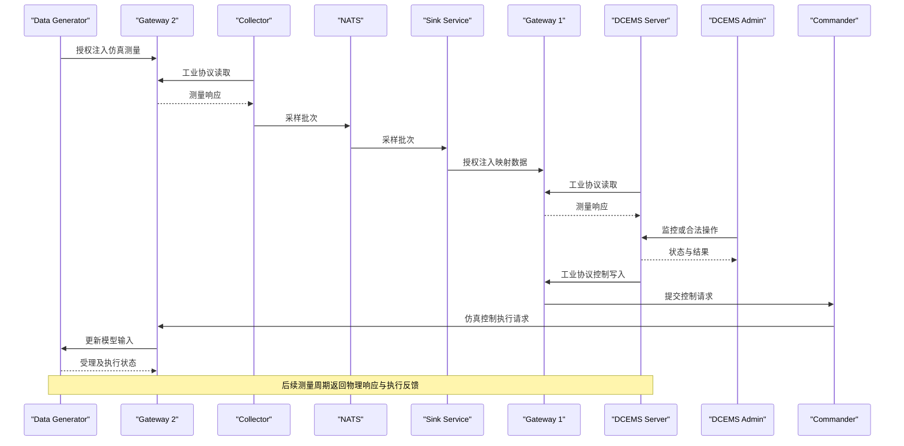
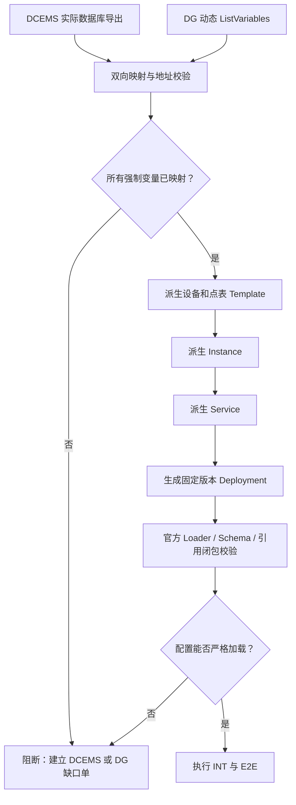

<h1 class="title">DCEMS 跨系统测试设计</h1>

<p class="subtitle">v1_2 · 20261126 · 独立 DCEMS 容器联测实施候选</p>

<style>
body {
  font-family: "Microsoft YaHei";
  font-size: 16px;
  line-height: 1.75;
  color: #24292f;
}
.title {
  font-family: "Microsoft YaHei";
  font-size: 32px;
  line-height: 1.30;
  font-weight: 700;
  text-align: center;
}
.subtitle {
  font-family: "Microsoft YaHei";
  font-size: 18px;
  line-height: 1.50;
  font-weight: 400;
  text-align: center;
}
h1 {
  font-family: "Microsoft YaHei";
  font-size: 28px;
  line-height: 1.40;
  font-weight: 700;
}
h2 {
  font-family: "Microsoft YaHei";
  font-size: 22px;
  line-height: 1.40;
  font-weight: 700;
}
h3 {
  font-family: "Microsoft YaHei";
  font-size: 18px;
  line-height: 1.50;
  font-weight: 700;
}
h4 {
  font-family: "Microsoft YaHei";
  font-size: 16px;
  line-height: 1.50;
  font-weight: 700;
}
p, li {
  font-family: "Microsoft YaHei";
  font-size: 16px;
  line-height: 1.75;
}
.figure-caption,
.formula-caption {
  font-family: "Microsoft YaHei";
  font-size: 14px;
  line-height: 1.50;
  font-weight: 600;
  text-align: center;
  margin: 0.65em 0 0.35em 0;
}
.table-caption {
  font-family: "Microsoft YaHei";
  font-size: 13px;
  line-height: 1.40;
  font-weight: 500;
  text-align: center;
  margin: 0.65em 0 0.35em 0;
}
.mermaid,
.mermaid text,
.mermaid .label {
  font-family: "Microsoft YaHei" !important;
  font-size: 14px !important;
  line-height: 1.20;
}
table {
  width: 100%;
  border-collapse: collapse;
  font-family: "Microsoft YaHei";
  font-size: 13px;
  line-height: 1.45;
}
table th,
table th p,
table th li {
  font-family: "Microsoft YaHei";
  font-size: 13px;
  line-height: 1.40;
  font-weight: 600;
}
table td,
table td p,
table td li {
  font-family: "Microsoft YaHei";
  font-size: 13px;
  line-height: 1.45;
  font-weight: 400;
}
table th,
table td {
  padding: 0.40em 0.60em;
  vertical-align: top;
}
code, pre {
  font-family: "Cascadia Code";
  font-size: 14px;
  line-height: 1.50;
}
p code, li code, td code {
  color: #24292f;
  background: #f3f4f6;
  padding: 0.08em 0.28em;
  border-radius: 3px;
}
pre {
  color: #c9d1d9;
  background: #0d1117;
  padding: 1em;
  border-radius: 6px;
  overflow-x: auto;
}
pre code {
  color: inherit;
  background: transparent;
  padding: 0;
}
.hljs-comment, .hljs-quote,
.token.comment, .token.prolog, .token.doctype, .token.cdata {
  color: #8b949e;
  font-style: italic;
}
.hljs-keyword, .hljs-selector-tag, .hljs-literal,
.token.keyword, .token.boolean { color: #ff7b72; }
.hljs-string, .hljs-doctag, .hljs-regexp,
.token.string, .token.char, .token.regex { color: #a5d6ff; }
.hljs-number, .token.number { color: #79c0ff; }
.hljs-title, .hljs-function, .token.function { color: #d2a8ff; }
.hljs-title.class_, .hljs-type, .hljs-built_in,
.token.class-name, .token.builtin { color: #ffa657; }
.hljs-variable, .hljs-attr, .hljs-property,
.token.variable, .token.property, .token.attr-name { color: #7ee787; }
.hljs-operator, .hljs-punctuation,
.token.operator, .token.punctuation { color: #c9d1d9; }
</style>

---

## 目录

1. [文档约定](#1-文档约定)  
2. [文档定位与使用方式](#2-文档定位与使用方式)  
3. [测试目标、范围与总体要求](#3-测试目标范围与总体要求)  
4. [完整测试场景与总体数据流](#4-完整测试场景与总体数据流)  
5. [DCEMS 外部接口分析](#5-dcems-外部接口分析)  
6. [仿真场景与模型能力对照](#6-仿真场景与模型能力对照)  
7. [共享配置与部署设计](#7-共享配置与部署设计)  
8. [Integration 分段测试](#8-integration-分段测试)  
9. [E2E 完整场景](#9-e2e-完整场景)  
10. [Golden Data 与验收证据](#10-golden-data-与验收证据)  
11. [性能、故障、安全及 Admin 验收](#11-性能故障安全及-admin-验收)  
12. [测试实施、目录与准入裁决](#12-测试实施目录与准入裁决)  

---

# 1. 文档约定

本章是全文的固定排版与表达规范。文档修订、补充和派生版本均应遵守本章，不再根据个人习惯调整字体、字号、行距、图题、表题、公式或代码样式。

本文开头的 `<style>...</style>` 是 HTML `style` 元素，其中包含内部 CSS 样式表，本文简称为 **CSS 样式块**。第 1.1～1.4 节规定目标样式；CSS 样式块通过 `h1`、`h2`、`p`、`table`、`th`、`td`、`pre`、`code` 等选择器，将规范应用到 Markdown 渲染后生成的 HTML 元素。

## 1.1 字体约定

<p class="table-caption">表 1-1 文档字体与排版规范</p>

| 文档元素 | 字体 | 字号 | 行间距/行高 | 字重 | 对齐方式 |
|---|---|---:|---:|---:|---|
| 文档标题 | Microsoft YaHei | 32 px | 1.30 | 700 | 居中 |
| 文档副标题 | Microsoft YaHei | 18 px | 1.50 | 400 | 居中 |
| 一级标题 | Microsoft YaHei | 28 px | 1.40 | 700 | 左对齐 |
| 二级标题 | Microsoft YaHei | 22 px | 1.40 | 700 | 左对齐 |
| 三级标题 | Microsoft YaHei | 18 px | 1.50 | 700 | 左对齐 |
| 四级标题 | Microsoft YaHei | 16 px | 1.50 | 700 | 左对齐 |
| 正文 | Microsoft YaHei | 16 px | 1.75 | 400 | 左对齐 |
| 图题 | Microsoft YaHei | 14 px | 1.50 | 600 | 居中 |
| 图内文字 | Microsoft YaHei | 14 px | 1.20 | 400 | 按图形布局 |
| 表题 | Microsoft YaHei | 13 px | 1.40 | 500 | 居中 |
| 表头 | Microsoft YaHei | 13 px | 1.40 | 600 | 左对齐 |
| 表格正文 | Microsoft YaHei | 13 px | 1.45 | 400 | 左对齐 |
| 公式题 | Microsoft YaHei | 14 px | 1.50 | 600 | 居中 |
| 代码文字 | Cascadia Code | 14 px | 1.50 | 400 | 左对齐 |

以上规范已经通过本文开头的 CSS 样式块固定。其中，正文为 `16 px`；表题、表头和表格正文均为 `13 px`。表头字重为 `600`，低于标题字重；表格正文行高为 `1.45`，因此表格在字号、字重和行距上均明显弱于正文。英文业务对象、数据库对象和程序标识符仍按所在文本元素的字号排版，但使用行内代码形式，例如 `Asset`、`Connection`、`task_id`。

## 1.2 绘图约定

1. 上下文图、第 0 层及更深层 DFD、总体流程图和关系流程图统一使用 Mermaid。
2. 每一个 Mermaid 图都必须在 Mermaid 代码块第一行加入初始化配置，统一只设置 `useMaxWidth: true`。初始化配置格式为：

```text
%%{init: {"<Mermaid 图类型配置域>": {"useMaxWidth": true}}}%%
```

其中 `<Mermaid 图类型配置域>` 必须根据实际 Mermaid 图类型替换，不得固定写成 `flowchart`，也不得使用与实际图类型不匹配的配置域。

<p class="table-caption">表 1-2 Mermaid 图类型与初始化配置</p>

| Mermaid 图类型 | 图声明 | 第一行初始化配置 |
|---|---|---|
| Flowchart | `flowchart TB/LR/...` | `%%{init: {"flowchart": {"useMaxWidth": true}}}%%` |
| Sequence Diagram | `sequenceDiagram` | `%%{init: {"sequence": {"useMaxWidth": true}}}%%` |
| State Diagram | `stateDiagram-v2` | `%%{init: {"state": {"useMaxWidth": true}}}%%` |
| Class Diagram | `classDiagram` | `%%{init: {"class": {"useMaxWidth": true}}}%%` |
| ER Diagram | `erDiagram` | `%%{init: {"er": {"useMaxWidth": true}}}%%` |

若后续使用其他 Mermaid 图类型，也必须遵守同一规则：

```text
实际图类型
    ↓
确定该图类型对应的 Mermaid 配置域
    ↓
第一行写入：
%%{init: {"对应配置域": {"useMaxWidth": true}}}%%
```

不得额外加入 `wrap` 等非统一配置；如确有特殊需要，应在对应图的局部设计说明中单独论证。

3. 每张图必须有图编号和图题，编号采用“章节号-本章图序号”，例如“图 7-2”。
4. 图题必须使用普通图题样式，不得使用 Markdown 标题。统一写法为：

```html
<p class="figure-caption">图 7-2 图题</p>
```

## 1.3 公式约定

1. 行内公式使用单美元符号，例如 `$E_1$`。
2. 独立公式使用双美元符号，例如：

```text
$$
\mathrm{Entity}=E_1\land(E_2\lor E_3\lor E_4)\land E_5
$$
```

3. 正式公式不得放入代码块。
4. 不使用 `\[` 与 `\]` 作为公式定界符。
5. 变量下标统一写成 `E_1`、`R_1`；逻辑“与”和“或”统一写成 `\land`、`\lor`。
6. 公式必须使用 LaTeX，不使用普通文本模拟数学符号。
7. 需要编号的公式使用“式（章节号-本章公式序号）”，式题采用普通公式题样式：

```html
<p class="formula-caption">式（8-1）实体判断逻辑</p>
```

## 1.4 代码约定

1. 多行代码必须使用带语言标识的围栏代码块，例如 `python`、`sql`、`json`、`yaml`、`mermaid` 或 `text`。
2. 单个标识符、字段名、命令和短代码使用行内代码，例如 `PRIMARY KEY`、`Connection`。
3. 伪代码必须明确标记为 `text` 或在正文中说明“以下为伪代码”；不得使读者误认为它可以直接运行。
4. 代码块统一使用深色背景，颜色为 `#0D1117`；普通代码文字颜色为 `#C9D1D9`。
5. 语法高亮统一采用表 1-2 的配色。Markdown 渲染器应使用 Highlight.js 或 Prism 可识别的语言标识；渲染器不支持高亮时，至少保留代码背景色和普通代码文字颜色。

<p class="table-caption">表 1-2 代码语法高亮配色</p>

| 语法元素 | 颜色 | 十六进制 |
|---|---|---|
| 代码背景 | 深黑蓝 | `#0D1117` |
| 普通文字、运算符和标点 | 浅灰 | `#C9D1D9` |
| 注释 | 灰色 | `#8B949E` |
| 关键字和布尔值 | 红色 | `#FF7B72` |
| 字符串和正则表达式 | 浅蓝 | `#A5D6FF` |
| 数值 | 蓝色 | `#79C0FF` |
| 函数名 | 紫色 | `#D2A8FF` |
| 类型、类名和内置对象 | 橙色 | `#FFA657` |
| 变量、属性和字段 | 绿色 | `#7EE787` |

---

# 2. 文档定位与使用方式

## 2.1 适用对象

本文面向 wind-hub 与 DCEMS 的集成开发、独立测试与验收人员。DCEMS 源码后续由项目负责人导入 `third_party/dc-ems/`；本版不要求修改任一仓库。测试范围包括 DCEMS Server、Admin 和支撑闭环的 wind-hub 服务，不包括 wind-hub Web Server、Web Admin。Storage Service 不作为本闭环的必经节点，原跨模块测试中的独立存储验收不因本文而取消。

## 2.2 目标

在真实进程、真实工业协议、真实中间件及真实 DCEMS 数据库条件下，验证外部测量、控制指令、模型执行和反馈的完整闭环；验证 Server 持续运行及 Admin 的监控、配置和控制功能。本文是编码及测试前的**规范性设计冻结版本**；冻结的是目标、接口边界、映射规则、测试用例和裁决方法，不代表生产代码、配置及测试已经通过验收。

---

# 3. 测试目标、范围与总体要求

## 3.1 基线与依据

<p class="table-caption">表 3-1 设计基线</p>

| 项目 | 基线与证据 |
|---|---|
| wind-hub | 历史指定分支的固定代码快照 `e2ba7e77c23d65c0a4751b4f666af796ce7c0a9a`（分支名现不可解析）；最新核对的 `main` 为 `79946cb3650c8023b46fcee282fa9a1435956ffe`，编码时必须重新固定工作提交 |
| dc-ems | `main`，`95cd9128c0aeac2d170c9b894ce4523c9baf30d1` |
| wind-hub 跨模块设计 | `docs/design/wind-hub_跨模块测试设计_v0_44.md` |
| 相关设计版本 | 历史开发快照中 Gateway v1_53、Generator v1_63、Commander v1_60、Collector v1_44、Sink v1_76、Contracts v1_45、Configuration v1_23、CLI v1_56；实施前按当前 HEAD 校验文件路径、版本及契约差异 |
| 配置基线 | `configs/deployments/deployment_e2e-final_v1.0.8.yaml`；已读取源 Gateway v1.1.2、目标 Gateway v1.1.1、Generator E2E v1.1.1 |
| 测试基线 | `tests/system/e2e/full_chain/conftest.py`；部分源码及 Fixture 已抽查，未执行 |
| DCEMS 接口证据 | `ai_shared/reports/external_data_contract_review_20261022.md`，审查源基线为 `4c45932`；最新版仓库 README 与该历史报告已读取，尚未逐个 Java 消费者复核 |

基线链接：[wind-hub commit](https://github.com/luoshaozhuo/wind-hub/commit/e2ba7e77c23d65c0a4751b4f666af796ce7c0a9a)，[dc-ems commit](https://github.com/luoshaozhuo/dc-ems/commit/95cd9128c0aeac2d170c9b894ce4523c9baf30d1)。后续集成须记录实际导入源码清单及哈希，不以分支名称代替固定提交。

## 3.2 强制边界

1. DCEMS 的全部外部实时数据及对外控制均通过工业协议；禁用 SCADA Redis 同步及心跳，不使用 Redis、数据库写入、调试 API 或内部变量注入替代工业协议输入。数据库初始化与 Admin 合法参数配置不属于实时数据旁路。
2. wind-hub 内部使用 NATS、JetStream、Redis 等原有依赖不受此限制。两个 Gateway 独立进程、端点、权限及变量空间隔离。
3. 所有 wind-hub 业务进程由正式 CLI 启停及管理；中间件与数据库由测试基础设施单独启动；DCEMS 使用自身真实构建产物和启动方式。协议客户端及 DCEMS 浏览器操作是被测外部接口，不强行改为 CLI。
4. 不通过直接更新 Generator 控制量代替 DCEMS 闭环；测试仅可通过正式接口设置环境激励、初始化和场景条件。测试系统不得连接生产设备。
5. 复用既有配置 Schema、鉴权和接口；不引入新的中间件、常驻桥接服务或自定义 RPC，除非证据证明现有能力不足并获批准。

## 3.3 测试规模

首阶段**必须**使用至少三台风机、一套并网点及必要调度/调频模拟对象完成闭环，设备角色以源码实际支持为准。再扩展至历史 DCEMS 配置的 50 台 2 MW 风机作容量探索，50 台并非已确认的性能承诺。三台功能场景必须具备不同设备身份、可用功率、初始状态及可辨识的测量轨迹；禁止三台使用完全相同的固定值作为映射正确性证据。光伏和储能仅在最新 DCEMS 源码确认支持后纳入必测范围。

---

# 4. 完整测试场景与总体数据流

## 4.1 系统级交互

下图为进程间时序，不映射至单个源码类。测量数据与控制结果必须区分；采集和指令执行的实际周期相互独立。


<p class="figure-caption">图 4-1 跨系统进程级测量与控制时序（拟定）</p>

DCEMS 与 Gateway 1 之间使用 Modbus TCP 作为初始候选。GW1 至 Commander 使用内部 RPC；Commander 至 GW2 优先复用现有专用仿真执行路径，而不是无依据要求每一内部跳均使用 Modbus。当前源 Gateway 配置明确只有 Commander 可以调用仿真执行接口，Gateway 随后更新 Generator；正式设计须核实 Commander 的具体目标类型及执行结果查询路径。若必须增加真正的 GW2 工业协议写入路径，须证明现有设计不会产生二次转发或循环。

## 4.2 设备身份与所有权

GW2 为仿真设备源，GW1 为 DCEMS 协议投影，两者设备实例身份必须可区分；源 Collector 不采 GW1，Sink 不注入 GW2。GW1 的测量由 Sink 单独持有注入租约；命令点由工业写入口接收。共址设定读回与物理执行反馈分别建模，防止异步 Sink 数据覆盖未执行命令或写入造成伪反馈。DCEMS 的设备 ID 与两套 Gateway 的全限定变量 ID 建立明确对照。

控制提交、执行、测量反馈是三个独立事件。GW1 的 Modbus 正常响应最多证明协议层受理，不能承诺 Commander 或 DG 已执行。共址寄存器允许表示请求值或已应用设定值，但必须在点表中唯一确定语义、更新所有权和时序；若表示请求值，不得用其作为执行判据。GW2 仿真执行不得再次转发给 Commander；Sink 注入不得触发任何控制。所有 DCEMS 控制成功用例必须验证无跨设备副作用、无重复逻辑执行及无循环转发。

---

# 5. DCEMS 外部接口分析

## 5.1 接口清单生成规则

从 `devices`、`edgeServers`、`edgeaddrset` 与 Java 数据消费路径共同构造接口分母。对 `emsPoint`、`turbPoint` 逐项判定外部采集、内部派生、静态参数、控制写入或控制反馈，不把变量字典直接视为外部点表。追踪 `ConfigLoader`、`EdgeManager`、`DataGetterModbusImpl`、调度算法及 Web 路由，核对当前数据库种子与实际加载结果。下列点位来自历史审查报告，是候选清单而非当前源码已冻结契约。

接口清单以当前源码、测试数据库、实际启动后生效的点表及控制调用点交叉生成；四者不一致必须登记差异。独立审查人须从 DCEMS 消费端反查，不允许仅由已写好的 wind-hub 映射生成验收分母。每条映射保留源码位置、数据库行键、功能适用性及测试 ID；内部计算量、静态量、外部量分别统计，未分类项阻断准入。历史报告的 40/38/9 仅供核查，计数歧义不能自动归并；共址别名仍须分别验证 DCEMS 消费结果。

## 5.2 单机测量接口

历史配置为 50 台风机，每台一个 Modbus TCP 通道，unit ID 为 1，采集周期 500 ms。40 条读映射、38 个唯一变量（含共址别名）；以下按报告所列变量归组，最终以原始记录逐行核对，不以本表行数替代完整分母。

<p class="table-caption">表 5-1 历史单机采集点候选</p>

| DCEMS 变量 | 零基地址（unit 1） | 类型 | 仿真来源或待核查能力 |
|---|---|---|---|
| `emsWorkMode` | HR 41501 | I32 | 模型工作模式及枚举 |
| `emsWinSpd`、`emsWinSpdAvg10Sec`、`emsWinSpdAvg60Sec` | HR 41503/05/07 | F32 | 风速及明确窗口平均 |
| `emsPowAct`、`emsPowActCvt`、`emsPowActAvg10Sec`、`emsPowActAvg60Sec` | HR 41509/11/13/15 | F32 | 有功、变流器有功及平均 |
| `emsPowReactCvt`、`emsPowReact`、`emsPowReact10`、`emsPowReact60` | HR 41517/19/21/23 | F32 | 无功及平均；核对字典名称 |
| `emsBladeAngle1/2/3` | HR 41525/27/29 | F32 | 三叶片角度 |
| `emsGenRotateSpd`、`emsGenTorque`、`emsMinBladeAngle` | HR 41531/33/35 | F32 | 转速、转矩、最小变桨角 |
| `emsOilTemp`、`emsTotalEnergy` | HR 41537/39 | F32 | 油温、累计电量 |
| `emsAutoLimitSetFeedback`、`emsActPowerMaxSetFeedback`、`emsReactPowerMaxSetFeedback` | HR 41541/43/45 | F32 | 独立执行反馈 |
| `emsGridPhaseCurrentA`、`emsConvertVol` | HR 41547/49 | F32 | 电流、电压及量纲 |
| `emsCabinTemp`、`emsEnvTemp` | HR 41551/53 | F32 | 机舱及环境温度 |
| `emsReactPowerSet`、`emsActPowerSet`、`emsActPowerRead` | HR 41555/57/57 | F32 | 共址读回别名 |
| `emsReactPowerSetStatus`、`inertiaLimitValue` | HR 41561/67 | I32/F32 | 控制状态及惯量限值 |
| `emsFaultState`、`emsLocalOnOff`、`emsAutoLimitState`、`emsLocalLimitState` | DI 12800/01/02/03 | Bool | 故障、就地/远方及限功率状态 |
| `emsRemoteLimitState`、`emsLimitStop`、`emsLocalActPowerEnableState`、`emsReactCanCtrl` | DI 12804/05/06/07 | Bool | 远程限功率、停机及可控性 |

HR 为保持寄存器，DI 为离散输入。历史报告中 `emsPowReact10/60` 与字典 `emsPowReact10Sec/60Sec` 不一致，`emsPowReactCvt` 缺少同名字典点；须确认最新代码是否仍存在缺口。常量只能用于证明合法固定设备参数的场景，不得用常量伪造动态量或执行反馈。

## 5.3 单机控制接口

<p class="table-caption">表 5-2 历史九个控制点候选</p>

| DCEMS 控制变量 | 地址 | 类型/功能码 | 执行与反馈验收 |
|---|---|---|---|
| `ctrlActPow` | HR 41557 | F32 / FC16 | 有功目标、41543 反馈、实际有功 |
| `ctrlReActPow` | HR 41555 | F32 / FC16 | 无功目标、41545 反馈、实际无功 |
| `emsActPowerSetInertia` | HR 41559 | F32 / FC16 | 惯量功率输入及实际响应 |
| `emsReactPowerSetStatusWrite` | HR 41561 | I32 / FC16 | 状态枚举、41561 回读及真实模式 |
| `emsActPowerChangeRate` | HR 41563 | F32 / FC16 | 变化速率约束；历史单位 kW/min |
| `emsActCtrlMode` | HR 41565 | I32 / FC16 | 模式切换及后续控制行为 |
| `ctrlStart` | Coil 12808 | Bool / FC5 | 启动状态迁移及功率响应 |
| `ctrlStop` | Coil 12809 | Bool / FC5 | 停机状态迁移及功率响应 |
| `ctrlReset` | Coil 12810 | Bool / FC5 | 可复位故障的状态迁移 |

历史 Modbus 契约为 `slave.reg.addr[.bit]`，reg=4 表示 HR，reg=1 表示 DI，reg=0 表示 Coil；地址不减一，`highBit=1` 为 CDAB（低字在前）。保持寄存器读 FC3，离散输入读 FC2。禁止将 DCEMS 的 reg=4 直接当作 Modbus 功能码 4。写入缩放、脉冲复位、字节序、枚举与符号方向须逐点确定。历史源码的控制返回成功仅代表协议事务成功，不代表仿真已执行。

## 5.4 全场级输入与控制通路

<p class="table-caption">表 5-3 全场级接口调查矩阵</p>

| 功能 | 必须核实的外部输入 | 候选协议设备 | 当前结论 |
|---|---|---|---|
| AGC | 调度有功目标、有效/使能、模式 | 调度或站控装置 | 历史库无入向映射；协议赋值路径待确认 |
| AVC | 无功/电压目标、有效/模式、并网点电压和无功 | 调度、升压站 | 同上 |
| 一次调频 | 电网频率、调频使能/目标、测量功率 | 电网、独立调频装置 | 历史代码存在 `YctpDevice`；消费路径待确认 |
| 惯量响应 | 频率及变化率、使能、目标和限值 | 电网或调频装置 | 区分外部输入和 DCEMS 内部计算 |
| 升压站 | 并网点有功、无功、电压、电流、频率 | 升压站 | 历史代码存在 `SyzDevice`；地址集待建立 |
| 光伏/储能 | 状态、功率、SOC 与控制 | 对应设备 | 是否为本版必测范围待最新源码确认 |

历史 `syncdata` 11 条均为输出；不得用 Redis 输入补齐上述缺口。需从协议数据 getter 追踪至全场变量及控制算法。如果 DCEMS 没有工业协议入口，则登记 DCEMS 侧集成阻断项，明确最小源码整改方案。不得自行编造调度点地址，也不得把普通 Admin 参数设置当成外部调度输入的验收证据。

## 5.5 最新代码核实与证据等级

本轮审查基线为 `wind-hub/feat/production-readiness-final-20261123@e2ba7e77c23d65c0a4751b4f666af796ce7c0a9a` 与 `dc-ems/main@95cd9128c0aeac2d170c9b894ce4523c9baf30d1`；仓库均为线上读取，未运行构建。证据分为 `SRC`（最新源码已确认）、`CFG`（最新具体文件已确认）、`HIST`（2026-10-22 历史数据审查）、`TBD`（尚缺交叉验证）。`HIST` 不可升级为 `SRC`；未取得运行时数据库快照不得标记实际激活。

<p class="table-caption">表 5-4 代码确认事实、设计影响及残余缺口</p>

| 事项 | 核实事实和来源 | 设计影响 | 证据等级 |
|---|---|---|---|
| DCEMS 协议采集 | `EdgeManager` 根据 serverType 实例化 Modbus TCP、Modbus RTU 或 IEC104 Getter | GW1 优先提供 Modbus TCP；其他协议不作为默认控制通路 | SRC |
| DCEMS 控制写 | `EdgeManager.control(deviceId,varPath,value)` 委托 Getter；`DataGetterIec104Impl.control()` 直接 `return false` | 若用 IEC104，写入闭环必然不成立，不能仅凭支持 IEC104 采集声称可控 | SRC |
| DCEMS 算法 | `EmsDispatcher` 监听 `emsGridDispatchAct`、`emsGridDispatchReact` 等变量，负责控制计算与状态响应 | 这证明变量被算法消费，不证明变量能由工业协议写入；必须另找写入者 | SRC |
| DCEMS AGC/AVC 调度输入 | 既有库 `edgeaddrset`、`syncdata(I)` 均无全场目标绑定 | 不得给 GW1 人为加寄存器后就宣称 DCEMS 会消费；应由 DCEMS 侧提供并测试协议到算法变量的实际接线 | HIST+SRC（消费端）；入口 TBD |
| DCEMS 启动 | `EmsApp` 先检查数据库结构并执行授权校验，再启动 Manager | 必须检测完整运行状态；授权缺失或数据表视图依赖错误会阻断正常启动 | SRC |
| GW2 仿真受理 | Gateway `GeneratorRpcClient` 按实时 `GetDevice/GetGeneration/ListVariables` 检查 `INPUT` 且 `writable`，随后调用 `UpdateVariables` | 不允许从字段名推断可写；以实际 Generation 的 `ListVariables` 为配置准入标准 | SRC |
| GW2 执行判据 | Generator `UpdateVariables` 只返回 `accepted/effective_step`，另有 `GetInputExecution` 获取 `PENDING/APPLIED` | APPPLIED 与已达物理目标分开验证；链路超时保持 UNKNOWN | SRC |
| 现有 GW1 候选 | `service_gateway-e2e-target_v1.1.1.yaml` 仅 `WTG_SINK01`，`control.enabled=false` | 不能直接接入 DCEMS 发出的控制；需新建可写协议监听及 Commander 映射 | CFG |
| 现有 GW2 候选 | `service_gateway-e2e-source_v1.1.2.yaml` 五设备，仅 PPC 有 `agc_power_setpoint` 控制映射 | 不能以 PPC 单点成功代表风机九种写命令均能进入 DG | CFG |
| 既有配置激活 | `deployment_e2e-final_v1.0.8.yaml` 固定 Service/Instance 文件版本 | 本测试应派生独立部署闭包，保留旧版本不可变 | CFG |

参考源：

- [DCEMS EdgeManager.java](https://github.com/luoshaozhuo/dc-ems/blob/95cd9128c0aeac2d170c9b894ce4523c9baf30d1/server/dc-ems/src/main/java/cn/hedpy/scada/ems/core/edge/EdgeManager.java)
- [DCEMS DataGetterIec104Impl.java](https://github.com/luoshaozhuo/dc-ems/blob/95cd9128c0aeac2d170c9b894ce4523c9baf30d1/server/dc-ems/src/main/java/cn/hedpy/scada/ems/core/edge/impl/DataGetterIec104Impl.java)
- [DCEMS EmsDispatcher.java](https://github.com/luoshaozhuo/dc-ems/blob/95cd9128c0aeac2d170c9b894ce4523c9baf30d1/server/emslib/src/main/java/cn/hedpy/scada/emslib/EmsDispatcher.java)
- [wind-hub Gateway GeneratorRpcClient](https://github.com/luoshaozhuo/wind-hub/blob/e2ba7e77c23d65c0a4751b4f666af796ce7c0a9a/src/industrial_gateway/infrastructure/adapters/outbound/grpc/generator_client.py)
- [wind-hub 现有源 Gateway 配置](https://github.com/luoshaozhuo/wind-hub/blob/e2ba7e77c23d65c0a4751b4f666af796ce7c0a9a/configs/services/service_gateway-e2e-source_v1.1.2.yaml)

## 5.6 DCEMS 外部数据入口逐层判定

不得把同一变量的“声明”“更新”“协议地址”混作一个接口。对每个功能按 `协议设备配置 → Getter 采样 → 设备对象/全场变量赋值 → EmsDispatcher/算法消费` 四层形成证据链。四层任一缺失则状态为 `NO_PATH`，归属 DCEMS 侧能力差距，不能靠修改 wind-hub 点表补齐。

<p class="table-caption">表 5-5 重要外部量核查清单</p>

| 类别 | 代表性 DCEMS 变量/功能 | 已知入口性质 | 必须进一步查明的消费者或生产者 | 初步裁决 |
|---|---|---|---|---|
| 单机遥测 | `emsWinSpd`、`emsPowAct`、`emsPowReact` | 历史 edgeaddrset 已映射 | DB 当前版本、Getter 实例与风机变量刷新 | 候选可配置，待数据库实证 |
| 单机遥信 | `emsFaultState`、`emsLocalOnOff`、`emsReactCanCtrl` | 历史离散输入绑定 | 禁控逻辑如何消费，状态变化何时生效 | 候选可配置 |
| 单机遥控 | `ctrlStart`、`ctrlStop`、`ctrlReset` | 历史 Modbus 线圈写 | 能否触发所有真实执行路径、是否脉冲、自复位 | 候选可配置，执行待证 |
| 单机功率指令 | `ctrlActPow`、`ctrlReActPow` | 历史 Modbus HR 写 | 控制状态、限幅、实际反馈 | 候选可配置，执行待证 |
| 全场 AGC | `emsGridDispatchAct` 等 | 算法明确消费，历史无协议输入绑定 | 将工业遥调/遥测写到全场变量的实际实现 | **NO_PATH 待补** |
| 全场 AVC | `emsGridDispatchReact` 等 | 算法明确消费，历史无协议输入绑定 | 电压/无功目标、使能、模式的工业协议入口 | **NO_PATH 待补** |
| 站控测量 | `emsSyzAct`、`emsSyzReact` 等 | 历史未配置升压站对象 | `SyzDevice`、实际采样路径及全场聚合消费 | **NO_PATH 待补** |
| 一次调频 | 频率、调频目标/使能 | 历史未配置装置 | 设备/全场变量来源、时间与响应算法 | **NO_PATH 待补** |
| 惯量响应 | 频率变化、使能和目标 | 历史仅部分点定义 | 外部频率变化/模式与算法真实消费 | **NO_PATH 待补** |
| 设备静态参数 | `capacity` 等 | 数据库参数或对象属性 | 是否在运行中依赖远程点 | 不应重复作为动态遥测 |

`NO_PATH` 表示当前审查没有证据，不等于断言源码绝不存在。必要的最小 DCEMS 整改应是**将协议采样数据明确映射至已有全场变量**，并测试质量/时间戳/失联行为；不允许启用 Redis 或测试私有注入绕行。

## 5.7 控制指令闭环的独立状态机验收

| 状态 | 独立证据 | 不能代替的后续状态 |
|---|---|---|
| 协议响应 | DCEMS→GW1 Modbus 功能码与事务读回 | Commander 已提交 |
| 已提交 | GW1 转发记录、稳定请求/子命令 ID | Commander 已批准或执行 |
| 已裁决 | Commander 查询接口的明确裁决 | GW2、DG 已应用 |
| 已受理 | GW2→DG `UpdateVariables` 有效受理和 `effective_step` | DG `APPLIED` |
| 已应用 | Generator `GetInputExecution=APPLIED`、正确 Generation/设备/点 ID | 设备物理量到达目标 |
| 已响应 | Recording 真值及约束模型中的动态变化 | DCEMS 已收到反馈 |
| 已闭环 | DCEMS 下次真实协议采样/控制调整及 Admin 展示 | 完成，进入稳态检查 |

须分别设计拒绝（不可写/未启动/错误模式）、超时未知、并发覆盖、旧 Generation、重复相同 request_id、冲突不同内容等反例；无独立证据时不得把任何阶段自动升级为成功。

---

## 5.8 协议入口与实际消费端的双向可追踪性

本轮再次核对 `dc-ems/main@95cd9128` 的 `EdgeManager`、`DataGetterModbusImpl`、`DataGetterIec104Impl`、`EmsDispatcher`，并确认 `wind-hub/main@79946cb3650c8023b46fcee282fa9a1435956ffe`。原指定开发分支名称现无法由 GitHub 解析，继续以 v0_3 已冻结且曾读取的 `e2ba7e77` 作为**历史目标分支证据**，不得误称它是当前远端活动分支。正式实现前需重新确定集成基线。

协议侧明确采用 Modbus TCP 作为**首版唯一双向实时外部通信协议**。这不意味着 DCEMS 没有 IEC104/Modbus RTU 采集能力，而是避免将尚不支持的 IEC104 控制接口纳入正向闭环。所有工业协议报文均须由真实 DCEMS Server 的 Getter/控制代码产生；测试客户端只负责独立对照或受控的外部调度激励。

<p class="table-caption">表 5-6 功能级协议输入闭包与裁决要求</p>

| 功能 | 源头与工业协议注入点 | DCEMS 内部实际消费者 | 当前证据 | 关闭条件 |
|---|---|---|---|---|
| 单机遥测 | GW1 Modbus HR/DI，DCEMS `edgeServers` + `edgeaddrset` | 风机实例、全场聚合 | HIST + 部分 SRC | 当前 DB 种子逐点匹配，独立协议抓包和变量状态对账 |
| 单机遥控 | DCEMS `EdgeManager.control` → GW1 Modbus | GW1 写事件 → Commander → GW2 → DG | SRC + GW1 配置缺口 | 每种功能码及每个控制地址均具备真实响应和拒绝证据 |
| AGC 外部目标 | GW1 的调度设备采集点（需要新增绑定） | `emsGridDispatchAct` 与 `ActPowerFun` | SRC 已证明消费端；输入未证 | 证明 Getter→全场变量更新→算法动作，并检查数据失效 |
| AVC 外部目标 | GW1 调度设备采集点（需要新增绑定） | `emsGridDispatchReact` 与无功算法 | SRC 已证明消费端；输入未证 | 同上，且单位及符号方向明确 |
| 并网点测量 | GW1 站控设备采集点 | `SyzDevice` 或全场测量变量 | HIST + 入口待证 | 独立测量进入指定算法而不只是缓存 |
| 调频与惯量 | GW1 电网/调频设备采集点 | `FreActPowerFun`、惯量算法输入 | HIST + 部分 SRC | 频率/变化率/模式/使能/目标各自确定唯一真实生产者 |

**注意**：`EmsDispatcher` 中存在对 `emsGridDispatchAct`、`emsGridDispatchReact` 的变更监听。这只能证明消费者存在，不能推导协议采集已接入。对任一调度变量，缺少“实际设备实例→具体地址→Getter→赋值语句→消费者”的任一步，均判定 `BLOCKED`。

## 5.9 Modbus 写入与控制执行的风险清单

基于最新 DCEMS Getter 再次确认：控制定位器按 `deviceId_varPath` 注册；`isCtrl` 决定可写点；TCP 超时 4000 ms、重试 1 次。PDU offset 不按常见 4xxxx 展示地址自动减一。历史数据库的 32 位 F/I 使用 `highBit=1`，要求 CDAB 字交换。

验收程序必须验证：① FC5 线圈；② FC16 两寄存器的 F32/I32；③ 读写同址点的读回延迟；④ 连接中断后 `comOk` 门禁；⑤ 远端返回异常码；⑥ 超时未知与重复执行抑制。写响应只证明协议事务，不证明指令生效。DCEMS 对相同地址存在多变量别名，应在**DCEMS 地址视图**统一，不能将多对一关系引入 wind-hub 已要求一对一的 BusinessPoint 身份体系。

## 5.10 2026-11-24 代码核查的新增发现

以 `dc-ems/main@95cd9128` 的 Java 生产代码和历史数据库审查为依据，本版进一步固定以下接口事实。协议入口不以变量名称相似度推断。

<p class="table-caption">表 5-7 DCEMS 可追踪生产者与缺失项</p>

| 变量/功能 | 已证生产者/消费路径 | 结论和必做事项 |
|---|---|---|
| `emsSyzAct` | `SyzDevice.powAct.dataUpdate` → `FactoryPoint.emsSyzAct.update` | **代码存在生产者**，但历史 `devices` 缺 `deviceType=1` 升压站实例及工业地址。需补独立站控设备、`edgeServers`、`edgeaddrset` 并验证 Getter 回调确实进入 SyzDevice |
| `emsSyzReact` | `SyzDevice.powReact.dataUpdate` → `FactoryPoint.emsSyzReact.update` | 同上，确认 kVar 与 var 等单位映射、正方向、频率与更新质量 |
| `emsGridDispatchAct` | `EmsDispatcher.emsGridDispatchActChanged` → `emsAgcFeedback`、`ActPowerFun.doFun` | **算法消费路径已证**，外部 Modbus 赋值路径未证。必须显式增加并验证协议→全场变量赋值接线 |
| `emsGridDispatchReact` | `EmsDispatcher.emsGridDispatchReactChanged` → `ReactPowerFun.doFun` | **算法消费路径已证**，工业协议入口未证。源码第 286 行 `emsAvcFeedback.update(fp.emsGridDispatchAct.getVal())` 疑似有功/无功变量混用，列入 P1 缺陷候选 |
| 频率及惯量控制输入 | DG grid 有 `grid_frequency_input`，DCEMS 具有调频/惯量算法入口 | 两边存在相关能力，不代表协议及变量契约闭合；需按每一个频率、使能、目标、变化率和故障模式逐项追踪 |

**AVC 独立鉴别用例**：将有功目标固定为 A、无功目标设为 B，要求 A 与 B 取不同数值并具有不同时间变化序列；核实 `emsAvcFeedback` 对应的实际产品定义和期望单位。若反馈应当反映无功目标，且观察到始终等于 A，则判 `FAIL`；先核对字段语义，不能未经确认将疑似缺陷标记为已证实的生产故障。用例 ID `INT-18`，生产问题标记 `DCEMS-P1-AVC-FEEDBACK-CANDIDATE`。

# 6. 仿真场景与模型能力对照

## 6.1 场景构成

初始候选场景为三台风机、并网点、必要外部调度/调频信号。既有 E2E Fixture 包含 WTG、PV、BESS、GRID、PPC 五类对象；不得默认它们的控制模式、点表或端口能够直接满足 DCEMS。DCEMS 为被测场站控制器，现有 PPC 模型不得同时对同一设备发出竞争性功率命令。应优先复用明确允许外部控制的模型模式。

## 6.2 模型能力核对

<p class="table-caption">表 6-1 模型能力准入矩阵</p>

| 能力 | 所需行为 | 当前状态 |
|---|---|---|
| 风机有功/无功 | 接受独立目标，限值与动态响应 | 待核对 Generator 可写变量与模型实现 |
| 启停复位 | 工作状态机、故障注入与可复位条件 | 待核对 |
| 模式、使能和速率 | 执行模式切换、爬坡限制 | 待核对 |
| 平均量、累计量 | 定义窗口、初始化、积分及单位 | 待核对 |
| 并网点模型 | 聚合功率、电网频率与电压 | 待核对 |
| 调度激励 | 可控目标，经完整测量链进入 DCEMS | 待核对 |

每个外部变量必须记录来源类别、模型 ID、全限定变量 ID、读写能力、量纲、更新周期和算法依据。若只缺协议投影，修改配置；若缺真实动态或可写输入，先补模型能力，不在 Sink 中复制控制算法。功能阶段采用固定种子、湍流度 0，并使用可重复阶跃或斜坡。历史 DCEMS 对 `isWatch` 点长时间数值不变可能触发重连（30 s），应核实最新版；恒定工况测试需单独验证该行为，不靠噪声掩盖缺陷。长稳场景可使用明确可重复的风速变化。

## 6.3 需求—模型能力逐项对账

下表中“待核实”是明确待办，**不代表已经实现**。以当前物理测试场景的五种设备身份 `WTG_SIM01/PV_SIM01/BESS_SIM01/GRID_SIM01/PPC_SIM01` 为起始模型目录，以运行中的 `ListVariables` 和物理模型源文件为最终证据。风机与全场控制不准混用一个 PPC 指令的成功来替代各风机的受控响应。

<p class="table-caption">表 6-2 DCEMS 需求到 Generator 模型能力对照</p>

| DCEMS 需求 | 推荐验证对象 | 需要的 DG 可写输入/真值 | 当前静态证据 | 实施分类 |
|---|---|---|---|---|
| 风机瞬时有功、无功 | WTG | 实际功率/无功输出、时间戳 | E2E 含 WTG 仿真物理设备，但不证明所有功率分量可用 | A/B 待验证 |
| 三叶片角度/转矩/转速 | WTG | 三角度、转矩与转速真值 | 完整逐点目录未复核 | B 或 C |
| 有功限额、无功限额 | WTG | `INPUT` 可写限值及动态执行状态 | GW2 动态筛选 writable；变量 ID 未确定 | A/C 待验证 |
| 启停、复位、控制模式 | WTG | 模型事件/状态机与受理回执 | 不能将 bool 线圈等价为永久状态变量 | C 待验证 |
| 十秒/六十秒均值与累计电量 | WTG/测量投影 | 明确采样窗口、积分规则及开机累计 | 现有 Recorder 可产真值，但不等于全部派生量已有定义 | B/C |
| 电网频率/电压 | GRID | 外部受控频率/电压、变化率真值 | E2E 含 GRID 物理对象；可写性未知 | A/C 待验证 |
| 并网点全场有功/无功 | GRID/厂站汇聚 | 多机聚合及损耗规则 | GRID、PPC 两种模型共存；所有权待核查 | B/C |
| AGC/AVC 指令源 | 测试侧调度装置投影 | 可重复的调度阶跃与模式切换 | DCEMS 协议输入未证，DG 不能替代 DCEMS 接入能力 | **D 优先** |
| 一次调频/惯量激励 | GRID/调频投影 | 频率阶跃或斜率、响应持续时间 | DCEMS 入口与模型接口未证 | C/D |

分类定义：`A` 可直接复用现有变量；`B` 有现有真值，可用配置/投影转换，且不破坏物理语义；`C` 需补充 Generator 变量或物理动态；`D` 需 DCEMS 工业协议接入/算法接线改造。`A/B/C` 必须由动态变量目录和真实物理试验裁决，`D` 必须由 DCEMS 输入调用链证明关闭。

## 6.4 避免控制器竞争及虚假响应

DCEMS 对设备下达有功/无功控制时，DG 内部 PPC 自动控制、外部场站控制以及人工仿真写入若同时对同一输入具有所有权，测试必须拒绝进入稳态。每个变量须定义唯一“控制输入所有权”，其它控制器只能作为只读观测或明确关闭。对不同设备采用不同有功额定值、风速/初始功率、控制上限和目标阶跃；每轮控制后验证：目标设备唯一生效、非目标设备无直接输入写入、全场聚合有可解释变化。

同一 Generator 更新周期与 DCEMS 500 ms 读取周期之间可能存在相位差：时间比较使用 `generation_id + effective_step + source_timestamp + read_window` 建立有界事件窗口，不强制要求同一时刻逐样本数值完全相等。未被采样的中间步不视为传输丢失，冻结不变数据与真实质量错误分别测试。

## 6.5 待补物理能力验收定义

如需补充模型，不得仅返回“期望目标值”假冒动态响应。每个新输入需给出量纲、范围、饱和条件、时间常数或斜率、状态机转换及拒绝条件；对可逆控制提供阶跃上升、下降、越限、解除限幅四类验证。频率扰动测试应区分外部频率信号是由 GRID 产生还是测试调度设备提供，不能在 DCEMS 与 DG 两侧同时计算频率响应导致自激闭环。

---

## 6.6 模型能力验收采用运行时事实而非静态猜测

真正的配置准入顺序为：

1. 用实际 DCEMS 测试数据库导出 `deviceId/varPath/addr/isCtrl/dataType/highBit`；
2. 启动指定 DG Generation，枚举 `GetGeneration` 和**全部分页** `ListVariables`，保存 `device_id/point_id/role/writable/type/unit`；
3. 按具体目标将单机控制点划分为 `直接可写 INPUT`、`可以由现有 INPUT 组合表达`、`模型无此输入`；不能把只读 OUTPUT 写成可控目标；
4. 对 `ctrlStart/ctrlStop/ctrlReset`，必须证明模型状态机/事件语义，不能把线圈 ON 当作永久 bool 输入；
5. 对 `ctrlActPow/ctrlReActPow/emsActPowerChangeRate`，必须证明限幅、爬坡、拒绝和解除限制后的动态行为；
6. 全场频率、电压、功率聚合需要定义测量点的唯一模型生产者，避免 DG PPC 与 DCEMS 同时控制同一执行对象；
7. 将所有无对应 INPUT 的项写入实现缺口单，明确模型代码位置、预计输入契约和独立验收试验；未证明之前不得生成声称可运行的路由。

<p class="table-caption">表 6-3 九个历史控制点的模型映射状态</p>

| DCEMS 控制点 | 目标语义 | DG 期望作用 | 设计审查状态 |
|---|---|---|---|
| `ctrlActPow` | 有功限额 | WTG 功率指令或上限输入 | 待运行时确认 |
| `ctrlReActPow` | 无功限额 | WTG 无功设定输入 | 待运行时确认 |
| `emsActPowerSetInertia` | 惯量功率限额 | WTG 惯量响应输入 | 待运行时确认 |
| `emsReactPowerSetStatusWrite` | 无功设定状态 | WTG 无功控制使能/模式 | 待运行时确认 |
| `emsActPowerChangeRate` | 有功变化速率 | WTG 爬坡限制 | 待运行时确认 |
| `emsActCtrlMode` | 有功控制模式 | WTG 控制模式 | 待运行时确认 |
| `ctrlStart` | 机组启动 | WTG 状态转换事件 | 待运行时确认 |
| `ctrlStop` | 机组停机 | WTG 状态转换事件 | 待运行时确认 |
| `ctrlReset` | 故障复位 | WTG 状态转换事件 | 待运行时确认 |

以上不得以任一个 PPC `agc_power_setpoint` 成功替代。若仅一部分支持，应准确报告支持子集，不得把不支持项删除出覆盖率分母。

## 6.7 Data Generator 静态真实输入清单及覆盖差距

已读取 `wind-hub/main@79946cb3` 的 `src/data_generator/application/model/inputs.py`；以下为生产代码静态定义，不替代当前运行时 `ListVariables` 结果。单位使用 wind-hub 原始契约。`INPUT` 是否当前可写，还取决于 Generation 是否运行和 PPC 所有权。

<p class="table-caption">表 6-4 DG `InputSpec` 的设备级能力</p>

| 设备类 | 已定义输入 | 类型/单位和范围 |
|---|---|---|
| WTG | `control_mode` | `int16`，0～2：最优/恒功率/限功率 |
| WTG | `active_power_setpoint`、`power_limit_setpoint` | `float32`，watt，非负 |
| WTG | `reactive_power_setpoint` | `float32`，var |
| PV | `active_power_setpoint`、`reactive_power_setpoint` | `float32`，watt（有功非负）/var |
| BESS | `soc_target`、`active_power_setpoint`、`reactive_power_setpoint` | `float32`，percent（0～100）/watt/var |
| GRID | `grid_frequency_input`、`grid_voltage_source`、`grid_connected` | `float32` hertz、`float32` volt、`uint16` 0/1 |
| PPC | `agc_enable`、`agc_power_setpoint`、`avc_enable`、`avc_voltage_setpoint`、`avc_reactive_setpoint`、`ffr_enable` | 启用项 `uint16` 0/1；功率 watt；电压 volt；无功 var |
| 天气 | `wind_speed_mean`、`turbulence_intensity`、`wind_direction` | m/s（非负）、ratio_one（0～2）、degree（0～360） |

特别地，`src/data_generator/application/runtime.py` 对 `controller_mode=ppc` 的风机显式禁止外部改写 `active_power_setpoint` 和 `reactive_power_setpoint`，会返回 `PPC owns this device setpoint`。不能同时配置 DCEMS 和 DG PPC 作为同一台机组的控制器。

<p class="table-caption">表 6-5 DCEMS 九控制点与 DG 已实现 `InputSpec` 的语义映射</p>

| DCEMS | 候选 DG 输入 | 是否已经等价实现 | 正式验收前必须证明 |
|---|---|---|---|
| `ctrlActPow` | `power_limit_setpoint` **或** `active_power_setpoint` | **部分等价，必须选定限额还是目标** | 目标语义、kW→W、饱和、PPC 所有权 |
| `ctrlReActPow` | `reactive_power_setpoint` | **部分等价** | kVar→var、无功正负方向及 PPC 所有权 |
| `emsActPowerSetInertia` | 无专用 WTG Input | **缺失** | 惯量模式及受控附加功率的模型效果；不得以普通功率点替代 |
| `emsReactPowerSetStatusWrite` | 无专用 WTG Input | **缺失** | 无功命令生效/使能状态机 |
| `emsActPowerChangeRate` | 无专用 WTG Input | **缺失** | 指令级爬坡速率（原 DCEMS 单位 kW/min） |
| `emsActCtrlMode` | `control_mode` | **候选部分等价** | DCEMS 枚举逐值对照，禁止直接假设枚举编号一致 |
| `ctrlStart` | 无专用 WTG Input | **缺失** | 启动事件、状态转换和实际功率响应 |
| `ctrlStop` | 无专用 WTG Input | **缺失** | 停机事件、限电/故障模式区别 |
| `ctrlReset` | 无专用 WTG Input | **缺失** | 故障复位的前置条件及可观测效果 |

**结论**：九点中 3 点具有部分可复用候选，6 点未见同义独立输入；仅限 `InputSpec` 静态层面的判定。即使通过点表映射，也不等于已实现控制。全场 PPC 的 AGC/AVC 是另一组输入，不等价于 DCEMS 单台风机完整控制协议。不得因为便于测试而把未实现的六项从强制分母删除。

## 6.8 控制器所有权互斥与两种必要场景

为了真正测试 DCEMS 的风机功率分配算法，固定以**DCEMS 控制 WTG**作为主验收场景：DG 中各 WTG 不由 PPC 自动覆盖同一风机有功/无功命令。DG PPC 若用来生成电网/站控外部量，不能再同时承担同一执行器的有功/无功命令。若需要独立验证 DG PPC 算法，应作为对照场景，不计入 DCEMS 算法闭环通过。

- `CTRL-OWNER-01`：DCEMS 外部工业写入可以驱动 WTG 合法可写 Input，执行后到达模型规定的 step；随后反馈按模型动态变化。
- `CTRL-OWNER-02`：在 PPC 控制模式下尝试改写被其占用的机组功率输入，应有确定的拒绝或明确所有权转交，不允许 `ACK` 成功但被下一步悄悄覆盖。

# 7. 共享配置与部署设计

## 7.1 配置原则

复用 `deployment_e2e-final_v1.0.8.yaml` 的精确版本选择机制。Service 只依赖 Instance 逻辑身份，Instance 固定引用 Template 版本，Deployment 统一选择实际文件版本；不自动选择最新版本。新增测试专用文件及隔离发布根 `deploy/config_roots/dcems/`，不覆盖原 sim/prod/e2e 配置。文件头说明全部可配置字段、单位、取值范围、示例及适用 Schema；`schema_version` 遵从对应类型，不统一强制为 1；`file_version` 采用 MAJOR.MINOR.PATCH。以下文件名冻结为**命名意图和配置资产分工**，实际 basename、目录、`schema_version` 与字段必须按当时官方 Loader 及 Schema 生成；若命名与 Schema 冲突，以 Schema 为准并在实现追踪矩阵中记录差异，禁止偷偷引入第二套解析器。

<p class="table-caption">表 7-1 专用配置文件候选</p>

| 目录（相对 configs） | 文件名 | 主要内容 |
|---|---|---|
| templates/device_models | `device_model_wtg_dcems_v1.0.0.yaml` | GW1 风机投影型号 |
| templates/point_tables | `point_table_wtg_dcems_v1.0.0.yaml` | DCEMS 风机地址及类型 |
| templates/point_tables | `point_table_substation_dcems_v1.0.0.yaml` | 升压站接口（待核定） |
| templates/point_tables | `point_table_dispatch_dcems_v1.0.0.yaml` | 调度及调频接口（待核定，必要时拆分） |
| templates/device_models、tasks | `device_model_source_dcems_v1.0.0.yaml`、`task_source_dcems_v1.0.0.yaml` | 物理源及采集任务；按类型拆分或复用已有模板 |
| templates（实际子目录待核对） | `business_points_dcems_v1.0.0.yaml` | 业务点身份及一对一语义；按现有 Schema 拆分 |
| instances | `device_dcems_v1.0.0.yaml` | GW1/GW2 设备及隔离端口 |
| instances | `site_dcems_v1.0.0.yaml`、`scenario_dcems_v1.0.0.yaml` | 站点、模型、环境激励及映射 |
| instances | `collector_tasks_dcems_v1.0.0.yaml` | 源设备采集任务 |
| templates（实际子目录待核对） | `sink_gateway_dcems_v1.0.0.yaml`、`delivery_gateway_dcems_v1.0.0.yaml` | Gateway 输出与映射模板 |
| instances | `sinks_dcems_v1.0.0.yaml`、`deliveries_dcems_v1.0.0.yaml` | 输出及 Delivery 实例 |
| services | `service_gateway1_dcems_v1.0.0.yaml`、`service_gateway2_dcems_v1.0.0.yaml` | 两个 Gateway 独立服务配置 |
| services | `service_data-generator_dcems_v1.0.0.yaml`、`service_collector_dcems_v1.0.0.yaml` | 仿真与采集 |
| services | `service_sink_dcems_v1.0.0.yaml`、`service_commander_dcems_v1.0.0.yaml`、`service_cli_dcems_v1.0.0.yaml` | 派发、控制、管理 |
| deployments | `deployment_dcems_v1.0.0.yaml` | 精确 Service/Instance 版本闭包 |

Configuration Service 自身引导配置按现行机制复用或派生。DCEMS 原生数据库配置不属于 wind-hub 配置 Schema，须另行维护测试初始化资产（SQL/JSON 或原生导入格式）；不要求 DCEMS 直接读取 wind-hub YAML。

## 7.2 双向映射契约

<p class="table-caption">表 7-2 映射矩阵必备字段</p>

| 矩阵 | 必备字段 |
|---|---|
| 测量矩阵 | DCEMS deviceId/varPath、GW1 点身份/地址、Sink 源/目标、Collector 点身份、GW2 点身份、DG 模型变量、类型、单位、缩放、字序、采样周期、容差、证据 |
| 控制矩阵 | DCEMS deviceId/varPath、GW1 写点及功能码、Commander 目标设备/点、GW2 执行目标、DG 可写变量、合法范围、执行状态、反馈点、超时、证据 |

候选示例：`ctrlActPow` 对应 GW1 HR 41557，经 Commander 送达 GW2 对应的仿真控制目标，再应用到 DG 的有功可写量；反馈通过 GW2、Collector、Sink 返回 GW1 HR 41543 与 41509。DG 具体变量 ID 待源码核验，不预填虚假标识。共址多别名属于 DCEMS 协议视图，不得破坏 wind-hub BusinessPoint 一对一约束；物理点归一化后由 DCEMS 读取同一寄存器形成其别名。

## 7.3 现有配置差异及重点整改

现有 `service_gateway-e2e-target_v1.1.1.yaml` 只有隔离 Sink 目标 `WTG_SINK01`，`control.enabled=false`；不能直接作为 GW1。须为 DCEMS 设备建立完整协议监听、Sink 授权注入及 Commander 转发映射。现有 `service_gateway-e2e-source_v1.1.2.yaml` 仅 PPC 配置控制映射 `agc_power_setpoint`，需核实新场景各风机控制目标的仿真执行路由。复用 loopback 管理监听、应用令牌、Sink 独立注入口和最小权限，不恢复已移除的 mTLS。源 Collector 禁止选择 GW1 设备。实时测量采用现行支持的 PROTOCOL 交付及精确映射；若必须采用 BUSINESS，则先取得批准的真实点表 manifest。RAW 不属于本闭环的必需格式。

已抽查的旧 `full_chain/conftest.py` 引用 `devices_sim.yaml`、`data-generator-sim.example.yaml`，在指定 HEAD 路径读取返回 404；其 mTLS 辅助引用也需核查。复用其测试思想，不直接复制未与现行配置对齐的 Fixture。

## 7.4 DCEMS 原生运行环境

使用真实 PostgreSQL/TimescaleDB、独立测试库、与测试机器匹配的合法授权、原生 Java Server 及真实 Admin 构建产物。依据实际源码与构建脚本固定 Java/Node/Maven 版本、端口及启动命令。禁用 SCADA Redis、非必要 RMI 主备、外部同步和 Proface 通道；若某功能为测试目标则单独声明。测试凭据不得进入仓库，网络隔离且禁止现场地址。README 记载历史启动中物化视图依赖 `data.d_fp` 的初始化顺序及授权阻塞问题，启动验收需检查这些依赖已实际就绪，而非仅进程存在。

## 7.5 工业协议接入配置最小闭包

专用 `dcems` 配置按现行 `deploy/config_roots/e2e-final` 的精确引用模式构建，**不能仅把建议 YAML 名称存盘当作已实现**。配置根依次需包含以下闭包并经正式 Loader 验证：

1. `templates/point_tables`：为 GW1/DCEMS 建单机 HR/DI/Coil 地址投影；若单个物理地址有多个 DCEMS 名称，配置中共享协议物理点但保留来源证明和别名的消费核验。GW2 保留模型本身点表，不用 GW1 寄存器地址覆盖模型内部 ID。
2. `templates/device_models` 和 `instances/device`：GW1、GW2 设备按不同实例和端口分离。DCEMS 设备 ID 与源 DG ID 使用显式映射，不能只靠后缀截断或同名假设。
3. `services`：GW1 必须同时具备 Sink 的受限注入路径及工业控制转发路径；GW2 必须有对应的 Commander 仿真执行能力、授权的 Generator 目标绑定和合法 writable 点。
4. `instances`：Collector 任务只能指向 GW2；Sink Gateway 输出只能更新 GW1 Store；Commander 控制由 GW1 的工业写事件发出，不从 Sink 发布中触发。
5. `deployments`：明确单个 `deployment_dcems_v1.0.0.yaml` 选择的每项 Service/Instance 版本与模板闭包；执行前导出完整文件哈希及激活/目标版本。
6. DCEMS 原生数据库：独立实例初始化 `devices/edgeServers/edgeaddrset`、风机/站控/调度装置、emsConfig、授权。将不使用的 SCADA Redis sync 和心跳通道置为禁用/无有效连接；运行时验证无连接尝试。不得将 DCEMS 数据库 `data.json` 的密钥/密码/授权写入风机 YAML。

<p class="table-caption">表 7-3 设备身份与接口所有权设计</p>

| 对象 | 数据生产者 | 对外接口/方向 | 配置禁止事项 |
|---|---|---|---|
| GW2 风机源设备 | DG WTG 模型 | Modbus Server 供 Collector 采集；命令经 Commander 执行 | 不能让 DCEMS 直接采集 GW2 绕过完整链 |
| GW2 GRID/调度源 | DG 或确定性协议激励服务 | Modbus Server 供 Collector；入库以前必须有真值 | 不得通过 Redis 直接注入 DCEMS |
| GW1 风机/升压/调度投影 | Sink 的独立数据注入 | Modbus Server 供 DCEMS 读；DCEMS 写触发 Commander | 禁止回采 GW1 到 Collector 形成采集环 |
| Commander | GW1 工业写事件 | 批次/子命令身份与结果查询 | 禁止越过 GW2 直接修改 DG |
| DCEMS Server | GW1 Modbus 读值 | Modbus 写值至 GW1 | 禁止直接调用 Gateway gRPC 更新数据代替真实控制 |

## 7.6 最小配置示意与实际 Schema 分离（非可加载文件）

本节给出**字段关系示意**，不是可直接发布的 YAML。示意中的物理点/变量名必须由源码与 Loader 证据替换，不得无条件导入仓库。

```yaml
# 关系示意；不能直接作为 Configuration Service 可加载配置。
source_device: WTG_SIM01
collector_source: gateway2
sink_target: gateway1
external_device_id: d10001
measurement_example:
  dcems_var_path: emsPowAct
  dcems_modbus_pdu_offset: 41509
  dcems_type: F32_CDAB
  dg_point_id: PENDING_LIST_VARIABLES
control_example:
  dcems_var_path: ctrlActPow
  dcems_modbus_pdu_offset: 41557
  modbus_function_code: 16
  commander_target: GW2_DEVICE_POINT_PENDING
  generator_input_point_id: PENDING_WRITABLE_LIST_VARIABLES
  independent_feedback: emsActPowerMaxSetFeedback
```

应将上表转换为正式测试资产 `mapping_measurement_dcems.csv`、`mapping_control_dcems.csv`（记录全部目标，不包含密钥），并由自动审计检查：类型范围、字序、地址重叠、源/目标存在、控制反馈独立性、模板版本、采样周期、未绑定项以及 DCEMS 实际消费端。没有完整映射闭包时，配置候选只能标记 `DRAFT`。

## 7.7 DCEMS 运行阻断与隔离边界

依据最新 `EmsApp` 与历史授权分析，启动准入必须真实检查 DB 连接、普通表及 `data.d_fp`、物化视图、合法授权以及 Server 算法和 Web Manager 运行状态，不以 Java PID 存活替代。Admin 必须在隔离网络经真实登录及订阅通道读取 Server 数据。安全前置：测试内网访问控制、临时凭据、禁止暴露未知鉴权 Web 接口，不使用绕过授权的测试修改。

不启用 SCADA Redis 输入/输出同步服务并不意味着删除 wind-hub 自有 Redis。为避免实际并行通道掩盖故障，分别观察 DCEMS 的 Redis 连接尝试和工业协议实际请求计数；关闭 GW1 Modbus 时，DCEMS 不得继续通过其它输入通道获得“新鲜”设备值。

## 7.8 编码前接口变更最小化清单

<p class="table-caption">表 7-4 当前待决开发项（不是已批准实施）</p>

| ID | 归属 | 触发条件 | 最小整改方向 | 验证 |
|---|---|---|---|---|
| GAP-01 | dc-ems | 全场 AGC/AVC 调度量没有工业协议入口 | 给现有全场变量增加真实协议输入绑定并防止内外双写 | 新的协议输入变化被算法消费且可失效 |
| GAP-02 | dc-ems | 升压/调频点未从工业 Getter 到算法形成完整通路 | 补站控/调频设备实例、点表及必要字段赋值 | 独立测量和调度动态用例 |
| GAP-03 | wind-hub configs | GW1 目标控制 disabled、GW2 只有 PPC 单点可控 | 增加 GW1 Commander 转发及 GW2 各设备可写映射 | 每个 DCEMS 指令真实到达 DG |
| GAP-04 | Data Generator | 某个 DCEMS 控制点无可写真实模型输入 | 按设备模型增加控制输入和动态状态机 | `ListVariables` + `GetInputExecution` + 物理响应 |
| GAP-05 | 测试资产 | DCEMS 原生 DB 与设备数、通道数不一致 | 构建隔离、可重复的 DCEMS 种子与映射生成审计 | 初始化快照哈希及表引用核验 |

GAP-01/02 的实施边界需源码深查后判定：若 DCEMS 本身已有工业设备模式，优先通过数据库实例及地址集配置关闭，不修改 Java。没有调用链证据时不得声称可以纯配置解决。

---


## 7.9 可实施配置闭包的生成顺序

先生成并核对映射资产，再编制严格 Schema YAML，最后生成部署清单，不允许反向以猜测 YAML 字段决定模型能力。



<p class="figure-caption">图 7-2 DCEMS 专用配置的事实驱动生成流程</p>

**专用配置范围**：`devices/point_tables/device_models/tasks/scenario/collector_tasks/sinks/deliveries/services/deployment`；独立目录 `deploy/config_roots/dcems/`。每个 YAML 必须具有真实 Schema 对应的 `schema_version`、统一 `file_version` 和文件头说明；Service 引用 Instance 身份，Instance 引用 Template 固定版本，Deployment 固定选定实际文件版本。DCEMS 自身的 PostgreSQL/TimescaleDB 数据种子及授权文件单独保存，不纳入 wind-hub 共享 YAML 契约。

<p class="table-caption">表 7-5 配置编制的不可省略检查</p>

| 检查 | 检查方法 | 阻断条件 |
|---|---|---|
| 设备身份 | DG、GW2、Collector、Sink、GW1、DCEMS 全段 ID 外键核对 | 未声明的 ID 或设备串台 |
| 协议地址 | unit/reg/offset/bit、宽度、字序、读写权限 | 非法重叠或不可解释别名 |
| 量纲 | 功率、无功、频率、电压、转速、角度的转换链 | 未标注单位、双重缩放、数值方向不明 |
| 数据路径 | GW2→Collector→Sink→GW1 单向且逐点有真实源 | GW1 被回采、Sink 虚构动态值 |
| 控制路径 | GW1→Commander→GW2→DG，真实工业写触发 | 直接写 DG、缺失 writable 或多控制器争用 |
| 安全 | 隔离端口、令牌来源、最小权限、外网隔离 | 匿名写、管理/注入权限混用 |
| 配置选择 | Loader 实际激活版本、引用闭包、哈希快照 | 隐式 latest、无效模板引用或混用生产根 |
| DCEMS 运行 | DB/Timescale、合法授权、初始化顺序、Server/Admin | 进程存在但算法/采集/页面不可用 |

## 7.10 测试数据与控制报文的独立 Oracle

外部数据应使用“不同设备、不同变量、不同阶段”的已知序列，不允许所有风机采用相同常量。每项控制至少包括“无控制基线→目标阶跃→有效执行→反馈变化→撤销/限幅恢复”的完整轨迹。

- **采集 Oracle**：以 DG Recorder 为第一独立源，关联 Gateway2 报文、Collector Batch、Sink Delivery、GW1 独立读回、DCEMS 变量与 Admin；采集环节只要求在所定义的采样窗口内一致，不将未采样的物理步误判为丢包。
- **指令 Oracle**：以 DCEMS Server 真实写报文为起点，分别关联 GW1 命令、Commander 的批次/子命令、GW2 执行请求、DG `effective_step` 和 `APPLIED`；外部客户端直写仅用于分段测试，不作为真实 DCEMS 自动控制覆盖证据。
- **算法 Oracle**：单独冻结 AGC/AVC/调频/惯量输入、限值、优先级、分配规则和预期输出。不得通过读取 DCEMS 内部同一算法计算结果再当作“独立答案”。
- **物理 Oracle**：模型输出与可用功率/惯性/爬坡/电气限制的一致性独立验证。无可信参考时标记 `BLOCKED`，不得仅因功率“有所变化”判 PASS。

## 7.11 最小实施工作包及测试准入

| 工作包 | 工作范围 | 验收输出 | 当前 |
|---|---|---|---|
| C1 | DCEMS 运行数据库/全部外部输入与控制点导出 | 完整字段和实际算法入口证据表 | PARTIAL |
| C2 | 逐台 DG 运行时变量目录与模型响应验证 | 九控制点及全场量的可写/只读/缺失分类 | BLOCKED |
| C3 | DCEMS AGC/AVC、站控、调频的协议采集路径闭合 | Getter→全场变量→算法追踪及失联语义 | BLOCKED |
| C4 | GW1/GW2 设备、业务点表及双向路由闭合 | 合法地址、类型、授权与无竞争映射 | BLOCKED |
| C5 | 专用 YAML、DCEMS DB 种子和 Deployment 生成 | 严格 Loader、Schema、引用和版本哈希证据 | NOT_RUN |
| C6 | 真实 Server/Admin、全部 Integration/E2E 验收 | 真实启动、控制闭环、故障恢复及独立报告 | NOT_RUN |

“完成设计”不等于“软件已通过测试”。C1～C4 存在 P0 接口缺口时，可以审查文件及编写测试骨架，但禁止声明 C5 可发布、C6 进入正式验收。


---

## 7.12 最小配置决策与实施边界

本轮以 `wind-hub` 已验证的 `service_gateway-e2e-source_v1.1.2.yaml` 和 `deployment_e2e-final_v1.0.8.yaml` 为参考。现有源 Gateway 中 WTG/PV/BESS/GRID 的 `control.enabled=false`，唯一 PPC 监听具备 `agc_power_setpoint` 的映射。因此该配置只能作为**结构参照**，不能改名后宣称 DCEMS 全功能运行。GW1 在原 E2E target 配置中也关闭了写控制。

建议最小变更顺序：

1. 在 `third_party/dc-ems/` 保持第三方代码原样可追踪，并建立**单独、去敏的** DCEMS PostgreSQL/TimescaleDB 测试初始化工件。包含符合授权政策的有效 License；禁止将私钥、管理员真实授权或生产凭据写入公开测试配置。
2. 先为 DCEMS 创建最少一台风机和一台站控/调度测试设备的协议绑定，确认每个 `edgeServers` 和 `edgeaddrset` 实际能被 Getter 装载，建立一套逐字段注册表；配置直接由数据库种子管理，wind-hub YAML 仅管理其自己的 Service/Instance/Template。
3. 为 GW1 建立**供 DCEMS 轮询的 Modbus 服务端**以及不同设备的独立寄存器/身份，Sink 只向 GW1 的注入口写测量数据，不发控制指令。GW1 写控制只通过 `control.target.kind=commander`，严格限定 `control.mappings` 白名单。
4. Commander 对下行 Gateway2 使用真实协议设备引用及请求 ID/子命令身份；GW2 的仿真执行必须经授权 `ExecuteSimulationCommand` 再由 DG `UpdateVariables` 受理，不得直接给 DG 发非授权写入。
5. 先完整关闭双向映射表，再按 `Template→Instance→Service→Deployment` 的依赖层级编制 DCEMS 版本化配置。GW1/GW2 的管理端、注入端和 Modbus Listener 必须分别有明确端口和最小授权。独立校验 GW1 不落入 Collector 的采集设备集合，避免数据回环。
6. 未关闭上述映射和模型缺口前，仅能生成**候选设计配置**，不得发布、激活或声称 Loader 通过。

<p class="table-caption">表 7-6 需要开发而非单纯改 YAML 的事项</p>

| ID | 缺口 | 最小实现范围 | 是否已开发 |
|---|---|---|---|
| DEV-01 | DCEMS AGC/AVC 等全场变量的工业采集入口 | 在已支持的 DCEMS 工业采集层为调度变量建立设备/点绑定与受控赋值，优先复用现有类型而非新增接入架构 | 否 |
| DEV-02 | WTG 六项控制语义的 DG 模型支持缺失 | 逐项实现命令事件、模式/速率/惯量/复位及相应输出；是否归入单个输入/事件需依据 DG 正式接口定案 | 否 |
| DEV-03 | GW1/GW2 缺九点路由及最终执行反馈证明 | 利用既有 Gateway 和 Commander 正式接口配置；仅在 Schema 无法表达已批准点映射时最小修改生产代码 | 否 |
| DEV-04 | `emsAvcFeedback` 疑似读错目标值 | 先做 `INT-18` 反证，确认后最小修复 DCEMS Java 并单测 | 否 |
| DEV-05 | DCEMS 测试种子缺站控、调度和必要参数/授权 | 从实际 Schema 派生去敏测试数据库初始化及一致性断言 | 否 |

**配置命名**：文件需含 `dcems` 与符合既有约定的 `vMAJOR.MINOR.PATCH` 后缀；真实文件类型前缀必须严格取现有 Loader 支持的 `service_`、`device_`、`point_table_`、`deployment_` 等类型，不能把前述 `scenario_dcems` 之类的示例名称未经核实直接投入生产。外部 DCEMS 自身 SQL 种子不伪装成 wind-hub YAML。

## 7.13 冻结的接口映射数据契约

不预设尚未核对的真实寄存器地址或 Data Generator 变量名字。编码阶段必须从 DCEMS 原始数据库与当前 DG 运行接口**生成并提交**两张对账资产，禁止在测试脚本中硬编码第二份不一致的真值。

<p class="table-caption">表 7-7 双向映射资产的冻结字段</p>

| 资产 | 每条必备字段 | 唯一键与完整性条件 |
|---|---|---|
| `dcems_measurement_mapping` | `dcems_device_id`, `dcems_var_path`, `server_id`, `slave_id`, `reg`, `pdu_offset`, `bit`, `data_type`, `word_order`, `unit`, `source_dg_device_id`, `source_dg_point_id`, `gw2_device_id`, `gw2_point_id`, `collector_point_id`, `sink_delivery_id`, `gw1_device_id`, `gw1_point_id`, `conversion`, `producer`, `consumer`, `quality_policy` | 每个启用 DCEMS 外部读映射有唯一上游来源；合法别名显式声明；独立校验地址重叠及字宽 |
| `dcems_control_mapping` | `dcems_device_id`, `dcems_var_path`, `server_id`, `function_code`, `pdu_offset`, `encoding`, `unit`, `gw1_control_variable_id`, `commander_target`, `gw2_device_id`, `gw2_control_variable_id`, `dg_device_id`, `dg_input_id`, `command_semantics`, `feedback_point_id`, `execution_evidence`, `owner` | 每个可写 DCEMS 控制点至多一个正式执行目标；所有控制点均有明确执行或能力缺口；禁止空映射默认为成功 |

两表须记录生成时间、DCEMS 源码 SHA、数据库种子 SHA、wind-hub 源码 SHA、部署配置 SHA 与 Schema 版本。映射中 `producer` 和 `consumer` 必须指向实际源代码位置、数据表列或经执行证明的接口，而不是自然语言推断。

映射基数规则：**wind-hub BusinessPoint 保持其既定一对一身份契约**；DCEMS 多个变量别名同一物理地址属于 DCEMS 接入视图，必须显式列为 alias，不得以此改变 BusinessPoint 一对一规则。读测量点与写控制点同址的情形允许，但须分别声明访问方向、事件语义及真实执行反馈来源。

### 7.13.1 单位和字序冻结规则

- Modbus 地址一律以 DCEMS Getter 实际使用的零基 PDU offset 表示；`4xxxx` 人类工程地址只用于标注，不得再次偏移。
- 现有 DCEMS 历史库 `highBit=1` 的 32 位 F/I 按 CDAB；如具体新点定义另有编码，以实际经确认的数据契约为准并逐点测试。
- wind-hub 模型功率输入以 `watt`、无功以 `var`；DCEMS 历史控制量以 `kW`/`kVar` 使用时须由映射表声明明确换算；不得凭字段名称自动乘以 1000。
- 校验器须检查：单位、量纲、允许范围、符号约定、数据类型、字序、功能码、只读/可写属性、控制模式、地址重叠，以及转换的可逆性或有意的量化损失。
- 所有位/字编码测试用互不对称的原始值，必须包含零、正负、边界及多设备区别值。

## 7.14 双 Gateway 实施约束

- **GW2 是模拟设备侧**：DG 将测量注入 GW2，Collector 只采集 GW2 的工业接口；GW2 对控制输入必须通过已授权的仿真执行适配器绑定活跃 Generation，反馈 DG `APPLIED` 或明确的 UNKNOWN。
- **GW1 是 DCEMS 接入侧**：Sink 仅注入测量到 GW1 的授权入口；DCEMS 以真实 Modbus 客户端从 GW1 读取并发送控制写入；GW1 工业写走 Commander，不能采用直接 DG UpdateVariables 替代。
- **Commander**：用正式设备/命令契约将 GW1 写事件路由到 GW2；管理 batch request_id 与子命令 command_id 分离，重复/超时按现有幂等及 UNKNOWN 语义处理。
- **防回环**：GW1 不能出现在 Collector 源采集列表，Sink 注入不触发 Commander 控制事件，GW2 控制执行反馈不能重新生成控制命令。
- **双控制器冲突**：DCEMS 控制 WTG 的主场景，DG PPC 不得同时拥有同一执行器。控制所有权独立测试，不以静默覆盖作为合法仲裁。
- **安全**：工业 Listener 与 gRPC 管理/注入入口分离，控制映射逐项白名单；令牌来自测试环境变量或受控密钥注入，禁止把实际凭据放进版本化文档或日志。

## 7.15 配置发布及测试数据库交付契约

配置交付包含：`deploy/config_roots/dcems/` 中由官方 Schema 接受的完整 YAML 根目录、固定版本 Deployment、全部引用的 Service/Instance/Template、去敏 DCEMS 测试数据库初始化及迁移脚本、地址/变量映射数据和配置验证报告。**不得仅交一份 Deployment 声称完成配置**。

执行顺序固定为：静态 Schema/唯一键/外键检查 → 启动 Configuration → 完整根目录发布 → 对比目标与活动版本 → 由 CLI 启动服务 → 独立协议检查 → 启动 DCEMS。涉及无法热更新的配置，按现有版本激活规则重启并复核活动版本；出现任何部分激活不一致，阻断 E2E。

数据库须覆盖风机、站控、调度及必要调频设备的设备定义、`edgeServers`、`edgeaddrset`、变量字典、控制权限/策略、功能使能和授权前置；全套种子必须可重复、无真实生产地址及秘密。DCEMS 的真实授权遵守授权流程，不得修改源码绕过校验。

## 7.16 缺口转编码任务的强制规则

| 开发任务 | 生产范围 | 完成定义 | 验收用例 |
|---|---|---|---|
| DEV-01 | DCEMS 调度/站控/调频外部值真实进入算法 | 新工业协议设备和点绑定、可观测的真实写入消费者、失效策略；无 Redis 输入 | INT-09/15/19，E2E-06～09/26 |
| DEV-02 | DG 风机六项非等价控制语义及反馈 | 逐项定义命令事件、可写资格、状态机、边界与模型反馈，禁止直接跳过六项 | INT-20/21，E2E-04/05/09/27 |
| DEV-03 | GW1/Commander/GW2 完整路由 | 合法控制白名单、映射类型、唯一请求关联、执行查询、无回环 | INT-06/10/16，E2E-17/18/25/27 |
| DEV-04 | DCEMS AVC 反馈变量疑似错误 | 先用独立目标阶跃复现，再以正确的语义修复并保留回归测试 | INT-18，E2E-07 |
| DEV-05 | DCEMS 数据库种子与真实部署 | 清理冲突参数、补工业设备、可启动 Server/Admin、无非法授权绕过 | INT-01/07/17，UI-01～08 |
| DEV-06 | 数据质量/新鲜度端到端可见性（若现有契约不足） | 源停止而 GW1 在线时，DCEMS 不把缓存当作新采样；安全控制策略可独立观测 | INT-14，E2E-22/23，F-01～06 |

上述任务是**批准的开发范围与完成条件**，不是声称当前代码已经实现。实施中发现与上述边界不一致的设计假设，应先形成变更记录并审查受影响用例，不得仅在实现中隐式改变验收目标。

---


## 7.17 双系统配置资产清单与事实状态（v1_1）

本节为**配置实施规范性补充**，不改变 v1_0 已冻结的测试目标、用例分母、链路及通过条件。必须区分四种证据等级：`SOURCE_VERIFIED`（仓库源码/种子已实查）、`MAPPED_CANDIDATE`（存在合理映射候选）、`FILE_GENERATED`（真实配置资产已经生成）、`LOADER_VERIFIED`（已通过正式加载器及版本闭包检查）。只有具备运行时执行证据后才允许 `RUNTIME_VERIFIED`。禁止将任意候选称为可发布配置。

<p class="table-caption">表 7-6 双系统配置资产状态</p>

| 系统 | 资产 | 源文件或表 | 本轮事实 | 下一个必须交付的实物 |
|---|---|---|---|---|
| wind-hub | 部署清单 | `configs/deployments/deployment_e2e-final_v1.0.8.yaml`（历史证据） | 已确认精确 Service/Instance 选版结构 | 隔离 `deployment_dcems_v1.0.0.yaml`，不可借用现有生产配置 |
| wind-hub | GW2 | `service_gateway-e2e-source_v1.1.2.yaml`（历史证据） | 源设备中 4 个控制关闭、PPC 仅一条 AGC 映射 | DCEMS 专用源 Gateway、逐点控制路由和动态合法性检查 |
| wind-hub | GW1 | `service_gateway-e2e-target_v1.1.1.yaml`（历史证据） | Sink 目标单设备、控制关闭 | 与 DCEMS `edgeServers/edgeaddrset` 匹配的监听与写控制配置 |
| wind-hub | DG | `src/data_generator/application/model/inputs.py` | WTG 可写四项；不支持将九个 DCEMS 命令无损直接映射 | 缺失控制输入/状态机实现后生成专用 Scenario |
| wind-hub | Collector/Sink/Commander | 原有 e2e-final 结构 | 必须统一身份、站点及目的地；本轮没有生成专用实例 | 实际版本化 Service/Instance/Template 及 Loader 报告 |
| dc-ems | 原生文件 | `deploy/config/env.template`、启动工作目录 `db.property`/`log4j.properties` | env 文件确实存在；本轮 `deploy/config/db.property.template` 路径读取失败 | 启动目录、秘密注入、端口、证书、日志和 Admin URL 的交付清单 |
| dc-ems | 初始化数据 | `deploy/database/init/data.json` | **文件确实存在**，13 个集合，见 §7.18；同目录 README 描述“缺失”，两者不一致 | 基于已审种子的派生 `data_dcems_test.json`、脱敏和可重复导入验证 |
| dc-ems | 实时协议 | `devices`、`edgeServers`、`edgeaddrset` | 50 风机/50 Modbus TCP 通道/49 地址记录 | 一致的测试设备数、端口、地址集与类型/字序 |
| dc-ems | 运行参数 | `emsConfig`、`sysconfig`、`syncdata` | 历史种子存在数量/启动门禁问题 | 按测试场景修改参数，并证明 Redis 采集与同步旁路关闭 |
| dc-ems | Admin | `userInfos`、Web/HTTPS 相关运行配置 | 种子有 3 条用户数据；未独立验证权限 | 非生产测试账户及权限初始化、真实浏览器验收 |

**修正既有认知：** `deploy/database/init/README.md` 声称缺少可确认种子，但在 `dc-ems/main@95cd9128` 已经能够读取 `deploy/database/init/data.json`。应检查发布打包规则是否按 README 还是文件实体决定、导出中敏感字段如何脱敏；不能再写成“仓库不存在 data.json”。

## 7.18 DCEMS 数据库配置冻结字段、记录数与差异

<p class="table-caption">表 7-7 数据库初始化文件实查范围</p>

| JSON 集合 | 记录数 | 必要处理 |
|---|---:|---|
| `devices` | 50 | 历史为 `d10001`～`d10050` 的 50 台风机、统一 2000 kW/台；测试规模必须与 DG/GW1/Collector 实际规模一致 |
| `edgeServers` | 50 | 历史均为 `MODBUSTCP`、502 端口、500 ms 周期；替换原现场私网地址为隔离测试网关地址，保留外键一致性 |
| `edgeaddrset` | 49 | 49 个地址变量映射（其中 9 个可写记录）；逐项按附带 CSV 校验 |
| `emsConfig` | 95 | `iWTUnits=100` 与 50 台设备冲突；`iLineCount=12` 与单条线路冲突；需要按场景修订并验证算法配置范围 |
| `emsPoint` | 130 | 识别全场调度/站控点，新增的工业协议采集绑定必须能写入消费者 |
| `turbPoint` | 101 | 修订 `emsPowReact10`/`emsPowReact10Sec` 等名称差异，避免静默未刷新 |
| `syncdata` | 11 | 全部 `ioType=O`，本测试禁用整条 SCADA Redis 同步（包括输出），而非仅删除输入 |
| `sysconfig` | 5 | Redis 连接字符串不得视为有效输入路径；核对 `web.listenPort`、RMI/站外地址和数据库保留策略 |
| `pagepoints`、`lineColors`、`alarmConfigs`、`powCurves`、`userInfos` | 89、5、2、442、3 | 保留真实页面/曲线/告警依赖，清理或替换现场地址和身份凭据 |

**文件与库的关系**：`data.json` 是*数据库初始化输入*，不是运行时数据库的自动同步文件。必须证明实际导入方式、主键生成、更新/覆盖语义、数据库 Schema 与时序表/视图初始化顺序；不得直接修改原始历史种子或将其当作已验证的测试数据库。

**关键运行参数**：`iAGCDispatchCount=3000 ms`、`iAVCDispatchCount=7000 ms`、`iFreDispatchCount=1000 ms`；`license` 在原种子为空；`sysconfig` 存在 `sync.redisCon` 和 `web.listenPort=443`。开发阶段需通过合法授权机制提供 License，不能修改或绕过校验。需证明同步管理器在 Redis 关闭时不会干扰 Server 算法及 Admin。

## 7.19 联合点表与协议地址规范

本版新增机器可读资产 `DCEMS_协议点映射基线_v1_1.csv`，逐行保留原 `edgeaddrset` 的 `varPath`、`slave.reg.addr`、类型、字序、读写方向；每行 `windhub_gw1_point`、`windhub_gw2_point`、`dg_model_variable` 均明确标为尚未验证，**不是运行配置**。

- DCEMS 地址语法 `slave.reg.addr`：`reg=4` 为 Holding Register，`reg=1` 为 Discrete Input，`reg=0` 为 Coil；`addr` 是**零基 PDU offset**，禁止无依据减 1；`highBit=1` 的 32 位浮点/整数采用 CDAB。
- 49 条地址记录中有 9 条写控制；其他 40 条为读取角色的映射记录（并非 40 个互不重复的物理地址）；重复地址包含 41555、41557、41561；要明确读别名、写别名、独立反馈的语义。
- 一对一 BusinessPoint 约束只针对 wind-hub 规范化的业务身份；DCEMS 对同一物理寄存器的多 `varPath` 不能复制成 wind-hub 多源 BusinessPoint。
- 每个 GW1 监听必须明确与 DCEMS 的 `edgeServers.serverIp1/port1` 对应；控制由 GW1 工业协议写事件经 Commander 到 GW2，再经 DG `UpdateVariables` 处理，禁止直接用 GW1 `UpdateVariables` 当作工业写事件。
- 单台 DG WTG 仅有 `control_mode`、`active_power_setpoint`、`power_limit_setpoint`、`reactive_power_setpoint` 四个输入规范。九个 DCEMS 写点除可能的语义映射外，余者必须走生产功能补充；同名并不等于同义。若 `controller_mode=ppc`，有功/无功设定可能被 PPC 独占，DCEMS 主场景须禁止双控制器竞争。

<p class="table-caption">表 7-8 写控制点映射裁决</p>

| DCEMS 地址 / 变量 | DCEMS 语义 | DG 现有候选 | 是否可直接配置 |
|---|---|---|---|
| 41555 `ctrlReActPow` | 无功限额 | `reactive_power_setpoint` | **不可直接认定等价**，限额与目标必须核对 |
| 41557 `ctrlActPow` | 有功限额 | `power_limit_setpoint` | **候选**，需要核对功率单位和限额行为 |
| 41559 `emsActPowerSetInertia` | 惯量目标 | 无专用 INPUT | **否** |
| 41561 `emsReactPowerSetStatusWrite` | 无功设定状态 | 无专用 INPUT | **否** |
| 41563 `emsActPowerChangeRate` | 有功变化速率 | 无专用 INPUT | **否** |
| 41565 `emsActCtrlMode` | 控制模式 | `control_mode` | **候选**，必须核对枚举语义 |
| 12808 `ctrlStart` | 机组启动命令 | 无启动命令 INPUT | **否** |
| 12809 `ctrlStop` | 机组停机命令 | 无停机命令 INPUT | **否** |
| 12810 `ctrlReset` | 故障复位命令 | 无复位命令 INPUT | **否** |

## 7.20 配置工作包与冻结前校验门禁

按以下顺序推进，**所有实际输出物均必须具备独立哈希、来源、生成规则和验证日志**：

1. **DB-01**：从实际 `data.json` 派生去敏数据库种子；明确每个集合的保留/删改项，尤其 50 台设备缩放到测试规模、禁用 syncdata、修订 `emsConfig`、补充升压站/调度设备和地址集。不能凭空确定调度地址。
2. **DC-FILE-01**：生成原生 `db.property`、日志、证书、Admin 构建与授权部署清单；全部真实秘密只从环境或隔离文件注入，不提交到仓库。
3. **MAP-01**：建立全部 49 条历史地址的双向映射基线，以及新增站控/调度点表（在完成代码消费者追踪后才批准实际地址）。逐点标注质量、新鲜度、单位与状态。
4. **WH-01**：以当前 Loader 为依据生成 Template、Instance、Service、Deployment；确保源 GW2 只被 Collector 采集、目标 GW1 只接收 Sink 注入并服务 DCEMS，绝无自采回路。
5. **WH-02**：按动态 `ListVariables` 与 `GetInputExecution` 证明全部控制点的合法目标，完成 Commander 权限、关联 ID、超时/UNKNOWN 与结果重查。
6. **QA-01**：自动执行 YAML 严格解析、Schema、引用版本闭包、寄存器冲突/别名审查、DCEMS DB 外键、端口冲突、权限和无 Redis 旁路；真实 PostgreSQL 导入/Server 启动/CLI 服务启动需另行实测。

<p class="table-caption">表 7-9 配置准入裁决</p>

| 门禁 | 必备证据 | 状态 |
|---|---|---|
| CFIG-01 wind-hub 完整配置 | Loader + Service/Instance/Template/Deployment 引用及实际激活版本 | BLOCKED |
| CFIG-02 dc-ems 原生文件 | 真实路径、权限、无明文凭据、Server/Admin 运行 | BLOCKED |
| CFIG-03 dc-ems 数据库 | 清洁种子、完整外键、业务参数、真实数据库导入和算法消费 | BLOCKED |
| CFIG-04 双系统一致性 | 读/写逐点映射、Modbus 实际事务、控制执行和反馈 | BLOCKED |
| CFIG-05 无 Redis 旁路 | 断开 SCADA Redis 后全场工业协议数据和控制仍可正常运作 | NOT_RUN |


# 8. Integration 分段测试

## 8.1 用例设计与执行约束

每条用例须有固定 ID、需求或接口来源、配置版本、初始状态、唯一激励源、执行步骤、预期值及计算依据、独立观测点、截止时间、负向断言、恢复步骤和证据路径。下表是可展开的用例族；逐设备、逐点、逐协议功能码、逐故障位置展开为可独立裁决的子用例。禁止仅记录用例族的汇总 PASS。

所有需要写入物理模型的测试先建立已知基线并验证无待处理旧指令；不同用例使用隔离场景或完整恢复后再执行。激励必须改变待检量，且不与初值相同；负向用例使用原本可被观励的合法非零目标或状态变化，避免因模型本来不可能响应而误判拒绝成功。

## 8.2 分段测试矩阵

<p class="table-caption">表 8-1 分段测试矩阵</p>

| ID | 对象与激励 | 必须满足的独立验收 |
|---|---|---|
| INT-01 | 发布完整 DCEMS 配置；再分别删除引用、改错版本、重复设备/地址、写入非法配置 | 严格 Loader、Configuration 发布及实际激活闭包一致；非法候选不污染活动配置；各服务实际端口、身份、权限与清单一致 |
| INT-02 | DG → GW2；逐设备施加不同的阶跃、斜坡、正负值及状态切换 | Recording 与独立 Modbus 读回一致；目标点变化，非目标设备和点不发生非预期变化；固定值和平均量按不同来源规则验证 |
| INT-03 | GW2 → Collector → NATS；已知源轨迹，改变采集周期及设备状态 | 独立订阅正式批次；核对设备/点身份、数值、质量、源时间、采样率；不允许遗漏点、串台、重复伪新样本 |
| INT-04 | NATS → Sink → GW1；正常、异常及乱序样本 | 独立 Modbus 原始字与解码值、映射、最新值语义正确；无错误设备更新；Sink 注入期间 Commander 无新增执行 |
| INT-05 | GW1 → DCEMS；对每个外部读映射产生可区分变化 | 真实 Server 消费的 deviceId/varPath 与独立预期一致；共址别名分别核验；异常点不得默默保持为有效新值 |
| INT-06 | 独立工业协议客户端写 GW1 全部控制点 | 观察 GW1 请求、Commander、GW2 执行、DG 有效步和物理反馈；按控制点语义验证目标及非目标状态，不能以协议 ACK 判通过 |
| INT-07 | DCEMS 原生启动、真实浏览器登录、读取、配置及合法操作 | Server 真实依赖就绪；Admin API/WS 与独立真值一致；配置持久化；合法控制经工业写入；不以 HTTP 200 或页面出现判通过 |
| INT-08 | 协议边界及内部令牌负向用例 | 非法地址、只读写、越限、非法枚举、错误 unit、半寄存器写、未授权调用等按冻结契约拒绝或明确处理；无意外执行 |
| INT-09 | 调度/并网点/调频激励从 DG 经完整测量链输入 | 实际 DCEMS 算法消费者获取正确值、模式及有效性；无 Redis/DB/API 输入旁路；关闭算法时仍能验证采集 |
| INT-10 | 同址命令与读回、Sink 持续刷新下并发写入 | 证明请求值与执行反馈的区别；无撕裂、错误覆盖、重复转发；GW2 执行不回送 Commander |
| INT-11 | 不同协议端点使用同一 unit 和地址；故意交换点表或目标设备的测试专用错误候选 | 正常配置无串台；验收程序必须能识别交换错误；禁止直接依赖被测映射反算预期 |
| INT-12 | 独立验证 DG 物理模型及环境激励能力 | 通过模型输入、初值和独立参考计算或物理约束验证状态、功率、累计/平均量及可用功率；Recording 仅作为观察值，不作为模型正确性的唯一依据 |
| INT-13 | 32 位读写编码、寄存器边界及批量读写 | 使用非对称字节向量、正负浮点、整数边界、独立编码器，验证 CDAB、零基偏移、FC2/3/5/16；合法的双字写为一个逻辑操作；异常功能码按契约处理 |
| INT-14 | 正常样本之后停止 DG 注入而保留 GW1 TCP 服务 | 验证端到端新鲜度能被识别；若协议无法承载质量且 DCEMS 无有效性判别机制，则登记设计缺口并阻断相关自动控制验收 |

分段 PASS 不得替代 E2E PASS。INT-06 的工业客户端不是 DCEMS 控制产生证据。INT-11 的错误候选仅在隔离测试根内使用；正常发布仍执行配置校验，不要求部署非法配置到生产路径。

---

## 8.3 v0_3 追加分段测试（不可从验收分母剔除）

<p class="table-caption">表 8-3 新增专项 Integration 测试</p>

| ID | 触发/前置 | 动作和独立观察 | 通过判据 |
|---|---|---|---|
| INT-15 | DCEMS 调度和升压设备及其工业协议地址已部署 | 从 GW1 协议输入 AGC/AVC 目标、并网点功率/电压和频率，在 DCEMS 下游真实变量、算法线程观察；关闭协议再观察失效 | 所有输入按类型/单位在实际算法变化；断链无伪新鲜；不访问 Redis |
| INT-16 | 九控制点及目标 DG 模型运行 | 逐个发真实 DCEMS 控制，抓取 GW1 Modbus 写、Commander 子命令结果、GW2 执行和 DG `APPLIED`，并比对非目标设备 | 九种命令或明确不适用的已批准分母；无映射缺口；无双执行 |
| INT-17 | 新 DCEMS 隔离环境 | 检查 DB 建表视图、合法授权、算法 Manager、Web HTTPS/WS 和 Admin 真连接 | 所有必要服务实际就绪，授权合法、无隐藏初始化错误 |

# 9. E2E 完整场景

## 9.1 通用执行步骤

1. 启动隔离基础设施及 DCEMS 数据库，记录空库或已声明基线快照、版本、授权状态和测试时钟。
2. 经 CLI 发布配置、核对目标与激活版本；启动 wind-hub 服务、场景、采集任务及 Delivery；核对两套 Gateway 的监听与权限。实际启动先后按依赖就绪门禁，不使用固定 sleep 代替健康检查。
3. 启动真实 DCEMS Server/Admin，验证 Manager、数据库、采集、控制线程与浏览器会话均就绪；确认外部 Redis 通道禁用，所有工业接口与测试网络白名单一致。
4. 建立稳定初态、基线测量及请求计数；开启独立观测后施加唯一激励；在冻结截止时间内等待指定状态而非无限等待。
5. 保留从激励到物理响应再到 DCEMS 消费和 Admin 展示的关联证据，并核查非目标设备、非目标点及禁止通道。
6. 停止激励、恢复初态，清理任务、进程、租约、端口、测试数据库及消息主题；有失败仍执行清理并保存原始证据。隔离资产清理不得触及生产环境。

## 9.2 场景矩阵

<p class="table-caption">表 9-1 跨系统 E2E 用例族</p>

| ID | 场景及激励 | 独立通过条件 |
|---|---|---|
| E2E-01 | 冷启动及全测点；三台风机不同状态与轨迹 | 全部外部读映射在真实 Server 生效；Admin 关键值一致；无遗漏、串台或默认值冒充测量 |
| E2E-02 | 单机有功目标上升、下降、零值及可用功率受限 | DCEMS 实际写入正确设备；DG 目标与有效步正确；功率方向、幅度、限值、反馈及后续 DCEMS 读取满足冻结判据 |
| E2E-03 | 单机无功正、负、零目标与能力边界 | 方向、无功能力限制、独立反馈正确；有功非预期变化不得超过已声明耦合边界 |
| E2E-04 | 启动、停机、复位；分别测试允许/禁止状态 | 真实命令与线圈语义正确；验证状态迁移、功率变化、故障清除或拒绝；非目标机组不动作 |
| E2E-05 | 模式、无功设定状态、变化速率及惯量设定点 | 逐一覆盖相应 varPath 的真实 DCEMS 产生路径；不仅读回设置，还验证其对后续控制的功能影响 |
| E2E-06 | 全场 AGC；目标上/下阶跃、可行/不可行目标 | 独立分配参考、设备限制、总功率及反馈闭环；以算法定义的可达目标为准 |
| E2E-07 | 全场 AVC；无功与电压模式（若支持） | 模式和目标实际被消费，控制方向、能力约束、并网点响应正确；不同模式分别裁决 |
| E2E-08 | 一次调频；死区内、边界、低频、高频、恢复 | 死区不误触发；响应方向、幅值、限幅、时延和退出符合独立参考；频率恢复不遗留错误目标 |
| E2E-09 | 惯量响应；频率正负斜率、零斜率、阈值边界 | 触发/不触发、方向、限幅、持续时间与恢复正确；验证斜率而非仅频率绝对值 |
| E2E-10 | 多机异质可用功率、禁控、故障、就地模式 | 仅合格设备接收控制；其余设备无非法写入；分配、再分配及总量约束正确 |
| E2E-11 | 按表 11-2 逐个注入故障 | 对应失效、禁止错误执行、恢复及恢复后的新闭环均通过 |
| E2E-12 | Admin 全部启用功能族 | 实际浏览器逐项验证，参见 11.3；操作及权限与 Server 结果一致 |
| E2E-13 | 无外部 SCADA Redis 的完整套件 | 本表所有必测正常场景在禁用条件下执行；配置、连接和网络证据均无旁路；不是单独跑一次空闲检查 |
| E2E-14 | 容量与长稳 | 真实负载及多周期控制活动，满足表 11-1 的冻结门限，无无界积压或资源泄漏 |
| E2E-15 | 控制功能关闭、使能切换、无目标变化 | 不产生未授权或非预期控制；按实际算法允许的周期刷新规则核验指令；重新启用后正确响应 |
| E2E-16 | AGC/AVC/调频/惯量同时激活、退出及模式切换 | 按已确认的优先级及功率/容量约束独立验证仲裁；无竞争写入、振荡或退出后旧控制残留 |
| E2E-17 | GW1 同址设定值回读与实际执行延迟；在命令受理后阻断执行 | 即使协议 ACK 正常或请求值已回读，仍不得判定物理执行成功；恢复后以新命令完成闭环 |
| E2E-18 | 同一目标连续命令、不同目标快速更新、多机交错写入 | 按实际队列/覆盖/顺序契约验证有效输入及最终目标；无重复逻辑动作、错误设备执行、旧指令覆盖新目标 |
| E2E-19 | 历史数据及 Server/数据库重启 | 独立查询历史、时间戳、单位、区间与持久化；恢复后无旧值伪新、无旧指令重放；重新执行控制 |
| E2E-20 | 发布配置新版本及无效版本，涉及地址或设备实例的合法变化 | 验证目标/激活版本、热更新或重启边界；旧映射不再误用；非法配置不破坏原活动闭环 |
| E2E-21 | DCEMS 授权缺失/无效、依赖未就绪及初始化失败 | 启动不得虚报健康；无控制报文及无设备执行；恢复合法授权/依赖后冷启动通过 |
| E2E-22 | 固定值、冻结值、通信恢复及数据重放 | 区分合法稳定测量与不可用数据；监视机制不得掩盖缺失；失效期间控制策略符合契约，恢复后新样本驱动新闭环 |

单机用例必须从真实 DCEMS Server 发出控制报文。若某控制点没有任何 Server 生产路径，仅 INT-06 可验证传输能力，E2E 覆盖仍为 BLOCKED，不能把测试客户端伪装成 DCEMS。经 Admin 操作进入 Server 的控制与自动算法控制分别记账。所有适用的全场功能必须有工业协议目标或测量入口；不能因历史数据库未配置而直接标记不适用。

## 9.3 AGC 详细用例及独立判据

触发与前置：三台风机以不同可用功率、不同初始有功运行，远程控制使能；DCEMS 为唯一有效场站控制器。以当前算法规定的目标单位和有效标志经 DG 调度对象施加目标，不使用 Admin 参数接口替代外部调度。

<p class="table-caption">表 9-2 AGC 子用例</p>

| ID | 激励 | 验收重点 |
|---|---|---|
| E2E-06-A | 可行目标上升 | 独立计算各机分配或允许集合；跟踪总目标且每台不越界 |
| E2E-06-B | 可行目标下降 | 降功率方向、速率、稳定误差及设备约束 |
| E2E-06-C | 高于总可用功率或低于允许下界 | 依据算法限幅或拒绝；不可达目标不误判为跟踪失败，也不能无限追踪 |
| E2E-06-D | 一台机组禁控/故障，目标仍可达 | 禁控机无非法写；其他机组按实际剩余能力再分配 |
| E2E-06-E | 无效调度、失效测量或关闭 AGC | 不执行无效目标；保持、降级或安全退出依冻结规则裁决 |
| E2E-06-F | 目标快速变更及恢复 | 顺序、最终有效目标、速率限制及重新稳定；无旧指令迟到覆盖 |

独立参考模型采用冻结算法设计、设备能力参数及输入记录计算期望，不调用被测 DCEMS 分配函数生成期望值；若算法允许多种分配解，检验总量、单机约束、优先级及公平性等实际规定的不变量，不臆造唯一分配。并网点功率必须按约定的损耗、符号和测量边界独立计算，不直接假设等于风机功率之和。跟踪误差、持续时间、超调及速率分别验收，不能仅取终点值。

## 9.4 控制点与功能级验收闭包

<p class="table-caption">表 9-3 历史控制点与 E2E 功能关联（候选）</p>

| 控制点 | 分段 | 真实 Server 用例 | 必须单独验证的行为 |
|---|---|---|---|
| `ctrlActPow` | INT-06 | E2E-02/06 | 写入目标、应用、实际有功、独立设定反馈 |
| `ctrlReActPow` | INT-06 | E2E-03/07 | 正负目标、实际无功、独立反馈 |
| `emsActPowerSetInertia` | INT-06 | E2E-05/09 | 惯量目标生效及响应/恢复 |
| `emsReactPowerSetStatusWrite` | INT-06 | E2E-05/07 | 状态读回及可控行为 |
| `emsActPowerChangeRate` | INT-06 | E2E-05 | 速率变化确实影响后续响应 |
| `emsActCtrlMode` | INT-06 | E2E-05/15 | 模式切换和指令有效性 |
| `ctrlStart` | INT-06 | E2E-04 | 允许启动及禁止启动 |
| `ctrlStop` | INT-06 | E2E-04 | 停机和功率下降 |
| `ctrlReset` | INT-06 | E2E-04 | 可复位故障清除及不可复位条件 |

上述关联不能证明最新 Server 已存在相应生产路径。正式用例必须补充源码调用位置、激励方式、实际写入捕获与结果；对每台启用设备展开，不只测第一台。线圈命令按真实脉冲/电平语义检查重复、清零和再触发；禁止将传输成功等同于故障被复位。

---

## 9.5 v0_3 追加端到端能力边界测试

| ID | 场景 | 输入与动作 | 验收 |
|---|---|---|---|
| E2E-23 | 禁用 SCADA Redis 的工业通道独占性 | 停止 GW1 工业读端口，同时保持 wind-hub 内部基础设施正常，施加新激励并观察 DCEMS 采样更新 | DCEMS 不出现伪新鲜值，不发生 SCADA Redis 输入旁路，恢复协议后按定义重新同步 |
| E2E-24 | IEC104 控制能力边界 | 以独立隔离测试设备配置 IEC104 控制通路，调用实际 `control()` | 现有实现应拒绝控制；不得误记为完整闭环 PASS；主线默认继续使用 Modbus TCP |

## 9.6 强制补测与真实指令责任归属

<p class="table-caption">表 9-5 新增测试用例</p>

| ID | 前置/激励 | 独立判据 | 失败语义 |
|---|---|---|---|
| `INT-18` | 固定有功 A、阶跃变化无功 B，A≠B，检查 AVC 反馈 | 反馈必须与其实际定义一致，不得无故复制有功目标 | 错字段 FAIL；定义不明 BLOCKED |
| `INT-19` | 建立 `SyzDevice` 站控设备，从 GW1 送有功和无功不同测试值 | Modbus 报文、SyzDevice 更新、全场 `emsSyzAct/emsSyzReact` 与物理源相符 | 缺设备绑定 BLOCKED；映射错误 FAIL |
| `INT-20` | 使用 DG `ListVariables` 全页枚举，逐一尝试九类控制的授权合法输入与拒绝 | 不支持的点必须明确拒绝，已支持项在指定 step `APPLIED` 且有物理反馈 | 未实现不可 PASS |
| `INT-21` | DCEMS 自动 AGC 与 DG PPC 并发争夺单机功率控制 | 检查单一控制器所有权，禁止后续覆盖导致虚假成功 | 静默覆盖 FAIL |
| `E2E-25` | 正式 DCEMS Server 输出有功/无功不同阶跃，经过 GW1→Commander→GW2→DG | 两通道请求、模型执行、独立反馈各自一致 | 任一跳不可查 BLOCKED/FAIL |
| `E2E-26` | 主站控设备经工业协议刷新并网点功率，DCEMS 运行 AGC | 不经 Redis、数据进入正确消费者且影响预期限值/控制决策 | 只有显示而不入算法 FAIL |
| `E2E-27` | 九控制点覆盖全部合法/拒绝/超时，特别是新增六项模型语义 | 真实 DCEMS 出指令，DG 物理状态/反馈与预期一致 | 有缺失即 BLOCKED，不能将其删除出分母 |

上述用例与已有 `INT-01～17`、`E2E-01～24` 合并，不重编号。任何因源码功能缺失无法执行的用例按 `BLOCKED` 保留，不能标记 `SKIPPED/PASS`。

## 9.7 冻结的实际执行顺序与功能级判据

以下步骤适用于每个 `E2E-02～10` 的控制场景，不能省略任何一步：

1. **建立基线**：记录 DCEMS 模式、调度目标、设备状态和控制权，关闭上一用例的在途指令；设备与环境激励应使目标变化可被辨识。
2. **产生真实控制**：通过指定外部工业调度点或真实 Admin 合法操作触发 DCEMS Server；不得测试客户端直接写 GW1 冒充 Server 指令。
3. **捕获工业事务**：独立取得目标设备、功能码、偏移、编码值和 DCEMS 实际通信时间；验证未访问未授权目标。
4. **核对执行链**：保留 GW1 控制接收、Commander 批次及子命令、GW2 执行查询、DG `effective_step` 与 `APPLIED`；因 Modbus 无业务请求 ID，采用隔离事务及证据链消歧。
5. **验证模型**：确认控制影响预期模型输入、状态、功率和限制，不把同址写点读回当作独立效果。
6. **验证反馈**：模型真值沿 GW2→Collector→Sink→GW1 进入 DCEMS，真实 API/变量与 Admin 页面按各自刷新窗口一致。
7. **反例与恢复**：禁控、离线、越限、重复、超时或数据过期必须按照冻结安全契约处理，恢复后再完成一次新指令闭环。

<p class="table-caption">表 9-6 功能级验收不能相互替代的证据</p>

| 功能 | 必测独立结论 | 不足以证明的证据 |
|---|---|---|
| 单机有功/无功 | 设定正确、模型限制、实际反馈、非目标不动 | 控制写 ACK、写点同址回读 |
| 启停/复位 | 状态机合法转换、实际运行变化、非法状态拒绝 | 线圈读回 1 |
| AGC | 真实工业调度目标、独立分配约束、全场可达目标跟踪 | 仅全场功率终值相近 |
| AVC | 电压或无功目标来源明确、分配方向、能力曲线及反馈正确 | `emsAvcFeedback` 有任意变化 |
| 调频/惯量 | 频率及变化率激励、死区/阈值、响应方向与退出 | 一次功率短时波动 |
| Admin | 浏览器真实操作、服务端状态及工业控制效果 | 页面能加载或单次 API 200 |

---

# 10. Golden Data 与验收证据

## 10.1 三类独立判据

<p class="table-caption">表 10-1 验收参考与观测边界</p>

| 类别 | 参考 | 目的 |
|---|---|---|
| 数据传输 | DG Recording、独立编码/解码、经审查冻结的点位映射 | 证明实际生成数据无错传、错址、串台、单位错误 |
| 算法决策 | 外部激励、独立参考算法或设计不变量、设备限制 | 证明 DCEMS 的决策正确，而非仅忠实转发错误指令 |
| 物理响应 | 独立模型参考、已知初始状态、输入及物理约束 | 证明 DG 实际执行且模型响应正确，而非仅自证 Recording 一致 |

期望映射不得由被测 Sink/Collector/DCEMS 实际输出自动反向生成；预期编码器不得直接复用被测编解码实现。对关键断言执行反例自检：交换两个地址、交换设备身份、反转符号、替换为旧值、仅返回 ACK 而不执行时，验收程序均必须失败。错误注入仅在测试资产中进行。

## 10.2 逐跳观测与时序关联

<p class="table-caption">表 10-2 完整链路证据</p>

| 位置 | 证据 |
|---|---|
| DG | generation、仿真步、独立环境激励记录、实际输入执行与输出 Recording |
| GW2 | 独立协议读回、仿真执行结果、目标设备身份 |
| Collector/NATS | 独立订阅正式批次、身份、质量、序列及时间 |
| Sink/GW1 | Delivery 状态、独立协议原始值与解码值、命令提交记录 |
| Commander | 请求身份、实际路由目标、执行裁决及查询记录 |
| DCEMS | 真实协议读写报文、算法消费/输出、状态及 API、数据库独立读回 |
| Admin | 真实浏览器操作、页面值及状态与 Server 和源参考的对照 |

Modbus 不携带跨服务 request_id，禁止假定能够直接关联。单命令场景采用隔离设备、唯一目标值、前后计数、连接及事务标识、时间窗口和内部 request_id 对照；并发场景必须保存可消歧的正式日志或执行记录，无法建立唯一对应关系的用例为 BLOCKED。不得凭相同数值或最近时间推断因果。观察客户端不得通过写入或额外采集改变被测行为；诊断读流量与性能测量隔离或计入负载。

## 10.3 数据比较与覆盖率

在每个设备和每个点上使用源身份、源步或时间窗口匹配，不能取全场最近值；禁止未来样本匹配、无限扩大窗口、用测试终点最后一条记录替代全过程。若协议不传时间戳，应通过独立采集事务时间与已知激励窗口建立可验证的时间界限；歧义时不判 PASS。多速率下不要求每个 DG 步都被采集，但必须验证应采样窗口覆盖率、最大年龄、稳定段和阶跃/脉冲的规定可见性；禁止只比较相同的常量。

整数、布尔、枚举、身份及原始编码精确比较；浮点误差按每点协议量化、缩放和单位转换确定。传输误差与物理模型误差分别设置，不得用较宽物理容差掩盖数据错传。平均值按实际窗口、初始不足窗口规则与独立历史计算；累计电量按积分步长、单位及重启规则验证。缺失、非有限数值、陈旧、异常质量及不适用值分别处理，不允许自动替换为零后判一致。

<p class="table-caption">表 10-3 覆盖率分母与通过要求</p>

| 覆盖维度 | 固定分母 | PASS 要求 |
|---|---|---|
| 外部测量 | 当前启用的全部设备 × 实际外部读映射（含别名） | 100% 独立逐点对账及必要动态/边界场景 |
| 控制通道 | 全部启用设备 × 实际写点 | 100% INT-06 与对应真实 Server E2E 均通过 |
| 全场功能 | 全部批准的算法模式、正负边界及失效分支 | 100% 必测子用例通过 |
| 工业协议 | 全部启用外部协议及实际使用功能码/地址类型 | 100% 正常及非法边界覆盖 |
| Admin | 启用页面/功能/角色及关键操作 | 100% 必测项真实浏览器通过 |
| 故障 | 表 11-2 每个故障位置 × 必测运行阶段 | 100% 失效及恢复断言通过 |

分母在执行前固定并附来源及哈希；未实现、未知来源、BLOCKED、NOT_RUN、执行失败均不能从分母删除。非适用项单独列出，经批准后在执行前确定范围；禁止在失败后修改分母。百分比不能代替逐项裁决。记录预期、实测、阈值和证据；自动汇总必须从实际子用例结果生成。

## 10.4 控制时延分解

分别记录调度激励生效、DCEMS 获取目标、发出控制报文、GW1 受理、Commander 裁决、GW2 执行、DG 应用输入、物理响应达到判据、DCEMS 读取反馈及 Admin 展示。采用同一单调时钟域或经校准的时基，区分仿真时间和实际时间；不得用协议 ACK 时间冒充闭环时延。跨时钟的不确定性纳入验收，无法度量时不得宣称精确时延。超时且结果未知时先核对实际执行状态，再按现行契约恢复；不自动生成新请求绕过幂等或重发限制。

---

## 10.5 证据包、关联和反例测试冻结

每条实际执行子用例必须输出机器可读 manifest，至少包含：`test_id`, `requirement_id`, `run_id`, `wind_hub_sha`, `dcems_sha`, `dcems_db_seed_sha`, `config_root_sha`, `deployment_version`, `scenario_id`, `device_id`, `start/end_utc`, `monotonic_clock_source`, `trigger`, `expected`, `measured`, `tolerance`, `result`, `evidence_paths`。对请求相关场景还记录 Commander `request_id`/`command_id` 和 DG `generation_id`/`effective_step`；协议无业务 ID 时保留抓包事务标识、时间关联不确定度及消歧证明。

强制反例自检包括：交换两个设备、交换两地址、改变 CDAB 字序、反转无功符号、注入缓存旧值、仅 ACK 不执行、用另一用例的历史数据替代当前反馈。验收程序若不能拒绝其中任一构造反例，则其覆盖项为 `BLOCKED`，不是“测试通过”。

独立参考不得通过复制被测输出产生；每项物理量或算法目标的容差应由配置、数据类型及参考模型单独冻结。超时、UNKNOWN、丢失和错误必须单独计数，不能仅在成功样本上计算 P95/P99。

---

# 11. 性能、故障、安全及 Admin 验收

## 11.1 性能与数值门限冻结

首阶段参考负载为 DG/Collector 10 Hz、DCEMS 500 ms 采集；具体采样率以冻结的实际配置为准；历史 DCEMS 调度周期不直接作为当前门限。实际周期以生效配置和测量为准。采用三台功能基线（建议 30 min）、逐级扩容至历史 50 台的探索场景、候选长稳不少于 60 min；规模、频率、点数、控制频率及硬件必须同时记录。若无法达到 50 台，应提交明确的降额容量及瓶颈，不得宣称 50 台通过。

<p class="table-caption">表 11-1 执行前必须冻结的量化判据</p>

| 指标 | 判定口径 | 门限来源/状态 |
|---|---|---|
| 点值正确率、控制点覆盖 | 第 10 章独立逐点子用例 | 100%，强制 |
| 禁止通道、串台、错误执行、伪成功 | 事件计数 | 0，强制 |
| 数据新鲜度及有效采样窗口覆盖 | 各设备最大年龄、P95/P99、超期次数 | 依据采集、控制周期与失效策略；待冻结 |
| 协议受理与执行时延 | 分段 P50/P95/P99/最大值、超时/UNKNOWN 数 | 依据 RPC/工业协议及执行契约；待冻结 |
| AGC/AVC 响应 | 稳态误差、稳定时间、超调、速率、可达目标 | 根据实际算法及物理模型；待冻结 |
| 调频及惯量 | 死区、响应方向、幅值、响应/退出时间、限值 | 根据算法配置及模型；待冻结 |
| Server/Admin | API、WS 更新及操作响应时延、历史查询正确性 | 根据实际更新周期与功能需求；待冻结 |
| 容量及长稳 | 负载、CPU、RSS、队列、覆盖/丢失、异常、重连趋势 | 硬件与容量目标待冻结；无无界增长为强制 |
| 故障恢复 | 失效识别、控制安全状态、恢复时限 | 按逐故障契约；待冻结 |

待冻结项必须在对应测试执行前形成带数值、单位、窗口、统计方式、来源和批准记录的验收参数表，否则该性能/动态场景为 BLOCKED。可先运行探索测试获得能力曲线，但不能从同一轮实测结果反向设置通过阈值；阈值变更须说明依据并独立重测。稳态验收须满足连续窗口而非瞬间命中。采样时延统计不得只保留成功样本，超时和丢失须独立计数。长稳须有真实变化的测量和周期性控制、持续 Admin 读取与历史落库，排除仅空闲进程存活的假长稳；记录预热、稳定负载和排空阶段，重复至少三轮关键功能和容量基线，任一轮失败不能用平均值掩盖。

## 11.2 故障与安全

每项故障测试包含正常基线、故障注入、失效观测、禁止动作验证、恢复以及新指令闭环六个步骤。除特别说明外，分别在空闲、正常采集及命令在途阶段执行适用故障；不能把进程重启成功当作功能恢复。故障检测、保持/降级/停控策略以实际设计冻结；若没有安全策略则登记阻断，不预设不存在的能力。

<p class="table-caption">表 11-2 故障注入与恢复用例族</p>

| ID | 故障 | 失效及恢复必须验证 |
|---|---|---|
| F-01 | DG 停止或源注入中断，GW2/GW1 仍在线 | 识别数据过期；不得以持续 TCP 成功判为新鲜；恢复后新值可见 |
| F-02 | GW2 停止、单设备端口断链 | 受影响设备失效，其他设备按契约继续；恢复无串台 |
| F-03 | Collector 停止、采样异常 | 下游陈旧识别；不伪造新样本；恢复实际新数据 |
| F-04 | NATS 不可用、断连、恢复 | 依实时通道覆盖/恢复语义验证；无无界积压或旧数据误当新值 |
| F-05 | Sink 停止或失去注入租约 | GW1 不伪造新鲜数据；恢复取得合法租约且不触发控制 |
| F-06 | GW1 停止或 DCEMS 与 GW1 断链 | DCEMS 通信状态、控制抑制及重连正确；恢复后重新读取并执行 |
| F-07 | Commander 明确拒绝、不可用 | 不宣称执行；DG 无意外状态变化；新命令在恢复后正确执行 |
| F-08 | Commander/GW2/DG 执行后响应丢失或超时 | UNKNOWN 与明确拒绝区分；查询或独立执行证据消歧；无盲目重复逻辑动作 |
| F-09 | DG 模型输入拒绝或执行阶段失败 | 协议 ACK 不等于执行成功；实际反馈不伪造；恢复后合法输入生效 |
| F-10 | DCEMS Server 重启、数据库短时断连 | 实际 Manager、采集、历史、控制及 Admin 恢复；无旧指令重放 |
| F-11 | Admin 网络断开、会话过期、WS 断连 | 页面标识失效或明确错误；恢复后重新同步；不重复提交人工命令 |
| F-12 | 恒定 watch 点与真正数据冻结 | 区分两类场景，核查历史 30 s 监视重连行为；不通过随机扰动掩盖问题 |
| F-13 | 错误 token、权限、地址、unit、非法值及只读写 | 明确拒绝或按冻结契约处置，未授权调用无实际执行；管理口不暴露 |
| F-14 | Configuration 不可用或部分服务未激活新版本 | 不将目标版本冒充活动版本；混合版本不引起错误路由；恢复后验证一致闭包 |
| F-15 | 连续高频控制、队列满、重复及乱序 | 按既有有界队列和执行语义裁决，拒绝不执行，无过期目标覆盖或循环 |
| F-16 | 外部 Redis 禁用且网络禁止连接；测试监测实际连接 | 所有必测工业协议场景继续运行；无 SCADA Redis 请求；内部依赖不误禁用 |
| F-17 | 测量与命令共址并发、部分寄存器写入 | 不产生撕裂的有效输入或伪反馈；依实际协议契约拒绝或原子处理 |

关键失效场景需要观察到足以覆盖冻结检测周期、控制周期及在途命令截止时间的窗口，禁止立即检查“无动作”即通过。恢复后必须再次验证至少一次真实 DCEMS 控制闭环及非目标设备状态。测试网络不得接触现场设备、真实 SCADA 或生产数据库。

## 11.3 Server 与 Admin 功能验收

根据最新 DCEMS 路由、页面、角色、WS 订阅与数据库配置生成启用功能清单；以下是最低必测功能族，未确认存在的功能先审查，不凭空定义接口。

<p class="table-caption">表 11-3 Server/Admin 独立功能用例</p>

| ID | 功能及激励 | 判据 |
|---|---|---|
| UI-01 | 登录、错误凭据、退出、会话过期 | 有效账户进入、无效账户拒绝，受保护操作按实际安全契约限制；不能只验证按钮隐藏 |
| UI-02 | 设备列表、详情、全场总览；不同设备轨迹 | 正确设备身份、实时值、单位、状态与聚合；切换页面无串台或旧订阅污染 |
| UI-03 | 历史曲线、时间区间、边界与空结果 | 数据库独立查询及源时间对账；区间、单位、顺序、缺失与时区正确 |
| UI-04 | 合法配置修改、非法参数、重载/重启 | 合法配置持久化并实际生效；非法参数不污染运行；配置操作不得作为实时调度旁路 |
| UI-05 | 人工单机控制、权限及确认 | 真实 Server 产生工业报文并经完整链路执行；界面区分提交与执行反馈，若不支持需登记缺口 |
| UI-06 | 故障、通信失效及告警恢复 | 显示状态与独立故障证据一致；不以旧值冒充在线新值；告警按实际规则产生及恢复 |
| UI-07 | 网络断开、WS 重连、刷新、多会话 | 恢复后正确同步、不重复控制、不泄露其他设备/角色数据 |
| UI-08 | Server 正常启动与历史落库 | 合法授权、Manager/任务真实运行，历史表和视图可查询，重复启动无初始化破坏 |

Admin 的真实浏览器验证、Server API 测试及数据库只读核验分别保留证据；不得以 API 测试代替浏览器，也不得用浏览器截图代替实际状态断言。若发现历史报告所述 Web 鉴权或启动问题仍存在，隔离环境只能降低风险，不能把安全或功能缺口裁决为 PASS。

---

# 12. 测试实施、目录与准入裁决

## 12.1 测试资产

测试代码统一放在 `tests/system/e2e/dcems/`，复用已有中间件、CLI、协议客户端和 Golden Data 公共 Fixture；新增 DCEMS 专用数据库初始化、构建启动、浏览器操作及映射验证资产。第三方源码保持在 `third_party/dc-ems/`，不将 DCEMS 实现复制进 wind-hub 生产模块。实际 Marker、目录及依赖依据现行测试配置确定，避免重复建设。全仓 CLI/RPC 覆盖仍由原跨模块测试负责；本专项覆盖参与链路的全部接口及外部点，不能用专项替代全仓门禁。

## 12.2 准入与裁决

<p class="table-caption">表 12-1 阶段准入</p>

| 阶段 | 准出条件 |
|---|---|
| S0 接口与配置 | 当前 DCEMS 源码逐点追踪完成，所有外部点、指令和模型能力有闭合映射，配置严格加载 |
| S1 独立启动 | 真实基础设施、wind-hub、Server 和 Admin 正常启动并可操作 |
| S2 分段 | 全部必测 Integration 子用例通过，含反例自检与失效识别 |
| S3 单机 | 全部实际启用的控制点经真实 DCEMS Server 发出、正确执行及反馈；单机逐设备验证 |
| S4 全场 | AGC、AVC、调频、惯量及协同/退出等必测场景全部通过；独立算法与物理判据通过 |
| S5 异常 | 全部故障子用例、禁止动作及恢复后新闭环满足冻结规则 |
| S6 长稳 | 取得已批准规模和冻结性能门限的真实测试证据，Admin 和历史落库持续有效 |

PASS 仅在相应范围全部满足时使用；FAIL 为已执行且不满足；BLOCKED 为缺少前置能力、配置或依赖；NOT_RUN 为未执行。非适用项必须事先说明依据及批准范围，禁止把 BLOCKED 或 NOT_RUN 算入 PASS。正式报告需附实际 HEAD、配置哈希、命令、退出码、用例 ID、原始数据、逐点结果及限制。

专项最终 PASS 必须同时满足 S0～S6、全部必测子用例 PASS、覆盖率闭包、外部 Redis 零旁路、独立证据完整，以及无未关闭的影响闭环正确性、安全性或验收可信度的缺陷。Admin 专项必须独立通过；不得以风机闭环通过抵销 Admin 失败。降额容量仅能形成明确限定规模的次裁决，不能替代原规模目标。任何必测能力 BLOCKED 或 NOT_RUN 均阻断专项最终 PASS；对已执行失败的用例保留 FAIL，不因同时存在环境阻断而抹除。

## 12.3 编码前冻结清单与缺口台账

<p class="table-caption">表 12-2 设计冻结后必须通过编码或验证关闭的项目</p>

| ID | 固定设计要求与当前差距 | 关闭证据 | 优先级 |
|---|---|---|---|
| D-01 | DCEMS 全外部读/写注册表与数据库真实种子尚未全面对账 | C1 完整映射资产、源代码路径、数据库哈希、逐点覆盖率 | P0 |
| D-02 | AGC/AVC/站控/调频外部值进入 DCEMS 算法的工业协议入口不足 | DEV-01，Getter→变量→算法的真实输入与断线试验 | P0 |
| D-03 | DG 九个控制点仅三项有部分静态候选，其余六项无同义输入 | DEV-02；正式运行 `ListVariables`、模型实现、逐点响应和反馈 | P0 |
| D-04 | GW1 控制关闭、GW2 仅有 PPC 控制示例，缺九点双向路由 | DEV-03；GW1→Commander→GW2→DG 逐项证据 | P0 |
| D-05 | DCEMS AVC 反馈疑似把有功目标当作无功反馈 | INT-18 独立复现；若确认则修复及回归测试 | P1 |
| D-06 | DCEMS 原生 DB 初始化、License、Server/Admin 启动缺独立证据 | DEV-05；真实构建、授权、数据库、浏览器验证 | P0 |
| D-07 | 外部质量/新鲜度在缓存 GW1 读通情况下可能丢失 | DEV-06 或既有策略的完整正/反例实证 | P0 |
| D-08 | 专用完整配置与 Schema 校验尚未执行 | C5 固定版本 YAML、官方 Loader、发布激活快照和 SHA | P0 |
| D-09 | 算法/物理 Oracle 及量化门限需源于设计而非实测追认 | 审批的参数表、参考计算、反例自检及结果 | P0 |
| D-10 | 第三方源码集成及实际测试基础设施未部署 | 固定源码树哈希、依赖清单、可重建环境 | P1 |
| D-11 | Admin 启用功能与权限矩阵需从当前源码动态确定 | UI-01～08 对应真实路由、页面、角色及结果 | P1 |

**设计测试原则冻结：`TEST_DESIGN_BASELINE = FROZEN v1_0`；配置实施基线：`CONFIG_BASELINE = BLOCKED`。** 已固定目标、系统边界、实现约束、用例族、验收逻辑及缺口关闭条件，允许据此开展缺口整改和测试编写，但不得宣称完整配置冻结或启动正式 E2E。**不等于 `IMPLEMENTATION_READY` 或 `TEST_PASS`**；D-01～D-11 需在相应阶段凭代码、配置及独立测试证据关闭。对现有软件不具备的能力，不得以 `N/A`、跳过或局部性能通过代替。

## 12.4 测试用例冻结分母

本版沿用并冻结以下用例族 ID：

| 类型 | 冻结分母 | 展开规则 |
|---|---:|---|
| Integration | `INT-01～INT-21`（21 个） | 每设备、测点、功能码、状态、正常/异常分别生成子用例 |
| 端到端 E2E | `E2E-01～E2E-27`（27 个） | 每个功能模式及规定激励拆为可独立裁决的子用例 |
| 故障/恢复 | `F-01～F-17`（17 个） | 故障位置 × 适用的运行阶段 × 恢复路径 |
| Server/Admin | `UI-01～UI-08`（8 个） | 实际启用页面、操作、角色、合法/拒绝行为 |
| 控制所有权 | `CTRL-OWNER-01～02`（2 个） | DCEMS 主控制与 DG PPC 竞争场景 |

上述为**75 个用例族**，不是 75 条最终可执行子用例。实施时自动生成完整子用例分母与映射矩阵；增加子用例允许，删除强制用例、改变通过条件、变更范围须走变更控制。`E2E-24` 为 IEC104 控制负向边界测试，不表示 IEC104 为主链路协议；其正常控制路径不得进入生产闭环正向分母。

## 12.5 实施顺序、角色与阶段放行

1. **C1/C3（DCEMS 接入）**：提取当前源码、全部外部点及 SQL/JSON 初始化数据，消除调度及站控工业协议入口缺口，明确更新全场消费者的代码路径。
2. **C2（模型）**：依据九个控制点补充 DG 所需语义及反馈输出，补控制器所有权和执行状态；先完成模型定向测试。
3. **C4（路由）**：GW1、Commander、GW2 逐条控制映射及非法写入/重复/超时覆盖；未解决所有 P0 不发布正式 E2E 配置。
4. **C5（配置）**：生成所有真实 Schema YAML、Deployment 与 DCEMS 去敏测试 DB，完成严格加载、逐点外键及版本发布/激活检查。
5. **C6（测试）**：先 INT→单机 E2E→全场 E2E→故障→性能长稳→完整 Server/Admin；按第 10～11 章独立核验，最终报告不得遗漏未执行项目。

ChatGPT 负责生产设计、代码开发及缺陷修复；Claude Code 负责独立静态检查、测试、Fixture 与小范围修复及复测。未经用户明确指令，不创建 PR，不合并 main，不 rebase/force push。DCEMS 第三方代码应保持来源可追踪，所需改动需在 `third_party` 下清楚记录来源差异。

## 12.6 变更控制与最终裁决

**冻结范围**：系统边界、工业协议唯一外部实时通道、五层闭环证据、三类独立 Oracle、九控制点分母、双 Gateway 职责、控制器唯一所有权、完整用例族、负向/恢复要求、配置 Schema 优先级与裁决规则。

**允许的实现细化**：真实数据库导出的地址和设备实例、DG 新增 Input 名称、模板的准确类型/路径、测试程序组织及性能具体阈值。这些细化必须提供证据、更新映射资产并在执行前冻结，不得改变上述规范性语义。

**必须升版重审的变更**：关闭任一必测功能、修改唯一工业协议通路、改变 DCEMS 真实 Server 产生命令要求、改变控制权或执行成功定义、用虚拟反馈替代物理反馈、放宽覆盖分母、改变测试通过条件、取消必测反例或故障场景。

测试结果只有 `PASS`、`FAIL`、`BLOCKED`、`NOT_RUN` 四种；探索性降额容量只能单独标记 `PASS WITH LIMITATIONS`，并注明负载规模、条件与未满足的原目标，不得替代全范围通过。完整跨系统生产验收必须 S0～S6 和全部强制功能、恢复、Admin、证据项通过，且无未关闭的 P0/P1。

**本次检查范围**：本文是冻结设计书而非测试报告。已抽查 GitHub 的关键接口与配置文件，未启动服务、未生成任何专用可加载 YAML、未运行真实 DCEMS 数据库及软件测试；当前 `SOFTWARE_TESTS = NOT_RUN`，`FULL_E2E = BLOCKED`。

---

## 附录 A：基线与实现追踪

- 历史 wind-hub 分支固定快照：`e2ba7e77c23d65c0a4751b4f666af796ce7c0a9a`。
- 冻结审查时已核对的 wind-hub main：`79946cb3650c8023b46fcee282fa9a1435956ffe`。
- 冻结审查时已核对的 dc-ems main：`95cd9128c0aeac2d170c9b894ce4523c9baf30d1`。
- wind-hub 跨模块测试设计历史源：`docs/design/wind-hub_跨模块测试设计_v0_44.md`；实际编码时重新核对当前 HEAD 最新版。
- DCEMS 外部审查历史来源：`ai_shared/reports/external_data_contract_review_20261022.md`，其中数据库抽样为历史快照，不视为当前数据库实时事实。
- 测试文档 `v0_1～v0_5` 的审查发现已纳入本版规范性章节；本版不再以历史分轮裁决替代当前准入规则。


## 附录 B：v1_1 配置审查记录

- 2026-11-24 复核 `wind-hub/main@79946cb3650c8023b46fcee282fa9a1435956ffe` 和 `dc-ems/main@95cd9128c0aeac2d170c9b894ce4523c9baf30d1`。
- `dc-ems/deploy/database/init/data.json` 已被实际读取并解析出 13 个集合，总记录数由本轮仓库内容核对；不是独立的运行数据库查询。
- `dc-ems/deploy/database/init/README.md` 与 data.json 实物状态冲突，待更新源码或发布说明后复核。
- `DCEMS_协议点映射基线_v1_1.csv` 是**基于当前种子逐点转录的设计输入**；没有捏造 Gateway/GD 目标映射。
- 本版未编写可加载 DCEMS 专用 YAML、未提交实际 DB 派生种子、未运行 Schema/Loader、Java Server、Admin、数据库或端到端测试。
- 原 v1_0 的测试用例分母、工业协议约束与闭环验收规则保持不变。

---

## 附录 E：2026-11-26 独立容器联测实施约束（v1_2）

### E.1 代码及构建基线

- wind-hub: `main@9a17dcc253128e0e0685afb7f29899bed214093d`；
- 工作分支：`feat/dcems-gateway-smoke-20261126`，不修改 main；
- 第三方发布产物：`third_party/dc-ems/`，内含 JAR、Web 静态资源与原始 `data.json`；
- 发布包 `VERSION`：`1.1.4-583d5da`，构建注明 `git_dirty=true`，不能视为 dc-ems 最新源码；
- 发布包内仅有 DB、Server 的 Compose 服务；Web 服务由本测试单独的 Compose Overlay 提供；
- 镜像仅存在本地时，不声称在远端已启动或检验其内容。

### E.2 BusinessPoint 与第三方变量命名约束

Gateway 对外运行数据的逻辑身份使用现有标准 BusinessPoint ID，不能以 DCEMS 历史 `varPath` 替代。DCEMS 历史表 `edgeaddrset.varPath` 是其**内部变量名**，`edgeaddrset.addr` 才是采集/控制的 Modbus 通道绑定；二者名称不要求相同。必须建立 `dcems_var_path,business_point_id,modbus_addr` 的逐点显式映射，并按当前真实 Gateway PointTable 的地址、数据类型、字序及权限核验。该表不允许虚构映射或自动按字符串相似度猜测。DCEMS 历史库保留了控制/反馈共址别名；Gateway 的 `RegisterMap` 禁止寄存器重叠，因此共享地址的别名必须折叠到**一个** Gateway BusinessPoint，而不是在 Gateway PointTable 重复声明。

### E.3 数据库与部署隔离

`third_party/dc-ems/app/server/data.json` 是**原始历史种子**：50 台风机、50 个 Modbus TCP 通道和 49 条点记录；配置中带有历史地址、系统参数及用户记录。不可直接导入开发公共数据库，亦不可将修改后带凭据的派生种子提交 Git。测试工具生成的单机派生文件必须放入 Git 忽略的隔离运行目录，先检查字段/映射闭包再导入。禁止使用 SCADA Redis 数据通路。测试 Docker 卷和端口必须与既有 dc-ems 部署隔离，避免破坏已有数据库。

### E.4 最小验收

1. 启动前：本地镜像存在、许可证有效、业务数据库已初始化、配置差异已审核；
2. 链路：随机数据源→真实 Gateway 协议服务→真实 DCEMS Server 采集；
3. 可视化：Web 实际访问、登录、实时数据随随机输入变化；
4. 反向：在 Web 发出允许的控制操作，抓到真实 Modbus 写请求，并独立确认 Gateway/Commander/生成器执行；禁止用测试客户端伪造 DCEMS 输出以冒充通过；
5. 错误路径：错 BusinessPoint ID、寄存器字序/类型错配、超时、无许可证、Redis 通路不应带来假阳性；
6. 裁决：仅当上述实测全部完成才可标记 `PASS`。此附录和测试代码本身不构成运行时通过证据。

### E.5 已知实施缺口

当前仅建立了种子静态门禁、派生工具及 Web Overlay。**尚未提供符合 Gateway 实际 PointTable 的全量业务映射、真实随机源→Gateway 注入脚本、数据库导入/授权闭包和真实浏览器 E2E。** 因此此次工作分支只能定义为 `IMPLEMENTATION_IN_PROGRESS`；不改变 v1_0 原有跨系统测试冻结验收分母。
