<h1 class="title">Data Generator 软件设计</h1>

<p class="subtitle">v1_32 · 20261112</p>

<style>
body {
  font-family: "Microsoft YaHei";
  font-size: 16px;
  line-height: 1.75;
  color: #24292f;
}
.title {
  font-family: "Microsoft YaHei";
  font-size: 32px;
  line-height: 1.30;
  font-weight: 700;
  text-align: center;
}
.subtitle {
  font-family: "Microsoft YaHei";
  font-size: 18px;
  line-height: 1.50;
  font-weight: 400;
  text-align: center;
}
h1 {
  font-family: "Microsoft YaHei";
  font-size: 28px;
  line-height: 1.40;
  font-weight: 700;
}
h2 {
  font-family: "Microsoft YaHei";
  font-size: 22px;
  line-height: 1.40;
  font-weight: 700;
}
h3 {
  font-family: "Microsoft YaHei";
  font-size: 18px;
  line-height: 1.50;
  font-weight: 700;
}
h4 {
  font-family: "Microsoft YaHei";
  font-size: 16px;
  line-height: 1.50;
  font-weight: 700;
}
p, li {
  font-family: "Microsoft YaHei";
  font-size: 16px;
  line-height: 1.75;
}
.figure-caption,
.formula-caption {
  font-family: "Microsoft YaHei";
  font-size: 14px;
  line-height: 1.50;
  font-weight: 600;
  text-align: center;
  margin: 0.65em 0 0.35em 0;
}
.table-caption {
  font-family: "Microsoft YaHei";
  font-size: 13px;
  line-height: 1.40;
  font-weight: 500;
  text-align: center;
  margin: 0.65em 0 0.35em 0;
}
.mermaid,
.mermaid text,
.mermaid .label {
  font-family: "Microsoft YaHei" !important;
  font-size: 14px !important;
  line-height: 1.20;
}
table {
  width: 100%;
  border-collapse: collapse;
  font-family: "Microsoft YaHei";
  font-size: 13px;
  line-height: 1.45;
}
table th,
table th p,
table th li {
  font-family: "Microsoft YaHei";
  font-size: 13px;
  line-height: 1.40;
  font-weight: 600;
}
table td,
table td p,
table td li,
table td strong,
table td b {
  font-family: "Microsoft YaHei";
  font-size: 13px;
  line-height: 1.45;
  font-weight: 400;
}
table th,
table td {
  padding: 0.40em 0.60em;
  vertical-align: top;
}
code, pre {
  font-family: "Cascadia Code";
  font-size: 14px;
  line-height: 1.50;
}
p code, li code, td code {
  color: #24292f;
  background: #f3f4f6;
  padding: 0.08em 0.28em;
  border-radius: 3px;
}
pre {
  color: #c9d1d9;
  background: #0d1117;
  padding: 1em;
  border-radius: 6px;
  overflow-x: auto;
}
pre code {
  color: inherit;
  background: transparent;
  padding: 0;
}
.hljs-comment, .hljs-quote,
.token.comment, .token.prolog, .token.doctype, .token.cdata {
  color: #8b949e;
  font-style: italic;
}
.hljs-keyword, .hljs-selector-tag, .hljs-literal,
.token.keyword, .token.boolean { color: #ff7b72; }
.hljs-string, .hljs-doctag, .hljs-regexp,
.token.string, .token.char, .token.regex { color: #a5d6ff; }
.hljs-number, .token.number { color: #79c0ff; }
.hljs-title, .hljs-function, .token.function { color: #d2a8ff; }
.hljs-title.class_, .hljs-type, .hljs-built_in,
.token.class-name, .token.builtin { color: #ffa657; }
.hljs-variable, .hljs-attr, .hljs-property,
.token.variable, .token.property, .token.attr-name { color: #7ee787; }
.hljs-operator, .hljs-punctuation,
.token.operator, .token.punctuation { color: #c9d1d9; }
</style>

---

## 目录

1. [文档约定](#1-文档约定)  
2. [软件设计指导原则与编制方法](#2-软件设计指导原则与编制方法)  
3. [软件需求](#3-软件需求)  
4. [用例视图](#4-用例视图)  
5. [逻辑视图](#5-逻辑视图)  
6. [进程视图](#6-进程视图)  
7. [开发视图](#7-开发视图)  
8. [物理视图（部署视图）](#8-物理视图部署视图)  
9. [接口与通信契约](#9-接口与通信契约)  
10. [数据生成与历史重放专题](#10-数据生成与历史重放专题)  
11. [配置管理专题](#11-配置管理专题)  
12. [安全、诊断、Metrics 与运行技术契约](#12-安全诊断metrics-与运行技术契约)  
13. [测试方法及运行基线](#13-测试方法及运行基线)  
14. [设计 GAP、System 追溯与验收结论](#14-设计-gapsystem-追溯与验收结论)

---

# 1. 文档约定

本章是全文的固定排版与表达规范。文档修订、补充和派生版本均应遵守本章，不再根据个人习惯调整字体、字号、行距、图题、表题、公式或代码样式。

本文开头的 `<style>...</style>` 是 HTML `style` 元素，其中包含内部 CSS 样式表，本文简称为 CSS 样式块。第 1.1～1.4 节规定目标样式；CSS 样式块通过 `h1`、`h2`、`p`、`table`、`th`、`td`、`pre`、`code` 等选择器，将规范应用到 Markdown 渲染后生成的 HTML 元素。

## 1.1 字体约定

<p class="table-caption">表 1-1 文档字体与排版规范</p>

| 文档元素 | 字体 | 字号 | 行间距/行高 | 字重 | 对齐方式 |
|---|---|---:|---:|---:|---|
| 文档标题 | Microsoft YaHei | 32 px | 1.30 | 700 | 居中 |
| 文档副标题 | Microsoft YaHei | 18 px | 1.50 | 400 | 居中 |
| 一级标题 | Microsoft YaHei | 28 px | 1.40 | 700 | 左对齐 |
| 二级标题 | Microsoft YaHei | 22 px | 1.40 | 700 | 左对齐 |
| 三级标题 | Microsoft YaHei | 18 px | 1.50 | 700 | 左对齐 |
| 四级标题 | Microsoft YaHei | 16 px | 1.50 | 700 | 左对齐 |
| 正文 | Microsoft YaHei | 16 px | 1.75 | 400 | 左对齐 |
| 图题 | Microsoft YaHei | 14 px | 1.50 | 600 | 居中 |
| 图内文字 | Microsoft YaHei | 14 px | 1.20 | 400 | 按图形布局 |
| 表题 | Microsoft YaHei | 13 px | 1.40 | 500 | 居中 |
| 表头 | Microsoft YaHei | 13 px | 1.40 | 600 | 左对齐 |
| 表格正文 | Microsoft YaHei | 13 px | 1.45 | 400 | 左对齐 |
| 公式题 | Microsoft YaHei | 14 px | 1.50 | 600 | 居中 |
| 代码文字 | Cascadia Code | 14 px | 1.50 | 400 | 左对齐 |

以上规范已经通过本文开头的 CSS 样式块固定。其中，正文为 `16 px`；表题、表头和表格正文均为 `13 px`。表头字重为 `600`，低于标题字重；表格正文行高为 `1.45`，因此表格在字号、字重和行距上均明显弱于正文。英文业务对象、数据库对象和程序标识符仍按所在文本元素的字号排版，但使用行内代码形式，例如 `Asset`、`Connection`、`task_id`。

## 1.2 绘图约定

1. 上下文图、第 0 层及更深层 DFD、总体流程图和关系流程图统一使用 Mermaid。
2. 每一个 Mermaid 图都必须在 Mermaid 代码块第一行加入初始化配置，统一只设置 `useMaxWidth: true`。初始化配置格式为：

```text
%%{init: {"<Mermaid 图类型配置域>": {"useMaxWidth": true}}}%%
```

其中 `<Mermaid 图类型配置域>` 必须根据实际 Mermaid 图类型替换，不得固定写成 `flowchart`，也不得使用与实际图类型不匹配的配置域。

<p class="table-caption">表 1-2 Mermaid 图类型与初始化配置</p>

| Mermaid 图类型 | 图声明 | 第一行初始化配置 |
|---|---|---|
| Flowchart | `flowchart TB/LR/...` | `%%{init: {"flowchart": {"useMaxWidth": true}}}%%` |
| Sequence Diagram | `sequenceDiagram` | `%%{init: {"sequence": {"useMaxWidth": true}}}%%` |
| State Diagram | `stateDiagram-v2` | `%%{init: {"state": {"useMaxWidth": true}}}%%` |
| Class Diagram | `classDiagram` | `%%{init: {"class": {"useMaxWidth": true}}}%%` |
| ER Diagram | `erDiagram` | `%%{init: {"er": {"useMaxWidth": true}}}%%` |

若后续使用其他 Mermaid 图类型，也必须遵守同一规则：

```text
实际图类型
    ↓
确定该图类型对应的 Mermaid 配置域
    ↓
第一行写入：
%%{init: {"对应配置域": {"useMaxWidth": true}}}%%
```

不得额外加入 `wrap` 等非统一配置；如确有特殊需要，应在对应图的局部设计说明中单独论证。

3. 每张图必须有图编号和图题，编号采用“章节号-本章图序号”，例如“图 7-2”。
4. 图题必须使用普通图题样式，不得使用 Markdown 标题。统一写法为：

```html
<p class="figure-caption">图 1-1 图题</p>
```

## 1.3 公式约定

1. 行内公式使用单美元符号，例如 `$E_1$`。
2. 独立公式使用双美元符号，例如：

```text
$$
\mathrm{Entity}=E_1\land(E_2\lor E_3\lor E_4)\land E_5
$$
```

3. 正式公式不得放入代码块。
4. 不使用 `\[` 与 `\]` 作为公式定界符。
5. 变量下标统一写成 `E_1`、`R_1`；逻辑“与”和“或”统一写成 `\land`、`\lor`。
6. 公式必须使用 LaTeX，不使用普通文本模拟数学符号。
7. 需要编号的公式使用“式（章节号-本章公式序号）”，式题采用普通公式题样式：

```html
<p class="formula-caption">式（8-1）实体判断逻辑</p>
```

### 1.3.1 中文文字与 LaTeX 公式混排和渲染

1. 数学量、指标计算式、分段定义与不等式使用 LaTeX；符号的字体、上下标及几何量/阵列类型遵从规范性参考文献《符号体系.md》。业务字段名使用行内代码表示；数学变量与业务字段之间必须建立明确映射，不能把标量、向量、张量混用。
2. 简短符号可使用行内 `$...$`，完整指标定义、分式、求和、分段函数及多行等式应使用独立的 `$$...$$`；独立公式定界符必须独占一行，公式块前后各留一个空行。不得把独立公式置于 Markdown 表格单元、列表行、HTML 标签内部或围栏代码块中。
3. 中文解释写在公式外的自然段或独立列表项中。数学环境中仅为短标签使用 `\text{...}`；不把长段中文及中文标点塞入公式，不让 `$` 跨越换行或 Markdown 表格列界。
4. 表格单元格仅放简短行内变量或公式；含 `|`、分段、多行、复杂上下标、分式的定义一律移到表格外。若一条规则包含先决条件、数学定义和异常处理，采用“文字定义 → 独立公式 → 文字边界说明”布局。
5. 所有数学符号必须在第一次出现处定义，包括物理/业务含义、类型、单位、取值域、采样或统计时刻；公式运算中单位必须一致，必要时写出秒与毫秒之间的换算。
6. 必须在最终 Markdown 渲染器中检查中文与行内公式、独立公式与列表边界、下标、上下标、百分位、分式、转义字符和 Mermaid/HTML 混排。静态代码围栏检查不能替代实际渲染验收。若渲染器不支持某类语法，应先调整表达方式，不得以不可渲染公式交付。

## 1.4 代码约定

1. 多行代码必须使用带语言标识的围栏代码块，例如 `python`、`sql`、`json`、`yaml`、`mermaid` 或 `text`。
2. 单个标识符、字段名、命令和短代码使用行内代码，例如 `PRIMARY KEY`、`Connection`。
3. 伪代码必须明确标记为 `text` 或在正文中说明“以下为伪代码”；不得使读者误认为它可以直接运行。
4. 代码块统一使用深色背景，颜色为 `#0D1117`；普通代码文字颜色为 `#C9D1D9`。
5. 语法高亮统一采用表 1-3 的配色。Markdown 渲染器应使用 Highlight.js 或 Prism 可识别的语言标识；渲染器不支持高亮时，至少保留代码背景色和普通代码文字颜色。

<p class="table-caption">表 1-3 代码语法高亮配色</p>

| 语法元素 | 颜色 | 十六进制 |
|---|---|---|
| 代码背景 | 深黑蓝 | `#0D1117` |
| 普通文字、运算符和标点 | 浅灰 | `#C9D1D9` |
| 注释 | 灰色 | `#8B949E` |
| 关键字和布尔值 | 红色 | `#FF7B72` |
| 字符串和正则表达式 | 浅蓝 | `#A5D6FF` |
| 数值 | 蓝色 | `#79C0FF` |
| 函数名 | 紫色 | `#D2A8FF` |
| 类型、类名和内置对象 | 橙色 | `#FFA657` |
| 变量、属性和字段 | 绿色 | `#7EE787` |


---


# 2. 软件设计指导原则与编制方法

本章规定本设计书的编制准则，不是特定系统的内部实现说明，也不要求按传统瀑布流程开发。后续章节必须以需求为依据；非适用事项应注明理由，不机械增加模块或抽象。

### 2.0 规范性参考文献与优先级

本设计书的公式和图形表达必须参考并遵守下列项目规范，引用文件为本设计的规范性依据，而非可选阅读材料：

| 规范文献 | 适用范围 | 强制规则 |
|---|---|---|
| 《符号体系.md》（v1_1） | 数学公式、标量、矢量、矩阵、张量、时间导数等 | 同一物理或数学量必须保持符号和对象层级一致，不得因编码便利擅自换符号；统计标量可新增本文件局部符号，但须显式定义、不与既有符号冲突 |
| 《软件系统建模图形与表达规范.md》（v0_2） | 业务流程、算法流程、DFD、状态、时序、伪代码、图题及图形语义 | 按建模目的选图；流程图区分过程、判断、输入输出、子过程与存储；数据流与控制流不得混用；Mermaid 初始化及图题遵循对应条款 |
| “项目对外接口定义”、“项目专用接口定义”、“项目数据契约” | 对外 RPC 和采样数据契约 | 实际字段、枚举、消息结构以代码库当前已冻结契约为准，不在需求书臆造字段或新接口 |

规范发生冲突时：实际对外数据契约按已冻结 Contract 执行；符号记法遵从《符号体系》；绘图遵从《软件系统建模图形与表达规范》；本章补充具体业务编制与验收口径。若仍存在冲突，应明确列出待决差异而不能暗中选取一种表述。

## 2.1 总则

本节规定软件设计书的编制原则、设计深度和工作流程。软件设计以需求为依据，以架构视图组织设计内容，以明确的行为与接口契约约束实现，并通过测试与验收验证设计目标。优先采用简单、安全、高效的方案，避免无依据的功能扩展和过度设计。

### 2.1.1 需求驱动原则

软件设计必须来源于已确认的需求，不应从技术方案反向编造需求。

<p class="table-caption">表 2-1 需求驱动设计要求</p>

| 设计要求 | 具体规定 |
|---|---|
| 需求依据 | 关键功能、技术机制和质量约束应能够追溯至需求 |
| 设计范围 | 不擅自增加功能或扩大系统职责 |
| 需求分解 | 原始需求与分类需求保持完整、一致 |
| 设计取舍 | 同样满足需求时，优先选择职责更少、依赖更少的方案 |
| 需求变更 | 新增或改变系统行为时，先核对需求，再修订相关设计 |

### 2.1.2 职责与边界明确原则

系统及组件必须具有清晰的职责、依赖方向和状态所有权。

<p class="table-caption">表 2-2 职责与边界设计要求</p>

| 设计要求 | 具体规定 |
|---|---|
| 系统边界 | 明确本系统负责什么、不负责什么 |
| 组件职责 | 重要职责有明确的负责组件，避免重复承担 |
| 状态所有权 | 关键状态具有明确的权威来源和修改责任 |
| 接口边界 | 区分内部接口、对外接口与外部依赖 |
| 依赖控制 | 避免循环依赖和不必要的跨层访问 |
| 简单性 | 不因假设性的扩展需要增加抽象、兼容层或冗余实现 |

### 2.1.3 行为与契约确定原则

设计应消除影响正确性的重要歧义，但不规定无关的私有方法。

<p class="table-caption">表 2-3 行为与契约设计要求</p>

| 设计对象 | 必须明确的内容 |
|---|---|
| 业务操作 | 触发条件、输入、反馈、业务输出及处理规则 |
| 接口 | 参数、类型、返回值、错误、超时及版本语义 |
| 状态 | 状态定义、转换条件、终态与非法转换 |
| 数据 | 数据结构、约束、所有权、一致性与生命周期 |
| 并发操作 | 执行顺序、同步条件、互斥范围与竞争裁决 |
| 异常操作 | 失败条件、处理结果、恢复行为及禁止行为 |

同一契约应有唯一的规范定义位置，其他章节通过引用关联，不重复规定矛盾规则。

### 2.1.4 资源与异步操作安全原则

异步操作的业务结果、底层执行活动和资源生命周期必须分别判断。

<p class="table-caption">表 2-4 异步操作与资源管理原则</p>

| 概念 | 定义及设计要求 |
|---|---|
| 操作逻辑终结 | 业务层已形成最终处理结果，不代表底层活动已经结束 |
| 底层 I/O 安全结束 | 有可信证据表明相关 I/O 不再继续执行或产生新的相关资源访问 |
| 安全隔离 | 通过可验证措施，使未结束操作无法与后续操作发生有害冲突 |
| 资源所有权 | 明确谁创建、持有、跟踪和释放资源 |
| 资源安全释放 | 满足安全结束或可信隔离条件后，才允许释放或复用可能产生冲突的资源 |

核心原则：操作超时不等于底层 I/O 结束；未确认 I/O 安全结束或隔离前，不得释放可能引发冲突操作的执行资源。

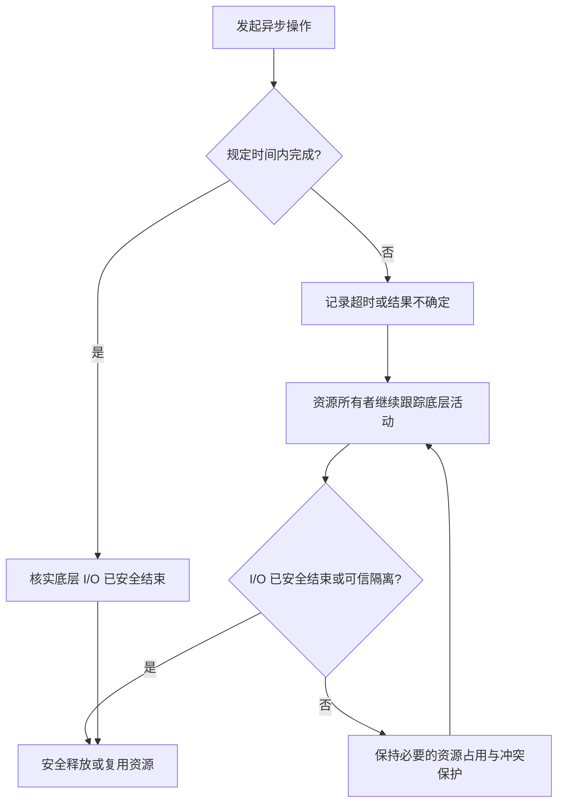

<p class="figure-caption">图 2-1 异步操作超时与资源安全释放流程</p>

对异步操作应区分超时、取消、异常和正常结束；不能仅凭调用方返回、Future/Task 取消或连接状态判断底层 I/O 已安全结束。

### 2.1.5 性能与资源有界原则

性能设计围绕明确的负载与质量要求展开，而不是无依据地增加并发或缓存。

<p class="table-caption">表 2-5 性能与资源有界设计要求</p>

| 设计要求 | 具体规定 |
|---|---|
| 负载模型 | 明确请求规模、并发规模、数据量及运行条件 |
| 容量约束 | 队列、线程、Task、连接、缓存及存储资源应有合理边界 |
| 背压 | 资源不足时明确等待、拒绝、丢弃或降级策略及适用条件 |
| 缓存 | 明确缓存用途、权威数据来源、失效与容量策略 |
| 性能指标 | 明确时延、吞吐、资源占用及测量口径 |
| 性能取舍 | 不得以违反正确性、安全性和可靠性约束换取性能 |

### 2.1.6 故障可控与恢复原则

设计应覆盖正常运行及合理预期的异常场景，明确故障影响范围和恢复条件。

<p class="table-caption">表 2-6 故障与恢复设计要求</p>

| 设计要求 | 具体规定 |
|---|---|
| 故障识别 | 明确可能的超时、通信失败、存储失败、任务异常和进程崩溃 |
| 故障隔离 | 限制故障传播，避免无关组件或资源被错误影响 |
| 状态可信 | 不将未知状态解释为确定成功或失败 |
| 重试与恢复 | 明确允许重试的条件，禁止可能产生危险副作用的盲目重试 |
| 持久化恢复 | 规定异常中断后的数据一致性及状态恢复规则 |
| 生命周期 | 明确启动、就绪、运行、关闭和重启期间的异常处理 |
| 失效行为 | 无法恢复时应有明确的降级、阻塞或停止服务条件 |

### 2.1.7 横切能力非侵入式原则

日志、审计、指标、追踪、权限校验等横切能力应与核心业务逻辑分离，优先通过统一的边界组件、装饰器、中间件或独立服务实现，不应将重复的技术处理流程散布在业务代码中。非侵入式不等于隐藏业务约束：凡影响业务准入、执行结果、事务一致性或故障处理的规则，必须在业务契约中明确，并保留必要的显式调用点。

<p class="table-caption">表 2-7 横切能力非侵入式设计要求</p>

| 设计要求 | 具体规定 |
|---|---|
| 职责分离 | 业务组件负责业务规则与状态转换；横切组件负责统一的记录、采集、校验与传输机制 |
| 边界统一 | 在服务入口、应用服务边界、消息发布边界等明确位置接入横切能力，避免各业务分支重复编排 |
| 最小侵入 | 不为记录日志、采集指标或传播追踪上下文而改变业务方法的核心控制流程和返回语义 |
| 审计正确性 | 审计事件的业务含义及产生时机由业务契约定义；持久化、投递、重试等通用机制与业务处理解耦，同时保证要求的一致性 |
| 故障影响 | 明确横切能力故障时的阻断、降级或重试规则；不得默认其失败不会影响业务，也不得默默吞掉必须处理的错误 |
| 可读性与验证 | 业务代码能够直接体现主流程；横切处理可独立测试，端到端测试验证其与业务契约一致 |

不为追求形式上的非侵入而引入复杂框架或过多抽象；简单、清晰的显式边界优先于难以追踪的隐式执行机制。

### 2.1.8 公共能力复用与冗余控制原则

优先使用符合需求的标准库、成熟软件包、现有工具及公共组件；相同且稳定的职责才提炼为公共能力，不重复发明、不为假设性扩展提前设计框架。

<p class="table-caption">表 2-8 公共能力复用与冗余控制要求</p>

| 设计要求 | 具体规定 |
|---|---|
| 复用优先 | 先评估现成组件是否满足功能、安全、性能及维护要求，再决定是否自行实现。 |
| 提炼公共职责 | 多模块存在稳定相同的职责时统一实现；业务规则留在所属业务模块。 |
| 控制依赖 | 核查成熟度、许可证、版本、安全维护及引入成本。 |
| 控制抽象 | 避免仅为减少少量重复而引入复杂框架或多层转发。 |
| 清理冗余 | 统一能力落地后删除重复、废弃和不必要的兼容实现。 |

### 2.1.9 图表表达与设计一致性原则

设计优先使用合适的图形和表格表达结构、流程、时序、状态及约束，图表不能代替必要的精确定义。

<p class="table-caption">表 2-9 图表表达与一致性设计要求</p>

| 设计要求 | 具体规定 |
|---|---|
| 视图完整 | 使用 4+1 架构视图组织系统设计，覆盖适用内容 |
| 图形选择 | 根据表达目的选择结构图、状态图、时序图、活动图等 |
| 图表一致 | 图形、表格和正文不得相互矛盾 |
| 跨章节一致 | 同一接口、状态、参数及资源规则保持一致 |
| 设计深度 | 明确影响系统行为的契约，允许自主选择内部实现细节 |
| 可验证性 | 关键设计要求应能够对应测试条件与验收证据 |

### 2.1.10 软件设计工作流程

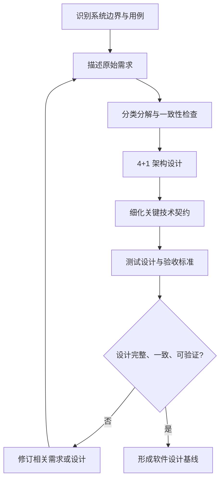

<p class="figure-caption">图 2-2 软件设计编制流程</p>

工作流程允许迭代，不要求传统瀑布式阶段。发现缺口或冲突时直接修订相关需求、架构视图或契约，不通过追加覆盖性条款解决。

### 2.1.11 规范性参考文献及项目无关性

本章为跨项目通用设计与编制规范，不得写入具体仓库、服务、业务协议、接口文件路径或项目专有指标。设计正文引用具体项目的源码、配置和协议文件时，应放在相关业务章节或接口/数据契约章节。

- **《符号体系.md》**：数学量类型、变量命名、标量/矢量/矩阵/张量、下标和公式运算的规范性依据。统计业务中的普通标量同样遵守其标量与阵列的区分原则。
- **《软件系统建模图形与表达规范.md》**：业务流程、DFD、活动/状态/时序图、算法图、伪代码和图元语义的规范性依据。

规范性引用以文件标题和相应章节为准，不复制全文；引用之间存在冲突时先识别并修订冲突，不擅自切换符号或重新解释图元。任何设计实例的具体接口名称、消息字段和技术约束均在第三章及后续适当章节给出。

## 2.2 需求体系及描述规范

需求采用“识别用例 → 逐条描述原始需求 → 分类分解 → 总分一致性检查”的方法。用例应从外部使用者及运行场景出发，覆盖适用的部署、启动、正常使用、配置、运维、正常关闭、重启及异常恢复过程；不局限于业务 RPC，也不将内部技术机制机械列为用例。用例识别属于需求分析，第 4 章用例视图负责表达参与者、边界及用例关系。

<p class="table-caption">表 2-10 原始需求描述字段</p>

| 字段 | 描述要求 |
|---|---|
| 编号 | 唯一原始需求标识，例如 `UR-01` |
| 名称 | 准确概括使用者需要的能力或运行场景 |
| 请求方（Requester） | 发起操作的外部系统、服务或接口，如外部客户端、上层服务、进程管理系统；消息和周期自动触发时可以没有直接请求方，标记“不适用” |
| 触发方式（Trigger） | 标明触发类型、事件来源、触发条件及必要的周期或接口；允许多个类型组合，区分外部触发和内部自动步骤 |
| 输入（Input） | 请求方向本系统提供的数据、参数和信息 |
| 反馈（Response） | 本系统返回请求方的确认、状态、结果及错误信息 |
| 目标方（Destination） | 接收本系统业务输出的外部系统、消息中间件或现场设备；没有时标记“不适用” |
| 业务输出（Output） | 本系统发往目标方的数据、消息或控制指令；没有时标记“不适用” |
| 业务流程（Flow） | 用 Mermaid 表达主要控制流程、数据输入/输出及重要异常，已表达的动作不重复 |
| 业务规则（Business Rules） | 补充主流程未精确定义的术语、公式、算法、初始化、阈值和边界；允许文字分条、LaTeX、图、伪代码或表格，不重复业务流程 |
| 关键约束（Constraints） | 性能、可靠性、安全、审计、可观测性、错误信息、缓存、I/O 与背压等可验证的非功能要求 |

反馈与业务输出必须分开：反馈面向请求方，业务输出面向目标方；请求方与目标方可有多个，且请求方断连不必然撤销已接受的业务操作。

### 2.2.1 触发方式分类与标注规则

原始需求必须列出实际适用的触发方式；同一需求可以组合多种触发方式，不能把处理流程中的普通步骤误写成独立触发。触发方式描述“何时、由什么启动”，不预先决定线程、定时器或队列等内部实现。

- **消息触发（Message）**：外部消息到达，例如实时消息或可靠消息；标明消息来源与订阅范围。
- **周期触发（Periodic）**：达到配置周期，例如实时周期输出或变化加周期保底；标明周期来源及生效条件。
- **API 触发（API）**：收到明确的外部接口请求，例如任务启动或配置应用接口；标明接口和调用方。
- **状态触发（State）**：受监控对象的状态发生满足条件的变化，例如外部依赖从不可用恢复可用；标明状态条件，不把普通循环迭代误列为触发。
- **生命周期触发（Lifecycle）**：服务进入启动、关闭、重启或配置生效等阶段；标明阶段及必要前置条件。

周期触发与消息触发可以同时存在：消息到达更新数据，周期到达决定何时输出。若无外部直接请求方，Requester 写“不适用（自动触发）”，但仍须列出消息生产者或状态来源；触发方式不替代 Input、Response 与 Output 的定义。

### 2.2.2 原始需求四节结构与写作原则

各 UR 固定为四节：**基本信息与触发方式、业务流程、业务规则、关键约束**。根据语义选择最清晰的表达形式；文字、公式、图形、伪代码和表格地位平等；**业务流程图已清楚表达的处理不得在后两节复述**。规则和约束必须有唯一规范定义，其他章节仅引用。

1. **基本信息与触发方式**：表格列出 Requester、Trigger、Input、Response、Destination、Output。Trigger 采用第 2.2.1 节分类，明确事件来源、触发条件及周期或 API。
2. **业务流程**：Mermaid Flowchart 或适用的 UML 活动图表达触发入口、主要处理、判断、数据输入输出、重要异常及恢复出口；复杂算法通过“预定义过程”节点指向第三节，不在总流程中堆叠实现细节。
3. **业务规则**：仅描述流程图无法精确表达的算法、公式、阈值、初始化、状态不变量、顺序及边界。允许文字分条定义、算法流程图、DFG、LaTeX 公式、表格或明确标为 `text` 的伪代码；必须说明输入、输出、初始值、边界及终止条件。无额外内容时标注“无额外规则”。
4. **关键约束**：**优先给出定量要求**（带单位、作用范围、测量窗口、默认值或硬上限、验收方法）；不能合理量化的才采用具有明确判定条件的定性要求。**仅放可核验的非功能要求**，按性能与容量、可靠性与恢复、安全与授权、审计、可观测性、错误信息、缓存与有效期、I/O 资源安全、背压与过载分类；无关分类可以省略或说明不适用。约束应给出故障条件、正确结果、测量或验收口径，不得用抽象口号代替。

### 2.2.3 业务图形元素与数据语义

参照《软件系统建模图形与表达规范.md》第 5.1 节 Flowchart、第 7.1 节 DFD 与第 8.1 节算法规范。业务活动图的控制流箭头表示处理顺序，DFD 箭头表示数据流，**两者不得混用**。图中应以不同形状区分处理、判断和数据。

| 元素 | Mermaid 写法 | 语义 |
|---|---|---|
| 开始/结束 | `A([开始/结束])` | 明确入口和完成/失败出口 |
| 处理 Process | `B["更新缓存"]` | 矩形，表达动作而非数据 |
| 判断 Decision | `C{"已过期?"}` | 菱形，分支标明条件 |
| 输入/输出 Data | `D[/"采样消息"/]` | 平行四边形，表达数据输入/输出 |
| 预定义子过程 | `E[["计算统计指标"]]` | 双边矩形，引用业务规则的算法说明 |
| 数据存储 | `F[("最新值缓存")]` | 存储节点；仅在理解读写关系必要时出现 |

不因形式要求增加无意义数据节点。数据来源、存储及复杂数据变换应单独绘制 DFD，避免业务活动图变成混杂的控制/数据流图。Mermaid 第一行初始化配置、图编号和图题仍须符合第一章。

### 2.2.4 业务规则、输出定义与关键约束的具体要求

- **业务规则**：定义与边界条件优先文字分条；涉及数学关系必须使用 LaTeX 独立公式；复杂步骤按需使用 Flowchart/DFG 或伪代码补充。表达形式不限于图和表；精确定义阈值、边界、初始化、更新基准和不可变条件，不复述主流程动作。算法必须能够独立据输入判断预期输出。
- **性能与容量**：优先用定量指标给出负载范围、时延/吞吐口径、并发及资源上限；必须区分设计目标、默认配置、不可突破的资源上限和验收实测值；未确定的阈值不得虚构。
- **可靠性及 I/O**：明确超时、结果不确定、重试、恢复、安全收敛及资源释放条件。调用返回或 Task 取消不代表底层 I/O 已结束。
- **错误信息**：定义错误类别、错误码或结果、对象与关联标识、发生阶段、可检索证据及敏感信息脱敏；禁止把 UNKNOWN 伪装为成功或明确失败。
- **缓存与背压**：规定缓存键、容量、更新/覆盖、过期、丢弃、等待、拒绝、暂停消费及恢复条件；所有超限策略必须可观测。
- **安全与审计**：列出认证、授权、控制边界以及需审计的操作、事件产生时机、关联 ID、可信保存与失败处理；运行日志不能代替审计。
- **可观测性**：指标、统计窗口、状态、事件、更新时间、无数据语义及告警；可结合真实场景验收。

**指标、计算和输出契约完整性（强制）：**凡使用“计算、统计、比较、阈值、状态、错误、容量、返回结果”等词定义业务能力，必须形成封闭的输出集合；不得用“等”“包括但不限于”替代本版本必须实现的清单。每个指标/派生字段至少定义以下内容；其中数学计算不得仅写在表格单元格内，必须另列可渲染的 LaTeX 公式：

| 必填字段 | 内容 |
|---|---|
| 唯一标识、类型和单位 | 与公开接口字段或指标名一致；明示 `counter/gauge/histogram`、计量单位 |
| 统计层级和数据来源 | 系统 / 进程 / 组件 / 任务 / 消费者；事件记录点、分子和分母来源 |
| 计算公式与口径 | 累计/窗口/瞬时，窗口端点、去重规则、事件计数次数、百分位算法 |
| 触发、初始化和重置 | 何时采集/计算、初始值、首个周期、进程重启、配置热更新 |
| 边界与缺失 | 零分母、空样本、UNKNOWN、超时、重复投递、源不可达的值域与 `unavailable` 语义 |
| 输出与验收 | 指标名、采样时间、窗口、可用性表达、配置边界及给定数据可独立验算的实例 |

**示例与可复算性（强制）：**当业务规则涉及多种计数口径、状态转换、时间窗口、边界分支或重试等易混淆情形时，至少给出一个具体输入—处理过程—预期输出的完整算例。算例必须标明初始条件、计量单位、每一步事件及最终结果；若同时存在样本条数、批次数、I/O 尝试次数等不同统计单位，须分别列出，禁止混用。算例应覆盖易误解的边界（例如重试成功仍有失败尝试记录），且结果必须可直接转化为确定性测试断言。算例是对定义的验证，不得取代规范性定义，也不应重复流程图中的全部步骤；涉及计算关系仍按第一章使用 LaTeX。

**数学定义与表达门禁：**业务规则的文字定义应独立成段或分条；涉及计算时，必须在定义后给出独立 LaTeX 公式，逐一释义变量、单位、取值域以及零分母、空样本和无效值。算法图与伪代码是可选的精度增强手段，不得要求所有业务规则使用表格。公式与中文混排遵守第一章 §1.3.1。

**约束定量优先门禁（强制）：**关键约束首先给出数值、单位、统计范围、采样方法、允许误差、测试条件和通过标准；可配置阈值应列出默认值及合法范围。仅当约束本质上无法定量（例如禁止错误 ACK）时，才用可判定的定性约束。不得用“及时、足够、合理、有界、尽可能、低延迟、高可靠”等词代替具体要求；未完成基准测试的数值应标明“设计验收目标，尚未实测”，不得声称达标。

**完备性门禁：**业务规则涉及的状态枚举、错误分类/错误信息字段、缓存容量及淘汰策略、I/O 结果、背压策略、审计与统计输出均应列举封闭集合和边界输入；凡无法根据文档构造确定预期结果的要求，视为需求未完成，不得标记为可编码。参数可以配置，但必须说明合法范围、默认/缺省行为及越界错误；性能数值未经验证时不得伪称已达标。每项约束必须可追溯至可执行的 UC/System 场景。

每项业务规则和关键约束须能由 UC/场景及第 14 章测试追溯；第 5～13 章详述实现契约时应引用 UR，不得另造冲突定义。

统一样式：

```text
### 3.x UR-xx 需求名称
#### 3.x.1 基本信息与触发方式
Requester / Trigger / Input / Response / Destination / Output
#### 3.x.2 业务流程
Mermaid 活动流程图，含重要异常及数据输入输出
#### 3.x.3 业务规则
可用文字、LaTeX、伪代码、图或表格精确定义算法、初始化与边界，不重复流程
#### 3.x.4 关键约束
按性能、可靠性、安全、审计、可观测性、错误、缓存、I/O、背压列可验证要求
```

本节也是第三章及后续章节的强制完整性验收标准。

<p class="table-caption">表 2-11 分类需求体系与描述重点</p>

| 类别 | 核心问题 | 典型要求 |
|---|---|---|
| 功能需求（Functionality） | 系统提供什么行为 | 对外能力、业务流程、业务规则、输入输出与状态反馈 |
| 性能需求（Performance） | 运行速度与资源上限 | 时延、吞吐、并发、调度、公平性、容量、背压、资源消耗、扩展能力 |
| 可靠性需求（Reliability） | 故障时如何保持正确与恢复 | 容错、超时、重试、请求关联、事务、持久化、故障恢复、可用性、未结束操作的资源管理 |
| 安全需求（Safety & Security） | 如何防止危险或非法控制 | 控制权、互锁、失效安全、认证、授权、通信及数据安全 |
| 横切能力（Cross-cutting Concerns） | 如何观测、管理与追责 | 审计（操作证据、可靠投递、完整性、追溯）、日志、指标、追踪、配置、版本、可测试性、可维护性 |

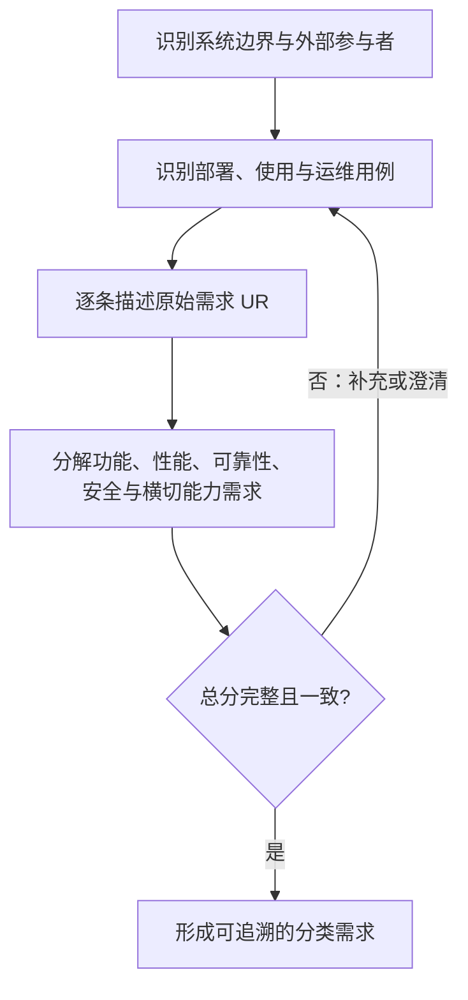

<p class="figure-caption">图 2-3 需求识别、分解与一致性检查流程</p>

分类需求必须从原始需求的输入、反馈、业务输出、规则和约束中推导，不得遗漏、矛盾或未经确认增加能力；多条原始需求的共同约束可以合并，但必须保留来源编号。每条分类需求应给出可核验条件，性能要求还需明确测量口径，不虚构现场阈值。审计应独立于普通日志定义，不得以运行日志代替审计证据。

需求分类与设计专题是不同维度：启动、正常关闭、重启及 Reload 属于跨需求的运行生命周期设计，统一在进程视图展开；相应行为和质量约束分别由原始需求及分类需求追溯。

## 2.3 4+1 架构视图：内涵、外延与表达规范

<p class="table-caption">表 2-12 4+1 架构视图的职责与成果</p>

| 视图 | 关注范围 | 主要成果 | 不应混淆 |
|---|---|---|---|
| 用例视图（+1） | 参与者、系统边界、典型/异常场景 | 系统上下文、用例、业务流程 | 不负责线程调度 |
| 逻辑视图（Logical） | 组件职责、模型、接口、状态规则、依赖 | 组件图、类/数据关系、状态图 | 不等于源码目录树 |
| 进程视图（Process） | 进程、线程、Event Loop、Task、协作、生命周期、同步、并发、资源、背压、缓存、故障恢复 | 运行结构图、任务所有权表、时序/状态/活动图、资源预算 | Task 不等于 OS 线程；图名须区分标准 UML 与示意图 |
| 开发视图（Development） | 软件模块边界、层次、静态依赖、公共契约与复用关系 | 模块图、依赖图、模块职责表 | 不描述真实并发拓扑，也不列现有代码修改清单 |
| 物理视图（Physical/Deployment） | 节点、进程部署、存储、网络、控制权和现场外部依赖 | 部署图、网络/故障域/外部依赖表 | 不是现场设备内部物理结构模型 |

### 2.3.1 用例视图的场景编写规范

用例以参与者的完整业务目标为单位组织，而非以原始需求、RPC 或内部模块为单位逐条改名。一项用例可以关联多项原始需求；一项原始需求也可以由多个业务场景共同覆盖。用例视图回答“在具体业务场景中系统如何工作”，不代替逻辑视图、进程视图和数据设计。

<p class="table-caption">表 2-13 业务场景用例的必备描述要素</p>

| 要素 | 编写规定 |
|---|---|
| 用例身份与目标 | 给出唯一编号、业务场景名称及参与者要达成的可观察目标；名称使用业务活动，不使用内部机制命名 |
| 参与者与触发条件 | 列明实际发起操作的外部角色；内部定时任务、恢复及发布等自动步骤不得虚构外部参与者 |
| 前置条件 | 列明系统就绪、授权、配置或数据存在等必要条件；不得混入未确认的实现假设 |
| 主业务流程 | 以 Mermaid 业务活动图（flowchart）为主要表达，覆盖触发、校验、关键处理、反馈及后置结果；以判断节点表达重要分支，避免大段编号文字复述 |
| 分支与异常流程 | 在活动图中呈现影响业务结果的主要异常出口；罕见或不宜展开的异常在简明说明表中概括，避免为了完整而画出所有技术异常 |
| 后置条件 | 明确成功和失败之后的业务状态、外部可见结果、未完成事项及后续查询方式 |
| 需求追溯 | 标明相关 UR；核对全部 UR 在真实场景中得到覆盖，但不要求 UR 与 UC 一一对应 |

跨用例共享的内部机制（如存储、审计发布和调度）应作为相关业务流程中的自动步骤或支撑行为描述；只有存在独立业务目标时才另立用例。应避免将一串 gRPC 方法名或 CRUD 操作直接当作完整用例，也不得在用例章节展开线程、锁、表结构及类方法等实现细节。

用例的正文采用“一张业务活动图 + 一张简明用例说明表”的表达形式。活动图包含主路径、必要判断以及重要异常分支；图中节点使用业务动作，不展开展示内部类、锁和数据库事务。说明表只填写参与者、业务目标、前置条件、主要异常、后置条件及关联需求。业务分支已在图中完整表达时，不再重复书写大段“主业务流程”和“异常流程”；复杂跨参与者消息时序可在独立小节补充时序图。图题和表题按文档约定独立编号。

进程视图应按四个设计专题组织，而不是按需求类别重复划分：

<p class="table-caption">表 2-14 进程视图的四类设计专题</p>

| 专题 | 必须明确的设计对象 | 推荐表达 |
|---|---|---|
| 运行时结构 | 进程、线程、Event Loop、Task、线程池、组件与资源所有权 | 分层运行结构图、Task 职责表 |
| 运行生命周期（Runtime Lifecycle） | 启动、初始化、就绪、运行、Reload、正常关闭、重启及其阶段转换 | 生命周期状态图、启动/关闭/Reload 时序图 |
| 并发与资源管理 | Task 协作、队列、通知、同步、调度、容量限额、背压、缓存及释放 | 任务协作时序图、资源与背压策略表 |
| 异常与恢复 | 超时、取消、故障隔离、未收敛 I/O、崩溃恢复与降级 | 故障状态图、异常裁决矩阵 |

各专题共享同一运行模型，明确创建者、所有者、同步关系和退出条件；不因分节而重复定义状态或资源。生命周期是进程视图的独立设计专题，不是第六类需求。

图表仅使用其可准确表达的语义：结构关系用 Mermaid Flowchart；行为交互用 Sequence Diagram；状态约束用 State Diagram；条件控制用活动/流程图。图题说明对象、范围及图类型。关键质量属性贯穿各视图，不能只写在单独的“非功能要求”段落。

## 2.4 测试设计方法、组织及验收规范

测试设计以测试层级组织物理目录，以 Marker 描述测试层级、测试专题与运行场景。测试文件名应清楚表达验证对象或行为；测试文件及其标记、验证说明统一登记在测试矩阵中。需求、用例及重要技术契约必须能追溯到实际测试，不为同一目的建立重复测试体系。

<p class="table-caption">表 2-15 测试层级与目录规范</p>

| 层级 Marker | 物理目录 | 验证范围 |
|---|---|---|
| `unit` | `unit/` | 状态转换、业务规则、纯逻辑，无外部服务依赖 |
| `component` | `component/` | 单组件职责及其可控依赖 |
| `integration` | `integration/` | 组件之间及真实外部依赖的接口协作 |
| `system` | `system/` | 独立进程、完整业务场景及端到端行为 |

<p class="table-caption">表 2-16 测试 Marker 与矩阵编制规范</p>

| 事项 | 规范 |
|---|---|
| 层级 Marker | 每项测试必须且仅属于 `unit`、`component`、`integration`、`system` 之一，与目录对应 |
| 专题 Marker | 标识可靠性、安全、性能等验证主题，可与层级及场景 Marker 叠加；无专项主题时可为空 |
| 场景 Marker | 标识并发、超时、恢复、负载、现场等执行条件或情境；有相应场景时标记 |
| 测试矩阵 | 至少包含“测试文件名、层级 Marker、专题 Marker、场景 Marker、测试说明”五列；每项重要测试应有可定位的文件归属 |
| 标记粒度 | 标记以具体测试函数或类为准；同文件可包含不同专题与场景，矩阵列出涉及的 Marker |
| 运行条件 | 通过 Fixture 和环境准备明确外部依赖；现场专用测试与常规回归分离，未执行不视为通过 |
| 执行规则 | 提供按目录、Marker 及其布尔组合的 pytest 命令；所有 Marker 在项目配置中注册 |
| 可追溯性 | 测试说明与需求、用例或技术契约对应；行为变更时同步检查测试及矩阵 |
| 验收证据 | 保留运行环境、命令、实际结果、指标和未验证项，禁止把设计目标当作测试结果 |

目录划分测试层级，专题与场景通过 Marker 横向组合；可靠性测试不单独设第五类目录。测试矩阵用于定位和筛选测试，不预设每个实现文件必须存在，也不要求每个文件仅能有一种测试场景。

### 2.4.1 测试依据及 System 覆盖要求

各层级测试必须依据已确认的设计成果编制；System Test 以用例视图为主基线，以原始需求及技术契约补充覆盖，不得由测试人员凭经验任意缩减范围。

<p class="table-caption">表 2-17 各测试层级的设计依据</p>

| 测试层级 | 主要依据 | 验证重点 |
|---|---|---|
| Unit | 详细设计、函数及算法契约 | 纯逻辑、状态转换、参数及边界规则 |
| Component | 逻辑视图、组件职责及内部接口契约 | 单组件行为、依赖协作及异常处理 |
| Integration | 接口与通信契约、开发视图、物理视图 | 真实接口调用、跨组件通信及外部依赖 |
| **System** | **用例视图（UC）及原始需求（UR）**，并补充接口、运行、部署、安全及性能约束 | **从真实受测服务进程及其通信入口验证业务目标、异常、边界与恢复行为** |

System Test 必须遵守以下规定：

1. **用例覆盖率 100%**：每项 UC 至少有一项 System Test 作为验证证据；同一测试可以覆盖多个 UC，同一 UC 可以由多个测试覆盖，**不按测试数量与 UC 数量的大小关系判定覆盖**。
2. **规定场景覆盖率 100%**：每项 UC 明确的主流程、关键分支、异常流程、边界和恢复场景均必须有对应 System Test；不能仅以一条正常路径代表整个 UC 已覆盖。
3. **需求覆盖率 100%**：每项 UR 必须能够经一个或多个 UC 追溯至 System Test；若某项需求未能被 UC 覆盖，必须先补全用例，不得直接以技术测试代替业务用例。
4. **技术约束补充覆盖**：用例未充分表达的性能、容量、并发、安全、权限、超时和可靠性要求，依据对应技术契约补充测试；不得因 UC 未逐项列出而豁免。
5. **真实系统边界**：System Test 通过真实受测服务进程和适用的外部依赖、通信链路执行；Mock 不得代替本次明确纳入验收范围的基础设施及通信链路。
6. **覆盖与通过分开裁定**：测试已关联不等于已执行；失败、跳过及未运行均不得计为通过。验收报告分别给出需求覆盖、用例及场景覆盖、执行情况和通过情况；缺少真实环境时标记 `NOT_RUN`，不得用模拟结果替代。
7. **变更同步**：任何 UR、UC、接口或行为约束的新增、删除、调整，必须同步核查 System Test、测试矩阵和验收条款；新增 UC 不得留下无测试映射。

<p class="table-caption">表 2-18 System Test 追溯矩阵规范</p>

| 字段 | 要求 |
|---|---|
| UR 编号 | 被验证的原始需求编号，可列多个 |
| UC 编号与场景 | 用例编号及主流程、异常、边界或恢复场景标识 |
| 技术契约 | 相关接口、配置、运行或安全约束的章节编号；没有则记“—” |
| 测试文件名／测试标识 | 可定位的 System Test 文件名及测试函数或参数化场景标识 |
| 层级／专题／场景 Marker | 层级固定为 `system`，其余按第 2.4 节定义填写 |
| 验证内容与预期结果 | 从用户可观察行为与副作用表述判定依据 |
| 执行环境及结果 | 真实依赖、执行证据、`PASS`／`FAIL`／`SKIP`／`NOT_RUN` 等状态 |

追溯链为 **UR → UC／用例场景 → System Test → 执行结果与证据**，技术契约作为补充依据进入相应测试。第 4 章负责编制完整 UC 和场景，第 14 章依据本规范给出实际测试矩阵及验收安排，两章必须双向核对。

# 3. 软件需求

本章按附件第二章 §2.2 统一采用“基本信息与触发方式→业务流程→业务规则→关键约束”描述七项原始需求。业务活动图承担正常路径、关键判断与异常出口；文字仅补充模型、时序、状态和资源等无法在图中精确表达的约束。第 4 章定义用户可观察的 UC 场景，第 5～14 章承接组件、运行、配置、接口和测试契约。

生成模型仅分 `random` 与 `physical`；CSV 历史重放是独立的数据来源。`physical` 使用简单物理方程，可同时具有代数关系和状态积分，不承担厂家级高保真仿真。Data Generator 负责对外 gRPC Server 和 Gateway `UpdateVariables` Client，不持有工业协议 Server。

## 3.1 业务需求总表

<p class="table-caption">表 3-1 Data Generator 业务需求总表</p>

| 编号 | 业务需求 | 业务目标 | 触发方式 |
|---|---|---|---|
| UR-01 | 模拟数据生成 | 根据场景以随机模型或简单物理模型生成符合点表的值。 | API：StartGeneration 启动指定场景；周期：运行实例每次生成周期；生命周期：显式停止时结束。 |
| UR-02 | 历史数据重放 | 按历史时间顺序和配置倍率重新输出设备测点值。 | API：StartGeneration 绑定重放场景；周期：按历史时间差及倍率调度；状态：源读取或输出故障触发失败处理。 |
| UR-03 | 虚拟设备数据输出 | 将模拟或重放结果经 Gateway 的正式 gRPC 接口更新虚拟变量。 | 周期：模拟/重放产生数据后；状态：Gateway 响应、故障或恢复。 |
| UR-04 | gRPC 接口实现 | 通过公开 Proto 提供 Data Generator 的管理、查询、配置、诊断和监控接口。 | API：收到 gRPC 请求；生命周期：服务启动及关闭时暴露/撤销服务能力。 |
| UR-05 | 配置管理 | 查询、暂存和应用完整配置快照并反馈磁盘和运行效果。 | API：GetConfigSnapshot/PushConfigSnapshot/ApplyConfigSnapshot；生命周期：启动读取正式配置；状态：Apply 后执行运行更新或提示重启。 |
| UR-06 | 数据通路诊断（Diagnose） | 逐阶段检查数据源至 Gateway 接收的链路并报告证据及局限。 | API：CommonService.Diagnose。 |
| UR-07 | 运行指标监控（Metrics） | 持续统计生成、重放、输出、实例运行状态及资源异常并提供查询。 | 周期：内部采样与窗口汇总；API：GetMetrics、GetEvents 及相关服务状态查询。 |

## 3.2 UR-01 模拟数据生成

### 3.2.1 基本信息与触发方式

<p class="table-caption">表 3-2 UR-01 基本信息</p>

| 字段 | 内容 |
|---|---|
| 请求方（Requester） | 授权 CLI/管理客户端；周期触发时不适用（自动触发） |
| 触发方式（Trigger） | API：`StartGeneration` 启动指定场景；周期：运行实例每次生成周期；生命周期：显式停止时结束。 |
| 输入（Input） | 已生效场景、设备与测点、模型参数、周期、随机种子与静态输入 |
| 反馈（Response） | 启动受理、生成实例状态、生成数量与错误（通过查询和指标获取） |
| 目标方（Destination） | 统一数据输出流程（内部），外部目标由 UR-03 规定 |
| 业务输出（Output） | 设备/测点标识、值、生成周期标识与内部采样时间 |

### 3.2.2 业务流程

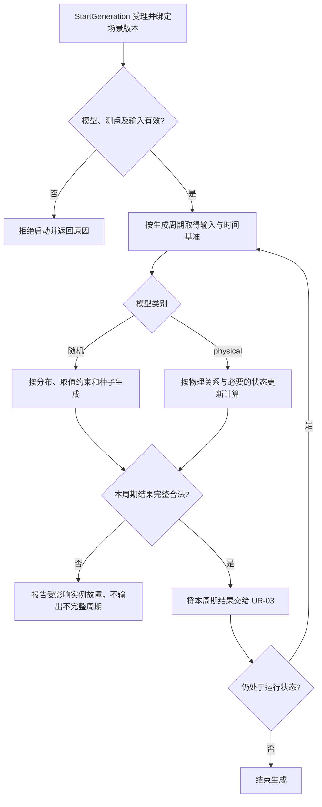

<p class="figure-caption">图 3-1 UR-01 模拟数据生成业务活动图</p>

### 3.2.3 业务规则

<p class="table-caption">表 3-3 UR-01 业务规则</p>

| 主题 | 规范性规则 |
|---|---|
| 模型和数据范围 | 仅有 random、physical 两类生成模型；physical 内含代数关系、查表、动态方程及状态机，涵盖风机、光伏、储能、电网和 PPC。CSV 重放为独立来源。 |
| 随机模型 | 对每个生成实例按场景版本及确定的随机种子初始化独立 PRNG；同一算法、种子、配置与调用次序得到相同序列。离散均匀整数、连续均匀实数及正态分布是否允许由已生效的模型类型明确选择；不得将取整或裁剪默认为所有分布共有行为。 |
| 简单物理模型 | 按第 10.5 节规范执行代数、查表与有需要的状态积分；变量角色、初值、输入权限、约束及失败行为均须明确。不得把计算方法另定义为模型类别。 |
| 样本合法性 | 每个目标点的计算结果须按点表类型、上下界和有限数检查；NaN/Infinity、非法枚举和超界值判为生成失败，不进入输出。 |
| 周期规则 | 一个生成实例在周期边界只生成一个逻辑样本批；同一周期禁止重入。错过的周期按进程视图跳期规则处理，不能同时运行重叠计算。 |

### 3.2.4 关键约束

<p class="table-caption">表 3-4 UR-01 关键约束</p>

| 类别 | 可核验约束 |
|---|---|
| 调度可靠性 | 单实例生成不可重入；每周期有限时长计算；超期按照第 6 章有界调度与跳期，记录对应错误。 |
| 合法数据 | 所有输出必须通过点表类型、有限数及范围校验；零个有效点不得作为正常成功批。 |
| 复现验收 | 同一种子/配置/输入与调用顺序重放生成序列，逐个值一致；更换种子应允许不同结果。 |


## 3.3 UR-02 历史数据重放

### 3.3.1 基本信息与触发方式

<p class="table-caption">表 3-5 UR-02 基本信息</p>

| 字段 | 内容 |
|---|---|
| 请求方（Requester） | 授权 CLI/管理客户端；持续重放无外部逐条请求方 |
| 触发方式（Trigger） | API：`StartGeneration` 绑定重放场景；周期：按历史时间差及倍率调度；状态：源读取或输出故障触发失败处理。 |
| 输入（Input） | CSV 历史数据文件、设备/测点映射、时间范围、倍率、绑定版本与起始位置 |
| 反馈（Response） | 重放受理、已处理进度、结束状态、异常及指标 |
| 目标方（Destination） | 统一数据输出流程（内部），外部目标由 UR-03 规定 |
| 业务输出（Output） | 历史值及其内部来源时间信息，按顺序送往 UR-03 |

### 3.3.2 业务流程

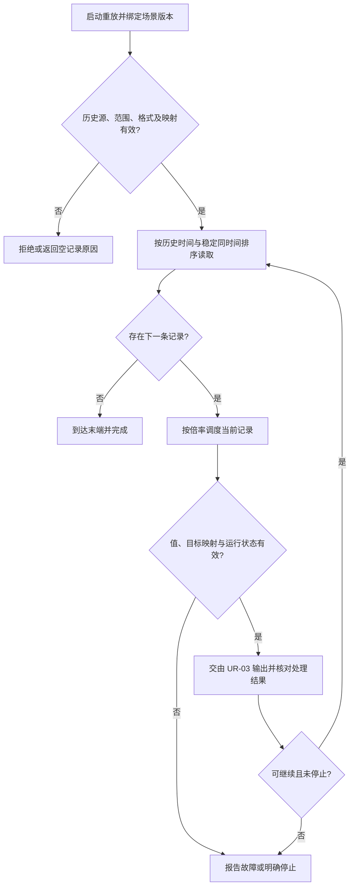

<p class="figure-caption">图 3-2 UR-02 历史数据重放业务活动图</p>

### 3.3.3 业务规则


首条有效历史记录的原始时间为 $t_0$（秒），第 $i$ 条记录时间为 $t_i$（秒），启动重放时的单调时刻为 $T_0$（秒），倍率 $r$ 为无量纲正数，第 $i$ 条计划发送时刻 $T_i$（秒）：

$$
T_i=T_0+\frac{t_i-t_0}{r}
$$

当多条记录的 $t_i$ 相等时，按文件行顺序稳定发送。$r=0$、负值或非有限值应在启动时拒绝。

<p class="table-caption">表 3-6 UR-02 业务规则</p>

| 主题 | 规范性规则 |
|---|---|
| 数据源 | 本期仅 CSV；每条记录至少能解析时间戳、设备 ID、测点 ID 和受约束的值；列名、时间格式及类型转换以第 10 章为唯一规范。 |
| 排序与重复 | 记录按历史时间戳升序，同时间戳按源文件原始行序稳定排序；重复行不自动去重。非法时间、缺失字段和不支持的类型是错误记录而非生成随机替代值。 |
| 重放调度 | 设首条有效历史时间为 $t_0$，其计划输出时刻为单调时钟 $T_0$，第 $i$ 条时间为 $t_i$，倍率 $r>0$，则按下式计划输出。历史值和时间戳不随倍率改变。 |
| 进度判定 | 已读记录数、已交付输出流程记录数、目标已确认变量更新次数分别统计；一条记录映射到多个目标时，不能把任一目标成功计作全部成功。 |
| 结束规则 | 抵达配置范围尾端后结束，不自动循环。空结果、数据损坏、输入中断明确结束或失败；停止与恢复按第 6 章定义，不虚构续播保证。 |

### 3.3.4 关键约束

<p class="table-caption">表 3-7 UR-02 关键约束</p>

| 类别 | 可核验约束 |
|---|---|
| 资源边界 | CSV 分批读取、调度缓冲和在途请求须有显式容量；发生背压按第 6/10 章统一规则，不能无界缓存。 |
| 失败隔离 | 非法行须保留错误位置和分类，且不得静默替换、跳过或冒充成功。 |
| 时间精度 | 历史调度以单调时钟计算等待；等待误差、倍率合法范围与可接受偏差依第 10 章配置和测试基准。 |


## 3.4 UR-03 虚拟设备数据输出

### 3.4.1 基本信息与触发方式

<p class="table-caption">表 3-8 UR-03 基本信息</p>

| 字段 | 内容 |
|---|---|
| 请求方（Requester） | 不适用（由 UR-01/02 自动触发） |
| 触发方式（Trigger） | 周期：模拟或重放产生数据；状态：目标 Gateway 故障、恢复或请求完成 |
| 输入（Input） | 不可变数据批、一个 Scenario 对应的多个 Gateway 目标及各自的多重变量映射 |
| 反馈（Response） | 按目标 Gateway、目标变量报告明确成功、明确失败或结果未知，并聚合实例输出状态与指标 |
| 目标方（Destination） | 一个或多个 Industrial Gateway；单个源点可映射多个 Gateway/变量 |
| 业务输出（Output） | 按 `gateway_id` 分组，分别调用 `IndustrialGatewayService.UpdateVariables` |

### 3.4.2 业务流程

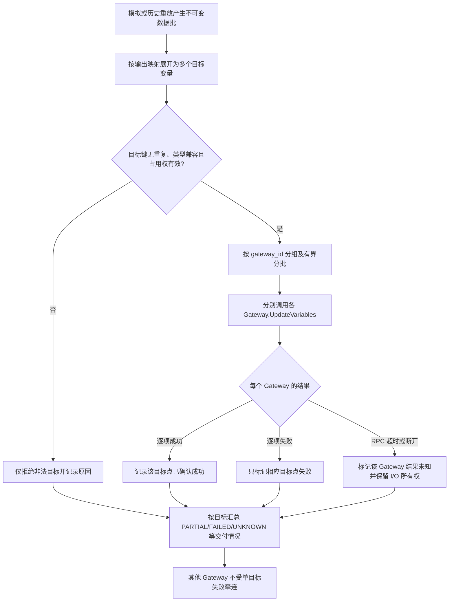

<p class="figure-caption">图 3-3 UR-03 一对多虚拟设备数据输出业务活动图</p>

### 3.4.3 业务规则

<p class="table-caption">表 3-9 UR-03 业务规则</p>

| 主题 | 规范性规则 |
|---|---|
| 一对多映射 | 一个 Scenario 可映射多个 Gateway，一个 `(device_id,point_id)` 可以映射到多个 `(gateway_id,variable_id)`，包括同一 Gateway 内多个不同变量；同一场景版本内目标二元组必须恰好出现一次；同一源点可输出到多个**不同**目标，不允许任意两个源点（即使来自不同 Device）共享同一个目标二元组。 |
| 目标键与所有权 | 目标变量的唯一标识是 `(gateway_id,variable_id)`；不同活动 Generation 不能同时取得同一目标键的写入所有权。StartGeneration 在创建实例/运行前必须对该实例完整目标集合进行原子冲突检查和预留；有任一冲突则全量拒绝，不允许部分占用或部分启动。StopGeneration 仅在对应未收敛 I/O 已安全结束或可信隔离后释放占用。冲突的启动或配置应用必须拒绝并返回冲突目标键。 |
| RPC 和分组 | 按 `gateway_id` 分组、按配置上限分批调用 `IndustrialGatewayService.UpdateVariables`，每个请求仅包含该 Gateway 的 `VariableUpdate(variable_id,value)`。当前 Proto 不携带 sample timestamp/quality，不能在 Gateway 中假设此二字段。 |
| 结果判定 | 每个返回项依据其 `variable_id/success/error_code/message` 判定；仅当本次全部应交付目标均被明确确认成功，逻辑批为 SUCCESS；部分成功为 PARTIAL；无确认且有已知失败为 FAILED；任何无法确定的目标均须保留 UNKNOWN，不得合并为成功。 |
| 故障隔离 | Gateway 间独立处理，无分布式原子性或回滚；目标 A 失败不撤销已确认的 B，也不能阻断 B 的后续允许更新。 |
| 非控制操作 | 该 RPC 只改变 Gateway 所持协议 Server 的变量，不触发 Commander 的控制转发；RPC 确认不代表下游工业客户端消费。 |

### 3.4.4 关键约束

<p class="table-caption">表 3-10 UR-03 关键约束</p>

| 类别 | 可核验约束 |
|---|---|
| 并发及容量 | 每 Gateway 配置独立批大小和在途上限；整体出站请求及排队资源有容量边界；达到上限时执行明确背压策略并计数。 |
| 超时与 I/O 安全 | 单个 RPC 超时或客户端取消并不能证明底层 I/O 已终结；保留关联执行资源及冲突保护，直至安全收敛。 |
| 安全 | Gateway 写入权限由服务端校验；无权目标不可更新；受控诊断不得写入真实业务变量。 |
| 统计和故障 | 按 Gateway 及目标变量保留明确成功/失败/未知，并在跨 Gateway 部分成功时返回 PARTIAL，不报告整体成功。 |


## 3.5 UR-04 gRPC 接口实现

### 3.5.1 基本信息与触发方式

<p class="table-caption">表 3-11 UR-04 基本信息</p>

| 字段 | 内容 |
|---|---|
| 请求方（Requester） | 授权 CLI、运维平台及其他 gRPC 客户端 |
| 触发方式（Trigger） | API：收到 gRPC 请求；生命周期：服务启动及关闭时暴露/撤销服务能力。 |
| 输入（Input） | `src/contracts/data_generator.proto` 与 `common.proto` 对应请求消息 |
| 反馈（Response） | 对应 Proto 响应及规范化 gRPC 错误 |
| 目标方（Destination） | 不适用；调用 UR-03 时外部目标为 Gateway |
| 业务输出（Output） | 不适用（只读 RPC）；Start/Stop 触发生成实例状态变化 |

### 3.5.2 业务流程

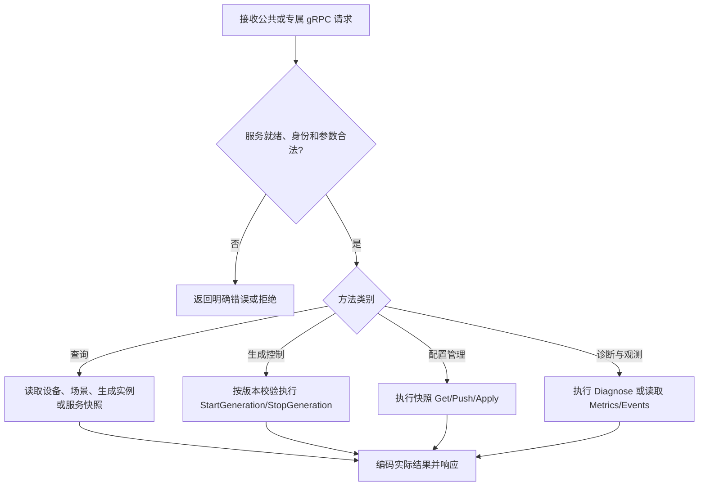

<p class="figure-caption">图 3-4 UR-04 gRPC 接口实现业务活动图</p>

### 3.5.3 业务规则

<p class="table-caption">表 3-12 UR-04 业务规则</p>

| 主题 | 规范性规则 |
|---|---|
| 对外服务 | 实现 DataGeneratorService 目标八项（既有设备/场景查询、生成启停六项，加变量发现与更新两项）和 CommonService 九项，共 17 个 Unary RPC；新增两项须先更新 Contracts Proto。 |
| 字段契约 | Proto 字段、oneof、optional、类型和返回消息以仓库 `src/contracts/` 为准，业务设计不得生成平行或不兼容的协议。 |
| 实例控制 | StartGeneration 依据 `scenario_id` 与可选 `scenario_version` 绑定确定版本，受 `expected_revision` 冲突校验；StopGeneration 按 `generation_id` 操作；超时不等于完成停机。 |
| 客户端边界 | Data Generator 另以 Client 身份调用 Gateway `UpdateVariables`，该 RPC 不属于 Data Generator 的 Server 接口。 |

### 3.5.4 关键约束

<p class="table-caption">表 3-13 UR-04 关键约束</p>

| 类别 | 可核验约束 |
|---|---|
| 安全与错误 | 各 RPC 严格身份校验与权限检查，错误码/对象/冲突版本可核对且敏感内容脱敏。 |
| 兼容性 | 接口方法集合、Request/Response 和 optional presence 以编译后的 Proto Descriptor 验证，无自造 RPC。 |


## 3.6 UR-05 配置管理

### 3.6.1 基本信息与触发方式

<p class="table-caption">表 3-14 UR-05 基本信息</p>

| 字段 | 内容 |
|---|---|
| 请求方（Requester） | 授权 CLI 或管理客户端 |
| 触发方式（Trigger） | API：`GetConfigSnapshot`/`PushConfigSnapshot`/`ApplyConfigSnapshot`；生命周期：启动读取正式配置；状态：Apply 后执行运行更新或提示重启。 |
| 输入（Input） | 配置作用域、完整候选文件集、预期修订版本、候选 ID |
| 反馈（Response） | 正式/候选/运行快照、校验问题、文件提交、逐对象应用结果与重启要求 |
| 目标方（Destination） | 不适用 |
| 业务输出（Output） | 不适用（配置受理和生效结果通过 Response） |

### 3.6.2 业务流程

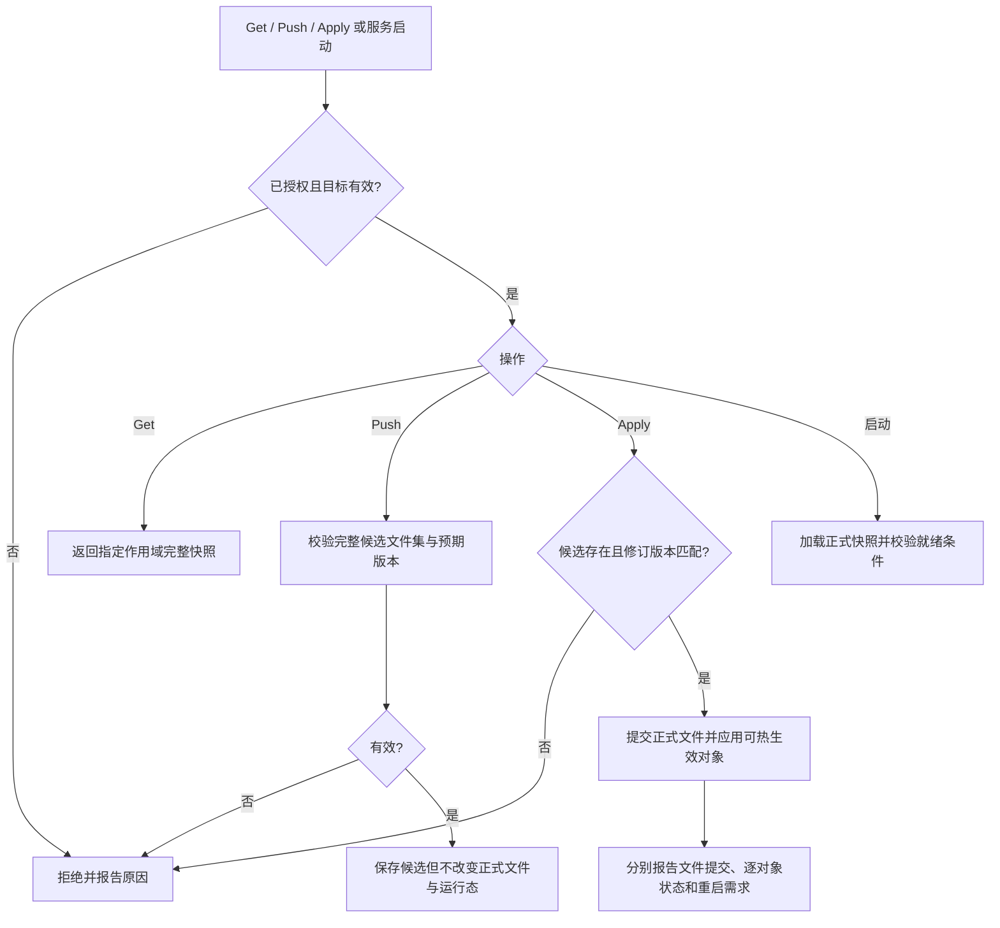

<p class="figure-caption">图 3-5 UR-05 配置管理业务活动图</p>

### 3.6.3 业务规则

<p class="table-caption">表 3-15 UR-05 业务规则</p>

| 主题 | 规范性规则 |
|---|---|
| 快照作用域 | `GetConfigSnapshot` 的 DISK/RUNTIME/CANDIDATE 分别指已提交正式文件集、当前运行有效快照和待应用候选；不存在时返回明确错误，不把某一作用域误报为另一作用域。 |
| 推送规则 | Push 依据 `expected_revision` 校验完整文件集、路径、版本和引用，合法则创建候选但不修改正式文件或运行实例。无效候选不生效。 |
| 应用规则 | Apply 对候选及 expected_revision 进行核验，先提交正式文件后逐项应用允许热更新的实例和模板；服务本体配置变化设置 `restart_required`。文件提交结果和运行对象生效结果独立返回。 |
| 场景版本 | 活动生成实例绑定启动时的场景版本；配置变更不能隐式切换其绑定版本。 |
| 保密与文件保真 | 授权读取的快照须完整保留文件字节用于往返，不可用脱敏副本覆盖正式文件；日志、事件与诊断证据中禁止泄露敏感字段。 |

### 3.6.4 关键约束

<p class="table-caption">表 3-16 UR-05 关键约束</p>

| 类别 | 可核验约束 |
|---|---|
| 原子性与恢复 | Push 不修改正式文件；Apply 文件提交必须提供失败恢复保障和逐对象结果。 |
| 审计 | 对 Push、Apply 的主体、版本和结果生成可追溯事件，凭据不进入事件内容。 |
| 容量 | 快照总文件数、字节数、候选保留量及并发写入均应按第 11 章明确限额。 |


## 3.7 UR-06 数据通路诊断（Diagnose）

### 3.7.1 基本信息与触发方式

<p class="table-caption">表 3-17 UR-06 基本信息</p>

| 字段 | 内容 |
|---|---|
| 请求方（Requester） | 授权 CLI、运维或诊断客户端 |
| 触发方式（Trigger） | API：`CommonService.Diagnose`。 |
| 输入（Input） | `target_id`、待检查阶段、超时及关联标识 |
| 反馈（Response） | 总体状态、阶段状态、耗时、证据、错误与 `limitations` |
| 目标方（Destination） | 不适用；经授权的测试可指向安全测试 Gateway |
| 业务输出（Output） | 不适用（诊断请求并非正常数据流交付） |

### 3.7.2 业务流程

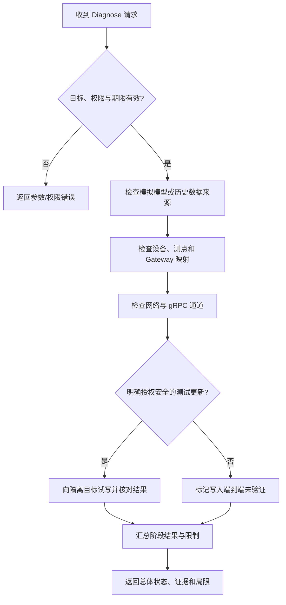

<p class="figure-caption">图 3-6 UR-06 数据通路诊断（Diagnose）业务活动图</p>

### 3.7.3 业务规则

<p class="table-caption">表 3-18 UR-06 业务规则</p>

| 主题 | 规范性规则 |
|---|---|
| 诊断覆盖 | 根据 `DiagnoseRequest(target_id,stages,timeout_ms,correlation_id)` 执行选定阶段，覆盖模型/历史源、映射、网络、gRPC 可达和明确授权的 Gateway 更新试验。 |
| 成功含义 | TCP 可达不等于 gRPC 可调用，gRPC 可用不等于变量更新成功，变量更新成功不等于现场工业客户端已消费。 |
| 安全测试 | 默认非侵入式；没有明确授权及隔离的测试变量时不得执行写入，未执行阶段以 skipped/unverified 形式报告并列入 limitations，不可宣称端到端通过。 |
| 响应格式 | 只返回既有 `DiagnoseResponse(overall_status,stages,limitations)` 及其 `DiagnosticStage` 证据，阶段结果须给出观察时间、执行来源、错误码和耗时。 |

### 3.7.4 关键约束

<p class="table-caption">表 3-19 UR-06 关键约束</p>

| 类别 | 可核验约束 |
|---|---|
| 非侵入与安全 | 默认只读；受授权写入测试只可使用隔离目标，明确诊断权限并记录审计证据。 |
| 超时和隔离 | 整体和分阶段诊断有超时边界；取消不释放未收敛底层 I/O 的资源所有权。 |
| 证据 | 每个阶段返回状态、错误、实际范围、观察时刻和 limitations，未做检查不能标记 PASS。 |


## 3.8 UR-07 运行指标监控（Metrics）

### 3.8.1 基本信息与触发方式

<p class="table-caption">表 3-20 UR-07 基本信息</p>

| 字段 | 内容 |
|---|---|
| 请求方（Requester） | 监控与运维客户端；内部周期统计无直接请求方 |
| 触发方式（Trigger） | 周期：内部采样与窗口汇总；API：`GetMetrics`、`GetEvents` 及相关服务状态查询。 |
| 输入（Input） | scope、窗口、事件时间范围与过滤条件 |
| 反馈（Response） | 数值指标/单位/采样时间及事件记录 |
| 目标方（Destination） | 不适用 |
| 业务输出（Output） | 不适用（指标是查询反馈，不主动写入 Gateway） |

### 3.8.2 业务流程

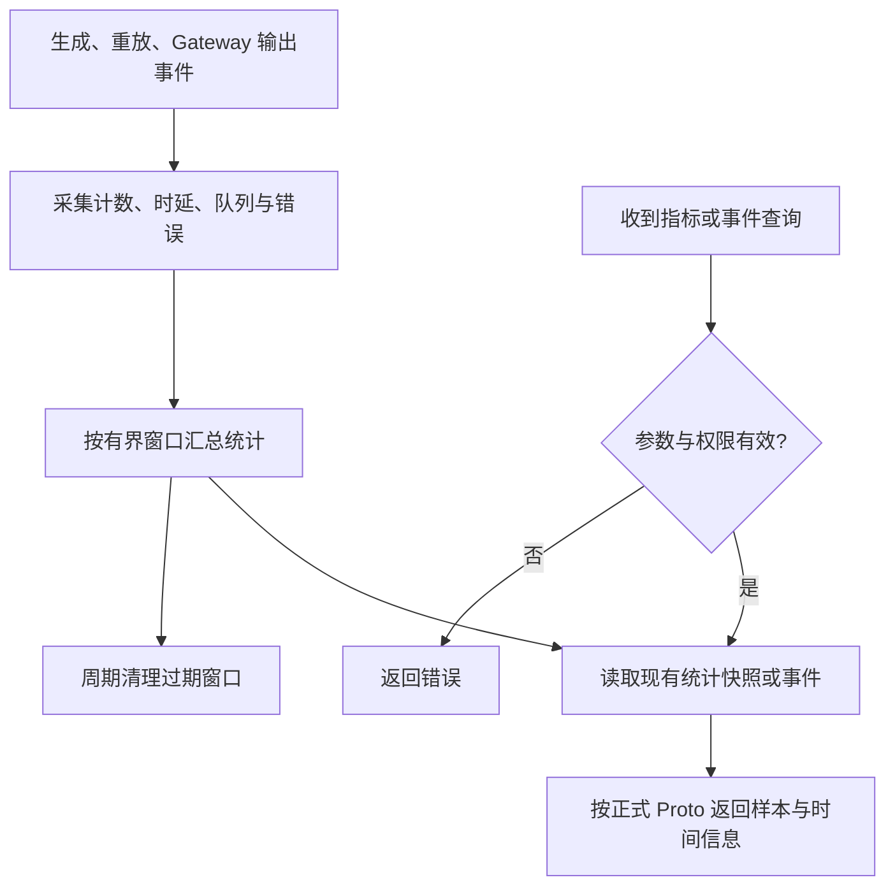

<p class="figure-caption">图 3-7 UR-07 运行指标监控（Metrics）业务活动图</p>

### 3.8.3 业务规则


设观察窗口长度为 $W$ 秒，窗口内 Gateway 已明确确认成功的目标变量更新数量为 $N_{ok}$（次），对应成功速率 $R_{ok}$（次/秒）：

$$
R_{ok}=\frac{N_{ok}}{W},\qquad W>0
$$

若窗口内已完成 RPC 的有效耗时样本升序为 $d_{(1)},\ldots,d_{(n)}$（毫秒），$n>0$，采用 nearest-rank 规则：

$$
P_{99}=d_{(\lceil 0.99n\rceil)}
$$

$n=0$ 时 P99 不可用，不返回数值零；超时但底层执行未结束的请求不纳入已完成样本。

<p class="table-caption">表 3-21 UR-07 业务规则</p>

| 主题 | 规范性规则 |
|---|---|
| 指标分层 | 分别统计生成样本数、历史读取记录数、逻辑发送批次、按 Gateway 的 RPC 调用次数、已尝试目标变量数、成功变量数、明确失败变量数和结果未知变量数；不得把次数不同的计数口径相加。 |
| 时间窗口 | 所有速率使用明确的统计窗口。窗口内成功更新数按 Gateway 对应目标变量逐项确认计数；空窗口没有有效速率样本时不伪造历史值。 |
| 百分位 | P99 从窗口内已完成且有有效耗时的 gRPC 调用样本计算，不包含未结束请求；必须注明采用的分位数算法。 |
| 输出消息 | `GetMetricsResponse` 只能返回 `Metric(name,value,unit,window_ms,sampled_at)`；Proto 没有状态字段，缺失/不可用不得伪装为数值 0，应通过明确定义的省略规则与 `GetEvents`/`GetServiceStatus` 辅助辨认。 |
| 维度和重置 | 可查询服务、任务与 Gateway 等受限维度；进程重启后进程内计数和窗口重新初始化，不声称历史统计连续。 |

### 3.8.4 关键约束

<p class="table-caption">表 3-22 UR-07 关键约束</p>

| 类别 | 可核验约束 |
|---|---|
| 资源开销 | 采样周期、窗口长度、最大标签数与保留上限以配置约束；指标聚合不得阻塞主业务。 |
| 可观测性 | 统计周期、纪元、单位和窗口应能由实际响应核查；不同 Gateway 结果须独立统计。 |
| 故障隔离 | Metrics 采集异常不得使生成和重放停止，GetMetrics 为只读且不隐式触发生成或诊断。 |


## 3.9 分类需求与 UR 追溯（遵照 §2.2）

以下分类仅索引和收敛 §3.2～§3.8 中已经确定的要求，不构成额外功能或新 RPC。性能阈值采用 §6.3、§11.3 所列可配置限额和可验证的相对时序约束；未给定硬性容量数字的项目不得声称达标。

<p class="table-caption">表 3-23 分类需求追溯</p>

| 类别 | 可核验要求及依据 | 来源 |
|---|---|---|
| FR-01 | 随机/简单物理模型生成、输入依赖及错误处理；Gateway 输出 | UR-01、UR-03 |
| FR-02 | CSV 历史范围读取、顺序、倍率、结束及停止 | UR-02 |
| FR-03 | 实现目标 8 个专属与 9 个公共 Server RPC，并报告真实状态 | UR-04 |
| FR-04 | 快照 Get/Push/Apply、场景版本查询、生成启停 | UR-04、UR-05 |
| FR-05 | Diagnose 分阶段证据与局限、Metrics 及 Events 查询 | UR-06、UR-07 |
| PR-01 | 生成非重入、历史倍率时序和统计偏差，§6.3 | UR-01、UR-02 |
| PR-02 | 队列、在途 RPC、诊断和指标有界；超限背压，§6.3 | UR-03、UR-06、UR-07 |
| RR-01 | 不确定送达不得当成功；底层 I/O 收敛前不可释放冲突资源 | UR-02、UR-03 |
| RR-02 | 正式文件提交原子切换、运行版本绑定、重启不隐式恢复任务 | UR-04、UR-05 |
| SR-01 | 受控 Gateway 注入、目标与权限校验；只读诊断默认无写入 | UR-03、UR-06 |
| SR-02 | 配置目录和历史文件路径安全、快照授权和凭据保护 | UR-05 |
| CR-01 | 运行状态/事件、采样纪元、窗口 P99、无样本不作零值 | UR-04、UR-07 |
| CR-02 | 诊断证据、指标隔离、配置提交日志与可测试性 | UR-05～UR-07 |

# 4. 用例视图

## 4.1 系统上下文

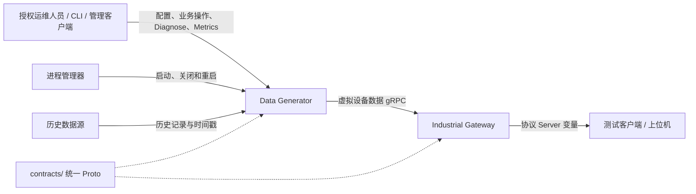

<p class="figure-caption">图 4-1 Data Generator 系统上下文图</p>

本章用例以外部参与者的完整业务目标组织，不按 RPC 或内部模块逐项命名。`UC-xx-S01` 为主流程、`S02` 为关键边界、`S03` 为异常或恢复；每一行中的并列条件须分别由参数化或独立 System Test 验证。实际生成或重放等后台工作属于用例的自动步骤，不额外虚构外部参与者。第 14 章按相同场景编号建立追溯与验收证据。

<p class="table-caption">表 4-1 用例—需求总表</p>

| 用例 | 目标 | 关联需求 |
|---|---|---|
| UC-01 | 模拟数据生成并输出 | UR-01、UR-03、UR-05 |
| UC-02 | 按历史记录重放数据 | UR-02、UR-03、UR-05 |
| UC-03 | 确认虚拟设备数据可在 Gateway 使用 | UR-01、UR-02、UR-03 |
| UC-04 | 获取、推送并应用配置快照 | UR-05 |
| UC-05 | 诊断来源到 Gateway 的数据通路 | UR-03、UR-06 |
| UC-06 | 查看运行指标并识别异常 | UR-07 |
| UC-07 | 通过服务接口管理和查询业务 | UR-04、UR-05、UR-06、UR-07 |
| UC-08 | 启动、关闭及故障后恢复服务 | UR-01～UR-07 |

## 4.2 UC-01 模拟数据生成并输出

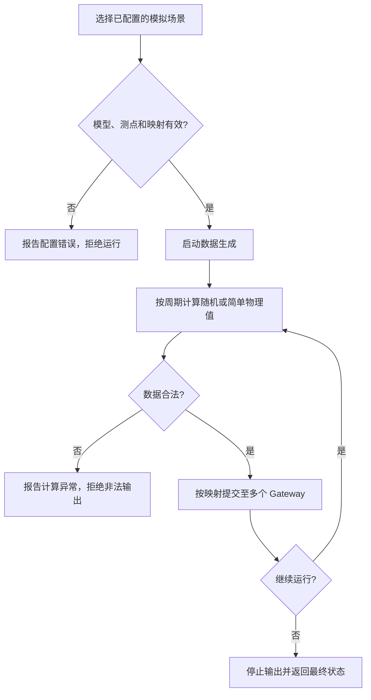

<p class="figure-caption">图 4-2 UC-01 业务活动图</p>

<p class="table-caption">表 4-2 UC-01 用例说明与规定场景</p>

| 要素 | 内容 |
|---|---|
| 参与者 | 运维人员、配置客户端 |
| 业务目标 | 使随机或简单物理模型按配置生成合法测点值并交付 Gateway |
| 前置条件 | 服务就绪，模型、设备点表及输出映射已生效 |
| 主要异常 | 模型参数不合法；生成数值非法；周期超期；输出拥塞 |
| 后置条件 | 生成数据可被 Gateway 接收；失败/停止时不继续发送非法数据 |
| 关联需求 | UR-01、UR-03、UR-05 |
| UC-01-S01 主流程 | 随机模型与简单物理模型分别生成并输出 |
| UC-01-S02 关键边界 | 零周期、参数边界、模型计算超期、停止 |
| UC-01-S03 异常与恢复 | 模型无效、非有限值、生成故障与恢复 |

## 4.3 UC-02 按历史记录重放数据

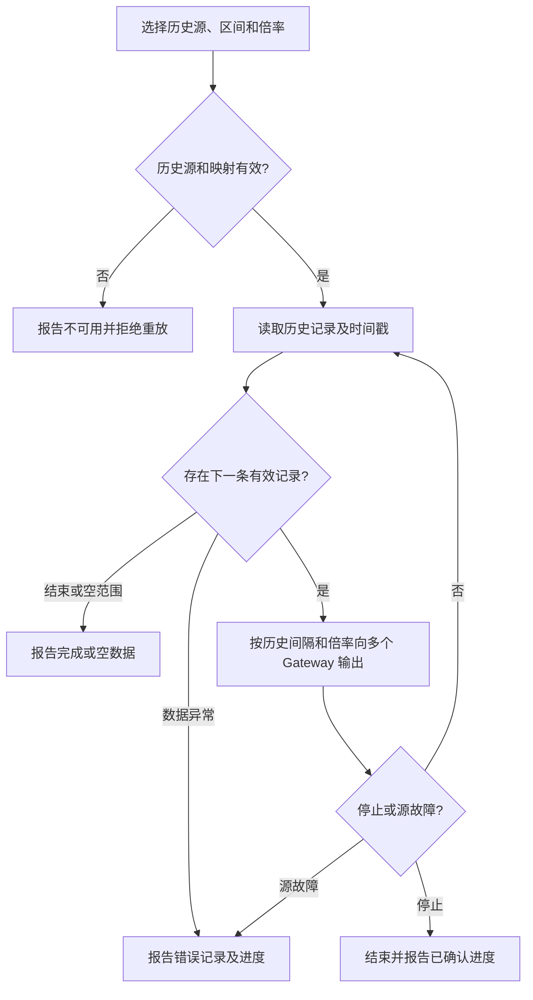

<p class="figure-caption">图 4-3 UC-02 业务活动图</p>

<p class="table-caption">表 4-3 UC-02 用例说明与规定场景</p>

| 要素 | 内容 |
|---|---|
| 参与者 | 运维人员、历史数据提供方 |
| 业务目标 | 按历史时间顺序和设定倍率向 Gateway 重放既有记录 |
| 前置条件 | 历史源可访问；时间范围、倍率和测点映射明确 |
| 主要异常 | 空范围；时间戳非法；源中断；重放迟到；停止或重启 |
| 后置条件 | 完成时报告记录和进度；失败时明确最后已确认位置 |
| 关联需求 | UR-02、UR-03、UR-05 |
| UC-02-S01 主流程 | 按时间顺序和倍率完成重放 |
| UC-02-S02 关键边界 | 同时间戳、空范围、倍率边界 |
| UC-02-S03 异常与恢复 | 读取失败、运行中停止和重启 |

## 4.4 UC-03 确认虚拟设备数据可在 Gateway 使用

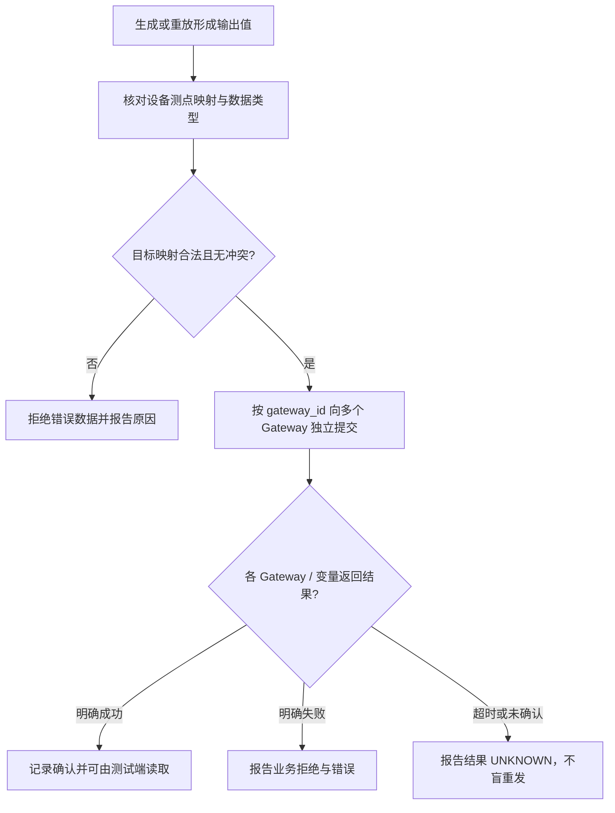

<p class="figure-caption">图 4-4 UC-03 业务活动图</p>

<p class="table-caption">表 4-4 UC-03 用例说明与规定场景</p>

| 要素 | 内容 |
|---|---|
| 参与者 | 运维人员、外部测试读端、Industrial Gateway |
| 业务目标 | 确认生成或重放数据经 gRPC 被 Gateway 正确接收并能按对应变量提供读取 |
| 前置条件 | 目标 Gateway 可用，映射一致，测试目标与现场隔离 |
| 主要异常 | 映射冲突；业务拒绝；超时或未知交付；断线及背压 |
| 后置条件 | 分别报告已确认、失败或未知交付，不将 Gateway 接收误判为下游消费 |
| 关联需求 | UR-01、UR-02、UR-03 |
| UC-03-S01 主流程 | 单源点映射至多个 Gateway 及同 Gateway 多目标变量，逐目标读回 |
| UC-03-S02 关键边界 | 错误映射、同目标重复、类型边界及跨活动实例目标所有权冲突 |
| UC-03-S03 异常与恢复 | 单 Gateway 故障隔离、部分成功、未知结果、独立恢复与有界拥塞 |

## 4.5 UC-04 获取、推送并应用配置快照

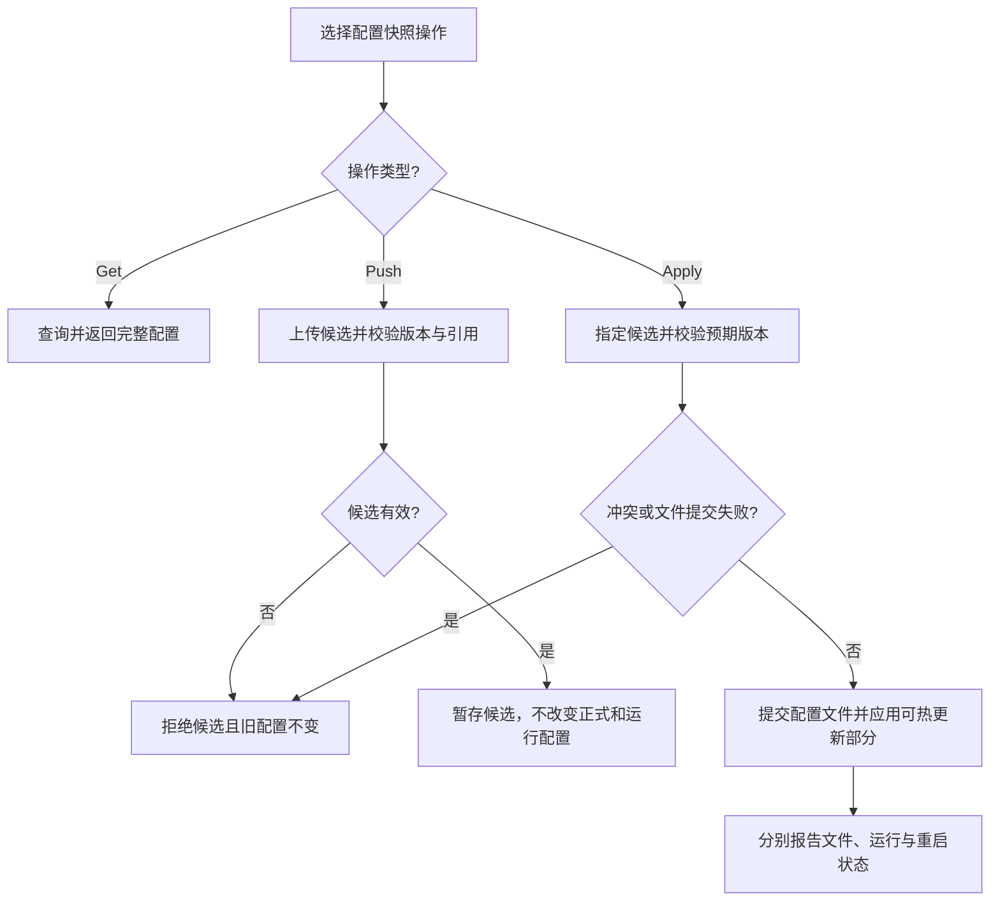

<p class="figure-caption">图 4-5 UC-04 业务活动图</p>

<p class="table-caption">表 4-5 UC-04 用例说明与规定场景</p>

| 要素 | 内容 |
|---|---|
| 参与者 | 授权运维人员、CLI |
| 业务目标 | 安全更新完整配置快照，并区分文件提交和运行生效 |
| 前置条件 | 服务 gRPC 可用，操作者具有配置权限 |
| 主要异常 | Schema 非法；候选失效；版本冲突；文件失败；部分热更新失败 |
| 后置条件 | Push 不改变正式配置；Apply 后可区分正式、运行及待重启状态 |
| 关联需求 | UR-05 |
| UC-04-S01 主流程 | Get、Push 与 Apply 完整链路 |
| UC-04-S02 关键边界 | 候选版本、冲突、重复请求和需要重启 |
| UC-04-S03 异常与恢复 | 校验失败、部分生效、断连后查询实际状态 |

## 4.6 UC-05 诊断来源到 Gateway 的数据通路

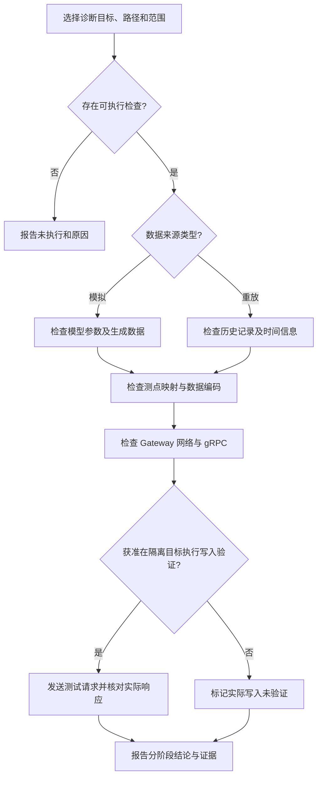

<p class="figure-caption">图 4-6 UC-05 业务活动图</p>

<p class="table-caption">表 4-6 UC-05 用例说明与规定场景</p>

| 要素 | 内容 |
|---|---|
| 参与者 | 授权运维人员、CLI |
| 业务目标 | 分阶段定位模拟或重放至 Gateway 接收之间的故障 |
| 前置条件 | 诊断目标明确，检查范围和权限已确定 |
| 主要异常 | 无检查目标；阶段不可达；RPC 可达但业务拒绝；测试写入未授权 |
| 后置条件 | 返回每阶段证据、耗时和未验证范围，不把端口连通判定为整链路通过 |
| 关联需求 | UR-03、UR-06 |
| UC-05-S01 主流程 | 生成路径或重放路径检查及安全写入验证 |
| UC-05-S02 关键边界 | 只读检查与未授权主动写入 |
| UC-05-S03 异常与恢复 | 连接、映射、编码、超时及无目标 |

## 4.7 UC-06 查看运行指标并识别异常

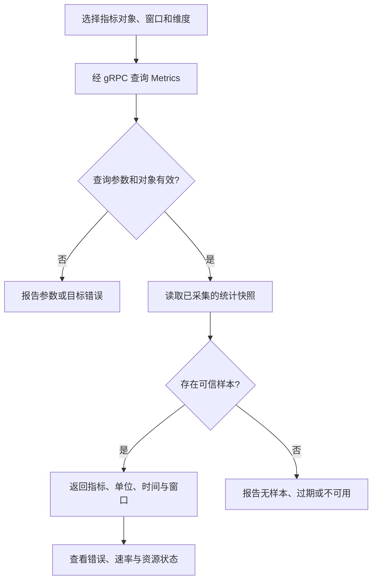

<p class="figure-caption">图 4-7 UC-06 业务活动图</p>

<p class="table-caption">表 4-7 UC-06 用例说明与规定场景</p>

| 要素 | 内容 |
|---|---|
| 参与者 | 授权监控客户端、运维人员 |
| 业务目标 | 查询模拟、重放、输出及资源指标，判断服务性能和运行健康 |
| 前置条件 | 服务指标查询接口可用，采集按运行周期开展 |
| 主要异常 | 空窗口；指标过期；高基数限制；采集异常；服务重启 |
| 后置条件 | 返回可信指标、窗口、单位和采样时刻，或明确不可用 |
| 关联需求 | UR-07 |
| UC-06-S01 主流程 | 查询各类实时/窗口指标 |
| UC-06-S02 关键边界 | 空窗口、统计边界、资源与标签容量 |
| UC-06-S03 异常与恢复 | 采集异常、查询限流及重启后的统计重置 |

## 4.8 UC-07 通过服务接口查询和控制已配置业务

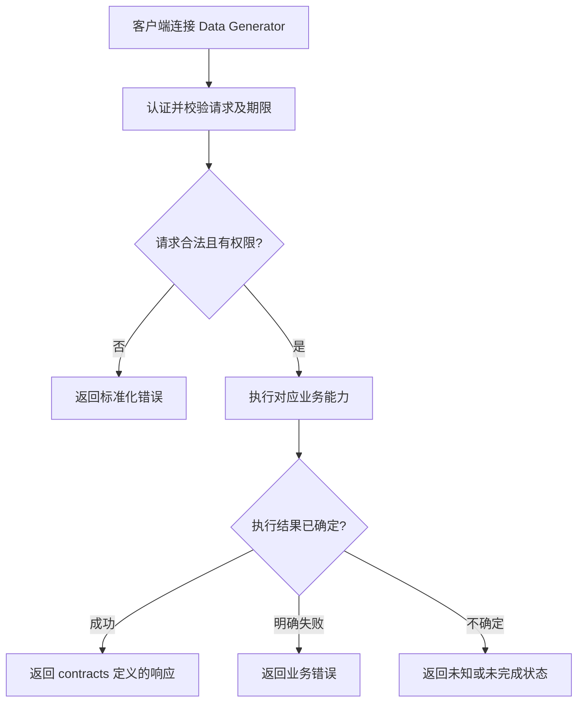

<p class="figure-caption">图 4-8 UC-07 业务活动图</p>

<p class="table-caption">表 4-8 UC-07 用例说明与规定场景</p>

| 要素 | 内容 |
|---|---|
| 参与者 | CLI、授权 gRPC 客户端 |
| 业务目标 | 通过 contracts 定义的 gRPC 入口调用已授权的业务能力并获得可信反馈 |
| 前置条件 | 服务已启动，接口契约及认证材料有效 |
| 主要异常 | 认证失败；无效参数；不支持的能力；截止时间或取消 |
| 后置条件 | 成功返回正式响应；失败或不确定状态均可区分 |
| 关联需求 | UR-04、UR-05、UR-06、UR-07 |
| UC-07-S01 主流程 | `DataGeneratorService` 目标八项及 `CommonService` 九项 RPC 正常调用；场景/设备查询、生成启停及公共服务操作 |
| UC-07-S02 关键边界 | `scenario_version` 可选、`expected_revision` 冲突、ID 不存在、分页、身份权限和并发请求 |
| UC-07-S03 异常与恢复 | 截止时间、取消、生成启停不确定结果、请求失败及服务关闭 |

## 4.9 UC-08 启动、关闭及故障后恢复服务

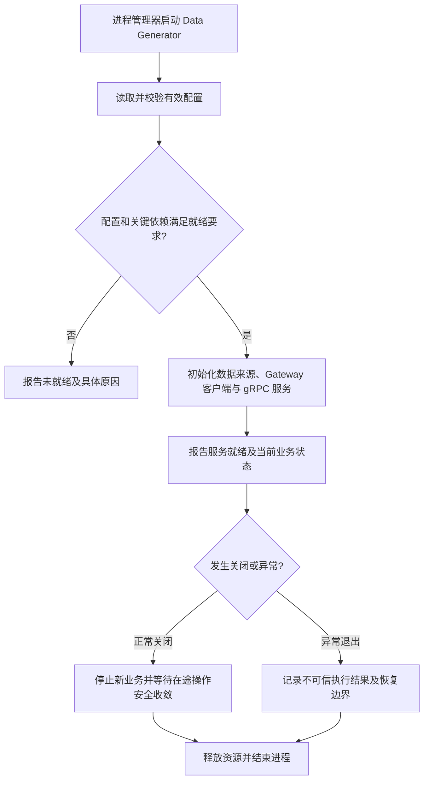

<p class="figure-caption">图 4-9 UC-08 业务活动图</p>

<p class="table-caption">表 4-9 UC-08 用例说明与规定场景</p>

| 要素 | 内容 |
|---|---|
| 参与者 | 部署运维人员、外部进程管理器 |
| 业务目标 | 启动服务并确认就绪，在正常关闭或故障后保持状态可信及资源安全 |
| 前置条件 | 部署环境和配置文件可用；目标依赖按要求配置 |
| 主要异常 | 配置无效；依赖不可用；在途 I/O；异常退出；重启后状态不确定 |
| 后置条件 | 分别报告进程、服务就绪与业务运行状态；不虚构任务自动恢复 |
| 关联需求 | UR-01～UR-07 |
| UC-08-S01 主流程 | 正常启动、就绪、关闭及重新启动 |
| UC-08-S02 关键边界 | 配置不合法、运行依赖未就绪 |
| UC-08-S03 异常与恢复 | 在途 I/O、异常退出及恢复边界 |

# 5. 逻辑视图

## 5.1 第 0 层 DFD

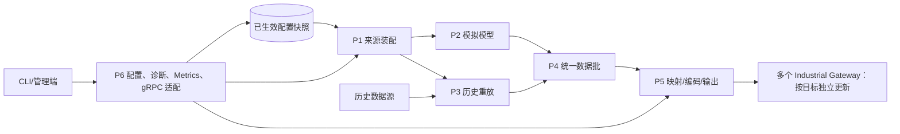
<p class="figure-caption">图 5-1 Data Generator 第 0 层数据流图</p>

## 5.2 逻辑组件

```mermaid
%%{init: {"flowchart": {"useMaxWidth": true}}}%%
flowchart TB
 Entry["ServiceHost / 进程入口"] --> Runtime["RuntimeCoordinator"]
 Runtime --> Sim["SimulationSource"]
 Runtime --> Rep["ReplaySource"]
 Sim --> Model["GeneratorModel Port"]
 Rep --> History["HistoryReader Port"]
 Runtime --> Batch["DataBatch / OutputCoordinator"]
 Batch --> Map["Mapping & Scalar Validation"]
 Map --> Fanout["Gateway Fan-out / 独立目标状态"]
 Fanout --> Gateway["GatewayClient / Gateway Proto：多个目标"]
 Entry --> GRPC["DataGeneratorGrpcServer / contracts Proto"]
 GRPC --> Runtime
 GRPC --> Config["ConfigManager"]
 GRPC --> Diag["DiagnoseService"]
 GRPC --> Metrics["MetricsService"]
 Diag --> Sim
 Diag --> Rep
 Diag --> Gateway
 Metrics --> Runtime
 Metrics --> Gateway
```
<p class="figure-caption">图 5-2 目标逻辑组件与调用依赖图</p>

<p class="table-caption">表 5-1 组件、职责和权威状态</p>

| 组件 | 职责 | 权威状态及边界 |
|---|---|---|
| `RuntimeCoordinator` | 调度当前唯一已配置数据来源，组织输出和运行停止 | 生命周期、运行纪元、执行状态 |
| `SimulationSource` | 以周期生成模拟数据 | 步序、仿真时间、模型实例 |
| `ReplaySource` | 按历史时间调度记录 | 来源游标、倍率、当前历史时间 |
| `GeneratorModel` | 生成一个设备或一组相关测点的数据 | 有限模型状态；两种首版实现 |
| `HistoryReader` | 按稳定顺序读取、验证历史记录 | 外部数据归历史源所有，Reader 不持有持久存储 |
| `OutputCoordinator` | 一对多映射展开、按 Gateway 分组、独立发送和交付裁决 | 按 Gateway/变量维护在途与确认状态；不承担下游消费 |
| `GatewayClient` | 调用 Gateway 的 Proto 客户端 | gRPC Channel、超时与明确响应 |
| `ConfigManager` | Get/Push/Apply 和应用状态 | 候选、正式文件与内存生效快照分离 |
| `DiagnoseService` | 主动分阶段诊断 | 检查项结果，不能修改生产业务状态 |
| `MetricsService` | 采集、聚合、只读查询 | 有界时间窗口及重启纪元 |
| `DataGeneratorGrpcServer` | 完整实现外置 Proto Server | 请求适配，不持有业务权威数据 |

## 5.3 统一领域契约

**领域对象及数量关系（规范性定义）：**

| 对象 | 业务定义 | 标识与所有权 | 数量关系 |
|---|---|---|---|
| `Scenario` | 可版本化的生成/重放方案，定义来源、多个虚拟设备、测点与 Gateway 输出映射；不是运行中的任务 | `scenario_id` 唯一，`version` 标识不可变版本；配置为权威来源 | 一个 Scenario 可产生多次 Generation（历史上 1:N）；同一场景的活动并发仍受第 6 章容量限制 |
| `Generation` | 一次 `StartGeneration` 创建的运行实例，绑定一个确定的 Scenario 版本，负责统一调度该版本定义的全部 Device | 服务端生成全局唯一 `generation_id`；绑定的 `scenario_id/scenario_version` 运行期间不变 | 一个 Generation 对应一个 Scenario 版本，并管理其中 1..N 个 Device |
| `Device` | Scenario 定义的虚拟设备及其测点集合，不是实际 PLC，也不是 Gateway | `device_id` 在本服务内全局唯一；不同 Scenario 不得重定义同一设备；同一 Scenario 的不同版本允许保留同一设备 ID | 一个 Device 任一时刻最多关联一个活动 Generation；一个 Device 可有多个测点 |
| `OutputTarget` | Gateway 内一个可更新变量，是数据写入的最小唯一占用单元 | 复合键 `(gateway_id, variable_id)`；由活动 Generation 占有 | 一个源测点可映射多个**不同**目标；一个目标在一个 Scenario 版本内恰好出现一次，任一时刻最多由一个活动 Generation 占有 |

```mermaid
%%{init: {"flowchart": {"useMaxWidth": true}}}%%
flowchart TD
 S["Scenario（版本化定义）"] -->|"一个版本启动一次"| G["Generation（运行实例）"]
 G -->|"统一管理 1..N"| D["Device（虚拟设备）"]
 D -->|"包含 1..N"| P["Point（源测点）"]
 P -->|"映射 1..N 不同目标"| O["OutputTarget（Gateway 变量）"]
```

<p class="figure-caption">图 5-3 Scenario、Generation、Device 与输出目标关系</p>

说明：图中的 1..N 表示单次业务对象之间的关系；一个 Scenario 可跨时间产生多次 Generation，并不表示本版必然允许并行启动。同一 `Device` 在多个版本中的定义是同一逻辑设备的版本演进，而非多个同时可运行的设备。`ListDevices/GetDevice` 返回按 `device_id` 唯一的逻辑设备视图；其 `generation_id` 仅标识**当前活动归属**，未运行时为空，不能随意选择某个历史 Generation 填入。

**输出占用不变量：**

$$
K_{\mathrm{out}}=(\mathrm{gateway\_id},\mathrm{variable\_id})
$$

<p class="formula-caption">式（5-1）输出目标复合标识</p>

任意已生效 Scenario 版本内，映射集合中每个 `K_out` 只能出现一次；任意时刻，不同活动或仍持有未收敛写入资源的 Generation 的目标集合不得相交。这里 `gateway_id` 和 `variable_id` 都是非空字符串，前者标识服务配置中的 Gateway 目标，后者标识该 Gateway 内变量；组合唯一性不按 endpoint 字符串替代。跨 Scenario 配置允许声明相同目标，但不得同时运行占用；服务当前 `活动数据源=1` 的限制与此独立，不得取代目标占用验证。


```mermaid
%%{init: {"class": {"useMaxWidth": true}}}%%
classDiagram
 class DataPoint {
   +string device_id
   +string point_id
   +Scalar value
   +datetime source_time
 }
 class DataBatch {
   +string source_id
   +SourceKind kind
   +int sequence
   +datetime produced_at
   +DataPoint[] points
 }
 class ReplayRecord {
   +datetime historical_time
   +string stable_order_key
   +DataPoint point
 }
 class ConfigSnapshot {
   +string version
   +string origin
   +string status
 }
 DataBatch *-- "1..*" DataPoint
 ReplayRecord *-- DataPoint
```
<p class="figure-caption">图 5-4 数据输出与历史重放核心契约类图</p>

`source_time` 表示物理采样/历史来源时间；`produced_at` 表示本进程组批时间。若 Gateway Proto 没有对应时间字段，不得伪造接口支持，必须在元数据或本地进度中保存并注明对外时间限制。`DataBatch` 一经交给输出边界，内容不可变；输出失败不能修改既有样本。首版允许一个 `(device_id, point_id)` 扇出到多个**互不重复**的目标；同一 Scenario 版本内任一目标键恰有一条映射；每个 `(gateway_id, variable_id)` 在任一时刻只允许一个活动或尚未完成安全收敛的实例拥有写入权。数据源必须归属某个已配置 `scenario_id`，生成实例绑定 `scenario_version`。

## 5.4 模型与重放的统一输出

```mermaid
%%{init: {"sequence": {"useMaxWidth": true}}}%%
sequenceDiagram
 participant R as RuntimeCoordinator
 participant S as SimulationSource / ReplaySource
 participant O as OutputCoordinator
 participant G as Gateway A / B / ... gRPC
 R->>S: next_batch(deadline)
 S-->>R: DataBatch
 R->>O: submit(DataBatch)
 O->>O: check mapping / validate scalar / bounded batch
 O->>G: 对每个 gateway_id 独立 UpdateVariables(values[])
 alt 明确确认
 G-->>O: acknowledged
 O-->>R: 仅该目标 CONFIRMED
 else 明确失败
 G-->>O: error
 O-->>R: 仅该目标 FAILED
 else 超时或未知
 G--xO: timeout/disconnect
 O-->>R: 仅该目标 UNKNOWN
 end
```
<p class="figure-caption">图 5-5 统一输出调用时序图</p>

# 6. 进程视图

## 6.1 运行时结构

```mermaid
%%{init: {"flowchart": {"useMaxWidth": true}}}%%
flowchart TB
 subgraph P["Data Generator 单个 OS 进程"]
  L["主 asyncio Event Loop / gRPC Server / 调度协调"]
  C["ConfigManager"]
  D["Diagnose Task / 有界并发"]
  M["Metrics Sampler / 窗口"]
  R["单来源执行 Task"]
  B["有界 DataBatch 缓冲"]
  O["Gateway Fan-out / 各目标独立有界在途"]
  L --> R --> B --> O
  L --> C
  L --> D
  L --> M
 end
 R --> H["历史数据源或纯计算模型"]
 O --> G["多个 Industrial Gateway"]
```
<p class="figure-caption">图 6-1 目标运行时结构（异步执行单元，不等同 OS 线程）</p>

<p class="table-caption">表 6-1 Task、资源与所有权</p>

| 运行实体 | 创建者 | 所有资源 | 结束条件 |
|---|---|---|---|
| Server Task | ServiceHost | Server Listener、在途 RPC | 停止准入、在途请求收敛 |
| Source Task | RuntimeCoordinator | 模型/历史 Reader、时间游标 | 完成、主动停止或异常 |
| Output Task | RuntimeCoordinator | 有界输出队列、gRPC Channel、在途写入 | 不再受理并处理/明确终结在途 |
| Diagnose Tasks | DiagnoseService | 临时读取与测试连接 | 截止时间或全部检查结束且资源安全 |
| Metrics Sampler | MetricsService | 定时 Task、固定窗口缓存 | 服务停止 |
| Config Apply | ConfigManager | 候选数据、文件提交权、受影响源 | 提交成功或回滚/部分应用报告 |

首版采用**一个活动生成实例，对应一个活动数据源**（模拟或重放），使输出点所有权唯一。若未来要支持多来源并行，必须先定义设备/点位的冲突裁决与统一时间顺序，本版不凭空承诺其并发写入能力。

## 6.2 运行生命周期

服务启动通过指定的服务配置绝对路径定位 `configs/`，逐一校验三个直接引用的实例文件、模板根目录及 `configuration` 解析的间接模板，再进入就绪状态；`Apply` 只热更新实例/模板相关生效内容，服务级配置变更须重启（详见 §11.1、§11.5）。


`DataGeneratorService.StartGeneration` 与 `StopGeneration` 是当前 Proto 已有的业务运行控制入口；`GetGeneration` 返回权威生成实例状态。它们不同于外部进程管理器启动/停止服务进程。按 `scenario_id` 选择已配置场景、绑定 `scenario_version` 后产生服务端 `generation_id`；合法停止必须保护未安全收敛的底层 I/O。场景编辑/删除不属于当前接口范围。


```mermaid
%%{init: {"state": {"useMaxWidth": true}}}%%
stateDiagram-v2
 [*] --> STARTING
 STARTING --> READY: 配置和依赖可用
 STARTING --> FAILED: 校验/初始化失败
 READY --> RUNNING: 已授权 StartGeneration 且来源启动成功
 RUNNING --> STOPPING: 关闭信号
 READY --> STOPPING: 关闭信号
 RUNNING --> FAILED: 不可恢复异常
 FAILED --> STOPPING: 清理
 STOPPING --> STOPPED: 资源安全收敛
 STOPPED --> [*]
```
<p class="figure-caption">图 6-2 进程生命周期状态图</p>

服务进程启动与数据源启动必须区分：**进程 READY 表示管理和查询能力就绪，不必代表 Gateway 已交付数据。** 首版服务启动后处于 READY、**不自动生成或重放**；只有受理 `StartGeneration` 才启动已配置场景。`StopGeneration` 只影响指定实例、不停止服务进程。进程重启后不自动重启先前运行的生成实例。进程重新启动时重新读取正式配置；无检查点的模拟状态与历史重放游标不自动恢复为崩溃前位置。停止执行时，不得将取消 Future/Task 当作底层 I/O 已安全结束的证据。

## 6.3 调度、容量与背压

**启动、停止与配置变更的目标占用裁决：** `StartGeneration` 在同一串行化控制边界中解析不可变 Scenario 版本，计算全部 `(gateway_id,variable_id)`，先检查设备活动归属及目标占用，后原子预留全部 Device 和目标键，再开始来源与 Gateway I/O；任意冲突导致整次启动拒绝且不创建可运行的部分实例。并发请求不能分别通过检查后重复占用。`StopGeneration` 先禁止新数据输出，等待已提交 I/O 安全收敛或可信隔离，再原子释放设备/目标占用；超时返回未收敛状态并保留冲突保护。`ApplyConfigSnapshot` 校验新旧配置和运行实例占用，不得把目标重新分配给另一活动 Generation；被替换版本的实例绑定与保留遵照 §11.5。


模拟源步序满足 $t_n=n\Delta t$、$n\geq1$，调度间隔配置为 `interval_seconds`。当单步运行超过周期时，同一模型不得重入；执行下一步前报告滞后并采取显式策略（首版为不补偿、逐步继续），不能为追赶时间发起重叠计算。

历史记录以 `source_timestamp` 和稳定排序键确定顺序。若基准历史时间为 $T_0$、倍率为 $r>0$，首条发送基准墙钟时间为 $W_0$，则第 i 条的计划发送时间：

$$
W_i=W_0+\frac{T_i-T_0}{r}
$$
<p class="formula-caption">式（6-1）历史重放的预期墙钟发送时间</p>

同时间戳按稳定键顺序发送；禁止在没有重放确认策略的情况下重新发送结果不确定的批次。默认一次性重放、不循环。速率超过处理能力时记录 `lag` 并阻塞上游读取；不无界缓存或跳过记录。

<p class="table-caption">表 6-2 容量与背压设计</p>

| 资源 | 界限 | 达上限行为 |
|---|---|---|
| 活动数据源 | 1（本版） | 拒绝第二来源启动，报告配置冲突 |
| 生成/重放数据缓冲 | 由服务配置 `buffer.max_batches`、`max_points_per_batch` 限制 | 暂停上游推进；超时按失败处理 |
| Gateway 在途 RPC | `output.max_inflight`，首版每 Gateway 默认 1，总量有界 | 仅阻塞相应 Gateway；全局上限用尽时暂停来源，禁止同目标无序覆盖 |
| 历史读取批量 | `replay.read_batch_size` 上限 | 分批流式读取 |
| 诊断并发 | `diagnose.max_concurrent` | 明确拒绝超量请求 |
| 指标窗口与标签 | `metrics.window_seconds`、`max_series` | 限制新标签，记录溢出统计 |
| 配置候选快照 | 同时一份候选 + 版本令牌 | 冲突返回，不覆盖他人候选 |

## 6.4 异常及恢复

<p class="table-caption">表 6-3 异常裁决矩阵</p>

| 异常 | 业务结果 | 恢复要求 |
|---|---|---|
| 模型 NaN/Inf、公式域错误 | 该周期失败，不发送错误值 | 修复配置后重新启动源 |
| 历史源暂时失联 | 重放停止/故障，保留已确认位置 | 不从未确认位置盲重放 |
| Gateway 明确拒绝 | 本批 FAILED | 记录原因，停止受影响来源或按明确策略处理 |
| Gateway RPC 超时/连接中断 | 本批 UNKNOWN | 不默认再次发送；控制未收敛在途 I/O |
| Metrics 不可用 | 指标 UNKNOWN/STALE | 记录采集错误，不停止有效业务源 |
| Diagnose 失败 | 该诊断失败 | 不修改正常生成源 |
| 配置 Apply 文件写入失败 | 未成功提交 | 继续保留原正式配置 |
| 运行进程崩溃 | 不确定批次不保证交付 | 重启从配置开始，明确非断点恢复 |

# 7. 开发视图

## 7.1 模块结构

```mermaid
%%{init: {"flowchart": {"useMaxWidth": true}}}%%
flowchart TB
 Entry["data_generator / composition root"] --> App["application / 源编排、发布与服务用例"]
 Entry --> Infra["infrastructure / gRPC、配置、模型、Reader、Gateway"]
 App --> Domain["domain / DataBatch、SourceTime、模型参数"]
 App --> Ports["ports / Model、HistoryReader、OutputClient"]
 Infra --> Ports
 Infra --> Domain
 Infra --> C["contracts / 外部 Proto"]
```
<p class="figure-caption">图 7-1 静态开发依赖图</p>

<p class="table-caption">表 7-1 第一层目标源码目录</p>

| 路径 | 归属职责 |
|---|---|
| `src/data_generator/domain/` | 数据批、时间语义、模型输入输出及数据质量规则 |
| `src/data_generator/application/` | 生成与重放协调、输出、配置、诊断和指标应用服务 |
| `src/data_generator/ports/` | 领域所需的模型、历史 Reader、Gateway Writer 抽象 |
| `src/data_generator/infrastructure/` | 模型实现、文件/数据库 Reader、gRPC Server、Gateway 客户端和配置存取 |
| `src/data_generator/main.py` | 进程入口及装配，无业务算法 |
| `src/contracts/` 或仓库统一 `contracts/` | 由外部维护的 Proto；**不是本模块所有物** |

具体文件与私有类方法依照实现清晰度调整，不复制 Commander/Collector 的业务层或引入兼容性模块；仅复用 Core 已有通用能力，模型仍归 Data Generator。

## 7.2 可插拔来源与模型

```mermaid
%%{init: {"class": {"useMaxWidth": true}}}%%
classDiagram
 class SourcePort {
  <<interface>>
  +next_batch() DataBatch
  +close()
 }
 class GeneratorModel {
  <<interface>>
  +validate(params)
  +generate(time, inputs) ScalarMap
 }
 class HistoryReader {
  <<interface>>
  +iterate_records(range)
  +close()
 }
 class SimulationSource
 class ReplaySource
 class RandomModel
 class PhysicalModel
 SourcePort <|.. SimulationSource
 SourcePort <|.. ReplaySource
 SimulationSource --> GeneratorModel
 ReplaySource --> HistoryReader
 GeneratorModel <|.. RandomModel
 GeneratorModel <|.. PhysicalModel
```
<p class="figure-caption">图 7-2 数据来源与模型的端口关系类图</p>

生成入口为 `RandomModel` 和 `PhysicalModel`。代数计算、随机风场与必要的状态演化均在 `PhysicalModel` 的明确设备子模型内完成，不新增静态/有状态两个生成类别。物理计算关系的具体公式/查表从已配置的受控模型类型和参数中选择，**不得以直接 `eval` 任意表达式实现**。

# 8. 物理视图（部署视图）

```mermaid
%%{init: {"flowchart": {"useMaxWidth": true}}}%%
flowchart LR
 subgraph Host["受控联调主机 / 测试网络"]
  DG["Data Generator 进程"]
  GW["Industrial Gateway 进程"]
  CLI["CLI / 管理端"]
  CFG[("正式配置文件")]
  CLI -->|"按 contracts gRPC"| DG
  CFG --> DG
  DG -->|"Gateway gRPC"| GW
 end
 HS["历史文件/数据库"] -->|"只读读取"| DG
 GW -->|"工业协议 Server 数据"| T["测试上位机"]
```
<p class="figure-caption">图 8-1 Data Generator 部署与通信依赖</p>

部署中的 `CFG` 以服务 YAML 相对 `configs/` 指定的四项直接路径及 `configuration` 的间接引用图为准，不在运行代码中固定推导 `instances` 文件名或 `templates/` 路径，详见 §11.1；生产环境可将根目录部署在 `/etc/wind-hub/`。

<p class="table-caption">表 8-1 节点、依赖、故障域</p>

| 元素 | 部署与安全要求 | 失效影响 |
|---|---|---|
| Data Generator | 独立进程，外部进程管理器监护；一个实例独占运行时配置 | 当前来源停止；不影响真实 PLC |
| Industrial Gateway | 独立服务，提供已定义的反馈写入接口 | 输出能力受外部写入契约阻塞；可读查询按现有 Proto 工作 |
| 历史数据源 | 可为本地受控文件或外部数据存储，由 Reader 适配；只读权限 | 仅历史重放不可用 |
| 管理客户端 | 访问 Data Generator Server，认证与授权由统一安全策略控制 | 管理不可用不代表生成已停止 |
| 网络 | 端点与网络边界配置决定；同机不同容器的 loopback 不共用 | 配置错误导致连接失败 |
| 配置存储 | 服务配置与实例配置持久化，版本与所有权明晰 | 严重损坏时拒绝就绪 |

首版不直接连接任何真实 PLC。历史来源具体产品、现场集群部署、认证材料分发由部署项目确定，设计不假定某一种数据库已经存在。

# 9. 接口与通信契约（目标新增两个 RPC）

本章依据仓库的 `src/contracts/common.proto`、`src/contracts/data_generator.proto`、`src/contracts/industrial_gateway.proto` 和 Contracts v1_21 目标设计。三份 Proto 均为 `proto3`；DataGeneratorService 目前只有六项正式 RPC，新增两项属于待实施契约，不得视为已发布接口。

## 9.1 DataGeneratorService：八项 gRPC Server RPC（含新增变量发现与更新）

`src/contracts/data_generator.proto` 当前确有 **6 个** unary RPC；目标依照 Contracts v1_21 §9.5 新增 `ListVariables`、`UpdateVariables` 后为 **8 个**。必须先同步修改正式 Proto 与生成物，再实现八项 Server RPC；在契约变更完成前，新增接口只能判定 **NOT_IMPLEMENTED**，不得将设计稿等同现有 Proto。

<p class="table-caption">表 9-1 DataGeneratorService 方法与实现映射（已核实）</p>

| RPC | 请求与关键字段 | 响应与关键字段 | 设计实现位置 | 需求/用例及边界 |
|---|---|---|---|---|
| `ListDevices` | `ListDevicesRequest(filter, page_size, page_token)` | `ListDevicesResponse(devices[], next_page_token)` | §5.2 设备视图、§6.1 查询快照、§7.1 gRPC Adapter | UR-04、UC-07；设备必须属于当前配置/运行视图，分页稳定 |
| `GetDevice` | `common.ObjectId(id)` | `GetDeviceResponse(device)` | §5.2、§7.1 | UR-04、UC-07；不存在返回 NOT_FOUND |
| `ListScenarios` | `ListScenariosRequest(page_size, page_token)` | `ListScenariosResponse(scenarios[], next_page_token)` | §5.2 配置来源视图、§11.1 | UR-04、UC-07；读取已配置场景清单，不附加编辑/创建场景能力 |
| `GetGeneration` | `common.ObjectId(id)` | `GetGenerationResponse(generation)` | §5.3、§6.2 | UR-04、UC-07；真实 generation 状态，未知 ID 不伪造 |
| `StartGeneration` | `StartGenerationRequest(scenario_id, optional scenario_version, expected_revision)` | `StartGenerationResponse(generation_id, accepted, actual_state, error_code, message)` | §5.3、§6.2、§10.4 | UR-04、UC-07；指定已配置场景启动生成/重放，必须校验版本/互斥，接受不等于已经运行 |
| `ListVariables` | `ListVariablesRequest(generation_id, device_id, page_size, page_token)` | `ListVariablesResponse(variables[], next_page_token)` | §9.4、§10.5.11 | 模型有效点目录、类型、单位、角色与可写权限 |
| `UpdateVariables` | `UpdateVariablesRequest(generation_id, device_id, request_id, values[])` | `UpdateVariablesResponse(accepted, effective_step, error_code, message, request_id)` | §9.4、§10.5.11 | 只更新活跃 Generation 的可更新模型输入，整批原子/幂等 |
| `StopGeneration` | `StopGenerationRequest(generation_id, expected_revision)` | `StopGenerationResponse(accepted, actual_state, error_code, message)` | §5.3、§6.2、§10.4 | UR-04、UC-07；按 ID 停止，逻辑终结与底层 I/O 收敛分别报告与处理 |

**业务对象语义见 §5.3**：`Device` 是虚拟设备，不是 Gateway；包含 `device_id, protocol, endpoint, generation_id, actual_state`；其 `generation_id` 只标识当前活动实例，没有活动归属时使用空字符串，`endpoint` 为虚拟设备显示/映射属性，不等于一对多 Gateway 的唯一地址；`Scenario` 是版本化方案，包含 `scenario_id, active_version, available_versions[], device_ids[], description`；`Generation` 是绑定单个场景版本并管理多个 Device 的一次运行，包含 `generation_id, scenario_id, scenario_version, desired_state, actual_state, started_at, last_error`。其中 `scenario_version` 是可选输入，未提供时选用该场景当前 `active_version`，一旦生成开始即绑定具体版本。版本冲突不得隐式忽略 `expected_revision`。`generation_id` 由服务端产生并用于查询与停止；不引入未经 Proto 定义的暂停、Seek、循环重放控制。

**需求边界**：DataGeneratorService 目标八项 RPC（含场景只读查询、生成启停、变量发现与更新）均归 UR-04；不提供场景 CRUD、任务编辑或复杂仿真控制。§4.8 UC-07 必须核验有效调用、权限和失败路径。

配置快照 RPC 的文件集合必须遵循 §11.1 的 `services/`、`instances/`、`templates/` 分层目录及相对路径规则；对外消息字段一律使用已冻结的 `common.proto`。

## 9.2 CommonService：九项必须实现的 gRPC Server RPC

`src/contracts/common.proto` 定义包 `windhub.common.v1`、服务 `CommonService`，共 **9 个 unary RPC**。本服务应实现公共接口；它们不计入 `DataGeneratorService` 目标八项数量。

<p class="table-caption">表 9-2 CommonService 方法与实现映射（已核实）</p>

| RPC | 请求 → 响应 | 本设计落点 | UR / UC |
|---|---|---|---|
| `GetServiceInfo` | `Empty` → `GetServiceInfoResponse` | §6.2 服务标识、进程角色、软件/契约版本、启动时间 | UR-04，UC-07、08 |
| `GetServiceStatus` | `Empty` → `GetServiceStatusResponse` | §6.2、§6.4 健康/依赖检查、观测时间 | UR-04，UC-07、08 |
| `GetCapabilities` | `Empty` → `GetCapabilitiesResponse` | §7.2 实际可用 `rpc_names/protocols/features` | UR-04，UC-07 |
| `GetConfigSnapshot` | `GetConfigSnapshotRequest(scope, candidate_id)` → `GetConfigSnapshotResponse` | §11.2 DISK/RUNTIME/CANDIDATE 快照、版本、验证与应用结果 | UR-05，UC-04 |
| `PushConfigSnapshot` | `PushConfigSnapshotRequest(files[], expected_revision)` → `PushConfigSnapshotResponse` | §11.2 完整候选文件、校验、候选 ID、基线 revision | UR-05，UC-04 |
| `ApplyConfigSnapshot` | `ApplyConfigSnapshotRequest(candidate_id, expected_revision)` → `ApplyConfigSnapshotResponse` | §11.2 文件提交 `file_commit`、逐对象 `apply_results`、`restart_required` | UR-05，UC-04 |
| `GetMetrics` | `GetMetricsRequest(scope, window_ms)` → `GetMetricsResponse(metrics[])` | §12.2 指标名称、数值、单位、窗口、采样时间 | UR-07，UC-06 |
| `GetEvents` | `GetEventsRequest(from_time, to_time, filter, page_size, page_token)` → `GetEventsResponse(events[], next_page_token)` | §12.2 事件查询与有界分页；新增事件采集契约 | UR-07，UC-06 |
| `Diagnose` | `DiagnoseRequest(target_id, stages[], timeout_ms, correlation_id)` → `DiagnoseResponse(overall_status, stages[], limitations[])` | §12.1 分阶段证据与未覆盖范围 | UR-06，UC-05 |

公共消息适配必须遵守 Proto 的字段与存在性语义：`ScalarValue` 为 bool/sint64/uint64/double/string/bytes 的 `oneof kind`；`Sample.value` 是 `optional ScalarValue`；`PointMetadata.minimum/maximum` 是 `optional double`。不能以数值零替代字段未设置；时间戳使用 `google.protobuf.Timestamp`。`SnapshotScope` 只有 `UNSPECIFIED/DISK/RUNTIME/CANDIDATE` 四个枚举。`GetMetricsResponse.Metric` 的标准字段只有 `name,value,unit,window_ms,sampled_at`，因此无样本/不可用状态需通过缺席指标与服务事件/诊断报告表达，**不得虚构 `status` 字段或把缺样本编码为零值**。

`GetEvents` 是实际存在的强制接口，必须有可查询的运行事件及时间、过滤和分页语义；不能用日志文本代替 Proto `Event`。公共接口在服务启动后必须支持真实 gRPC 调用；接口不可用不得虚报到 `GetCapabilities`。

## 9.3 Gateway 客户端：正式 UpdateVariables 契约

依据 `main@367481254518a2d3d79ebeeb80a41944897a7e84` 的 `src/contracts/industrial_gateway.proto`，`IndustrialGatewayService` 包含八项 Unary RPC，新增 `ClaimTargets`，并要求 `UpdateVariables` 携带租约令牌。Data Generator 作为 Gateway 客户端，使用只读目录查询、租约管理和数据更新方法。

<p class="table-caption">表 9-3 Gateway RPC 与 Data Generator 职责</p>

| RPC | 作用 | Data Generator 使用约束 |
|---|---|---|
| `ListGateways`、`GetGateway` | 网关目录和状态查询 | 仅用于合法目标核对 |
| `ListVariables`、`ReadVariables` | 变量目录与值读取 | 用于诊断/校验，不以读取代替写入 |
| `StartGateway`、`StopGateway` | Gateway 自身生命周期 | Data Generator 输出流程不得擅自操作 |
| `ClaimTargets` | Gateway 变量目标所有权的申请、续租和释放 | 生产写入前必须取得对应目标集合的租约，作为跨进程仲裁入口 |
| `UpdateVariables` | 更新 Gateway 持有的协议 Server 变量值 | **本服务的唯一生产数据推送 RPC**，携带租约 fencing token |

### 9.3.1 `UpdateVariables` 请求、响应与一对多语义

正式请求 `UpdateVariablesRequest { gateway_id, repeated VariableUpdate values, lease_token }`；每个 `VariableUpdate { variable_id, ScalarValue value }`。正式响应 `UpdateVariablesResponse { repeated VariableUpdateResult results }`，其中结果包含 `variable_id`、`success`、`error_code`、`message`。当前接口没有 `source_timestamp`、`quality`、`generation_id`、`batch_sequence`，不得擅自添加字段或宣称具备端到端幂等键。

源数据 `(device_id,point_id)` 先依配置展开为零个或多个目标 `(gateway_id,variable_id)`；**配置要求每个被启用的输出点至少一个目标**。一批源数据按 `gateway_id` 分组；每个 Gateway 接收其自身的 `UpdateVariables` 调用，多个 Gateway 的成功/失败相互独立，不存在跨 Gateway 原子提交。单 Gateway 的部分失败以逐项结果裁决，响应缺失或未包含预期结果时不得补造成功。全批成功必须所有映射目标逐项确认；只要存在某个明确成功且另有失败则记 `PARTIAL`；存在未知目标要保留 UNKNOWN 明细而不能折算成功。数据推送只更新虚拟协议 Server 内部变量，不构成工业客户端写入、Commander 控制或下游已消费证明。

对于超时/取消导致的未知执行结果，该 Gateway 的 I/O 所有者继续跟踪底层调用，禁止盲重试旧批次；其他 Gateway 可以继续接收后续数据。目标变量所有权键为 `(gateway_id,variable_id)`，配置 Apply 与启动均须检查跨活动实例冲突。按 Gateway 限制并发、批量、超时和资源，并在 Metrics 中按 Gateway 分别统计。

### 9.3.2 跨实例目标所有权与租约契约

- 所有权键为 `(gateway_id,variable_id)`，仲裁权属于实际持有该变量的 Industrial Gateway 进程；Data Generator 本地锁只处理本进程内的竞争。Gateway 在内部租约记录中同时绑定来自服务端认证上下文的可信主体；Generation 业务 `owner_id` 不能代替该认证主体。ACQUIRE、RENEW、RELEASE、UpdateVariables 必须由同一可信主体发起；跨证书主体复制 token 不取得写权限。
- `ClaimTargetsRequest` 使用 `gateway_id,owner_id,variable_ids[],action,lease_token,lease_ms`；action 限定 `ACQUIRE/RENEW/RELEASE`。ACQUIRE 对单 Gateway 内全部变量原子接受或拒绝，成功签发高熵、不复用的 fencing token；RENEW/RELEASE 必须与 owner、token、目标集合匹配。租期有界为 1～60 秒，实际调用端按 10～60 秒（不小于约 6 倍 RPC 超时）确定并每三分之一租期续约。
- `UpdateVariables` 不携带有效租约 token 时必须拒绝整个请求，不允许已失效的旧实例继续写入；检查和变量更新须受 Gateway 同一把串行锁保护，避免租约转移与旧写入交错。
- Generation 启动：校验映射和真实变量 → 逐 Gateway 申请租约 → **全部取得后**才能启动来源。任一 Gateway 申请失败，逐一释放已确认取得的租约，申请结果未知的 Gateway 只能等待租约自动过期，不冒充已确认释放。多 Gateway 之间**没有分布式原子事务**。
- Generation 运行：定期 RENEW；续租拒绝或租约丢失时停止后续写入，标记 FAILED/UNKNOWN（按实际送达证据），不得重放旧 UNKNOWN 批次。临时网络不可达允许受控 RENEW 探测，旧批次仍不得重发。
- Generation 停止：等待来源任务和原生 I/O 安全收敛，再 RELEASE；若无法确认原生调用已结束，继续隔离，进程退出后由 Gateway TTL 回收。Gateway 重启后旧 token 全部失效。
- token 是写入授权凭证，仅在受控回环网络和部署身份边界内传送；不得写入日志、Metrics、错误文本或 GetConfigSnapshot。IP 白名单不能替代跨机 mTLS。**本契约有意修改 Gateway Proto；所有调用方、Server/Client、生成物、测试和诊断须同步升级，不保留旧无令牌写入兼容路径。**

## 9.4 方法实现、错误、并发与契约验收

1. Server 目标需实现 **17 个 Unary RPC**（`DataGeneratorService` 8 + `CommonService` 9；目前 Proto 仍为 6 + 9，须先更新 Contracts），逐方法比对编译后的 Descriptor；不能把 Gateway 的接口算作本模块 Server 方法。
2. 对 ID/类型/版本/分页/权限/期限错误给出与 Proto 字段兼容的反馈；不通过新增自定义 Request/Response 消息绕开公共契约。
3. 生成启停和 Apply 属于有副作用操作：`expected_revision` 校验、状态所有权与并发冲突裁决在应用层完成；接受请求与实际启动/停止状态分开。
4. gRPC 取消/超时不证明底层历史读取或 Gateway I/O 已结束；进程视图 §6.4 负责资源所有权与安全关闭。
5. 配置 `file_commit` 与 `apply_results` 分别表示正式文件提交与运行生效情况；Apply 返回成功不能隐瞒部分运行对象未生效。
6. 本章方法清单对应 §3.5、§4.8、§5、§6、§7、§11、§12、§13、§14，任何 Proto 变更须同步重新生成 Descriptor 覆盖矩阵和 System 追溯。

## 9.5 冻结基础与批量注入协作（规范性）

目标接口以 Contracts v1_21 的新增设计为准：DataGeneratorService 从既有 6 个扩展为目标 8 个 Unary RPC，另有 CommonService 9 个；输出唯一 RPC 为 Gateway `UpdateVariables`。生产生成任务必须先通过 `ClaimTargets` 对每个 Gateway 的完整目标集合获取 fencing token；没有有效 token 时不允许调用 `UpdateVariables`；每一个输出目标 `(gateway_id,variable_id)` 在单一 Generation 的展开映射中只允许出现一次，冲突必须在启动前全量拒绝，禁止依赖最后写入覆盖。

**映射与执行**：一个 Generation 可管理多个 Device，源 `(device_id,point_id)` 可映射多个输出，但一个目标不得由同一运行集合内两个来源重复占用。按 Gateway 分组为 `UpdateVariablesRequest {gateway_id,values[],lease_token}`，不得额外增加质量、时间戳、批次 ID 或请求级幂等字段。无令牌请求即使当前目标未被其他 Generation 认领，也必须被 Gateway 拒绝。一个 Gateway 的成功不构成其他 Gateway 的成功，逐项失败和响应缺失必须分别记录；UNKNOWN 不得虚报为投递成功。

**租约权威判失**：Gateway 对 RENEW 明确返回 `accepted=false` 时视为当前租约失效；必须停止对该目标的后续注入，并在下一次输出周期以 `LEASE_LOST` 将 Generation 转为 FAILED。网络超时/确认丢失仅标为不安全及 UNKNOWN，不得凭超时臆断租约失效，也不得重发未确认批次。\n\n**租约与终止**：多 Gateway 租约获取按确定顺序逐个完成，只有全部成功才允许开始生成；失败释放已确认获得的令牌，未知申请结果等待其 TTL 到期而非伪造释放。StopGeneration 停止新批次，并等待在途 I/O 安全收敛后释放本实例目标；租约过期则禁止继续写入，重新获取前不得重放可能成功的批次。不存在跨 Gateway 分布式原子事务。

**共享配置**：`configs/services/data-generator-service.yaml` 显式声明 instances.site/devices/scenarios 和 templates.root，其中 site/devices 的共享引用由 Configuration v1_15 装配，scenarios 为本服务专属 Instance，Scenario 的校验及候选 Apply 由本服务负责；Service 的文件提交不替代共享文件唯一写入方，也不在 Loader 内实现多文件写事务。必须区分 DISK、CANDIDATE、RUNTIME 与 source_manifest 原始字节身份，发现 SOURCE_CHANGED 需拒绝继续应用。

**独立测试**：通过 UR→UC→ST→Marker→断言验证简单物理、随机与 CSV 回放生成、同一目标重复映射拒绝、一个来源多目标、一 Generation 多设备、租约占用/抢占/过期、部分 Gateway 失败、停止后在途 I/O 收敛、Push/Apply 和 SOURCE_CHANGED。真实 Gateway/网络缺失时标 NOT_RUN，不能以 Fake 注入测试替代实链路验收。

# 10. 数据生成与历史重放专题

## 10.1 随机数据模型

`random` 根据任意已登记的设备点表逐点选择分布、采样规则与种子，不依赖预设设备方程，也不强制不同测点的物理关联。唯一算法契约见 §10.5.3；统一输出校验见 §5.4。

## 10.2 简单物理模型（`physical`）

仅包含风机、光伏、储能、电网和 PPC 五类固定的简化设备模型。代数关系、受控查表和状态积分均属于同一 `physical` 类别，不提供任意表达式执行器，也不保证与厂商高保真模型相同。方程、模型约束见 §10.5；点表和运行控制边界见 §10.6。

## 10.3 历史数据重放

<p class="table-caption">表 10-3 历史重放核心规则</p>

| 项目 | 约束 |
|---|---|
| 读取 | 通过 Reader 适配明确指定的历史数据源；按时间窗口分批读取 |
| 记录标识 | 设备/测点、时间、值及稳定排序键；无稳定排序键的同时间戳记录需在加载时确定排序策略 |
| 重放倍率 | 正数；`1.0` 为原速，`2.0` 为两倍速；不允许零或负倍率 |
| 时间 | 源时间保持原义；当前墙钟时间仅用于定时输出 |
| 结束 | 时间范围末端完成；默认不循环 |
| 控制 | 本版不承诺暂停/定位/循环重放 RPC；停止可通过 `StopGeneration` 指定生成实例；服务生命周期关闭亦必须安全停止 |
| 失效 | 失败批次可能已部分到达 Gateway；不得把游标前移等同于下游交付成功 |
| 重启 | 没有持久检查点时重启从所配置的起始时间开始，且告警不保证 exactly-once 输出 |

## 10.4 统一数据源与扩展

```mermaid
flowchart TB
  A["来源配置"] --> B{"来源"}
  B -->|simulation| C{"生成模型"}
  C -->|random| D["随机模型"]
  C -->|physical| E["简单物理模型"]
  E --> W["风机 / 光伏 / 储能 / 电网 / PPC"]
  B -->|replay| F["历史数据重放 Reader"]
  D --> G["统一 DataBatch 校验"]
  W --> G
  F --> G
  G --> H["Gateway Writer"]
```

<p class="figure-caption">图 10-1 两类数据生成模型与独立的历史重放来源</p>

`replay` 是历史数据**来源类型**而非第三类数据生成模型；`simulation` 下只有 `random` 与 `physical`。同一个物理模型允许代数计算与状态积分，不能按是否存在微分方程分流两个生产实现。

## 10.5 数据生成模型：随机生成与固定简单物理模型

本节是编码契约。Data Generator 只提供两类生成模型，分别解决不同问题：

1. **通用随机模型（`random`）**：不预设风机、光伏、储能等设备的物理方程。设备实例引用统一点表；每个待生成点均由场景配置给出分布、参数、更新周期和约束，按点表类型生成任意合法数据。增加设备型号或数据点无需修改随机模型代码；随机结果不要求物理量之间相互自洽。
2. **固定简单物理模型（`physical`）**：为已定义的风机、光伏、储能、电网及电厂控制器提供**固定的、有限适用范围的简化方程和状态机**。模型反映部分真实物理关系，供系统级闭环联调，但不适用所有设备结构、控制算法及运行工况；不能把未配置的厂家特性或复杂电磁暂态当作已实现能力。气象扰动可以随机，但不因此新增模型类别。

历史 CSV 重放属于独立数据源，不属于上述两种生成模型。随机模型的“任意”指**任意已登记的数据点及受配置约束的合法值**，不表示可以绕过数据类型、取值域或设备/点表契约。

### 10.5.1 模型边界、设备与数据契约

| 维度 | `random` | `physical` |
|---|---|---|
| 支持设备 | 任何合法设备实例及点表 | 本节明确规定的五类设备 |
| 输出来源 | 各点独立的分布配置；可显式指定关联规则 | 外部气象 + 控制指令 + 固定设备方程 |
| 点位增减 | 修改点表与生成规则，不修改算法代码 | 必须有方程、状态、输入/输出映射才能扩展 |
| 输出真实性 | 保证数据合法，不保证电气/机械一致性 | 保证规定的简化模型内的方程与守恒约束 |
| 状态管理 | PRNG 状态、规则配置及必要的采样状态 | 气象随机状态、设备连续状态及离散状态机 |
| 运行时修改 | 已声明可修改的分布参数/控制规则 | 已声明的外部输入、指令；不能直接改写计算状态 |

仿真设备文件为 `configs/instances/devices_sim.yaml`，真实设备为 `configs/instances/devices.yaml`，两者沿用同一 Schema，由每个服务的 `config_sources.instances.devices` 选择。型号、点表与业务点统一引用 `configs/templates/` 下的共享定义。定位键为 `device_id + point_id`；生成场景不重复声明 `business_point_id`、`data_type`、`unit`、寄存器地址及比例系数。

| 模型 | 设备示例 | 型号模板 | 点表模板 |
|---|---|---|---|
| 风机 | `WTG_SIM01`～`WTG_SIM03` | `wtg_sim_2mw` | `modbus_wtg_sim_2mw` |
| 光伏 | `PV_SIM01` | `pv_sim` | `modbus_pv_sim` |
| 储能 | `BESS_SIM01` | `bess_sim` | `modbus_bess_sim` |
| 储能目标控制 | $SOC_*$：目标荷电状态(0～1)；$K_{\rm SOC}$：SOC 比例控制系数(W)；$P_*$：目标充放电功率(W)；$P_{\rm demand}$：外部有功需求(W)；$Q_*$：PCS 无功需求(var) |
| 电网 | `GRID_SIM01` | `grid_sim` | `modbus_grid_sim` |
| 电厂控制 | `PPC_SIM01` | `plant_controller_sim` | `modbus_plant_controller_sim` |

**变量角色**：`input` 为模型输入（包括外部操作、气象层及内部控制指令），只有第 10.6 节明确标注“外部控制=是”的设备控制点和气象绑定输入允许经授权 `UpdateVariables` 修改；`parameter` 为只能通过配置 Apply 修改的模型参数；`state` 为内部连续/离散状态；`output` 为计算派生量。随机模型按逐点生成规则确定可修改对象；物理模型中 `wind_speed_mean` 是外部可控 `input`，`turbulence_intensity` 是配置 `parameter`，`wind_speed` 是 `output`。模型角色不同于 Modbus 寄存器读写属性，不允许把对外测量输出的可写性作为模型输入权限。

### 10.5.2 符号、单位与数值约定

**先定义本节所用符号，再给出方程。**下表按物理域分组；每个模型只引用本表符号，不在公式之后追加“符号释义”。带下标 `k`、`k+1` 的量依次表示离散步初和步末；带 `*` 表示目标值；下标 `0` 表示基值或初值，具体见符号定义。标量列阵仍采用本项目统一的下划线表示法。

| 域 | 符号、含义与单位 |
|---|---|
| 时间、数值 | $t$：时间(s)；$\Delta t>0$：固定仿真步长(s)；$k$：非负整数步号；$\underline u,\underline x,\underline y$：输入、状态和输出标量列阵；$\underline f,\underline g$：状态变化率和输出函数；$\mathcal P_{\mathcal X}$：合法状态域投影；$\operatorname{clip}(x,a,b)$：闭区间限幅；$\tau$：一阶响应时间常数(s)；$r$：变化速率上限，单位随变量而定 |
| 三相电气 | $P,Q,S$：设备交流有功(W)、无功(var)、视在功率(VA)；$U_{LL}$：三相线电压有效值(V)；$I$：线电流有效值(A)；$PF$：功率因数；$P>0$ 表示设备向母线注入，储能充电为负；$\eta$：效率(0～1] |
| 风场 | $\bar v$：平均风速(m/s)；$v$：瞬时风速(m/s)；$\sigma_v$：风速标准差(m/s)；$I_v$：湍流度(无量纲)；$\tau_v$：风速相关时间(s)；$z_k,\xi_k$：标准化随机状态和独立标准正态扰动；$a_v,s_v$：相关系数和对数正态形状参数(无量纲)；$\theta_{\rm wind}$：风向(rad) |
| 日照、气温与空气 | $G$：面辐照度(W/m²)；$G_{\rm clear}$：场景给定的晴空参考辐照度(W/m²)；$c_k$：遮云因子(0～1)；$h(t)$：归一化昼夜函数(0～1)；$\vartheta_a$：环境温度(°C)；$\bar\vartheta_a$：日平均或基准温度(°C)；$A_T$：日温差振幅(K)；$\varphi_T$：温度日变化相位(rad)；$\tau_T^{\rm met}$：气温扰动相关时间(s)；$\sigma_T$：气温扰动标准差(K)；$\rho$：空气密度(kg/m³) |
| 风机气动 | $R$：叶轮半径(m)；$A=\pi R^2$：扫风面积(m²)；$v_e$：有效迎风风速(m/s)；$\theta_{\rm yaw},\theta_e$：偏航角、偏航误差(rad)；$\beta_i,\beta_i^*,\bar\beta$：第 $i=1,2,3$ 支叶片桨距、目标桨距、平均桨距(rad)；$\lambda$：叶尖速比；$C_p$：风能利用系数；$P_a,T_a$：气动功率(W)、气动转矩(N·m) |
| 风机传动与变流 | $\omega_r,\omega_g$：叶轮、发电机轴角速度(rad/s)；$N$：传动比；$J_r,J_g,J_{\rm eq}$：叶轮、发电机及叶轮侧等效惯量(kg·m²)；$D_r$：黏性阻尼(N·m·s/rad)；$T_g,T_{g,*}$：发电机实际/目标电磁反转矩(N·m)；$E_r$：转动动能(J)；$\eta_g,\eta_c$：发电机、变流器效率；$P_e$：交流输出有功(W)；$P_{\rm rated},S_{\rm rated}$：额定有功(W)、视在容量(VA)；$Q_*$：无功目标(var) |
| 风机模式控制 | $\lambda_{\rm opt},C_{p,\rm opt}$：最优叶尖速比和对应风能利用系数；$K_{\rm opt}$：最优转矩系数(kg·m²)；$\omega_{r,\rm opt},\omega_{r,\rm rated},\omega_{r,\max}$：最优、额定及上限叶轮角速度(rad/s)；$T_{g,\max}$：最大电磁反转矩(N·m)；$P_*,P_{\rm demand},P_{\rm limit},P_{\rm available}$：目标、需求、限制及可用有功(W)；$\beta_*,\beta_{\min},\beta_{\rm feather}$：目标、最小及顺桨角(rad)；$K_\beta$：桨距转速比例增益(s)；$K_{\beta P}$：功率超额桨距增益(rad/W)；$P_{\rm req}$：有效目标有功(W) |
| 伺服与热 | $\tau_y,\tau_{\beta,i},\tau_g,\tau_Q$：偏航、桨距、转矩、无功时间常数(s)；$r_y,r_{\beta,i},r_P$：对应偏航速率(rad/s)、桨距速率(rad/s)、有功爬坡上限(W/s)；$\vartheta_g$：发电机温度(°C)；$C_{\rm th}$：热容(J/K)；$h_g$：散热系数(W/K)；$\varepsilon_v,\varepsilon_\omega$：速度/角速度的正数值阈值(m/s、rad/s) |
| 光伏 | $\vartheta_c,\vartheta_{\rm STC}$：电池片温度、标准测试温度(°C)；$NOCT$：额定工作电池温度(°C)；$G_{\rm STC}$：标准辐照度(W/m²)；$P_{\rm STC}$：阵列标准峰值功率(W)；$\gamma_T$：功率温度系数(1/K)；$P_{\rm mp}$：可用最大直流功率(W)；$U_{\rm dc},U_{\rm mp},U_{\rm oc}$：工作、最大功率点、开路直流电压(V)；$I_{\rm dc}$：直流电流(A)；$\phi$：简化功率利用函数；$\eta_{\rm inv}$：逆变器效率；$\tau_{\rm th},\tau_{\rm mppt}$：热、MPPT 时间常数(s) |
| 储能 | $E,E_{\rm rated},E_{\min},E_{\max}$：电池可用能量、额定及边界能量(J)；$SOC,SOH$：荷电/健康状态(0～1)；$P_{\rm ac},P_{\rm dc}$：PCS 交流侧、直流侧功率(W，放电正)；$\eta_{\rm dis},\eta_{\rm ch}$：放电、充电效率；$U_b,U_{\rm oc}$：电池端电压、开路电压(V)；$I_b$：电池电流(A，放电正)；$R_b$：内阻(Ω)；$\vartheta_b$：电池温度(°C)；$C_b,h_b$：热容(J/K)、散热系数(W/K)；$P_{\rm cooling}$：冷却功率(W)；$c_{\rm age}$：老化系数(1/(A·s)) |
| 电网 | $n$：参与聚合设备数；$P_i,Q_i$：设备 $i$ 有功、无功；$P_\Sigma,Q_\Sigma,S_\Sigma$：三相汇总量；$U_s,U_0$：等值电源线电压、标称线电压(V)；$R_g,X_g$：每相等值阻抗实、虚部(Ω)；$f,f_0,\Delta f$：电网频率、标称频率、频差(Hz)；$ROCOF$：频率变化率(Hz/s)；$H$：等效惯量常数(s)；$S_b$：频率模型基准功率(W)；$\Delta P$：发电负荷不平衡(W)；$D_f$：频率阻尼(W/Hz) |
| 电厂控制 | $P_{i,\min},P_{i,\max}$：设备有功可行上下界(W)；$L_i,H_i$：含爬坡限制的上下界(W)；$w_i$：非负分配权重；$\alpha$：水位求解系数(W)；$P_{\rm AGC,set},P_{i,\rm AGC}$：电厂 AGC 目标、设备分配值(W)；$Q_{\rm AVC,set},Q_{\rm req}$：AVC 目标与请求无功(var)；$U_{\rm set}$：电压目标(V)；$K_U$：电压调节增益(var/V)；$d_f$：调频死区(Hz)；$K_f$：下垂增益(W/Hz)；$\Delta P_{\rm FFR},\Delta P_{i,\rm FFR}$：电厂、设备调频增量(W) |

本节中其他直接出现的配置名（如 `rated_power_w`、`wind_seed`）均是实现字段，不替代数学符号。索引 $i$ 的含义在各设备小节确定；`rad` 为无量纲角度单位，角速度仍用 rad/s。所有内部数值统一采用 SI 单位；数据点按点表声明的单位和比例系数转换。温度相减以 K 为单位等效于 °C 温差；功率积分中的时间单位为 s。

#### 通用数值算子

$$
\operatorname{clip}(x,a,b)=\min\{\max(x,a),b\},\qquad
\underline x_{k+1}=\mathcal P_{\mathcal X}\!\left(\underline x_k+\Delta t\,\underline f(\underline x_k,\underline u_k)\right),\quad
\underline y_{k+1}=\underline g(\underline x_{k+1},\underline u_k).
\tag{10-1}
$$

设目标在一步内保持不变，具有正时间常数的一阶响应按精确离散公式计算：

$$
x_{k+1}=x_*+(x_k-x_*)\exp(-\Delta t/\tau),\qquad \tau>0.
\tag{10-2}
$$

三相平衡电气输出统一从**最终实际** $P,Q,U_{LL}$ 计算：

$$
S=\sqrt{P^2+Q^2},\qquad
I=\frac{S}{\sqrt 3\,U_{LL}},\qquad
PF=\begin{cases}P/S,&S>0,\\1,&S=0.\end{cases}
\tag{10-3}
$$

当 $U_{LL}\le0$，禁止计算式 (10-3) 中的电流，输出不可用状态并触发已配置保护。状态和输出禁止出现 NaN/Infinity；对保护失效、越界、无有效能量输入等情况，不得仅靠最后一层限幅掩盖模型错误。

### 10.5.3 运行框架与通用随机模型

#### 10.5.3.1 仿真时步与数据流

每个 Generation 使用固定 $\Delta t$；所有控制输入在步边界原子生效，`effective_step` 标识首次生效步。反馈至少延迟一个仿真步，禁止在没有联合求解器的情况下构造零延迟代数环。

```mermaid
flowchart TD
  A["加载场景、设备、点表与模型"] --> B["校验引用、初值、参数和随机规则"]
  B --> C["安装当前步输入快照"]
  C --> D["生成本步气象条件"]
  D --> E["PPC 读取上一已确认反馈并分配指令"]
  E --> F["风机、光伏、储能并行/确定序更新"]
  F --> G["电网聚合本步实际 P / Q"]
  G --> H["统一校验并生成同一时间戳输出批"]
  H --> I["Gateway ClaimTargets / UpdateVariables"]
  I --> J["保存状态、步号和复现信息"]
  J --> C
```

<p class="figure-caption">图 10-2 固定物理模型的确定性执行顺序</p>

仅涉及随机模型的 Generation 不必执行气象、PPC 和物理求解分支；直接按配置为目标点生成同一步样本批。不同设备之间的随机序列必须隔离，增删其他设备不应改变原设备的序列。相同场景版本、设备 ID、种子、步序和输入事件序列必须复现相同数据。

#### 10.5.3.2 通用随机规则契约

随机生成**以点表为驱动**：逐设备枚举目标点 → 读取点的数据类型、单位和范围 → 查找与该点绑定的生成规则 → 在受控 PRNG 上采样 → 验证值 → 输出。没有规则的点按配置选择 `reject` 或显式 `omit`，禁止隐式填零或猜测分布。

| 点表数据类型 | 允许规则及约束 |
|---|---|
| 浮点 | `constant`、`uniform`、`normal`；均匀分布上下界有序，正态标准差非负 |
| 有符号/无符号整数 | `constant`、`uniform_int`、`choice`；离散端点为整数，不得先取浮点再任意取整 |
| 布尔 | `constant`、`bernoulli`；成功概率在 [0,1] |
| 枚举 | `choice`；候选值必须是点表登记的合法枚举 |
| 字符串（点表允许时） | `constant`、`choice`；满足长度、编码和候选值约束 |

`normal` 的越界行为必须明确选择 `reject_sample`（本步失败）或有界重采样（最大次数配置、达到上限失败）；不允许无声明直接裁剪并继续宣称数据仍服从原分布。随机值可逐步独立，也可通过显式 `hold_steps` 维持若干步；需要变量间相关性必须在配置中引用独立的关联规则，不能默认随机输出满足有功/电流/SOC 等物理关系。

**场景示例（目标结构，当前生产 Schema 尚未支持）：**

```yaml
model:
  kind: random
  seed: 42
  points:
    active_power:
      distribution: uniform
      min: 100000.0
      max: 900000.0
    operating_status:
      distribution: choice
      values: [1, 2, 3]
      weights: [0.8, 0.15, 0.05]
    alarm_active:
      distribution: bernoulli
      probability: 0.02
```

以上只绑定点 ID，不要求指定风机/光伏/储能预设方程；实际规则需与对应设备点表类型匹配。种子配置和采样算法必须版本化，禁止因迭代次序不确定而破坏重放。

### 10.5.4 外部气象条件

气象是物理设备的**外部输入层**，而非风机或光伏内部状态。可设置常值，也可按固定时间规律叠加可复现的随机扰动。每个气象变量在每个时步只计算一次，供所有显式绑定到同一气象场景的设备消费；不同气象场景可使用不同种子。外部 `UpdateVariables` 只允许改变第 10.6 节列明的直接气象操作输入（平均风速、风向）；湍流度、参考辐照度、气温基值及其变化规律均由场景配置管理，不直接覆盖物理输出。**不生成未绑定的数据点，也不自动把风机风速当作所有光伏设备的风速。**

```mermaid
flowchart LR
  A["气象场景参数 / 运行时输入"] --> W["风速：平均值 + 相关扰动"]
  A --> G["日照：昼夜规律 + 遮云"]
  A --> T["气温：日周期 + 相关扰动"]
  A --> D["风向、空气密度"]
  W --> WT["风机气动模型"]
  W -.->|"显式绑定"| PV["光伏组件热模型"]
  G --> PV
  T --> WT
  T --> PV
  T --> B["储能热模型"]
  D --> WT
```

<p class="figure-caption">图 10-3 气象条件独立生成并按设备绑定</p>

#### 10.5.4.1 风速的时间变化

风速采用相关高斯状态经对数正态变换，保证非负，且在输入恒定及状态平稳时满足规定平均值和湍流度。风向另用可配置常值或缓变输入，不对风向引入无定义的噪声。

$$
\begin{aligned}
a_v&=\exp(-\Delta t/\tau_v),\\
z_{k+1}&=a_vz_k+\sqrt{1-a_v^2}\,\xi_k,\qquad \xi_k\sim\mathcal N(0,1),\\
s_v&=\sqrt{\ln(1+I_v^2)},\\
v_{k+1}&=\begin{cases}
\bar v\exp(s_vz_{k+1}-s_v^2/2),&\bar v>0,\\
0,&\bar v=0.
\end{cases}
\end{aligned}
\tag{10-4}
$$

当 $z_0\sim\mathcal N(0,1)$，且 $\bar v,I_v,\tau_v$ 恒定时：

$$
\mathbb E[v]=\bar v,\qquad \sigma_v=I_v\bar v,\qquad
I_v=\frac{\sigma_v}{\bar v}\quad(\bar v>0).
\tag{10-5}
$$

约束：$\bar v\ge0$、$I_v\ge0$、$\tau_v>0$。`wind_speed_mean` 是外部可更新输入；`turbulence_intensity` 是场景配置参数；`wind_speed` 是只读派生输出。平均风速输入变更时保留 $z_k$，配置参数变更通过受控 Apply 生效；$\bar v=0$ 时强制输出零。零平均风速时湍流度统计比值无定义，不进行式 (10-5) 的除法。切入/切出风速是**风机保护门限**，不得通过裁剪风速分布实现。种子、状态初始化和相关时间由场景配置，不默认为 IEC/Kaimal 谱。

**计算例**：配置平均风速初值 10 m/s、湍流度 0.20、相关时间 10 s、固定步长 0.05 s，则目标标准差为 2 m/s；外部将平均风速改到 12 m/s 后使用相同 $z_k$ 连续推进，而不是重新播种。湍流度不提供运行时直接控制。

#### 10.5.4.2 光照的昼夜与遮云变化

采用**固定的、非天文精密模型**：场景指定日出/日落、晴空参考辐照度和昼夜归一化曲线 $h(t)$。在日出前和日落后 $h(t)=0$；白天可采用下式简单正弦，$t_r,t_s$ 是当天日出/日落的场景时刻（s），且 $t_s>t_r$：

$$
h(t)=\begin{cases}
\sin\!\left(\pi\frac{t-t_r}{t_s-t_r}\right),&t_r<t<t_s,\\
0,&\text{其余}.
\end{cases}
\qquad
G_k=G_{\rm clear}\,h(t_k)\,c_k.
\tag{10-6}
$$

遮云因子 $c_k$ 按模式选择：`constant` 使用配置常数；`correlated` 使用独立种子的有界相关过程。例如定义 $q_k\in[0,1]$、$\zeta_k\sim\mathcal N(0,1)$、$\tau_G>0$、$\sigma_G\ge0$、$a_G=\exp(-\Delta t/\tau_G)$：

$$
q_{k+1}=\operatorname{clip}\left(
a_Gq_k+(1-a_G)\bar q+\sigma_G\sqrt{1-a_G^2}\,\zeta_k,\ 0,\ 1
\right),\qquad c_k=q_k.
\tag{10-7}
$$

其中 $\bar q$ 为场景遮云因子目标(0～1)，$q_0$ 为初始遮云状态；$a_G$ 是无量纲相关系数，$\sigma_G$ 为扰动幅度。截断后的 $q_k$ **不保证**均值严格为 $\bar q$，因此 $\bar q$ 仅为未截断过程的目标位置参数，不称作经证明的稳态均值。没有纬度、日期、太阳高度角或组件倾斜角输入时，不承诺真实天文辐照，默认也不模拟云影空间传播。

`irradiance_reference`、`cloud_factor_target` 是场景配置参数；`irradiance` 是导出的非负辐照度。夜间 $G=0$，遮云更新不能产生夜间辐照度。如需回放实测辐照度，应显式配置外部气象数据源（与日周期模式互斥），通过独立的气象输入绑定采样，不将 `irradiance` 开放为普通设备控制命令。

#### 10.5.4.3 环境气温的日变化

场景给定平均温度、日周期振幅与相位，并允许叠加独立的、零均值相关扰动：

$$
\begin{aligned}
a_T&=\exp(-\Delta t/\tau_T^{\rm met}),\\
z^T_{k+1}&=a_Tz^T_k+\sqrt{1-a_T^2}\,\xi^T_k,\qquad
\xi^T_k\sim\mathcal N(0,1),\\
\vartheta_{a,k+1}&=\bar\vartheta_a+
A_T\sin(2\pi t_{k+1}/86400+\varphi_T)+\sigma_Tz^T_{k+1}.
\end{aligned}
\tag{10-8}
$$

这里 $z^T_k,\xi^T_k$ 为无量纲温度随机状态和独立扰动，$a_T$ 为相关系数；86400 s 是固定模型中一天的长度。$\tau_T^{\rm met}>0$、$A_T\ge0$、$\sigma_T\ge0$。同样种子与步序生成同一温度过程；$A_T=\sigma_T=0$ 时温度恒定。必要时通过场景配置声明 `temperature_min_c` / `temperature_max_c`，越界采用明确的失败/饱和语义；饱和后不再声称保持原正态统计特性。

空气密度 $\rho$ 由场景配置常值或明确的大气近似计算，不暴露为日常直接控制；当前固定模型不隐含海拔、湿度或复杂天气预报。光伏、储能和风机可绑定同一 `ambient_temperature`，也可分别绑定不同场景，不得靠变量名称隐式跨设备关联。

#### 10.5.4.4 气象参数、初值与边界

| 气象子模型 | 必需参数 / 初始状态 | 可修改的控制输入 | 派生输出 |
|---|---|---|---|
| 风 | `wind_seed,wind_correlation_time_s,z_initial,turbulence_intensity` | `wind_speed_mean,wind_direction` | `wind_speed` |
| 日照 | `sunrise_s,sunset_s,irradiance_clear_w_m2,cloud_mode,cloud_factor_target`；相关模式另含 `cloud_seed,cloud_tau_s,cloud_sigma,cloud_initial` | 无（使用场景配置或气象数据源） | `irradiance` |
| 气温 | `temperature_seed,temperature_tau_s,temperature_initial`、平均温度、振幅和相位 | 无（使用场景配置或气象数据源） | `ambient_temperature` |
| 风向/空气密度 | 空气密度、风向初值、合法范围、来源绑定 | `wind_direction` | 同名气象快照 |

数值例：场景设日出 06:00、日落 18:00、晴空参考 1000 W/m²、遮云因子恒为 0.8，则中午输出 800 W/m²，夜间输出零。该示例是固定计算场景，非全球任意位置的太阳辐照预测。

### 10.5.5 风机固定物理模型

**适用边界**：采用集总气动功率系数、刚性传动链、等效电磁反转矩与简化变流器；不模拟柔性塔架、叶片气动弹性、轴系扭振、真实厂商控制器。气象输入来自第 10.5.4 节；控制指令来自本地控制或 PPC，二者由 `controller_mode` 互斥选取。

```mermaid
flowchart LR
  W["气象风速 / 风向 / 密度"] --> A["气动 C_p 与 P_a"]
  Y["偏航 / 三叶片桨距"] --> A
  A --> R["刚性传动链 / 转速"]
  C["转矩或功率目标"] --> T["唯一转矩执行状态"]
  T --> R
  R --> E["发电机 / 变流器 / 损耗"]
  E --> O["P / Q / I / 热状态 / 保护"]
```

<p class="figure-caption">图 10-4 风机能量链与唯一转矩状态</p>

#### 10.5.5.1 气动功率、偏航和变桨

$$
\begin{aligned}
\theta_e&=\operatorname{wrap}_{[-\pi,\pi)}(\theta_{\rm wind}-\theta_{\rm yaw}),\\
v_e&=v\max(0,\cos\theta_e),\qquad A=\pi R^2,\\
\bar\beta&=(\beta_1+\beta_2+\beta_3)/3,\qquad
\lambda=\frac{\omega_rR}{\max(v_e,\varepsilon_v)},\\
P_a&=\frac12\rho A C_p(\lambda,\bar\beta)v_e^3,\\
T_a&=\begin{cases}P_a/\omega_r,&\omega_r>\varepsilon_\omega,\\0,&\text{零速安全退化}.\end{cases}
\end{aligned}
\tag{10-9}
$$

$C_p(\lambda,\bar\beta)$ 必须由配置明确给出解析函数系数或双线性查表规则，强制 $0\le C_p\le16/27$。若需要静止起动，必须额外配置可验证的低速起动转矩近似；否则零速不擅自自启动。风机保护在切入、切出、超速、停机时统一决定是否允许捕风和并网。

$$
\begin{aligned}
\dot\theta_{\rm yaw}&=\operatorname{clip}\!\left(
\frac{\operatorname{wrap}(\theta_{\rm yaw}^*-\theta_{\rm yaw})}{\tau_y},-r_y,r_y\right),\\
\theta_{{\rm yaw},k+1}&=\operatorname{wrap}(\theta_{{\rm yaw},k}+\Delta t\,\dot\theta_{{\rm yaw},k}),\\
\dot\beta_i&=\operatorname{clip}\left((\beta_i^*-\beta_i)/\tau_{\beta,i},
-r_{\beta,i},r_{\beta,i}\right),\\
\beta_{i,k+1}&=\operatorname{clip}(\beta_{i,k}+\Delta t\,\dot\beta_i,\beta_{\min},\beta_{\max}).
\end{aligned}
\tag{10-10}
$$

这里 $\theta_{\rm yaw}^*$ 为目标偏航角；$\beta_{\min},\beta_{\max}$ 为桨距边界(rad)，均由型号参数配置。三支叶片保存独立状态；故障/停机顺桨优先于普通桨距目标。

#### 10.5.5.2 传动链、转矩与能量守恒

$$
\begin{aligned}
J_{\rm eq}&=J_r+N^2J_g,\qquad \omega_g=N\omega_r,\\
J_{\rm eq}\dot\omega_r&=T_a-NT_g-D_r\omega_r,\\
E_r&=\tfrac12J_{\rm eq}\omega_r^2,\qquad
\dot E_r=P_a-T_g\omega_g-D_r\omega_r^2.
\end{aligned}
\tag{10-11}
$$

转矩执行状态由**唯一控制路径**更新：

$$
T_{g,k+1}=\operatorname{clip}\!\left(
T_{g,*}+(T_{g,k}-T_{g,*})e^{-\Delta t/\tau_g},0,T_{g,\max}\right),\quad
P_e=\eta_g\eta_c T_g\omega_g.
\tag{10-12}
$$

$T_{g,\max}$ 是配置上限(N·m)。三种运行模式统一计算转矩目标（§10.5.5.4）；转矩是内部执行状态，不提供直接转矩写入接口。实际 $P_e$ 必须由**本步实际** $T_g,\omega_g$ 求出，不能另外积分一套彼此矛盾的实际功率。有功爬坡、额定容量及当步实际转速限制应提前约束电磁转矩；禁止在不调整实际转矩的情况下仅裁剪输出功率。若启动/保护状态不允许发电，输出置零并执行约定的制动或顺桨；不能默默截断动能余额。

#### 10.5.5.3 无功、温度和保护

$$
\begin{aligned}
|Q_*|&\le\sqrt{\max(0,S_{\rm rated}^2-P_e^2)},\\
Q_{k+1}&=Q_*+(Q_k-Q_*)e^{-\Delta t/\tau_Q},\\
C_{\rm th}\dot\vartheta_g&=(1-\eta_g\eta_c)T_g\omega_g-h_g(\vartheta_g-\vartheta_a).
\end{aligned}
\tag{10-13}
$$

本步无功响应之后须再次检查视在容量圆；电压目标必须经无功控制器换算，直接无功控制和电压控制互斥。$Q$、电流及 PF 从同一步的实际有功和电压计算。过温、过速、风速越界、电网掉电触发按配置定义的锁存故障；故障复位不自动忽略仍存在的保护条件。初始状态至少包括叶轮速度、三个桨距、偏航、实际电磁转矩、发电机温度和运行态。

#### 10.5.5.4 最优转速、恒功率及限功率控制

风机配置额定转速、最优叶尖速比、最佳功率系数、最大转矩、功率/桨距/转矩速率上限以及切入/切出条件；**运行时只允许**控制模式、有功需求和功率上限等业务量，不直接写入转速、转矩和三叶片桨距状态。模式为 `optimal_speed`（0，最优转速）、`constant_power`（1，恒功率）和 `curtailed`（2，限功率）。三个模式互斥，模式变更保留转子角速度和执行器状态，不重置动力学。

定义最优叶尖速比 $\lambda_{\rm opt}>0$、对应气动系数 $C_{p,\rm opt}$、叶轮侧转矩系数 $K_{\rm opt}$、最优叶轮角速度 $\omega_{r,\rm opt}$：

$$
\omega_{r,\rm opt}=\frac{\lambda_{\rm opt}v_e}{R},\qquad
K_{\rm opt}=\frac{\rho A R^3 C_{p,\rm opt}}{2\lambda_{\rm opt}^3},\qquad
T_{g,\rm opt}=\frac{K_{\rm opt}\omega_r^2}{N}.
\tag{10-14}
$$

在最优转速模式，转矩目标取 $T_{g,\rm opt}$ 并受到最大转矩和当步额定有功上限约束；实际执行转矩与当步速度计算的功率必须再通过容量检查，必要时限制实际转矩而不是功率显示值。该平方律是最优转速的简化转矩跟踪策略；实际角速度仍严格由式 (10-11) 的机械动力学积分，**不允许将风速直接赋给转速**。恒功率模式将可用范围内的有功需求转换为发电机目标反转矩，限功率模式将额定能力和限功率设定共同作为上界：

$$
P_*=
\begin{cases}
P_{\rm available},&\text{最优转速模式},\\
\min(P_{\rm demand},P_{\rm available}),&\text{恒功率模式},\\
\min(P_{\rm limit},P_{\rm available}),&\text{限功率模式},
\end{cases}
\qquad
T_{g,*}=\operatorname{clip}\!\left(
\frac{P_*}{\eta_g\eta_c\max(\omega_g,\varepsilon_\omega)},0,T_{g,\max}
\right).
\tag{10-15}
$$

$P_{\rm demand}$ 为外部有功需求(W)，$P_{\rm limit}$ 为外部有功限制(W)，$P_{\rm available}$ 为按本步气象、机组状态、机械与电气约束估算的可发有功上限(W)；切入/切出或保护态为零。式 (10-15) 仅用于恒功率和限功率模式的转矩目标，最优转速模式始终使用式 (10-14) 的平方律目标。三个模式均由式 (10-12) 更新**同一个**实际转矩并由传动链得到有功。离散推进明确采用旧状态求气动及目标→更新执行状态→积分转速→得到本步实际电功率；能量余额按统一的步进算法和误差公差检验，不得混合不同时间层的量声称精确守恒。恒功率是**尽力跟踪目标**，低风速或额定约束下必须如实报告未满足功率，不可凭空补足。限功率模式通过功率需求及转速双反馈调整桨距与转矩；单纯减小发电机电磁反转矩会导致转子加速，不是完整的限功率控制。

定义配置参数 $\omega_{r,\rm rated}$（额定转速，rad/s）、$K_\beta>0$（超速桨距增益，s）、$K_{\beta P}\ge0$（功率超额桨距增益，rad/W）、$\beta_{\rm feather}$（顺桨目标，rad）和 $\omega_{r,\max}$（转速上限，rad/s）。定义 $P_{\rm req}$ 为当前模式下的有效目标有功（W），简化桨距控制为：

$$
\beta_* = \operatorname{clip}\!\left(
\beta_{\min}+K_\beta\max(0,\omega_r-\omega_{r,\rm rated})+K_{\beta P}\max(0,\eta_g\eta_c P_a-P_{\rm req}),\beta_{\min},\beta_{\rm feather}
\right),\qquad 0\le\omega_r\le\omega_{r,\max}.
\tag{10-16}
$$

无超速且气动可转换功率不超过目标时，桨距趋于最小捕风角；出现功率超额或超速时，桨距目标增大，再由式 (10-10) 的伺服限速执行。保护态直接执行配置的安全顺桨逻辑。$\beta_*$ 是统一桨距目标，不是额外开放的外部控制点。编程顺序为：读取**同一时步**气象快照→计算气动→选模式及转矩/桨距目标→更新三桨距与电磁转矩→积分叶轮速度→计算实际有功、无功、电流、可用功率和保护；防止用未来状态形成隐式代数闭环。

测试至少覆盖风速阶跃引起 $P_a$、$T_a$、$\omega_r$、$T_g$、$P_e$ 连锁变化；恒功率有风能约束；限功率稳态不超限；转速超限触发变桨；三种模式切换不出现动能凭空跃迁。

**能量一致性约束**：上限必须作用于物理执行量（电磁转矩、桨距），不是仅对最终输出执行 `clip`；全部功率、速度和动能使用同一步定义的状态与积分近似。

### 10.5.6 光伏固定物理模型

**适用边界**：组件最大可用直流功率、简化单峰 DC 功率曲线、MPPT 一阶动态及逆变器能量/容量限幅。不模拟真实单二极管曲线、局部遮挡多峰优化和电网谐波。

```mermaid
flowchart LR
  G["辐照度 / 气温"] --> T["组件温度"]
  T --> M["阵列可用直流功率"]
  C["MPPT / 直流电压目标"] --> U["DC 电压状态"]
  U --> D["实际 DC P / I"]
  M --> D
  D --> V["逆变器功率与容量约束"]
  V --> O["交流 P / Q / I / 运行态"]
```

<p class="figure-caption">图 10-5 光伏直流到交流能量链</p>

$$
\begin{aligned}
\vartheta_{c,*}&=\vartheta_a+(NOCT-20^\circ{\rm C})\frac{G}{800\ {\rm W/m^2}},\\
\vartheta_{c,k+1}&=\vartheta_{c,*}+(\vartheta_{c,k}-\vartheta_{c,*})e^{-\Delta t/\tau_{\rm th}},\\
P_{\rm mp}&=\max\left(0,P_{\rm STC}\frac{G}{G_{\rm STC}}
[1+\gamma_T(\vartheta_c-\vartheta_{\rm STC})]\right).
\end{aligned}
\tag{10-17}
$$

采用以下**明确的近似功率—电压曲线**（不是实际短路 I–V 特性），并约束 $U_{\rm oc}>U_{\rm mp}>0$：

$$
\begin{aligned}
\phi(U)&=\begin{cases}
U/U_{\rm mp},&0\le U<U_{\rm mp},\\
(U_{\rm oc}-U)/(U_{\rm oc}-U_{\rm mp}),&U_{\rm mp}\le U\le U_{\rm oc},\\
0,&\text{其余},
\end{cases}\\
P_{\rm dc}&=P_{\rm mp}\phi(U_{\rm dc}),\qquad
I_{\rm dc}=\begin{cases}P_{\rm dc}/U_{\rm dc},&U_{\rm dc}>0,\\0,&U_{\rm dc}=0.\end{cases}
\end{aligned}
\tag{10-18}
$$

MPPT 开启时目标直流电压取 $U_{\rm mp}$；关闭时取配置的 `dc_voltage_setpoint`。实际电压按式 (10-2) 以 $\tau_{\rm mppt}$ 更新。$U_{\rm mp},U_{\rm oc}$ 随气象条件的变化要么由显式参数曲线规定，要么采用声明的常值近似。

$$
0\le P_{\rm ac}\le\min(\eta_{\rm inv}P_{\rm dc},P_{\rm ac,rated},P_{\rm command}),\qquad
|Q|\le\sqrt{\max(0,S_{\rm inv}^2-P_{\rm ac}^2)}.
\tag{10-19}
$$

此处 $P_{\rm ac,rated}$ 是逆变器交流额定有功(W)，$P_{\rm command}$ 是非负有功控制上限(W)，$S_{\rm inv}$ 是额定视在容量(VA)。实际输出可以一阶响应，但每一步仍以**当步**直流可用功率限额，夜间、停机和逆变器故障必须零注入。初值至少包含组件温度、直流电压、MPPT 状态、逆变器运行状态。PV 的组件冷却风速仅来自显式气象绑定，不自动复用任意风机数据。

### 10.5.7 储能固定物理模型

**适用边界**：内部化学储能、目标 SOC 或有功需求两种互斥模式、简化 OCV—内阻直流电路、PCS 双向效率和一阶热模型。不模拟单体不一致、复杂电化学扩散和真实老化寿命预测。

```mermaid
flowchart LR
  C["AGC / 本地功率 / FFR"] --> L["PCS、SOC 和电流可行域"]
  L --> P["实际充放电功率"]
  P --> E["电池能量与 SOC"]
  E --> V["OCV / 内阻 / DC 电流"]
  V --> T["热状态与可选 SOH"]
  T -.->|"下一步保护"| L
  P --> O["交流 P / Q / I / BMS 状态"]
```

<p class="figure-caption">图 10-6 储能功率、能量和保护反馈</p>

$$
\begin{aligned}
SOC&=E/E_{\rm rated},\\
P_{\rm dc}&=\begin{cases}
P_{\rm ac}/\eta_{\rm dis},&P_{\rm ac}\ge0,\\
\eta_{\rm ch}P_{\rm ac},&P_{\rm ac}<0,
\end{cases}\\
E_{k+1}&=E_k-\Delta t\,U_{\rm oc}I_b,\qquad E_{\min}\le E_{k+1}\le E_{\max}.
\end{aligned}
\tag{10-20}
$$

$E$ 是电池内部等效化学储能，不是端口电能累计。端口功率为 $P_{\rm dc}=U_bI_b$，内部化学功率为 $U_{\rm oc}I_b=P_{\rm dc}+I_b^2R_b$；内阻热耗散必须计入化学能下降（充电时也减少净储能增加量）。$\eta_{\rm ch},\eta_{\rm dis}$ **仅代表 PCS 交流/直流变换效率**，电池内阻损耗不再重复计算为效率。必须**先**按端口、电流、化学能余额限缩实际功率，**再**积分式 (10-20)；不得事后钳制 SOC。电池电路采用：

$$
\begin{aligned}
U_b&=U_{\rm oc}(SOC,\vartheta_b)-R_bI_b,\qquad P_{\rm dc}=U_bI_b,\\
I_b&=\begin{cases}
\frac{2P_{\rm dc}}{U_{\rm oc}+\sqrt{U_{\rm oc}^2-4R_bP_{\rm dc}}},&R_b>0,\\
P_{\rm dc}/U_{\rm oc},&R_b=0,
\end{cases}\\
U_b&=U_{\rm oc}-R_bI_b.
\end{aligned}
\tag{10-21}
$$

`ocv_curve` 定义 $U_{\rm oc}$ 随 SOC/温度的可插值关系，须满足 $U_{\rm oc}>0$。先检查判别式非负、$U_b>0$、$|I_b|\le I_{\max}$，并验证预测能量 $E_k-\Delta t U_{\rm oc}I_b\in[E_{\min},E_{\max}]$；不满足时按固定容差缩小实际 $P_{\rm ac}$，重算端口功率、电流和 SOC 变化，直到可行或判定本步无可用功率。不得输出无效根或在积分后裁剪掩盖能量差。

$$
\begin{aligned}
C_b\dot\vartheta_b&=I_b^2R_b-h_b(\vartheta_b-\vartheta_a)-P_{\rm cooling},\\
SOH_{k+1}&=\max(SOH_{\min},SOH_k-c_{\rm age}|I_b|\Delta t)\quad(\text{启用老化时}).
\end{aligned}
\tag{10-22}
$$

$SOH_{\min}$ 是配置健康状态下界；老化禁用时 SOH 保持。PCS 先施加充/放电功率、SOC、电压、电流与温度边界，再给出双向有功，最后在同一容量圆内计算无功：

$$
-P_{\rm charge,max}(SOC)\le P_{\rm ac}\le P_{\rm discharge,max}(SOC),\qquad
|Q|\le\sqrt{\max(0,S_{\rm PCS}^2-P_{\rm ac}^2)}.
\tag{10-23}
$$

$P_{\rm charge,max},P_{\rm discharge,max}$ 是配置导出的当步可用功率(W)，$S_{\rm PCS}$ 是 PCS 额定视在容量(VA)。初始状态至少包含 SOC、SOH、温度、PCS/BMS 运行态；充放电互锁、故障锁存和复位由明确状态机定义，不能交给随机值生成器决定。

#### 储能目标 SOC 控制与 PCS 无功能力

储能运行策略在配置中选择 `power_demand`（有功需求）或 `soc_target`（目标 SOC）；两种设定可预先写入，但**只有配置中选定的策略具有执行权**，不因写入某个点而隐式切换策略。若加入 PPC 调度，须按场景配置唯一确定本地或 PPC 的有功来源，禁止双重叠加。$SOC_*$ 是目标荷电状态（0～1），$K_{\rm SOC}>0$ 是 SOC 比例调节系数（W），$P_{\rm charge,max}$、$P_{\rm discharge,max}$ 分别为实际可充/放功率上限（W）：

$$
P_*=\begin{cases}
P_{\rm demand},&\text{有功需求模式},\\
\operatorname{clip}\!\left(K_{\rm SOC}(SOC-SOC_*),
-P_{\rm charge,max},P_{\rm discharge,max}\right),&\text{目标 SOC 模式}.
\end{cases}
\tag{10-24}
$$

$P_{\rm demand}$ 是有功需求(W)。实际 $P_{\rm ac}$ 经 PCS 功率/电流、SOC 边界、爬坡及热保护约束后，进入式 (10-20) 的化学储能积分。外部设置目标 SOC **不修改当前 SOC**。如果实际 SOC 低于目标，指令为负（充电）；高于目标则为正（放电）。在目标附近配置 SOC 死区，避免来回切换。

储能是否允许独立无功补偿由型号参数 `reactive_support_enabled` 决定；具备四象限 PCS 的设备允许 $P_{\rm ac}=0$ 而 $Q\ne0$，但始终满足：

$$
P_{\rm ac}^2+Q^2\le S_{\rm PCS}^2,\qquad
Q=\begin{cases}
\operatorname{clip}\left(Q_*, -\sqrt{S_{\rm PCS}^2-P_{\rm ac}^2},\sqrt{S_{\rm PCS}^2-P_{\rm ac}^2}\right),&\text{支持无功且 PCS 并网},\\
0,&\text{不支持无功或未并网}.
\end{cases}
\tag{10-25}
$$

$Q_*$ 为外部无功需求(var)，$S_{\rm PCS}$ 为 PCS 额定视在容量(VA)。不得以此方程假定所有 PCS 均具备无功补偿能力；直流侧能量不足限制有功，不意味着可绕开交流侧电流和运行状态限制。测试须包含零有功无功补偿、容量圆约束、禁用无功、SOC 目标充放电方向和实际 SOC 随时间连续变化。

### 10.5.8 电网固定物理模型

**适用边界**：公共耦合点单母线、平衡三相、小电压偏差下的线性 R/X 近似；不求解任意多母线潮流、不计算电磁暂态。频率使用外部输入或显式启用的等效动态，两者互斥。

$$
P_\Sigma=\sum_{i=1}^{n}P_i,\qquad
Q_\Sigma=\sum_{i=1}^{n}Q_i,\qquad
S_\Sigma=\sqrt{P_\Sigma^2+Q_\Sigma^2}.
\tag{10-26}
$$

$$
U_{LL}\approx U_s+\frac{R_gP_\Sigma+X_gQ_\Sigma}{U_0},\qquad
I_\Sigma=\frac{S_\Sigma}{\sqrt3\,U_{LL}}\quad(U_{LL}>0).
\tag{10-27}
$$

$R_g,X_g$ 为每相等值电阻、电抗，$P_\Sigma,Q_\Sigma$ 为三相总功率；注入为正时采用上述电压方向约定。电压低于配置边界时进入脱网/保护，不套用小扰动近似。

外生频率模式：

$$
f_k=f_{{\rm input},k},\qquad
\Delta f_k=f_k-f_0,\qquad
ROCOF_k=\frac{f_k-f_{k-1}}{\Delta t}.
\tag{10-28}
$$

动态频率模式：

$$
\frac{2HS_b}{f_0}\frac{\mathrm df}{\mathrm dt}
=\Delta P-D_f(f-f_0).
\tag{10-29}
$$

$S_b>0$、$H>0$、$f_0>0$；$\Delta P$ 必须由外部发电—负荷失衡明确给定，不能无条件令其等于 $P_\Sigma$。电网在设备输出确定后聚合，PPC 下一步才读取电网输出；故障或断网时不得产生非有限电流值。

### 10.5.9 电厂控制（PPC）固定物理模型

**适用边界**：有限容量与爬坡率下的 AGC 有功分配、AVC 无功/电压模式、按死区和下垂的快速频率响应。不模拟完整厂商 AGC/AVC 策略和复杂调度优化。PPC 是独立模拟设备，不能替代 Commander 审计和权限控制。

```mermaid
flowchart LR
  A["AGC 总有功设定"] --> D["有界加权分配"]
  U["AVC 电压或无功设定"] --> Q["容量约束无功分配"]
  F["上一时步频差"] --> R["FFR 死区与下垂"]
  D --> L["设备可用能力 / 爬坡"]
  Q --> L
  R --> L
  L --> W["风 / 光 / 储实际执行"]
  W --> B["PCC 功率、电压与频率"]
  B -.->|"下一步反馈"| D
  B -.->|"下一步反馈"| Q
  B -.->|"下一步反馈"| R
```

<p class="figure-caption">图 10-7 PPC 分配与单步延迟反馈</p>

设第 $i$ 台设备的前一步实际有功为 $P_{i,k}$、爬坡率为 $r_i$ (W/s)，则：

$$
L_i=\max(P_{i,\min},P_{i,k}-r_i\Delta t),\qquad
H_i=\min(P_{i,\max},P_{i,k}+r_i\Delta t).
\tag{10-30}
$$

$$
P_{i,\rm AGC}=\operatorname{clip}(L_i+\alpha w_i,L_i,H_i),\qquad
\sum_iP_{i,\rm AGC}=
\operatorname{clip}\!\left(P_{\rm AGC,set},\sum_iL_i,\sum_iH_i\right).
\tag{10-31}
$$

对于 $w_i>0$ 的参与设备，$\alpha$ 由固定设备排序和容差的单调水位求解；$w_i=0$ 不参与增量分配，需确保其基准值也明确。无可行解或设定超过总上/下界时记录 `unserved_power_command`，不得伪称已完成调度。

AVC 的无功目标模式和电压模式互斥：

$$
Q_{\rm req}=\begin{cases}
Q_{\rm AVC,set},&\text{无功模式},\\
\operatorname{clip}\!\left(K_U(U_{\rm set}-U_{LL}),Q_{\min},Q_{\max}\right),&\text{电压模式}.
\end{cases}
\tag{10-32}
$$

其中 $Q_{\min},Q_{\max}$ 为电厂可分配无功边界(var)，需从参与设备的真实可用容量聚合。设备容量限制为：

$$
|Q_i|\le\sqrt{\max(0,S_{i,\rm rated}^2-P_i^2)}.
\tag{10-33}
$$

频率偏差 $\Delta f=f-f_0$，FFR 原始增量为：

$$
\Delta P_{\rm FFR}=
\begin{cases}
-K_f(\Delta f-d_f),&\Delta f>d_f,\\
0,&|\Delta f|\le d_f,\\
-K_f(\Delta f+d_f),&\Delta f<-d_f.
\end{cases}
\tag{10-34}
$$

FFR 必须按当前设备正/负可用功率及储能 SOC 分配；风、光无上调裕量时不得凭空增加功率。AGC、AVC、FFR 的指令输出是**设定值**，电厂实际反馈必须由各设备实际执行值聚合得到。跟踪误差、未服务目标和恢复过程均应暴露为相应已登记的数据点。初始状态包括各控制模式、使能、上次分配值和反馈快照。

### 10.5.10 模型输入和状态生效规则

每个 Generation 固定绑定已生效的场景版本、设备点表、型号参数、气象场景及初始状态。运行时只接纳 §10.6 明确为外部可控的变量；配置参数一律通过 §11 的配置流程修改，不能伪装成实时控制输入。模型输入在 `effective_step` 的边界原子安装；停止、更换或重启 Generation 时禁止旧命令写入新运行实例。随机模型不需要设备方程，物理模型只能采用已登记的五类固定简化方程。

### 10.5.11 控制接口与配置的权威出处

`ListVariables(generation_id,device_id)` 的变量集合是该设备的**有效模型变量目录**：包括已登记的 PointTable 控制/测量点，也包括绑定气象场景的两个独立输入。后者由模型 Schema 定义元数据，`point_table_version` 为空；`UpdateVariables` 的 `point_id` 据此解析，不强行要求气象输入存在于 Modbus PointTable。整批更新与幂等语义仍以 §9 为准。

运行时变量发现、批量输入更新、幂等和权限见 §9；配置文件路径、目标 Schema 与 Push/Apply 生效见 §11；Modbus PointTable、模型参数清单及业务控制权限见 §10.6。此处不重复定义 RPC、配置字段或点位元数据。

### 10.5.12 物理模型编码不变量

物理模型须保持：同一步时间戳与确定性随机流；风机的转矩—转速—功率一致性；光伏直流/交流能量界限；储能化学能、端口功率与内阻热损耗守恒；电网三相有功/无功聚合；PPC 设定与实际反馈分离；所有设备限幅及保护前置。具体单测、系统测试和追溯以 §13～§14 为准，不在本章维护第二份测试矩阵。

## 10.6 气象、配置参数与 Modbus 点表的独立契约

本节将**气象条件**、**模型配置参数**与**实际 Modbus PointTable** 分开。配置参数**不进入 PointTable**；气象控制输入由 Data Generator 气象场景管理，不伪装成每台风机或光伏的私有寄存器。设备点表只保留需要对外观察的测量量和少量真正业务控制设定。删除启停/复位、内部执行器使能、直接变桨/转矩命令等非必要外部控制点；物理模型内部可保留运行保护状态机，但不开放其内部动作命令。

### 10.6.1 外部气象条件（独立于设备 PointTable）

| 气象量 | 变量简单说明 | 外部控制 | 配置参数 | 所属与生效说明 |
|---|---|---|---|---|
| `wind_speed_mean` | 期望平均风速，m/s | 是 | 否 | 气象场景输入；瞬时 `wind_speed` 由模型产生 |
| `wind_direction` | 来流风向，° | 是 | 否 | 气象场景输入，用于偏航误差 |
| `turbulence_intensity` | 风速湍流度，无量纲 | 否 | 是 | 配置文件决定随机分布参数 |
| `air_density` | 气动计算空气密度，kg/m³ | 否 | 是 | 配置参数或声明的大气公式 |
| `irradiance` | 本步日照辐照度，W/m² | 否 | 否 | 气象模型生成输出；可由外部**气象数据源**绑定，不是设备控制命令 |
| `ambient_temperature` | 本步环境气温，°C | 否 | 否 | 气象模型生成输出 |
| `irradiance_clear_w_m2` | 晴空参考辐照度 | 否 | 是 | 场景参数 |
| `cloud_factor_target` | 遮云强度目标 | 否 | 是 | 场景参数 |
| `temperature_mean_c` | 基准环境温度 | 否 | 是 | 场景参数 |

不同设备可绑定同一气象场景；同一瞬时风速只生成一次再被绑定设备共享。只有风机 `wind_speed` 作为监测点进入风机 PointTable。外部用户可控制平均风速和风向，但不直接写入派生瞬时风速、光照和环境温度。

**气象输入路由**：`wind_speed_mean`、`wind_direction` 是固定气象模型的运行时变量，不属于 Modbus PointTable，也不占寄存器地址。绑定同一 `weather_ref` 的任一设备，均可用其 `generation_id + device_id` 通过 `ListVariables` 发现这两个气象输入，并经 `UpdateVariables` 修改共享气象场景。`point_id` 在此为模型变量标识，由气象变量 Schema 给出数据类型、单位和边界；`point_table_version` 对此类非点表变量为空。一个天气场景只有一份状态，合法输入在单写者队列按接收序号和 `effective_step` 生效，对所有绑定设备产生一致影响；同批重复点拒绝，随机状态不得重新播种。不增加气象设备或额外 RPC。

### 10.6.2 可配置模型参数（不属于 Modbus PointTable）

| 类别 | 配置项示例 | 简单说明 | 外部控制 | 配置参数 |
|---|---|---|---|---|
| 风场 | `wind_seed,wind_correlation_time_s,turbulence_intensity` | 随机序列、相关时间、湍流度 | 否 | 是 |
| 日照 | `sunrise_s,sunset_s,irradiance_clear_w_m2,cloud_mode,cloud_factor_target` | 昼夜与遮云变化规律 | 否 | 是 |
| 气温 | `temperature_mean_c,diurnal_amplitude_k,temperature_tau_s,temperature_sigma_k` | 昼夜温差及随机扰动 | 否 | 是 |
| 风机结构 | `rotor_radius_m,cp_curve,gear_ratio,rotor_inertia,generator_inertia` | 气动和机械结构固有参数 | 否 | 是 |
| 风机控制 | `lambda_opt,cp_opt,rated_speed,torque_tau,pitch_tau,pitch_rate_limit,cut_in_speed,cut_out_speed` | 最优转速与变桨控制器常量、保护门限 | 否 | 是 |
| 光伏 | `dc_peak_power,noct,temperature_coefficient,umpp,uoc,mppt_tau,inverter_efficiency` | 组件曲线及逆变器特性 | 否 | 是 |
| 储能电池 | `usable_energy_wh,soc_min,soc_max,ocv_curve,internal_resistance_ohm,charge_efficiency,discharge_efficiency` | 容量、SOC 约束及电池特性 | 否 | 是 |
| 储能 PCS | `pcs_power_limit_w,pcs_apparent_power_va,reactive_support_enabled,soc_control_gain,thermal_parameters` | 功率/电流能力、无功补偿支持及 SOC 目标调节 | 否 | 是 |
| 电网 | `nominal_voltage_v,nominal_frequency_hz,equivalent_resistance_ohm,equivalent_reactance_ohm,frequency_mode` | 单母线等值条件 | 否 | 是 |
| PPC | `participating_device_ids,allocation_weights,agc_ramp_w_s,avc_mode,ffr_deadband_hz,ffr_droop_w_hz` | 参与资源、分配与调节算法参数 | 否 | 是 |

配置参数经配置文件的 Push/Apply 或重启流程生效，禁止通过实时 `UpdateVariables` 修改。目标 SOC、功率需求和功率上限是**运行时设定**，不是配置参数；实际 SOC、转速、无功等均由方程更新。

#### Modbus PointTable 通用地址与编码规则

以下五张表为**新建仿真点表的目标地址规划**，不是声称仓库当前已存在这些点表。每个字段按照现有 `configs/templates/point_tables/modbus_wtg_tz2mw_1.0.0.yaml` 的正式结构落盘，采用 `points.<point_id>.{business_point_id,point_groups,address,data_type,unit,scale,offset,description}`；`address` 子字段包含 `register_type,address,count,slave_id`。

- 地址为 Modbus PDU **从 0 起始的偏移**，不是带 3xxxx/4xxxx 的人工显示号；每个设备模板均从 input 和 holding 区独立编号。所有点默认 `slave_id: 1`、`scale: 1.0`、`offset: 0.0`、`point_groups: [all, measurement]`，可控点为 `[all, control]`。float32/int32 使用连续两个寄存器；uint16 使用一个寄存器。实际字节序/字序从协议模板明确配置并测试。
- `bool` 在 Modbus 寄存器中以 `uint16` 编码 0/1，枚举以 `int16` 编码，必须声明枚举代码集合；模型逻辑变量仍分别是 bool 和枚举类型，gRPC 必须验证对应 `ScalarValue` 类型，不宽松接受浮点伪布尔值。协议转换在 Gateway 边界执行；本节点表不使用线圈地址。
- 为避免误用已有业务点的数据类型/单位，本组新仿真点统一要求在 `business_points.yaml` 中登记 `sim_<point_id>` 业务语义；同名点如风机/光伏 `active_power` 可以共享 `sim_active_power`，登记类型和工程单位必须与本表一致。表中已有业务点 ID 可精确复用；凡带 `sim_` 的 ID 都是**待新增登记契约**，未经登记校验通过不得启动。
- `unit` 列使用当前 `units.yaml` 的**正式单位 ID**，不是 W/var 等显示单位；`none` 仅用于枚举和布尔编码。需要真实设备配置覆盖时不得复用本仿真模板修改现场点表。表中“配置参数”全部为**否**，因为参数已经移出 PointTable。
- 外部可控的 holding 点仅经授权可写；物理模型内部状态和结果为 input 只读。直接写入控制应经 Data Generator 的类型/权限与有效步校验；不能绕开安全边界改状态。风机外部控制模式、功率目标、限功率目标互斥按模式生效。PPC 对设备的指令走内部绑定，不凭空写设备两个相互冲突的 holding 点。

**目标 YAML 结构示例（可控点 + 测量点）：**

```yaml
schema_version: 1
template_id: modbus_wtg_sim_2mw
file_version: 1.0.0
protocol: modbus
points:
  active_power_setpoint:
    business_point_id: sim_active_power_setpoint
    point_groups: [all, control]
    address: {register_type: holding, address: 1, count: 2, slave_id: 1}
    data_type: float32
    unit: watt
    scale: 1.0
    offset: 0.0
    description: "风机本地有功需求"
  active_power:
    business_point_id: sim_active_power
    point_groups: [all, measurement]
    address: {register_type: input, address: 38, count: 2, slave_id: 1}
    data_type: float32
    unit: watt
    scale: 1.0
    offset: 0.0
    description: "实际交流有功"
```

上述地址与第 10.6.3 节风机表一致。生成正式 YAML 时仍须逐条核对表中的地址、类型及单位，**以地址表为唯一规划权威**。


### 10.6.3 风机 Modbus 点表（32 项）

| point_id | 变量简单说明 | business_point_id | data_type | unit | register_type | address / count | 外部控制 | 配置参数 |
|---|---|---|---|---|---|---|---|---|
| `wind_speed` | 轮毂瞬时风速 | `wind_speed` | `float32` | `meter_per_second` | `input` | 0 / 2 | 否 | 否 |
| `effective_wind_speed` | 考虑偏航后的等效风速 | `sim_effective_wind_speed` | `float32` | `meter_per_second` | `input` | 2 / 2 | 否 | 否 |
| `yaw_angle` | 机舱偏航角 | `sim_yaw_angle` | `float32` | `degree` | `input` | 4 / 2 | 否 | 否 |
| `yaw_error` | 偏航方向误差 | `sim_yaw_error` | `float32` | `degree` | `input` | 6 / 2 | 否 | 否 |
| `tip_speed_ratio` | 叶尖速比 | `sim_tip_speed_ratio` | `float32` | `ratio_one` | `input` | 8 / 2 | 否 | 否 |
| `power_coefficient` | 风能利用系数 | `sim_power_coefficient` | `float32` | `ratio_one` | `input` | 10 / 2 | 否 | 否 |
| `pitch_angle_1` | 第一叶片实际桨距 | `blade_1_pitch_angle` | `float32` | `degree` | `input` | 12 / 2 | 否 | 否 |
| `pitch_angle_2` | 第二叶片实际桨距 | `blade_2_pitch_angle` | `float32` | `degree` | `input` | 14 / 2 | 否 | 否 |
| `pitch_angle_3` | 第三叶片实际桨距 | `blade_3_pitch_angle` | `float32` | `degree` | `input` | 16 / 2 | 否 | 否 |
| `pitch_rate_1` | 第一叶片变桨速度 | `sim_pitch_rate_1` | `float32` | `degree_per_second` | `input` | 18 / 2 | 否 | 否 |
| `pitch_rate_2` | 第二叶片变桨速度 | `sim_pitch_rate_2` | `float32` | `degree_per_second` | `input` | 20 / 2 | 否 | 否 |
| `pitch_rate_3` | 第三叶片变桨速度 | `sim_pitch_rate_3` | `float32` | `degree_per_second` | `input` | 22 / 2 | 否 | 否 |
| `sim_rotor_speed` | 叶轮角速度 | `rotor_speed` | `float32` | `radian_per_second` | `input` | 24 / 2 | 否 | 否 |
| `sim_generator_speed` | 发电机轴角速度 | `generator_speed` | `float32` | `radian_per_second` | `input` | 26 / 2 | 否 | 否 |
| `shaft_torque` | 传动轴等效转矩 | `sim_shaft_torque` | `float32` | `newton_meter_torque` | `input` | 28 / 2 | 否 | 否 |
| `aerodynamic_power` | 气动机械功率 | `sim_aerodynamic_power` | `float32` | `watt` | `input` | 30 / 2 | 否 | 否 |
| `aerodynamic_torque` | 气动机械转矩 | `sim_aerodynamic_torque` | `float32` | `newton_meter_torque` | `input` | 32 / 2 | 否 | 否 |
| `available_power` | 工况允许的最大有功 | `sim_available_power` | `float32` | `watt` | `input` | 34 / 2 | 否 | 否 |
| `sim_generator_torque` | 实际电磁反转矩 | `generator_torque` | `float32` | `newton_meter_torque` | `input` | 36 / 2 | 否 | 否 |
| `active_power` | 实际交流有功 | `sim_active_power` | `float32` | `watt` | `input` | 38 / 2 | 否 | 否 |
| `reactive_power` | 实际交流无功 | `sim_reactive_power` | `float32` | `var` | `input` | 40 / 2 | 否 | 否 |
| `converter_current` | 变流器交流电流 | `sim_converter_current` | `float32` | `ampere` | `input` | 42 / 2 | 否 | 否 |
| `converter_losses` | 机电变换损耗 | `sim_converter_losses` | `float32` | `watt` | `input` | 44 / 2 | 否 | 否 |
| `sim_power_factor` | 交流功率因数 | `power_factor` | `float32` | `ratio_one` | `input` | 46 / 2 | 否 | 否 |
| `generator_temperature` | 发电机等效温度 | `generator_temperature` | `float32` | `celsius` | `input` | 48 / 2 | 否 | 否 |
| `running_status` | 设备运行状态 | `sim_running_status` | `int32` | `none` | `input` | 50 / 2 | 否 | 否 |
| `fault_status` | 故障状态码 | `sim_fault_status` | `int32` | `none` | `input` | 52 / 2 | 否 | 否 |
| `control_result` | 上次控制执行结果 | `sim_control_result` | `int32` | `none` | `input` | 54 / 2 | 否 | 否 |
| `control_mode` | 风机功率控制模式 0最优转速 1恒功率 2限功率 | `sim_control_mode` | `int16` | `none` | `holding` | 0 / 1 | 是 | 否 |
| `active_power_setpoint` | 外部有功需求 | `sim_active_power_setpoint` | `float32` | `watt` | `holding` | 1 / 2 | 是 | 否 |
| `power_limit_setpoint` | 外部有功上限 | `sim_power_limit_setpoint` | `float32` | `watt` | `holding` | 3 / 2 | 是 | 否 |
| `reactive_power_setpoint` | 外部无功需求 | `sim_reactive_power_setpoint` | `float32` | `var` | `holding` | 5 / 2 | 是 | 否 |


### 10.6.4 光伏 Modbus 点表（16 项）

| point_id | 变量简单说明 | business_point_id | data_type | unit | register_type | address / count | 外部控制 | 配置参数 |
|---|---|---|---|---|---|---|---|---|
| `cell_temperature` | 光伏电池片温度 | `pv_cell_temperature` | `float32` | `celsius` | `input` | 0 / 2 | 否 | 否 |
| `pv_available_power` | 光伏当前可用功率 | `sim_pv_available_power` | `float32` | `watt` | `input` | 2 / 2 | 否 | 否 |
| `mppt_state` | MPPT跟踪状态 | `sim_mppt_state` | `int32` | `none` | `input` | 4 / 2 | 否 | 否 |
| `dc_voltage` | 阵列实际直流电压 | `pv_dc_voltage` | `float32` | `volt` | `input` | 6 / 2 | 否 | 否 |
| `dc_current` | 阵列实际直流电流 | `pv_dc_current` | `float32` | `ampere` | `input` | 8 / 2 | 否 | 否 |
| `dc_power` | 阵列实际直流功率 | `sim_dc_power` | `float32` | `watt` | `input` | 10 / 2 | 否 | 否 |
| `active_power` | 实际交流有功 | `sim_active_power` | `float32` | `watt` | `input` | 12 / 2 | 否 | 否 |
| `reactive_power` | 实际交流无功 | `sim_reactive_power` | `float32` | `var` | `input` | 14 / 2 | 否 | 否 |
| `ac_current` | 逆变器交流电流 | `sim_ac_current` | `float32` | `ampere` | `input` | 16 / 2 | 否 | 否 |
| `sim_power_factor` | 交流功率因数 | `power_factor` | `float32` | `ratio_one` | `input` | 18 / 2 | 否 | 否 |
| `inverter_temperature` | 逆变器等效温度 | `sim_inverter_temperature` | `float32` | `celsius` | `input` | 20 / 2 | 否 | 否 |
| `inverter_status` | 逆变器状态 | `sim_inverter_status` | `int32` | `none` | `input` | 22 / 2 | 否 | 否 |
| `fault_status` | 故障状态码 | `sim_fault_status` | `int32` | `none` | `input` | 24 / 2 | 否 | 否 |
| `control_result` | 上次控制执行结果 | `sim_control_result` | `int32` | `none` | `input` | 26 / 2 | 否 | 否 |
| `active_power_setpoint` | 外部有功需求 | `sim_active_power_setpoint` | `float32` | `watt` | `holding` | 0 / 2 | 是 | 否 |
| `reactive_power_setpoint` | 外部无功需求 | `sim_reactive_power_setpoint` | `float32` | `var` | `holding` | 2 / 2 | 是 | 否 |


### 10.6.5 储能 Modbus 点表（20 项）

| point_id | 变量简单说明 | business_point_id | data_type | unit | register_type | address / count | 外部控制 | 配置参数 |
|---|---|---|---|---|---|---|---|---|
| `soc` | 电池实际荷电状态 | `battery_soc` | `float32` | `percent` | `input` | 0 / 2 | 否 | 否 |
| `soh` | 电池健康状态 | `battery_soh` | `float32` | `percent` | `input` | 2 / 2 | 否 | 否 |
| `stored_energy` | 电池当前储能 | `sim_stored_energy` | `float32` | `watt_hour` | `input` | 4 / 2 | 否 | 否 |
| `available_charge_power` | 当前允许充电功率 | `sim_available_charge_power` | `float32` | `watt` | `input` | 6 / 2 | 否 | 否 |
| `available_discharge_power` | 当前允许放电功率 | `sim_available_discharge_power` | `float32` | `watt` | `input` | 8 / 2 | 否 | 否 |
| `battery_voltage` | 电池直流端电压 | `battery_voltage` | `float32` | `volt` | `input` | 10 / 2 | 否 | 否 |
| `battery_current` | 电池直流电流 | `battery_current` | `float32` | `ampere` | `input` | 12 / 2 | 否 | 否 |
| `battery_loss` | 电池内阻损耗 | `sim_battery_loss` | `float32` | `watt` | `input` | 14 / 2 | 否 | 否 |
| `battery_temperature` | 电池温度 | `battery_temperature` | `float32` | `celsius` | `input` | 16 / 2 | 否 | 否 |
| `active_power` | 实际交流有功 | `sim_active_power` | `float32` | `watt` | `input` | 18 / 2 | 否 | 否 |
| `reactive_power` | 实际交流无功 | `sim_reactive_power` | `float32` | `var` | `input` | 20 / 2 | 否 | 否 |
| `pcs_current` | PCS交流电流 | `sim_pcs_current` | `float32` | `ampere` | `input` | 22 / 2 | 否 | 否 |
| `sim_power_factor` | 交流功率因数 | `power_factor` | `float32` | `ratio_one` | `input` | 24 / 2 | 否 | 否 |
| `pcs_status` | PCS运行状态 | `sim_pcs_status` | `int32` | `none` | `input` | 26 / 2 | 否 | 否 |
| `bms_status` | BMS运行状态 | `sim_bms_status` | `int32` | `none` | `input` | 28 / 2 | 否 | 否 |
| `fault_status` | 故障状态码 | `sim_fault_status` | `int32` | `none` | `input` | 30 / 2 | 否 | 否 |
| `control_result` | 上次控制执行结果 | `sim_control_result` | `int32` | `none` | `input` | 32 / 2 | 否 | 否 |
| `soc_target` | 目标SOC 非实际SOC | `sim_soc_target` | `float32` | `percent` | `holding` | 0 / 2 | 是 | 否 |
| `active_power_setpoint` | 外部有功需求 | `sim_active_power_setpoint` | `float32` | `watt` | `holding` | 2 / 2 | 是 | 否 |
| `reactive_power_setpoint` | 外部无功需求 | `sim_reactive_power_setpoint` | `float32` | `var` | `holding` | 4 / 2 | 是 | 否 |


### 10.6.6 电网 Modbus 点表（15 项）

| point_id | 变量简单说明 | business_point_id | data_type | unit | register_type | address / count | 外部控制 | 配置参数 |
|---|---|---|---|---|---|---|---|---|
| `grid_frequency` | 电网频率 | `grid_frequency` | `float32` | `hertz` | `input` | 0 / 2 | 否 | 否 |
| `frequency_deviation` | 频率偏差 | `frequency_deviation` | `float32` | `hertz` | `input` | 2 / 2 | 否 | 否 |
| `frequency_rocof` | 频率变化率 | `frequency_rocof` | `float32` | `hertz_per_second` | `input` | 4 / 2 | 否 | 否 |
| `grid_voltage` | PCC线电压 | `grid_voltage` | `float32` | `volt` | `input` | 6 / 2 | 否 | 否 |
| `voltage_deviation` | 母线电压偏差 | `sim_voltage_deviation` | `float32` | `volt` | `input` | 8 / 2 | 否 | 否 |
| `grid_current` | PCC交流电流 | `grid_current` | `float32` | `ampere` | `input` | 10 / 2 | 否 | 否 |
| `sim_apparent_power` | 三相视在功率 | `apparent_power` | `float32` | `volt_ampere` | `input` | 12 / 2 | 否 | 否 |
| `active_power` | 实际交流有功 | `sim_active_power` | `float32` | `watt` | `input` | 14 / 2 | 否 | 否 |
| `reactive_power` | 实际交流无功 | `sim_reactive_power` | `float32` | `var` | `input` | 16 / 2 | 否 | 否 |
| `sim_power_factor` | 交流功率因数 | `power_factor` | `float32` | `ratio_one` | `input` | 18 / 2 | 否 | 否 |
| `grid_status` | 电网连接状态 | `sim_grid_status` | `int32` | `none` | `input` | 20 / 2 | 否 | 否 |
| `fault_status` | 故障状态码 | `sim_fault_status` | `int32` | `none` | `input` | 22 / 2 | 否 | 否 |
| `grid_frequency_input` | 外生频率扰动输入 | `sim_grid_frequency_input` | `float32` | `hertz` | `holding` | 0 / 2 | 是 | 否 |
| `grid_voltage_source` | 等值电源电压设定 | `sim_grid_voltage_source` | `float32` | `volt` | `holding` | 2 / 2 | 是 | 否 |
| `grid_connected` | 电网连接条件 | `sim_grid_connected` | `uint16` | `none` | `holding` | 4 / 1 | 是 | 否 |


### 10.6.7 PPC Modbus 点表（20 项）

| point_id | 变量简单说明 | business_point_id | data_type | unit | register_type | address / count | 外部控制 | 配置参数 |
|---|---|---|---|---|---|---|---|---|
| `active_power_feedback` | 电厂有功实际反馈 | `sim_active_power_feedback` | `float32` | `watt` | `input` | 0 / 2 | 否 | 否 |
| `agc_allocated_power` | AGC已分配有功 | `sim_agc_allocated_power` | `float32` | `watt` | `input` | 2 / 2 | 否 | 否 |
| `agc_tracking_error` | AGC跟踪误差 | `sim_agc_tracking_error` | `float32` | `watt` | `input` | 4 / 2 | 否 | 否 |
| `grid_voltage_feedback` | AVC电压反馈 | `sim_grid_voltage_feedback` | `float32` | `volt` | `input` | 6 / 2 | 否 | 否 |
| `avc_allocated_reactive_power` | AVC已分配无功 | `sim_avc_allocated_reactive_power` | `float32` | `var` | `input` | 8 / 2 | 否 | 否 |
| `avc_tracking_error` | AVC无功跟踪误差 | `sim_avc_tracking_error` | `float32` | `var` | `input` | 10 / 2 | 否 | 否 |
| `grid_frequency_feedback` | FFR频率反馈 | `sim_grid_frequency_feedback` | `float32` | `hertz` | `input` | 12 / 2 | 否 | 否 |
| `ffr_power_command` | FFR合成有功增量 | `sim_ffr_power_command` | `float32` | `watt` | `input` | 14 / 2 | 否 | 否 |
| `ffr_active` | FFR动作状态 | `sim_ffr_active` | `uint16` | `none` | `input` | 16 / 1 | 否 | 否 |
| `frequency_deviation` | 频率偏差 | `frequency_deviation` | `float32` | `hertz` | `input` | 17 / 2 | 否 | 否 |
| `plant_active_power` | 电厂实际有功 | `sim_plant_active_power` | `float32` | `watt` | `input` | 19 / 2 | 否 | 否 |
| `plant_reactive_power` | 电厂实际无功 | `sim_plant_reactive_power` | `float32` | `var` | `input` | 21 / 2 | 否 | 否 |
| `plant_available_power` | 电厂可用有功 | `sim_plant_available_power` | `float32` | `watt` | `input` | 23 / 2 | 否 | 否 |
| `unserved_power_command` | 不可满足有功需求 | `sim_unserved_power_command` | `float32` | `watt` | `input` | 25 / 2 | 否 | 否 |
| `agc_enable` | 启用AGC | `sim_agc_enable` | `uint16` | `none` | `holding` | 0 / 1 | 是 | 否 |
| `agc_power_setpoint` | 电厂有功目标 | `sim_agc_power_setpoint` | `float32` | `watt` | `holding` | 1 / 2 | 是 | 否 |
| `avc_enable` | 启用AVC | `sim_avc_enable` | `uint16` | `none` | `holding` | 3 / 1 | 是 | 否 |
| `avc_voltage_setpoint` | PCC目标电压 | `sim_avc_voltage_setpoint` | `float32` | `volt` | `holding` | 4 / 2 | 是 | 否 |
| `avc_reactive_setpoint` | 电厂无功目标 | `sim_avc_reactive_setpoint` | `float32` | `var` | `holding` | 6 / 2 | 是 | 否 |
| `ffr_enable` | 启用FFR | `sim_ffr_enable` | `uint16` | `none` | `holding` | 8 / 1 | 是 | 否 |

**业务点登记契约**：现有共享 `business_points.yaml` 中可以精确匹配的业务点予以复用；对于未登记或数据类型/单位不一致的 `sim_<point_id>`，按本节表中的 `business_point_id`、`data_type`、`unit`、变量说明进行新增业务点登记，不修改已有 ID 的语义。共享 `units.yaml` 所需单位 ID 必须存在且量纲一致。同名的 `sim_` 业务点可被多个设备复用，但类型/单位必须完全一致。若点表实际未落盘或业务点未登记，编码验收必须判为 **NOT_IMPLEMENTED**，不可把规划中的表格当作已生效配置。

### 10.6.8 点表落盘与输入边界验收

1. 为风机、光伏、储能、电网及 PPC 分别创建版本化 `modbus_*sim*` 点表文件；按上表逐行展开 `address.register_type`、`address.address`、`address.count`、`address.slave_id`、`business_point_id`、`point_groups`、`data_type`、`unit`、`scale`、`offset`、`description`。表里没有的模型配置参数、气象场景输入不得临时混入 PointTable。
2. 每个 `business_point_id` 与 `units.yaml` 都必须实际存在，并校验与对应点位的 `data_type`、`unit` 及量纲兼容；新业务点先注册再引用。禁止复用类型不符的既有 business point。
3. 对同一 slave_id 和 register_type 校验所有 `[address,address+count)` 区间互不重叠，所有 32 位值必须指定唯一字节/字序。枚举映射必须有清晰状态码，不得靠布尔宽松转换。
4. `外部控制=是` 不等同于可任意强制写入：根据所选控制模式验证、饱和、执行，并以当步实际输出反馈；禁止外部直接修改 SOC、转速、转矩、桨距和保护状态。PPC/本地目标冲突必须有唯一来源决策。
5. 仿真点表和真实设备点表分别注册；编码阶段实现并执行单元、契约、真实 Gateway 映射以及三相/能量守恒测试。未经实际端到端测试不得称为完成实现。

# 11. 配置管理专题

## 11.1 文件目录、命名、职责与生效原则

**依据**：`main@367481254518a2d3d79ebeeb80a41944897a7e84` 的 `SharedDocumentLoader`、`VersionedTemplateRepository`、`SharedDomainSnapshot` 与 `configs/`。公共配置和 Data Generator 私有运行配置采用同一根目录，但职责分离，禁止重复定义公共设备及模板。

```text
configs/
├── services/
│   └── data-generator-service.yaml       # Data Generator 服务级，重启生效
├── instances/
│   ├── site.yaml                         # Core 共享站点
│   ├── devices.yaml                      # 真实设备实例
│   ├── devices_sim.yaml                  # 仿真设备实例（相同 Schema）
│   └── data-generator.yaml               # Scenario/模型/重放/输出映射
└── templates/
    ├── device_models/
    │   └── <template_id>_<version>.yaml
    ├── point_tables/
    │   └── <template_id>_<version>.yaml
    ├── protocols/
    │   └── <template_id>_<version>.yaml
    ├── business_points.yaml
    └── units.yaml
```

<p class="table-caption">表 11-1 共享与私有配置权威来源</p>

| 文件/目录 | 权威职责 | Data Generator 处理方式 |
|---|---|---|
| `instances/site.yaml` | 站点标识/名称 | 通过 `configuration` 共享加载/装配接口只读获取 |
| `instances/devices.yaml` | 全局设备 ID、设备型号引用、端点、覆盖参数和启用状态 | 不在 Scenario 内重复声明设备型号、协议地址和测点元数据 |
| `templates/device_models/` | 设备型号及协议/点表版本引用 | 精确版本解析，不回退最新版 |
| `templates/point_tables/` | 协议测点、类型、工程单位及地址 | 以实际解析后的点表校验 Scenario 引用；不复制点表内容 |
| `templates/protocols/` | Modbus TCP、ADS、IEC104 等协议参数 | 仅复用元数据，不使 Generator 持有工业协议 Server |
| `templates/business_points.yaml`、`units.yaml` | 业务物理量、工程单位与换算 | 通过共享快照验证标量/单位 |
| `instances/data-generator.yaml` | 场景及版本、数据来源、随机/简单物理模型参数、CSV 重放和 Gateway 映射 | Data Generator 独立校验并拥有运行行为 |
| `services/data-generator-service.yaml` | 配置来源路径、gRPC、输出、缓冲、诊断与 Metrics 限额 | 显式声明共享/私有实例文件及模板根目录；重启生效 |

**服务级路径契约**：`config_sources` 必填，且仅包含四项直接依赖：`instances.site`、`instances.devices`、`instances.scenarios`、`templates.root`。四项路径均以部署工作根 `config_root` 为基准且以 `configs/` 开头，不使用 `../`，不得使用绝对路径、路径越界或默认值回退。实例可选择不同的实际文件名。`configuration` 依据指定的 `templates.root` 装配 `units.yaml`、`business_points.yaml`，并根据设备型号模板中的 ID/版本逐级引用协议、点表和型号文件。这些间接依赖无需、也不得在 Data Generator 专属配置中重复声明。修改四项直接路径属于服务级配置变更，重启后生效。

**公共版本契约**：`configuration` 的版本化共享文件契约规定 `schema_version: 1`（整数）、`file_version: MAJOR.MINOR.PATCH`（字符串）；版本化模板另需 `template_id`。设备实例的 `model: {id, version}` 必须精确引用 `device_models/<id>_<version>.yaml`。型号模板再引用 `protocols/` 与 `point_tables/`；其解析次序为实例覆盖 > 型号参数 > 协议模板默认值 > Core 默认值。`tasks/`、`deliveries/` 仍按 Core 规定的独立版本目录解析；本模块不得为这些类别生成虚构引用。

**共享能力边界**：`configuration` 持有共享文档装配、版本化模板引用和业务域快照的职责，统一复用 Core 的无业务 YAML/数据原语。`SharedDocumentLoader(SharedConfigPaths(...))` 和 `build_shared_snapshot()` 如作为既有实现名引用，只表示该装配层的历史实现接口，不改变固定架构中的所有权。它们**不实现 Data Generator 私有 Scenario 校验、配置快照 RPC、候选持久化或文件集事务**；这些职责保留在本模块适配层，且须复用现有 Core 通用文件/版本/安全设施，不宣称 Core 已提供完整 Get/Push/Apply 服务。

**启动定位及配置来源**：服务启动参数传入服务 YAML 的绝对路径，该文件应位于 `configs/services/`；经 `services/` 与 `configs/` 目录定位部署工作根（即 `configs/` 的父目录）。只解析 `config_sources.instances.{site,devices,scenarios}` 以及 `config_sources.templates.root`，不按默认文件名选择实例或模板根。四项引用以部署工作根 `config_root` 为根解析，与当前工作目录无关；禁止绝对路径、`../`、符号链接越界。`configuration` 负责解析单位、业务点和版本化模板的间接依赖，缺失或不合法时拒绝启动。

**版本与执行快照**：运行实例绑定 Scenario 不可变版本和当时解析的公共点表/设备元数据快照。公共设备或模板升级不能隐式修改正在运行的 Generation；涉及点类型、端点或输出映射变化时由 Apply 进行变更影响核对。

## 11.2 Get / Push / Apply 规则

对外方法分别为 `CommonService.GetConfigSnapshot`、`PushConfigSnapshot`、`ApplyConfigSnapshot`，其 `SnapshotScope`、`candidate_id`、`expected_revision`、`file_commit`、`apply_results`、`restart_required` 以 §9.2 的实际 Proto 为准。配置实体中的 Scenario 是 `ListScenarios` 的只读呈现；没有场景 CRUD RPC。


<p class="table-caption">表 11-2 配置操作契约</p>

| 操作 | 输入 | 输出与生效语义 |
|---|---|---|
| Get | 选定 `DISK`/`RUNTIME`/`CANDIDATE` 作用域 | 文件集按服务 YAML 显式引用的三个实例文件、模板根目录及 `configuration` 解析的间接依赖确定；返回对应文件字节、版本和校验结果 |
| Push | 候选完整文件集、预期版本 | 依服务 YAML 中声明的四项直接路径校验实例、模板根目录、Schema、版本及引用、模型、点表、Gateway 映射；不得从固定路径补全缺失文件；仅暂存候选，不更改正式文件或运行态 |
| Apply | 已校验候选标识、预期版本 | 校验版本并安全提交正式文件，对可热更新部分安全切换；服务配置变化报告 `RESTART_REQUIRED` |
| 查询应用状态 | 配置状态查询 | 候选、正式、运行三份状态及受影响对象结果；部分失败不得标记全局成功 |

文件层提交可通过同目录临时文件、fsync、原子重命名以及回滚清单确保安全；跨多个文件的文件系统事务不能仅凭单次 `rename` 宣称原子，应采用受控快照目录与当前指针切换或等效机制。运行中来源切换须先停止新批次，等待底层 I/O 安全收敛，再切换配置和恢复；失败源保留旧配置或保持阻塞，不能在无证据下继续旧/新源混发。

## 11.3 服务配置示例

以下为本模块**拟实现**的服务级 Schema，不代表 Core 已支持这些私有字段。版本与 共享配置版本规则一致使用语义版本字符串；字段边界由 §6.3、§12 定义。

```yaml
schema_version: 1
file_version: "1.0.0"
config_sources:
  instances:
    site: configs/instances/site.yaml       # 公共站点
    devices: configs/instances/devices_sim.yaml # 本例使用仿真设备文件
    scenarios: configs/instances/data-generator.yaml # 本模块专属场景
  templates:
    root: configs/templates                # 版本化公共模板根
service:
  grpc_bind: "127.0.0.1:50061"
output:
  max_inflight: 1                  # >= 1；每 Gateway 默认串行
  grpc_timeout_seconds: 3.0       # > 0
buffer:
  max_batches: 128                # >= 1
  max_points_per_batch: 1000      # >= 1
replay:
  read_batch_size: 1000           # >= 1
diagnose:
  max_concurrent: 2               # >= 1
  timeout_seconds: 10.0
  permit_wait_seconds: 0.5                 # 诊断并发许可等待上限           # > 0
metrics:
  enabled: true
  sample_seconds: 1.0             # > 0
  window_seconds: 60              # >= sample_seconds
  retain_seconds: 3600            # >= window_seconds
  max_series: 2000                # >= 1
```

路径安全、配置大小上限及服务端鉴权必须在实现中确定且测试可验证。未在本设计中定义的运行容量硬上限不得声称已由 Core 提供。

## 11.4 场景与实例配置规范

场景只能引用当前服务通过 `config_sources.instances.devices` 选择的一份设备实例文件（真实 `devices.yaml` 或仿真 `devices_sim.yaml`），二者 Schema 相同但不在本服务内自动合并。设备型号、点表、协议地址由共享快照解析，场景不得再次声明。固定物理模型应使用仿真设备实例。

**目标 Scenario Schema** 如下（尚未在生产代码中实现）。一个场景的 `source.kind=simulation` 下可按设备绑定 `random` 或 `physical`；`source.kind=replay` 是独立来源，按 §10.3 定义，不再额外引入模型类别。

```yaml
schema_version: 1
file_version: "1.0.0"
scenarios:
  - scenario_id: demo-simulation
    version: "1.0.0"
    source:
      kind: simulation
      interval_seconds: 0.05
    weather:
      site-a:
        wind:
          wind_seed: 42
          wind_correlation_time_s: 10.0
          wind_speed_mean: 10.0
          turbulence_intensity: 0.12
          wind_direction: 0.0
        irradiance:
          sunrise_s: 21600
          sunset_s: 64800
          irradiance_clear_w_m2: 1000.0
          cloud_mode: constant
          cloud_factor_target: 0.8
        ambient_temperature:
          temperature_mean_c: 20.0
          diurnal_amplitude_k: 5.0
          temperature_seed: 43
          temperature_tau_s: 1800.0
          temperature_sigma_k: 0.5
          phase_rad: 0.0
    models:
      wtg-example:
        kind: physical
        device_kind: wtg
        parameters_ref: models/wtg-example.yaml
        weather_ref: site-a
        controller_mode: local
      generic-random:
        kind: random
        seed: 43
        rules:
          active_power:
            distribution: uniform
            min: 100000.0
            max: 900000.0
    devices:
      - device_id: WTG_SIM01
        model_ref: wtg-example
        points: [wind_speed, rotor_speed, generator_speed, active_power]
      - device_id: GRID_SIM01
        model_ref: generic-random
        points: [active_power]
    gateways:
      - gateway_id: gw-sim
        endpoint: "127.0.0.1:50051"
        feedback_mapping:
          - {device_id: WTG_SIM01, point_id: active_power, variable_id: WTG_SIM01.active_power}
          - {device_id: GRID_SIM01, point_id: active_power, variable_id: GRID_SIM01.active_power}
```

- `models` 声明唯一生成算法与参数引用；`devices` 仅绑定已有设备、模型和输出点；`weather` 是气象场景，非 Modbus PointTable；`gateways` 仅定义合法输出目的地。模型参数、种子和状态初值版本化；外部写入只涉及 §10.6 列明的简单控制量。
- 风机 `control_mode`（最优转速/恒功率/限功率）是允许外部设定的设备业务量，`controller_mode`（本地/PPC）是模型参数，二者不得混淆。储能 `control_strategy: power_demand|soc_target` 和 `reactive_support_enabled` 是配置文件参数；外部可写目标 SOC 与有功需求，但只能由所选策略执行，不因写入某个点自动切换策略。
- `WTG_SIM01`、`GRID_SIM01`、`gw-sim` 和变量 ID 都是部署示例，只有与实际设备快照及 Gateway `ListVariables` 对齐后才允许启动。真实 PLC endpoint 不等于 Gateway endpoint。

<p class="table-caption">表 11-3 场景配置与共享模板校验</p>

| 对象 | 必要校验 | 失败结果 |
|---|---|---|
| 共享设备和点表 | 设备存在且启用；型号/点表引用精确；输出点 ID、业务语义、单位及数据类型匹配 | 拒绝场景 |
| 随机模型 | 每个待生成点具有合法分布、种子与边界，无隐式补零或未定义分布 | 拒绝场景 |
| 固定物理模型 | 五种 `device_kind` 之一；参数、初始状态与气象绑定有效；不执行任意公式或脚本 | 拒绝场景 |
| 气象 | 场景唯一、参数有效、种子确定；输出不被设备控制直接改写 | 拒绝场景 |
| 外部控制 | 仅允许 §10.6 中列明的设备控制点与气象绑定输入；拒绝修改配置参数及状态 | 整批拒绝 |
| Gateway | 目标已存在；展开后 `(gateway_id,variable_id)` 唯一，类型兼容 | 拒绝场景/启动 |
| 运行互斥 | 同时活动或尚未安全收敛的 Generation 不共享 Device 和目标键 | 拒绝启动 |
| CSV 重放 | `replay` 场景按 §10.3 定义时序、字段、倍率及受控路径 | 拒绝非法源 |

## 11.5 配置提交与运行实例的裁决

1. **权限与所有权**：Data Generator 只负责 `services/data-generator-service.yaml` 与 `instances/data-generator.yaml` 的候选/正式文件更新。`site.yaml`、`devices.yaml`、公共模板及目录由共享配置所有者管理；`Get` 可以读取授权范围内的公共文件，`Push/Apply` 不得直接改写公共文档或跨服务配置。公共文档更新由其权威配置写入方提交，Data Generator 在下一次合法 Apply/重启时重新加载共享快照。
2. **Get**：`DISK` 返回当前正式文件真实字节及准确哈希；`RUNTIME` 返回运行中实际生效的解析版本并标记公共快照修订；`CANDIDATE` 返回唯一已暂存候选。不得把重新解析的公共最新状态伪称运行中已绑定状态。
3. **Push**：只接纳本模块拥有的完整私有文件集合及 `expected_revision`；调用 `configuration` 统一共享引用/版本/点表校验与快照装配接口，并复用 Core 通用 YAML/数据处理能力，之后执行场景模型/映射校验。公共模板文件不得包含在本模块可改写候选中。失败时正式文件、运行态均不变。
4. **Apply**：在串行单写入边界核对正式/候选版本和公共快照修订，拒绝 TOCTOU 造成的模板引用漂移；以安全落盘及原子正式指针或等效事务提交本模块文件，再应用未运行场景的新版本。服务配置变化只设置 `restart_required`。文件提交成功不代表全部运行对象已热更新；按 Proto 分别返回 `file_commit` 和 `apply_results`。
5. **活动实例保护**：运行中的 Generation 绑定场景版本和启动时公共快照；公共模板文件变更、候选替换不得改变已绑定测点类型/模型/目标占用。新增实例与当前仍执行或 I/O 未安全收敛的实例冲突时全量拒绝；Stop 仅在安全结束/可信隔离后释放 Device 和目标键。
6. **并发及恢复**：配置单写入方串行；候选最多一份。对同一被管理文件的并发改动执行 revision 校验；进程崩溃后依据落盘的正式指针恢复文件状态，不自动恢复 Generation。公共配置独立修改不构成本模块文件事务的一部分，发现修订漂移时明确拒绝并要求重新 Push。
7. **契约界限**：当前 `SharedDocumentLoader` 和 `build_shared_snapshot` 仅提供公共配置读取、解析及语义快照，不提供完整快照候选/原子提交机制。Data Generator 的 RPC 必须实现自身业务适配，禁止将未实现的公共配置写入功能描述为现成能力。

# 12. 安全、诊断、Metrics 与运行技术契约

## 12.1 诊断的层级与真实边界

外部调用 `CommonService.Diagnose(DiagnoseRequest)`；必须返回 `overall_status`、逐阶段 `DiagnosticStage`（含 `Evidence`）和 `limitations`。当前 Gateway Proto 已定义 `ClaimTargets` 与携带租约的 `UpdateVariables`。主动写入诊断仅在授权隔离目标且真实 Gateway 实现可用时执行；未执行须标记 NOT_RUN / SKIPPED，不得返回 PASS。


<p class="table-caption">表 12-1 Diagnose 阶段与 PASS 口径</p>

| 阶段 | 检查方法 | 可证实结果 | 不得推断 |
|---|---|---|---|
| D1 来源有效性 | 模型校验、历史 Reader 只读样本 | 模型能产出或历史可读取 | 生产长时运行稳定 |
| D2 数据合法性 | 类型、数值、时间、映射与编码检查 | 样本可以被本地编码 | Gateway 已接收 |
| D3 网络可达 | DNS/TCP 等连接检查 | 网络/端口可建立 | gRPC 方法可用 |
| D4 gRPC 通信 | 真实 Gateway 方法/握手及状态检查（按 Proto） | 受支持接口可调用 | 业务写入已成功 |
| D5 有授权测试写入 | 使用已定义的 Gateway `UpdateVariables`（仅授权隔离测试目标；真实服务实现必须核验） | Gateway 对测试值给出明确确认 | 下游上位机实际消费 |

无可执行目标：`UNKNOWN` / `NO_DIAGNOSTIC_TARGETS`、检查数 0，不伪造检查步骤。结果至少区分 PASS、FAIL、UNKNOWN、SKIPPED/NOT_RUN；整体 PASS 仅代表已执行且范围明确的全部检查通过。主动测试需要显式选择隔离目标；无授权时执行只读检查并报告写入验证未覆盖。诊断 Task 不能直接修改运行来源的模型随机状态，应使用独立模型实例或只读快照。

## 12.2 Metrics 数据定义

公共接口为 `CommonService.GetMetrics` 和 `CommonService.GetEvents`。前者严格映射为 `Metric(name,value,unit,window_ms,sampled_at)`，后者映射为 `Event(event_id,timestamp,severity,source,error_code,message)` 并支持分页及时间过滤。两者相互独立；无法以 Metrics 响应虚构状态字段。


<p class="table-caption">表 12-2 关键指标及统计口径</p>

| 分类 | 指标与单位 | 采集时机 | 统计形式 |
|---|---|---|---|
| 模拟 | 生成点数、失败周期数 | 周期完成/失败 | 累计计数 + 窗口速率 |
| 模拟 | 生成耗时、调度滞后（秒） | 每个生成周期 | 窗口分位数 P50/P95/P99 |
| 重放 | 已读取记录数、实际发出记录数 | Reader/Output 边界 | 累计与窗口速率 |
| 重放 | 当前历史位置、倍率、发送偏差 | 每个记录/批次 | 状态量 + 窗口分布 |
| 输出 | attempted/confirmed/failed/unknown 批/目标变量数；目标数、部分成功数 | 每 Gateway 每个 RPC 和逐项结果 | 按 Gateway 独立计数，汇总不把部分成功当全部成功 |
| 输出 | RPC 延迟（秒） | 每次 gRPC 完成/超时 | 窗口 P50/P95/P99 |
| 资源 | 缓冲深度、最大容量、内存、CPU | 周期采样 | Gauge |
| 诊断 | 诊断总数、失败数、无目标数 | Diagnose 终结 | 累计计数 |
| 运行 | 服务启动时间、配置版本、最后错误 | 生命周期/异常 | 状态/有限标签 |

指标只存储进程内有界窗口；服务重启后通过 `GetServiceInfo.started_at` 判定新运行纪元，禁止跨纪元拼接累计指标。P99 只在有可用样本时返回，窗口空不返回虚构的分位数样本。任务、设备等高基数标签须限制并设置淘汰/拒绝策略。不可用指标不产生伪造数值；通过事件、诊断及缺席指标表达不可用或过期，不能以 0 代替。

### 12.2.1 运行观测补充

`data_generator.batches_total` 计数的是来源产生并尝试派发的批次，**不是**原生网络实际发送数；`gateway.<id>.rpc_native_started_total` 才表示真正启动的 Gateway UpdateVariables 调用数量。指标 `max_series` 达限时必须保留 `data_generator.metrics_truncated=1` 作为明确降级标记，不可静默截断；空窗口 P99 仍不返回。来源预检目标变量不匹配的拒绝码为 `TARGET_VALIDATION_FAILED`，断线/服务不可用为 `GATEWAY_UNAVAILABLE`。Diagnose 的 permit 等待从服务配置 `diagnose.permit_wait_seconds`（0.01～10 秒，默认 0.5 秒）读取。Apply 的 `effective_revision` 永远指**当前生效运行版本**；当 `restart_required=true`，在 `apply_results.message` 显式带 `disk_revision=...; effective_revision=...`，也允许客户端通过 DISK 快照获取正式版本。

## 12.3 安全与故障隔离

只对明确配置的 Gateway 和历史来源访问，不直接连接真实 PLC；候选配置与运行信息不得回显密码。生产环境中的访问认证、mTLS、授权主体和角色须由部署安全策略及 `contracts` 统一确定，不能将 loopback-only 简单认为万能安全边界。输出重试不能掩盖未知投递；超时并不释放未结束底层 I/O 的所有权。日志带 `source_id`、`batch_sequence`、`device_id`、`trace_id`（有则记录）及错误阶段；大规模点值默认不写入日志。Metrics 与 Diagnose 仅用于观测与排障，不能充当可靠业务审计。

# 13. 测试方法及运行基线

本章测试物理目录按照《软件设计模板_v1_1》§14.2 调整为模块优先、测试层级次之；层级 Marker、专题 Marker、场景 Marker 的含义与验收覆盖要求保持不变。

测试文件按 `tests/src/data_generator/unit/`、`tests/src/data_generator/component/`、`tests/src/data_generator/integration/`、`tests/src/data_generator/system/` 组织，层级 Marker 分别为 `unit`、`component`、`integration`、`system`；专题与场景 Marker 可叠加且必须在 pytest 配置登记。真实 Gateway、历史数据源、独立进程与故障注入由 Fixture 管理；测试不能凭 mock 结果冒充 System 验收。

<p class="table-caption">表 13-1 测试文件、层级与 Marker 矩阵</p>

| 测试文件名 | 层级 Marker | 专题 Marker | 场景 Marker | 测试说明 |
|---|---|---|---|---|
| `test_random_model.py` | unit | reliability | deterministic | UR-01：类型、边界、seed、设备顺序独立性 |
| `test_physical_model.py` | unit | safety | invalid_input | UR-01：物理代数关系、插值、状态步进、定义域、NaN/Inf |
| `test_replay_schedule.py` | unit | reliability | time_order | UR-02：稳定同时间戳排序与倍率计算 |
| `test_batch_contract.py` | unit | reliability | invalid_data | UR-03：类型、时间、单来源冲突 |
| `test_source_runtime.py` | component | reliability | lifecycle | UC-01/02：源停止、超期、回收 |
| `test_output_backpressure.py` | component | performance | overload | UC-03：容量、顺序、未知投递 |
| `test_config_manager.py` | component | reliability | conflict | UC-04：Push/Apply、版本冲突及失败保护 |
| `test_diagnose.py` | component | reliability | no_targets | UC-05：诊断阶段、无目标和非侵入 |
| `test_metrics.py` | component | performance | no_samples | UC-06：窗口、P99、缺样本、标签限额 |
| `test_proto_descriptor.py` | integration | reliability | contract | `DataGeneratorService` 目标八方法 + `CommonService` 九方法逐项 Descriptor、类型及存在性断言 |
| `test_model_weather.py` | unit | reliability | deterministic | 气象昼夜、相关风速、均值与湍流度的配置/运行时权限区分 |
| `test_wind_control.py` | unit | safety | energy_balance | 最优转速、恒功率、限功率模式的转矩/桨距/功率/动能一致性与切换 |
| `test_bess_soc_pcs.py` | unit | safety | energy_balance | 化学储能/端口/热耗散余额、SOC 目标、AC/DC 效率、零有功无功补偿 |
| `test_sim_point_table_contract.py` | integration | reliability | contract | 五种 Modbus 点表 103 点地址无重叠、宽度、业务点/单位/枚举与控制权限一致 |
| `test_grpc_server.py` | integration | safety | timeout | UC-07：真实 Proto RPC、错误映射和取消 |
| `test_gateway_integration.py` | integration | reliability | network_failure | UC-03：真实 Gateway gRPC（契约已具备，真实 Gateway 实现待核验） |
| `test_history_reader.py` | integration | reliability | invalid_records | UC-02：真实历史 Reader 和异常数据 |
| `test_simulation_system.py` | system | reliability | end_to_end | UC-01/03：独立 Data Generator 和 Gateway |
| `test_replay_system.py` | system | reliability | end_to_end | UC-02/03：历史记录→Gateway 的真实链路 |
| `test_config_system.py` | system | reliability | reload | UC-04/08：Get/Push/Apply 和重启要求 |
| `test_diagnose_system.py` | system | reliability | fault_injection | UC-05：分阶段故障、写入限制、空计划 |
| `test_metrics_system.py` | system | performance | overload | UC-06：统计真实性、延迟、重启纪元 |
| `test_grpc_system.py` | system | safety | deadline | UC-07：独立服务 Proto 兼容、权限/超时 |
| `test_lifecycle_system.py` | system | reliability | restart | UC-08：进程退出、断线、重启与未确认输出 |
| `test_lease_system.py` | system | safety | recovery | UC-03/07/08：ClaimTargets、重启 token 失效、续租判失及 Generation FAILED |
| `test_observability_system.py` | system | reliability | recovery | UC-03/06：真实 RPC 计数、UNKNOWN 隔离、不重放与安全恢复 |
| `test_error_classification_system.py` | system | safety | invalid_data | UC-03/07：目标缺失、类型不符、只读变量、Gateway 不可达分类 |

**测试前置契约**：本设计的目标 8 个 DataGeneratorService RPC 必须先与 Contracts Proto 同步，并在冻结后进行 Descriptor 核对；测试不得根据设计虚构不存在的接口。模型与点表测试数据应来自正式配置文件，独立测试方复核输出而不是复制生产算法。

## 13.2 验收执行

必须新增 Descriptor 逐方法断言：目标 DataGeneratorService 8 项、CommonService 9 项均为 Unary；前者包含新增 ListVariables/UpdateVariables，先更新 Contracts Proto 再执行集成测试，不能把现有 6 项视为 8 项已经具备。检验真实响应类型、optional 字段存在性、授权、幂等及启动后可调用性。Gateway 输出相关验收应核实实际 Gateway Server 已实现 `UpdateVariables`；未联调的场景保持 NOT_RUN。


```bash
pytest tests/src/data_generator/unit -m unit
pytest tests/src/data_generator/component -m component
pytest tests/src/data_generator/integration -m integration
pytest tests/src/data_generator/system -m system
pytest tests/src/data_generator/system -m 'system and reliability'
```

上述是**目标测试组织**，执行前须完成目录与 Marker 注册，不能作为当前已通过的测试证据。System Test 要求完整覆盖第 4 章 UC 的主流程、重要边界、异常与恢复，详细场景见第 14 章。性能目标须根据机器规模、设备/点数、实际 Gateway 和历史源测量制定；不以任意预估值代替实测。

# 14. System Test 追溯矩阵

## 14.1 System Test 完整追溯矩阵

本节以 UC 为基准、逐场景列测试映射。每个用例的主流程、关键分支、错误/边界和恢复/停止场景至少各有一项 System Test。执行结果应记录在独立验收报告中。

<p class="table-caption">表 14-2 UR → UC → System Test 追溯矩阵</p>

| UR | UC 与场景 | 技术契约 | 测试文件名／测试标识 | 层级／专题／场景 Marker | 验证内容与预期结果 | 执行环境 |
|---|---|---|---|---|---|---|
| UR-01、03 | UC-01-S04 风机三种功率模式 | 10.5.5、10.6.3 | `test_simulation_system.py::test_wind_three_modes` | system/reliability/end_to_end | 风速阶跃驱动转速与实际有功；恒功率和限功率收敛、额定保护与转矩/动能守恒 | 真实 Gateway |
| UR-01、03 | UC-01-S05 储能 SOC/无功 | 10.5.7、10.6.5 | `test_simulation_system.py::test_bess_soc_and_var` | system/reliability/end_to_end | 实际 SOC 连续、目标充放电、内阻热耗散、四象限 PCS 有功无功容量约束 | 真实 Gateway |
| UR-01、03 | UC-01-S06 仿真点表与气象 | 10.5.4、10.6 | `test_simulation_system.py::test_sim_point_tables_weather` | system/reliability/end_to_end | 五类点表合法、气象独立、不接受参数及计算状态直接控制 | 真实 Gateway |
| UR-01、03 | UC-01-S01 正常随机生成  | 5、10 | `test_simulation_system.py::test_random_generation` | system/reliability/end_to_end | 独立进程持续生成并写入 Gateway | 真实 Gateway |
| UR-01 | UC-01-S02 简单物理模型、边界 | 10 | `test_simulation_system.py::test_physical_model` | system/reliability/end_to_end | 公式/插值结果与读回一致 | 真实 Gateway |
| UR-01 | UC-01-S03 坏模型/计算失败  | 6、10 | `test_simulation_system.py::test_invalid_model_and_runtime_failure` | system/reliability/fault_injection | 启动拒绝或任务失败，不发送非法点 | 独立进程 |
| UR-01 | UC-01-S02 周期超限/安全停止  | 6 | `test_simulation_system.py::test_overrun_and_stop` | system/performance/overload | 不重入；退出后无额外输出 | 独立进程 |
| UR-02、03 | UC-02-S01 正常重放/倍率  | 6、10 | `test_replay_system.py::test_replay_1x_2x_order` | system/reliability/end_to_end | 源时间与墙钟倍率、顺序正确 | 真实历史源/Gateway |
| UR-02 | UC-02-S02 同时间戳/空范围  | 10 | `test_replay_system.py::test_equal_timestamps_and_empty_range` | system/reliability/time_order | 稳定排序，空范围不伪造数据 | 真实历史源 |
| UR-02 | UC-02-S03 中途读取失败  | 6、10 | `test_replay_system.py::test_source_failure` | system/reliability/fault_injection | 终止并保留已确认位置 | 真实历史源 |
| UR-02 | UC-02-S03 停止及重启  | 6、10 | `test_replay_system.py::test_stop_restart_boundary` | system/reliability/restart | 不声称断点恢复或 exactly-once | 真实历史源/Gateway |
| UR-03 | UC-03-S01 Gateway 正常映射  | 9 | `test_simulation_system.py::test_gateway_feedback` | system/reliability/end_to_end | 仅合法 feedback 映射数据写入 | 真实 Gateway |
| UR-03 | UC-03-S02 错误映射/编码  | 9 | `test_simulation_system.py::test_bad_gateway_mapping` | system/safety/invalid_data | 不向错误点写入 | 真实 Gateway |
| UR-03 | UC-03-S03 断线/未知结果  | 6、9 | `test_lifecycle_system.py::test_gateway_timeout_unknown` | system/reliability/network_failure | 超时不谎报未送达，不盲重试 | 可注入断线的真实 Gateway |
| UR-03 | UC-03-S03 恢复重连/背压  | 6 | `test_lifecycle_system.py::test_gateway_recovery_backpressure` | system/performance/overload | 有界积压、恢复行为明确 | 真实 Gateway |
| UR-03 | UC-03-S01 一源多 Gateway 及一源多目标变量 | 3.4、5、9、11 | `test_simulation_system.py::test_fanout_multiple_gateways_and_variables` | system/reliability/end_to_end | 同一源点更新 A/B Gateway 及 A 内两个不同变量；展开映射中每个目标键仅出现一次，逐目标读回一致 | 真实双 Gateway |
| UR-03 | UC-03-S02 跨实例目标冲突 | 9、11 | `test_simulation_system.py::test_conflicting_target_ownership` | system/safety/conflict | 不同活动实例争用同一 gateway_id/variable_id 时拒绝第二实例或配置应用 | 真实双实例/Gateway |

| UR-03 | UC-03-S02 未取得租约直接注入 | 9.3、9.5 | `test_gateway_integration.py::test_unclaimed_update_rejected` | system/safety/conflict | 无 lease_token 即使当前目标空闲也由真实 Gateway 拒绝，值无变化 | 真实 Gateway |
| UR-03 | UC-03-S02 单场景重复输出目标 | 3.4、5.3、11.4 | `test_simulation_system.py::test_duplicate_target_mapping_rejected` | system/safety/conflict | 两个不同源点映射同一 `(gateway_id,variable_id)` 时 Push 拒绝，已生效配置不变 | 独立服务 |
| UR-04、03 | UC-07-S02 并发启动目标原子占用 | 5.3、6.3、9.1 | `test_grpc_system.py::test_concurrent_start_atomic_target_reservation` | system/reliability/concurrency | 同一目标并发 StartGeneration 只能有一个成功；失败者不得留下部分 Device/目标占用 | 独立服务 |
| UR-04、03 | UC-07-S03 停止时未收敛输出占用 | 5.3、6.3 | `test_grpc_system.py::test_stop_retains_target_until_io_settled` | system/safety/deadline | Stop 超时后另一 Generation 不能抢占，底层安全结束或可信隔离后方可取得目标 | 真实 Gateway 故障注入 |
| UR-03 | UC-03-S03 单 Gateway 失败隔离及部分成功 | 6、9、12 | `test_lifecycle_system.py::test_gateway_fanout_partial_failure` | system/reliability/network_failure | A 超时/拒绝不回滚 B 已确认更新；逐点与逐目标指标准确 | 真实双 Gateway+故障注入 |
| UR-03 | UC-03-S03 多目标背压独立性 | 6、9 | `test_lifecycle_system.py::test_fanout_bounded_backpressure` | system/performance/overload | 故障目标资源有界，健康目标继续输出；全局资源耗尽时暂停来源 | 真实双 Gateway |
| UR-05 | UC-04-S01 Get/Push/Apply 正常  | 11 | `test_config_system.py::test_get_push_apply` | system/reliability/reload | Push 无生效；Apply 完整报告 | 独立服务 |
| UR-05 | UC-04-S02 版本冲突/非法候选  | 11 | `test_config_system.py::test_invalid_candidate_and_conflict` | system/reliability/conflict | 旧正式/运行配置保持有效 | 独立服务 |
| UR-05 | UC-04-S03 服务配置变更/重启  | 6、11 | `test_config_system.py::test_restart_required` | system/reliability/restart | 文件提交与热生效区分 | 独立服务 |
| UR-05 | UC-04-S03 文件应用异常  | 11 | `test_config_system.py::test_apply_failure_recovery` | system/reliability/fault_injection | 部分失败准确报告且无破坏 | 独立服务 |
| UR-06 | UC-05-S01 模拟/重放分阶段诊断  | 12 | `test_diagnose_system.py::test_simulate_replay_stages` | system/reliability/end_to_end | 逐项检查及覆盖范围真实 | 历史源/Gateway |
| UR-06 | UC-05-S02 无目标/映射错误  | 12 | `test_diagnose_system.py::test_empty_and_bad_mapping` | system/reliability/no_targets | UNKNOWN/FAIL，不虚构 PASS | 独立服务 |
| UR-06 | UC-05-S03 端口通而业务拒绝  | 12 | `test_diagnose_system.py::test_grpc_rejection` | system/reliability/fault_injection | 精确定位业务层，而非报告通路通 | 真实 Gateway |
| UR-06 | UC-05-S03 未授权写入/取消  | 6、12 | `test_diagnose_system.py::test_no_write_and_cancel` | system/safety/deadline | 不扰动业务源，不泄露资源 | 真实 Gateway |
| UR-07 | UC-06-S01 正常指标与 P99  | 12 | `test_metrics_system.py::test_counters_and_latency` | system/performance/load | 计数、P99 与真实数据相符 | 独立服务/Gateway |
| UR-07 | UC-06-S02 空窗口/采集失败  | 12 | `test_metrics_system.py::test_no_samples_stale` | system/reliability/no_samples | 显式无样本/过期，不报零 | 独立服务 |
| UR-07 | UC-06-S03 标签超限  | 12 | `test_metrics_system.py::test_series_capacity` | system/performance/overload | 有界聚合与明确降级 | 独立服务 |
| UR-07 | UC-06-S03 进程重启纪元  | 6、12 | `test_metrics_system.py::test_epoch_restart` | system/reliability/restart | 指标不跨进程拼接 | 独立服务 |
| UR-04 | UC-07-S01 目标 17 个 Proto Server RPC 正常调用  | 9 | `test_grpc_system.py::test_contract_operations` | system/reliability/end_to_end | 外置 Proto 全方法的基本成功路径 | 独立服务 |
| UR-04 | UC-07-S02 错误与非法参数  | 9 | `test_grpc_system.py::test_contract_errors` | system/safety/invalid_input | 错误码准确，无额外副作用 | 独立服务 |
| UR-04 | UC-07-S03 超时/取消  | 6、9 | `test_grpc_system.py::test_timeout_cancel` | system/reliability/deadline | 不把取消当 I/O 结束 | 独立服务 |
| UR-04 | UC-07-S03 关闭期间请求  | 6、9 | `test_grpc_system.py::test_shutdown_inflight` | system/reliability/restart | 拒绝新请求，安全收敛已有请求 | 独立服务 |
| UR-01～07 | UC-08-S01 启动/停止/重启  | 6、8 | `test_lifecycle_system.py::test_restart` | system/reliability/restart | 环境完整校验、资源释放 | 独立服务/Gateway |
| UR-01～07 | UC-08-S02 配置与依赖故障  | 6、11 | `test_lifecycle_system.py::test_startup_failure` | system/reliability/fault_injection | 不错误报告 READY | 独立服务 |
| UR-01～07 | UC-08-S03 崩溃/未知批次  | 6、9 | `test_lifecycle_system.py::test_crash_unknown_delivery` | system/reliability/recovery | 不隐式恢复未确认批次 | 独立服务/Gateway |
| UR-01～07 | UC-08-S03 正常关闭未收敛 I/O  | 6 | `test_lifecycle_system.py::test_unsettled_io_shutdown` | system/safety/deadline | 不将取消视为底层完成 | 独立服务 |
| UR-03、UR-04 | UC-08-S03 Gateway 重启令牌围栏与生成终结 | 9.3.2、9.5 | `test_lease_system.py::test_p1_09_gateway_restart_invalidates_all_tokens` | system/safety/recovery | 旧 token FAILED_PRECONDITION；Generation 在权威续租拒绝后 FAILED，last_error 含 lease，未收敛 I/O 不提前解除占用 | 真实 Gateway 重启 + 独立 DG |
| UR-03、UR-04 | UC-07-S02 租约竞争与回滚 | 9.3.2、9.5 | `test_lease_system.py::test_p1_10_second_group_failure_rolls_back_first` | system/safety/concurrency | 后一 Gateway 申领失败须释放已确认的前序租约，第二来源不得夺得受保护目标 | 真实双 Gateway |
| UR-03、UR-07 | UC-03-S03 未知输出的计量与隔离 | 9.3、12.2 | `test_observability_system.py::test_obs1_unknown_quarantine_no_resend_and_recovery_probe` | system/reliability/recovery | UNKNOWN 不重发，安全续租探测与计数匹配实际 RPC 发生次数 | 真实 Gateway / 故障注入 |
| UR-03、UR-04 | UC-03-S02 Gateway 错误类型识别 | 9.3、9.4 | `test_error_classification_system.py::test_type_mismatch_rejected_as_target_validation` | system/safety/invalid_data | 类型不匹配在目标预检拒绝，零变量更新，不冒充网络 UNKNOWN | 真实 Gateway |

