<h1 class="title">Sink Service 软件设计</h1>

<p class="subtitle">v1_57 · 20261113</p>

<style>
body {
  font-family: "Microsoft YaHei";
  font-size: 16px;
  line-height: 1.75;
  color: #24292f;
}
.title {
  font-family: "Microsoft YaHei";
  font-size: 32px;
  line-height: 1.30;
  font-weight: 700;
  text-align: center;
}
.subtitle {
  font-family: "Microsoft YaHei";
  font-size: 18px;
  line-height: 1.50;
  font-weight: 400;
  text-align: center;
}
h1 {
  font-family: "Microsoft YaHei";
  font-size: 28px;
  line-height: 1.40;
  font-weight: 700;
}
h2 {
  font-family: "Microsoft YaHei";
  font-size: 22px;
  line-height: 1.40;
  font-weight: 700;
}
h3 {
  font-family: "Microsoft YaHei";
  font-size: 18px;
  line-height: 1.50;
  font-weight: 700;
}
h4 {
  font-family: "Microsoft YaHei";
  font-size: 16px;
  line-height: 1.50;
  font-weight: 700;
}
p, li {
  font-family: "Microsoft YaHei";
  font-size: 16px;
  line-height: 1.75;
}
.figure-caption,
.formula-caption {
  font-family: "Microsoft YaHei";
  font-size: 14px;
  line-height: 1.50;
  font-weight: 600;
  text-align: center;
  margin: 0.65em 0 0.35em 0;
}
.table-caption {
  font-family: "Microsoft YaHei";
  font-size: 13px;
  line-height: 1.40;
  font-weight: 500;
  text-align: center;
  margin: 0.65em 0 0.35em 0;
}
.mermaid,
.mermaid text,
.mermaid .label {
  font-family: "Microsoft YaHei" !important;
  font-size: 14px !important;
  line-height: 1.20;
}
table {
  width: 100%;
  border-collapse: collapse;
  font-family: "Microsoft YaHei";
  font-size: 13px;
  line-height: 1.45;
}
table th,
table th p,
table th li {
  font-family: "Microsoft YaHei";
  font-size: 13px;
  line-height: 1.40;
  font-weight: 600;
}
table td,
table td p,
table td li,
table td strong,
table td b {
  font-family: "Microsoft YaHei";
  font-size: 13px;
  line-height: 1.45;
  font-weight: 400;
}
table th,
table td {
  padding: 0.40em 0.60em;
  vertical-align: top;
}
code, pre {
  font-family: "Cascadia Code";
  font-size: 14px;
  line-height: 1.50;
}
p code, li code, td code {
  color: #24292f;
  background: #f3f4f6;
  padding: 0.08em 0.28em;
  border-radius: 3px;
}
pre {
  color: #c9d1d9;
  background: #0d1117;
  padding: 1em;
  border-radius: 6px;
  overflow-x: auto;
}
pre code {
  color: inherit;
  background: transparent;
  padding: 0;
}
.hljs-comment, .hljs-quote,
.token.comment, .token.prolog, .token.doctype, .token.cdata {
  color: #8b949e;
  font-style: italic;
}
.hljs-keyword, .hljs-selector-tag, .hljs-literal,
.token.keyword, .token.boolean { color: #ff7b72; }
.hljs-string, .hljs-doctag, .hljs-regexp,
.token.string, .token.char, .token.regex { color: #a5d6ff; }
.hljs-number, .token.number { color: #79c0ff; }
.hljs-title, .hljs-function, .token.function { color: #d2a8ff; }
.hljs-title.class_, .hljs-type, .hljs-built_in,
.token.class-name, .token.builtin { color: #ffa657; }
.hljs-variable, .hljs-attr, .hljs-property,
.token.variable, .token.property, .token.attr-name { color: #7ee787; }
.hljs-operator, .hljs-punctuation,
.token.operator, .token.punctuation { color: #c9d1d9; }
</style>

---

## 目录

1. [文档约定](#1-文档约定)  
2. [软件设计指导原则与编制方法](#2-软件设计指导原则与编制方法)  
3. [软件需求](#3-软件需求)  
4. [用例视图](#4-用例视图)  
5. [逻辑视图](#5-逻辑视图)  
6. [进程视图](#6-进程视图)  
7. [开发视图](#7-开发视图)  
8. [物理视图（部署视图）](#8-物理视图部署视图)  
9. [gRPC Server 实现](#9-grpc-server-实现)  
10. [数据交付链路与关键技术设计](#10-数据交付链路与关键技术设计)  
11. [配置管理与生效](#11-配置管理与生效)  
12. [Sink Adapter 能力与输出映射](#12-sink-adapter-能力与输出映射)  
13. [安全、可观测性与运行指标](#13-安全可观测性与运行指标)  
14. [测试体系、物理组织与验收](#14-测试体系物理组织与验收)  

---

# 1. 文档约定

本章是全文的固定排版与表达规范。文档修订、补充和派生版本均应遵守本章，不再根据个人习惯调整字体、字号、行距、图题、表题、公式或代码样式。

本文开头的 `<style>...</style>` 是 HTML `style` 元素，其中包含内部 CSS 样式表，本文简称为 CSS 样式块。第 1.1～1.4 节规定目标样式；CSS 样式块通过 `h1`、`h2`、`p`、`table`、`th`、`td`、`pre`、`code` 等选择器，将规范应用到 Markdown 渲染后生成的 HTML 元素。

## 1.1 字体约定

<p class="table-caption">表 1-1 文档字体与排版规范</p>

| 文档元素 | 字体 | 字号 | 行间距/行高 | 字重 | 对齐方式 |
|---|---|---:|---:|---:|---|
| 文档标题 | Microsoft YaHei | 32 px | 1.30 | 700 | 居中 |
| 文档副标题 | Microsoft YaHei | 18 px | 1.50 | 400 | 居中 |
| 一级标题 | Microsoft YaHei | 28 px | 1.40 | 700 | 左对齐 |
| 二级标题 | Microsoft YaHei | 22 px | 1.40 | 700 | 左对齐 |
| 三级标题 | Microsoft YaHei | 18 px | 1.50 | 700 | 左对齐 |
| 四级标题 | Microsoft YaHei | 16 px | 1.50 | 700 | 左对齐 |
| 正文 | Microsoft YaHei | 16 px | 1.75 | 400 | 左对齐 |
| 图题 | Microsoft YaHei | 14 px | 1.50 | 600 | 居中 |
| 图内文字 | Microsoft YaHei | 14 px | 1.20 | 400 | 按图形布局 |
| 表题 | Microsoft YaHei | 13 px | 1.40 | 500 | 居中 |
| 表头 | Microsoft YaHei | 13 px | 1.40 | 600 | 左对齐 |
| 表格正文 | Microsoft YaHei | 13 px | 1.45 | 400 | 左对齐 |
| 公式题 | Microsoft YaHei | 14 px | 1.50 | 600 | 居中 |
| 代码文字 | Cascadia Code | 14 px | 1.50 | 400 | 左对齐 |

以上规范已经通过本文开头的 CSS 样式块固定。其中，正文为 `16 px`；表题、表头和表格正文均为 `13 px`。表头字重为 `600`，低于标题字重；表格正文行高为 `1.45`，因此表格在字号、字重和行距上均明显弱于正文。英文业务对象、数据库对象和程序标识符仍按所在文本元素的字号排版，但使用行内代码形式，例如 `Asset`、`Connection`、`task_id`。

## 1.2 绘图约定

1. 上下文图、第 0 层及更深层 DFD、总体流程图和关系流程图统一使用 Mermaid。
2. 每一个 Mermaid 图都必须在 Mermaid 代码块第一行加入初始化配置，统一只设置 `useMaxWidth: true`。初始化配置格式为：

```text
%%{init: {"<Mermaid 图类型配置域>": {"useMaxWidth": true}}}%%
```

其中 `<Mermaid 图类型配置域>` 必须根据实际 Mermaid 图类型替换，不得固定写成 `flowchart`，也不得使用与实际图类型不匹配的配置域。

<p class="table-caption">表 1-2 Mermaid 图类型与初始化配置</p>

| Mermaid 图类型 | 图声明 | 第一行初始化配置 |
|---|---|---|
| Flowchart | `flowchart TB/LR/...` | `%%{init: {"flowchart": {"useMaxWidth": true}}}%%` |
| Sequence Diagram | `sequenceDiagram` | `%%{init: {"sequence": {"useMaxWidth": true}}}%%` |
| State Diagram | `stateDiagram-v2` | `%%{init: {"state": {"useMaxWidth": true}}}%%` |
| Class Diagram | `classDiagram` | `%%{init: {"class": {"useMaxWidth": true}}}%%` |
| ER Diagram | `erDiagram` | `%%{init: {"er": {"useMaxWidth": true}}}%%` |

若后续使用其他 Mermaid 图类型，也必须遵守同一规则：

```text
实际图类型
    ↓
确定该图类型对应的 Mermaid 配置域
    ↓
第一行写入：
%%{init: {"对应配置域": {"useMaxWidth": true}}}%%
```

不得额外加入 `wrap` 等非统一配置；如确有特殊需要，应在对应图的局部设计说明中单独论证。

3. 每张图必须有图编号和图题，编号采用“章节号-本章图序号”，例如“图 7-2”。
4. 图题必须使用普通图题样式，不得使用 Markdown 标题。统一写法为：

```html
<p class="figure-caption">图 1-1 图题</p>
```

## 1.3 公式约定

1. 行内公式使用单美元符号，例如 `$E_1$`。
2. 独立公式使用双美元符号，例如：

```text
$$
\mathrm{Entity}=E_1\land(E_2\lor E_3\lor E_4)\land E_5
$$
```

3. 正式公式不得放入代码块。
4. 不使用 `\[` 与 `\]` 作为公式定界符。
5. 变量下标统一写成 `E_1`、`R_1`；逻辑“与”和“或”统一写成 `\land`、`\lor`。
6. 公式必须使用 LaTeX，不使用普通文本模拟数学符号。
7. 需要编号的公式使用“式（章节号-本章公式序号）”，式题采用普通公式题样式：

```html
<p class="formula-caption">式（8-1）实体判断逻辑</p>
```

### 1.3.1 中文文字与 LaTeX 公式混排和渲染

1. 数学量、指标计算式、分段定义与不等式使用 LaTeX；符号的字体、上下标及几何量/阵列类型遵从规范性参考文献《符号体系.md》。业务字段名使用行内代码表示；数学变量与业务字段之间必须建立明确映射，不能把标量、向量、张量混用。
2. 简短符号可使用行内 `$...$`，完整指标定义、分式、求和、分段函数及多行等式应使用独立的 `$$...$$`；独立公式定界符必须独占一行，公式块前后各留一个空行。不得把独立公式置于 Markdown 表格单元、列表行、HTML 标签内部或围栏代码块中。
3. 中文解释写在公式外的自然段或独立列表项中。数学环境中仅为短标签使用 `\text{...}`；不把长段中文及中文标点塞入公式，不让 `$` 跨越换行或 Markdown 表格列界。
4. 表格单元格仅放简短行内变量或公式；含 `|`、分段、多行、复杂上下标、分式的定义一律移到表格外。若一条规则包含先决条件、数学定义和异常处理，采用“文字定义 → 独立公式 → 文字边界说明”布局。
5. 所有数学符号必须在第一次出现处定义，包括物理/业务含义、类型、单位、取值域、采样或统计时刻；公式运算中单位必须一致，必要时写出秒与毫秒之间的换算。
6. 必须在最终 Markdown 渲染器中检查中文与行内公式、独立公式与列表边界、下标、上下标、百分位、分式、转义字符和 Mermaid/HTML 混排。静态代码围栏检查不能替代实际渲染验收。若渲染器不支持某类语法，应先调整表达方式，不得以不可渲染公式交付。

## 1.4 代码约定

1. 多行代码必须使用带语言标识的围栏代码块，例如 `python`、`sql`、`json`、`yaml`、`mermaid` 或 `text`。
2. 单个标识符、字段名、命令和短代码使用行内代码，例如 `PRIMARY KEY`、`Connection`。
3. 伪代码必须明确标记为 `text` 或在正文中说明“以下为伪代码”；不得使读者误认为它可以直接运行。
4. 代码块统一使用深色背景，颜色为 `#0D1117`；普通代码文字颜色为 `#C9D1D9`。
5. 语法高亮统一采用表 1-3 的配色。Markdown 渲染器应使用 Highlight.js 或 Prism 可识别的语言标识；渲染器不支持高亮时，至少保留代码背景色和普通代码文字颜色。

<p class="table-caption">表 1-3 代码语法高亮配色</p>

| 语法元素 | 颜色 | 十六进制 |
|---|---|---|
| 代码背景 | 深黑蓝 | `#0D1117` |
| 普通文字、运算符和标点 | 浅灰 | `#C9D1D9` |
| 注释 | 灰色 | `#8B949E` |
| 关键字和布尔值 | 红色 | `#FF7B72` |
| 字符串和正则表达式 | 浅蓝 | `#A5D6FF` |
| 数值 | 蓝色 | `#79C0FF` |
| 函数名 | 紫色 | `#D2A8FF` |
| 类型、类名和内置对象 | 橙色 | `#FFA657` |
| 变量、属性和字段 | 绿色 | `#7EE787` |


---


# 2. 软件设计指导原则与编制方法

本章规定本设计书的编制准则，不是特定系统的内部实现说明，也不要求按传统瀑布流程开发。后续章节必须以需求为依据；非适用事项应注明理由，不机械增加模块或抽象。

### 2.0 规范性参考文献与优先级

本设计书的公式和图形表达必须参考并遵守下列项目规范，引用文件为本设计的规范性依据，而非可选阅读材料：

| 规范文献 | 适用范围 | 强制规则 |
|---|---|---|
| 《符号体系.md》（v1_1） | 数学公式、标量、矢量、矩阵、张量、时间导数等 | 同一物理或数学量必须保持符号和对象层级一致，不得因编码便利擅自换符号；统计标量可新增本文件局部符号，但须显式定义、不与既有符号冲突 |
| 《软件系统建模图形与表达规范.md》（v0_2） | 业务流程、算法流程、DFD、状态、时序、伪代码、图题及图形语义 | 按建模目的选图；流程图区分过程、判断、输入输出、子过程与存储；数据流与控制流不得混用；Mermaid 初始化及图题遵循对应条款 |
| “项目对外接口定义”、“项目专用接口定义”、“项目数据契约” | 对外 RPC 和采样数据契约 | 实际字段、枚举、消息结构以代码库当前已冻结契约为准，不在需求书臆造字段或新接口 |

规范发生冲突时：实际对外数据契约按已冻结 Contract 执行；符号记法遵从《符号体系》；绘图遵从《软件系统建模图形与表达规范》；本章补充具体业务编制与验收口径。若仍存在冲突，应明确列出待决差异而不能暗中选取一种表述。

## 2.1 总则

本节规定软件设计书的编制原则、设计深度和工作流程。软件设计以需求为依据，以架构视图组织设计内容，以明确的行为与接口契约约束实现，并通过测试与验收验证设计目标。优先采用简单、安全、高效的方案，避免无依据的功能扩展和过度设计。

### 2.1.1 需求驱动原则

软件设计必须来源于已确认的需求，不应从技术方案反向编造需求。

<p class="table-caption">表 2-1 需求驱动设计要求</p>

| 设计要求 | 具体规定 |
|---|---|
| 需求依据 | 关键功能、技术机制和质量约束应能够追溯至需求 |
| 设计范围 | 不擅自增加功能或扩大系统职责 |
| 需求分解 | 原始需求与分类需求保持完整、一致 |
| 设计取舍 | 同样满足需求时，优先选择职责更少、依赖更少的方案 |
| 需求变更 | 新增或改变系统行为时，先核对需求，再修订相关设计 |

### 2.1.2 职责与边界明确原则

系统及组件必须具有清晰的职责、依赖方向和状态所有权。

<p class="table-caption">表 2-2 职责与边界设计要求</p>

| 设计要求 | 具体规定 |
|---|---|
| 系统边界 | 明确本系统负责什么、不负责什么 |
| 组件职责 | 重要职责有明确的负责组件，避免重复承担 |
| 状态所有权 | 关键状态具有明确的权威来源和修改责任 |
| 接口边界 | 区分内部接口、对外接口与外部依赖 |
| 依赖控制 | 避免循环依赖和不必要的跨层访问 |
| 简单性 | 不因假设性的扩展需要增加抽象、兼容层或冗余实现 |

### 2.1.3 行为与契约确定原则

设计应消除影响正确性的重要歧义，但不规定无关的私有方法。

<p class="table-caption">表 2-3 行为与契约设计要求</p>

| 设计对象 | 必须明确的内容 |
|---|---|
| 业务操作 | 触发条件、输入、反馈、业务输出及处理规则 |
| 接口 | 参数、类型、返回值、错误、超时及版本语义 |
| 状态 | 状态定义、转换条件、终态与非法转换 |
| 数据 | 数据结构、约束、所有权、一致性与生命周期 |
| 并发操作 | 执行顺序、同步条件、互斥范围与竞争裁决 |
| 异常操作 | 失败条件、处理结果、恢复行为及禁止行为 |

同一契约应有唯一的规范定义位置，其他章节通过引用关联，不重复规定矛盾规则。

### 2.1.4 资源与异步操作安全原则

异步操作的业务结果、底层执行活动和资源生命周期必须分别判断。

<p class="table-caption">表 2-4 异步操作与资源管理原则</p>

| 概念 | 定义及设计要求 |
|---|---|
| 操作逻辑终结 | 业务层已形成最终处理结果，不代表底层活动已经结束 |
| 底层 I/O 安全结束 | 有可信证据表明相关 I/O 不再继续执行或产生新的相关资源访问 |
| 安全隔离 | 通过可验证措施，使未结束操作无法与后续操作发生有害冲突 |
| 资源所有权 | 明确谁创建、持有、跟踪和释放资源 |
| 资源安全释放 | 满足安全结束或可信隔离条件后，才允许释放或复用可能产生冲突的资源 |

核心原则：操作超时不等于底层 I/O 结束；未确认 I/O 安全结束或隔离前，不得释放可能引发冲突操作的执行资源。

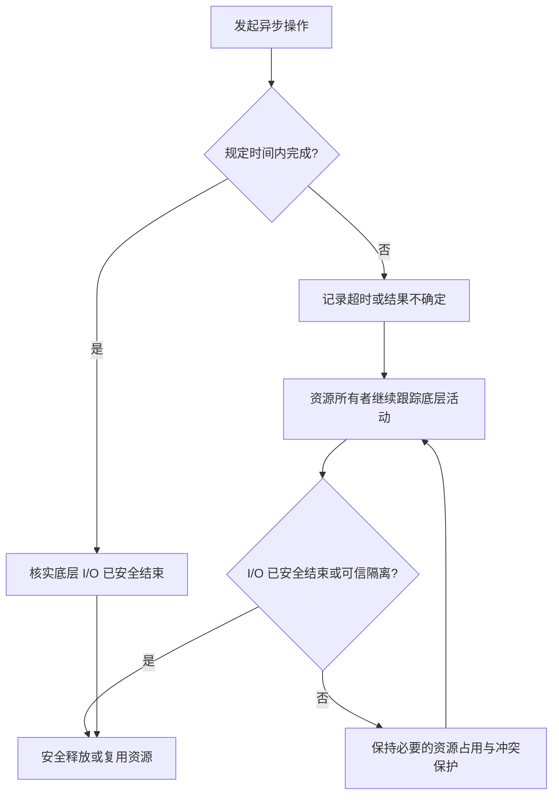

<p class="figure-caption">图 2-1 异步操作超时与资源安全释放流程</p>

对异步操作应区分超时、取消、异常和正常结束；不能仅凭调用方返回、Future/Task 取消或连接状态判断底层 I/O 已安全结束。

### 2.1.5 性能与资源有界原则

性能设计围绕明确的负载与质量要求展开，而不是无依据地增加并发或缓存。

<p class="table-caption">表 2-5 性能与资源有界设计要求</p>

| 设计要求 | 具体规定 |
|---|---|
| 负载模型 | 明确请求规模、并发规模、数据量及运行条件 |
| 容量约束 | 队列、线程、Task、连接、缓存及存储资源应有合理边界 |
| 背压 | 资源不足时明确等待、拒绝、丢弃或降级策略及适用条件 |
| 缓存 | 明确缓存用途、权威数据来源、失效与容量策略 |
| 性能指标 | 明确时延、吞吐、资源占用及测量口径 |
| 性能取舍 | 不得以违反正确性、安全性和可靠性约束换取性能 |

### 2.1.6 故障可控与恢复原则

设计应覆盖正常运行及合理预期的异常场景，明确故障影响范围和恢复条件。

<p class="table-caption">表 2-6 故障与恢复设计要求</p>

| 设计要求 | 具体规定 |
|---|---|
| 故障识别 | 明确可能的超时、通信失败、存储失败、任务异常和进程崩溃 |
| 故障隔离 | 限制故障传播，避免无关组件或资源被错误影响 |
| 状态可信 | 不将未知状态解释为确定成功或失败 |
| 重试与恢复 | 明确允许重试的条件，禁止可能产生危险副作用的盲目重试 |
| 持久化恢复 | 规定异常中断后的数据一致性及状态恢复规则 |
| 生命周期 | 明确启动、就绪、运行、关闭和重启期间的异常处理 |
| 失效行为 | 无法恢复时应有明确的降级、阻塞或停止服务条件 |

### 2.1.7 横切能力非侵入式原则

日志、审计、指标、追踪、权限校验等横切能力应与核心业务逻辑分离，优先通过统一的边界组件、装饰器、中间件或独立服务实现，不应将重复的技术处理流程散布在业务代码中。非侵入式不等于隐藏业务约束：凡影响业务准入、执行结果、事务一致性或故障处理的规则，必须在业务契约中明确，并保留必要的显式调用点。

<p class="table-caption">表 2-7 横切能力非侵入式设计要求</p>

| 设计要求 | 具体规定 |
|---|---|
| 职责分离 | 业务组件负责业务规则与状态转换；横切组件负责统一的记录、采集、校验与传输机制 |
| 边界统一 | 在服务入口、应用服务边界、消息发布边界等明确位置接入横切能力，避免各业务分支重复编排 |
| 最小侵入 | 不为记录日志、采集指标或传播追踪上下文而改变业务方法的核心控制流程和返回语义 |
| 审计正确性 | 审计事件的业务含义及产生时机由业务契约定义；持久化、投递、重试等通用机制与业务处理解耦，同时保证要求的一致性 |
| 故障影响 | 明确横切能力故障时的阻断、降级或重试规则；不得默认其失败不会影响业务，也不得默默吞掉必须处理的错误 |
| 可读性与验证 | 业务代码能够直接体现主流程；横切处理可独立测试，端到端测试验证其与业务契约一致 |

不为追求形式上的非侵入而引入复杂框架或过多抽象；简单、清晰的显式边界优先于难以追踪的隐式执行机制。

### 2.1.8 公共能力复用与冗余控制原则

优先使用符合需求的标准库、成熟软件包、现有工具及公共组件；相同且稳定的职责才提炼为公共能力，不重复发明、不为假设性扩展提前设计框架。

<p class="table-caption">表 2-8 公共能力复用与冗余控制要求</p>

| 设计要求 | 具体规定 |
|---|---|
| 复用优先 | 先评估现成组件是否满足功能、安全、性能及维护要求，再决定是否自行实现。 |
| 提炼公共职责 | 多模块存在稳定相同的职责时统一实现；业务规则留在所属业务模块。 |
| 控制依赖 | 核查成熟度、许可证、版本、安全维护及引入成本。 |
| 控制抽象 | 避免仅为减少少量重复而引入复杂框架或多层转发。 |
| 清理冗余 | 统一能力落地后删除重复、废弃和不必要的兼容实现。 |

### 2.1.9 图表表达与设计一致性原则

设计优先使用合适的图形和表格表达结构、流程、时序、状态及约束，图表不能代替必要的精确定义。

<p class="table-caption">表 2-9 图表表达与一致性设计要求</p>

| 设计要求 | 具体规定 |
|---|---|
| 视图完整 | 使用 4+1 架构视图组织系统设计，覆盖适用内容 |
| 图形选择 | 根据表达目的选择结构图、状态图、时序图、活动图等 |
| 图表一致 | 图形、表格和正文不得相互矛盾 |
| 跨章节一致 | 同一接口、状态、参数及资源规则保持一致 |
| 设计深度 | 明确影响系统行为的契约，允许自主选择内部实现细节 |
| 可验证性 | 关键设计要求应能够对应测试条件与验收证据 |

### 2.1.10 软件设计工作流程

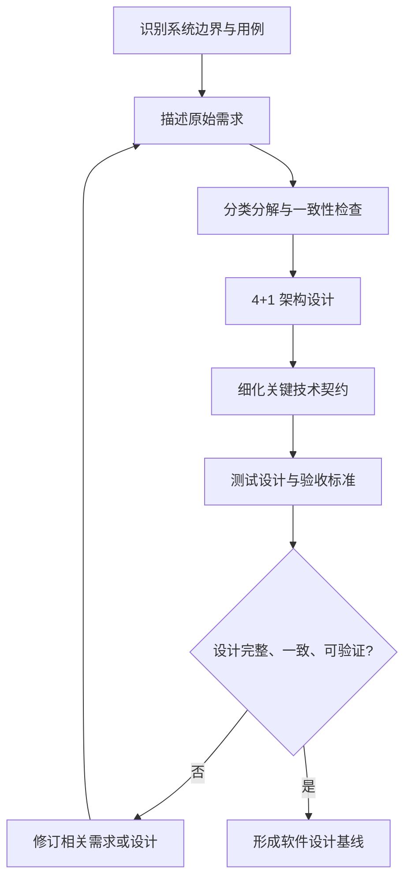

<p class="figure-caption">图 2-2 软件设计编制流程</p>

工作流程允许迭代，不要求传统瀑布式阶段。发现缺口或冲突时直接修订相关需求、架构视图或契约，不通过追加覆盖性条款解决。

### 2.1.11 规范性参考文献及项目无关性

本章为跨项目通用设计与编制规范，不得写入具体仓库、服务、业务协议、接口文件路径或项目专有指标。设计正文引用具体项目的源码、配置和协议文件时，应放在相关业务章节或接口/数据契约章节。

- **《符号体系.md》**：数学量类型、变量命名、标量/矢量/矩阵/张量、下标和公式运算的规范性依据。统计业务中的普通标量同样遵守其标量与阵列的区分原则。
- **《软件系统建模图形与表达规范.md》**：业务流程、DFD、活动/状态/时序图、算法图、伪代码和图元语义的规范性依据。

规范性引用以文件标题和相应章节为准，不复制全文；引用之间存在冲突时先识别并修订冲突，不擅自切换符号或重新解释图元。任何设计实例的具体接口名称、消息字段和技术约束均在第三章及后续适当章节给出。

## 2.2 需求体系及描述规范

需求采用“识别用例 → 逐条描述原始需求 → 分类分解 → 总分一致性检查”的方法。用例应从外部使用者及运行场景出发，覆盖适用的部署、启动、正常使用、配置、运维、正常关闭、重启及异常恢复过程；不局限于业务 RPC，也不将内部技术机制机械列为用例。用例识别属于需求分析，第 4 章用例视图负责表达参与者、边界及用例关系。

<p class="table-caption">表 2-10 原始需求描述字段</p>

| 字段 | 描述要求 |
|---|---|
| 编号 | 唯一原始需求标识，例如 `UR-01` |
| 名称 | 准确概括使用者需要的能力或运行场景 |
| 请求方（Requester） | 发起操作的外部系统、服务或接口，如外部客户端、上层服务、进程管理系统；消息和周期自动触发时可以没有直接请求方，标记“不适用” |
| 触发方式（Trigger） | 标明触发类型、事件来源、触发条件及必要的周期或接口；允许多个类型组合，区分外部触发和内部自动步骤 |
| 输入（Input） | 请求方向本系统提供的数据、参数和信息 |
| 反馈（Response） | 本系统返回请求方的确认、状态、结果及错误信息 |
| 目标方（Destination） | 接收本系统业务输出的外部系统、消息中间件或现场设备；没有时标记“不适用” |
| 业务输出（Output） | 本系统发往目标方的数据、消息或控制指令；没有时标记“不适用” |
| 业务流程（Flow） | 用 Mermaid 表达主要控制流程、数据输入/输出及重要异常，已表达的动作不重复 |
| 业务规则（Business Rules） | 补充主流程未精确定义的术语、公式、算法、初始化、阈值和边界；允许文字分条、LaTeX、图、伪代码或表格，不重复业务流程 |
| 关键约束（Constraints） | 性能、可靠性、安全、审计、可观测性、错误信息、缓存、I/O 与背压等可验证的非功能要求 |

反馈与业务输出必须分开：反馈面向请求方，业务输出面向目标方；请求方与目标方可有多个，且请求方断连不必然撤销已接受的业务操作。

### 2.2.1 触发方式分类与标注规则

原始需求必须列出实际适用的触发方式；同一需求可以组合多种触发方式，不能把处理流程中的普通步骤误写成独立触发。触发方式描述“何时、由什么启动”，不预先决定线程、定时器或队列等内部实现。

- **消息触发（Message）**：外部消息到达，例如实时消息或可靠消息；标明消息来源与订阅范围。
- **周期触发（Periodic）**：达到配置周期，例如实时周期输出或变化加周期保底；标明周期来源及生效条件。
- **API 触发（API）**：收到明确的外部接口请求，例如任务启动或配置应用接口；标明接口和调用方。
- **状态触发（State）**：受监控对象的状态发生满足条件的变化，例如外部依赖从不可用恢复可用；标明状态条件，不把普通循环迭代误列为触发。
- **生命周期触发（Lifecycle）**：服务进入启动、关闭、重启或配置生效等阶段；标明阶段及必要前置条件。

周期触发与消息触发可以同时存在：消息到达更新数据，周期到达决定何时输出。若无外部直接请求方，Requester 写“不适用（自动触发）”，但仍须列出消息生产者或状态来源；触发方式不替代 Input、Response 与 Output 的定义。

### 2.2.2 原始需求四节结构与写作原则

各 UR 固定为四节：**基本信息与触发方式、业务流程、业务规则、关键约束**。根据语义选择最清晰的表达形式；文字、公式、图形、伪代码和表格地位平等；**业务流程图已清楚表达的处理不得在后两节复述**。规则和约束必须有唯一规范定义，其他章节仅引用。

1. **基本信息与触发方式**：表格列出 Requester、Trigger、Input、Response、Destination、Output。Trigger 采用第 2.2.1 节分类，明确事件来源、触发条件及周期或 API。
2. **业务流程**：Mermaid Flowchart 或适用的 UML 活动图表达触发入口、主要处理、判断、数据输入输出、重要异常及恢复出口；复杂算法通过“预定义过程”节点指向第三节，不在总流程中堆叠实现细节。
3. **业务规则**：仅描述流程图无法精确表达的算法、公式、阈值、初始化、状态不变量、顺序及边界。允许文字分条定义、算法流程图、DFG、LaTeX 公式、表格或明确标为 `text` 的伪代码；必须说明输入、输出、初始值、边界及终止条件。无额外内容时标注“无额外规则”。
4. **关键约束**：**优先给出定量要求**（带单位、作用范围、测量窗口、默认值或硬上限、验收方法）；不能合理量化的才采用具有明确判定条件的定性要求。**仅放可核验的非功能要求**，按性能与容量、可靠性与恢复、安全与授权、审计、可观测性、错误信息、缓存与有效期、I/O 资源安全、背压与过载分类；无关分类可以省略或说明不适用。约束应给出故障条件、正确结果、测量或验收口径，不得用抽象口号代替。

### 2.2.3 业务图形元素与数据语义

参照《软件系统建模图形与表达规范.md》第 5.1 节 Flowchart、第 7.1 节 DFD 与第 8.1 节算法规范。业务活动图的控制流箭头表示处理顺序，DFD 箭头表示数据流，**两者不得混用**。图中应以不同形状区分处理、判断和数据。

| 元素 | Mermaid 写法 | 语义 |
|---|---|---|
| 开始/结束 | `A([开始/结束])` | 明确入口和完成/失败出口 |
| 处理 Process | `B["更新缓存"]` | 矩形，表达动作而非数据 |
| 判断 Decision | `C{"已过期?"}` | 菱形，分支标明条件 |
| 输入/输出 Data | `D[/"采样消息"/]` | 平行四边形，表达数据输入/输出 |
| 预定义子过程 | `E[["计算统计指标"]]` | 双边矩形，引用业务规则的算法说明 |
| 数据存储 | `F[("最新值缓存")]` | 存储节点；仅在理解读写关系必要时出现 |

不因形式要求增加无意义数据节点。数据来源、存储及复杂数据变换应单独绘制 DFD，避免业务活动图变成混杂的控制/数据流图。Mermaid 第一行初始化配置、图编号和图题仍须符合第一章。

### 2.2.4 业务规则、输出定义与关键约束的具体要求

- **业务规则**：定义与边界条件优先文字分条；涉及数学关系必须使用 LaTeX 独立公式；复杂步骤按需使用 Flowchart/DFG 或伪代码补充。表达形式不限于图和表；精确定义阈值、边界、初始化、更新基准和不可变条件，不复述主流程动作。算法必须能够独立据输入判断预期输出。
- **性能与容量**：优先用定量指标给出负载范围、时延/吞吐口径、并发及资源上限；必须区分设计目标、默认配置、不可突破的资源上限和验收实测值；未确定的阈值不得虚构。
- **可靠性及 I/O**：明确超时、结果不确定、重试、恢复、安全收敛及资源释放条件。调用返回或 Task 取消不代表底层 I/O 已结束。
- **错误信息**：定义错误类别、错误码或结果、对象与关联标识、发生阶段、可检索证据及敏感信息脱敏；禁止把 UNKNOWN 伪装为成功或明确失败。
- **缓存与背压**：规定缓存键、容量、更新/覆盖、过期、丢弃、等待、拒绝、暂停消费及恢复条件；所有超限策略必须可观测。
- **安全与审计**：列出认证、授权、控制边界以及需审计的操作、事件产生时机、关联 ID、可信保存与失败处理；运行日志不能代替审计。
- **可观测性**：指标、统计窗口、状态、事件、更新时间、无数据语义及告警；可结合真实场景验收。

**指标、计算和输出契约完整性（强制）：**凡使用“计算、统计、比较、阈值、状态、错误、容量、返回结果”等词定义业务能力，必须形成封闭的输出集合；不得用“等”“包括但不限于”替代本版本必须实现的清单。每个指标/派生字段至少定义以下内容；其中数学计算不得仅写在表格单元格内，必须另列可渲染的 LaTeX 公式：

| 必填字段 | 内容 |
|---|---|
| 唯一标识、类型和单位 | 与公开接口字段或指标名一致；明示 `counter/gauge/histogram`、计量单位 |
| 统计层级和数据来源 | 系统 / 进程 / 组件 / 任务 / 消费者；事件记录点、分子和分母来源 |
| 计算公式与口径 | 累计/窗口/瞬时，窗口端点、去重规则、事件计数次数、百分位算法 |
| 触发、初始化和重置 | 何时采集/计算、初始值、首个周期、进程重启、配置热更新 |
| 边界与缺失 | 零分母、空样本、UNKNOWN、超时、重复投递、源不可达的值域与 `unavailable` 语义 |
| 输出与验收 | 指标名、采样时间、窗口、可用性表达、配置边界及给定数据可独立验算的实例 |

**示例与可复算性（强制）：**当业务规则涉及多种计数口径、状态转换、时间窗口、边界分支或重试等易混淆情形时，至少给出一个具体输入—处理过程—预期输出的完整算例。算例必须标明初始条件、计量单位、每一步事件及最终结果；若同时存在样本条数、批次数、I/O 尝试次数等不同统计单位，须分别列出，禁止混用。算例应覆盖易误解的边界（例如重试成功仍有失败尝试记录），且结果必须可直接转化为确定性测试断言。算例是对定义的验证，不得取代规范性定义，也不应重复流程图中的全部步骤；涉及计算关系仍按第一章使用 LaTeX。

**数学定义与表达门禁：**业务规则的文字定义应独立成段或分条；涉及计算时，必须在定义后给出独立 LaTeX 公式，逐一释义变量、单位、取值域以及零分母、空样本和无效值。算法图与伪代码是可选的精度增强手段，不得要求所有业务规则使用表格。公式与中文混排遵守第一章 §1.3.1。

**约束定量优先门禁（强制）：**关键约束首先给出数值、单位、统计范围、采样方法、允许误差、测试条件和通过标准；可配置阈值应列出默认值及合法范围。仅当约束本质上无法定量（例如禁止错误 ACK）时，才用可判定的定性约束。不得用“及时、足够、合理、有界、尽可能、低延迟、高可靠”等词代替具体要求；未完成基准测试的数值应标明“设计验收目标，尚未实测”，不得声称达标。

**完备性门禁：**业务规则涉及的状态枚举、错误分类/错误信息字段、缓存容量及淘汰策略、I/O 结果、背压策略、审计与统计输出均应列举封闭集合和边界输入；凡无法根据文档构造确定预期结果的要求，视为需求未完成，不得标记为可编码。参数可以配置，但必须说明合法范围、默认/缺省行为及越界错误；性能数值未经验证时不得伪称已达标。每项约束必须可追溯至可执行的 UC/System 场景。

每项业务规则和关键约束须能由 UC/场景及第 14 章测试追溯；第 5～13 章详述实现契约时应引用 UR，不得另造冲突定义。

统一样式：

```text
### 3.x UR-xx 需求名称
#### 3.x.1 基本信息与触发方式
Requester / Trigger / Input / Response / Destination / Output
#### 3.x.2 业务流程
Mermaid 活动流程图，含重要异常及数据输入输出
#### 3.x.3 业务规则
可用文字、LaTeX、伪代码、图或表格精确定义算法、初始化与边界，不重复流程
#### 3.x.4 关键约束
按性能、可靠性、安全、审计、可观测性、错误、缓存、I/O、背压列可验证要求
```

本节也是第三章及后续章节的强制完整性验收标准。

<p class="table-caption">表 2-11 分类需求体系与描述重点</p>

| 类别 | 核心问题 | 典型要求 |
|---|---|---|
| 功能需求（Functionality） | 系统提供什么行为 | 对外能力、业务流程、业务规则、输入输出与状态反馈 |
| 性能需求（Performance） | 运行速度与资源上限 | 时延、吞吐、并发、调度、公平性、容量、背压、资源消耗、扩展能力 |
| 可靠性需求（Reliability） | 故障时如何保持正确与恢复 | 容错、超时、重试、请求关联、事务、持久化、故障恢复、可用性、未结束操作的资源管理 |
| 安全需求（Safety & Security） | 如何防止危险或非法控制 | 控制权、互锁、失效安全、认证、授权、通信及数据安全 |
| 横切能力（Cross-cutting Concerns） | 如何观测、管理与追责 | 审计（操作证据、可靠投递、完整性、追溯）、日志、指标、追踪、配置、版本、可测试性、可维护性 |

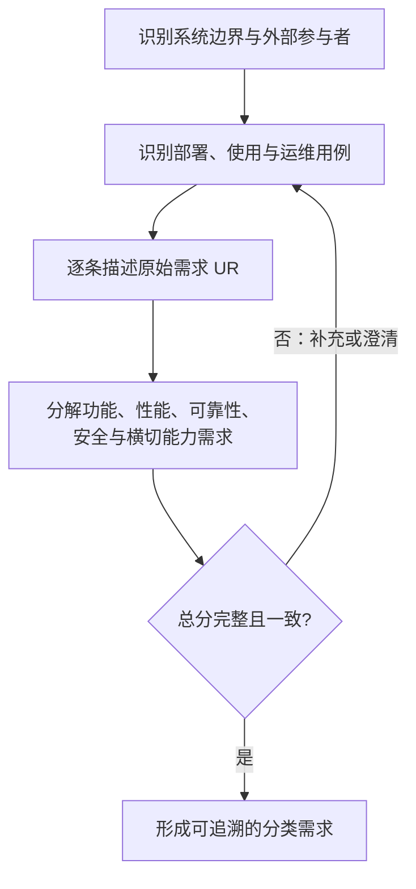

<p class="figure-caption">图 2-3 需求识别、分解与一致性检查流程</p>

分类需求必须从原始需求的输入、反馈、业务输出、规则和约束中推导，不得遗漏、矛盾或未经确认增加能力；多条原始需求的共同约束可以合并，但必须保留来源编号。每条分类需求应给出可核验条件，性能要求还需明确测量口径，不虚构现场阈值。审计应独立于普通日志定义，不得以运行日志代替审计证据。

需求分类与设计专题是不同维度：启动、正常关闭、重启及 Reload 属于跨需求的运行生命周期设计，统一在进程视图展开；相应行为和质量约束分别由原始需求及分类需求追溯。

## 2.3 4+1 架构视图：内涵、外延与表达规范

<p class="table-caption">表 2-12 4+1 架构视图的职责与成果</p>

| 视图 | 关注范围 | 主要成果 | 不应混淆 |
|---|---|---|---|
| 用例视图（+1） | 参与者、系统边界、典型/异常场景 | 系统上下文、用例、业务流程 | 不负责线程调度 |
| 逻辑视图（Logical） | 组件职责、模型、接口、状态规则、依赖 | 组件图、类/数据关系、状态图 | 不等于源码目录树 |
| 进程视图（Process） | 进程、线程、Event Loop、Task、协作、生命周期、同步、并发、资源、背压、缓存、故障恢复 | 运行结构图、任务所有权表、时序/状态/活动图、资源预算 | Task 不等于 OS 线程；图名须区分标准 UML 与示意图 |
| 开发视图（Development） | 软件模块边界、层次、静态依赖、公共契约与复用关系 | 模块图、依赖图、模块职责表 | 不描述真实并发拓扑，也不列现有代码修改清单 |
| 物理视图（Physical/Deployment） | 节点、进程部署、存储、网络、控制权和现场外部依赖 | 部署图、网络/故障域/外部依赖表 | 不是现场设备内部物理结构模型 |

### 2.3.1 用例视图的场景编写规范

用例以参与者的完整业务目标为单位组织，而非以原始需求、RPC 或内部模块为单位逐条改名。一项用例可以关联多项原始需求；一项原始需求也可以由多个业务场景共同覆盖。用例视图回答“在具体业务场景中系统如何工作”，不代替逻辑视图、进程视图和数据设计。

<p class="table-caption">表 2-13 业务场景用例的必备描述要素</p>

| 要素 | 编写规定 |
|---|---|
| 用例身份与目标 | 给出唯一编号、业务场景名称及参与者要达成的可观察目标；名称使用业务活动，不使用内部机制命名 |
| 参与者与触发条件 | 列明实际发起操作的外部角色；内部定时任务、恢复及发布等自动步骤不得虚构外部参与者 |
| 前置条件 | 列明系统就绪、授权、配置或数据存在等必要条件；不得混入未确认的实现假设 |
| 主业务流程 | 以 Mermaid 业务活动图（flowchart）为主要表达，覆盖触发、校验、关键处理、反馈及后置结果；以判断节点表达重要分支，避免大段编号文字复述 |
| 分支与异常流程 | 在活动图中呈现影响业务结果的主要异常出口；罕见或不宜展开的异常在简明说明表中概括，避免为了完整而画出所有技术异常 |
| 后置条件 | 明确成功和失败之后的业务状态、外部可见结果、未完成事项及后续查询方式 |
| 需求追溯 | 标明相关 UR；核对全部 UR 在真实场景中得到覆盖，但不要求 UR 与 UC 一一对应 |

跨用例共享的内部机制（如存储、审计发布和调度）应作为相关业务流程中的自动步骤或支撑行为描述；只有存在独立业务目标时才另立用例。应避免将一串 gRPC 方法名或 CRUD 操作直接当作完整用例，也不得在用例章节展开线程、锁、表结构及类方法等实现细节。

用例的正文采用“一张业务活动图 + 一张简明用例说明表”的表达形式。活动图包含主路径、必要判断以及重要异常分支；图中节点使用业务动作，不展开展示内部类、锁和数据库事务。说明表只填写参与者、业务目标、前置条件、主要异常、后置条件及关联需求。业务分支已在图中完整表达时，不再重复书写大段“主业务流程”和“异常流程”；复杂跨参与者消息时序可在独立小节补充时序图。图题和表题按文档约定独立编号。

进程视图应按四个设计专题组织，而不是按需求类别重复划分：

<p class="table-caption">表 2-14 进程视图的四类设计专题</p>

| 专题 | 必须明确的设计对象 | 推荐表达 |
|---|---|---|
| 运行时结构 | 进程、线程、Event Loop、Task、线程池、组件与资源所有权 | 分层运行结构图、Task 职责表 |
| 运行生命周期（Runtime Lifecycle） | 启动、初始化、就绪、运行、Reload、正常关闭、重启及其阶段转换 | 生命周期状态图、启动/关闭/Reload 时序图 |
| 并发与资源管理 | Task 协作、队列、通知、同步、调度、容量限额、背压、缓存及释放 | 任务协作时序图、资源与背压策略表 |
| 异常与恢复 | 超时、取消、故障隔离、未收敛 I/O、崩溃恢复与降级 | 故障状态图、异常裁决矩阵 |

各专题共享同一运行模型，明确创建者、所有者、同步关系和退出条件；不因分节而重复定义状态或资源。生命周期是进程视图的独立设计专题，不是第六类需求。

图表仅使用其可准确表达的语义：结构关系用 Mermaid Flowchart；行为交互用 Sequence Diagram；状态约束用 State Diagram；条件控制用活动/流程图。图题说明对象、范围及图类型。关键质量属性贯穿各视图，不能只写在单独的“非功能要求”段落。

## 2.4 测试设计方法、组织及验收规范

测试设计以测试层级组织物理目录，以 Marker 描述测试层级、测试专题与运行场景。测试文件名应清楚表达验证对象或行为；测试文件及其标记、验证说明统一登记在测试矩阵中。需求、用例及重要技术契约必须能追溯到实际测试，不为同一目的建立重复测试体系。

<p class="table-caption">表 2-15 测试层级与目录规范</p>

| 层级 Marker | 物理目录 | 验证范围 |
|---|---|---|
| `unit` | `unit/` | 状态转换、业务规则、纯逻辑，无外部服务依赖 |
| `component` | `component/` | 单组件职责及其可控依赖 |
| `integration` | `integration/` | 组件之间及真实外部依赖的接口协作 |
| `system` | `system/` | 独立进程、完整业务场景及端到端行为 |

<p class="table-caption">表 2-16 测试 Marker 与矩阵编制规范</p>

| 事项 | 规范 |
|---|---|
| 层级 Marker | 每项测试必须且仅属于 `unit`、`component`、`integration`、`system` 之一，与目录对应 |
| 专题 Marker | 标识可靠性、安全、性能等验证主题，可与层级及场景 Marker 叠加；无专项主题时可为空 |
| 场景 Marker | 标识并发、超时、恢复、负载、现场等执行条件或情境；有相应场景时标记 |
| 测试矩阵 | 至少包含“测试文件名、层级 Marker、专题 Marker、场景 Marker、测试说明”五列；每项重要测试应有可定位的文件归属 |
| 标记粒度 | 标记以具体测试函数或类为准；同文件可包含不同专题与场景，矩阵列出涉及的 Marker |
| 运行条件 | 通过 Fixture 和环境准备明确外部依赖；现场专用测试与常规回归分离，未执行不视为通过 |
| 执行规则 | 提供按目录、Marker 及其布尔组合的 pytest 命令；所有 Marker 在项目配置中注册 |
| 可追溯性 | 测试说明与需求、用例或技术契约对应；行为变更时同步检查测试及矩阵 |
| 验收证据 | 保留运行环境、命令、实际结果、指标和未验证项，禁止把设计目标当作测试结果 |

目录划分测试层级，专题与场景通过 Marker 横向组合；可靠性测试不单独设第五类目录。测试矩阵用于定位和筛选测试，不预设每个实现文件必须存在，也不要求每个文件仅能有一种测试场景。

### 2.4.1 测试依据及 System 覆盖要求

各层级测试必须依据已确认的设计成果编制；System Test 以用例视图为主基线，以原始需求及技术契约补充覆盖，不得由测试人员凭经验任意缩减范围。

<p class="table-caption">表 2-17 各测试层级的设计依据</p>

| 测试层级 | 主要依据 | 验证重点 |
|---|---|---|
| Unit | 详细设计、函数及算法契约 | 纯逻辑、状态转换、参数及边界规则 |
| Component | 逻辑视图、组件职责及内部接口契约 | 单组件行为、依赖协作及异常处理 |
| Integration | 接口与通信契约、开发视图、物理视图 | 真实接口调用、跨组件通信及外部依赖 |
| **System** | **用例视图（UC）及原始需求（UR）**，并补充接口、运行、部署、安全及性能约束 | **从真实受测服务进程及其通信入口验证业务目标、异常、边界与恢复行为** |

System Test 必须遵守以下规定：

1. **用例覆盖率 100%**：每项 UC 至少有一项 System Test 作为验证证据；同一测试可以覆盖多个 UC，同一 UC 可以由多个测试覆盖，**不按测试数量与 UC 数量的大小关系判定覆盖**。
2. **规定场景覆盖率 100%**：每项 UC 明确的主流程、关键分支、异常流程、边界和恢复场景均必须有对应 System Test；不能仅以一条正常路径代表整个 UC 已覆盖。
3. **需求覆盖率 100%**：每项 UR 必须能够经一个或多个 UC 追溯至 System Test；若某项需求未能被 UC 覆盖，必须先补全用例，不得直接以技术测试代替业务用例。
4. **技术约束补充覆盖**：用例未充分表达的性能、容量、并发、安全、权限、超时和可靠性要求，依据对应技术契约补充测试；不得因 UC 未逐项列出而豁免。
5. **真实系统边界**：System Test 通过真实受测服务进程和适用的外部依赖、通信链路执行；Mock 不得代替本次明确纳入验收范围的基础设施及通信链路。
6. **覆盖与通过分开裁定**：测试已关联不等于已执行；失败、跳过及未运行均不得计为通过。验收报告分别给出需求覆盖、用例及场景覆盖、执行情况和通过情况；缺少真实环境时标记 `NOT_RUN`，不得用模拟结果替代。
7. **变更同步**：任何 UR、UC、接口或行为约束的新增、删除、调整，必须同步核查 System Test、测试矩阵和验收条款；新增 UC 不得留下无测试映射。

<p class="table-caption">表 2-18 System Test 追溯矩阵规范</p>

| 字段 | 要求 |
|---|---|
| UR 编号 | 被验证的原始需求编号，可列多个 |
| UC 编号与场景 | 用例编号及主流程、异常、边界或恢复场景标识 |
| 技术契约 | 相关接口、配置、运行或安全约束的章节编号；没有则记“—” |
| 测试文件名／测试标识 | 可定位的 System Test 文件名及测试函数或参数化场景标识 |
| 层级／专题／场景 Marker | 层级固定为 `system`，其余按第 2.4 节定义填写 |
| 验证内容与预期结果 | 从用户可观察行为与副作用表述判定依据 |
| 执行环境及结果 | 真实依赖、执行证据、`PASS`／`FAIL`／`SKIP`／`NOT_RUN` 等状态 |

追溯链为 **UR → UC／用例场景 → System Test → 执行结果与证据**，技术契约作为补充依据进入相应测试。第 4 章负责编制完整 UC 和场景，第 14 章依据本规范给出实际测试矩阵及验收安排，两章必须双向核对。

# 3. 软件需求

本章按第 2.2 节规定，以“基本信息与触发方式 → 业务流程 → 业务规则 → 关键约束”描述八项原始需求。业务规则仅展开流程中的复杂算法、精确数据契约及边界，不复述图形；关键约束仅放非功能要求。第 4 章按用例组织场景，第 5～13 章落实实现契约。

## 3.1 业务需求总表

<p class="table-caption">表 3-1 Sink Service 业务需求总表</p>

| 编号 | 业务需求 | 业务目标 | 触发方式 |
|---|---|---|---|
| UR-01 | 实时数据派发 | 按策略输出最新且未过期的采样，原样保留质量标志 | 消息、周期、状态 |
| UR-02 | 历史数据派发 | 持久消费并至少一次交付历史采样，支持故障恢复 | 消息、状态 |
| UR-03 | Delivery 管理 | 独立启停和管理 Delivery 的期望/实际状态 | API、生命周期、状态 |
| UR-04 | 派发运行指标周期统计 | 初始化统计状态，记录基础数据并周期计算指标快照 | 生命周期、事件、周期 |
| UR-05 | 派发运行状态、指标与事件查询 | 查询当前状态、已计算指标和事件 | API |
| UR-06 | 数据派发配置管理 | Get/Push/Apply 完整快照并安全应用 | API、状态、生命周期 |
| UR-07 | 链路诊断（Diagnose） | 按阶段提供可核验证据而不破坏生产链路 | API |
| UR-08 | gRPC 服务端实现 | 实现已冻结的 9 公共 + 4 专属 Unary RPC | API、生命周期 |

首版 Sink 必须支持四种交付目标：Redis Client、Modbus TCP Server、Industrial Gateway gRPC Client（均只允许 Realtime）以及 Kafka Producer（只允许 Reliable）。不支持 TDengine、MQTT、IEC 104。当前 main 已发布 `contracts.sample_batch.SampleBatch(schema_version=2)` 双通道批量契约；Sink 的消费实现须按该已冻结契约与 Collector 联调，未验证的联调结果不得标记为 PASS。Realtime 经 NATS Core、Reliable 经 JetStream，质量标志不得被改变。

### 3.1.1 首版派发负载与验收基准

**参考负载**为单个 Sink Service 容器实例（Main + Realtime + Reliable 三个独立 asyncio 进程）同时处理 30 台风机、两条通道均为 10 Hz 的批量输入与批量转发。此负载用于容量标定，不是固定的合并吞吐门槛；单实例实际稳定容量必须独立测量，不得用多容器聚合吞吐替代。

<p class="table-caption">表 3-1a 单实例双通道共载参考性能目标</p>

| 指标 | Realtime | Reliable | 单实例合计 |
|---|---:|---:|---:|
| 风机数 | 30 台 | 30 台（同一组） | 30 台 |
| 每台、每周期变量数 | 100 | 500 | 600 |
| 每台更新/派发频率 | 10 Hz | 10 Hz | 两通道同时 10 Hz |
| 上游批量消息数（每台每通道每周期一批） | 300 批/s | 300 批/s | **600 输入批/s** |
| 输入变量数 | 30000 值/s | 150000 值/s | **180000 值/s** |
| 完整有效负载对应的目标成功变量数 | 30000 值/s | 150000 值/s | **180000 值/s** |
| 优先采用的稳定测量窗口 | 600 s | 600 s | 600 s |

**计数边界：** 600 批/s 是假定每台风机每通道每周期恰好一条批量消息时的**上游输入批次**，不等于下游 Adapter 写入批次数。输入批次可按多个 Delivery 扇出，目标能力也可能导致拆批；按每通道各一份预期输出的参考拓扑计数时，参考确认值吞吐为 180000 值/s，有额外扇出时应分别记录附加的目标写入工作量。区分 offered（发布）、received（已接收）、accepted（校验后有效）、delivered（目标明确确认）、dropped（合法策略丢弃）和 target batches（下游写入批次），不得混算。Realtime 的合法覆盖须独立统计，不得以 dropped 或 offered 冒充 delivered；参考负载测量须提供满足时效的批次、足够 TTL 和可确认目标，控制输入相位以验证实际输出频率。

**输入契约前置条件：** 正式批量输入采用 `src/contracts/sample_batch.py::SampleBatch`，其 Schema、Subject、样本标识与批量上限按第 10.3 节执行；Publisher 与 Collector/Contracts/Sink 的一致性须通过独立实测。不得将单点消息数量冒充批量消息数量。

**资源与适配器：** 三进程分别使用独立事件循环，Main 不参与采样解码与目标批写；Realtime、Reliable 必须同容器同时满载。所有目标协议需逐一标明原生批量能力、拆批上限与真实确认边界；Redis、Modbus、Gateway、Kafka 的全协议表现分别测试，不得由某一协议推断其他协议的吞吐能力。未实测时指标仅为待验收设计目标。

### 3.1.2 性能目标成立条件

- **双通道共载**：一个容器的两个数据进程同时运行；同一 30 台风机集合的实时 3000 点和可靠 15000 点持续更新。目标值类型为有效 `float32`，质量可包含 `good/bad/uncertain`，所有批次具有有效身份与时间。
- **实时输出**：使用 `periodic` 或明确可达到每拍输出的变化数据作为基准负载；稳定测量时不能靠数据过期、重复 sample_id 或最新值覆盖减少工作量。变化触发与保底策略另作专项测试。
- **可靠确认**：按批量消息处理，但 ACK 必须覆盖批内全部测点的终局；部分成功、重投、DLQ、故障恢复必须单独验证，不允许以写入尝试数代替目标确认值数。
- **性能环境**：声明容器 CPU 配额、内存、Broker/目标配置、网络和 Producer 实际供数能力；独立 Publisher 须先实测持续供数上限。若未能达到 600 批/s、180000 值/s，参考满载对比标记 NOT_RUN，但仍须在实际可供负载下完成单实例稳定容量测量，不得将其结果冒充参考负载成绩。
- **控制面**：Main 的 13 RPC 在双通道满载时仍保持可达；关键健康、状态及指标调用在配置 deadline 内完成，超时、拒绝连接和最长不可用时间全部记录。

## 3.2 UR-01 实时数据派发

### 3.2.1 基本信息与触发方式

<p class="table-caption">表 3-2 UR-01 基本信息</p>

| 字段 | 内容 |
|---|---|
| 请求方（Requester） | NATS Core 消息生产者（Collector）；周期定时器非外部请求方 |
| 触发方式（Trigger） | 消息：实时样本到达；周期：按 Delivery 输出/保底周期；状态：目标恢复后重试未过期最新值 |
| 输入（Input） | 批量实时样本（以冻结的 `SampleBatch(schema_version=2)` 为准）、来源规则、逐测点有效期、Delivery 输出策略 |
| 反馈（Response） | 不逐条应答 Core 消息；通过状态、指标与事件查询派发结果 |
| 目标方（Destination） | 已绑定的 Redis、Modbus TCP Server 或 Industrial Gateway（Realtime）；Kafka 不属于本实时用例 |
| 业务输出（Output） | 未过期的最新值及原始质量、时间、测点身份 |

### 3.2.2 业务流程

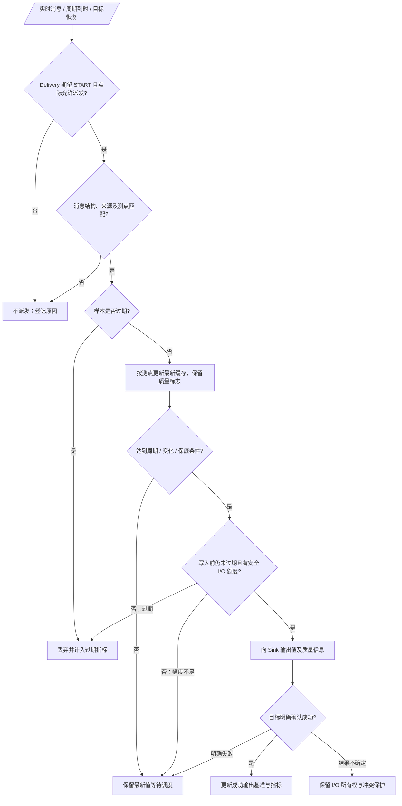

<p class="figure-caption">图 3-1 UR-01 实时数据派发业务活动图</p>

### 3.2.3 业务规则

**R01-01 时效算法。** `sample_time` 为具有时区的事件时间；实时有效期为 `sample_time + max_staleness_ms`，在缓存入列与写前按当前 UTC 时刻判定：`now >= deadline` 为过期；时钟偏差与未来时间拒绝阈值以配置契约为准，不得将无效时间解释为最新。

**R01-02 新旧比较。** 同 `delivery_id/device_id/point_id` 按 `sample_time`、稳定 `sample_id` 判定更新；较早样本不能覆盖较新样本；完全重复 `sample_id` 不产生新的业务版本。

**R01-03 变化判定。** 数值量以最近一次**明确成功**输出值为基准。设当前值为 $x$，基准值为 $x_0$，绝对阈值为 $a$，相对阈值为 $r$，启用的判定条件分别为：

$$
|x-x_0|\ge a
$$

$$
\frac{|x-x_0|}{|x_0|}\ge r,\qquad |x_0|>0
$$

两个条件中任意一个已启用且满足即判定变化。基准为零时不计算相对变化；首次无基准直接判定变化；非数值按值不等判定；质量标志改变必定视为变化。保底周期自最近一次**成功确认**起算；禁用的阈值不得以零阈值参与判断。

**R01-04 输出契约。** 质量 `good/bad/uncertain` 原样保留，质量不参与过期过滤；Redis/Kafka 输出包含测点身份、时间、值、质量、`sample_id`；Gateway 仅按正式 RPC 支持的变量 ID 和 ScalarValue 更新，不声称保存时间、质量或 sample_id；Modbus Server 必须定义明确的质量关联寄存器或映射，否则相关 Delivery 配置校验失败。


### 3.2.4 关键约束

<p class="table-caption">表 3-26 UR-01 非功能约束</p>

| 约束类别 | 可验证要求 |
|---|---|
| 性能与容量 | 单实例 Realtime 参考负载：30 台 × 100 点/台 × 10 Hz，对应 300 输入批/s、30000 值/s；与 Reliable 共载测量，优先采用连续 600 s 稳态窗口，报告实际确认值/s、输出频率、覆盖/丢弃及参考达成率；不以参考值不足单独判 FAIL，参见 §3.1.1、§14.5.3。 |
| 缓存与背压 | Realtime 每 Delivery 按测点去重，默认最多 10000 个最新点（与配置第 11 章一致）；满载时拒绝新增键而不驱逐已有键；已存在键覆盖。所有丢弃或拒绝计数，内存不随持续输入无限增长。 |
| I/O 安全 | 每 Delivery 默认最多 1 个在途写入，UNKNOWN 未收敛持续占有额度；调度不重入。 |
| 可靠性与错误 | 目标拒绝、重试、UNKNOWN 分别报告；目标质量映射缺失时在配置阶段报错。 |
| 可观测性 | 每次派发结果关联 delivery_id、sink_id、sample_id 且不写入敏感凭据。 |

## 3.3 UR-02 历史数据派发

### 3.3.1 基本信息与触发方式

<p class="table-caption">表 3-4 UR-02 基本信息</p>

| 字段 | 内容 |
|---|---|
| 请求方（Requester） | JetStream durable Consumer（自动消息投递），没有人工请求方 |
| 触发方式（Trigger） | 消息：JetStream 投递；状态：目标恢复、Consumer 恢复、退避期限到达 |
| 输入（Input） | JetStream 持久化批量历史消息、逐测点来源条件、批次及原始消息身份 |
| 反馈（Response） | ACK/NAK/InProgress 等确认行为；状态、指标及错误可查询 |
| 目标方（Destination） | 可靠目标 Sink；永久错误的 DLQ Stream |
| 业务输出（Output） | 历史原始样本；必要时输出带错误和源标识的死信 |

### 3.3.2 业务流程

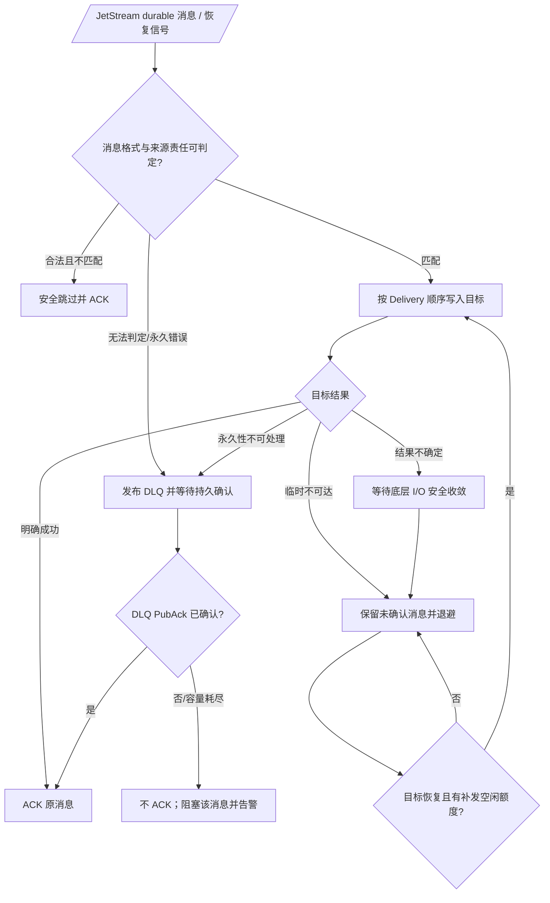

<p class="figure-caption">图 3-2 UR-02 历史数据派发业务活动图</p>

### 3.3.3 业务规则

**R02-01 结果分型。** `CONFIRMED`（目标确认，ACK 原消息）、`TRANSIENT`（保留原消息等待）、`PERMANENT`（持久化 DLQ 后 ACK）、`UNCERTAIN`（保持 I/O 所有权、冲突保护和未确认状态）；未知禁止归入明确失败或成功。

**R02-02 ACK 和死信。** 原始消息的 ACK 只能发生在目标明确成功或 DLQ 已获持久 PubAck 之后；DLQ 发布不明、容量耗尽、原始消息责任归属不明一律不 ACK。

**R02-03 补发与去重。** 以稳定 `sample_id` 保留业务关联；同 Delivery 的历史消息保持接收顺序、至少一次；重复投递可能重写目标，必须通过 Adapter 能力及下游契约说明幂等边界，不能把 Kafka 生产者幂等误称为跨系统恰好一次。

**R02-04 恢复调度。** 恢复积压只在目标空闲额度下限速运行，当前实时写入先占用可用额度；跨进程不能依靠进程内锁宣称实现同一目标的绝对优先权。


**R02-05 受控设备级并发。** 在一个 Reliable 进程内，允许不同设备的独立 Reliable Delivery 并发执行；每个 Delivery 仍只有一个未收敛源消息和一个逻辑写入序列。仅当每个 Delivery 的 `source.devices` 恰有一个设备、同一物理目标的设备来源互斥、共享 Sink 能力与并发额度经验证时，才允许启用。多设备 Delivery 继续串行，不自动拆分。启用条件、Kafka 设备级顺序与 Durable 迁移按 §6.3.3、§10.8、§11.2.5.1 执行。未启用时维持 v1_24 的单 Delivery 串行语义。

### 3.3.4 关键约束

<p class="table-caption">表 3-27 UR-02 非功能约束</p>

| 约束类别 | 可验证要求 |
|---|---|
| 可靠性 | 原消息在目标明确成功或 DLQ 获持久 PubAck 前 ACK 次数必须为 0；故障重试无限时仍受 Broker 保留容量和期限约束，不保证无限保存。 |
| 背压与性能 | 单实例 Reliable 参考负载：30 台 × 500 点/台 × 10 Hz，对应 300 输入批/s、150000 值/s；与 Realtime 共载测量，优先采用连续 600 s 稳态窗口，报告实际目标确认值/s、积压增长率和参考达成率；参考值不足不单独判 FAIL，超出实测稳定能力的持续输入不得宣称可长期稳定运行。每 Delivery 默认逻辑写入并发 1；实际 ACK pending 和重放速率不得突破配置值，超限时暂停拉取而非丢弃可靠数据。 |
| I/O | UNKNOWN 安全收敛之前释放底层操作所有权的次数必须为 0。 |
| 审计 | DLQ 记录源消息 ID、原因、发生时刻及可查位置，脱敏。 |

## 3.4 UR-03 Delivery 管理

### 3.4.1 基本信息与触发方式

<p class="table-caption">表 3-6 UR-03 基本信息</p>

| 字段 | 内容 |
|---|---|
| 请求方（Requester） | 授权 CLI、运维平台及自动化管理客户端 |
| 触发方式（Trigger） | API：StartDelivery/StopDelivery；生命周期：启动加载；状态：Watchdog 恢复 START |
| 输入（Input） | delivery_id、expected_revision、持久化期望状态 |
| 反馈（Response） | OperationResult 的受理、期望状态、实际状态、版本和错误 |
| 目标方（Destination） | Main 配置管理及相应 Realtime/Reliable 子进程的 Delivery 与 Sink |
| 业务输出（Output） | 启动或停止该 Delivery 的派发行为 |

### 3.4.2 业务流程

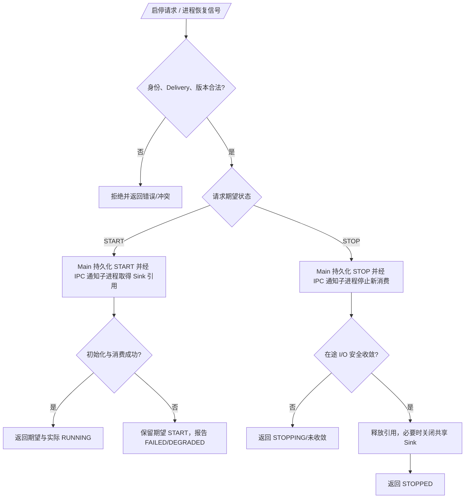

<p class="figure-caption">图 3-3 UR-03 Delivery 管理业务活动图</p>

### 3.4.3 业务规则

**R03-01 状态模型。** Main 通过有界 IPC 执行启动和停止、核对子进程实际状态；IPC 超时只能报告尚未收敛。区分持久 `desired_state`（START/STOP）与实际 `runtime_state`（初始化、运行、退化、停止中、停止、失败）；两者不得互相代替，Stop 只在安全收敛后返回实际 STOPPED。

**R03-02 共享资源所有权。** 共享 Sink 以稳定身份键管理引用；最后一个 Delivery 引用释放且 I/O 已安全收敛后才可关闭目标连接；正在进行的操作不能因上层取消失去所有权。

**R03-03 静态归属。** CLI/Web UI 在部署前将完整 Delivery 及其 Sink 引用分配到指定配置域。实例仅执行本地显式配置中的 Delivery，不需要知道其他实例数量及拓扑。任何时刻同一 Delivery 及可能冲突的物理 Sink 只能有一个活动写入所有者；跨实例转移须先停止旧所有者、确认底层 I/O 安全结束，再提交并启动新所有者。无法确认安全结束时拒绝切换，不能通过重新启动冒险接管。


### 3.4.4 关键约束

<p class="table-caption">表 3-28 UR-03 非功能约束</p>

| 约束类别 | 可验证要求 |
|---|---|
| 可靠性 | 手动 STOP 后自动恢复次数必须为 0；持久化失败后启动次数必须为 0；同一 Delivery 状态写入并发数不得超过 1。 |
| I/O | 共享 Sink 引用数或未收敛 I/O 数大于 0 时，强制关闭次数为 0；每 Delivery 写入默认并发 1。 |
| 审计 | 记录可信调用方、操作目标、版本与结果。 |

## 3.5 UR-04 派发运行指标周期统计

### 3.5.1 基本信息与触发方式

<p class="table-caption">表 3-8 UR-04 基本信息</p>

| 字段 | 内容 |
|---|---|
| 请求方（Requester） | 不适用（自动触发）；启动阶段由服务进程生命周期驱动 |
| 触发方式（Trigger） | 生命周期：服务初始化或运行配置变更；状态：派发操作完成或运行状态变化；周期：`metrics_compute_interval_ms` 到期 |
| 输入（Input） | 统计配置、接收及交付计数、执行耗时、丢弃/重投/DLQ 记录、运行状态变化 |
| 反馈（Response） | 不适用；初始化失败以服务健康和事件暴露 |
| 目标方（Destination） | 本进程内存统计快照，供 `GetMetrics` 查询 |
| 业务输出（Output） | 带窗口、样本覆盖时长和计算时间的最新统计快照；异常事件按现有事件机制记录 |

### 3.5.2 业务流程

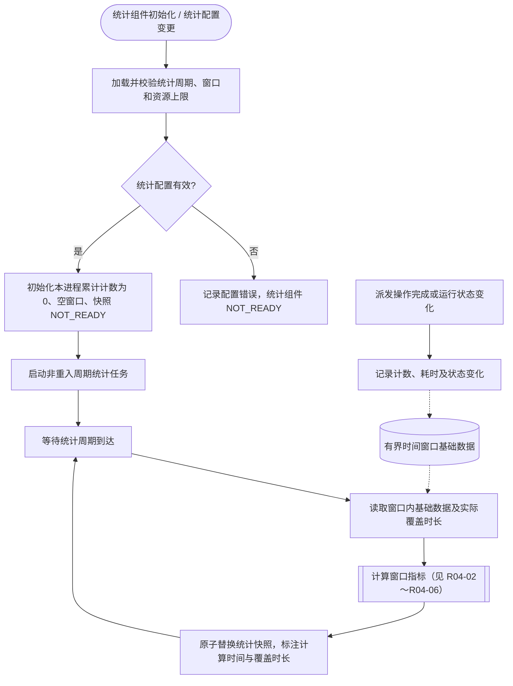

<p class="figure-caption">图 3-4 UR-04 指标初始化、基础记录和周期计算业务活动图</p>

### 3.5.3 业务规则

**R04-01 统计对象与计数时机。** 指标按 **Delivery** 独立累计；计数单位必须区分“样本条数”和“目标 I/O 尝试次数”。本版本五项累计计数定义如下。

<p class="table-caption">表 3-10b R04-01 累计计数器的唯一计数口径</p>

| 指标 | 计量对象 | 递增时机 | 重复投递、重试与边界 |
|---|---|---|---|
| `received_total` | 样本条 | 成功解码且交给本 Delivery 时 +1 | JetStream 再次投递并再次进入本 Delivery 时再次 +1 |
| `delivered_total` | 逻辑交付次（指标单位为条） | 一次交付执行取得目标明确成功确认时 +1 | 同一次执行中的重复确认不再计数；重新投递形成的新执行若成功可再次 +1 |
| `failed_total` | I/O 尝试次 | 目标 I/O 一次尝试**明确失败**时 +1 | 同一样本的首次失败和重试失败分别计数；未收敛的 UNKNOWN 不计数 |
| `dropped_total` | 样本条 | Realtime 样本因过期、最新值覆盖或缓存上限被最终放弃时 +1 | 每条被放弃的缓存样本只计一次；Reliable 待重投消息不算丢弃 |
| `dead_letter_total` | 样本条 | Reliable 消息成功持久化写入 DLQ 并取得确认时 +1 | DLQ 写入失败不计数，也不得 ACK 原消息 |

`bad`、`uncertain` 是样本质量标志，不是 I/O 失败或丢弃条件。以上累计值由业务操作即时更新；周期任务读取基础数据，计算窗口指标。**不同计量对象的计数器不能简单相加，也不要求守恒。**

**算例 R04-01-A：单个 Reliable Delivery 接收 100 条样本。** 假设统计初值均为 0，所有消息均首次交付到本 Delivery，其中：

1. 90 条首次 I/O 成功；
2. 5 条首次 I/O 明确失败，随后各重试一次并成功；
3. 3 条首次 I/O 明确失败，仍等待后续重投；
4. 2 条经业务校验判定为永久无效，未执行目标 I/O，已成功持久化进入 DLQ。

得到以下可直接验算的增量：

| 指标 | 算例结果 | 计算依据 |
|---|---:|---|
| `received_total` | 100 条 | 100 条首次进入 Delivery |
| `delivered_total` | 95 条 | 90 条首次成功 + 5 条重试成功 |
| `failed_total` | 8 次 | 5 次首次失败 + 3 次首次失败 |
| `dropped_total` | 0 条 | Reliable 不按实时丢弃机制处理 |
| `dead_letter_total` | 2 条 | 2 条获得 DLQ 持久化确认 |

此时还有 **3 条待重投**，但不能仅凭以上五个累计计数推断所有积压：其他时刻可能存在重复投递、多个在途 I/O 或外部消费者积压。若这 3 条随后重新投递，`received_total` 还会按实际再次接收计数。

**计量单位补充。** 一次批量输出包含 500 个 `float32` 数值，不等于 500 次目标 I/O；若该批由 500 条测点样本组成，则样本计数按 500 条，实际 I/O 尝试次数取决于 Adapter 的批量写入行为。指标 `failed_total` 仅计明确失败的目标 I/O 尝试，而非批内每个数值。

**R04-02 统计窗口、初始化及计算周期。** 设统计时刻为 $t$，纪元创建时刻为 $t_0$，配置的窗口长度为 $W$（秒），则有效窗口和覆盖时长定义为：

$$
\mathcal W(t)=(\max(t_0,t-W),t]
$$

$$
T(t)=\min(W,t-t_0)
$$

其中 $t$、$t_0$ 均由单调时钟换算为秒，$W>0$；事件按动作完成时间归入半开窗口。周期调度使用单调时钟，对外计算时间使用 UTC。

首次启动、进程重启或统计周期/窗口配置更改时，创建新统计纪元：累计计数清零、窗口为空、快照标记 `NOT_READY`。**第一个统计周期到达时即执行计算**，产生 `READY` 快照；未填满的窗口使用实际覆盖时长，不补造历史数据。定时任务不得重入，前次未完成时跳过本周期。

**R04-03 交付速率。** 令 $N_d(t)$ 为窗口 $\mathcal W(t)$ 内获得目标明确成功确认的逻辑交付次数。交付速率定义为：

$$
\lambda_d(t)=\frac{N_d(t)}{T(t)}
$$

单位为条/秒，对应 `delivered_rate_per_second`。当 $T(t)=0$ 时不可用；窗口内无交付但已有有效覆盖时长时取零。

**R04-04 写入成功率。** 令 $N_s(t)$、$N_f(t)$ 分别为窗口内目标 I/O 明确成功、明确失败的**尝试次数**；重试按实际尝试计入，不确定 I/O 在结果未明确前不计入任一项。定义：

$$
\eta(t)=\frac{N_s(t)}{N_s(t)+N_f(t)}
$$

`write_success_ratio` 为无量纲数，范围为 $[0,1]$；分母为零时不可用，不得返回零或百分之百。此项是**写入尝试成功率**，不是去重后的样本交付率。

**R04-05 写入耗时 P99。** `write_latency_ms_p99` 的统计总体为窗口内得到明确成功确认的交付测点；其样本值是该测点所属**目标 I/O 确认单元**从实际发起发送至可信确认的耗时（毫秒），不包含等待写入额度或排队时间。Kafka B2 中同一 BatchBuilder 的 Broker Future 为一个确认单元；每个成功确认的 Record 各提供一个带相同 Builder 耗时的测点权重。一次 Builder 确认不等于多个独立 Broker ACK。非 Kafka Adapter 依自身可信确认边界提供耗时和权重；失败、UNKNOWN 和未确认点不计入该分位数。

设观察窗口内有 $m$ 个成功确认单元，第 $i$ 个单元的耗时为 $d_i$（ms）、其已成功交付测点数为 $w_i$（正整数），则总权重 $n$ 与最近秩的定义为：

$$
n=\sum_{i=1}^{m}w_i,\qquad Q_{0.99}=d_{(\lceil0.99n\rceil)},\quad n>0
$$

其中 $d_{(j)}$ 表示将各 $d_i$ 按对应权重 $w_i$ 展开后升序排列的第 $j$ 项；实现不得真的复制数百个相同延迟对象。无有效样本时省略指标，不返回零。当前实现采用 §13.3.2 的**有界加权直方图近似最近秩**，其误差、时间窗边界和极端值缺失条件在该节唯一规定。此指标是“成功测点所属确认单元的延迟 P99”，不能称为每点独立确认的延迟或包括队列等待的端到端延迟。

**R04-06 瞬时水位和快照有效性。** `backlog_messages` 为统计时点可核实的当前 Reliable 待处理消息数；`io_inflight` 为当前尚未安全结束的目标 I/O 数，包括 UNKNOWN 未收敛 I/O。二者均为 Gauge，不作窗口求和；外部 Broker 不可达时，`backlog_messages` 为不可用，不得用零或旧值冒充。`metrics_snapshot_ready` 表示是否已完成首次周期计算；`metrics_covered_ms` 表示本次快照有效窗口覆盖毫秒数。快照替换须原子化，查询只读最近一次完整快照。

<p class="table-caption">表 3-10a UR-04 首版必选指标（12 项）</p>

| 指标名称 | 类型、单位 | 统计对象 | 定义位置 |
|---|---|---|---|
| `received_total` | Counter，条 | Delivery | R04-01 |
| `delivered_total` | Counter，条 | Delivery | R04-01 |
| `failed_total` | Counter，次 | Delivery | R04-01 |
| `dropped_total` | Counter，条 | Realtime Delivery | R04-01 |
| `dead_letter_total` | Counter，条 | Reliable Delivery | R04-01 |
| `delivered_rate_per_second` | Gauge，条/秒 | Delivery | R04-03 |
| `write_success_ratio` | Gauge，比例 | Delivery | R04-04 |
| `write_latency_ms_p99` | Gauge，毫秒 | Delivery | R04-05 |
| `backlog_messages` | Gauge，条 | Reliable Delivery | R04-06 |
| `io_inflight` | Gauge，个 | Delivery | R04-06 |
| `metrics_snapshot_ready` | Gauge，布尔 | Process | R04-02、R04-06 |
| `metrics_covered_ms` | Gauge，毫秒 | Process | R04-02、R04-06 |

计数器与水位可在运行时更新，但速率、成功率、P99 等**窗口指标只在周期计算后更新**。指标通过现有 `GetMetricsResponse.metrics[]` 表达，不增加 Proto 字段。对于不可用的数值指标，按契约省略该项并配套状态或事件说明，不得填零。

以上 12 项是首版规范性指标全集。队列年龄、重投速率、详细错误分类、多个分位数和组件内部性能指标可作为**可选诊断扩展**，不构成首版功能或 System Test 强制指标，也不能取代错误事件、日志和健康检查。

### 3.5.4 关键约束

<p class="table-caption">表 3-29 UR-04 非功能约束</p>

| 约束类别 | 可验证要求 |
|---|---|
| 性能 | 默认每 1000 ms 计算一次，默认统计窗口 60000 ms；支持配置周期 100～60000 ms、窗口 1000～3600000 ms（须满足窗口不小于周期）；周期计算并发上限 1，超期积压任务上限 0，超期跳过计数。以上为设计默认值及建议合法范围，须同步在第 11 章实施。 |
| 可靠性 | 首次统计前返回 `NOT_READY`，可用 P99 样本数为 0 时不输出 P99；统计任务异常不得清除上一已完成快照，必须同时标记陈旧时间。 |
| 错误 | Broker 不可用的 Gauge 只能标缺失，不能报零。 |
| 可观测性 | 每一指标附计算时间、作用域、单位及窗口；不得以 sample_id 为标签形成高基数。 |

## 3.6 UR-05 派发运行状态、指标与事件查询

### 3.6.1 基本信息与触发方式

<p class="table-caption">表 3-10 UR-05 基本信息</p>

| 字段 | 内容 |
|---|---|
| 请求方（Requester） | 授权运维管理及监控客户端 |
| 触发方式（Trigger） | API：`GetServiceInfo`、`GetServiceStatus`、`GetCapabilities`、`GetMetrics`、`GetEvents`、`ListDeliveries`、`GetDelivery` |
| 输入（Input） | 作用域、对象 ID、窗口、筛选和分页参数 |
| 反馈（Response） | 服务身份与健康、Delivery 配置及状态、最新已计算指标、事件或明确错误 |
| 目标方（Destination） | 不适用 |
| 业务输出（Output） | 不适用（只读查询） |

### 3.6.2 业务流程

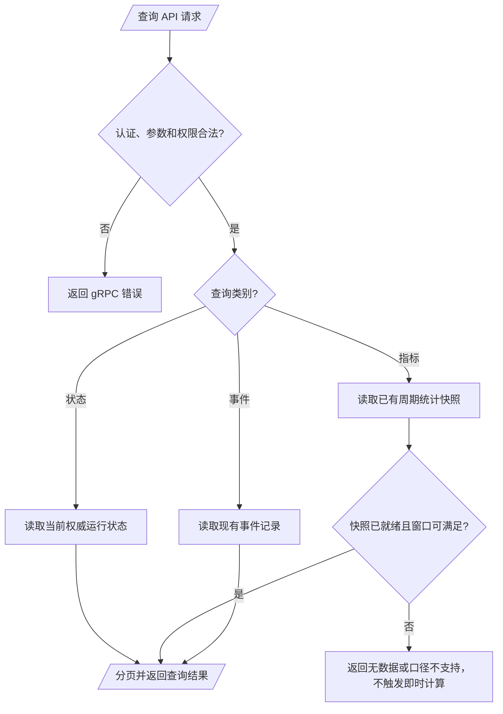

<p class="figure-caption">图 3-5 UR-05 运行状态、指标与事件查询业务活动图</p>

### 3.6.3 业务规则

**R05-01 查询语义。** `GetMetrics` 仅返回已计算快照及已支持的 `window_ms`；未知窗口必须明确报告不支持，不临时重新计算；首次计算前的 NOT_READY 与值为 0 不同。

**R05-02 分页与状态。** 状态、指标及事件分别按其权威来源读取；分页游标和对象作用域必须保持稳定语义，不把部分失败掩盖为全量成功。


### 3.6.4 关键约束

<p class="table-caption">表 3-30 UR-05 非功能约束</p>

| 约束类别 | 可验证要求 |
|---|---|
| 性能与容量 | 设计验收目标：单次最多 500 条事件，查询返回体上限 2 MiB，局部服务查询 P99 不高于 200 ms（每秒 20 并发请求，单实例两通道按 §3.1.1 同时满载）；超限返回明确参数错误；验收目标尚未实测。 |
| 安全 | 认证和对象级授权；查询不执行脱敏处理，返回字段依正式查询契约和权限决定。未经授权的查询不得返回业务内容。 |
| 错误 | 缺少数据、不支持窗口、对象不存在、来源不可达须可区分；不可触发目标新连接。 |
| 审计 | 记录运维查询中需留证的敏感操作。 |

## 3.7 UR-06 数据派发配置管理

### 3.7.1 基本信息与触发方式

<p class="table-caption">表 3-12 UR-06 基本信息</p>

| 字段 | 内容 |
|---|---|
| 请求方（Requester） | 授权 CLI/Web UI；各容器 Main 受理本域配置操作 |
| 触发方式（Trigger） | API：GetConfigSnapshot/PushConfigSnapshot/ApplyConfigSnapshot；状态：两个数据子进程确认配置代；生命周期：重启加载 |
| 输入（Input） | SnapshotScope、完整文件集、candidate_id、expected_revision |
| 反馈（Response） | 快照及候选校验、文件提交、逐对象应用结果、effective_revision、restart_required |
| 目标方（Destination） | 本容器正式配置目录、Realtime/Reliable 子进程 |
| 业务输出（Output） | 正式文件提交及受影响 Delivery/Sink 的运行配置变更 |

### 3.7.2 业务流程

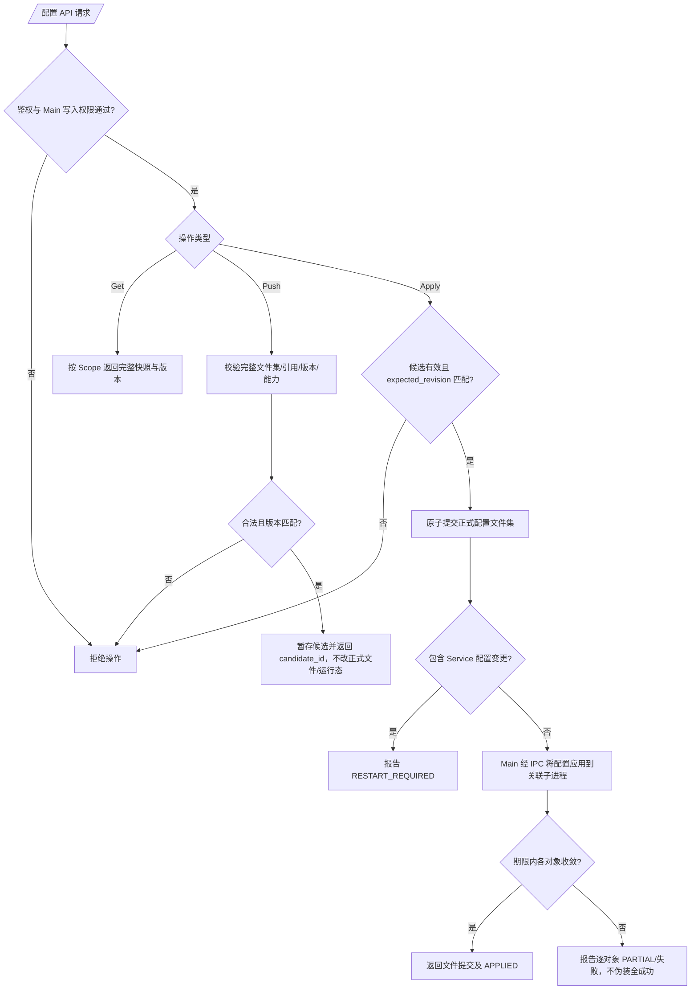

<p class="figure-caption">图 3-6 UR-06 数据派发配置管理业务活动图</p>

### 3.7.3 业务规则

**R06-01 版本提交。** Push 返回仅可供 Apply 使用的候选 ID；Apply 只有在 revision 匹配时才提交完整正式文件集；磁盘提交成功与运行对象热生效成功是两个独立结果。

**R06-02 配置分类。** Service 配置修改需重启；Template 版本不可变；Instance 通过版本化引用热更新；服务文件、模板文件及实例文件不能混为一类。

**R06-03 多实例静态配置分配。** 每个容器只有 Main 一个配置写入方、一个独立配置域。CLI/Web UI 按容器分配 Delivery/Sink，并串行处理存在资源冲突的跨域迁移；先确认旧容器停止与 I/O 收敛，再在新容器启动。各容器通过既有 Get/Push/Apply 提交本地快照，跨域操作不具备分布式原子性，不提供自动选主、调度和故障迁移。


### 3.7.4 关键约束

<p class="table-caption">表 3-31 UR-06 非功能约束</p>

| 约束类别 | 可验证要求 |
|---|---|
| 可靠性 | 单容器正式配置写入方数量上限 1（Main）；正式文件集必须全部提交或全部不提交；部分热生效时不得返回全成功。 |
| 安全 | 路径校验、权限、秘密数据保护；审计：Push/Apply 的身份、候选 ID、版本、结果和失败原因。 |
| I/O | 不强制取消旧版本未结束写入。 |
| 多实例 | 单容器 Main 写入入口同时最多 1 个；部署平台跨配置域校验 Delivery、Sink 目标与监听端口归属。未确认旧实例 STOPPED 和底层 I/O 收敛时，新实例允许启动冲突 Delivery 次数为 0。 |

## 3.8 UR-07 链路诊断（Diagnose）

### 3.8.1 基本信息与触发方式

<p class="table-caption">表 3-14 UR-07 基本信息</p>

| 字段 | 内容 |
|---|---|
| 请求方（Requester） | 授权 CLI、运维平台或诊断客户端 |
| 触发方式（Trigger） | API：Diagnose |
| 输入（Input） | target_id、stages、timeout_ms、correlation_id |
| 反馈（Response） | overall_status、分阶段状态/耗时/证据/错误、limitations |
| 目标方（Destination） | NATS/JetStream、目标 Sink 的安全只读探测端点 |
| 业务输出（Output） | 默认无业务数据输出，诊断不得改写生产数据 |

### 3.8.2 业务流程

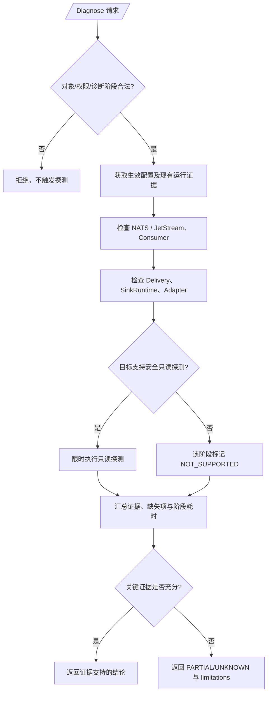

<p class="figure-caption">图 3-7 UR-07 链路诊断（Diagnose）业务活动图</p>

### 3.8.3 业务规则

**R07-01 证据等级。** `NOT_RUN` 表示未执行；`NOT_SUPPORTED` 表示该目标不提供安全探测；`UNKNOWN` 表示证据不足；三者均不得作为 PASS。TCP 可达、协议成功、目标确认是不同阶段证据。

**R07-02 目标约束。** 无安全只读探测能力的目标不得实施有副作用的测试写入；诊断超时后未收敛 I/O 不得回收其资源所有权。


### 3.8.4 关键约束

<p class="table-caption">表 3-32 UR-07 非功能约束</p>

| 约束类别 | 可验证要求 |
|---|---|
| 安全与性能 | 只读探针禁止执行写入；设计默认总期限 5000 ms、每阶段不超过剩余期限、每服务同时探测最多 4 个、响应体不超过 1 MiB；配置越界须拒绝，值须同步进配置章节。 |
| I/O | 诊断不得抢占生产额度或破坏未收敛操作。 |
| 可观测性 | 每阶段时间、来源、失败类别、UNKNOWN/NOT_RUN 的依据可追溯。 |

## 3.9 UR-08 gRPC 服务端实现

### 3.9.1 基本信息与触发方式

<p class="table-caption">表 3-16 UR-08 基本信息</p>

| 字段 | 内容 |
|---|---|
| 请求方（Requester） | 经认证的 gRPC 客户端；服务管理器负责进程生命周期 |
| 触发方式（Trigger） | API：13 项 Unary RPC；生命周期：启动/关闭服务端 |
| 输入（Input） | `src/contracts/common.proto`、`sink_service.proto` 中的请求消息、认证上下文 |
| 反馈（Response） | 正式 Proto 响应或 gRPC 状态错误 |
| 目标方（Destination） | 按具体 RPC 路由到业务组件 |
| 业务输出（Output） | 业务操作输出归 UR-01～UR-07，本 UR 不新增独立派发 |

### 3.9.2 业务流程

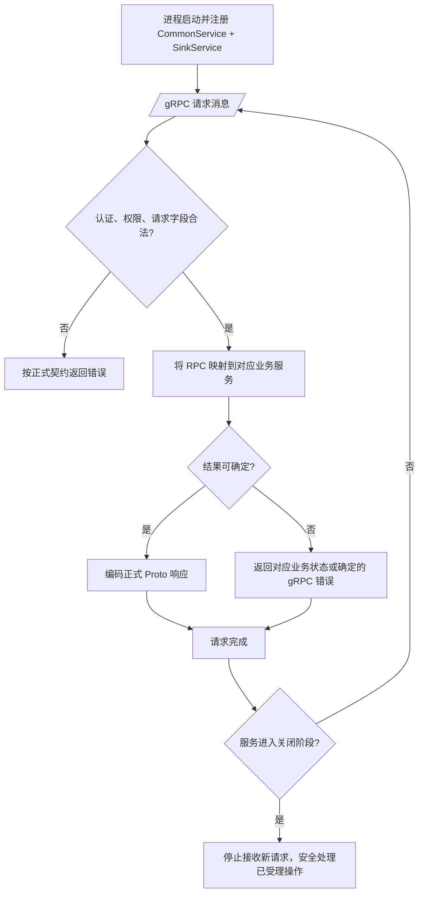

<p class="figure-caption">图 3-8 UR-08 gRPC 服务端实现业务活动图</p>

### 3.9.3 业务规则

**R08-01 接口全集。** CommonService 固定 9 项：`GetServiceInfo`、`GetServiceStatus`、`GetCapabilities`、`GetConfigSnapshot`、`PushConfigSnapshot`、`ApplyConfigSnapshot`、`GetMetrics`、`GetEvents`、`Diagnose`；SinkService 固定 4 项：`ListDeliveries`、`GetDelivery`、`StartDelivery`、`StopDelivery`。

**R08-02 契约权威。** 请求/响应字段、gRPC status、错误及版本信息全部以正式 Proto 为准；不得因文档新增私有字段或自造 RPC。


### 3.9.4 关键约束

<p class="table-caption">表 3-33 UR-08 非功能约束</p>

| 约束类别 | 可验证要求 |
|---|---|
| 安全与性能 | 强制 mTLS 与权限检查；设计目标：请求体最大 2 MiB、单服务并发 RPC 默认上限 64、默认 deadline 5000 ms，必须在配置章节体现。请求断连不撤销已提交操作，未收敛写入不得被误判完成；错误状态依正式 Proto/gRPC。 |


# 4. 用例视图


## 4.1 系统上下文

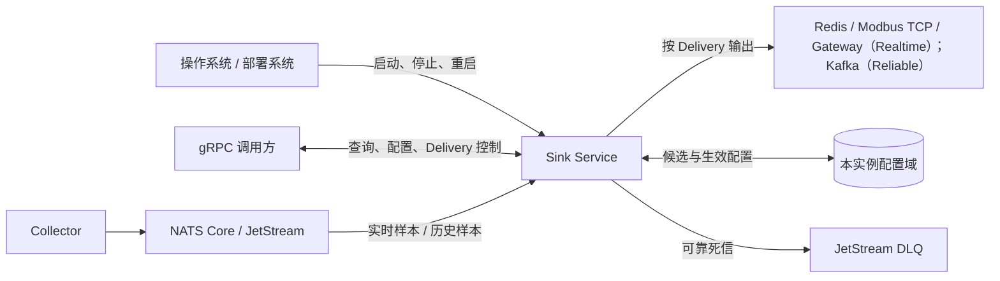

<p class="figure-caption">图 4-1 Sink Service 系统边界与外部交互</p>

用例基于第 3 章八项 UR，按外部可观察的完整业务目标组织。多实例静态分配属于 UC-01、02、03、07、09、10 的部署和配置分支，不新增集群管理 UC，也不扩展对外 RPC。进程管理系统、运维 gRPC 调用方为主动参与者；NATS/JetStream 样本和故障事件是业务触发，不虚构人工参与者。每个用例的规定场景采用 `UC-xx-S01`（主流程）、`S02`（关键边界）、`S03`（异常与恢复）；同一场景涉及多种条件时，System Test 必须逐一参数化或分别验证。

<p class="table-caption">表 4-1 用例—需求总表</p>

| 用例 | 业务目标 | 关联需求 |
|---|---|---|
| UC-01 | 首次部署启动并就绪 | UR-03、UR-06、UR-08 |
| UC-02 | 启动 Delivery 并建立输出 | UR-03、UR-06、UR-08 |
| UC-03 | 停止 Delivery 并释放共享资源 | UR-03、UR-06、UR-08 |
| UC-04 | 实时样本按策略派发 | UR-01 |
| UC-05 | 历史样本可靠交付 | UR-02 |
| UC-06 | 查询服务、Sink、Delivery 和指标 | UR-05、UR-08 |
| UC-07 | 校验、修改配置并热生效 | UR-06、UR-08 |
| UC-08 | 正常停止服务 | UR-03、UR-08 |
| UC-09 | 重启加载新配置 | UR-03、UR-06、UR-08 |
| UC-10 | 异常退出后恢复和重新交付 | UR-02、UR-03、UR-06 |
| UC-11 | 故障隔离与目标恢复 | UR-01、UR-02、UR-03 |
| UC-12 | 查询死信状态并交接外部运维 | UR-02、UR-05 |
| UC-13 | 诊断数据派发链路 | UR-07、UR-08 |
| UC-14 | 初始化并周期生成派发指标 | UR-04 |

## 4.2 UC-01 首次部署启动并就绪

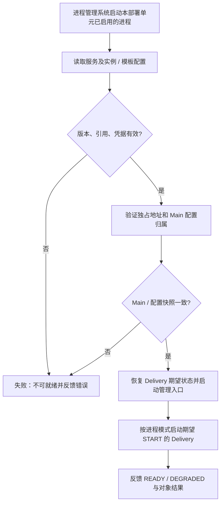

<p class="figure-caption">图 4-2 UC-01 业务活动图</p>

<p class="table-caption">表 4-2 UC-01 用例说明与规定场景</p>

| 要素 | 内容 |
|---|---|
| 参与者 | 进程管理系统 |
| 业务目标 | 首次部署启动并就绪 |
| 前置条件 | 系统具备配置路径及 TLS 文件 |
| 主要异常 | 配置非法、Main 配置写入冲突、独占端口占用 |
| 后置条件 | 进程及对象的就绪状态真实可查询 |
| 关联需求 | UR-03、UR-06、UR-08 |
| UC-01-S01 主流程 | 启动本域已启用的 Realtime/Reliable 进程并查询就绪 |
| UC-01-S02 关键边界 | Service 配置变化与子进程未就绪 |
| UC-01-S03 异常与恢复 | 非法配置、Main 配置写入冲突和进程恢复 |

## 4.3 UC-02 启动 Delivery 并建立输出

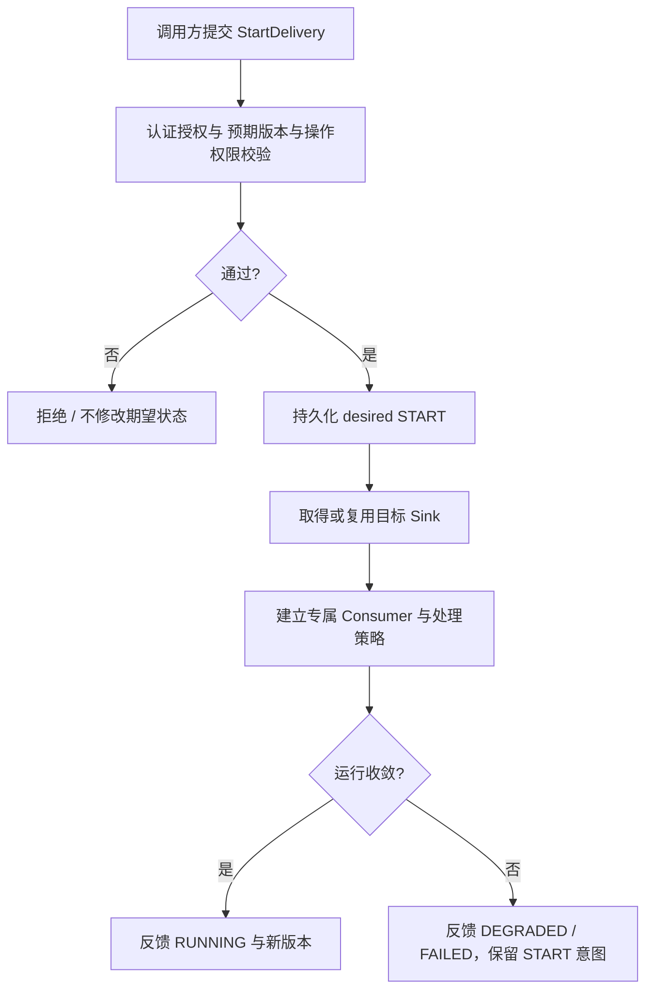

<p class="figure-caption">图 4-3 UC-02 业务活动图</p>

<p class="table-caption">表 4-3 UC-02 用例说明与规定场景</p>

| 要素 | 内容 |
|---|---|
| 参与者 | gRPC 调用方 |
| 业务目标 | 启动 Delivery 并建立输出 |
| 前置条件 | Delivery 已存在、配置已校验、调用方有 control 权限 |
| 主要异常 | revision 冲突、Sink 不可达、订阅失败 |
| 后置条件 | 持久 START 与实际状态、版本分别可查询 |
| 关联需求 | UR-03、UR-06、UR-08 |
| UC-02-S01 主流程 | 启动已配置 Delivery 并确认状态 |
| UC-02-S02 关键边界 | 重复启动与共享 Sink 的引用 |
| UC-02-S03 异常与恢复 | 版本冲突、目标不可达及待收敛 |

## 4.4 UC-03 停止 Delivery 并释放共享资源

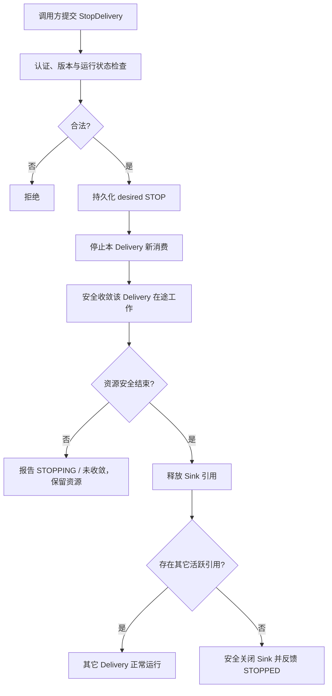

<p class="figure-caption">图 4-4 UC-03 业务活动图</p>

<p class="table-caption">表 4-4 UC-03 用例说明与规定场景</p>

| 要素 | 内容 |
|---|---|
| 参与者 | gRPC 调用方 |
| 业务目标 | 停止 Delivery 并释放共享资源 |
| 前置条件 | Delivery 已存在，调用方具备 control 权限 |
| 主要异常 | 未收敛 I/O、重复 Stop、关联 Sink 被其它 Delivery 使用 |
| 后置条件 | STOP 不被 Watchdog 覆盖；资源安全释放或明确阻塞 |
| 关联需求 | UR-03、UR-06、UR-08 |
| UC-03-S01 主流程 | 停止 Delivery 并确认实际停止 |
| UC-03-S02 关键边界 | 重复停止、其它 Delivery 共享 Sink |
| UC-03-S03 异常与恢复 | 未收敛 I/O、关闭超时及资源保护 |

## 4.5 UC-04 实时样本按策略派发

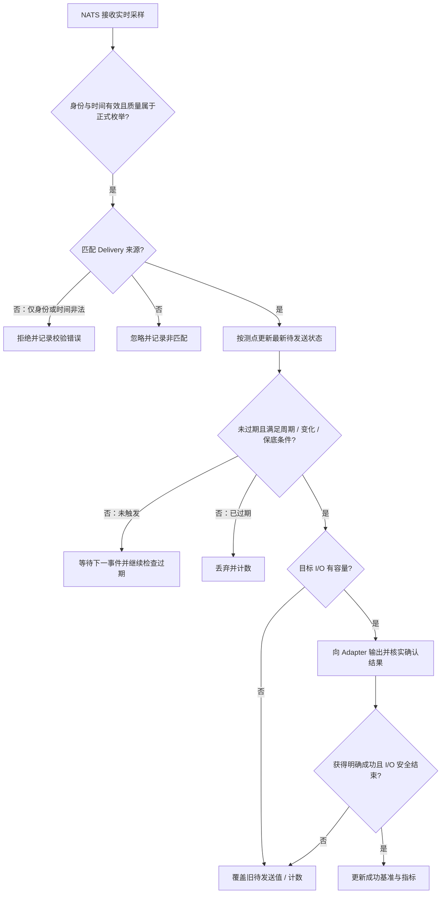

<p class="figure-caption">图 4-5 UC-04 业务活动图</p>

<p class="table-caption">表 4-5 UC-04 用例说明与规定场景</p>

| 要素 | 内容 |
|---|---|
| 参与者 | Collector/NATS 数据事件 |
| 业务目标 | 实时样本按策略派发 |
| 前置条件 | 实时进程与 Delivery 正在运行 |
| 主要异常 | 过期、乱序、质量 bad、满缓存、下游慢 |
| 后置条件 | 最新值及交付指标可信，不承诺实时消息全量交付 |
| 关联需求 | UR-01 |
| UC-04-S01 主流程 | 接收样本并按三种策略派发 |
| UC-04-S02 关键边界 | 阈值、质量变化、过期、乱序与容量边界 |
| UC-04-S03 异常与恢复 | NATS 中断、慢目标、背压和恢复 |

## 4.6 UC-05 历史样本可靠交付

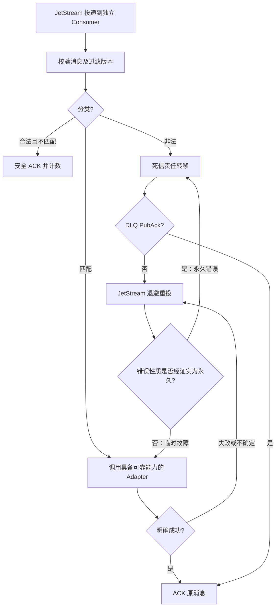

<p class="figure-caption">图 4-6 UC-05 业务活动图</p>

<p class="table-caption">表 4-6 UC-05 用例说明与规定场景</p>

| 要素 | 内容 |
|---|---|
| 参与者 | JetStream 数据事件 |
| 业务目标 | 历史样本可靠交付 |
| 前置条件 | reliable 模式目标已通过能力校验 |
| 主要异常 | ACK 续约、写入超时、DLQ PubAck 丢失 |
| 后置条件 | 已成功交付或已确认转死信；其它保留重投权 |
| 关联需求 | UR-02 |
| UC-05-S01 主流程 | 匹配消息可靠写入并确认 ACK |
| UC-05-S02 关键边界 | 不匹配消息、重复投递、目标写入结果不确定 |
| UC-05-S03 异常与恢复 | 永久错误转死信、DLQ 满、PubAck 失败及恢复 |

## 4.7 UC-06 查询服务、Sink、Delivery 和指标

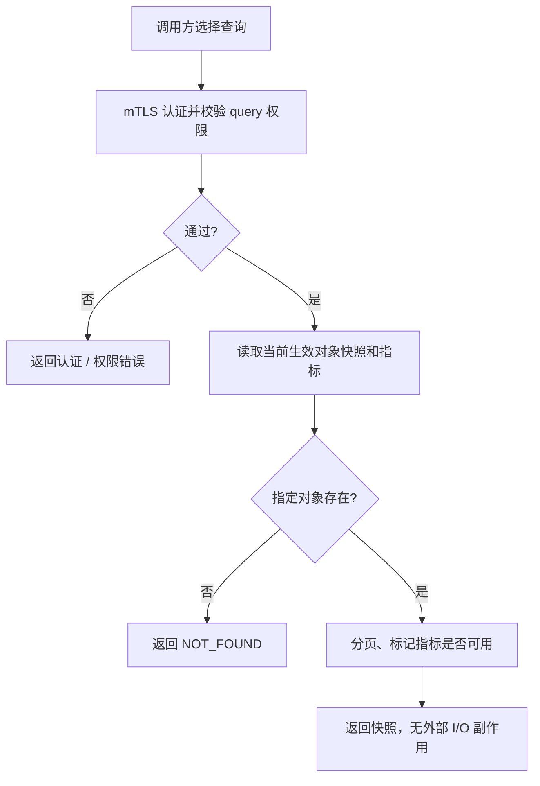

<p class="figure-caption">图 4-7 UC-06 业务活动图</p>

<p class="table-caption">表 4-7 UC-06 用例说明与规定场景</p>

| 要素 | 内容 |
|---|---|
| 参与者 | gRPC 调用方 |
| 业务目标 | 查询服务、Sink、Delivery 和指标 |
| 前置条件 | gRPC 管理入口可用 |
| 主要异常 | 未认证、无权限、无对应对象、Metrics 不可用 |
| 后置条件 | 返回生效状态快照，查询不触发目标连接 |
| 关联需求 | UR-05、UR-08 |
| UC-06-S01 主流程 | 查询服务、Delivery、Sink、Metrics 与事件 |
| UC-06-S02 关键边界 | 无数据、统计窗口、分页和不可用指标 |
| UC-06-S03 异常与恢复 | 无权限、对象不存在、部分进程不可用 |

## 4.8 UC-07 校验、修改配置并热生效

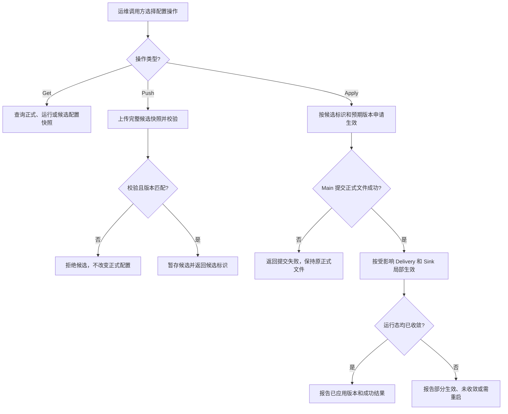

<p class="figure-caption">图 4-8 UC-07 业务活动图</p>

<p class="table-caption">表 4-8 UC-07 用例说明与规定场景</p>

| 要素 | 内容 |
|---|---|
| 参与者 | gRPC 调用方 |
| 业务目标 | 校验、修改配置并热生效 |
| 前置条件 | Main 运行且配置存储可读写 |
| 主要异常 | 数据子进程不可达、应用超时、版本冲突、连接未收敛 |
| 后置条件 | 提交版本与每对象 active 版本可对账，不伪报全局成功 |
| 关联需求 | UR-06、UR-08 |
| UC-07-S01 主流程 | 完整配置 Get、Push、Apply 与局部热生效 |
| UC-07-S02 关键边界 | 候选校验、版本冲突、Service 重启要求 |
| UC-07-S03 异常与恢复 | 文件提交后应用失败、数据子进程不可达与收敛查询 |

## 4.9 UC-08 正常停止服务

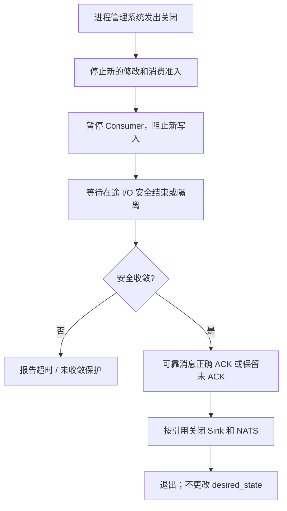

<p class="figure-caption">图 4-9 UC-08 业务活动图</p>

<p class="table-caption">表 4-9 UC-08 用例说明与规定场景</p>

| 要素 | 内容 |
|---|---|
| 参与者 | 进程管理系统 |
| 业务目标 | 正常停止服务 |
| 前置条件 | 进程正在运行 |
| 主要异常 | 未结束 I/O、NATS 不可达、关闭超时 |
| 后置条件 | 不提前 ACK、无不安全资源复用 |
| 关联需求 | UR-03、UR-08 |
| UC-08-S01 主流程 | 正常停止进程并保全交付责任 |
| UC-08-S02 关键边界 | 重复关闭、待处理消息及共享资源 |
| UC-08-S03 异常与恢复 | 关闭超时、未收敛 I/O 与安全退出 |

## 4.10 UC-09 重启加载新配置

```mermaid
%%{init: {"flowchart": {"useMaxWidth": true}}}%%
flowchart TD
 A["操作系统重启进程"] --> B["按关闭契约处理原进程"]
 B --> C["读取全部当前配置与版本"]
 C --> D{"配置与旧资源安全?"}
 D -->|否| X["不可就绪，报告冲突"]
 D -->|是| E["恢复期望状态与 durable 身份"]
 E --> F["仅启动 desired START 的 Delivery"]
 F --> G["返回当前文件与逐对象生效版本"]
```

<p class="figure-caption">图 4-10 UC-09 业务活动图</p>

<p class="table-caption">表 4-10 UC-09 用例说明与规定场景</p>

| 要素 | 内容 |
|---|---|
| 参与者 | 进程管理系统 |
| 业务目标 | 重启加载新配置 |
| 前置条件 | 已运行过旧实例 |
| 主要异常 | 重启配置不兼容、旧监听未隔离 |
| 后置条件 | 按新配置或报告不可就绪，不复用旧缓存 |
| 关联需求 | UR-03、UR-06、UR-08 |
| UC-09-S01 主流程 | 重启服务并加载正式新配置 |
| UC-09-S02 关键边界 | Service 参数变更和手动 STOP 保持 |
| UC-09-S03 异常与恢复 | 配置非法、端口占用及旧资源未收敛 |

## 4.11 UC-10 异常退出后恢复和重新交付

```mermaid
%%{init: {"flowchart": {"useMaxWidth": true}}}%%
flowchart TD
 A["异常退出后进程重启"] --> B["读取有效配置、意图和 JetStream 进度"]
 B --> C["检验旧进程所有权与独占资源"]
 C --> D{"冲突被排除?"}
 D -->|否| X["受影响 Sink 阻塞；不冒险复用"]
 D -->|是| E["实时缓存清空，历史恢复原 durable"]
 E --> F["检验目标可靠交付能力"]
 F --> G["恢复 desired START 的对象"]
 G --> H["报告积压、重投和真实状态"]
```

<p class="figure-caption">图 4-11 UC-10 业务活动图</p>

<p class="table-caption">表 4-11 UC-10 用例说明与规定场景</p>

| 要素 | 内容 |
|---|---|
| 参与者 | 进程管理系统 |
| 业务目标 | 异常退出后恢复和重新交付 |
| 前置条件 | 存在已部署配置和持久意图 |
| 主要异常 | 重投重复、Main 与子进程版本不一致、旧 I/O 不明 |
| 后置条件 | 恢复进度正确，遗留问题显式暴露 |
| 关联需求 | UR-02、UR-03、UR-06 |
| UC-10-S01 主流程 | 异常退出后按持久意图恢复派发 |
| UC-10-S02 关键边界 | 可靠消息重复投递、实时缓存清空 |
| UC-10-S03 异常与恢复 | Main 与子进程版本不一致、旧资源冲突 |

## 4.12 UC-11 故障隔离与目标恢复

```mermaid
%%{init: {"flowchart": {"useMaxWidth": true}}}%%
flowchart TD
 A["检测连接或写入故障"] --> B["隔离引用故障 Sink 的 Deliveries"]
 B --> C{"desired START?"}
 C -->|否| X["不恢复，保持手动 STOP"]
 C -->|是| D["保持未安全结束的 I/O 所有权"]
 D --> E{"可安全重建连接?"}
 E -->|否| F["保持 DEGRADED / BLOCKED 告警"]
 E -->|是| G["有界退避重连"]
 G --> H["恢复 Consumer 与交付"]
 H --> I["其它 Sink 持续正常运行"]
```

<p class="figure-caption">图 4-12 UC-11 业务活动图</p>

<p class="table-caption">表 4-12 UC-11 用例说明与规定场景</p>

| 要素 | 内容 |
|---|---|
| 参与者 | 下游故障自动触发 |
| 业务目标 | 故障隔离与目标恢复 |
| 前置条件 | 已检测连接/输出故障 |
| 主要异常 | 永久断连、目标超时、手工 Stop 与重连竞争 |
| 后置条件 | 受影响 Delivery 局部 DEGRADED，不影响无关联 Sink |
| 关联需求 | UR-01、UR-02、UR-03 |
| UC-11-S01 主流程 | 隔离故障 Sink 并恢复相关 Delivery |
| UC-11-S02 关键边界 | 多个 Delivery 引用同一 Sink、无关 Sink 保持运行 |
| UC-11-S03 异常与恢复 | 重连失败、手动 STOP 与未收敛 I/O |

## 4.13 UC-12 查询死信状态并交接外部运维

```mermaid
%%{init: {"flowchart": {"useMaxWidth": true}}}%%
flowchart TD
 A["运维调用方查询死信及派发异常"] --> B["校验查询权限与筛选范围"]
 B --> C{"有可核验的死信或积压记录?"}
 C -->|否| D["报告无记录或证据不可用"]
 C -->|是| E["返回事件身份、原因、时间与投递状态"]
 E --> F["运维人员使用外部工具独立处理或重放"]
 F --> G["Sink Service 仅提供证据查询，不执行重放"]
```

<p class="figure-caption">图 4-13 UC-12 业务活动图</p>

<p class="table-caption">表 4-13 UC-12 用例说明与规定场景</p>

| 要素 | 内容 |
|---|---|
| 参与者 | gRPC 运维调用方 |
| 业务目标 | 查询死信状态并交接外部运维 |
| 前置条件 | 具备运维查询权限；允许当前无死信记录 |
| 主要异常 | 死信内容不可查询、记录缺失、Broker 不可用 |
| 后置条件 | 外部承担重放决定；Sink Service 只提供观察证据 |
| 关联需求 | UR-02、UR-05 |
| UC-12-S01 主流程 | 查询死信记录、积压和可用证据 |
| UC-12-S02 关键边界 | 无死信、分页、死信证据缺失 |
| UC-12-S03 异常与恢复 | Broker 不可达、查询失败与外部工具交接 |

## 4.14 UC-13 诊断数据派发链路

```mermaid
%%{init: {"flowchart": {"useMaxWidth": true}}}%%
flowchart TD
 A["运维调用方指定 Delivery 和诊断范围"] --> B["验证身份、权限与对象"]
 B --> C{"准入成功?"}
 C -->|否| X["返回拒绝及原因"]
 C -->|是| D["检查 NATS / JetStream 连通、消费与积压证据"]
 D --> E["检查 Delivery 状态、匹配、过滤与调度证据"]
 E --> F["检查 Sink 连接、Adapter 与目标响应证据"]
 F --> G{"证据覆盖完整且均成功?"}
 G -->|是| H["返回已验证范围内 PASS"]
 G -->|否| I["返回 FAIL / PARTIAL / UNKNOWN 与缺失阶段"]
 H --> J["只读返回阶段证据，不执行业务写入"]
 I --> J
```

<p class="figure-caption">图 4-14 UC-13 业务活动图</p>

<p class="table-caption">表 4-14 UC-13 用例说明与规定场景</p>

| 要素 | 内容 |
|---|---|
| 参与者 | 授权运维调用方 |
| 业务目标 | 诊断数据派发链路 |
| 前置条件 | 有效身份、诊断范围及目标 Delivery；部分依赖不可用时仍返回已取得的证据 |
| 主要异常 | NATS 不可达、Consumer 积压、目标连接失败、目标写入证据缺失、诊断超时 |
| 后置条件 | 提供有时间戳的阶段状态与证据；不修改业务 ACK、配置或 Delivery 期望状态 |
| 关联需求 | UR-07、UR-08 |
| UC-13-S01 主流程 | 分阶段诊断 NATS、Delivery、Sink 和目标 |
| UC-13-S02 关键边界 | 阶段跳过、证据缺失与结果 UNKNOWN |
| UC-13-S03 异常与恢复 | 超时、权限拒绝、依赖不可达及无副作用 |

## 4.15 UC-14 初始化并周期生成派发指标

```mermaid
%%{init: {"flowchart": {"useMaxWidth": true}}}%%
flowchart TD
    A["服务进程启动"] --> B["统计组件加载配置并初始化空窗口"]
    B --> C{"配置合法?"}
    C -->|否| X["报告初始化异常"]
    C -->|是| D["等待统计周期"]
    E["派发操作完成或运行状态变化"] --> F["记录基础计数、耗时和状态"]
    F -.-> G["窗口基础数据"]
    D --> H["计算窗口指标和覆盖时长"]
    G -.-> H
    H --> I["原子发布统计快照"]
    I --> D
```

<p class="figure-caption">图 4-15 UC-14 周期统计业务活动图</p>

<p class="table-caption">表 4-15 UC-14 用例说明与规定场景</p>

| 要素 | 内容 |
|---|---|
| 参与者 | 部署/进程管理系统触发启动；后续周期调度属于服务自动行为，不虚构外部请求方 |
| 业务目标 | 启动统计组件，自动周期产出可查询且口径清晰的指标 |
| 前置条件 | Sink Service 启动，统计配置已提供 |
| 主要异常 | 配置无效、首次窗口不足、无事件、无耗时样本、重启、统计任务超期、配置热变更 |
| 后置条件 | 统计快照具有准确计算时间、窗口与就绪状态；不影响派发主路径 |
| 关联需求 | UR-04 |
| UC-14-S01 主流程 | 初始化为 NOT_READY，首个周期生成带覆盖时长的快照，后续持续更新 |
| UC-14-S02 关键边界 | 空窗口、窗口未填满、无延迟样本、周期与窗口不一致、查询不同窗口 |
| UC-14-S03 异常与恢复 | 非法配置、重启重置、热变更窗口重建、慢计算跳周期不重入 |

## 4.16 用例与 System Test 追溯基线

UC-04 的边界场景包含实时过期丢弃、恢复仅输出最新值；UC-05 的异常/恢复场景包含临时故障持续退避、不可恢复错误入 DLQ、DLQ 满时保持未 ACK 责任、源 Stream 满时的告警；UC-10/11 的恢复场景包含 Reliable 自动补发限流、与 Realtime 的目标资源隔离、重复投递去重及同一 Durable 的先后顺序。上述条件必须在第 14 章以参数化测试分别验证，不能仅用一个成功恢复测试代替。


第 4 章共 14 项 UC、42 个规定场景，覆盖 UR-01～UR-08。每个 `UC-xx-S01/S02/S03` 均是第 14 章 System Test 的最低场景基线；图中关键分支以及各场景表中的并列异常必须逐项验证，不能以单一正常路径代表场景通过。测试矩阵必须同时记录 UR、UC 场景、测试标识、预期结果和实际执行证据。

UC-12 仅查询死信与积压证据，外部运维工具负责重放；UC-13 仅提供可证实范围内的链路诊断，不替代 CLI 的跨服务诊断，也不产生业务写入。启动、重启、关闭的运行机制在第 6 章定义，用例视图只描述其可观察业务结果。

# 5. 逻辑视图

逻辑视图只描述组件职责和状态，不将每个模块等同于常驻 Task。Delivery 是业务执行单元；Sink 是共享目标资源；Consumer 归 Delivery 所有。同一配置域内的 Realtime/Reliable 子进程不共享 Python 对象，配置一致性由 Main 的版本化 IPC 和子进程确认承担。不同部署单元的配置域相互独立，其资源分配由 CLI/Web UI 在部署前校验。

## 5.1 组件结构与职责

```mermaid
%%{init: {"flowchart": {"useMaxWidth": true}}}%%
flowchart TB
 UI["CLI / Web UI"] --> RPC["Main：13 RPC / 鉴权"]
 RPC --> CFG["配置快照 / Revision CAS / 审计"]
 RPC --> CTRL["Delivery 控制 / 运行状态与指标聚合"]
 CFG --> CTRL
 CTRL <-->|"有界 IPC：命令、结果、状态、指标"| RT["Realtime Runtime"]
 CTRL <-->|"有界 IPC：命令、结果、状态、指标"| RL["Reliable Runtime"]
 N["NATS Core"] --> RT
 J["JetStream"] --> RL
 RT --> AT["各自进程内的 Sink Adapter"]
 RL --> AT
 AT --> S["外部 Sink"]
```

<p class="figure-caption">图 5-1 Sink Service 逻辑组件结构</p>

<p class="table-caption">表 5-1 组件职责与非职责</p>

| 组件 | 职责 | 不承担 |
|---|---|---|
| Main / gRPC | 唯一对外 RPC、mTLS、配置快照、Delivery 管理、状态与指标聚合、诊断 | NATS 样本解码及目标业务写入 |
| ProcessSupervisor | 创建、监控、重启/停止两个子进程；按子进程状态判定就绪 | 自动跨容器抢占 Delivery |
| WorkerControl | 经 IPC 接收已校验的配置版本和命令，回报真实运行状态、错误及指标 | 对外 gRPC、配置文件写入 |
| DeliveryRuntime | 本通道 Delivery 生命周期、过滤/策略、确认责任 | 跨进程共享 Adapter 对象 |
| SinkRuntime / SinkManager | 在子进程内持有连接、共享引用、写入额度与未收敛 I/O | 跨进程 Python 对象共享 |
| Realtime Consumer | NATS Core 订阅、解码和最新值缓存 | JetStream ACK/DLQ |
| Reliable Consumer | JetStream 消费、ACK/NAK/InProgress、重试及 DLQ | 实时覆盖语义 |
| Metrics / Diagnose | Main 汇总子进程真实证据；超时或断连返回 UNKNOWN/DEGRADED | 将子进程无响应解释为健康 |

### 5.1.1 静态多实例逻辑边界

```mermaid
%%{init: {"flowchart": {"useMaxWidth": true}}}%%
flowchart TB
 UI["CLI / Web UI：人工静态分配 Delivery / Sink"]
 N["NATS Core / JetStream"]
 subgraph A["容器 A：独立配置域"]
   MA["Main / 唯一 gRPC / 配置管理"]
   RA["Realtime 子进程"]
   LA["Reliable 子进程"]
   MA <-->|"IPC"| RA
   MA <-->|"IPC"| LA
 end
 subgraph B["容器 B：独立配置域"]
   MB["Main / 唯一 gRPC / 配置管理"]
   RB["Realtime 子进程"]
   LB["Reliable 子进程"]
   MB <-->|"IPC"| RB
   MB <-->|"IPC"| LB
 end
 UI --> MA
 UI --> MB
 N --> RA
 N --> LA
 N --> RB
 N --> LB
 RA --> TA["A 拥有的目标 Sink"]
 LA --> TA
 RB --> TB["B 拥有的目标 Sink"]
 LB --> TB
```

<p class="figure-caption">图 5-2 双容器静态分配逻辑架构</p>

每个容器实例固定包含 Main、Realtime、Reliable **三个进程**，三个进程分别具有独立的 asyncio 事件循环；两种子进程均创建，但只为本通道的 `desired_state=START` Delivery 创建业务 Task。一个容器就是一个独立配置域与一个受管进程组；多容器仅通过 CLI/Web UI 分配互不冲突的 Delivery/Sink，不建立中心协调服务、选主或自动迁移。IPC 仅在同一容器内部传递管理信息，**不传输采样数据**。

### 5.1.2 批量处理组件边界

每个数据进程采用**批量消息接入 → 批内逐测点校验与路由 → 按 Delivery 聚合 → Adapter 批量输出**的流水线，优先减少每测点独立解析、重复配置查找、Python 对象构造和网络往返。单批固定一次来源和版本校验；批内身份、质量、时间及 TTL 必须逐项验证，不因批处理改变原有逐点业务语义。相同来源可一次匹配对应 Delivery，随后仅将匹配测点放入其有界缓存/发送批次；不把全部风机批次广播给所有 Delivery 再逐点过滤。

- **Realtime**：按点替换最新缓存；仅批内有效点参与写入，过期/冲突逐点统计；按输出策略成批提交，慢 Sink 不阻塞接收事件循环的其它 Delivery。
- **Reliable**：消费单位为 JetStream 的**完整批量消息**；允许按目标 Adapter 上限拆为多个 I/O 子批，但必须在整条源消息的每个测点已成功确认或已持久转移到 DLQ 后才 ACK 源消息。未决点保留在 Broker 未 ACK 消息内，必要的去重/已确认进度依赖目标幂等契约；不得把仅内存中记录的部分成功当成崩溃可恢复事务。
- **Main**：IPC 仅传已校验配置代、控制命令、状态、聚合统计和受限诊断结果；不得传递高频批量采样。进程级 CPU 并行不能取代单进程热点优化。

## 5.2 核心对象与引用关系

```mermaid
%%{init: {"class": {"useMaxWidth": true}}}%%
classDiagram
  class DeliveryInstance {
    +delivery_id
    +sink_id
    +mode
    +desired_state
    +template_ref
  }
  class DeliveryRuntime {
    +actual_state
    +active_revision
    +start()
    +stop()
  }
  class Consumer {
    <<interface>>
    +start()
    +stop()
    +ack()
  }
  class SinkRuntime {
    +sink_id
    +inflight
    +open()
    +write()
    +close()
  }
  class SinkPort {
    <<interface>>
    +open()
    +write()
    +health()
    +close()
  }
  DeliveryInstance "1" --> "1" DeliveryRuntime
  DeliveryRuntime "1" --> "1" Consumer
  DeliveryRuntime "0..*" --> "1" SinkRuntime
  SinkRuntime "1" --> "1" SinkPort
```

<p class="figure-caption">图 5-3 Sink、Delivery、Consumer 与 Adapter 关系</p>

## 5.3 生命周期和状态责任

```mermaid
%%{init: {"state": {"useMaxWidth": true}}}%%
stateDiagram-v2
  [*] --> STOPPED
  STOPPED --> STARTING: desired START
  STARTING --> RUNNING: 消费与目标就绪
  STARTING --> FAILED: 启动失败
  RUNNING --> DEGRADED: 消费或目标不可用
  DEGRADED --> RUNNING: 依赖恢复且 desired START
  DEGRADED --> FAILED: 需要重建运行资源
  FAILED --> STARTING: desired START 且可重试
  STARTING --> STOPPING: desired STOP
  RUNNING --> STOPPING: desired STOP
  DEGRADED --> STOPPING: desired STOP
  FAILED --> STOPPING: desired STOP
  STOPPING --> STOPPED: 消费及 I/O 安全收敛
```

<p class="figure-caption">图 5-4 Delivery 运行状态机</p>

```mermaid
%%{init: {"state": {"useMaxWidth": true}}}%%
stateDiagram-v2
  [*] --> CLOSED
  CLOSED --> OPENING: 第一个活跃引用
  OPENING --> OPEN: 目标已就绪
  OPENING --> FAILED: 建连失败
  OPEN --> DEGRADED: 写入或连接故障
  DEGRADED --> OPENING: 可安全重连
  OPEN --> CLOSING: 最后引用释放
  DEGRADED --> CLOSING: desired STOP 无引用
  CLOSING --> CLOSED: 底层 I/O 安全结束
  CLOSING --> BLOCKED: 未结束 I/O
  BLOCKED --> CLOSING: 安全结束或隔离证据
  FAILED --> OPENING: 存在引用且可恢复
```

<p class="figure-caption">图 5-5 Sink 共享连接生命周期</p>

交付业务结果 `CONFIRMED/FAILED/UNCERTAIN` 与底层 I/O `IN_FLIGHT/SETTLED/ISOLATED` 是两个不同维度；`UNCERTAIN` 不可提前释放或重新使用可能冲突的连接。相同 SinkRuntime 的两个 Delivery 可以共享物理连接，但任何一个的 ACK、过滤、期望状态与指标均独立。

## 5.4 实时与可靠逻辑路径

```mermaid
%%{init: {"flowchart": {"useMaxWidth": true}}}%%
flowchart LR
  N["Core NATS"] --> F["身份与来源校验"]
  F --> L["每 Delivery 最新值"]
  L --> P["周期 / 变化 / 保底"]
  P --> W["SinkRuntime.write"]
  T["周期触发"] --> P
  W --> M["确认结果与 Metrics"]
```

<p class="figure-caption">图 5-6 实时 Delivery 内部协作</p>

```mermaid
%%{init: {"flowchart": {"useMaxWidth": true}}}%%
flowchart LR
  J["JetStream 独立 Durable"] --> F["已冻结过滤规则"]
  F --> W["可靠 Sink.write"]
  W --> E{"业务确认?"}
  E -->|是| A["ACK"]
  E -->|否或不明| R["退避重投"]
  R --> D["永久错误才发布死信"]
  D -->|PubAck| A
```

<p class="figure-caption">图 5-7 历史 Delivery 内部协作</p>

# 6. 进程视图

本章只规定**进程结构、资源所有权、生命周期、在途额度和进程故障恢复**。数据校验、派发策略、Kafka 处理、ACK/DLQ 等算法由第 10 章唯一规定。

## 6.1 运行时结构

```mermaid
%%{init: {"flowchart": {"useMaxWidth": true}}}%%
flowchart TB
 CLI["CLI / Web UI"] --> GRPC
 subgraph C["Sink Service 容器：一个实例 / 三个 OS 进程"]
   subgraph M["PID 1：Main / asyncio Loop-M"]
     GRPC["唯一 gRPC Server：13 RPC"]
     CFG["配置 CAS / 完整快照"]
     SUP["子进程 Supervisor / 状态汇总 / Metrics"]
     GRPC --> CFG
     GRPC --> SUP
   end
   subgraph R["子进程：Realtime / asyncio Loop-R"]
     NC["NATS Core Subscriber"] --> RE["Realtime Delivery Tasks"] --> RA["Realtime Adapter / Sink Pool"]
   end
   subgraph L["子进程：Reliable / asyncio Loop-L"]
     JC["JetStream Durable Consumer"] --> LE["Reliable Delivery Tasks"] --> LA["Reliable Adapter / Sink Pool"]
   end
   SUP <-->|"有界 IPC"| RE
   SUP <-->|"有界 IPC"| LE
 end
 NATS["NATS Core"] --> NC
 JS["JetStream"] --> JC
 RA --> T["Sink 目标"]
 LA --> T
```

<p class="figure-caption">图 6-1 单容器三进程及各自独立事件循环</p>

**进程边界。** Main 是容器 PID 1，负责创建、监控和回收两个子进程；仅 Main 监听外部 gRPC，两个子进程不开放 gRPC 服务或配置写接口。Realtime、Reliable 进程独立运行 asyncio，互不共享缓存、连接、Semaphore 或 Python 对象。单容器始终是三进程；没有对应 START Delivery 时，子进程保持轻量空闲，不建立无用订阅或目标连接。扩容只增加相同形态的容器实例，实例不判断自身是否处于多实例部署。

**IPC 最小契约。** Main 经容器内 Unix Domain Socket（或等价双向本地进程通道）发送带 `request_id`（仅内部 IPC 标识）、`generation`、`delivery_id` 的 START/STOP、APPLY、GET_STATUS、GET_METRICS、DIAGNOSE 和 SHUTDOWN 命令；子进程返回实际状态、运行版本、错误、有限大小的诊断/指标记录。IPC 帧必须有类型、长度上限、超时和关联请求标识；控制命令不得在 IPC 中夹带原始高频 SampleBatch。Main 对每个子进程只允许一个配置应用序列，允许彼此独立的只读查询。IPC 的内部 request_id 不改变任何外部 Proto 字段。

**性能隔离边界。** 每个进程各自事件循环，数据面不直接阻塞 Main 的事件循环；但共享容器 CPU 配额，满载 gRPC 的可用性仍须实测。Main 的 IPC 等待不得阻塞 asyncio 循环；超时返回 UNKNOWN/PENDING，不得把超时解释为未执行。

<p class="table-caption">表 6-1 执行单元、所有者与退出条件</p>

| 执行单元 | 所在进程 | 资源所有者与约束 |
|---|---|---|
| gRPC 请求、配置提交、指标聚合 | Main | 仅 Main 对外监听；请求超时仍保留有副作用命令的收敛跟踪 |
| 进程启动、停止、重启及 IPC | Main | Supervisor 管理两个子进程；绝不依赖子进程自动写配置 |
| NATS 订阅与消息回调 | Realtime | 只订阅归属本实例的来源；全部 Delivery 停止后关闭相关订阅 |
| 最新值缓存、调度 | Realtime | 每 Delivery 有界、串行，按 §10.5 保留质量、TTL 与版本语义 |
| JetStream Durable 消费、ACK/DLQ | Reliable | 每 Delivery 消费串行，持久身份稳定；不因 IPC 断连提前 ACK |
| Sink 连接与在途 I/O | 所属数据子进程 | 仅所有者释放资源；未收敛 I/O 不能因 Main 超时取消而视作已释放 |
| 统计、诊断原始记录 | 各子进程 | 产生真实证据并有界上报 Main；断连时旧快照标为不新鲜 |

## 6.2 运行生命周期

```mermaid
%%{init: {"flowchart": {"useMaxWidth": true}}}%%
flowchart TD
 A["容器启动 Main / 读取完整配置"] --> B{"快照、引用、安全配置合法?"}
 B -->|否| X["启动失败：NOT_READY"]
 B -->|是| C["Main 建立 gRPC 及本地 IPC"]
 C --> D["分别创建 Realtime、Reliable 子进程"]
 D --> E["对子进程发送已验证的配置代和本通道 Delivery 集合"]
 E --> F["子进程仅启动期望 START 的 Delivery Tasks"]
 F --> G{"两个子进程均已确认当前代和就绪?"}
 G -->|否| H["DEGRADED：保留 Main gRPC，监督重试"]
 G -->|是| I["READY：可查询状态、指标和诊断"]
```

<p class="figure-caption">图 6-2 Main 统一启动与子进程就绪判定</p>

```mermaid
%%{init: {"flowchart": {"useMaxWidth": true}}}%%
flowchart TD
 A["Main 收到容器终止信号"] --> B["停止受理新配置与 START"]
 B --> C["IPC 通知 Realtime/Reliable 停止消费"]
 C --> D["各子进程等待自身在途 I/O 安全收敛"]
 D --> E{"两个子进程均确认安全停止?"}
 E -->|是| F["释放 Adapter、连接与订阅"]
 F --> G["Main 回收子进程并关闭 gRPC"]
 E -->|否| H["报告未收敛；停止超时不可冒充安全释放"]
```

<p class="figure-caption">图 6-3 三进程优雅关闭</p>

**停止与重启。** Main 监督两个子进程，异常退出时仅重建故障角色；重建进程必须从 Main 获取最新**已提交**配置代、持久期望状态，禁止重建 STOP Delivery。进程崩溃后旧 OS 进程已实际终止，重新绑定前仍须核对目标端口/租约、JetStream Durable 及外部副作用不确定性；Reliable 仅凭 Broker 未 ACK 消息恢复。若旧子进程还活着但失去 IPC，Main 不得并行启动第二个同角色消费者，必须先确认旧 PID 终止及可能的资源隔离。

**命令收敛。** Main 先持久化 START/STOP 期望状态，再下发带版本的 IPC；子进程只执行当前/更高有效代的命令，拒绝旧代重放，返回真实运行态。IPC 超时或子进程重启期间，外部 RPC 只可返回已受理及 UNKNOWN/PENDING，不得报告实际 RUNNING/STOPPED，直到具备子进程证据。正常关闭请求不得删除已提交的 START/STOP 意图。

## 6.3 并发、额度与背压

一个容器固定 Main、Realtime、Reliable 三进程。两个数据 Worker 分别拥有事件循环、Delivery Tasks、连接、I/O 配额及缓存，不能共享本地 Semaphore。单实例 30 台风机、Realtime 100 点和 Reliable 500 点/台、10 Hz 共 180000 值/s 是设计参考目标，**不是实测稳定能力**（实测见 §14.7.2）。

<p class="table-caption">表 6-2 运行资源所有权</p>

| 资源 | 所有者 | 额度/耗尽处理 |
|---|---|---|
| gRPC、配置、IPC 与指标聚合 | Main | 超时返回真实 PENDING/UNKNOWN；不处理高频源批 |
| 最新值缓存 | Realtime Delivery | `max_pending_points` 限制不同测点键；覆盖和过期规则见 §10.5 |
| Durable 消费 | Reliable Delivery | 每 Delivery 一个源消息在途，积压留在 Broker；ACK 见 §10.6 |
| Sink 连接与目标 I/O | 对应 Worker 的 SinkRuntime | `max_inflight_global` / `max_inflight_per_sink` 双额度；未终局不释放 |
| Kafka Producer | Reliable 进程内共享 SinkRuntime | 单共享连接，设备顺序算法见 §10.8 |
| 窗口与事件 | 相应 Worker | 有界存储，按 IPC 向 Main 报告 |

```mermaid
%%{init: {"sequence": {"useMaxWidth": true}}}%%
sequenceDiagram
    participant D as Delivery
    participant Q as SinkRuntime / 配额
    participant A as Adapter / 底层 I-O
    D->>Q: 申请写入
    Q->>Q: 获取进程及 Sink 额度
    Q->>A: 发起受控 I-O
    alt 安全终局
        A-->>Q: CONFIRMED / FAILED
        Q->>Q: 释放锁及额度
        Q-->>D: 返回结果
    else 超时但 I-O 未终局
        Q-->>D: UNKNOWN
        Note over Q,A: 原所有者继续持有任务及额度
        A-->>Q: 安全结束或可信隔离
        Q->>Q: 核实后释放
    end
```

<p class="figure-caption">图 6-4 目标 I/O 所有权与额度释放</p>

### 6.3.1 跨进程资源边界

`max_inflight_global` 为**每个 Worker 的独立额度**，不能叠加冒充物理目标共享限额。Realtime、Reliable 同时连接同一目标时，只有目标侧可验证配额、连接隔离或独立实例才能支持严格实时优先声明；补发优先次序属于 §10.9.1。

### 6.3.2 单实例资源预算

| 压力源 | 第六章管理的资源 | 处理规则 |
|---|---|---|
| 批量输入与路由 | 有界订阅缓冲、来源索引 | §10.3～§10.4 |
| 实时值覆盖 | 有界缓存与写入额度 | §10.5 |
| Reliable backlog | 限制拉取和在途任务，消息保留于 JetStream | §10.6、§10.9 |
| Kafka CPU / 并发 | 独立 Reliable 事件循环、共享 SinkRuntime | §10.7～§10.8 |
| CPU / RSS / event-loop lag | 分进程采样并向 Main 汇总 | §13.3、§14.7 |

Publisher 供数不足时不能认定目标容量已达标；禁止用多容器汇总数字代替单实例性能报告。

### 6.3.3 Reliable 设备级并发执行模型

```mermaid
%%{init: {"flowchart": {"useMaxWidth": true}}}%%
flowchart TB
    J[("JetStream")]
    subgraph R["Reliable：一个事件循环"]
       A["设备 A / Delivery Task A / Durable A"]
       B["设备 B / Delivery Task B / Durable B"]
       C["设备 C / Delivery Task C / Durable C"]
       A --> Q["共享 SinkRuntime / 配额"]
       B --> Q
       C --> Q
       Q --> P["共享 Kafka Producer"]
    end
    J --> A
    J --> B
    J --> C
    P --> K["Kafka Broker"]
```

<p class="figure-caption">图 6-5 设备级任务与共享目标资源</p>

一个单设备 Delivery 对应一个独立异步 Task 与 Durable；**同 Delivery 串行，不同设备异步并发**。相同 `sink_id` 的任务共享连接、配额及资源所有权；能力上限取 Adapter `max_safe_inflight`、进程全局和每 Sink 限额的共同约束。STOP/Reload/崩溃的资源回收按 §6.2、§6.4；设备身份互斥、Kafka 分区、ACK 与顺序算法分别按 §10.4、§10.6、§10.8。不自动将多设备 Delivery 切分为多个 Task。

## 6.4 异常、崩溃与恢复

```mermaid
%%{init: {"flowchart": {"useMaxWidth": true}}}%%
flowchart TD
  A["Sink 写入失败 / 断连"] --> B["标记该 Sink DEGRADED"]
  B --> C["仅关联 Delivery DEGRADED"]
  C --> D{"desired START 且旧 I/O 安全?"}
  D -->|否| X["保留阻塞与告警；不重建冲突连接"]
  D -->|是| E["按退避重连一个 SinkRuntime"]
  E --> F{"恢复成功?"}
  F -->|否| E
  F -->|是| G["恢复关联 START Delivery"]
  B --> H["其它 Sink 与 Delivery 继续正常"]
```

<p class="figure-caption">图 6-6 目标连接故障范围与恢复</p>

<p class="table-caption">表 6-3 故障及恢复裁决矩阵</p>

| 故障 | 受影响范围 | 必须行为 |
|---|---|---|
| 单个实时实例崩溃 | 该实例负责的 Delivery/Sink | 其它实例保持运行；实时缓存重启为空；不自动转移所有权 |
| 历史进程崩溃 | 仅历史 | JetStream 保留消息，原 durable 继续 |
| NATS 断连 | 本进程订阅 | 标记不可用、按期望状态重订阅 |
| 单目标断连 | 引用该 Sink 的 Delivery | 共用连接监督重建，不影响其它 Sink |
| Main 崩溃 | 本容器管理与两个子进程 | 容器停止整个进程组，禁止孤儿继续写入；重启时恢复本域已提交配置；其它容器不接管 |
| Realtime/Reliable 子进程崩溃 | 对应通道 Delivery | Main 保留已提交版本、标记子进程未收敛，确认旧 PID 终止后按期望状态恢复 |
| 旧 I/O 不明 | 冲突 Sink 资源 | 保留额度和隔离限制 |
| 配置热更失败 | 受影响对象 | 逐对象 APPLY_FAILED；其它独立生效 |
| DLQ 不可用 | 相关历史 Delivery | 不 ACK 原消息，退避并告警 |

# 7. 开发视图

本章规定模块边界及依赖。遵守总体设计 v1_15 第 6 章的 Domain / Application / Infrastructure；没有独立职责的类不强制分立。B2 已存在的 `application/latency_window.py`、`infrastructure/realtime_adapters.py`、`infrastructure/reliable_runtime.py`、`infrastructure/worker.py`、`infrastructure/worker_registry.py` 和 `main.py` 是代码核验入口，不强行拆分为仅存在于示意树中的类或文件。Clean Rewrite 不保留旧 `StartSink/StopSink/ClearSink` 控制兼容层。共享配置由 `core.configuration` 负责实例与模板的引用装配，Core 只提供通用 YAML 基础处理；Sink 复用不可变共享快照；Sink 自有配置仓储继续负责 Main 的 revision CAS、不可变版本与原子配置代。

## 7.1 目标代码结构与端口

```text
src/sink_service/
├── domain/                       # Delivery、Sink、策略、不变量
├── application/
│   ├── ports/                    # DeliveryOutputPort、SourceConsumerPort、配置/持久化 Port
│   └── ...                       # Main 管理、Realtime/Reliable、ACK/DLQ 业务裁决
├── infrastructure/
│   ├── adapters/
│   │   ├── inbound/              # gRPC Server、NATS Core/JetStream Consumer
│   │   └── outbound/             # Redis、Modbus TCP Server 镜像、Gateway RPC、Kafka
│   ├── persistence/              # 文件提交/CURRENT/revision 原子配置仓储
│   └── config/                   # Sink Service/Template/Instance Schema
├── assembly.py                   # 三进程各自装配，不承载业务状态
└── main.py                       # 启动 Main/Realtime/Reliable
```

Application 通过 `DeliveryOutputPort` 提交批量输出，Adapter 返回真实逐项 `CONFIRMED/FAILED/UNKNOWN` 和原生 I/O 收敛证据。Redis/Modbus/Gateway 只支持 Realtime；Kafka 只支持 Reliable。Gateway Adapter 负责租约与逐项 RPC 结果，Modbus TCP Server 仅更新本地可读寄存器镜像，不作为外部 Modbus Client 主动写目标服务器。

`SourceConsumerPort` 将 NATS Core 最新值和 JetStream Durable 输入抽象为不同消费能力；可靠消息 ACK 由 Application 在完成交付裁决后经 Adapter 执行。实时 TTL、交付状态、重试/DLQ 与并发额度在 Application；协议 I/O、Kafka Builder、Redis Lua、连接池、IPC 传输在 Infrastructure。三进程模型不变，不创建新的控制进程或平行的消费状态机。当前 `infrastructure/realtime_runtime.py`、`reliable_runtime.py`、`grpc_server.py`、`nats_consumer.py`、`config_repository.py` 是需按职责拆分的代码路径，整改后不保留重复业务实现。

## 7.2 组件职责与对应测试

<p class="table-caption">表 7-1 模块职责及主要测试</p>

| 模块 | 责任 | 对应测试文件 |
|---|---|---|
| domain/delivery.py | Delivery 状态、来源及输出语义 | unit/test_delivery_state.py |
| domain/policy.py | 三种实时输出与质量判定 | unit/test_output_policy.py |
| application/delivery_runtime.py | 独立 Consumer、历史 ACK 与实时策略 | component/test_delivery_runtime.py |
| application/sink_runtime.py | 共享连接、并发、阻塞与确认 | component/test_sink_runtime.py |
| application/config.py | Main 管理候选、提交和子进程配置代对账 | component/test_config.py |
| infrastructure/adapters/inbound/nats_consumer.py | NATS / JetStream API、重投、死信 | integration/test_jetstream.py |
| infrastructure/persistence/config_repository.py | 原子写入、版本、意图恢复 | integration/test_config_repository.py |
| infrastructure/adapters/inbound/grpc_server.py | 按外部正式 proto 实现 Server、身份与权限 | integration/test_grpc.py |
| infrastructure/adapters/* | Redis、Modbus、Gateway、Kafka 四类目标写入与确认；具体 SDK/网络 I/O 不进入 Application | integration/test_adapters.py |
| application/runtime.py | Main 监督两个子进程、IPC 与收敛 | system/test_lifecycle.py |

## 7.3 模块依赖

```mermaid
%%{init: {"flowchart": {"useMaxWidth": true}}}%%
flowchart TB
  G["gRPC 接入"] --> A["Sink Service Application"]
  A --> D["Sink Service Domain"]
  I["Sink Service Infrastructure"] --> A
  I --> D
  A --> C["Core 通用配置与类型"]
  I --> C
  G --> P["contracts/sink_service.proto"]
  I --> E["NATS / Adapter SDK / 配置存储"]
  M["main + assembly"] --> A
  M --> I
```

<p class="figure-caption">图 7-1 模块依赖及外部适配</p>

## 7.4 复用及禁止依赖

Core 提供通用 YAML/配置数据处理、共享领域原语；`core.configuration` 负责 wind-hub 共享版本模板的引用装配，Contracts 负责传输消息类型；不得将 Core 的模板类别集合误认为已经包含 `sinks`。Sink Service 不在 Domain 引用 NATS、Protobuf、Redis 或 Kafka。所有外部调用方（Web Server、CLI、测试、配置）随 `.proto` 和旧 Sink 控制接口删除同步迁移；不能以“兼容旧版”为由保留两套生产语义。业务异常向 Adapter 错误、交付状态和 gRPC Status 三个边界分别映射，避免偷换结果。

# 8. 物理视图（部署视图）

## 8.1 部署拓扑

```mermaid
%%{init: {"flowchart": {"useMaxWidth": true}}}%%
flowchart TB
 UI["CLI / Web UI：静态分配配置"]
 N["NATS Core / JetStream"]
 subgraph A["容器 A / 独立配置域"]
   MA["Main + gRPC"]
   RA["Realtime 子进程"]
   LA["Reliable 子进程"]
   MA <-->|"IPC"| RA
   MA <-->|"IPC"| LA
 end
 subgraph B["容器 B / 独立配置域"]
   MB["Main + gRPC"]
   RB["Realtime 子进程"]
   LB["Reliable 子进程"]
   MB <-->|"IPC"| RB
   MB <-->|"IPC"| LB
 end
 UI --> MA
 UI --> MB
 N --> RA
 N --> LA
 N --> RB
 N --> LB
 RA --> SA["A 分配的 Sink"]
 LA --> SA
 RB --> SB["B 分配的 Sink"]
 LB --> SB
```

<p class="figure-caption">图 8-1 单容器三进程及静态水平扩容部署视图</p>

一个容器对应一个 Sink Service 实例，内部固定 Main、Realtime、Reliable 三个 OS 进程，每个进程各有独立 asyncio 事件循环。容器对外只暴露 Main 的一个 gRPC 端点；两个数据子进程只使用容器内部 IPC，不能直接被外部配置或 RPC 调用。容器之间不共享 IPC、进程内存或 Adapter 连接。各容器配置域独立、持久 `CURRENT` 独立，使用相同镜像和配置 Schema。

<p class="table-caption">表 8-1 物理部署与故障域</p>

| 对象 | 部署要求 | 故障影响 |
|---|---|---|
| Sink Service 容器 | 一个 Main + 两个子进程；一个 gRPC 端点 | 该实例全部交付；其它容器不受直接影响 |
| Main | 容器 PID 1，持有配置权威与 IPC 监督 | Main 退出导致容器重启，不允许孤儿子进程继续对外写入 |
| Realtime | 独立事件循环，按当前配置启动 Delivery Tasks | 只影响实时交付，Main 和 Reliable 保持可达 |
| Reliable | 独立事件循环，按当前配置启动 Durable Tasks | 只影响可靠交付；未 ACK 消息保留 |
| 配置域 | 每容器独立一个 `CURRENT` 和唯一配置提交者 Main | 其它配置域不可自动接管 |
| NATS/JetStream | 源过滤、Durable 身份与目标所有权按本地分配 | Broker 不承担静态分配协调 |
| gRPC/mTLS | 每容器一个可达 Main 端点 | Main 满载可用性必须实测，不能仅凭进程隔离推定 |

**容器生命周期。** Main 处理 SIGTERM，向两子进程下发受控停止命令、等待 I/O 收敛、关闭连接与进程，最后退出。容器终止期限必须大于配置的停止宽限；超时被强制杀死不等于业务副作用已经被证明不存在，恢复时按 §10 的不确定结果语义处理。禁止借助多个容器模拟实例内三进程，也不新增容器级集群服务。

## 8.2 部署身份与重建约束

`deployment_id` 与 `service_id` 标识单个容器实例；Main 分配固定子进程角色 `realtime`、`reliable`，角色不代表配置写入权限。`delivery_id` 与物理 Sink 所有权由本实例的正式配置决定，迁移前后 Delivery 业务身份不变，Reliable durable 不得双主消费。

CLI/Web UI 管理各容器独立完整快照，涉及冲突资源的跨容器静态分配须由管理端串行执行并检查同一 Delivery、物理 Sink、Modbus 监听端口冲突。迁移时旧实例持久 STOP，确认子进程实际 STOPPED、I/O 安全收敛，再移除旧归属并把相同 Delivery 配置加入新实例，最后新实例 START。任一步不确定，新实例不得抢占；跨域变更不是原子事务，也没有自动故障迁移、集群发现、选主或动态均衡。

首次启动、容器重建和工作进程重启均由 Main 恢复本域最新已提交配置与持久期望状态。各容器拥有独立持久 `config_root`；相同容器内三个进程只读使用 Main 提供的配置代，不得同时写入 `CURRENT`。网络订阅按本实例实际来源尽量缩小范围，相同来源被多个实例消费时可能重复解码，必须在容量报告中如实计算。

# 9. gRPC Server 实现

本章以已核实的 `main@367481254518a2d3d79ebeeb80a41944897a7e84` 中 `src/contracts/common.proto`、`src/contracts/sink_service.proto` 为接口权威；代码实现、设计书与冻结契约不得互相替代。本模块仅实现 Server；Proto 的字段号、类型及 RPC 名称不得在本模块内重新定义。当前契约为 **公共 `CommonService` 9 个 Unary RPC + 专属 `SinkService` 4 个 Unary RPC，共 13 个**。接口清单是应实现的目标，不代表现有代码已经通过测试。

## 9.1 服务与接口总表

<p class="table-caption">表 9-1 最新 main 的 gRPC 接口及业务归属</p>

| Service | RPC | 请求 → 响应 | 对应需求 / 实现责任 |
|---|---|---|---|
| CommonService | `GetServiceInfo` | `Empty` → `GetServiceInfoResponse` | UR-05、08；服务身份、版本、进程角色 |
| CommonService | `GetServiceStatus` | `Empty` → `GetServiceStatusResponse` | UR-05、08；依赖健康、更新时间 |
| CommonService | `GetCapabilities` | `Empty` → `GetCapabilitiesResponse` | UR-08；公布实际支持能力及 RPC |
| CommonService | `GetConfigSnapshot` | `GetConfigSnapshotRequest` → `GetConfigSnapshotResponse` | UR-06、08；正式/运行/候选快照查询 |
| CommonService | `PushConfigSnapshot` | `PushConfigSnapshotRequest` → `PushConfigSnapshotResponse` | UR-06、08；候选完整校验与暂存 |
| CommonService | `ApplyConfigSnapshot` | `ApplyConfigSnapshotRequest` → `ApplyConfigSnapshotResponse` | UR-06、08；文件提交与逐对象生效 |
| CommonService | `GetMetrics` | `GetMetricsRequest` → `GetMetricsResponse` | UR-04、05、08；数值、窗口、时间、单位 |
| CommonService | `GetEvents` | `GetEventsRequest` → `GetEventsResponse` | UR-05、08；事件时间过滤及分页 |
| CommonService | `Diagnose` | `DiagnoseRequest` → `DiagnoseResponse` | UR-07、08；分阶段诊断和局限 |
| SinkService | `ListDeliveries` | `ListDeliveriesRequest` → `ListDeliveriesResponse` | UR-03、05、08；Delivery 列表与分页 |
| SinkService | `GetDelivery` | `ObjectId` → `GetDeliveryResponse` | UR-03、05、08；单项配置和运行状态 |
| SinkService | `StartDelivery` | `OperationRequest` → `OperationResult` | UR-03、08；修改期望状态并报告实际状态 |
| SinkService | `StopDelivery` | `OperationRequest` → `OperationResult` | UR-03、08；手动停止持久化及实际状态 |

以上 13 项都是 Unary；不自行增加 `ListSinks`、`GetSink`、`GetPublishingStatus`、`GetMetricsEvents` 等未定义 RPC。Sink 运行信息通过已有服务状态、Delivery 状态、Metrics/Events/Diagnose 等现行接口暴露，不臆造独立 Sink RPC。

## 9.2 消息字段与语义

<p class="table-caption">表 9-2 公共接口字段契约</p>

| RPC | 关键输入 | 关键输出和必须满足的业务规则 |
|---|---|---|
| `GetServiceInfo` | `Empty` | `service_id`、`process_role`、`software_version`、`contract_version`、`started_at`；仅由 Main 提供，`process_role=main`；Delivery 的 `process_role` 按其实际 realtime/reliable 业务角色返回 |
| `GetServiceStatus` | `Empty` | `health`、`dependencies[]`（name/health/detail）、`observed_at`；gRPC 可达不等于派发就绪 |
| `GetCapabilities` | `Empty` | `rpc_names[]`、`protocols[]`、`features[]`；必须与实装能力一致 |
| `GetConfigSnapshot` | `scope` (`SNAPSHOT_SCOPE_DISK/RUNTIME/CANDIDATE`)、候选查询时 `candidate_id` | `snapshot_id`、`revision`、`files[]`、`validation[]`、`application_id`、`apply_results[]`、`last_error`；不同范围不得混报 |
| `PushConfigSnapshot` | `files[]`（relative_path/content/size_bytes/sha256）、`expected_revision` | `candidate_id`、`valid`、`validation[]`、`base_revision`；只暂存，不修改正式磁盘或运行态 |
| `ApplyConfigSnapshot` | `candidate_id`、`expected_revision` | `file_commit`、`apply_results[]`、`effective_revision`、`restart_required`、`application_id`；文件提交和运行收敛独立裁定 |
| `GetMetrics` | `scope`、`window_ms` | `metrics[]`（name/value/unit/window_ms/sampled_at）；无数据不伪造零值。当前 Proto 没有快照就绪、缺失原因及覆盖时间专用字段；需通过约定的现有指标/健康/事件表达，并在系统测试验证其可观察性 |
| `GetEvents` | `from_time`、`to_time`、`filter`、`page_size`、`page_token` | `events[]`（event_id/timestamp/severity/source/error_code/message）、`next_page_token`；分页有上限 |
| `Diagnose` | `target_id`、`stages[]`、`timeout_ms`、`correlation_id` | `overall_status`、`stages[]`（阶段/状态/耗时/错误/证据/时间/来源）、`limitations[]`；证据不足不报成功 |

<p class="table-caption">表 9-3 专属 Delivery 字段契约</p>

| RPC | 关键输入 | 关键输出和必须满足的业务规则 |
|---|---|---|
| `ListDeliveries` | `channel`、`page_size`、`page_token` | `deliveries[]`、`next_page_token`；按 realtime/reliable 通道过滤和分页 |
| `GetDelivery` | `ObjectId.id` | `delivery`，含 `delivery_id/channel/sink_id/process_role/desired_state/actual_state/revision/last_error/config[]` |
| `StartDelivery` | `OperationRequest.id`、`expected_revision` | `operation_id/accepted/desired_state/actual_state/revision/error_code/message`；受理与运行收敛分别报告 |
| `StopDelivery` | 同上 | 同上；手动 STOP 需持久化，Watchdog 不恢复停止对象；尚未安全结束的 I/O 不能冒充已释放；若 deadline 已到应返回尚未收敛的实际状态 |

`ScalarValue` 仅由 `oneof kind` 中的 bool、sint64、uint64、double、string、bytes 六类型表示。`AddressField` 由 `key + ScalarValue value` 构成。`SnapshotScope` 另有 `UNSPECIFIED=0`，服务端必须裁决是否允许，不能将未指定默认解释为已确认的范围。`GetDelivery` 与启动/停止的 ID 字段分别为 `ObjectId.id` 和 `OperationRequest.id`，不可擅自改名为 `delivery_id` 的 wire 字段。`OperationResult.accepted` 不等于实际派发成功；`OperationRequest` 不包含 `request_id` 字段。带副作用的 RPC 超时或断连不得据此推断未执行。

## 9.3 服务端映射、权限及配置域归属

<p class="table-caption">表 9-4 RPC 到内部职责与测试映射</p>

| RPC 组 | 实现责任组件 | 权限及资源约束 | 主要测试归属 |
|---|---|---|---|
| 身份、健康、能力（三项） | Main Service Runtime / Health | mTLS；聚合子进程实际状态，不能凭配置猜测 | `test_grpc_contract.py`、`test_grpc_api.py` |
| 配置快照（三项） | Main Config Manager | Get 按角色授权；Push/Apply 仅 Main 写正式快照；CAS、候选及 IPC 版本收敛 | `test_config_snapshot.py`、`test_config_apply.py` |
| Metrics、Events（两项） | Main Metrics / Event Query | 汇总有时间戳的子进程指标，超时标记不可用 | `test_metrics.py`、`test_metrics_query.py` |
| Diagnose（一项） | Main Diagnose | 经 IPC 有界获取数据面证据，失败返回 UNKNOWN | `test_diagnose.py`、`test_diagnose_pipeline.py` |
| Delivery 查询（两项） | Main Delivery Manager | 按通道查询真实子进程状态，分页有界 | `test_grpc_contract.py`、`test_grpc_api.py` |
| Delivery 启停（两项） | Main Delivery Manager | 先原子持久化 desired_state，后经 IPC 执行，超时不虚报已停止/运行 | `test_delivery_state.py`、`test_delivery_flow.py` |

单容器对外仅 Main 注册全部 13 个 Unary RPC；两个数据子进程不运行 gRPC、不对外接收配置。CLI/Web UI 分别调用每个容器的 Main，跨域汇总、静态分配和人工迁移均在外部执行，不引入新的 Proto。Main 以已提交配置为期望状态，以经过版本和时间验证的 IPC 汇报为实际状态；若子进程失联，不得构造其 `actual_state=STOPPED`。具体参数及返回类型以已冻结 Proto 为准。

### 9.3.1 方法受理、错误与版本的一致裁决

| 情况 | 裁决 | 可观察结果 |
|---|---|---|
| 查询不存在的 Delivery | 不改变运行状态 | gRPC `NOT_FOUND` |
| 请求参数非法或 page_size 超限 | 拒绝，不截断为隐含成功 | `INVALID_ARGUMENT`，分页上限由 Service 配置确定 |
| `expected_revision` 与权威提交版本不符 | 不写入配置、不改变期望状态 | `ABORTED`，返回冲突信息 |
| 未授权用户调用配置变更或 Delivery 启停 | Main 拒绝请求 | `PERMISSION_DENIED`，不得产生副作用 |
| 手动 STOP 已持久化、底层 I/O 未收敛 | 操作已受理，但 actual 不得伪造 STOPPED | `accepted=true`；返回真实 `actual_state` 与说明，继续可查询 |
| Apply 已提交磁盘、局部运行失败 | 不谎称整体成功、不静默回滚正式文件 | `file_commit` 与逐对象 `apply_results` 独立反映，记录 `application_id` |
| 客户端 deadline / 断连 | 不直接取消已提交的业务事实 | 调用方按修订号、`operation_id` 或 `application_id` 核查；缺失查询接口时通过现有快照/状态查询核查，不自行增加 RPC |
| 认证或授权失败 | 不执行业务副作用 | `UNAUTHENTICATED` / `PERMISSION_DENIED` |

`OperationResult` 中的 `accepted` 表示本次状态变更已受理，而非数据实际写出成功。操作响应中的 `revision` 为权威配置修订号；`desired_state` 和 `actual_state` 不得混用。对外错误码遵守正式 gRPC 契约，不以新增私有枚举代替标准 gRPC Status。所有配置路径与内容受长度/总量上限保护。

## 9.4 服务端协作视图

```mermaid
%%{init: {"sequence": {"useMaxWidth": true}}}%%
sequenceDiagram
    participant C as gRPC 调用方
    participant G as CommonService / SinkService
    participant A as 应用服务
    participant R as Config / Delivery Runtime
    C->>G: 按正式 Proto 请求
    G->>G: mTLS、授权与输入校验
    G->>A: 调用对应业务入口
    A->>R: 执行并获取权威状态
    R-->>A: 文件提交、运行状态或诊断证据
    A-->>G: 业务结果及局限
    G-->>C: 严格按 Proto 响应
```

<p class="figure-caption">图 9-1 gRPC Server 对外契约与应用协作时序图</p>

# 10. 数据交付链路与关键技术设计

本章按**全链路、技术问题、处理机制、故障恢复**展开。进程和资源见第 6 章，配置见第 11 章，Adapter 接口见第 12 章，指标算法见第 13 章，验收见第 14 章。

## 10.1 数据交付全链路

```mermaid
%%{init: {"flowchart": {"useMaxWidth": true}}}%%
flowchart TB
    C["Collector：采样并发布 Schema 2 源批"]
    NC[("NATS Core")]
    JS[("JetStream")]
    subgraph S["Sink Service：三进程"]
        M["Main：配置 / gRPC / IPC / 指标"]
        RT["Realtime：解码 → 最新值 → 调度"]
        RE["Reliable：解码 → 可靠交付 → 确认"]
        M -. "版本和状态 IPC" .-> RT
        M -. "版本和状态 IPC" .-> RE
    end
    C --> NC
    C --> JS
    NC --> RT
    JS --> RE
    RT --> RA["Realtime Adapter"] --> O1["Redis / Modbus 等目标"]
    RE --> KA["Reliable Adapter"] --> O2["Kafka 等可靠目标"]
    RE -. "ACK / NAK / InProgress" .-> JS
    RE -. "永久错误持久转移" .-> DL[("DLQ")]
```

<p class="figure-caption">图 10-1 批量输入、双通道派发及确认边界</p>

| 责任方 | 职责及确认边界 |
|---|---|
| Collector Task | 采集和发布，不配置 Sink Delivery |
| Sink Delivery | 来源选择、测点过滤、输出策略、目标绑定 |
| Realtime | 只保留最新有效值，允许覆盖未写旧值 |
| Reliable | 每条 JetStream 源批独立保留 ACK 责任；目标确认或持久 DLQ 转移后才 ACK |
| Main | 管理配置与 IPC，不经过高频数据批次 |

## 10.2 关键问题与性能瓶颈

<p class="table-caption">表 10-1 链路问题与设计位置</p>

| 环节 | 问题/风险 | 技术设计 |
|---|---|---|
| 批量输入 | 重复解析与逐点构造 CPU；非法批次不能误派发 | §10.3 |
| 路由 | 来源匹配、扇出及并发来源交叉 | §10.4 |
| 实时交付 | 输出慢于采集、缓存容量和成功基准 | §10.5 |
| 可靠交付 | 部分成功、ACK、重投与重复处理 | §10.6 |
| Kafka 输出 | JSON 编码、Builder/Future CPU 成本 | §10.7 |
| 设备写入 | 顺序、显式分区、跨设备并发 | §10.8 |
| 故障恢复 | 历史积压、DLQ、旧 I/O 与配置代 | §10.9 |

R12 已验证 Kafka 编码 CPU 可降低约 33.1%，短时饱和吞吐增加 18.89%，但最高 600 秒无持续积压档位仍为 125 批/s × 500 点；不能把短时成绩作为稳定容量。详细证据见 §14.7.2。

## 10.3 批量消息接收与校验

正式源消息使用 main 的 `contracts.sample_batch.SampleBatch(schema_version=2)`，批内测点为 `SampleItem`。接收上限由 Service 配置 `nats.max_samples_per_batch` 和 `nats.max_batch_bytes` 显式传入 `SampleBatch.decode()`；未配置或超过容量拒绝，不能修改 Contracts 常量。仓库默认 500 点、1 MiB 仅为默认值，Collector 发布上限不得超过 Sink 的对应接收上限及 NATS Server `max_payload`。批次身份包括 `wind_farm_id/collector_id/task_id/device_id/mode/batch_id`，逐点保留 `point_id/sample_id/value/quality/sample_time`；Realtime TTL 随测点提供。

| 通道 | Subject | 校验不通过 |
|---|---|---|
| Realtime | `wh.rt.batch.<farm>.<collector>.<device>` | 拒绝并计数，不能进入缓存 |
| Reliable | `wh.hist.batch.<farm>.<collector>.<device>` | 保留源消息责任；明确永久无效须持久 DLQ 证据后 ACK |

```mermaid
%%{init: {"flowchart": {"useMaxWidth": true}}}%%
flowchart TD
    A["接收源批字节"] --> B["SampleBatch.decode 严格校验"]
    B --> C{"Schema/容量/身份有效？"}
    C -->|否| X["按通道失败规则处理"]
    C -->|是| D["检查 Subject 与来源身份"]
    D --> E{"合法来源且匹配 Delivery？"}
    E -->|身份非法| X
    E -->|合法但未匹配| Y["按通道记录安全跳过"]
    E -->|是| F["进入 Delivery 路由"]
```

<p class="figure-caption">图 10-2 批量输入可信边界</p>

Collector 的一次采样周期、原生回调或主动上送分别形成一次源事件，不跨事件合并。Sink 在来源批次通过 Contracts 严格解码后，将 `SampleItem` 投影为私有 `DeliveryPoint` 供 Redis、Modbus 和普通 Kafka 输出；该对象不提供 NATS 解码或发布入口。Reliable Kafka 热路径直接使用 `SampleBatch + SampleItem`，避免逐点重复创建校验模型。

## 10.4 来源筛选、测点路由与 Delivery 派发

```mermaid
%%{init: {"flowchart": {"useMaxWidth": true}}}%%
flowchart LR
    B["已验证源批"] --> I["来源索引：风场 / Collector / Device"]
    I --> D1["Delivery A / 测点过滤"]
    I --> D2["Delivery B / 测点过滤"]
    D1 --> S1["Sink A"]
    D2 --> S2["Sink B"]
```

<p class="figure-caption">图 10-3 来源到多 Delivery 的有界派发</p>

| 处理 | 约束 |
|---|---|
| 来源选择 | 使用完整 `(wind_farm_id,collector_id,device_id)` 和正式 Subject，不以设备短名代替 |
| 测点选择 | 遍历有效点并匹配 Delivery 规则；不匹配点不算失败 |
| 扇出 | 多 Delivery 可分别以独立 Durable 消费同一 Stream 源批；各自拥有本 Consumer ACK、结果及资源额度，不需要跨 Durable 事务 |
| 并发准入 | 同物理 Kafka 目标设备来源不重叠；同目标共享 SinkRuntime，禁止多 Sink ID 绕过限制 |
| 目标子批 | 按 Adapter 预算拆批；Kafka Reliable 每目标子批最多 500 点，稳定 `sample_id` 不变 |

## 10.5 Realtime 最新值缓存与输出调度

每 Delivery 每个 `(device_id,point_id)` 只缓存一份最新有效值，保留采样时间、质量、TTL 与上次**可信写入成功**的基准。相同点新值覆盖未派发旧值；新键超 `max_pending_points` 时拒绝并计数，禁止无界历史队列。时序相等以 `sample_id` 去重，过期或超时钟偏差值不派发。

<p class="table-caption">表 10-2 Realtime 策略</p>

| 策略 | 输出触发 | 写入失败/UNKNOWN |
|---|---|---|
| `periodic` | 周期边界输出有效最新值；允许重复值 | 成功基准不变 |
| `on_change` | 首次有效值、变化阈值或质量变化 | 对最后成功输出值继续比较 |
| `change_with_heartbeat` | 变化触发或保底时间到期且值有效 | 成功保底时间不更新 |

绝对阈值按工程单位；相对阈值以非零 `last_confirmed_value` 绝对值为分母，零值禁用相对阈值；任一阈值满足即触发。质量 `good/bad/uncertain` 原样传递，质量变化本身触发输出。

```mermaid
%%{init: {"flowchart": {"useMaxWidth": true}}}%%
flowchart TD
    A["新有效样本"] --> B["覆盖最新值缓存"]
    B --> C{"输出策略触发且 TTL 有效？"}
    C -->|否| E["等待事件或周期"]
    C -->|是| F["获取 I/O 所有权并写入"]
    F --> G{"可信确认？"}
    G -->|成功| H["更新确认输出基准"]
    G -->|失败/UNKNOWN| I["基准不变，未终局 I/O 保留所有权"]
```

<p class="figure-caption">图 10-4 最新值派发状态机</p>

## 10.6 Reliable 消息确认与重复处理

**独立 Consumer 结算示例：**同一源批在 Durable A 已目标确认、在 Durable B 仍 UNKNOWN 时，A 可以 ACK 而 B 不得 ACK。A 的 ACK 不消除 B 的未决责任；B 的重投不应让 A 重新处理已确认消息。测试按 Durable 分别记录 `ack_sync`、NAK、DLQ、重复处理与 backlog，不以跨 Delivery 的单一 ACK 计数评判结果。

**先校验、再路由、最后结算 ACK：**`SampleBatch.decode` 失败、Subject 与消息身份不符或来源身份伪造等属于非法源消息，不能作为普通“来源不匹配”直接跳过；Reliable 必须将原始消息及错误证据持久写入 DLQ 并取得 PubAck，之后才允许 ACK。已经通过完整身份及 Schema 校验、但与当前权威配置的 Delivery 选择条件均不匹配的合法消息，可以记录过滤原因后 ACK。多个 Delivery 各自拥有独立的 JetStream Durable Consumer 与 ACK 序列。同一源批可以被多个 Durable 分别读取，各自仅在本 Delivery 的全部匹配点成功确认或持久 DLQ 转移后 ACK；其他 Delivery 的失败或 UNKNOWN 不阻止已终局 Durable 的 ACK，也不允许失败 Durable 提前 ACK。不存在跨 Durable 的全局 ACK。未匹配的测点不是目标投递失败。

| 源消息及路由结果 | 源消息 ACK 条件 |
|---|---|
| Schema/Subject/身份非法 | 原始消息及错误证据取得 DLQ 持久确认 |
| 合法来源、零个 Delivery 匹配 | 已记录权威配置代与安全跳过原因 |
| 一个 Delivery 匹配 | 该 Delivery 全部匹配点均确认成功或持久 DLQ 转移 |
| 多个 Delivery 匹配 | 各 Delivery 所属 Durable 独立结算；当前 Durable 的全部匹配点终结即可 ACK，不等待其他 Durable |
| 任一目标 UNKNOWN、未确认、处理中或 DLQ 无确认 | 不 ACK，保留源消息责任 |


### 10.6.1 源批确认与故障分类

**一个 Delivery Durable 中的一条 JetStream 消息是一份独立 ACK 责任**，目标拆批不改变该边界。所有匹配点明确目标成功，或取得逐点持久 DLQ 责任转移证据，才允许 `ack_sync`；`InProgress` 仅续约。

<p class="table-caption">表 10-3 Reliable 源消息确认规则</p>

| 状态 | 处理 | ACK |
|---|---|---|
| 来源合法且未匹配任何 Delivery，配置版本权威明确 | 记录配置代、跳过原因并计数 | 可 |
| 全部匹配点目标确认 | 记录 `delivered/settled` | 可 |
| 永久业务拒绝/格式无效 | 持久发布 DLQ | 仅 PubAck 后 |
| 临时失败/限流/目标不可达 | Broker 退避重投，不按次数自动永久转移 | 否 |
| 部分成功、UNKNOWN、取消、STOP | 保护未终局 I/O，续约或暂停消费 | 否 |

### 10.6.2 确认顺序与续约

```mermaid
%%{init: {"sequence": {"useMaxWidth": true}}}%%
sequenceDiagram
    participant J as JetStream
    participant D as Reliable Delivery
    participant A as Adapter
    participant Q as DLQ
    J->>D: 源批
    D->>A: 按子批写入
    opt 持续 I/O
        D->>J: InProgress 续约
    end
    alt 所有目标结果已确认
        A-->>D: DELIVERED / SETTLED
        D->>J: ack_sync
    else 明确永久错误
        A-->>D: PERMANENT
        D->>Q: 发布稳定 dead_letter_id
        Q-->>D: 持久 PubAck
        D->>J: 整批满足条件后 ack_sync
    else 临时失败或未知
        A-->>D: TRANSIENT / UNKNOWN
        D->>D: 保留所有权
        D->>J: 终局后安全重投或继续续约
    end
```

<p class="figure-caption">图 10-5 目标确认到源批 ACK</p>

### 10.6.3 下游重复处理契约

| 策略 | 准入 |
|---|---|
| `require_dedup` | 按 `delivery_id + sample_id` 跨重启去重 |
| `allow_at_least_once` | 下游明确接受重复写入 |

目标还必须能明确确认交付。Kafka Producer 会话幂等不等于跨 Broker exactly-once；ACK 丢失或进程崩溃时允许重投。重放消息头不构成交付归属的可信证据；消息仅按已校验的配置来源筛选，不能因为消息头指定了其他 Delivery 就直接 ACK。

## 10.7 Kafka 高吞吐批量交付

### 10.7.1 批内编码复用

只对 `SampleBatch.decode()` 严格校验、来源过滤后的可信批次执行。Kafka Reliable 直接使用 `SampleItem`，每个目标子批最多 500 点；输入源批容量可配置，目标拆批上限独立于输入。不得逐点构造旧线协议对象。

**编码算法。** `encode_kafka_points(batch, items)` 将同一源批共享的 `schema_version=1/wind_farm_id/collector_id/task_id/device_id` 按原顺序编码一次，删除公共 JSON 对象末尾的 `}` 并追加逗号，形成 UTF-8 字节前缀。源批的 `publish_time` 仅进行一次 UTC 格式规范化，但仍作为每个测点 JSON 片段的字段逐条序列化；不得把“时间规范化一次”误写成“该字段 JSON 编码一次”。每点按固定顺序编码 `point_id/sample_id/value/quality/sample_time/publish_time/receive_time/max_staleness_ms`，去掉逐点 JSON 对象开头的 `{`，再与公共字节前缀拼接。

**两测点可复算示例（演示 500 点子批的相同算法）。** 输入为同一有效源批，公共身份 `farm-a / collector-1 / task-1 / WTG001`，`publish_time=2026-11-11T02:00:00Z`；两点分别为 `(P, sample-P, 1200)` 和 `(Q, sample-Q, 300)`，质量均为 `good`，`sample_time=2026-11-11T01:59:59Z`，`receive_time=null`，`max_staleness_ms=null`。

| 步骤 | 优化前逐点完整编码 | 优化后公共前缀复用 |
|---|---|---|
| 公共身份字段 | 每条 Record 都参与一次完整 JSON 编码，共 2 次 | 按固定顺序 JSON 编码一次，形成下方公共前缀 |
| 时间字段 | 每条 Record 各自序列化 | `publish_time` 格式规范化一次，其 JSON 字段仍逐点编码 |
| 逐点字段 | 分别完整编码 P、Q 的 13 字段对象 | 分别编码 P、Q 的 8 字段片段 |
| 输出 | 2 条独立 Kafka Record | 仍为相同的 2 条独立 Kafka Record，且逐字节相同 |

公共字节前缀（已移除末尾 `}` 并补逗号）：

```json
{"schema_version":1,"wind_farm_id":"farm-a","collector_id":"collector-1","task_id":"task-1","device_id":"WTG001",
```

P 点逐点片段（已移除开头 `{`）：

```json
"point_id":"P","sample_id":"sample-P","value":1200,"quality":"good","sample_time":"2026-11-11T01:59:59Z","publish_time":"2026-11-11T02:00:00Z","receive_time":null,"max_staleness_ms":null}
```

拼接后，P 点的完整 Kafka Record（即优化前逐点编码的预期输出）：

```json
{"schema_version":1,"wind_farm_id":"farm-a","collector_id":"collector-1","task_id":"task-1","device_id":"WTG001","point_id":"P","sample_id":"sample-P","value":1200,"quality":"good","sample_time":"2026-11-11T01:59:59Z","publish_time":"2026-11-11T02:00:00Z","receive_time":null,"max_staleness_ms":null}
```

Q 点只把 P 点片段中的 `point_id/sample_id/value` 分别换为 `Q/sample-Q/300`，与**同一公共前缀**拼接，生成第二条独立 Kafka Record。原始 13 字段顺序、`ensure_ascii=False`、`allow_nan=False`、紧凑分隔符、UTF-8 字节、浮点、Unicode、UTC 时间与 `null` 必须与经独立固定夹具验证的 Sink 13 字段 Kafka 目标 Record 字节逐字节等价。源批为 500 点时，公共身份字段只编码一次，逐点片段仍编码 500 次，并输出 500 条 Record；不合并为一条 Record。单点入口 `encode_kafka_point` 使用同一规范，空子批输出空集合。不得跨源批缓存公共编码结果，亦不得使用无法证明字节等价的新 JSON 库。

### 10.7.2 Kafka Builder 与 Future 索引

```mermaid
%%{init: {"flowchart": {"useMaxWidth": true}}}%%
flowchart TD
    A["可信 Kafka 子批：最多 500 点"] --> B["公共前缀复用 + 逐点 JSON"]
    B --> C["设备 Key、锁和显式 Partition"]
    C --> D["BatchBuilder.append 逐条装入"]
    D --> E{"Record 能装下？"}
    E -->|能| F["继续追加 / 提交末尾非空 Builder"]
    E -->|不能，Builder 非空| G["先提交旧 Builder；新 Builder 重试此 Record"]
    E -->|不能，Builder 为空| X["超大 Record；保留失败归属"]
    G --> H["登记索引区间和 Future"]
    F --> H
    H --> I["等待所有已提交 Future 安全终局"]
    I --> J["Broker ACK 后映射 delivered/settled"]
    J --> K["源批确认按 §10.6"]
```

<p class="figure-caption">图 10-6 Kafka Builder、Future 与结果映射</p>

| 技术条件 | 约束 |
|---|---|
| Builder 容量 | `append(key=...,value=...,timestamp=None)` 返回值为准，非空 Builder 超限先提交再重试 |
| Future 索引 | `send_batch(builder,topic,partition=p)` 后登记 `(start,end,future,submitted_at)` |
| 确认时点 | 仅 Broker Future 成功才将相应原始零基索引加入 `delivered/settled` |
| 资源所有权 | 部分 Builder 失败或 STOP/Reload 后，已提交 Future 不得被遗弃 |
| Producer | `acks=all`、`enable_idempotence=true`、`linger_ms=0`，`max_batch_size` 默认 131072 byte |
| 观测 | 每个成功 Builder 仅采一次确认耗时，按 Record 成功数加权，P99 算法见 §13.3.2 |

Builder 合并 Future 管理不保证 ProduceRequest 数降低。当前 `successful_attempts` 计数单位与指标定义的已知偏差见 §14.7.2。

## 10.8 设备顺序与有界写入并发

```mermaid
%%{init: {"flowchart": {"useMaxWidth": true}}}%%
flowchart TB
    A["设备 A / Durable A"] --> L1["Stripe Lock A"]
    B["设备 B / Durable B"] --> L2["Stripe Lock B"]
    C["设备 C / Durable C"] --> L3["Stripe Lock C"]
    L1 --> Q["共享 SinkRuntime / I/O 额度"]
    L2 --> Q
    L3 --> Q
    Q --> P["单 AIOKafkaProducer"]
    P --> T["Kafka 显式分区"]
```

<p class="figure-caption">图 10-7 单设备有序与跨设备并发</p>

| 技术边界 | 规则 |
|---|---|
| 设备 Durable | 显式单设备来源使用精确 Subject；多设备或未限定设备的 Delivery 使用范围 Subject 再过滤；`max_ack_pending=1`、`fetch(batch=1)`；前批未终局不处理后批 |
| 不同设备 | 并发受第 6 章资源预算、模板 `supports_concurrent_write/max_safe_inflight` 限制 |
| 来源交叉 | 同物理目标同设备重叠拒绝，不能以新 Sink ID 绕过共享额度 |
| 设备 Key | UTF-8 `wind_farm_id:collector_id:device_id`；128 stripe 锁保证同设备写入及确认顺序 |
| Topic 分区 | 缓存命中显式指定；失效时用 `_wait_on_metadata` 有界解析并使用 Producer 分区算法；不明则 fail-closed |
| 未决 I/O | 取消、超时、STOP/Reload 不提前释放锁和 Future 所有权 |

不承诺跨设备全局顺序，不创建多 Reliable 进程，也不自动把多设备 Delivery 拆成多个 Task。

## 10.9 交付故障、历史补发及配置切换

### 10.9.1 失败恢复与积压调度

| 状况 | 行为 |
|---|---|
| 一个目标故障 | 相关 Sink/Delivery DEGRADED，其他目标继续 |
| 临时故障恢复 | 有界重连、Broker 待确认消息继续交付 |
| Realtime 与可靠补发共载 | 当前实时优先、Reliable 新消息次之、历史积压最低；跨进程共享目标须验证物理额度 |
| 长期 backlog | 按每 Delivery `replay_max_inflight/replay_max_rate_per_second` 限制，记录积压年龄与饥饿告警 |
| UNKNOWN 写入 | 旧底层 I/O 安全结束或可信隔离前不重试冲突写入 |

### 10.9.2 DLQ 容量与外部重放

DLQ 持久记录 `dead_letter_id`、来源 Stream/Consumer/sequence、`batch_id/sample_id`、Delivery、配置代、可复原 payload、错误分类和时间。按 `max_bytes`、保留期及 `DiscardNew` 管理；容量不足或 PubAck 不确定**不能 ACK 原消息**，源 Stream 亦满时须告警。只允许授权外部工具去重后重放，不允许 Sink 自动循环重放永久错误。

### 10.9.3 Durable 过滤及配置代切换

按 Source Subject、来源身份和配置代双重校验。绑定前核对现存 Durable 的过滤 Subject、ACK 策略、ACK 等待时限、最大投递次数和在途额度，不一致即拒绝绑定。改变精确设备 Durable 前停止旧消费、核查积压及在途 I/O、再创建独立新 Durable；不得直接覆盖旧过滤器或删除积压。STOP/Reload、IPC 失联不使未终局 I/O 自动变为安全失败；配置提交/运行代见第 11 章，子进程崩溃与进程回收见 §6.4。

**可靠性边界：** JetStream ACK、Kafka Broker ACK、DLQ PubAck、Modbus 寄存器镜像更新是不同确认层次；至少一次传递可能重复，不保证恢复 Broker 已过期/删除的数据。
# 11. 配置管理与生效

本章给出**有效配置文件、字段归属、校验条件和生效状态**。Gateway 类型是本轮新增的目标 Schema，须随代码实施后方可称为运行时有效。所有 YAML 为本章所规定的结构示例；实际部署必须使用已发布的精确模板版本与有效实例引用。

## 11.1 如何组织独立配置域

| 配置对象 | 位置 | 权威与规则 |
|---|---|---|
| Service | `configs/services/sink_service.yaml` | 每容器一份；Main 唯一读写入口 |
| Sink 实例 | `configs/instances/sinks.yaml` | 通过 `config_sources.instances.sinks` 显式指定 |
| Delivery 实例 | `configs/instances/deliveries.yaml` | 通过 `config_sources.instances.deliveries` 显式指定 |
| 版本化模板 | `configs/templates/{sinks,deliveries}/` | 根路径显式指定、按精确 ID/版本引用、不扫描目录 |
| 已提交修订 | 独立 `config_root` 的 `CURRENT`/revision | 容器间不共享修订号、无跨容器原子 Apply |

Core 的 `parse_yaml` 负责严格 YAML 基本解析（包括重复键拒绝）；Configuration 只装配共享来源，Sink 负责本模块 Sink/Delivery 私有模板 Schema、候选 CAS 和 Apply。模板不可原地修改已提交版本，实例通过 `template_version` 引用新版本。两个 Worker 仅接收 Main 经 IPC 下发的有效配置，不直接写正式文件。

### 11.1.1 批量和执行预算的边界

| 参数类别 | 所属契约 |
|---|---|
| `schema_version=2`、Subject、严格字段和质量/TTL 语义 | Contracts 的 `SampleBatch` |
| `nats.max_samples_per_batch`、`max_batch_bytes` | Sink 入口容量；默认 500 点 / 1 MiB，部署值不得小于 Collector 发布值且不得超过 NATS 服务器限制 |
| `runtime.max_inflight_global`、`max_inflight_per_sink`、`max_pending_points` | 本容器每数据 Worker 的安全执行预算 |
| `reliable.max_inflight_per_delivery`、`replay_max_inflight`、`replay_max_rate_per_second` | Reliable Delivery 消费及补发限制 |
| `output.max_batch_size`、`output.linger_ms`、Adapter 并发声明 | Sink 模板及适配器能力 |

未定义在正式配置 Schema 中的字段不得被宽松接收。Realtime 100 点/源批、Reliable 500 点/源批是容量参考工况，不是全体 Adapter 的硬编码配置值。

## 11.2 如何配置 Service、Sink、Delivery

以下文件示例构成同一容器的配置闭包；一个 Service 下可装配多个 Sink 和 Delivery，不为 Realtime/Reliable 分设两个 Service。

### 11.2.1 Service 配置

```yaml
# Sink Service 主服务配置：每容器一份
#
# 使用：按现场修改下方生效值；此处数字是示例，不是默认值。
# 除 watchdog_interval_ms 外，各字段必填；标为“固定”的值不得修改。
# 时间单位：ms 毫秒、s 秒；容量：byte；所有“正整数”均须 > 0。
# Main 负责加载/验证/写入；两个 Worker 通过 IPC 接收配置。
# Service 参数变更需重启；Sink/Delivery 实例和模板引用支持受控 Apply。
#
# 使用示例：为 30 台风机配置一个实例时：
#   runtime.max_inflight_global: 128   # 每个 Worker 最多 128 个在途 I/O
#   runtime.max_inflight_per_sink: 8   # 每个 Worker 中单 Sink 最多 8 个在途 I/O
#   reliable.ack_wait_seconds: 30      # 消息等待 ACK 的初始时限为 30 秒
#   reliable.retry_base_ms: 1000      # 临时失败从 1 秒退避起步
#   reliable.retry_max_ms: 60000      # 退避等待最长 60 秒
#   reliable.replay_max_rate_per_second: 50  # 每 Delivery 补发最多 50 批/s
# 上述是配置写法示例，并非 30 台风机的性能保证或推荐调优值。
#
# 字段说明：名称 — 作用；合法取值；示例/缺省
#
# [身份与配置来源]
# schema_version — 配置结构版本；固定 1。
# file_version — 文件版本；X.Y.Z 数字字符串，如 1.0.0。
# service_id — 当前服务实例的逻辑标识；非空字符串，如 sink-west。
# wind_farm_id — 本实例所属风场；非空字符串，如 farm-a。
# deployment_id — 部署实例标识；非空字符串，如 prod-a。
# config_root — 配置文件根目录；非空路径，如 /etc/wind-hub。
# config_sources.instances.sinks — Sink 实例文件；configs/instances/*.yaml。
# config_sources.instances.deliveries — Delivery 实例文件；configs/instances/*.yaml；
#   必须与 sinks 文件路径不同。
# config_sources.templates.root — 模板根目录；configs/templates 或其子目录。
#   路径均相对 config_root；不得包含 ../、符号链接或越界路径。
#   模板按准确 ID/版本引用，不扫描目录或使用隐式默认来源。
#
# [gRPC 管理面]
# listen_host — Main 的 gRPC 监听地址；非空字符串，如 0.0.0.0。
# listen_port — Main 的 gRPC 监听端口；整数 1..65535，如 50061。
# max_active_rpcs — 同时受理的 RPC 数量上限；整数 1..64，如 64。
# max_request_bytes — 单次 RPC 请求最大字节数；整数 1..2097152，如 2097152。
# default_deadline_ms — RPC 默认截止时间；整数 1..5000 ms，如 5000。
#
# [安全与调用方]
# ca_cert — 客户端证书验证所用 CA 证书路径；非空字符串。
# server_cert — Main gRPC 服务端证书路径；非空字符串。
# server_key — Main gRPC 服务端私钥路径；非空字符串。
# callers[].caller_id — 授权调用方的唯一业务标识；非空字符串，如 maintenance。
# callers[].certificate_identity — 与客户端证书对应的调用身份；如 spiffe://wind-hub/maintenance。
# callers[].permissions — 该调用方允许的操作类别；query（查询）、
#   control（启停/控制）、config（配置）；按最小权限分配。
#   证书与密钥只引用文件路径，不在 YAML 中写入密钥内容。
#
# [NATS / JetStream]
# servers — NATS 连接地址列表；非空 nats:// URI 列表，如 [nats://127.0.0.1:4222]。
# realtime_subject — Realtime 源批 Subject 前缀；固定 wh.rt.batch。
# reliable_subject — Reliable 源批 Subject 前缀；固定 wh.hist.batch。
# reliable_stream — 历史消息所在 JetStream Stream 名称；非空，如 WH_HISTORY。
# dead_letter_stream — 永久错误消息的 DLQ Stream 名称；非空，如 WH_DLQ。
# dead_letter_subject — 发布死信所用 Subject；非空，如 wh.dlq。
# history_storage — 历史 Stream 的存储类型；固定 file（磁盘）。
# dlq_storage — DLQ Stream 的存储类型；固定 file（磁盘）。
# history_discard — 历史 Stream 满额时拒绝新消息；固定 new。
# dlq_discard — DLQ 满额时拒绝新消息；固定 new，不能静默覆盖旧死信。
# dlq_max_bytes — DLQ 允许保存的最大字节数；正整数 byte，如 1073741824。
# dlq_max_age_seconds — DLQ 消息最长保留时间；正整数 s，如 2592000。
# connect_timeout_ms — NATS 初次连接超时；正整数 ms，如 2000。
# max_reconnect_interval_ms — NATS 断线重连最大等待间隔；正整数 ms，如 5000。
# max_samples_per_batch — Sink 接收源批的最大测点数；
#   整数 1..10000，例 500；不得小于 Collector 的实际发布上限。
# max_batch_bytes — 单条源批完整 UTF-8 JSON 的接收字节数；
#   整数 1..16777216 byte，例 1048576；须受 NATS Server max_payload 限制。
#
# [运行额度：对 Realtime 与 Reliable 两个 Worker 分别生效]
# max_inflight_global — 单 Worker 中所有 Sink 合计在途 I/O 上限；
#   正整数，如 128；不是跨进程的共享额度。
# max_inflight_per_sink — 单 Worker 中一个 Sink 的在途 I/O 上限；
#   整数 1..max_inflight_global，如 8。
# max_pending_points — Realtime 最新值缓存允许的不同测点键数；
#   正整数，如 10000；满额时拒收新键，不建立无界历史队列。
# io_wait_timeout_ms — 目标 I/O 额度排队等待的最长时间；
#   正整数 ms，如 3000；超时不等于底层写入已失败。
# max_event_records — 进程内保留的事件记录数上限；整数 1..10000，如 10000。
# watchdog_interval_ms — Main 检查子进程状态的周期；
#   整数 500..60000 ms；唯一可省略字段，省略时默认 5000 ms。
#
# [Reliable 可靠交付]
# max_deliver — JetStream 源消息允许的最大投递次数；
#   固定 -1（不按重投次数自动停止或转入 DLQ）。
# ack_wait_seconds — Consumer 收到消息后等待 ACK 的初始时限；
#   正整数 s，如 30；长时间 I/O 用 InProgress 续约。
# retry_base_ms — 临时失败重试的初始退避时长；
#   正整数 ms，如 1000。
# retry_max_ms — 临时失败重试退避时长的上限；
#   整数 >= retry_base_ms，如 60000 ms。
# max_inflight_per_delivery — 一个 Delivery 同时处理的源批上限；
#   固定 1，避免同一设备前一批未完成时处理后一批。
# transient_retry_policy — 对临时失败的重试策略；
#   固定 continuous（持续退避重试，不因达到次数而直接丢弃）。
# permanent_error_action — 对确定永久错误的处置方式；
#   固定 dlq（先持久写入死信，收到 PubAck 后才能结清源消息责任）。
# replay_max_inflight — 每个 Delivery 的历史补发同时在途批数；
#   固定 1，避免补发形成无界任务队列。
# replay_max_rate_per_second — 每个 Delivery 每秒最多启动的历史补发批数；
#   正整数，单位批/s，如 50；不是整个实例共享 50 批/s。
# replay_starvation_alarm_seconds — 历史补发持续得不到调度时的告警阈值；
#   正整数 s，如 300；用于观测，不直接删除积压消息。
# dedup_key — 可靠数据业务去重标识字段；
#   固定 sample_id；跨重启是否真正去重仍取决于下游去重契约。
#
# [统计与指标]
# metrics_compute_interval_ms — 指标汇总计算的时间间隔；
#   整数 100..60000 ms，如 1000。
# metrics_window_ms — 滚动指标统计窗口长度；
#   整数 1000..3600000 ms，且 >= metrics_compute_interval_ms，如 60000。
# supported_window_ms — 对外支持的指标窗口列表；非空，
#   每个元素必须等于 metrics_window_ms，如 [60000]。
# max_time_buckets — 指标窗口的时间分桶数上限；
#   整数 1..3600，且 metrics_window_ms 必须能被该值整除，如 120。
# overrun_policy — 指标计算超过调度周期时的处置策略；
#   固定 skip（跳过本轮，不无限排队）。
#
# [配置生效与退出]
# config_sync.apply_timeout_ms — Main 等待 Worker 配置生效响应的时限；
#   正整数 ms，如 10000；超时不代表配置一定未执行。
# shutdown.grace_seconds — 服务优雅关闭允许的时间；
#   正整数 s，如 10；未结束的目标 I/O 不能被误判为已完成。
#
# Kafka 编码、BatchBuilder、linger_ms、max_batch_size 等在 Sink 模板配置。
# =============================================================================
schema_version: 1
file_version: 1.0.0
service_id: sink-west
wind_farm_id: farm-a
deployment_id: prod-a
config_root: /etc/wind-hub
config_sources:
  instances:
    sinks: configs/instances/sinks.yaml
    deliveries: configs/instances/deliveries.yaml
  templates:
    root: configs/templates

grpc:
  listen_host: 0.0.0.0
  listen_port: 50061
  max_active_rpcs: 64
  max_request_bytes: 2097152
  default_deadline_ms: 5000

security:
  ca_cert: /etc/wind-hub/tls/ca.crt
  server_cert: /etc/wind-hub/tls/sink.crt
  server_key: /etc/wind-hub/tls/sink.key
  callers:
    - caller_id: maintenance
      certificate_identity: spiffe://wind-hub/maintenance
      permissions: [query, control, config]

nats:
  servers: [nats://127.0.0.1:4222]
  realtime_subject: wh.rt.batch
  reliable_subject: wh.hist.batch
  reliable_stream: WH_HISTORY
  max_samples_per_batch: 500
  max_batch_bytes: 1048576
  dead_letter_stream: WH_DLQ
  dead_letter_subject: wh.dlq
  history_storage: file
  dlq_storage: file
  history_discard: new
  dlq_discard: new
  dlq_max_bytes: 1073741824
  dlq_max_age_seconds: 2592000
  connect_timeout_ms: 2000
  max_reconnect_interval_ms: 5000

runtime:
  max_inflight_global: 128
  max_inflight_per_sink: 8
  max_pending_points: 10000
  io_wait_timeout_ms: 3000
  max_event_records: 10000
  watchdog_interval_ms: 5000

reliable:
  max_deliver: -1
  ack_wait_seconds: 30
  retry_base_ms: 1000
  retry_max_ms: 60000
  max_inflight_per_delivery: 1
  transient_retry_policy: continuous
  permanent_error_action: dlq
  replay_max_inflight: 1
  replay_max_rate_per_second: 50
  replay_starvation_alarm_seconds: 300
  dedup_key: sample_id

metrics:
  metrics_compute_interval_ms: 1000
  metrics_window_ms: 60000
  supported_window_ms: [60000]
  max_time_buckets: 120
  overrun_policy: skip

config_sync:
  apply_timeout_ms: 10000

shutdown:
  grace_seconds: 10
```

### 11.2.2 Redis Realtime Sink 模板

```yaml
schema_version: 1
file_version: "1.0.0"
template_id: "redis_realtime"       # 模板稳定 ID
kind: redis                       # redis | kafka | modbus_tcp | gateway
capabilities:
  realtime: true                 # 是否允许实时派发
  reliable: false               # Redis 首版只允许 Realtime；不能配置 Reliable
  idempotent: false             # 对业务 sample_id 的幂等保证
  supports_concurrent_write: true # Adapter 声明的写入并发安全能力
  max_safe_inflight: 8           # 1..8；且不超过运行时额度
connection:
  port: 6379                     # 正整数，实例可覆盖
output:
  namespace: "windhub"          # Redis Key 命名空间
  write_timeout_ms: 2000        # 正整数；超时仍需追踪 I/O
```

### 11.2.3 Realtime Delivery 模板

```yaml
schema_version: 1
file_version: "1.0.0"
template_id: "realtime_power"
delivery_mode: realtime            # realtime | reliable
source_filter: {} # 不配置质量过滤；good/bad/uncertain 均须派发
output:
  policy: change_with_heartbeat    # periodic | on_change | change_with_heartbeat
  period_ms: 100                  # 正整数毫秒；10 Hz 示例（保底周期同此参数）
  absolute_threshold: 1.0        # >=0；目标点工程单位
  relative_threshold: 0.01       # >=0；相对比例
staleness:
  max_age_ms: 3000               # 正数；仅作为附加更严格约束，不覆盖来源 max_staleness_ms；到期即丢弃
```

### 11.2.4 Reliable Delivery 模板

```yaml
schema_version: 1
file_version: "1.0.0"
template_id: "reliable_history"
delivery_mode: reliable
source_filter: {} # 历史输出不按质量静默过滤
reliable:
  max_deliver: -1               # 与服务级一致；有效值和消费者行为须经所部署 JetStream 版本验证
  retry_base_ms: 1000           # >0
  retry_max_ms: 60000           # >= retry_base_ms
  dead_letter_subject: "wh.dlq" # 死信 Subject
```

### 11.2.5 Kafka Reliable 单写模板

```yaml
schema_version: 1
file_version: "1.0.0"
template_id: "kafka_history"
kind: kafka
capabilities:
  realtime: false
  reliable: true                # 须明确下游接受至少一次或按 sample_id 去重
  idempotent: false            # Kafka Producer 幂等不等于跨系统业务幂等
  supports_concurrent_write: false # 单写入序列，无并行写入
  max_safe_inflight: 1         # 单写入时必须为 1
connection:
  bootstrap_servers: ["192.168.1.20:9092"]
  credential_ref: "kafka/history"
output:
  topic: "windhub.samples"
  key_field: device_id         # 同一设备路由到固定分区
  business_duplicate_policy: allow_at_least_once # require_dedup | allow_at_least_once；显式重复策略
  dedup_identity_fields: [delivery_id, sample_id] # 稳定身份；下游按需去重
  enable_idempotence: true
  acks: all
  write_timeout_ms: 2000
```

### 11.2.5.1 Kafka Reliable 并发模板

```yaml
schema_version: 1
file_version: "1.1.0"
template_id: "kafka_history"
kind: kafka
capabilities:
  realtime: false
  reliable: true
  idempotent: false
  supports_concurrent_write: true
  max_safe_inflight: 4
connection:
  bootstrap_servers: ["192.168.1.20:9092"]
  credential_ref: "kafka/history"
output:
  topic: "windhub.samples"
  key_field: device_id
  business_duplicate_policy: allow_at_least_once
  dedup_identity_fields: [delivery_id, sample_id]
  enable_idempotence: true
  acks: all
  write_timeout_ms: 2000
  max_batch_size: 131072
  linger_ms: 0
```

### 11.2.6 Modbus TCP Server 模板

```yaml
schema_version: 1
file_version: "1.0.0"
template_id: "modbus_registers"
kind: modbus_tcp
capabilities:
  realtime: true                 # 仅支持实时；Reliable 配置必须拒绝
  reliable: false
  idempotent: true               # 对同一点最新寄存器镜像覆盖更新
  supports_concurrent_write: false # 单写入者更新寄存器映射
  max_safe_inflight: 1
connection:
  listen_host: "0.0.0.0"        # 服务监听地址；部署时设置网络 ACL
  port: 1502                     # 1..65535；实例间监听地址不可冲突
output:
  unit_id: 1                     # 1..247
  register_start: 1000           # 0..65535
  value_encoding: float32_be     # float32_be；每值占用两个 Holding Register
  quality_encoding: separate_register # separate_register；不得隐去质量
  quality_register_start: 2000   # 0..65535；每值占用一个独立寄存器（500 值对应 value 1000..1999、quality 2000..2499）
  quality_codes: {good: 0, bad: 1, uncertain: 2}
  write_timeout_ms: 2000         # 1..30000；内部更新期限
```

### 11.2.6.1 Gateway Realtime Sink 模板（新增必选类型）

```yaml
schema_version: 1
file_version: "1.0.0"
template_id: "gateway_realtime"
kind: gateway
capabilities:
  realtime: true
  reliable: false
  idempotent: false            # Gateway 注入接口不提供跨请求幂等键
  supports_concurrent_write: false
  max_safe_inflight: 1
connection:
  endpoint: "gateway.local:50073" # 实例可覆盖；host:port 非空
  credential_ref: "env:WH_GATEWAY_MTLS"  # 服务证书/身份凭据引用，禁止明文
output:
  write_timeout_ms: 2000       # 1..30000；超时不能当作明确失败
  lease_ms: 15000              # 1000..60000；按约 1/3 租期续约
  max_batch_size: 500          # 1..500；每 Gateway RPC 最多变量数
```

Sink 实例还必须声明 `connection.gateway_id`（非空，标识实际目标 Gateway）；其 `connection.endpoint/credential_ref` 按 Service 的受控密钥与授权规则校验。每个引用该 Sink 的 Realtime Delivery 在实例中声明 `target_mappings`（非空数组），元素为 `source_device_id/source_point_id/variable_id` 三个非空字符串；来源场站和 Collector 标识仍由现有 `source` 过滤器限定。映射展开后，同一 Delivery 的目标 `(gateway_id,variable_id)` 不得重复；不同活动 Delivery 对同一变量的竞争由 Gateway 目标租约裁决。禁止隐式推断变量 ID 或自动采用同名点。

Gateway Adapter 使用正式的 `ClaimTargets(owner_id,variable_ids,ACQUIRE/RENEW/RELEASE)` 和 `UpdateVariables(gateway_id,values,lease_token)`；owner_id 由本 Sink 部署 ID 和 Delivery ID 稳定构成，同时由目标 Gateway 校验可信客户端身份。无权限、目标不存在、租约过期、变量类型不匹配、重复映射均拒绝；超时后原生 RPC 未收敛不得提前释放租约或将 UNKNOWN 判作成功。编解码不修改输入样本，但 Gateway 只持有值，不宣称存储质量和时间。

本 Schema 是 R0 目标合同，**当前代码尚未实现 gateway kind、映射或适配器**。R1 编码时须一次同步 Pydantic Schema、模板/实例 YAML、Port、Adapter 注册、配置加载、CLI 和测试；不得放宽 extra 字段或保留旧 gRPC Sink 的兼容别名。

### 11.2.7 Sink 实例

```yaml
schema_version: 1
file_version: "1.0.0"
revision: "sinks-r1"           # 并发修改令牌；由 Main 更新
sinks:
  ems_redis:
    template_id: redis_realtime
    template_version: "1.0.0"
    connection:
      host: "192.168.1.10"       # 目标主机 IP 或 DNS
      port: 6379                  # 1..65535
      credential_ref: "redis/ems" # Secret 引用；禁止明文口令
    overrides: {}                # 仅覆盖模板明确允许的字段
  history_kafka:
    template_id: kafka_history
    template_version: "1.0.0"   # Kafka 模板须声明幂等/确认能力
    connection:
      bootstrap_servers: ["192.168.1.20:9092"]
      credential_ref: "kafka/history"
    overrides: {}
  gateway_view:
    template_id: gateway_realtime
    template_version: "1.0.0"
    connection:
      endpoint: "gateway.local:50073"
      credential_ref: "env:WH_GATEWAY_MTLS"
      gateway_id: gateway-emulation
    overrides: {}
  modbus_view:
    template_id: modbus_registers
    template_version: "1.0.0"
    connection:
      listen_host: "0.0.0.0"
      port: 1502
    overrides: {}
```

### 11.2.8 Delivery 实例

```yaml
schema_version: 1
file_version: "1.0.0"
revision: "deliveries-r1"
deliveries:
  ems_power:
    template_id: realtime_power
    template_version: "1.0.0"
    sink_id: ems_redis             # 仅一个 Sink；必须存在
    desired_state: START          # START | STOP；人工启停修改本字段
    source:
      wind_farm_id: farm-a             # 必须匹配可信来源身份
      collector_id: collector-1
      devices: [WT001, WT002]     # 可为空表示该任务下全部设备；按校验契约
      points: [active_power]      # 可为空表示该来源全部点
    overrides: {}
  power_history:
    template_id: reliable_history
    template_version: "1.0.0"
    sink_id: history_kafka
    desired_state: START
    source:
      wind_farm_id: farm-a
      collector_id: collector-1
      devices: [WT001, WT002]
      points: [active_power]
    overrides: {}
  ems_modbus_view:
    template_id: realtime_power
    template_version: "1.0.0"
    sink_id: modbus_view
    desired_state: START
    source:
      wind_farm_id: farm-a
      collector_id: collector-1
      devices: [WT001, WT002]
      points: [active_power]
    overrides: {}
```


### 11.2.8.1 如何在多实例之间迁移 Delivery

跨容器迁移按 **旧实例 STOP → I/O 收敛 → 从旧实例配置删除 → 在新实例配置加入相同身份与模板引用 → 新实例 Apply/START** 执行。新旧容器具有独立配置根和 revision；不得同时 START 同一物理目标的冲突派发，也不使用 NATS queue group 代替业务对象分配。

### 11.2.9 如何校验跨文件引用和目标能力

| 校验对象 | 条件 | 失败动作 |
|---|---|---|
| 路径 | 仅 `config_root/configs/` 内显式路径；无 `..`、符号链接、越界、重复文件 | 拒绝候选 |
| 文件与引用 | Schema/版本合法，Template 的 ID/版本匹配，Sink/Delivery 引用闭包完整 | 拒绝候选 |
| Sink 能力 | 通道支持、写入并发、目标地址及资源配额均可证明 | 拒绝候选 |
| Reliable | `require_dedup` 或 `allow_at_least_once` 明确；Modbus TCP Server 不准 Reliable | 拒绝候选 |
| Realtime | 缓存点数有界，TTL、质量及点表可映射 | 拒绝候选 |
| Modbus | `(device_id,point_id)` 唯一映射 value/quality 寄存器地址对，不重叠、不越界 | 拒绝候选 |
| Kafka | `acks=all`、`enable_idempotence=true`；`linger_ms=0`、`max_batch_size` 正整数；并发受模板能力限制 | 拒绝候选 |

`max_inflight_global` 是**每个数据进程**的额度，不是跨进程共享目标限额。不能证明目标物理隔离或独立配额时，不承诺跨进程绝对实时优先。同一物理目标的冲突配置必须在 Apply 前拒绝或按明确的迁移流程处理。

### 11.2.10 如何确定数据映射与容量

`max_pending_points` 限制 Realtime 缓存点数，不等于 Adapter 批长。`period_ms` 为派发周期而非采样周期。Modbus `float32` 占两个 16-bit 寄存器，质量另占一个寄存器；质量码、字节序、地址上限均须在 Push 校验。性能验收按真实 30 设备拓扑分别生成每台 100 个 Realtime 点与 500 个 Reliable 点，不把两测点示例当成完整点表。

### 11.2.11 如何处理 Service 参数和角色边界

Main 唯一提供 gRPC 服务、配置写入和指标聚合。Realtime、Reliable 为固定两个独立数据进程；仅对 START 的 Delivery 建立相应订阅和目标 Adapter。更改 Service 的监听、鉴权及进程资源参数需要 `RESTART_REQUIRED`；修改 Instance 或引用新 Template 可按受控流程增量生效。

### 11.2.12 配置对象的归属

| 对象 | 读取与写入方 | 运行应用方 |
|---|---|---|
| Service 文件与完整候选快照 | Main | Main（Service 参数重启） |
| Sink/Delivery 实例及模板闭包 | Main（Configuration/Core 公共原语） | 对应 Realtime/Reliable Worker |
| `desired_state` | Main CAS 写入 | 对应 Delivery Task |
| `stored_revision` | Main 的持久配置清单 | Main 持有 |
| `active_revision` | Worker IPC 实际确认 | Main 聚合 |

## 11.3 如何执行 Get / Push / Apply

| 操作 | 成功条件 | 失败处理 |
|---|---|---|
| Get | 按显式引用闭包返回完整文件集与正式/运行 revision | 不返回不同代混合文件 |
| Push | 校验 `files[]`、SHA-256、大小、路径、Schema、引用、能力；只暂存不可变候选与 `base_revision/candidate_id` | 不修改正式文件及运行态 |
| Apply | revision CAS 成功后原子提交完整文件集，再按影响范围通过 IPC 增量应用 | CAS 冲突拒绝；部分 Worker 未收敛分别报告 PENDING/FAILED |
| Service 参数变化 | 文件可正式提交 | 返回 `RESTART_REQUIRED`，不热替换监听端口或进程 |

候选具有有界容量、数量及有效期，禁止通过目录扫描扩展文件集。`stored_revision` 表示磁盘正式提交代；`active_revision` 仅表示 Worker 确认应用代，两者可以暂时不同。Start/Stop 和 Apply 竞争同一 revision，避免丢失更新。旧 Adapter 的未终局 I/O 必须继续由原持有者收敛。

## 11.4 如何保证原子提交和崩溃恢复

```mermaid
flowchart TD
    A["Push 完整配置文件闭包"] --> B["校验路径、哈希、版本、引用、能力"]
    B --> C{"通过？"}
    C -->|否| X["拒绝，不变更正式配置"]
    C -->|是| D["暂存候选与 base_revision"]
    D --> E{"Apply CAS 匹配？"}
    E -->|否| Y["冲突拒绝"]
    E -->|是| F["完整目录代/清单指针原子提交并持久化"]
    F --> G["IPC 下发受影响对象配置代"]
    G --> H["汇总 Worker 实际版本和 Delivery 状态"]
    H --> I["返回 stored/active revision 与重启要求"]
```

<p class="figure-caption">图 11-1 配置提交与运行生效</p>

多文件不可仅逐个 `os.replace` 宣称原子；使用完整快照代与 `CURRENT` 切换，必要时 `fsync` 并支持重启后恢复最后完整提交代。Worker 拒绝旧修订，IPC 超时或失联不应伪造 APPLIED。

## 11.5 如何控制热更新并发与 I/O 所有权

仅 Main 能更新正式 revision；模板版本不可原地覆盖。子进程通过 IPC 接收配置增量，逐 Delivery 回复生效或失败；配置切换不能提前释放仍在途的 Adapter 锁及额度。手动 Start/Stop、Apply 互相使用同一 CAS。Service 参数更新不热重启数据进程；独立容器间迁移按 §11.2.8.1 操作。

## 11.6 如何保护配置路径与密钥

Main 对外 gRPC 使用 mTLS 与 `query/control/config` 权限；密钥只引用 Secret，不出现在普通配置查询和日志。严格拒绝绝对路径、`..`、符号链接及未引用模板扫描。IPC 为容器内受权限控制的本地通道，有界消息和超时；两个 Worker 没有外部配置写权限。


# 12. Sink Adapter 能力与输出映射

## 12.1 四类 Adapter 的确认、并发及幂等契约

**Gateway 输出实施契约**：`connection.endpoint/gateway_id/credential_ref` 分别为 Gateway RPC 地址、目标实例和 `env:NAME` Secret 引用。环境变量是包含 `ca_pem`、`client_cert_pem`、`client_key_pem` 的 JSON PEM 凭据；仅可使用具备 Gateway `inject` 权限的 mTLS 身份，禁止明文回退。模板 `output` 含 `write_timeout_ms/lease_ms/max_batch_size`。Realtime Delivery 的 `target_mappings` 数组逐项声明 `source_device_id/source_point_id/variable_id`，校验来源、目标唯一性和最大批量。一个 Sink 的多个 Delivery 共享 Gateway 租约，RPC 成功边界仅为逐变量成功应答，不等于工业 Client 已读取；未知或断连不盲重发。

**Gateway 输出 Schema 冻结约束**：目标 `kind: gateway`，连接字段必须声明服务端地址、可信 TLS 身份及 RPC 超时；输出模板声明可访问的 `gateway_id`、按点映射的 `variable_id`、租约 owner/TTL、批量大小和在途额度。配置根路径及共享设备/点表引用按总体设计 v1_15 第 5 章；`gateway_id` 与 `variable_id` 是目标标识，不是来源 `device_id` 的别名。一次源点可映射到多个不同目标，目标二元组在相同 Delivery 版本内不得重复；同一目标不同 Delivery 同时更新必须经 Gateway 租约仲裁。有效租约的取得、续约、释放和失效是 Adapter 的义务；结果不确定时保留在途和隔离，不回退到无租约写入。现行 Gateway `UpdateVariables` 只接收 `gateway_id, values[], lease_token`，不得伪造它存储 `sample_time/quality/sample_id`。四类目标的需求与配置准入同时生效，不实现新可靠通道策略。


<p class="table-caption">表 12-1 首版 Sink Adapter 能力矩阵</p>

| 目标 | 协议角色 | Realtime | Reliable | 确认边界 | 并发及幂等要求 |
|---|---|---|---|---|---|
| Redis | Client | 支持 | 不支持 | Redis 服务端成功响应，不等于磁盘持久化 | 同一 Key 防旧值覆盖；明确连接池及在途额度 |
| Modbus TCP Server | Server | 支持 | 不支持 | 本地寄存器映射更新成功；不代表外部主站已读取 | 独占监听地址、并发变量更新须原子且排序；默认同一映射串行 |
| Industrial Gateway | gRPC Client | 支持 | 不支持 | `ClaimTargets` 有效租约下 `UpdateVariables` 的逐项成功结果，不代表协议 Client 已读取 | 按 Gateway 分组、租约生命周期受控、失败/未知逐项归属；数据注入不得触发 Commander |
| Kafka | Producer | 不支持 | 支持 | 所需 ACK 策略下 Broker 确认；不代表 Consumer 处理成功 | `enable_idempotence=true`、`acks=all`；同设备稳定 Key；跨系统重复按业务策略处理 |

首版必须实现四类；TDengine、其他 gRPC 目标、MQTT 与 IEC 104 不在本版本范围内。目标类型与通道在 Push/Apply 阶段严格校验，禁止 Kafka→Realtime、Redis/Modbus/Gateway→Reliable。Adapter 返回 `CONFIRMED/FAILED/UNCERTAIN` 与底层 I/O 收敛状态，不能把超时当成明确失败。Kafka 作为大数据平台接入出口，只承担 Producer，不在 Sink 中增加 Kafka Consumer、数据清洗或分析逻辑。

**并发能力契约**：每个 Delivery 默认仅允许一个在途操作；共享 Sink 可以允许不同 Delivery 并发，但须满足 Adapter 的 `supports_concurrent_write`、`max_safe_inflight`、Sink 配置上限、进程上限和目标顺序约束的交集。未声明安全并发的 Adapter 上限固定为 1。跨进程共享目标资源时，不能把两个进程的本地计数误认为全局协调；需要独立连接/端口/客户端配额或明示无法提供严格隔离的部署限制。

**输出批次契约**：上游 NATS 使用批量 `SampleBatch`；Sink 按 Delivery 独立维护点映射、最新值和输出策略，采集触发不等于目标输出触发。10 Hz 周期调度时从有效最新值缓存提取本周期待输出点，按稳定 `(device_id, point_id)` 排序打包，**一次批次最多 500 个值**；更多测点须依固定顺序切分为多个批次并分别计入交付负载。每个值与原始 `quality`、`sample_time`、`sample_id` 对应；Modbus 映射为寄存器镜像的原子更新，Redis/Kafka 按第 12.1.1 节的固定编码/序列化定义确认；Gateway 按逐变量 RPC 结果确认。若目标不具备实际批写能力，其写入时延与 I/O 次数须按单点或分块操作真实计量，不得用调用 1 次的抽象层统计掩盖多个网络请求。

**重复策略**：Kafka Reliable 按 `output.business_duplicate_policy` 验证；`require_dedup` 必须提供可核验的去重方，`allow_at_least_once` 明确不承诺去重。Redis、Modbus TCP Server 与 Gateway 首版模板均须 `reliable: false`，Kafka 首版模板须 `realtime: false`；违反通道矩阵的候选配置直接拒绝。Modbus 业务成功边界只到内存镜像。

### 12.1.1 四类输出的可编码映射契约

下述映射以稳定的逐测点身份和目标输出能力为约束；main 的正式输入线格式为 Contracts v1_20 的 `SampleBatch(schema_version=2)`，不能在输出 Adapter 中把源批次误解成单点消息。

1. **Redis**：业务 Key 由 `namespace:wind_farm_id:collector_id:device_id:point_id` 组成，禁止使用 `sample_id` 作为 Key 的一部分。Value 为 UTF-8 JSON 对象，固定包含 `sample_id`、`value`、`quality`、`sample_time`、`publish_time`、`collector_id`、`device_id`、`point_id`、`wind_farm_id`；时间统一为 UTC ISO 8601，数值与布尔使用原始 JSON 类型，`null` 不改写为数字零。单个 Adapter 批次的成功要求所有属于该批的 Key 更新均获得可信确认；部分成功不得宣称整批已成功，已成功测点的确认按具体操作记录。
2. **Kafka**：输出 Topic 使用模板 `output.topic`；Message Key 使用 `wind_farm_id:collector_id:device_id` 的 UTF-8 字节；Value 按独立输出的测点条目规范 JSON 编码（含 `sample_id`、质量和原始采样时间，必要时保留源批次身份）；不得将整个 `SampleBatch` 强行当作旧单点消息或无依据假称输出格式已验收。同一设备使用稳定 Key，但不承诺跨设备、跨分区的顺序。Broker 确认数按真实 Producer 操作记录，多个上游样本合成的调度批次不假装为 Kafka 原生单条消息。
3. **Modbus TCP Server**：同一 `unit_id` 的点映射按 `(wind_farm_id, collector_id, device_id, point_id)` 字典序固定排序，序号从 0 开始。第 $i$ 个点的浮点值起始 Holding Register 为 `register_start` 加 $2i$，质量寄存器为 `quality_register_start` 加 $i$。寄存器地址为零基偏移，编码固定为 IEEE-754 binary32，高字在前且每字节高字节在前。质量码 `good=0`、`bad=1`、`uncertain=2`。每个配置代内映射固定；映射变更需先完成旧版本的安全切换。对 `null` 或不可编码为有限 `float32` 的值，拒绝该点更新并记录明确错误，不将其改写为 0；不影响同批其他有效点的编码结果。读取端必须通过同一版本的点位映射清单解释寄存器，不能仅凭点值自行恢复身份。
4. **Industrial Gateway**：按 `gateway_id` 批量调用 `ClaimTargets` 和 `UpdateVariables`，仅在有效租约和逐项结果 `success` 下确认对应点；请求级超时视为 UNKNOWN。Gateway 的变量 ID 与共享点表精确映射，不重复生成设备/点表定义；该 RPC 只更新 Gateway 变量存储，绝不提交 Commander。源批时间、质量、`sample_id` 不属于现有 Gateway UpdateVariables wire 字段，不得宣称 Gateway 原样持久保存这些元数据。
5. **批次与计数**：一个调度批次可以拆成多个网络 I/O 操作；`failed_total` 按真实明确失败 I/O 尝试计数。`delivered_total` 按获得明确成功确认的逻辑样本交付计数，同批 500 条样本均已确认时增量为 500，而不是 1；仅当各样本明确完成时分别计入。批次大小、样本数和 I/O 尝试数须分别在测试中核验，不互相代替。

配置准入还须检查 Redis Key 命名空间合法性、Kafka Topic 非空、Modbus 映射区域与编码支持范围。含有非 `float32` 类型或 `null` 的 Modbus 来源不应被伪装为一次成功写入；确需写入此类数据时必须先确定新编码规则并变更设计，本版不隐含支持。

### 12.1.2 批量 Adapter 写入预算

| Adapter | 批量要求 | 可信完成条件 |
|---|---|---|
| Redis | 尽量一次 Lua EVAL 处理同一目标最多 500 点；超限按配置和协议限制拆批 | Lua 应答中逐项明确确认；CAS 冲突/过期不得计为新成功 |
| Kafka | Producer 异步聚合多个测点，使用批次化发送能力与有界在途；不假定“500 点”是单个 Kafka Record | Broker ACK 对应消息后才确认；端到端业务去重仍依赖下游或策略声明 |
| Modbus TCP Server | 一次原子刷新本次有效点与质量的寄存器镜像，不制造 500 次外部主动网络写 | 本地镜像刷新完成；不将工业客户端读取等同于确认 |
| Industrial Gateway | 同 Gateway 聚合目标变量，遵守逐次 RPC 大小、租约和在途限制 | UpdateVariables 逐项成功且租约有效；UNKNOWN 不计入成功 |

跨目标分发、按 Sink 拆批以及部分成功必须保留逐测点身份和质量。不同 Sink 协议的“成功”语义不能混为一个统一的网络 ACK；Reliable 准入继续执行第 10.3 节的可靠结果与重复策略约束。以上是实现目标，需由相应 Adapter 的真实协议测试证明。

### 12.1.3 Kafka 设备级并发写入契约

Adapter 的并发声明必须同时覆盖 Producer 对象复用、设备 Key 到固定分区、异步回调、错误归属和取消后 I/O 所有权。一个设备同一时刻只有一个未收敛逻辑写入；不同设备允许在共享 SinkRuntime 的额度内并行。多个 Delivery 引用同一 Sink ID 不得创建互不受控的 Producer 实例。

每个真实 Producer 发送任务必须向所属 Delivery 返回能够归属到原 `batch_id`、`sample_id` 的明确结果；确认结果不确定不能更新 `delivered_total` 或 JetStream ACK。禁止因批量 Kafka API 发起成功而把全部样本记为目标确认；Broker ACK 和下游业务去重是两个不同确认边界。

### 12.1.4 Kafka Reliable 批量 Adapter 接口与结果映射

本节只规定 Adapter 接口和返回结构；编码、Builder、分区与并发算法以 **§10.7** 为唯一正文。

<p class="table-caption">表 12-3 Kafka Reliable 接口契约</p>

| 接口/字段 | 必须遵守的规则 |
|---|---|
| `write_encoded_batch(payloads,key,stripe)` | 接收已编码子批，保持测点原始顺序 |
| `write_batch(samples)` | 保留点对象接口，不改变其他 Adapter |
| `BatchOutcome.delivered/settled` | 只使用原始零基点索引；可信确认后才标记成功 |
| `successful_latency_weights` | 每成功 Builder 输出一次 `(确认延迟,成功点权重)`，参见 §13.3.2 |
| `successful_attempts/failed_attempts` | §3.5 规定目标 I/O 尝试统计单位；当前实现差异见 §14.7.2 |
| STOP/Reload/异常 | 不遗弃已提交 Future，不提前释放 I/O 所有权 |

目标 Broker ACK 不等于 JetStream 源批 ACK；源批确认规则见 §10.6。

## 12.2 输出点映射与冲突规则

<p class="table-caption">表 12-2 输出映射验证</p>

| 映射事项 | 要求 |
|---|---|
| 来源身份 | 至少以 wind_farm/collector/task/device/point 标识，来源缺失或冲突拒绝 |
| 目标地址 | Redis Key、Kafka Topic+Key、Modbus Address/Function 显式映射 |
| 类型 | 标量类型、质量、时间戳及单位转换不得丢失精度或静默溢出 |
| 重复映射 | 两个 Delivery 映射同一输出地址时需显式冲突策略；默认校验拒绝 |
| 时序 | 最新值不能被更老且时间相同但身份冲突的值覆盖 |
| 连接能力 | max_safe_inflight 必须限制 SinkRuntime 上限 |
| 配置切换 | 旧 I/O 未收敛时不能复用相同独占地址或目标写入权 |

```mermaid
%%{init: {"flowchart": {"useMaxWidth": true}}}%%
flowchart TD
 A["SinkAdapter.write"] --> B{"获得可信确认?"}
 B -->|明确成功| C["CONFIRMED"]
 B -->|明确失败| D["FAILED"]
 B -->|超时 / 取消 / 连接断开| E["UNCERTAIN"]
 C --> F{"底层 I/O 安全结束?"}
 D --> F
 E --> F
 F -->|是| G["释放资源额度"]
 F -->|否| H["持有额度、连接和冲突保护"]
 H --> I["继续跟踪安全结束或可信隔离"]
```

<p class="figure-caption">图 12-1 写入结果及底层 I/O 状态分类</p>

# 13. 安全、可观测性与运行指标

## 13.1 管理面身份与授权

外部 gRPC 只使用 mTLS 验证身份；从可信证书 URI SAN 映射 caller_id，再按 `query/control/config` 检查。不能使用请求体自报的 caller_id 作为权限事实。授权查询不执行通用脱敏；凭据不作为普通业务查询输出字段。Main 的配置权限不通过客户端可修改字段决定。运行日志不保存 Token、私钥或明文连接口令。

## 13.2 操作审计和普通指标

人工 Start/Stop、配置 Push/Apply 的可信 caller、操作标识（由服务生成；没有契约字段时不虚构请求幂等键）、对象、原/新 revision、成功及失败状态应通过统一运维操作事件记录，**此类事件不是历史采样数据，也不等于必须永久保存的 Commander 命令审计**。指标与日志在边界集中实现，不能改变交付 ACK 或资源释放结果。

## 13.3 指标、窗口与失效性

**首版必选指标及其计算、初始化和单位以 UR-04 表 3-10a 与 R04-01～R04-06 为规范性定义**；本节仅补充采集实现、运行告警和展示要求，不得另设不一致口径。

可靠性异常仍必须产生事件、日志及健康状态。详细重投、积压年龄、DLQ 容量、重放饥饿等数值可作为诊断扩展，但不纳入首版必选指标全集；容量风险、源流写入失败和 DLQ 阻塞仍应按照第 10 章告警，不得因为简化指标而降低故障处理要求。


<p class="table-caption">表 13-1 首版监控职责</p>

| 监控内容 | 依据 |
|---|---|
| 12 项必选指标 | UR-04 表 3-10a，统一口径，无第二套计算定义 |
| 错误事件与运维操作审计 | UR-05、UR-06 及 §13.2；不通过新增计数指标取代 |
| 可靠积压与 DLQ 容量告警 | 第 10 章；异常时必须报警，详细 Gauge 可选 |
| 业务健康状态 | `GetServiceStatus`，与进程存活区分 |

窗口覆盖时长按 `metrics_covered_ms` 报告；无法通过现有 Proto 表达的可用性不新增字段，而由省略指标和状态/事件明确说明。进程重启不回填未知历史；Broker 积压来自可核实查询，失败时不可报告零值。指标标签只使用有界的进程角色和对象 ID，不使用 `sample_id` 等高基数标签。

### 13.3.1 单实例容量观测（性能测试专用）

不扩大已冻结的 12 项必选 `GetMetrics` 指标全集；容量专项测试需独立记录：上游批/s、点/s、输入字节/s，Sink 已接收/校验/拒绝的批与点数量，按 Delivery 扇出点/s、目标确认点/s、Adapter 实际写批/s、批次平均/分位点数、可靠 ACK pending、重投、DLQ、两个数据进程的 CPU/RSS/事件循环延迟，以及 Main 关键 gRPC 调用的成功率、P95/P99 与最长不可达时长。必须同时报告实时覆盖丢弃数，禁止把 `failed_total=0` 解释为容量通过。用于计算的计数器必须按输入消息、业务测点和目标 I/O 尝试三个粒度分别定义与复核。

### 13.3.2 P99 有界加权近似与跨进程聚合

本节实现 §3.5.3 的 R04-05；不新增 GetMetrics 必选指标或 Proto 字段。采用**单事件循环拥有的有界时间桶 + 加权对数直方图**，不保存逐测点原始延迟；每个成功 Kafka Builder 只记录一次确认延迟及其成功 Record 权重，完整发送与确认过程见 §10.7。

**统计参数。** 时间桶固定为 250 ms，每 Delivery 至多保留配置 `metrics_window_ms` 对应窗口及 2 个边界桶；合法统计窗口 1000～3600000 ms。延迟 $d$ 为毫秒、$d\ge0$ 且有限，分桶函数 $k(d)$ 为：

$$
k(d)=\left\lfloor\frac{\ln(1+d)}{\ln(1.01)}\right\rfloor,\qquad 0\le d\le 3\,600\,000\ \mathrm{ms}
$$

每个桶以成功测点权重累加次数。将当前统计窗口内各 Delivery 的**分布计数按桶合并**后，取累积权重首次达到 $\lceil0.99n\rceil$ 的桶 $k_{99}$，输出该桶上界：

$$
\widehat Q_{0.99}=\exp\!\big((k_{99}+1)\ln(1.01)\big)-1
$$

上界近似引入的超估满足 $0\le\widehat Q_{0.99}-Q_{0.99}\le0.01(1+Q_{0.99})$ ms；窗口完整 250 ms 桶包含边界事件，因此时间窗边界不确定性小于 250 ms。超过 3600000 ms 的合法延迟单列溢出桶；**当 P99 命中溢出桶时必须省略指标并报告其不可用原因**，不得将其截断为一小时或填零。无成功样本、统计快照未就绪或子进程证据不足时，也应省略对应 P99，不得用其他 Delivery P99 代填。`datetime` 仅承担窗口标签；统计周期调度仍使用单调时钟。

**跨进程合并。** Realtime 和 Reliable 在本进程按 Delivery 聚合成功点权重；Delivery STOP/Reload 后，已确认且仍在当前窗口内的历史分布应继续保留，但配置代变化需要明确重置纪元。各 Worker 将**有界桶计数**经既有 IPC 报告 Main；Main 只有在两个 Worker 当前代均有效时才合并加权分布并计算进程级 P99。Delivery 级 P99 按自身桶分布计算；不得使用多个 Delivery P99 的最大值冒充总体 P99。IPC 帧继续遵守 `MAX_IPC_FRAME_BYTES=65536`，超出时不得以静默截断或虚假零值替代，应提供显式错误及未就绪状态。窗口外时间桶淘汰、空桶、系统时钟回拨、极端延迟、进程重启和高吞吐均须有可复算的确定性测试。

**示例与验收。** 一次确认 Builder A 含 99 条成功 Record、耗时 10 ms；Builder B 含 1 条成功 Record、耗时 100 ms；无其他样本。$n=100$，最近秩 $Q_{0.99}=10$ ms；应按权重取 10 ms 所在对数桶的**上界近似值**，而非以两条 Builder 观测的未加权 P99 得到 100 ms。必须验证桶权重与目标确认点数一致、时间窗口淘汰后结果消失、高负载下内存有界且不会因 50000 条测点溢出而丢失 P99。

## 13.4 链路诊断证据与安全边界

Diagnose 仅返回所指定范围内的可验证证据：NATS/JetStream 连通与消费者状态、Delivery 匹配/过滤与待处理、Sink 连接与在途 I/O、Adapter 返回及可验证的目标响应。每阶段报告执行位置、观察时间、耗时、状态、错误及证据来源；未执行和无法证明分别记为 `NOT_RUN`/`UNKNOWN`（最终状态名称以正式 Proto 为准）。TCP 通不代表协议成功，Adapter 接受不等于目标完成业务处理。

默认只读，不发送测试业务样本、不 ACK/NAK 正式消息、不清空积压、不修改 desired_state 或配置。诊断有独立并发、时限和结果大小上限，按授权范围返回；超时/取消不得误认为被检查的底层 I/O 已停止。跨服务端到端结论由调用方关联各服务独立证据，Sink Service 不宣称 Collector 的采集链路已验证。

# 14. 测试体系、物理组织与验收

**派发吞吐容量标定场景：** 单个三进程实例按 30 台 × 10 Hz、实时 100 点/台、可靠 500 点/台的参考负载，持续至少 600 s。分别记录 offered、received、accepted、实际确认 delivered、目标写入批次数、输出周期误差、P99 延迟、CPU/内存及各 Sink 错误/背压；参考吞吐不作为合并阻断指标，必须以真实供数、真实目标确认和完整可靠性证据报告稳定容量边界。详见 §14.5.3。


## 14.1 测试依据与裁定

UR-04 强制追加如下参数化验算场景：零样本首轮计算、无成功延迟分位数、首次单样本、成功/失败混合的分子分母、不同样本量下 P99 最近秩、重投与实际尝试计数隔离、UNKNOWN 与明确失败互斥、过期/覆盖/容量原因分计数、重启/热更新纪元重置、Broker 不可达返回 unavailable、窗口边界 `(t-W,t]`。这些场景是第 14 章原有 UC/System 矩阵的细化验收要求，不得因原表未逐项列名而省略。


遵循第 2.4、2.4.1 节的 `unit/component/integration/system` 四层级、Marker 与证据规则。第 2 章的“真实 CLI 操作入口”对本服务应解释为**真实 gRPC 调用、真实 NATS/JetStream 消息入口和真实服务进程**；跨服务 CLI 测试可补充但不得替代 Sink Service 的独立系统验收。系统用例及其主路径、关键分支、异常、边界和恢复场景的**设计覆盖目标均为 100%**，不按测试文件数判断覆盖。系统测试采用真实基础设施；若真实环境不具备，应标记 `NOT_RUN`，不得以 Mock 宣称通过。

## 14.2 测试目录与 Marker

```text
tests/src/
├── unit/
├── component/
├── integration/
├── system/
└── conftest.py
```

测试以模块为一级目录、四种层级为二级目录，不以可靠性、安全性、性能或现场另建平行目录。每个测试仅有一个层级 Marker，和物理目录一致；专题 Marker 如 `reliability/security/performance/contract`，场景 Marker 如 `normal/exception/concurrency/timeout/recovery/storage/load/field`，应在项目配置中注册；同一测试可叠加专题及场景标记。

## 14.3 测试文件矩阵

<p class="table-caption">表 14-1 测试文件矩阵</p>

| 测试文件名 | 层级 Marker | 专题 Marker | 场景 Marker | 测试说明 |
|---|---|---|---|---|
| `test_config_validation.py` | unit | contract、security | normal、exception | Service/Instance/Template 完整闭包、显式路径、类型及能力校验 |
| `test_modbus_image.py` | unit | contract | normal、boundary | Modbus 点表与寄存器编码映射 |
| `test_reliable_seams.py` | unit | reliability | exception、boundary | Reliable durable 身份、协议能力与 fail-closed 前置条件 |
| `test_writer_lease.py` | component | reliability | concurrency、recovery | Sink 共享资源独占与安全释放 |
| `test_config_repository.py` | integration | contract、reliability | storage、recovery | GenerationStore 原子提交、CAS、越界与模板不可变 |
| `test_redis_batch_contract.py` | integration | contract | normal、boundary | Redis 真批量写入的目标确认边界 |
| `test_output_policy.py` | unit | reliability | normal、exception | UR-01 三策略、变化阈值、质量/过期 |
| `test_sample_identity.py` | unit | reliability | exception | 来源、乱序、重复及冲突样本 |
| `test_delivery_state.py` | unit | reliability | normal、exception | UR-03 desired/actual 状态转换 |
| `test_ack_rules.py` | unit | reliability | exception、timeout | UR-02 成功确认、不匹配 ACK、死信判定 |
| `test_delivery_runtime.py` | component | reliability | concurrency | Sink 共享、独立 Consumer、停止收敛 |
| `test_realtime_cache.py` | component | performance | load | 有界合并、丢弃、最新值与重启清空 |
| `test_config_snapshot.py` | component | contract | normal、exception | Get/Push/Apply 校验、候选、冲突及版本 |
| `test_config_sources.py` | integration | contract、security | normal、exception、recovery | 单 Service 显式 Instance pathname；Template 根目录与扁平文件名；缺失/越界/旧版目录/默认路径回退拒绝；切换配置来源需重启 |
| `test_worker_ipc.py` | component | reliability | recovery、timeout | Main/子进程版本确认、超时与部分收敛 |
| `test_metrics.py` | component | contract | exception | 初始化、时间窗口、周期计算、跳周期、延迟分位数及快照不可用 |
| `test_diagnose.py` | component | security | exception、timeout | 诊断分阶段证据、无副作用、限流 |
| `test_grpc_contract.py` | integration | contract、security | normal、exception | 正式 Proto 全 RPC、mTLS、授权与错误映射 |
| `test_jetstream_real.py` | integration | reliability | timeout、recovery | 真实 JetStream durable、ACK、重投、DLQ PubAck |
| `test_nats_realtime_real.py` | integration | reliability | normal、exception | 真实 NATS Core 实时消息链路 |
| `test_adapters_real.py` | integration | reliability | normal、exception | 四类 Adapter 真实协议确认边界 |
| `test_config_disk_real.py` | integration | reliability | storage、recovery | 共享配置原子提交、磁盘重启恢复 |
| `test_lifecycle.py` | system | reliability | normal、recovery | UC-01、08、09 单容器三进程启停与恢复 |
| `test_delivery_flow.py` | system | reliability | normal、exception | UC-02～05、11 共享/实时/可靠派发 |
| `test_dlq_recovery.py` | system | reliability | timeout、recovery | UC-05、10、12 重投/死信/崩溃 |
| `test_config_apply.py` | system | reliability | concurrency、recovery | UC-07 Main 配置提交、IPC 版本与部分生效 |
| `test_metrics_query.py` | system | contract | normal、exception | UC-06、12 查询指标事件、分页和故障状态 |
| `test_metrics_cycle_e2e.py` | system | contract | normal、boundary、recovery | UC-14 初始化、首次周期、空窗口、重启及口径热变更 |
| `test_diagnose_pipeline.py` | system | reliability | exception、timeout | UC-13 阶段探测、证据不足、只读安全 |
| `test_grpc_api.py` | system | security | normal、exception | UC-02、03、06、07、13 正式接口可用性 |
| `test_resource_safety.py` | system | reliability | timeout、concurrency | UC-03、08、11 未收敛 I/O 与故障隔离 |
| `test_capacity.py` | system | performance | load | 单实例稳定吞吐/饱和点，输入供数、事件循环、满载 gRPC、P99 与内存资源 |
| `test_static_assignment.py` | component | contract、reliability | normal、exception | 每配置域本地完整闭包、Delivery/Sink 静态归属、无需集群字段及跨域独立性 |
| `test_container_scaleout.py` | system | performance、reliability | load、recovery、concurrency | 多个三进程容器独立运行、静态分配不重叠、总吞吐、满载 RPC、迁移先停后启、故障不自动接管 |
| `test_field_delivery.py` | system | reliability | field | 获授权条件下四类目标的真实交付 |
| `test_realtime_expiry_e2e.py` | system | reliability | exception、recovery | 实时数据过期丢弃、重启不补发；UC-04 |
| `test_reliable_outage_replay_e2e.py` | system | reliability | timeout、recovery、load | 下游长期不可达后的自动续发、限流及实时竞争；UC-05、11 |
| `test_dlq_capacity_e2e.py` | system | reliability | exception、storage | DLQ 满、PubAck 失败、源 Stream 容量边界；UC-05、10 |
| `test_reliable_duplicate_e2e.py` | system | reliability | recovery、exception | ACK 丢失/进程崩溃后的重复投递与幂等边界；UC-05、12 |
| `test_replay_starvation_e2e.py` | system | performance、reliability | load、timeout | 持续实时负载时补发的等待、饥饿监控和告警；UC-11 |
| `test_modbus_server_e2e.py` | system | reliability | normal、exception | Modbus Server 寄存器更新与真实客户端读取；UC-04 |

矩阵中的测试文件仅列文件名，物理归属由层级 Marker 确定为 `tests/src/{unit,component,system}/`，不得仅凭文件名推断测试已实现。上述文件均为**目标测试设计**，并不代表已创建、运行或通过。所有测试设计与场景追溯均以本章为唯一权威来源；验收报告可记录实施状态，但不得另建与本章并行的测试设计规范。

> **B2/P99 扩展测试文件与 Marker：** 本表以既有测试文件为基线；R10 计划新增的 `test_kafka_builder.py`、`test_kafka_metadata.py`、`test_kafka_delivery_e2e.py`、`test_kafka_concurrency_e2e.py`、`test_latency_window.py`、`test_metrics_ipc.py` 和 `test_sink_b2_performance.py` 的目录、层级/专题/场景 Marker、断言及 UR/UC 追溯，以 §14.5.6 表 14-9 为专项矩阵。文件是否入库由 R10 验收报告提供证据，本设计不将“计划新增”误写成“已经执行”。

## 14.4 System Test 用例及场景追溯矩阵

第 4 章 **14 项 UC × 3 个规定场景 = 42 项**，每项场景必须有可定位的独立测试或参数化 ID；每条场景中并列操作、异常和边界仍须逐项验证。以下均为**目标测试设计，非已运行结果**。实际验收报告须将“真实环境待核验；NOT_RUN（设计阶段）”替换为实测环境、执行状态及可检查证据，任何 `NOT_RUN/SKIP/FAIL` 不计通过。第 2 章所称真实 CLI 操作入口对服务端的适用解释遵循第 14.1 节。

<p class="table-caption">表 14-2 System Test 追溯矩阵</p>

| UR | UC 与规定场景 | 技术契约 | 测试文件/标识 | Marker | 预期结果 | 真实环境及执行结果 |
|---|---|---|---|---|---|---|
| UR-03、06、08 | UC-01-S01 | 9.1～9.3；11 | `test_lifecycle.py::test_uc_01_s01` | `system`、`contract`、`normal` | 启动本域已启用的进程并查询就绪；进程/业务就绪分离，失败可观察 | 真实环境待核验；NOT_RUN（设计阶段） |
| UR-03、06、08 | UC-01-S02 | 9.1～9.3；11 | `test_lifecycle.py::test_uc_01_s02` | `system`、`reliability`、`boundary` | Service 配置变化与子进程未就绪；进程/业务就绪分离，失败可观察 | 真实环境待核验；NOT_RUN（设计阶段） |
| UR-03、06、08 | UC-01-S03 | 9.1～9.3；11 | `test_lifecycle.py::test_uc_01_s03` | `system`、`reliability`、`failure` | 非法配置、Main 配置写入冲突和进程恢复；进程/业务就绪分离，失败可观察 | 真实环境待核验；NOT_RUN（设计阶段） |
| UR-03、06、08 | UC-02-S01 | 9.1～9.3；11 | `test_delivery_flow.py::test_uc_02_s01` | `system`、`contract`、`normal` | 启动已配置 Delivery 并确认状态；desired 与 actual 可区分，无重复资源 | 真实环境待核验；NOT_RUN（设计阶段） |
| UR-03、06、08 | UC-02-S02 | 9.1～9.3；11 | `test_delivery_flow.py::test_uc_02_s02` | `system`、`reliability`、`boundary` | 重复启动与共享 Sink 的引用；desired 与 actual 可区分，无重复资源 | 真实环境待核验；NOT_RUN（设计阶段） |
| UR-03、06、08 | UC-02-S03 | 9.1～9.3；11 | `test_delivery_flow.py::test_uc_02_s03` | `system`、`reliability`、`failure` | 版本冲突、目标不可达及待收敛；desired 与 actual 可区分，无重复资源 | 真实环境待核验；NOT_RUN（设计阶段） |
| UR-03、06、08 | UC-03-S01 | 9.1～9.3；11 | `test_resource_safety.py::test_uc_03_s01` | `system`、`contract`、`normal` | 停止 Delivery 并确认实际停止；手动 STOP 不恢复，引用安全释放 | 真实环境待核验；NOT_RUN（设计阶段） |
| UR-03、06、08 | UC-03-S02 | 9.1～9.3；11 | `test_resource_safety.py::test_uc_03_s02` | `system`、`reliability`、`boundary` | 重复停止、其它 Delivery 共享 Sink；手动 STOP 不恢复，引用安全释放 | 真实环境待核验；NOT_RUN（设计阶段） |
| UR-03、06、08 | UC-03-S03 | 9.1～9.3；11 | `test_resource_safety.py::test_uc_03_s03` | `system`、`reliability`、`failure` | 未收敛 I/O、关闭超时及资源保护；手动 STOP 不恢复，引用安全释放 | 真实环境待核验；NOT_RUN（设计阶段） |
| UR-01 | UC-04-S01 | 6；10；12 | `test_delivery_flow.py::test_uc_04_s01` | `system`、`contract`、`normal` | 接收样本并按三种策略派发；最新值、背压与有效性正确 | 真实环境待核验；NOT_RUN（设计阶段） |
| UR-01 | UC-04-S02 | 6；10；12 | `test_delivery_flow.py::test_uc_04_s02` | `system`、`reliability`、`boundary` | 阈值、质量变化、过期、乱序与容量边界；最新值、背压与有效性正确 | 真实环境待核验；NOT_RUN（设计阶段） |
| UR-01 | UC-04-S03 | 6；10；12 | `test_delivery_flow.py::test_uc_04_s03` | `system`、`reliability`、`failure` | NATS 中断、慢目标、背压和恢复；最新值、背压与有效性正确 | 真实环境待核验；NOT_RUN（设计阶段） |
| UR-02 | UC-05-S01 | 6；10；12 | `test_dlq_recovery.py::test_uc_05_s01` | `system`、`contract`、`normal` | 匹配消息可靠写入并确认 ACK；ACK 规则及死信转移安全 | 真实环境待核验；NOT_RUN（设计阶段） |
| UR-02 | UC-05-S02 | 6；10；12 | `test_dlq_recovery.py::test_uc_05_s02` | `system`、`reliability`、`boundary` | 不匹配消息、重复投递、目标写入结果不确定；ACK 规则及死信转移安全 | 真实环境待核验；NOT_RUN（设计阶段） |
| UR-02 | UC-05-S03 | 6；10；12 | `test_dlq_recovery.py::test_uc_05_s03` | `system`、`reliability`、`failure` | 永久错误转死信、DLQ 满、PubAck 失败及恢复；ACK 规则及死信转移安全 | 真实环境待核验；NOT_RUN（设计阶段） |
| UR-05、08 | UC-06-S01 | 9.1～9.3；13 | `test_metrics_query.py::test_uc_06_s01` | `system`、`contract`、`normal` | 查询服务、Delivery、Sink、Metrics 与事件；实时状态、指标口径一致 | 真实环境待核验；NOT_RUN（设计阶段） |
| UR-05、08 | UC-06-S02 | 9.1～9.3；13 | `test_metrics_query.py::test_uc_06_s02` | `system`、`reliability`、`boundary` | 无数据、统计窗口、分页和不可用指标；实时状态、指标口径一致 | 真实环境待核验；NOT_RUN（设计阶段） |
| UR-05、08 | UC-06-S03 | 9.1～9.3；13 | `test_metrics_query.py::test_uc_06_s03` | `system`、`reliability`、`failure` | 无权限、对象不存在、部分进程不可用；实时状态、指标口径一致 | 真实环境待核验；NOT_RUN（设计阶段） |
| UR-06、08 | UC-07-S01 | 9.1～9.3；11 | `test_config_apply.py::test_uc_07_s01` | `system`、`contract`、`normal` | 完整配置 Get、Push、Apply 与局部热生效；文件提交与运行生效分离 | 真实环境待核验；NOT_RUN（设计阶段） |
| UR-06、08 | UC-07-S02 | 9.1～9.3；11 | `test_config_apply.py::test_uc_07_s02` | `system`、`reliability`、`boundary` | 候选校验、版本冲突、Service 重启要求；文件提交与运行生效分离 | 真实环境待核验；NOT_RUN（设计阶段） |
| UR-06、08 | UC-07-S03 | 9.1～9.3；11 | `test_config_apply.py::test_uc_07_s03` | `system`、`reliability`、`failure` | 文件提交后应用失败、数据子进程不可达与收敛查询；文件提交与运行生效分离 | 真实环境待核验；NOT_RUN（设计阶段） |
| UR-03、08 | UC-08-S01 | 6；10；12 | `test_lifecycle.py::test_uc_08_s01` | `system`、`contract`、`normal` | 正常停止进程并保全交付责任；禁止不安全释放/重启 | 真实环境待核验；NOT_RUN（设计阶段） |
| UR-03、08 | UC-08-S02 | 6；10；12 | `test_lifecycle.py::test_uc_08_s02` | `system`、`reliability`、`boundary` | 重复关闭、待处理消息及共享资源；禁止不安全释放/重启 | 真实环境待核验；NOT_RUN（设计阶段） |
| UR-03、08 | UC-08-S03 | 6；10；12 | `test_lifecycle.py::test_uc_08_s03` | `system`、`reliability`、`failure` | 关闭超时、未收敛 I/O 与安全退出；禁止不安全释放/重启 | 真实环境待核验；NOT_RUN（设计阶段） |
| UR-03、06、08 | UC-09-S01 | 9.1～9.3；11 | `test_lifecycle.py::test_uc_09_s01` | `system`、`contract`、`normal` | 重启服务并加载正式新配置；服务级变更经重启生效 | 真实环境待核验；NOT_RUN（设计阶段） |
| UR-03、06、08 | UC-09-S02 | 9.1～9.3；11 | `test_lifecycle.py::test_uc_09_s02` | `system`、`reliability`、`boundary` | Service 参数变更和手动 STOP 保持；服务级变更经重启生效 | 真实环境待核验；NOT_RUN（设计阶段） |
| UR-03、06、08 | UC-09-S03 | 9.1～9.3；11 | `test_lifecycle.py::test_uc_09_s03` | `system`、`reliability`、`failure` | 配置非法、端口占用及旧资源未收敛；服务级变更经重启生效 | 真实环境待核验；NOT_RUN（设计阶段） |
| UR-02、03、06 | UC-10-S01 | 6；10；12 | `test_dlq_recovery.py::test_uc_10_s01` | `system`、`contract`、`normal` | 异常退出后按持久意图恢复派发；不丢消费责任，不重启 STOP | 真实环境待核验；NOT_RUN（设计阶段） |
| UR-02、03、06 | UC-10-S02 | 6；10；12 | `test_dlq_recovery.py::test_uc_10_s02` | `system`、`reliability`、`boundary` | 可靠消息重复投递、实时缓存清空；不丢消费责任，不重启 STOP | 真实环境待核验；NOT_RUN（设计阶段） |
| UR-02、03、06 | UC-10-S03 | 6；10；12 | `test_dlq_recovery.py::test_uc_10_s03` | `system`、`reliability`、`failure` | Main 与子进程版本不一致、旧资源冲突；不丢消费责任，不重启 STOP | 真实环境待核验；NOT_RUN（设计阶段） |
| UR-01、02、03 | UC-11-S01 | 6；10；12 | `test_delivery_flow.py::test_uc_11_s01` | `system`、`contract`、`normal` | 隔离故障 Sink 并恢复相关 Delivery；无关 Sink 不受影响 | 真实环境待核验；NOT_RUN（设计阶段） |
| UR-01、02、03 | UC-11-S02 | 6；10；12 | `test_delivery_flow.py::test_uc_11_s02` | `system`、`reliability`、`boundary` | 多个 Delivery 引用同一 Sink、无关 Sink 保持运行；无关 Sink 不受影响 | 真实环境待核验；NOT_RUN（设计阶段） |
| UR-01、02、03 | UC-11-S03 | 6；10；12 | `test_delivery_flow.py::test_uc_11_s03` | `system`、`reliability`、`failure` | 重连失败、手动 STOP 与未收敛 I/O；无关 Sink 不受影响 | 真实环境待核验；NOT_RUN（设计阶段） |
| UR-02、05 | UC-12-S01 | 9.1～9.3；13 | `test_metrics_query.py::test_uc_12_s01` | `system`、`contract`、`normal` | 通过 GetMetrics/GetEvents/Diagnose 查询可用的死信统计和证据；不承诺逐条 DLQ 浏览或服务内重放 | 真实环境待核验；NOT_RUN（设计阶段） |
| UR-02、05 | UC-12-S02 | 9.1～9.3；13 | `test_metrics_query.py::test_uc_12_s02` | `system`、`reliability`、`boundary` | 无死信、Events 分页、死信证据缺失；不假定已有逐条 DLQ 查询 RPC | 真实环境待核验；NOT_RUN（设计阶段） |
| UR-02、05 | UC-12-S03 | 9.1～9.3；13 | `test_metrics_query.py::test_uc_12_s03` | `system`、`reliability`、`failure` | Broker 不可达、查询失败与外部工具交接；不暗含服务内死信重放 | 真实环境待核验；NOT_RUN（设计阶段） |
| UR-07、08 | UC-13-S01 | 9.1～9.3；13 | `test_diagnose_pipeline.py::test_uc_13_s01` | `system`、`contract`、`normal` | 分阶段诊断 NATS、Delivery、Sink 和目标；不改正式消息/配置，UNKNOWN 不虚报成功 | 真实环境待核验；NOT_RUN（设计阶段） |
| UR-07、08 | UC-13-S02 | 9.1～9.3；13 | `test_diagnose_pipeline.py::test_uc_13_s02` | `system`、`reliability`、`boundary` | 阶段跳过、证据缺失与结果 UNKNOWN；不改正式消息/配置，UNKNOWN 不虚报成功 | 真实环境待核验；NOT_RUN（设计阶段） |
| UR-07、08 | UC-13-S03 | 9.1～9.3；13 | `test_diagnose_pipeline.py::test_uc_13_s03` | `system`、`reliability`、`failure` | 超时、权限拒绝、依赖不可达及无副作用；不改正式消息/配置，UNKNOWN 不虚报成功 | 真实环境待核验；NOT_RUN（设计阶段） |
| UR-04 | UC-14-S01 | 3.5；6.2；13 | `test_metrics_cycle_e2e.py::test_uc_14_s01` | `system`、`contract`、`normal` | 真实服务进程初始化 NOT_READY，按周期产生带真实覆盖时长的快照；调用 GetMetrics 只读取快照 | 真实环境待核验；NOT_RUN（设计阶段） |
| UR-04 | UC-14-S02 | 3.5；9.2；13 | `test_metrics_cycle_e2e.py::test_uc_14_s02` | `system`、`reliability`、`boundary` | 空窗口吞吐为零但延迟无数据，首次窗口未填满不得伪造完整窗口，支持/不支持窗口分别验证 | 真实环境待核验；NOT_RUN（设计阶段） |
| UR-04 | UC-14-S03 | 3.5；6.2；11 | `test_metrics_cycle_e2e.py::test_uc_14_s03` | `system`、`reliability`、`recovery` | 错误配置、进程重启清零、热更新重建窗口，慢计算时跳周期且不重入 | 真实环境待核验；NOT_RUN（设计阶段） |

以上文件及函数名为计划标识，测试人员必须落实实际可运行的 pytest Node ID、全部并列分支参数化 ID、运行环境及证据；缺少任一项不得宣称覆盖或通过。

## 14.5 技术契约补充测试与执行环境

第 14.3 节矩阵已纳入以下专项 System Test 场景：`test_realtime_expiry_e2e.py`（实时过期丢弃、重启不补发）；`test_reliable_outage_replay_e2e.py`（Kafka 长期不可达后自动续发、流控限额、与实时竞争）；`test_dlq_capacity_e2e.py`（DLQ 满、PubAck 失败、源 Stream 接近满，验证不提前 ACK 和告警）；`test_reliable_duplicate_e2e.py`（ACK 丢失、进程崩溃后重复消息的 Kafka/Redis 幂等边界）；`test_replay_starvation_e2e.py`（持续实时负载下补发等待与告警）；`test_modbus_server_e2e.py`（服务端寄存器更新、外部客户端读取、明确不承诺主站读取确认）。全部是真实 NATS/JetStream、真实目标协议边界的待实现测试，未经执行不得标 PASS；同时归属 UC-04、UC-05、UC-10、UC-11、UC-12 及第 10～12 章技术契约。


<p class="table-caption">表 14-3 gRPC 13 项方法级验收表</p>

| 服务 | 必须逐项验证的方法 | 关键验证条件 |
|---|---|---|
| CommonService | `GetServiceInfo`、`GetServiceStatus`、`GetCapabilities` | 真实 Servicer 注册，进程角色及健康正确 |
| CommonService | `GetConfigSnapshot`、`PushConfigSnapshot`、`ApplyConfigSnapshot` | 候选不生效、revision 冲突、文件提交与运行生效分开 |
| CommonService | `GetMetrics`、`GetEvents` | 窗口与分页、统计真实、权限和无数据 |
| CommonService | `Diagnose` | 阶段证据、超时、只读安全和 UNKNOWN |
| SinkService | `ListDeliveries`、`GetDelivery` | 通道筛选、分页、配置和两个子进程状态 |
| SinkService | `StartDelivery`、`StopDelivery` | 版本冲突、期望状态、手动停止、未收敛 I/O |

方法验收必须使用正式生成的 Stub，逐项核对请求/响应 Descriptor、实际 gRPC 可调用性、正常与异常结果，不能只按数量检查。


<p class="table-caption">表 14-4 技术契约的系统/集成验证</p>

| 契约 | 验证内容 | 基础设施与要求 |
|---|---|---|
| 第 6 章 | 单容器三进程，各自独立 asyncio、IPC、任务所有权与恢复 | 真实 Main/Realtime/Reliable 三进程；模拟 IPC 断开、进程崩溃及未收敛 I/O |
| 第 9 章 | `CommonService` 9 项 + `SinkService` 4 项全部 Unary RPC，认证、错误、deadline | 真实 gRPC Server/Stub、mTLS，Proto 已发布；未能完成编译或真实联调则 NOT_RUN |
| 第 10 章 | 实时 NATS 和可靠 JetStream、确认/死信与重复投递 | 真实 NATS Core 与 JetStream 服务 |
| 第 11 章 | 快照候选与原子提交、版本冲突、子进程配置代收敛 | 真实磁盘配置和三个进程；故障可控 |
| 第 12 章 | Redis/Modbus TCP Server/Gateway/Kafka 成功边界 | 真实协议端点；不可用项逐项 NOT_RUN |
| 第 13 章 | UR-04 必选 12 项指标、P99、统计窗口、资源上限、诊断/事件安全 | 记录负载、窗口、机器规格、测试数据、样本量 |

System 测试以真实进程与真实消息基础设施运行，受控测试目标可为实现真实协议的模拟下游；不能用 Mock 代替 NATS、JetStream 或服务进程。实际风场现场测试须获授权且隔离控制风险。容量和时延阈值不得虚构，应在场景执行前基于目标硬件与目标吞吐确认，测量口径、窗口、样本量和结果一并留证。

### 14.5.1 跨章节约束专门验收

| 验收主题 | 必须验证的可复现条件 | 通过标准 |
|---|---|---|
| 质量与过期 | 同批注入 `good`、`bad`、`uncertain` 及过期样本 | 未过期三类质量均被派发且标志保留；过期样本不写入目标 |
| 计数口径 | 依 UR-04 R04-01 的完整算例输入，含一次 I/O 失败后成功与可靠重投 | 五项累计计数与窗口指标符合第 3 章定义；按样本计数和按尝试计数不混淆 |
| 并行派发容量 | 单实例 30 台、Realtime 100 点/台 + Reliable 500 点/台，均为 10 Hz 的参考负载；优先持续测量 ≥600 s | 分别报告实际供数、接收、两通道目标确认、积压趋势、资源占用及参考达成率；不得将参考吞吐用作固定通过门槛 |
| 共享目标优先级 | 同一物理目标的 Realtime、Reliable 并存，持续大量历史积压 | 经目标侧配额验证 Realtime 不被补发占满；无配额时配置拒绝此保证 |
| 历史可靠性 | 临时故障、永久错误、DLQ 满、PubAck 丢失、重启后重投 | 临时故障不因重试次数转 DLQ；DLQ 持久确认前不 ACK；重复消费满足目标幂等/下游去重约定 |
| 配置快照原子性 | Push 与 Start/Stop 并发、断电模拟、子进程应用版本落后 | 单代提交可见，revision 冲突明确返回，`stored_revision` 与 `active_revision` 不混淆 |
| 统计初始化 | 空窗口启动、第一个周期、统计超期、重启、口径热更新 | `NOT_READY`/无数据/0 语义区分；周期任务不重入、不积压 |
| 查询无脱敏 | 授权与未授权分别读取全部可查询字段 | 授权按正式契约原样返回；未授权拒绝，日志不得泄漏凭据 |

### 14.5.2 System 场景执行协议与证据格式

每个 `UC-xx-Syy` 测试必须使用一个带场景 ID 的独立参数化用例或函数，至少记录：`given`（真实进程、Broker/目标版本、初始配置/状态与输入消息）、`when`（调用的正式 RPC、注入消息、故障动作及等待期限）、`then`（目标输出、ACK、运行状态、指标和错误的可机器断言值）、`cleanup`（恢复配置及资源）。同一场景表内以“、”“及”列出的不同边界必须逐一建立参数化 case；不得以一个笼统 case 占位。执行证据记录测试 Node ID、环境版本、开始/结束时间、实际结果及消息/寄存器/事件关联标识。

关键确定性断言：

1. `UC-04-S02`：构造 `good/bad/uncertain` 各一个未过期样本，输出质量与输入完全一致；构造 `now == sample_time + max_staleness_ms`，输出数为 0；相对阈值基准值为 0 时仅按已启用绝对阈值判定。
2. `UC-05-S03`：对临时故障重复执行超过所配置普通重试计数的次数，DLQ 新增数仍为 0 且原消息未 ACK；永久错误须先取得 DLQ 持久 PubAck，再确认源 ACK；PubAck 不可确认时源 ACK 数为 0。
3. `UC-07-S03`：原子提交后的 数据子进程故障必须返回文件提交成功但对象未应用；数据子进程恢复后通过正式快照接口验证存储版本与有效版本收敛。
4. `UC-14-S02`：零有效 I/O 样本时 `write_latency_ms_p99` 不得出现为数值 0；有有效覆盖时长但无成功写入，`delivered_rate_per_second` 为 0；不支持的窗口必须返回参数错误，不得触发重新统计。
5. `UC-03-S03`：人为阻塞目标 I/O 超过 Stop 等待期限，返回状态不得为 `STOPPED`；共享 Sink 不能提前关闭，后续确认 I/O 安全结束后才可释放。

上述为执行协议和基础断言，而非软件已通过验收的记录。

### 14.5.3 单实例双通道 30 台风机容量标定与优化

本项为**单实例性能测量与稳定容量确认**，而非固定吞吐数字的合并阻断门禁。真实部署单元为一个容器三个进程（Main、Realtime、Reliable），两通道必须同时运行。保留 §3.1.1 的 30 台 × 10 Hz 参考负载，通过多轮基线、瓶颈分析、定向优化和重复测量寻找可持续上限。若达不到参考目标，客观报告最佳稳定确认吞吐与约束，不强行达标；**禁止以多实例聚合、单通道分别达标或 offered 值替代目标确认值**。ACK 安全性、数据一致性、资源有界、系统可靠性及满载控制面可用性仍为独立强制门禁。

<p class="table-caption">表 14-5 Gate-5 单实例双通道容量标定与可靠性验收矩阵</p>

| 场景 | 输入/参考负载 | 必须提交的测量与可靠性证据 |
|---|---|---|
| 批量输入契约 | Collector 按冻结的批量 Schema 每台每通道每拍发送一批 | 正式 Contracts 与 Subject、生产者/消费者相容，报告独立 Publisher 可提供的批/s、值/s、参考负载达成率和批次/样本 ID 一致性 |
| Realtime 容量 | 30 台 × 100 点 × 10 Hz | 报告明确确认的实时值/s、输出周期分布与参考达成率；记录实时丢弃/覆盖/过期值 |
| Reliable 容量 | 同 30 台 × 500 点 × 10 Hz | 报告明确确认的可靠值/s、长期积压增长率与参考达成率；ACK 仅在整批条目终局后，无未解释的 ACK 提前/数据丢失 |
| 合并负载 | Realtime 与 Reliable 同时运行 ≥600 s | 报告同一容器稳定交付值/s、RT/可靠分别确认值/s及参考目标达成率；记录 Adapter 写批/s、CPU/RSS、事件循环 P99、Broker 积压及长期增长趋势 |
| 可靠部分成功 | 一批 500 点，部分目标确认、部分暂时失败、部分永久错误 | 原批未完成不 ACK；永久错误 DLQ 持久确认；重启/重投不会让未决点消失；重复符合业务策略 |
| 背压与恢复 | 暂停目标或限流、恢复后补发 | 无本地无界队列、Reliable 不丢未 ACK；实时过期按策略丢弃；恢复与重投有实际证据 |
| gRPC 可用性 | 600 s 双通道满载期间持续调用 Main 的真实 13 RPC 中适用的无副作用查询 | 连接拒绝为 0；健康/状态/指标请求在配置 deadline 内完成，记录 P95/P99、失败数和最长不可达时间 |
| 各协议 | Redis、Modbus、Gateway、Kafka 的实际协议能力及确认边界 | 逐协议报告吞吐、拆批成本和结果；无法覆盖的协议不冒充已 PASS |
| 输入/性能归因 | 独立 Producer、NATS/JetStream、Sink、Adapter 阶段采样 | 生产能力必须独立测量；供数不足时参考目标比较为 NOT_RUN，但可记录较低负载下真实稳定容量；提供可复现的瓶颈定位 |

**性能统计规则**：逐轮先校准 Publisher、Broker 与目标供数能力，调整负载寻找可持续最高吞吐；稳态按连续 600 s 窗口计算成功值速率，不以短时峰值抵消长期降速；同时记录 1 s 与 10 s 分桶以观察调度退化。无效、过期、重复、不匹配样本不得用于填充输入要求；测试应提供足量新鲜且可成功写入的不同样本。必须分别报告每个 Adapter 的目标写入成功边界、下游批次数与上游批次数，不假定相等。可靠历史流的故障后恢复能力与正常满载吞吐分别验收，不能以 Broker 缓存速度替代目标确认速度。

**Gate-5 裁决口径**：容量标定 PASS 表示所报告的负载及运行窗口内，目标确认量、可靠积压斜率、资源水位、ACK/DLQ、故障与控制面可用性均有真实且可复算的证据；不表示达到参考负载。若高于稳定吞吐的输入造成持续增长的可靠积压，只能将该轮判为超载边界证据，不得据此宣称该负载稳定；必须额外给出低于边界的稳定运行轮次。可靠性或容量测量真实性不满足要求时仍判 FAIL/NOT_RUN。

### 14.5.4 静态多实例部署专项验收

| 场景 | 测试与必须证实的结果 |
|---|---|
| 静态分配 | 相同镜像的多个三进程容器，各独立配置域，CLI/Web UI 显式分配不冲突的 Delivery/Sink；不依赖协调者或选主 |
| 规模扩展 | 先单独确认 §14.5.3 的稳定容量边界，再测量扩容后的增量与整体吞吐；不得以多实例成绩冒充单实例能力 |
| 来源订阅 | 每容器只订阅归属的来源，核对未匹配输入仍可能存在的重复接收/解码负担 |
| 配置隔离和迁移 | 独立 CURRENT，旧域 STOP/I/O 安全收敛后新域 START；任一步不确定拒绝抢占 |
| 控制面与故障 | 各实例 Main 保持可用，故障容器不影响别的实例；无自动跨域迁移或隐式集群能力 |

以上专项测试是 UC-01、02、03、04、05、07、09、10、11 及对应 14 UC × 3 场景的补充参数化用例，不改变其编号。未获得真实证据者标记 NOT_RUN，不能充作通过记录。

### 14.5.5 Reliable 设备级并发专项验收

| 场景 | 真实测试条件 | 必须断言 |
|---|---|---|
| 准入与兼容 | Kafka 模板 1.0.0/1.1.0，空/多设备来源，同设备不同点重叠，不同 Sink ID 同物理目标 | 1.0.0 保持串行；非法来源与额度绕过均 Push 拒绝；新模板仅在真实能力存在时启用 |
| 并发与顺序 | 一个 Reliable 进程中 1/2/4 个单设备 Delivery，各自 Durable，真实 Kafka KRaft 与 NATS JetStream | 单设备串行有序；跨设备有界并行；无提前 ACK；比较目标确认值/s、P99 与 CPU/RSS |
| 分区与回调 | 相同设备连续不同批次、不同设备并行、Kafka 暂时失败及 Producer 重建 | 同设备发送/确认次序符合声明；异步失败准确回到原 Delivery；不将跨会话 Producer 幂等误作业务去重 |
| 故障与恢复 | 单设备错误、共享 Producer 故障、写入 UNKNOWN、Stop、子进程崩溃及 JetStream 重投 | 只隔离应受影响对象；未收敛 I/O 保持所有权；旧批未终局不得 ACK；跨重启重复被准确声明 |
| Durable 迁移 | 宽过滤旧 Durable 含积压，切换精确设备 Subject | 不静默覆盖/删除旧 Durable；积压逐条裁定后按新身份恢复；无漏交或未经声明的双重写入 |
| 重放限流 | 1/2/4 Delivery 有积压并同时输入 Realtime | 每 Delivery 速率受限、共享目标总额度不超限；无法证明目标侧隔离时不宣称实时绝对优先 |
| 配置与结果 | 1.1.0 完整快照、指标、事件与原 14 UC / 42 场景矩阵 | 可定位 UR-02、UC-05/10/11 及对应测试 ID、原始数据与实测结果；未执行标 NOT_RUN |

以上新增测试统一放入 `tests/src/` 相应 `unit/component/integration/system` 子目录，层级 Marker、专题 Marker、场景 Marker 依第 2.4 节配置；不新增第十五个 UC。**性能比较不得将 1/2/4 并发下的理论倍数写成实测结果。**

### 14.5.6 Kafka 批量交付与 P99 专项验收

本节针对 §10.7、§12.1.4、§13.3.2 的专项追溯，**不新增 UR/UC**。R10 新测试实际位于 `tests/src/{unit,component,system}/`，原有 Sink 与 Contracts 套件仍在 `tests/sink_service/`、`tests/contracts/`；本表文件名为功能追溯建议，不代表真实文件名。R10 已独立验收 PASS WITH LIMITATIONS，结果参见 `docs/sink-service-r10-b2-acceptance.md`。

<p class="table-caption">表 14-9 B2/P99 独立验收矩阵</p>

| 测试标识与建议文件 | 层级 Marker | 专题 Marker | 场景 Marker | 输入、失败注入及必须断言 | 追溯 |
|---|---|---|---|---|---|
| B2-01 `test_kafka_builder.py` | unit | contract、reliability | normal、boundary | 逐点字节与 B1 234 例 parity 等价；500 点、拆 Builder、空 Builder、超大 Record、原始索引映射一致 | §10.7.2、§12.1.4、UC-05-S02 |
| B2-02 `test_kafka_builder.py` | component | reliability、contract | timeout、exception | 部分 Builder 成功/失败、提交中抛错、全部已登记 Future 必须终局；不提前标记 settled 或 ACK；一 Builder 成功确认 500 条 Record 时 `delivered_total` 增 500，而 `write_success_ratio` 的 I/O 成功尝试仅增 1 | §3.5、§10.7.2、UC-05-S02/S03 |
| B2-03 `test_kafka_metadata.py` | component | reliability | recovery、concurrency | 冷 Topic、Metadata 超时/刷新、扩分区、缓存 listener 竞态；设备 Key/分区/顺序不变，故障 fail-closed | §10.7.2、UC-11-S03 |
| B2-04 `test_kafka_delivery_e2e.py` | system | reliability | timeout、recovery | 真实 Kafka KRaft/JetStream：STOP/Reload、断连恢复、SIGKILL、ACK/DLQ/UNKNOWN、重复投递及 Durable 责任正确 | §10.6、UC-05/10/11 |
| B2-05 `test_kafka_concurrency_e2e.py` | system | performance、reliability | concurrency、load | 1/2/4 设备 Delivery 共享 Producer：同设备严格顺序、跨设备并行、额度/内存/Future 有界 | §6.3.3、§10.7.2、UC-05/11 |
| P99-01 `test_latency_window.py` | unit | contract | boundary、exception | 权重 99×10 ms +1×100 ms、空窗口、边界淘汰、250 ms 量化、1% 误差、溢出及时钟回拨 | §3.5.3、§13.3.2、UC-14-S02 |
| P99-02 `test_metrics_ipc.py` | component | contract、reliability | load、recovery | 高于 50000 点仍有 P99；双 Worker 合并、Delivery 退役/重启、配置代重置、IPC 65536 B 上限；不伪造缺失值 | §13.3.2、UC-06-S02、UC-14-S03 |
| B2-06 `test_sink_b2_performance.py` | system | performance | load、recovery | 在相同三进程真实环境至少各 3 轮 B1/B2；CPU ms/批、确认值/s、Future 总量/峰值、ProduceRequest、RSS、事件循环 P99、积压/ACK 审计；能独立确认收益及可靠性 | §3.1、§6.3.2、§13.3.1 |

**执行与裁决：** 先执行 Ruff Check、Ruff Format、Sink Mypy、全量 Mypy 历史 47 错差分及 Import Linter；再执行全部 unit/component/integration/system 和真实三进程性能对照。各项目必须记录用例、环境、原始数据、命令、结果和失败证据；未执行计 `NOT_RUN`，不以 Mock 代替明确要求的真实服务。netem/soak 若当前机器无法运行，单独标记限制。R10 已完成独立验收并判定 PASS WITH LIMITATIONS；但 `successful_attempts` 与 §3.5 指标计数单位存在独立实现差异，必须按 §14.7.2 明示，不能把数据正确性测试通过等同于该指标已对齐。

### 14.5.7 高吞吐编码与稳定容量验收

按照 §10.7 检验 Kafka Reliable 的公共字段编码复用、完整字节格式、Builder 有界提交、Future 所有权和安全源批 ACK。不引入 aiokafka 私有 `_build` 替换、额外计算进程或 Kafka 配置旁路；依据真实三进程测试验证性能与可靠性。

| 标识 | 层级 Marker | 验收要求 | 与基线比较 |
|---|---|---|---|
| B3-01 | unit、contract | 固定 13 字段目标 Record 字节夹具、§10.7.1 两测点示例、浮点、Unicode、时间偏移、null、布尔和大整数；验证逐点独立输出且公共身份字段编码一次；不得依赖已移除的单点 NATS 消息类 | 独立编码参考夹具 |
| B3-02 | component、reliability | 500 点默认输入、显式 1024 点合法配置下的源批拆分、超上限拒绝、过滤空子集、Reload、Builder 多批失败、Future 所有权不退化 | main SampleBatch v2 |
| B3-03 | system、performance | 真实 JetStream/Kafka 三进程 A/B 至少三轮，报告编码 CPU/批、Reliable CPU/批、CPU 栈、event-loop lag P99、Broker ACK、吞吐、backlog、RSS | R11 稳定容量 |
| B3-04 | system、reliability | 30 Durable、Realtime/可靠双通道共载、断连恢复、超限 Record、无提前 ACK；全量字节、记录顺序和重复数审计 | R10/R11 |
| B3-05 | system、performance | Reliable 独立与双通道各至少 600 秒稳定性复核；如实际环境不可达，明确 NOT_RUN，不虚称达标 | R11 |

静态门禁采用 Ruff Lint/Format、Sink Mypy、全量 Mypy 基线差分及 Import Linter；测试执行与证据归档遵守 §14.6～§14.7。以 B3 实际提升率和稳定性决定是否保留本次优化，若局部微基准改善但系统无实质收益，应在结论中明确，不再开展 B4。

## 14.6 执行命令和质量检查

```bash
pytest tests/src -m '(unit or component) and not field'
pytest tests/src -m integration
pytest tests/src -m 'system and not field'
pytest tests/src -m 'reliability and timeout and not field'
pytest tests/src -m performance
ruff check src/sink_service tests/src
ruff format --check src/sink_service tests/src
mypy src/sink_service
mypy src
lint-imports
```

上述是目标命令，未作为本次文档修订的实际执行结果。正式编码提交前必须执行项目规定的 Lint、Format、类型和依赖静态检查；缺少环境时逐项说明，不能宣称通过。测试报告分别给出 **UC 覆盖率、场景覆盖率、UR 覆盖率、已执行率、通过率**，其中 FAIL/SKIP/NOT_RUN 均不得算 PASS。任何 UR/UC/契约变更，必须同步检查本章矩阵、相关测试及验收条件。

## 14.7 验收门槛

单实例容量和多容器规模化是两个独立验收项目。**Gate-5 为单容器三进程双通道容量标定**：30 台风机、Realtime 30000 值/s + Reliable 150000 值/s 为参考负载；优先采用连续 ≥600 s 稳态窗口寻找可持续目标确认上限。低于参考吞吐不单独导致 FAIL；必须有可复算的稳定容量、输入及确认口径、积压斜率、CPU/RSS、延迟及故障记录。实测稳定能力之外的持续输入会造成积压时，必须明确供数限制、容量裕度或后续分片方案，不能声称该输入可长期稳定。多容器成绩不能替代单实例报告。ACK 提前、未解释丢失、资源失控和满载控制面不可用仍为阻断缺陷；Contracts/Collector 联调覆盖不足须明确标记限制，不可冒充已通过。

系统验收要求：全部 UR、UC 及规定场景形成可定位的真实测试映射；必需的测试在符合要求的环境执行且 PASS；无未裁定 P0/P1 缺陷；真实依赖未具备的测试标记 NOT_RUN 并阻止宣称完整验收通过。指标结果须同时提供原始测量口径，不得用设计期望充当实测证据。正式 Proto 与 Contracts Schema 2 以验收时记录的 GitHub main HEAD 为准；v1_36 记录的 `14e3be661cfd1d30417144d3f4cfa928d313eaa5` 属于历史检查点，不能代替最新提交核验。代码实现和联调仍需实际验证。

### 14.7.1 文档编码准入静态检查

编码开始之前应先检查以下设计契约（这是**设计检查**，不等于系统测试已通过）：

| 设计检查项 | 判定标准 |
|---|---|
| 设计范围 | 第一、二章编制原则保留；第三章定义单实例性能目标，§10.3 统一 main 输入契约，§10.7/§12.1.4/§13.3.2 保持 Kafka 性能与观测边界 |
| UR/UC/场景映射 | 8 项 UR、14 项 UC 和每个规定的 System 场景均有唯一可执行测试入口；每个场景有明确断言 |
| gRPC 契约 | 以锁定 main 提交的 Proto 逐项核对 9+4 RPC、消息字段、枚举、状态返回；不得在设计中发明 wire 字段 |
| 消息契约 | main 的 `SampleBatch(schema_version=2)` / `SampleItem` 是唯一输入线协议；Sink 私有 `DeliveryPoint` 不可充当跨模块 Schema；Collector→NATS→Sink 必须重新联调 |
| 数据可靠性 | 明确 ACK/DLQ PubAck/未知 I/O 所有权；Broker 限额未证实时不写“无损” |
| 配置闭包 | 每个模板与实例引用都存在；角色、监听端口、容量、策略、质量寄存器映射合法 |
| 术语一致 | `Sink` 指目标实例，`Delivery` 指派发任务，`Realtime/Reliable` 指通道，`sample` 为批内测点条目，`source batch` 为采集来源事件，`output batch` 为 Adapter 输出组 |
| 性能参考负载 | 单容器 30 台 ×10 Hz：Realtime 100 点/台、Reliable 500 点/台，即 600 输入批/s、180000 值/s；优先测量连续 600 s 稳态，报告实际稳定确认能力及差距；多容器不能替代 |

### 14.7.2 当前实现与已验证容量

本节区分代码事实、设计约束和验收结果；性能实测不是固定配置门槛，也不代表所有部署环境。

| 事项 | 当前实现及验收事实 | 依据 |
|---|---|---|
| 部署 | 单容器 Main、Realtime、Reliable 三进程，两个 Worker 独立事件循环 | Sink 当前代码、R11/R12 |
| 源数据 | main `SampleBatch` Schema 2 与 `SampleItem`；精确设备 Subject 使用 `wh.rt.batch.<farm>.<collector>.<device>` / `wh.hist.batch.<farm>.<collector>.<device>`；Sink 私有 `DeliveryPoint` 只承担输出上下文 | main `src/contracts/sample_batch.py`、Sink `application/delivery_point.py` |
| 高吞吐实现 | Reliable Kafka 每输出子批最多 500 点；`encode_kafka_points` 复用公共字段并逐点拼接差异字段；一测点一 Kafka Record；Builder、Future 与 ACK 规则见 §10.7 | `kafka_wire.py`、`reliable_runtime.py`、`realtime_adapters.py` |
| B3 正确性 | 历史 234 项 parity、新增 307 项逐字节测试；Sink 525、Contracts 91、R10/R11 系统回归 5 项 PASS | `docs/sink-service-r12-final-optimization-acceptance.md` |
| R12 饱和吞吐 | Reliable-only 三轮 120s A/B 中位数 B2 **72281** → B3 **85937** 确认值/s（+18.89%），JSON 编码 CPU −33.1%；不等于 600s 稳定容量 | R12 §3 |
| Reliable 长稳 | B3 **125 批/s × 500 点 = 62500 值/s**，600s 无持续积压；150 批/s 在 600s 出现积压，不能认定稳定 | R12 §4 |
| 双通道长稳 | Realtime 100 批/s × 100 点，Reliable 100 批/s × 500 点，600s 同期稳定工作点合计约 **80000 值/s**；Realtime 目标周期写入可包含重发，不能当作唯一测点确认数 | R11 §2.3、R12 §4 |
| CPU/时延 | 100+100 工作点 Reliable CPU 84.1% → 71.8%，写入 P99 19.2 → 11.4ms；共载稳定容量档位未提高 | R12 §3–§5 |
| 限制 | 真机 PLC、netem、多机/多副本为 NOT_RUN；R12 总体 PASS WITH LIMITATIONS | R12 §6 |

**实现与验收边界：** Kafka Builder 的成功尝试按确认 Future 数计，交付值数按 Record 计；UNKNOWN 不计成功。R13 在旧分支通信契约上获得 PASS WITH LIMITATIONS，但本次适配 main 的 SampleBatch、Subject、Core YAML 后，**跨模块联调、静态门禁和 600 秒容量必须重新独立测试**；不得继承既有结果为 v1_48 的 PASS。

**容量判定：** 120s 容量探测无法可靠排除小于 0.1 批/s 的慢性积压；稳定拐点至少连续 600s，同时报告 offered、ACK、backlog 斜率、CPU 及环境事件。B3 作为最终一次编码优化保留，不再开展 B4、aiokafka 私有 `_build` 改造或多进程分片。

## 14.8 配置契约专项验收（补充）

| 测试对象 | 正常/异常输入 | 必须断言 |
|---|---|---|
| 统计配置 | 合法 1000/60000 ms；重复、窗口越界、桶不足 | 合法启动并首次 `NOT_READY` 后形成快照；非法 Push 拒绝，旧配置不变 |
| RPC 配置 | 并发 64、请求体 2 MiB、deadline 5000 ms；分别超界 | 边界值通过；超界返回明确配置字段错误；不得启动不一致进程 |
| Kafka Reliable | `require_dedup`、`allow_at_least_once`、缺失策略 | 前两者按声明通过准入；缺失拒绝；重复测试不宣称 exactly-once |
| Modbus TCP Server | 1 个 float32+质量寄存器、500 点、地址冲突、Reliable 模式 | 值与质量同时可读；正确连续映射；冲突及 Reliable 拒绝 |
| 并发能力 | 单写入 Adapter 配 `max_safe_inflight=2` | Push 拒绝；已在途 I/O 超时不提前回收额度 |
| 双数据进程优先级 | 实时和补发共用目标、分别具有/没有物理隔离或目标侧配额 | 有保障时实测实时优先；无保障不允许声称优先级成立 |
| 配置来源 | 同配置域两 Service 指向同一路径、不同 pathname、缺失实例、目录扫描诱饵、旧式分层模板、Template 未引用 | 仅匹配显式文件和精确引用闭包；不同来源/缺失/旧路径拒绝；未引用模板不被读取或删除；变更来源提示重启 |
| 完整快照 | Template 缺失、版本原地覆盖、Main 配置写入冲突、CAS 冲突 | 完整候选原子拒绝；正式文件和 active_revision 均不被错误改变 |
| 容量性能 | 单实例两通道同时运行；30 台、10 Hz、实时 100 点/台、可靠 500 点/台为参考负载；优先连续 600 s 稳态；独立实测 Publisher | 分别提交输入、接收、目标确认、积压增长、CPU/RSS、P99、错误与背压；报告最高可持续稳定值/s及参考达成率；未达到参考值不单独判 FAIL，证据不足不得标容量测量 PASS |

上述测试是原有 UC→System Test 矩阵的专项细化，不替代原场景覆盖；每个配置拒绝分支须记录错误码、字段路径及可复现输入。

### 14.8.1 批量契约跨模块验收前置清单

| 变更对象 | 必须核验 |
|---|---|
| `src/contracts` | 新批量消息的 Schema、Subject、版本、批次/测点身份、有效期、序列化上限以及解析测试；不能再把旧单点契约当作批量契约 |
| Collector | 每台每通道批量发布、稳定 batch_id/sample_id、质量/时间与原点表映射、压测下足量 600 批/s 供数 |
| Sink Realtime | 一次批量解析与来源路由、逐点 TTL/质量/覆盖、调度与拆批确认计数 |
| Sink Reliable | 批量 JetStream 消费、逐点目标确认、整条消息安全 ACK、部分成功重投与 DLQ、InProgress 续约 |
| Service 配置与测试 | 校验真实生效的批量字节/消息上限、流过滤、新旧消息版本切换；无隐式兼容或旧接口残留 |

上述是跨模块核验清单，不自动代表缺失实现或验收通过；Contracts Schema 2 和当前 Sink B2 开发分支实现需分别核对，真实 Collector/Sink 联调结论以实际测试报告为准。

> **v1_37 历史修订说明（2026-11-09）**：以用户提供 v1_36 为基线，第 1～2 章原文保留；保留 Schema 2 源批与受控设备级并发决策，将 B2 Kafka Builder/Metadata/Future 确认纳入 §10.7.2 和 §12.1.4，将加权近似 P99 纳入 §3.5.3 和 §13.3.2，将独立验收纳入 §14.5.6；更新 Kafka 1.1.0 开发分支状态及历史基线表述。不增加第 15 章，不扩展 13 RPC，也不把线下测试视为已通过。
