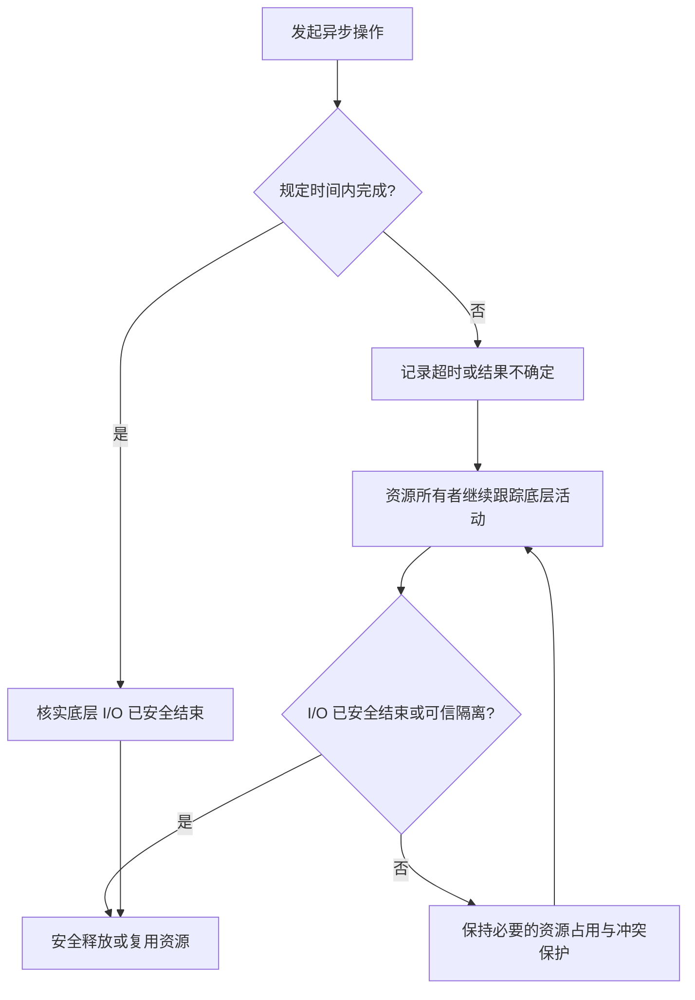
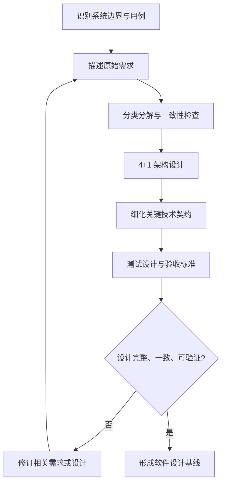
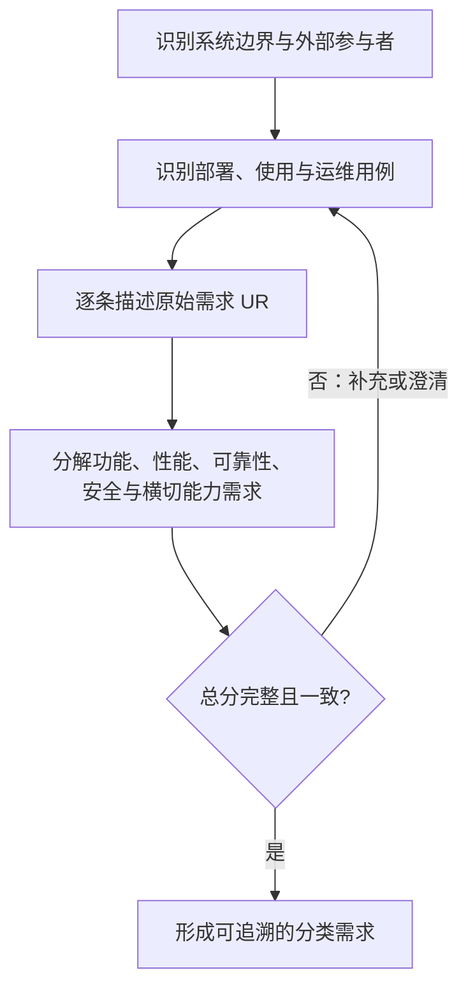
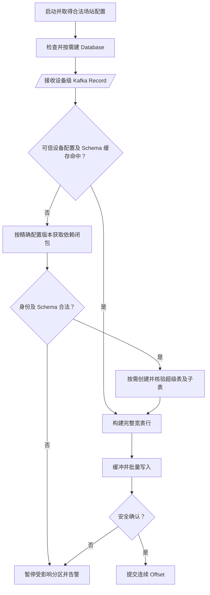
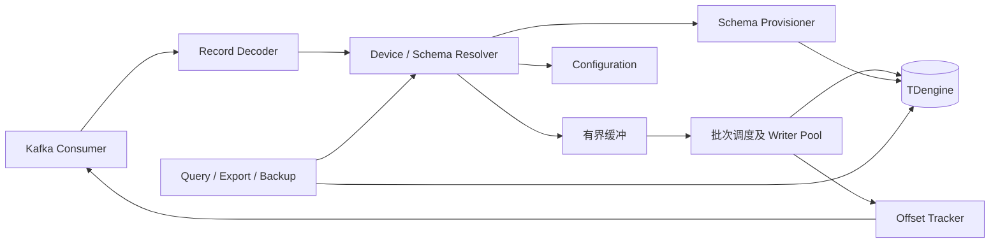
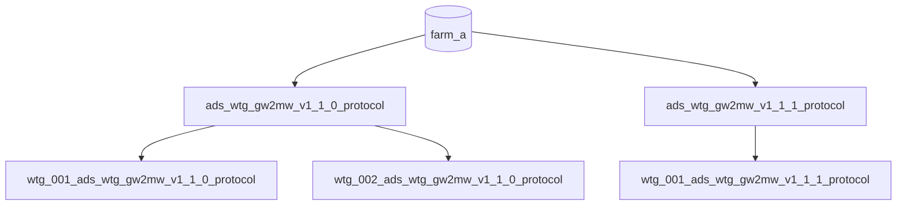

<h1 class="title">Storage Service 软件设计</h1>

<p class="subtitle">v1_14 · 20261125 · 设备级宽表重构设计（待技术验证）</p>

<style>
body {
  font-family: "Microsoft YaHei";
  font-size: 16px;
  line-height: 1.75;
  color: #24292f;
}
.title {
  font-family: "Microsoft YaHei";
  font-size: 32px;
  line-height: 1.30;
  font-weight: 700;
  text-align: center;
}
.subtitle {
  font-family: "Microsoft YaHei";
  font-size: 18px;
  line-height: 1.50;
  font-weight: 400;
  text-align: center;
}
h1 {
  font-family: "Microsoft YaHei";
  font-size: 28px;
  line-height: 1.40;
  font-weight: 700;
}
h2 {
  font-family: "Microsoft YaHei";
  font-size: 22px;
  line-height: 1.40;
  font-weight: 700;
}
h3 {
  font-family: "Microsoft YaHei";
  font-size: 18px;
  line-height: 1.50;
  font-weight: 700;
}
h4 {
  font-family: "Microsoft YaHei";
  font-size: 16px;
  line-height: 1.50;
  font-weight: 700;
}
p, li {
  font-family: "Microsoft YaHei";
  font-size: 16px;
  line-height: 1.75;
}
.figure-caption,
.formula-caption {
  font-family: "Microsoft YaHei";
  font-size: 14px;
  line-height: 1.50;
  font-weight: 600;
  text-align: center;
  margin: 0.65em 0 0.35em 0;
}
.table-caption {
  font-family: "Microsoft YaHei";
  font-size: 13px;
  line-height: 1.40;
  font-weight: 500;
  text-align: center;
  margin: 0.65em 0 0.35em 0;
}
.mermaid,
.mermaid text,
.mermaid .label {
  font-family: "Microsoft YaHei" !important;
  font-size: 14px !important;
  line-height: 1.20;
}
table {
  width: 100%;
  border-collapse: collapse;
  font-family: "Microsoft YaHei";
  font-size: 13px;
  line-height: 1.45;
}
table th,
table th p,
table th li {
  font-family: "Microsoft YaHei";
  font-size: 13px;
  line-height: 1.40;
  font-weight: 600;
}
table td,
table td p,
table td li,
table td strong,
table td b {
  font-family: "Microsoft YaHei";
  font-size: 13px;
  line-height: 1.45;
  font-weight: 400;
}
table th,
table td {
  padding: 0.40em 0.60em;
  vertical-align: top;
}
code, pre {
  font-family: "Cascadia Code";
  font-size: 14px;
  line-height: 1.50;
}
p code, li code, td code {
  color: #24292f;
  background: #f3f4f6;
  padding: 0.08em 0.28em;
  border-radius: 3px;
}
pre {
  color: #c9d1d9;
  background: #0d1117;
  padding: 1em;
  border-radius: 6px;
  overflow-x: auto;
}
pre code {
  color: inherit;
  background: transparent;
  padding: 0;
}
.hljs-comment, .hljs-quote,
.token.comment, .token.prolog, .token.doctype, .token.cdata {
  color: #8b949e;
  font-style: italic;
}
.hljs-keyword, .hljs-selector-tag, .hljs-literal,
.token.keyword, .token.boolean { color: #ff7b72; }
.hljs-string, .hljs-doctag, .hljs-regexp,
.token.string, .token.char, .token.regex { color: #a5d6ff; }
.hljs-number, .token.number { color: #79c0ff; }
.hljs-title, .hljs-function, .token.function { color: #d2a8ff; }
.hljs-title.class_, .hljs-type, .hljs-built_in,
.token.class-name, .token.builtin { color: #ffa657; }
.hljs-variable, .hljs-attr, .hljs-property,
.token.variable, .token.property, .token.attr-name { color: #7ee787; }
.hljs-operator, .hljs-punctuation,
.token.operator, .token.punctuation { color: #c9d1d9; }
</style>

---

## 目录

1. 文档约定
2. 软件设计指导原则与编制方法
3. 软件需求
4. 用例视图
5. 逻辑视图
6. 进程视图
7. 开发视图
8. 物理视图（部署视图）
9. 对外接口与通信契约
10. 核心技术与数据契约
11. 配置与动态生效
12. 外部适配与集成契约
13. 安全、可观测与运行管理
14. 测试与验收
15. 设计决策追溯及编码准入

---

# 1. 文档约定

本章是全文的固定排版与表达规范。文档修订、补充和派生版本均应遵守本章，不再根据个人习惯调整字体、字号、行距、图题、表题、公式或代码样式。

本文开头的 `<style>...</style>` 是 HTML `style` 元素，其中包含内部 CSS 样式表，本文简称为 CSS 样式块。第 1.1～1.4 节规定目标样式；CSS 样式块通过 `h1`、`h2`、`p`、`table`、`th`、`td`、`pre`、`code` 等选择器，将规范应用到 Markdown 渲染后生成的 HTML 元素。

## 1.1 字体约定

<p class="table-caption">表 1-1 文档字体与排版规范</p>

| 文档元素 | 字体 | 字号 | 行间距/行高 | 字重 | 对齐方式 |
|---|---|---:|---:|---:|---|
| 文档标题 | Microsoft YaHei | 32 px | 1.30 | 700 | 居中 |
| 文档副标题 | Microsoft YaHei | 18 px | 1.50 | 400 | 居中 |
| 一级标题 | Microsoft YaHei | 28 px | 1.40 | 700 | 左对齐 |
| 二级标题 | Microsoft YaHei | 22 px | 1.40 | 700 | 左对齐 |
| 三级标题 | Microsoft YaHei | 18 px | 1.50 | 700 | 左对齐 |
| 四级标题 | Microsoft YaHei | 16 px | 1.50 | 700 | 左对齐 |
| 正文 | Microsoft YaHei | 16 px | 1.75 | 400 | 左对齐 |
| 图题 | Microsoft YaHei | 14 px | 1.50 | 600 | 居中 |
| 图内文字 | Microsoft YaHei | 14 px | 1.20 | 400 | 按图形布局 |
| 表题 | Microsoft YaHei | 13 px | 1.40 | 500 | 居中 |
| 表头 | Microsoft YaHei | 13 px | 1.40 | 600 | 左对齐 |
| 表格正文 | Microsoft YaHei | 13 px | 1.45 | 400 | 左对齐 |
| 公式题 | Microsoft YaHei | 14 px | 1.50 | 600 | 居中 |
| 代码文字 | Cascadia Code | 14 px | 1.50 | 400 | 左对齐 |

以上规范已经通过本文开头的 CSS 样式块固定。其中，正文为 `16 px`；表题、表头和表格正文均为 `13 px`。表头字重为 `600`，低于标题字重；表格正文行高为 `1.45`，因此表格在字号、字重和行距上均明显弱于正文。英文业务对象、数据库对象和程序标识符仍按所在文本元素的字号排版，但使用行内代码形式，例如 `Asset`、`Connection`、`task_id`。

## 1.2 绘图约定

1. 上下文图、第 0 层及更深层 DFD、总体流程图和关系流程图统一使用 Mermaid。
2. 每一个 Mermaid 图都必须在 Mermaid 代码块第一行加入初始化配置，统一只设置 `useMaxWidth: true`。初始化配置格式为：

```text
%%{init: {"<Mermaid 图类型配置域>": {"useMaxWidth": true}}}%%
```

其中 `<Mermaid 图类型配置域>` 必须根据实际 Mermaid 图类型替换，不得固定写成 `flowchart`，也不得使用与实际图类型不匹配的配置域。

<p class="table-caption">表 1-2 Mermaid 图类型与初始化配置</p>

| Mermaid 图类型 | 图声明 | 第一行初始化配置 |
|---|---|---|
| Flowchart | `flowchart TB/LR/...` | `%%{init: {"flowchart": {"useMaxWidth": true}}}%%` |
| Sequence Diagram | `sequenceDiagram` | `%%{init: {"sequence": {"useMaxWidth": true}}}%%` |
| State Diagram | `stateDiagram-v2` | `%%{init: {"state": {"useMaxWidth": true}}}%%` |
| Class Diagram | `classDiagram` | `%%{init: {"class": {"useMaxWidth": true}}}%%` |
| ER Diagram | `erDiagram` | `%%{init: {"er": {"useMaxWidth": true}}}%%` |

若后续使用其他 Mermaid 图类型，也必须遵守同一规则：

```text
实际图类型
    ↓
确定该图类型对应的 Mermaid 配置域
    ↓
第一行写入：
%%{init: {"对应配置域": {"useMaxWidth": true}}}%%
```

不得额外加入 `wrap` 等非统一配置；如确有特殊需要，应在对应图的局部设计说明中单独论证。

3. 每张图必须有图编号和图题，编号采用“章节号-本章图序号”，例如“图 7-2”。
4. 图题必须使用普通图题样式，不得使用 Markdown 标题。统一写法为：

```html
<p class="figure-caption">图 1-1 图题</p>
```

## 1.3 公式约定

1. 行内公式使用单美元符号，例如 `$E_1$`。
2. 独立公式使用双美元符号，例如：

```text
$$
\mathrm{Entity}=E_1\land(E_2\lor E_3\lor E_4)\land E_5
$$
```

3. 正式公式不得放入代码块。
4. 不使用 `\[` 与 `\]` 作为公式定界符。
5. 变量下标统一写成 `E_1`、`R_1`；逻辑“与”和“或”统一写成 `\land`、`\lor`。
6. 公式必须使用 LaTeX，不使用普通文本模拟数学符号。
7. 需要编号的公式使用“式（章节号-本章公式序号）”，式题采用普通公式题样式：

```html
<p class="formula-caption">式（8-1）实体判断逻辑</p>
```

### 1.3.1 中文文字与 LaTeX 公式混排和渲染

1. 数学量、指标计算式、分段定义与不等式使用 LaTeX；符号的字体、上下标及几何量/阵列类型遵从规范性参考文献《符号体系.md》。业务字段名使用行内代码表示；数学变量与业务字段之间必须建立明确映射，不能把标量、向量、张量混用。
2. 简短符号可使用行内 `$...$`，完整指标定义、分式、求和、分段函数及多行等式应使用独立的 `$$...$$`；独立公式定界符必须独占一行，公式块前后各留一个空行。不得把独立公式置于 Markdown 表格单元、列表行、HTML 标签内部或围栏代码块中。
3. 中文解释写在公式外的自然段或独立列表项中。数学环境中仅为短标签使用 `\text{...}`；不把长段中文及中文标点塞入公式，不让 `$` 跨越换行或 Markdown 表格列界。
4. 表格单元格仅放简短行内变量或公式；含 `|`、分段、多行、复杂上下标、分式的定义一律移到表格外。若一条规则包含先决条件、数学定义和异常处理，采用“文字定义 → 独立公式 → 文字边界说明”布局。
5. 所有数学符号必须在第一次出现处定义，包括物理/业务含义、类型、单位、取值域、采样或统计时刻；公式运算中单位必须一致，必要时写出秒与毫秒之间的换算。
6. 必须在最终 Markdown 渲染器中检查中文与行内公式、独立公式与列表边界、下标、上下标、百分位、分式、转义字符和 Mermaid/HTML 混排。静态代码围栏检查不能替代实际渲染验收。若渲染器不支持某类语法，应先调整表达方式，不得以不可渲染公式交付。

## 1.4 代码约定

1. 多行代码必须使用带语言标识的围栏代码块，例如 `python`、`sql`、`json`、`yaml`、`mermaid` 或 `text`。
2. 单个标识符、字段名、命令和短代码使用行内代码，例如 `PRIMARY KEY`、`Connection`。
3. 伪代码必须明确标记为 `text` 或在正文中说明“以下为伪代码”；不得使读者误认为它可以直接运行。
4. 代码块统一使用深色背景，颜色为 `#0D1117`；普通代码文字颜色为 `#C9D1D9`。
5. 语法高亮统一采用表 1-3 的配色。Markdown 渲染器应使用 Highlight.js 或 Prism 可识别的语言标识；渲染器不支持高亮时，至少保留代码背景色和普通代码文字颜色。

<p class="table-caption">表 1-3 代码语法高亮配色</p>

| 语法元素 | 颜色 | 十六进制 |
|---|---|---|
| 代码背景 | 深黑蓝 | `#0D1117` |
| 普通文字、运算符和标点 | 浅灰 | `#C9D1D9` |
| 注释 | 灰色 | `#8B949E` |
| 关键字和布尔值 | 红色 | `#FF7B72` |
| 字符串和正则表达式 | 浅蓝 | `#A5D6FF` |
| 数值 | 蓝色 | `#79C0FF` |
| 函数名 | 紫色 | `#D2A8FF` |
| 类型、类名和内置对象 | 橙色 | `#FFA657` |
| 变量、属性和字段 | 绿色 | `#7EE787` |


---


# 2. 软件设计指导原则与编制方法

本章规定本设计书的编制准则，不是特定系统的内部实现说明，也不要求按传统瀑布流程开发。后续章节必须以需求为依据；非适用事项应注明理由，不机械增加模块或抽象。

### 2.0 规范性参考文献与优先级

本设计书的公式和图形表达必须参考并遵守下列项目规范，引用文件为本设计的规范性依据，而非可选阅读材料：

| 规范文献 | 适用范围 | 强制规则 |
|---|---|---|
| 《符号体系.md》（v1_1） | 数学公式、标量、矢量、矩阵、张量、时间导数等 | 同一物理或数学量必须保持符号和对象层级一致，不得因编码便利擅自换符号；统计标量可新增本文件局部符号，但须显式定义、不与既有符号冲突 |
| 《软件系统建模图形与表达规范.md》（v0_2） | 业务流程、算法流程、DFD、状态、时序、伪代码、图题及图形语义 | 按建模目的选图；流程图区分过程、判断、输入输出、子过程与存储；数据流与控制流不得混用；Mermaid 初始化及图题遵循对应条款 |
| “项目对外接口定义”、“项目专用接口定义”、“项目数据契约” | 对外 RPC 和采样数据契约 | 实际字段、枚举、消息结构以代码库当前已冻结契约为准，不在需求书臆造字段或新接口 |

规范发生冲突时：实际对外数据契约按已冻结 Contract 执行；符号记法遵从《符号体系》；绘图遵从《软件系统建模图形与表达规范》；本章补充具体业务编制与验收口径。若仍存在冲突，应明确列出待决差异而不能暗中选取一种表述。

## 2.1 总则

本节规定软件设计书的编制原则、设计深度和工作流程。软件设计以需求为依据，以架构视图组织设计内容，以明确的行为与接口契约约束实现，并通过测试与验收验证设计目标。优先采用简单、安全、高效的方案，避免无依据的功能扩展和过度设计。

### 2.1.1 需求驱动原则

软件设计必须来源于已确认的需求，不应从技术方案反向编造需求。

<p class="table-caption">表 2-1 需求驱动设计要求</p>

| 设计要求 | 具体规定 |
|---|---|
| 需求依据 | 关键功能、技术机制和质量约束应能够追溯至需求 |
| 设计范围 | 不擅自增加功能或扩大系统职责 |
| 需求分解 | 原始需求与分类需求保持完整、一致 |
| 设计取舍 | 同样满足需求时，优先选择职责更少、依赖更少的方案 |
| 需求变更 | 新增或改变系统行为时，先核对需求，再修订相关设计 |

### 2.1.2 职责与边界明确原则

系统及组件必须具有清晰的职责、依赖方向和状态所有权。

<p class="table-caption">表 2-2 职责与边界设计要求</p>

| 设计要求 | 具体规定 |
|---|---|
| 系统边界 | 明确本系统负责什么、不负责什么 |
| 组件职责 | 重要职责有明确的负责组件，避免重复承担 |
| 状态所有权 | 关键状态具有明确的权威来源和修改责任 |
| 接口边界 | 区分内部接口、对外接口与外部依赖 |
| 依赖控制 | 避免循环依赖和不必要的跨层访问 |
| 简单性 | 不因假设性的扩展需要增加抽象、兼容层或冗余实现 |

### 2.1.3 行为与契约确定原则

设计应消除影响正确性的重要歧义，但不规定无关的私有方法。

<p class="table-caption">表 2-3 行为与契约设计要求</p>

| 设计对象 | 必须明确的内容 |
|---|---|
| 业务操作 | 触发条件、输入、反馈、业务输出及处理规则 |
| 接口 | 参数、类型、返回值、错误、超时及版本语义 |
| 状态 | 状态定义、转换条件、终态与非法转换 |
| 数据 | 数据结构、约束、所有权、一致性与生命周期 |
| 并发操作 | 执行顺序、同步条件、互斥范围与竞争裁决 |
| 异常操作 | 失败条件、处理结果、恢复行为及禁止行为 |

同一契约应有唯一的规范定义位置，其他章节通过引用关联，不重复规定矛盾规则。

### 2.1.4 资源与异步操作安全原则

异步操作的业务结果、底层执行活动和资源生命周期必须分别判断。

<p class="table-caption">表 2-4 异步操作与资源管理原则</p>

| 概念 | 定义及设计要求 |
|---|---|
| 操作逻辑终结 | 业务层已形成最终处理结果，不代表底层活动已经结束 |
| 底层 I/O 安全结束 | 有可信证据表明相关 I/O 不再继续执行或产生新的相关资源访问 |
| 安全隔离 | 通过可验证措施，使未结束操作无法与后续操作发生有害冲突 |
| 资源所有权 | 明确谁创建、持有、跟踪和释放资源 |
| 资源安全释放 | 满足安全结束或可信隔离条件后，才允许释放或复用可能产生冲突的资源 |

核心原则：操作超时不等于底层 I/O 结束；未确认 I/O 安全结束或隔离前，不得释放可能引发冲突操作的执行资源。



<p class="figure-caption">图 2-1 异步操作超时与资源安全释放流程</p>

对异步操作应区分超时、取消、异常和正常结束；不能仅凭调用方返回、Future/Task 取消或连接状态判断底层 I/O 已安全结束。

### 2.1.5 性能与资源有界原则

性能设计围绕明确的负载与质量要求展开，而不是无依据地增加并发或缓存。

<p class="table-caption">表 2-5 性能与资源有界设计要求</p>

| 设计要求 | 具体规定 |
|---|---|
| 负载模型 | 明确请求规模、并发规模、数据量及运行条件 |
| 容量约束 | 队列、线程、Task、连接、缓存及存储资源应有合理边界 |
| 背压 | 资源不足时明确等待、拒绝、丢弃或降级策略及适用条件 |
| 缓存 | 明确缓存用途、权威数据来源、失效与容量策略 |
| 性能指标 | 明确时延、吞吐、资源占用及测量口径 |
| 性能取舍 | 不得以违反正确性、安全性和可靠性约束换取性能 |

### 2.1.6 故障可控与恢复原则

设计应覆盖正常运行及合理预期的异常场景，明确故障影响范围和恢复条件。

<p class="table-caption">表 2-6 故障与恢复设计要求</p>

| 设计要求 | 具体规定 |
|---|---|
| 故障识别 | 明确可能的超时、通信失败、存储失败、任务异常和进程崩溃 |
| 故障隔离 | 限制故障传播，避免无关组件或资源被错误影响 |
| 状态可信 | 不将未知状态解释为确定成功或失败 |
| 重试与恢复 | 明确允许重试的条件，禁止可能产生危险副作用的盲目重试 |
| 持久化恢复 | 规定异常中断后的数据一致性及状态恢复规则 |
| 生命周期 | 明确启动、就绪、运行、关闭和重启期间的异常处理 |
| 失效行为 | 无法恢复时应有明确的降级、阻塞或停止服务条件 |

### 2.1.7 横切能力非侵入式原则

日志、审计、指标、追踪、权限校验等横切能力应与核心业务逻辑分离，优先通过统一的边界组件、装饰器、中间件或独立服务实现，不应将重复的技术处理流程散布在业务代码中。非侵入式不等于隐藏业务约束：凡影响业务准入、执行结果、事务一致性或故障处理的规则，必须在业务契约中明确，并保留必要的显式调用点。

<p class="table-caption">表 2-7 横切能力非侵入式设计要求</p>

| 设计要求 | 具体规定 |
|---|---|
| 职责分离 | 业务组件负责业务规则与状态转换；横切组件负责统一的记录、采集、校验与传输机制 |
| 边界统一 | 在服务入口、应用服务边界、消息发布边界等明确位置接入横切能力，避免各业务分支重复编排 |
| 最小侵入 | 不为记录日志、采集指标或传播追踪上下文而改变业务方法的核心控制流程和返回语义 |
| 审计正确性 | 审计事件的业务含义及产生时机由业务契约定义；持久化、投递、重试等通用机制与业务处理解耦，同时保证要求的一致性 |
| 故障影响 | 明确横切能力故障时的阻断、降级或重试规则；不得默认其失败不会影响业务，也不得默默吞掉必须处理的错误 |
| 可读性与验证 | 业务代码能够直接体现主流程；横切处理可独立测试，端到端测试验证其与业务契约一致 |

不为追求形式上的非侵入而引入复杂框架或过多抽象；简单、清晰的显式边界优先于难以追踪的隐式执行机制。

### 2.1.8 公共能力复用与冗余控制原则

优先使用符合需求的标准库、成熟软件包、现有工具及公共组件；相同且稳定的职责才提炼为公共能力，不重复发明、不为假设性扩展提前设计框架。

<p class="table-caption">表 2-8 公共能力复用与冗余控制要求</p>

| 设计要求 | 具体规定 |
|---|---|
| 复用优先 | 先评估现成组件是否满足功能、安全、性能及维护要求，再决定是否自行实现。 |
| 提炼公共职责 | 多模块存在稳定相同的职责时统一实现；业务规则留在所属业务模块。 |
| 控制依赖 | 核查成熟度、许可证、版本、安全维护及引入成本。 |
| 控制抽象 | 避免仅为减少少量重复而引入复杂框架或多层转发。 |
| 清理冗余 | 统一能力落地后删除重复、废弃和不必要的兼容实现。 |

### 2.1.9 图表表达与设计一致性原则

设计优先使用合适的图形和表格表达结构、流程、时序、状态及约束，图表不能代替必要的精确定义。

<p class="table-caption">表 2-9 图表表达与一致性设计要求</p>

| 设计要求 | 具体规定 |
|---|---|
| 视图完整 | 使用 4+1 架构视图组织系统设计，覆盖适用内容 |
| 图形选择 | 根据表达目的选择结构图、状态图、时序图、活动图等 |
| 图表一致 | 图形、表格和正文不得相互矛盾 |
| 跨章节一致 | 同一接口、状态、参数及资源规则保持一致 |
| 设计深度 | 明确影响系统行为的契约，允许自主选择内部实现细节 |
| 可验证性 | 关键设计要求应能够对应测试条件与验收证据 |

### 2.1.10 软件设计工作流程



<p class="figure-caption">图 2-2 软件设计编制流程</p>

工作流程允许迭代，不要求传统瀑布式阶段。发现缺口或冲突时直接修订相关需求、架构视图或契约，不通过追加覆盖性条款解决。

### 2.1.11 规范性参考文献及项目无关性

本章为跨项目通用设计与编制规范，不得写入具体仓库、服务、业务协议、接口文件路径或项目专有指标。设计正文引用具体项目的源码、配置和协议文件时，应放在相关业务章节或接口/数据契约章节。

- **《符号体系.md》**：数学量类型、变量命名、标量/矢量/矩阵/张量、下标和公式运算的规范性依据。统计业务中的普通标量同样遵守其标量与阵列的区分原则。
- **《软件系统建模图形与表达规范.md》**：业务流程、DFD、活动/状态/时序图、算法图、伪代码和图元语义的规范性依据。

规范性引用以文件标题和相应章节为准，不复制全文；引用之间存在冲突时先识别并修订冲突，不擅自切换符号或重新解释图元。任何设计实例的具体接口名称、消息字段和技术约束均在第三章及后续适当章节给出。

## 2.2 需求体系及描述规范

需求采用“识别用例 → 逐条描述原始需求 → 分类分解 → 总分一致性检查”的方法。用例应从外部使用者及运行场景出发，覆盖适用的部署、启动、正常使用、配置、运维、正常关闭、重启及异常恢复过程；不局限于业务 RPC，也不将内部技术机制机械列为用例。用例识别属于需求分析，第 4 章用例视图负责表达参与者、边界及用例关系。

<p class="table-caption">表 2-10 原始需求描述字段</p>

| 字段 | 描述要求 |
|---|---|
| 编号 | 唯一原始需求标识，例如 `UR-01` |
| 名称 | 准确概括使用者需要的能力或运行场景 |
| 请求方（Requester） | 发起操作的外部系统、服务或接口，如外部客户端、上层服务、进程管理系统；消息和周期自动触发时可以没有直接请求方，标记“不适用” |
| 触发方式（Trigger） | 标明触发类型、事件来源、触发条件及必要的周期或接口；允许多个类型组合，区分外部触发和内部自动步骤 |
| 输入（Input） | 请求方向本系统提供的数据、参数和信息 |
| 反馈（Response） | 本系统返回请求方的确认、状态、结果及错误信息 |
| 目标方（Destination） | 接收本系统业务输出的外部系统、消息中间件或现场设备；没有时标记“不适用” |
| 业务输出（Output） | 本系统发往目标方的数据、消息或控制指令；没有时标记“不适用” |
| 业务流程（Flow） | 用 Mermaid 表达主要控制流程、数据输入/输出及重要异常，已表达的动作不重复 |
| 业务规则（Business Rules） | 补充主流程未精确定义的术语、公式、算法、初始化、阈值和边界；允许文字分条、LaTeX、图、伪代码或表格，不重复业务流程 |
| 关键约束（Constraints） | 性能、可靠性、安全、审计、可观测性、错误信息、缓存、I/O 与背压等可验证的非功能要求 |

反馈与业务输出必须分开：反馈面向请求方，业务输出面向目标方；请求方与目标方可有多个，且请求方断连不必然撤销已接受的业务操作。

### 2.2.1 触发方式分类与标注规则

原始需求必须列出实际适用的触发方式；同一需求可以组合多种触发方式，不能把处理流程中的普通步骤误写成独立触发。触发方式描述“何时、由什么启动”，不预先决定线程、定时器或队列等内部实现。

- **消息触发（Message）**：外部消息到达，例如实时消息或可靠消息；标明消息来源与订阅范围。
- **周期触发（Periodic）**：达到配置周期，例如实时周期输出或变化加周期保底；标明周期来源及生效条件。
- **API 触发（API）**：收到明确的外部接口请求，例如任务启动或配置应用接口；标明接口和调用方。
- **状态触发（State）**：受监控对象的状态发生满足条件的变化，例如外部依赖从不可用恢复可用；标明状态条件，不把普通循环迭代误列为触发。
- **生命周期触发（Lifecycle）**：服务进入启动、关闭、重启或配置生效等阶段；标明阶段及必要前置条件。

周期触发与消息触发可以同时存在：消息到达更新数据，周期到达决定何时输出。若无外部直接请求方，Requester 写“不适用（自动触发）”，但仍须列出消息生产者或状态来源；触发方式不替代 Input、Response 与 Output 的定义。

### 2.2.2 原始需求四节结构与写作原则

各 UR 固定为四节：**基本信息与触发方式、业务流程、业务规则、关键约束**。根据语义选择最清晰的表达形式；文字、公式、图形、伪代码和表格地位平等；**业务流程图已清楚表达的处理不得在后两节复述**。规则和约束必须有唯一规范定义，其他章节仅引用。

1. **基本信息与触发方式**：表格列出 Requester、Trigger、Input、Response、Destination、Output。Trigger 采用第 2.2.1 节分类，明确事件来源、触发条件及周期或 API。
2. **业务流程**：Mermaid Flowchart 或适用的 UML 活动图表达触发入口、主要处理、判断、数据输入输出、重要异常及恢复出口；复杂算法通过“预定义过程”节点指向第三节，不在总流程中堆叠实现细节。
3. **业务规则**：仅描述流程图无法精确表达的算法、公式、阈值、初始化、状态不变量、顺序及边界。允许文字分条定义、算法流程图、DFG、LaTeX 公式、表格或明确标为 `text` 的伪代码；必须说明输入、输出、初始值、边界及终止条件。无额外内容时标注“无额外规则”。
4. **关键约束**：**优先给出定量要求**（带单位、作用范围、测量窗口、默认值或硬上限、验收方法）；不能合理量化的才采用具有明确判定条件的定性要求。**仅放可核验的非功能要求**，按性能与容量、可靠性与恢复、安全与授权、审计、可观测性、错误信息、缓存与有效期、I/O 资源安全、背压与过载分类；无关分类可以省略或说明不适用。约束应给出故障条件、正确结果、测量或验收口径，不得用抽象口号代替。

### 2.2.3 业务图形元素与数据语义

参照《软件系统建模图形与表达规范.md》第 5.1 节 Flowchart、第 7.1 节 DFD 与第 8.1 节算法规范。业务活动图的控制流箭头表示处理顺序，DFD 箭头表示数据流，**两者不得混用**。图中应以不同形状区分处理、判断和数据。

| 元素 | Mermaid 写法 | 语义 |
|---|---|---|
| 开始/结束 | `A([开始/结束])` | 明确入口和完成/失败出口 |
| 处理 Process | `B["更新缓存"]` | 矩形，表达动作而非数据 |
| 判断 Decision | `C{"已过期?"}` | 菱形，分支标明条件 |
| 输入/输出 Data | `D[/"采样消息"/]` | 平行四边形，表达数据输入/输出 |
| 预定义子过程 | `E[["计算统计指标"]]` | 双边矩形，引用业务规则的算法说明 |
| 数据存储 | `F[("最新值缓存")]` | 存储节点；仅在理解读写关系必要时出现 |

不因形式要求增加无意义数据节点。数据来源、存储及复杂数据变换应单独绘制 DFD，避免业务活动图变成混杂的控制/数据流图。Mermaid 第一行初始化配置、图编号和图题仍须符合第一章。

### 2.2.4 业务规则、输出定义与关键约束的具体要求

- **业务规则**：定义与边界条件优先文字分条；涉及数学关系必须使用 LaTeX 独立公式；复杂步骤按需使用 Flowchart/DFG 或伪代码补充。表达形式不限于图和表；精确定义阈值、边界、初始化、更新基准和不可变条件，不复述主流程动作。算法必须能够独立据输入判断预期输出。
- **性能与容量**：优先用定量指标给出负载范围、时延/吞吐口径、并发及资源上限；必须区分设计目标、默认配置、不可突破的资源上限和验收实测值；未确定的阈值不得虚构。
- **可靠性及 I/O**：明确超时、结果不确定、重试、恢复、安全收敛及资源释放条件。调用返回或 Task 取消不代表底层 I/O 已结束。
- **错误信息**：定义错误类别、错误码或结果、对象与关联标识、发生阶段、可检索证据及敏感信息脱敏；禁止把 UNKNOWN 伪装为成功或明确失败。
- **缓存与背压**：规定缓存键、容量、更新/覆盖、过期、丢弃、等待、拒绝、暂停消费及恢复条件；所有超限策略必须可观测。
- **安全与审计**：列出认证、授权、控制边界以及需审计的操作、事件产生时机、关联 ID、可信保存与失败处理；运行日志不能代替审计。
- **可观测性**：指标、统计窗口、状态、事件、更新时间、无数据语义及告警；可结合真实场景验收。

**指标、计算和输出契约完整性（强制）：**凡使用“计算、统计、比较、阈值、状态、错误、容量、返回结果”等词定义业务能力，必须形成封闭的输出集合；不得用“等”“包括但不限于”替代本版本必须实现的清单。每个指标/派生字段至少定义以下内容；其中数学计算不得仅写在表格单元格内，必须另列可渲染的 LaTeX 公式：

| 必填字段 | 内容 |
|---|---|
| 唯一标识、类型和单位 | 与公开接口字段或指标名一致；明示 `counter/gauge/histogram`、计量单位 |
| 统计层级和数据来源 | 系统 / 进程 / 组件 / 任务 / 消费者；事件记录点、分子和分母来源 |
| 计算公式与口径 | 累计/窗口/瞬时，窗口端点、去重规则、事件计数次数、百分位算法 |
| 触发、初始化和重置 | 何时采集/计算、初始值、首个周期、进程重启、配置热更新 |
| 边界与缺失 | 零分母、空样本、UNKNOWN、超时、重复投递、源不可达的值域与 `unavailable` 语义 |
| 输出与验收 | 指标名、采样时间、窗口、可用性表达、配置边界及给定数据可独立验算的实例 |

**示例与可复算性（强制）：**当业务规则涉及多种计数口径、状态转换、时间窗口、边界分支或重试等易混淆情形时，至少给出一个具体输入—处理过程—预期输出的完整算例。算例必须标明初始条件、计量单位、每一步事件及最终结果；若同时存在样本条数、批次数、I/O 尝试次数等不同统计单位，须分别列出，禁止混用。算例应覆盖易误解的边界（例如重试成功仍有失败尝试记录），且结果必须可直接转化为确定性测试断言。算例是对定义的验证，不得取代规范性定义，也不应重复流程图中的全部步骤；涉及计算关系仍按第一章使用 LaTeX。

**数学定义与表达门禁：**业务规则的文字定义应独立成段或分条；涉及计算时，必须在定义后给出独立 LaTeX 公式，逐一释义变量、单位、取值域以及零分母、空样本和无效值。算法图与伪代码是可选的精度增强手段，不得要求所有业务规则使用表格。公式与中文混排遵守第一章 §1.3.1。

**约束定量优先门禁（强制）：**关键约束首先给出数值、单位、统计范围、采样方法、允许误差、测试条件和通过标准；可配置阈值应列出默认值及合法范围。仅当约束本质上无法定量（例如禁止错误 ACK）时，才用可判定的定性约束。不得用“及时、足够、合理、有界、尽可能、低延迟、高可靠”等词代替具体要求；未完成基准测试的数值应标明“设计验收目标，尚未实测”，不得声称达标。

**完备性门禁：**业务规则涉及的状态枚举、错误分类/错误信息字段、缓存容量及淘汰策略、I/O 结果、背压策略、审计与统计输出均应列举封闭集合和边界输入；凡无法根据文档构造确定预期结果的要求，视为需求未完成，不得标记为可编码。参数可以配置，但必须说明合法范围、默认/缺省行为及越界错误；性能数值未经验证时不得伪称已达标。每项约束必须可追溯至可执行的 UC/System 场景。

每项业务规则和关键约束须能由 UC/场景及第 14 章测试追溯；第 5～13 章详述实现契约时应引用 UR，不得另造冲突定义。

统一样式：

```text
### 3.x UR-xx 需求名称
#### 3.x.1 基本信息与触发方式
Requester / Trigger / Input / Response / Destination / Output
#### 3.x.2 业务流程
Mermaid 活动流程图，含重要异常及数据输入输出
#### 3.x.3 业务规则
可用文字、LaTeX、伪代码、图或表格精确定义算法、初始化与边界，不重复流程
#### 3.x.4 关键约束
按性能、可靠性、安全、审计、可观测性、错误、缓存、I/O、背压列可验证要求
```

本节也是第三章及后续章节的强制完整性验收标准。

<p class="table-caption">表 2-11 分类需求体系与描述重点</p>

| 类别 | 核心问题 | 典型要求 |
|---|---|---|
| 功能需求（Functionality） | 系统提供什么行为 | 对外能力、业务流程、业务规则、输入输出与状态反馈 |
| 性能需求（Performance） | 运行速度与资源上限 | 时延、吞吐、并发、调度、公平性、容量、背压、资源消耗、扩展能力 |
| 可靠性需求（Reliability） | 故障时如何保持正确与恢复 | 容错、超时、重试、请求关联、事务、持久化、故障恢复、可用性、未结束操作的资源管理 |
| 安全需求（Safety & Security） | 如何防止危险或非法控制 | 控制权、互锁、失效安全、认证、授权、通信及数据安全 |
| 横切能力（Cross-cutting Concerns） | 如何观测、管理与追责 | 审计（操作证据、可靠投递、完整性、追溯）、日志、指标、追踪、配置、版本、可测试性、可维护性 |



<p class="figure-caption">图 2-3 需求识别、分解与一致性检查流程</p>

分类需求必须从原始需求的输入、反馈、业务输出、规则和约束中推导，不得遗漏、矛盾或未经确认增加能力；多条原始需求的共同约束可以合并，但必须保留来源编号。每条分类需求应给出可核验条件，性能要求还需明确测量口径，不虚构现场阈值。审计应独立于普通日志定义，不得以运行日志代替审计证据。

需求分类与设计专题是不同维度：启动、正常关闭、重启及 Reload 属于跨需求的运行生命周期设计，统一在进程视图展开；相应行为和质量约束分别由原始需求及分类需求追溯。

## 2.3 4+1 架构视图：内涵、外延与表达规范

<p class="table-caption">表 2-12 4+1 架构视图的职责与成果</p>

| 视图 | 关注范围 | 主要成果 | 不应混淆 |
|---|---|---|---|
| 用例视图（+1） | 参与者、系统边界、典型/异常场景 | 系统上下文、用例、业务流程 | 不负责线程调度 |
| 逻辑视图（Logical） | 组件职责、模型、接口、状态规则、依赖 | 组件图、类/数据关系、状态图 | 不等于源码目录树 |
| 进程视图（Process） | 进程、线程、Event Loop、Task、协作、生命周期、同步、并发、资源、背压、缓存、故障恢复 | 运行结构图、任务所有权表、时序/状态/活动图、资源预算 | Task 不等于 OS 线程；图名须区分标准 UML 与示意图 |
| 开发视图（Development） | 软件模块边界、层次、静态依赖、公共契约与复用关系 | 模块图、依赖图、模块职责表 | 不描述真实并发拓扑，也不列现有代码修改清单 |
| 物理视图（Physical/Deployment） | 节点、进程部署、存储、网络、控制权和现场外部依赖 | 部署图、网络/故障域/外部依赖表 | 不是现场设备内部物理结构模型 |

### 2.3.1 用例视图的场景编写规范

用例以参与者的完整业务目标为单位组织，而非以原始需求、RPC 或内部模块为单位逐条改名。一项用例可以关联多项原始需求；一项原始需求也可以由多个业务场景共同覆盖。用例视图回答“在具体业务场景中系统如何工作”，不代替逻辑视图、进程视图和数据设计。

<p class="table-caption">表 2-13 业务场景用例的必备描述要素</p>

| 要素 | 编写规定 |
|---|---|
| 用例身份与目标 | 给出唯一编号、业务场景名称及参与者要达成的可观察目标；名称使用业务活动，不使用内部机制命名 |
| 参与者与触发条件 | 列明实际发起操作的外部角色；内部定时任务、恢复及发布等自动步骤不得虚构外部参与者 |
| 前置条件 | 列明系统就绪、授权、配置或数据存在等必要条件；不得混入未确认的实现假设 |
| 主业务流程 | 以 Mermaid 业务活动图（flowchart）为主要表达，覆盖触发、校验、关键处理、反馈及后置结果；以判断节点表达重要分支，避免大段编号文字复述 |
| 分支与异常流程 | 在活动图中呈现影响业务结果的主要异常出口；罕见或不宜展开的异常在简明说明表中概括，避免为了完整而画出所有技术异常 |
| 后置条件 | 明确成功和失败之后的业务状态、外部可见结果、未完成事项及后续查询方式 |
| 需求追溯 | 标明相关 UR；核对全部 UR 在真实场景中得到覆盖，但不要求 UR 与 UC 一一对应 |

跨用例共享的内部机制（如存储、审计发布和调度）应作为相关业务流程中的自动步骤或支撑行为描述；只有存在独立业务目标时才另立用例。应避免将一串 gRPC 方法名或 CRUD 操作直接当作完整用例，也不得在用例章节展开线程、锁、表结构及类方法等实现细节。

用例的正文采用“一张业务活动图 + 一张简明用例说明表”的表达形式。活动图包含主路径、必要判断以及重要异常分支；图中节点使用业务动作，不展开展示内部类、锁和数据库事务。说明表只填写参与者、业务目标、前置条件、主要异常、后置条件及关联需求。业务分支已在图中完整表达时，不再重复书写大段“主业务流程”和“异常流程”；复杂跨参与者消息时序可在独立小节补充时序图。图题和表题按文档约定独立编号。

进程视图应按四个设计专题组织，而不是按需求类别重复划分：

<p class="table-caption">表 2-14 进程视图的四类设计专题</p>

| 专题 | 必须明确的设计对象 | 推荐表达 |
|---|---|---|
| 运行时结构 | 进程、线程、Event Loop、Task、线程池、组件与资源所有权 | 分层运行结构图、Task 职责表 |
| 运行生命周期（Runtime Lifecycle） | 启动、初始化、就绪、运行、Reload、正常关闭、重启及其阶段转换 | 生命周期状态图、启动/关闭/Reload 时序图 |
| 并发与资源管理 | Task 协作、队列、通知、同步、调度、容量限额、背压、缓存及释放 | 任务协作时序图、资源与背压策略表 |
| 异常与恢复 | 超时、取消、故障隔离、未收敛 I/O、崩溃恢复与降级 | 故障状态图、异常裁决矩阵 |

各专题共享同一运行模型，明确创建者、所有者、同步关系和退出条件；不因分节而重复定义状态或资源。生命周期是进程视图的独立设计专题，不是第六类需求。

图表仅使用其可准确表达的语义：结构关系用 Mermaid Flowchart；行为交互用 Sequence Diagram；状态约束用 State Diagram；条件控制用活动/流程图。图题说明对象、范围及图类型。关键质量属性贯穿各视图，不能只写在单独的“非功能要求”段落。

## 2.4 测试设计方法、组织及验收规范

测试设计以测试层级组织物理目录，以 Marker 描述测试层级、测试专题与运行场景。测试文件名应清楚表达验证对象或行为；测试文件及其标记、验证说明统一登记在测试矩阵中。需求、用例及重要技术契约必须能追溯到实际测试，不为同一目的建立重复测试体系。

<p class="table-caption">表 2-15 测试层级与目录规范</p>

| 层级 Marker | 物理目录 | 验证范围 |
|---|---|---|
| `unit` | `unit/` | 状态转换、业务规则、纯逻辑，无外部服务依赖 |
| `component` | `component/` | 单组件职责及其可控依赖 |
| `integration` | `integration/` | 组件之间及真实外部依赖的接口协作 |
| `system` | `system/` | 独立进程、完整业务场景及端到端行为 |

<p class="table-caption">表 2-16 测试 Marker 与矩阵编制规范</p>

| 事项 | 规范 |
|---|---|
| 层级 Marker | 每项测试必须且仅属于 `unit`、`component`、`integration`、`system` 之一，与目录对应 |
| 专题 Marker | 标识可靠性、安全、性能等验证主题，可与层级及场景 Marker 叠加；无专项主题时可为空 |
| 场景 Marker | 标识并发、超时、恢复、负载、现场等执行条件或情境；有相应场景时标记 |
| 测试矩阵 | 至少包含“测试文件名、层级 Marker、专题 Marker、场景 Marker、测试说明”五列；每项重要测试应有可定位的文件归属 |
| 标记粒度 | 标记以具体测试函数或类为准；同文件可包含不同专题与场景，矩阵列出涉及的 Marker |
| 运行条件 | 通过 Fixture 和环境准备明确外部依赖；现场专用测试与常规回归分离，未执行不视为通过 |
| 执行规则 | 提供按目录、Marker 及其布尔组合的 pytest 命令；所有 Marker 在项目配置中注册 |
| 可追溯性 | 测试说明与需求、用例或技术契约对应；行为变更时同步检查测试及矩阵 |
| 验收证据 | 保留运行环境、命令、实际结果、指标和未验证项，禁止把设计目标当作测试结果 |

目录划分测试层级，专题与场景通过 Marker 横向组合；可靠性测试不单独设第五类目录。测试矩阵用于定位和筛选测试，不预设每个实现文件必须存在，也不要求每个文件仅能有一种测试场景。

### 2.4.1 测试依据及 System 覆盖要求

各层级测试必须依据已确认的设计成果编制；System Test 以用例视图为主基线，以原始需求及技术契约补充覆盖，不得由测试人员凭经验任意缩减范围。

<p class="table-caption">表 2-17 各测试层级的设计依据</p>

| 测试层级 | 主要依据 | 验证重点 |
|---|---|---|
| Unit | 详细设计、函数及算法契约 | 纯逻辑、状态转换、参数及边界规则 |
| Component | 逻辑视图、组件职责及内部接口契约 | 单组件行为、依赖协作及异常处理 |
| Integration | 接口与通信契约、开发视图、物理视图 | 真实接口调用、跨组件通信及外部依赖 |
| **System** | **用例视图（UC）及原始需求（UR）**，并补充接口、运行、部署、安全及性能约束 | **从真实受测服务进程及其通信入口验证业务目标、异常、边界与恢复行为** |

System Test 必须遵守以下规定：

1. **用例覆盖率 100%**：每项 UC 至少有一项 System Test 作为验证证据；同一测试可以覆盖多个 UC，同一 UC 可以由多个测试覆盖，**不按测试数量与 UC 数量的大小关系判定覆盖**。
2. **规定场景覆盖率 100%**：每项 UC 明确的主流程、关键分支、异常流程、边界和恢复场景均必须有对应 System Test；不能仅以一条正常路径代表整个 UC 已覆盖。
3. **需求覆盖率 100%**：每项 UR 必须能够经一个或多个 UC 追溯至 System Test；若某项需求未能被 UC 覆盖，必须先补全用例，不得直接以技术测试代替业务用例。
4. **技术约束补充覆盖**：用例未充分表达的性能、容量、并发、安全、权限、超时和可靠性要求，依据对应技术契约补充测试；不得因 UC 未逐项列出而豁免。
5. **真实系统边界**：System Test 通过真实受测服务进程和适用的外部依赖、通信链路执行；Mock 不得代替本次明确纳入验收范围的基础设施及通信链路。
6. **覆盖与通过分开裁定**：测试已关联不等于已执行；失败、跳过及未运行均不得计为通过。验收报告分别给出需求覆盖、用例及场景覆盖、执行情况和通过情况；缺少真实环境时标记 `NOT_RUN`，不得用模拟结果替代。
7. **变更同步**：任何 UR、UC、接口或行为约束的新增、删除、调整，必须同步核查 System Test、测试矩阵和验收条款；新增 UC 不得留下无测试映射。

<p class="table-caption">表 2-18 System Test 追溯矩阵规范</p>

| 字段 | 要求 |
|---|---|
| UR 编号 | 被验证的原始需求编号，可列多个 |
| UC 编号与场景 | 用例编号及主流程、异常、边界或恢复场景标识 |
| 技术契约 | 相关接口、配置、运行或安全约束的章节编号；没有则记“—” |
| 测试文件名／测试标识 | 可定位的 System Test 文件名及测试函数或参数化场景标识 |
| 层级／专题／场景 Marker | 层级固定为 `system`，其余按第 2.4 节定义填写 |
| 验证内容与预期结果 | 从用户可观察行为与副作用表述判定依据 |
| 执行环境及结果 | 真实依赖、执行证据、`PASS`／`FAIL`／`SKIP`／`NOT_RUN` 等状态 |

追溯链为 **UR → UC／用例场景 → System Test → 执行结果与证据**，技术契约作为补充依据进入相应测试。第 4 章负责编制完整 UC 和场景，第 14 章依据本规范给出实际测试矩阵及验收安排，两章必须双向核对。

# 3. 软件需求

## 3.1 范围和原始需求

本版是目标设计，替代此前逐点写入模型；现行代码尚未迁移，不得以本文宣称生产就绪。服务消费 Sink 可靠 Kafka 设备级采样记录，持久化至 TDengine 3.3.6.13，并提供历史查询、聚合、导出、备份和运行管理。Storage 不解码工业协议、不转换工程值、不补值，不管理 TDengine 服务端进程，不提供实时控制。单 Storage 实例为验收范围。Web Server/Web Admin 不在范围内。

<p class="table-caption">表 3-1 原始需求与验收追溯</p>

| UR | 请求方、触发与输入 | 业务输出与约束 | 验收 |
|---|---|---|---|
| UR-01 | 运维启动；可信 Site、Device、Service 闭包 | 授权场站数据库就绪，原生属性回读；不预建表 | F01,F18 |
| UR-02 | Sink Kafka 完整设备记录 | 精确配置、三级隔离、自动 Schema 与库表映射；同步值和质量无损 | F02–F11,F21 |
| UR-03 | Kafka 连续消费、重放及故障 | 有界异步缓冲、多表批写、连续 Offset；同键后到覆盖，不丢确认数据 | F12–F15,F20 |
| UR-04 | 查询/导出调用者；设备、等级、时间、测点 | 宽表分页、质量过滤、版本分组、流式导出 | F17 |
| UR-05 | 管理员备份/恢复、配置更新 | 受管元数据与数据一致，历史版本保留，目标/活动状态真实 | F16,F18,F19,F22 |
| UR-06 | 运维监测及负载验收 | 单实例 30 台设备、每台 500 点、10 Hz 目标；持续运行无数据缺口 | P1–P3,TD01–TD12 |

## 3.2 分类需求

功能：完整设备行、三等级、按需建表、历史版本解析、查询与导出。性能：消费与写入解耦，缓冲以行数及真实内存字节双重限额，批写以行/字节/时间任一先到为准。可靠性：同设备有序、未确认不提交、UNKNOWN 安全隔离、重启后核验映射；不降低 WAL 可靠性。安全：场站授权、参数绑定、标识符白名单、凭据环境引用、管理权限隔离。横切：配置发布/激活/活动版本、指标、可复现测试、故障证据。约束细节见第 9–14 章。

## 3.3 原始需求详细定义

### 3.3.1 UR-01 启动与场站建库

**基本信息与触发方式：**运维启动；启动时自动执行。

**业务流程：**读取授权 Site 与数据库参数，按场站建库并核验属性，成功后启动接入。

**业务规则：**只对授权场站建库；不提前建超级表/子表。

**关键约束：**数据库属性不一致不得伪装 READY；不自动删库。追溯 UC01；F01,F18。

### 3.3.2 UR-02 设备行与历史版本

**基本信息与触发方式：**Kafka 记录到达；事件触发。

**业务流程：**校验完整记录，解析固定闭包，生成或复用物理 Schema，持久化整行。

**业务规则：**源点、等级、值、Quality、版本及微秒时间保持；按需建表。

**关键约束：**未知闭包主动查询；超限、冲突阻断，不拆行。追溯 UC02–UC06；F02–F11,F21。

### 3.3.3 UR-03 可靠批写与恢复

**基本信息与触发方式：**记录到达、定时器、重平衡或故障；事件/周期触发。

**业务流程：**有界缓冲，按行/字节/时间触发 STMT2 批写，确认连续前缀，恢复未确认数据。

**业务规则：**同设备有序；同 ts 后到整行覆盖；UNKNOWN 不释放冲突保护。

**关键约束：**不降低 WAL；不以客户端超时作为底层终结；恢复时关闭受影响场站历史查询。追溯 UC09；F12–F15,F20。

### 3.3.4 UR-04 历史查询和导出

**基本信息与触发方式：**授权调用者发起 RPC；主动触发。

**业务流程：**校验条件、定位固定表族、读宽表/聚合或创建导出任务。

**业务规则：**返回列描述、值、Quality、版本和分页；导出可追踪。

**关键约束：**有界查询和输出；跨版本分别组织；不虚构旧逐点字段。追溯 UC07；F17。

### 3.3.5 UR-05 配置生效与备份恢复

**基本信息与触发方式：**配置通知、周期对账、管理员请求；事件/周期/主动触发。

**业务流程：**验证候选，安全切换或保留 active；备份数据及解释闭包，验证恢复。

**业务规则：**target/active 真实；历史映射和版本可恢复。

**关键约束：**不自动缩短 KEEP、不删除历史、不启用未验证备份。追溯 UC08,UC10；F16,F18,F19,F21,F22。

### 3.3.6 UR-06 观测与容量

**基本信息与触发方式：**运维查询、容量试验；主动/周期触发。

**业务流程：**采集独立计数及资源指标，分段施加真实变化负载并核对落库。

**业务规则：**单实例30设备×500点×10Hz；300行/s 单等级。

**关键约束：**稳定窗口达到100%，无持续积压和缺错值；不以多实例或降低耐久性替代。追溯 UC11；P1–P3,TD01–TD12。

# 4. 用例视图



<p class="figure-caption">图 4-1 数据接入与按需建表流程</p>

<p class="table-caption">表 4-1 用例规则</p>

| 用例 | 前置/触发 | 行为与结果 |
|---|---|---|
| UC01 | 空库首次启动 | 根据授权 Site 建 Database 并回读属性；不预建超级表 |
| UC02 | 首次收到 wtg_001、PointTable v1.1.0 | 建 ads_wtg_gw2mw_v1_1_0_protocol 与对应设备子表 |
| UC03 | wtg_002 使用同一 Schema | 复用超级表，仅建新子表 |
| UC04 | wtg_001 升级点表 v1.1.1 | 新超级表、新子表、新版本测点列；旧表不变 |
| UC05 | 旧消息重放 | 精确解析旧配置及物理表；不回退最新版本 |
| UC06 | 本地无设备/版本 | 主动向 Configuration 拉取固定版本完整闭包，验证后恢复；失败保留 Offset |
| UC07 | 查询、聚合、导出 | 按场站/设备/等级/版本/测点/时间筛选；跨版本分别组织 |
| UC08 | 配置更新 | 校验候选，原子生效或保留原 active；新 Schema 惰性建表 |
| UC09 | 故障、停止、重平衡 | 安全结束 I/O；只提交已确认连续前缀，其他从 Kafka 恢复 |
| UC10 | 授权备份及恢复 | 创建任务并核验 artifact、数据、历史解释闭包及权限；未验证则禁用 |
| UC11 | 运维统计及容量验收 | 返回真实行/点/确认/lag/资源指标；以独立真值核验目标负载 |

# 5. 逻辑视图



<p class="figure-caption">图 5-1 Storage 逻辑组件与数据路径</p>

Decoder 严格验证线格式；Resolver 解析可信固定闭包；Provisioner 管理 DDL 及表所有权；Writer 绑定原生数据；Offset Tracker 负责 Kafka 代际与连续确认；Query 只读访问授权历史表。正常热路径不执行配置 RPC、DDL、元数据扫描或逐点 SELECT。

# 6. 进程视图

一个 Storage 服务进程；Kafka poll/heartbeat 与数据库阻塞 I/O 解耦。每分区一个有序待处理序列，允许不同设备/分区并行，禁止同一设备有相互竞争的未终结写入。同一分区同一行按 offset 升序执行，不同分区不定义全局 offset 顺序。Kafka Key 固定为场站与设备的无歧义编码（合法 ID 禁止分隔符冒充，具体编码以 Contracts 为准）。同 Topic 运行期不改变分区算法或分区数；必要迁移须停写、排空和确认旧流后切换，不允许新旧流竞争。

缓冲包含拉取未解码、解码、已调度、在途及 UNKNOWN 记录和绑定副本；以实际字节估算/测量控制总预算，保留单次 fetch 及驱动复制余量。达到高水位暂停对应分区，低于低水位恢复，心跳和控制 RPC 继续。单条超限确定性阻断，不无界等待或丢弃。停止时停止接收、限时冲刷、确认连续前缀，未确认保留 Kafka；撤销代际先停止调度、等待底层 I/O 安全结束或可信隔离，才允许新代际处理同一设备。无法证明安全结束时阻断而非宣称恢复。

# 7. 开发视图

保留 Domain/Application/Infrastructure/Interfaces 分层。Domain 定义完整记录、Schema、命名、质量及版本规则；Application 负责缓存解析、DDL 协调、缓冲、调度、确认、查询与任务；Infrastructure 实现 Kafka、TDengine taosws、Configuration gRPC、NATS 修订通知及本地可信配置归档；Interfaces 实现 Contracts 生成的 RPC 与 CLI 入口。复用 Core 标准类型、配置读取、鉴权及观测。不得在多个适配器自行拼接 SQL 标识符或重复实现质量编码。删除旧逐点存储、复合主键、逐点哈希及窄表兼容写入分支；移除相应废弃测试和接口，历史数据迁移是独立授权事项。

# 8. 物理视图（部署视图）

单 Storage 实例连接 Kafka、Configuration、NATS、TDengine/taosAdapter。数据库单节点、单副本是测试基线，不代表节点永久损坏容错。生产按磁盘容量及可用性目标独立规划副本。TDengine 采用持久化数据目录、SSD/NVMe、预留 WAL、压缩、备份空间；记录 CPU、内存、文件系统、磁盘吞吐/延迟和 Kafka 资源竞争。Storage 管理数据库级参数，不编辑 taos.cfg 或擅自重分片。服务端配置及资源归部署管理。

# 9. 对外接口与通信契约

## 9.1 输入及配置接口

Kafka 目标 JSON v3、完整设备记录以 Contracts 最新设计为唯一规范。字段：schema_version、wind_farm_id、device_config_id（完整固定文件身份）、device_id、data_level、sample_time、points（源 point_id 对应 [value,quality]）。不传 device_type、point_table_id、business_point_id、unit、data_type 等可派生字段。场站身份仍独立传输并授权。样本时间 UTC 微秒，拒绝精度截断造成的键碰撞。不得把多个采样时刻合并成一个 Record，也不得拆同一完整设备时刻为多个可能覆盖的 Record。RAW 值使用严格小写偶数长度十六进制线格式，存入原始 bytes；无真实原始载荷不得伪造，未采集/失败与明确 RAW 缺失契约违反由 Contracts 统一裁决。

Configuration 当前 GetServiceConfigBundle 用于活动闭包；扩展 GetConfigBundle 支持精确根配置版本（含 config_type/config_id/file_version 或不可变 version_id），返回固定依赖闭包及摘要。禁止按推荐版替代历史；GetPointTableBundle 不是新设备身份的唯一解析入口。目标字段编号已由 Contracts §10 指定；实际 Proto、生成物及调用方迁移属于后续实施。

## 9.2 查询接口

目标保留查询、聚合、导出、备份任务、统计、阻断分区查询和重试能力；接口结构归 Contracts，不保留已删除的 sample_id、logical_key、content_sha256、逐点 publish_time/receive_time 等虚假历史字段。QuerySamples 改为设备级宽表分页结果：每组给出场站、设备、PointTable 完整身份、等级、物理 Schema 标识、逻辑测点列描述（类型、单位）与多行采样时间、值、质量。过滤项包含场站、设备、等级（显式必选）、PointTable 版本、测点集合、时间半开区间、Quality、page_size/page_token。分页按 Schema 指纹、设备 ID、时间稳定排序，签名不透明游标绑定条件、初始上界、排序位置和 15 分钟有效期；不承诺跨页 MVCC。跨版本分别返回；本期不提供服务端跨版本合并，调用方可在独立确认类型、单位、语义兼容后处理结果。

QueryAggregates 支持 COUNT/MIN/MAX/AVG 与窗口；默认原生聚合仅在语义与过滤条件一致时使用，Quality 筛选需正确解码位图后计算；空窗口不补造；COUNT/MIN/MAX/AVG、Quality、诊断计数、NULL 与有类型结果按 Contracts §14.1，不把 NULL 当0或把 uint64 MIN/MAX 转 double。导出 CSV 宽表（版本化列，质量可解码输出）、JSON 设备行；跨 Schema 分文件或显式版本分组，流式写入、有界任务及大小限制。备份使用实际版本验证过的 TDengine 原生工具，并包含受管 Schema 元数据、历史解释闭包及恢复校验；未通过鉴权及恢复测试不得启用。任务 QUEUED/RUNNING/SUCCEEDED/FAILED/INTERRUPTED；创建任务 request_id 幂等，受控目录，返回路径/标识、字节数、SHA-256、状态，不泄露凭据。重启在途任务标 INTERRUPTED。管理接口权限及字段迁移同步 CLI。

# 10. 核心技术与数据契约

## 10.1 数据库及版本化宽表

<p class="table-caption">表 10-1 对象身份</p>

| 对象 | 身份与创建时机 |
|---|---|
| Database | wind_farm_id；启动时根据合法场站配置建库 |
| SuperTable | PointTable 完整版本、等级、物理 Schema 指纹；首次数据 |
| SubTable | 场站、设备、SuperTable 身份；首次设备数据 |
| Column | RAW/PROTOCOL 用源 point_id，BUSINESS 用 business_point_id；均附 PointTable file_version |
| Row | ts 唯一主键；完整设备同步采样值和 Quality |
| TAG | device_id、device_type、point_table_id、data_level、schema_fingerprint |

不按自然月拆表，TDengine DURATION 决定原生固定时间跨度。旧版本表及列不修改、不因停用自动删除；旧消息路由原版本。仅 Device Instance 版本、IP、Task 或采样率变动不触发新 Schema。PointTable 版本变化即分表族，即使列相同。物理类型映射变化影响列类型时产生新指纹表族。



<p class="figure-caption">图 10-1 设备和点表版本的物理隔离</p>

物理名称可读、确定、唯一。版本点号转下划线，普通标识符规范化为 ASCII 小写；非法、超长、大小写折叠或规范化冲突须使用基于完整身份的稳定哈希，不使用递增序号。完整逻辑身份必须存入受管映射；同名异身份拒绝而非覆盖。TDengine 数据库内超级表/子表共享命名空间，检查全库冲突。具体长度、保留字、哈希后缀策略以目标版本验证后冻结，列名版本化不可省略。公共 ts、quality 与 TAG 名不版本化。

## 10.2 Schema 生成与类型

以 Device Instance 固定版本和设备 ID 解析 DeviceModel、PointTable、BusinessPoint、Units 固定依赖。按目标逻辑列 ID 的 UTF-8 字节序排序，生成全点表列（首批只有部分值也不缩减 Schema）。BUSINESS 必须一对一映射且标准类型/单位可信；RAW/PROTOCOL 源列名保留点身份。类型映射在 Storage YAML，Core 统一协议类型规范化；不重复协议类型表。允许无损扩宽，禁止范围缩窄、截断及隐式有符号转换。字符串、RAW 二进制按可信配置/协议实际最大长度；未知长度拒绝 Schema，禁止把全部 RAW 都按最大 2048 字节盲目建列。ADS 待 OEM 核实的点位不能宣称生产语义验收。

生成前检查目标版本最大列数、单列长度、总声明行宽（含变长列开销）、TAG 与标识符限制；公开文档给出 64 KB 行宽参考，必须在 3.3.6.13 实测；500 个 2048 字节 RAW 列显然超过限制。不可自动拆表破坏一设备一 Schema 一表约束，超限阻断并报告需修订的配置。规范化指纹包含列名/类型/长度/顺序、主键、TAG、质量编码版本及物理模型代际。仅在 Schema 解析时计算。

```sql
CREATE STABLE IF NOT EXISTS farm_a.ads_wtg_gw2mw_v1_2_0_protocol (
    ts TIMESTAMP,
    active_power_v1_2_0 INT,
    rotor_speed_v1_2_0 FLOAT,
    wind_speed_v1_2_0 FLOAT,
    quality VARBINARY(1)
) TAGS (
    device_id VARCHAR(128),
    device_type VARCHAR(64),
    point_table_id VARCHAR(192),
    data_level TINYINT,
    schema_fingerprint VARCHAR(64)
);
```

DDL 为示例，字段边界及绑定须经目标版本验证。使用白名单 SQL 标识符模板、参数绑定值、单飞按需建表，IF NOT EXISTS 后核验归属、TAG、列名/类型/顺序/主键、数据库参数。维护 TDengine 受管 Schema 元数据（完整身份、配置摘要、列映射、位序、指纹、创建时间）；不另引入 SQLite。创建、元数据登记、写入无跨系统事务，恢复时按确定性身份核验补齐，冲突或无法证明所有权则阻断。正常路径内存缓存命中，不反复查询元数据；重启恢复并核验，发现外部改表不自动重建掩盖数据。

## 10.3 Quality 与 NULL

<p class="table-caption">表 10-2 质量编码</p>

| 编码 | 含义 |
|---|---|
| 00 | 未采集；值必须 NULL |
| 01 | GOOD |
| 10 | BAD |
| 11 | UNCERTAIN |

测点值可 NULL；Quality 原样按上游，不从值推断；未采集与采集失败区分。Schema 规范排序后，每字节低位至高位依次四点，未用位补零。500 点为 125 字节。四点 GOOD/BAD/UNCERTAIN/未采集为 0x39。查询/导出按同一映射解码。所有等级采用同一规则，物理列仅一个 quality VARBINARY，禁止用逐点额外质量列代替。

## 10.4 写入与确认

完整设备行按 ts 覆盖，相同键相同内容重放无额外物理行；同键不同内容后到（同 Partition 较大 offset）优先。不得部分列更新；多采集 Task 或 Producer 不得同时产生同一设备时刻的分片记录。NULL 必须覆盖原非空值，目标版本未通过该验证前不得上线。不得按时间重排同一主键的写入；同批相同目标键按 offset 保留最后值，确认范围覆盖真实已安全完成的记录。跨表部分成功若无法精确归属，整组重试，且不得让后续同设备数据越过 UNKNOWN。

正常路径不执行逐点哈希、写前 SELECT 或写后全量回读。STMT2 列式绑定完整列，优先同物理 Schema 多子表一次调用；连接内有界 Statement 缓存，按实际驱动能力复用，失效后关闭并重建。不同 Schema 独立 statement，连接及 SQL 并发限额。若不支持多表复用，先验证可行性并报告性能影响，不宣称已实现。数据库写入明确成功且可靠性验证通过后才确认 Kafka offset；只提交当前有效 assignment 代际的连续前缀。写超时不代表 I/O 终结，保留执行 lease、连接、记录及冲突保护直到安全结束；重试不得与旧操作竞争。

## 10.5 故障和覆盖顺序

<p class="table-caption">表 10-3 异常裁决</p>

| 异常 | 行为 |
|---|---|
| 非法 Record、未知测点、身份冲突、Schema 超限 | 阻断受影响 Partition，告警，不提交 |
| Configuration 暂不可用 | 可信缓存可继续；未知版本暂停并退避获取 |
| DDL/数据库暂不可用 | 有界退避，缓冲背压 |
| 明确写失败 | 安全结束后重试未确认批 |
| UNKNOWN 或部分成功 | 不确认未证明的 Offset；等待 I/O 安全结束，再重放 |
| commit 失败/进程崩溃 | 由 broker 已提交位置恢复，原生覆盖；禁止越过未确认缺口 |
| 撤销分区 | fence 旧代际；旧写入安全结束或可信隔离后恢复 |

恢复时先记录 broker 已提交位置和开始时末端 offset，旧 I/O 必须安全结束或可信隔离。按 offset 有序重放至恢复边界并提交连续前缀；期间可能暂时覆盖较新未提交值，受影响场站历史查询、聚合、导出、备份返回 UNAVAILABLE，直至恢复边界确认提交。例：提交 next=10，10/11 同 ts，11 已写未提交，重放10、11最终为11，期间查询关闭。正常查询不承诺未确认数据最终状态。禁止手工回退正常消费组，历史重建另行授权并隔离目标。不宣称跨系统 exactly-once；跨进程旧 I/O 无法隔离是生产阻断，D2 未证明不得进入编码冻结。

# 11. 配置与动态生效

## 11.1 权威配置及缓存

Service 仅依赖 Instance，Instance 固定依赖模板；不新增 Storage 专用点表。Device Cache 按场站、Device Instance 完整版本、设备 ID；Schema Cache 按 PointTable 完整身份、等级、物理类型映射代际；Table Cache 按场站、设备、Schema 指纹。未知设备或版本主动获取精确闭包，校验授权、身份、文件摘要、依赖关系及 Manifest；不可变历史归档持久化，缓存有界、单飞、引用中不可淘汰。Configuration 发布通知为唤醒，周期对账；候选校验后原子切换，失败保留原 active，目标与活动版本分别报告。新表按需生成，旧闭包仍可解析。历史配置在数据/重放/备份依赖期间不得物理清除。

类型映射改变物理 Schema 时，物理映射变更仅受控停写切换：停止生产者、确认旧 topic 末端、排空并确认全部分区连续前缀、证明无 UNKNOWN；各分区 next offset 为新代际起点。持久登记 topic 不可变身份、partition、起始 offset、完整映射及指纹并回读；全部登记成功才激活新配置及恢复生产。失败保持停写，重启核验切换状态后完成或回滚未激活登记。按原 offset 区间解释历史，保留映射及备份。禁止未受控变更分区数、算法或重建同名 topic。D2 验证持久化能力。

## 11.2 配置示例与参数

以下为目标增量配置，不是已经部署的 YAML；保留现有 bootstrap、Service/Deployment、授权场站、Kafka、gRPC、auth、query、export、backup、reconciliation 等必要配置。实现阶段应形成完整唯一 YAML 契约，并逐字段同步 Schema、加载器、Fixture；删除 kafka.max_buffer_records/max_buffer_bytes 与 tdengine 旧平铺 batch_max_records、batch_max_bytes、batch_wait_ms、write_timeout_ms；统一 ingestion 预算，保留 Kafka poll/partition/commit 与 TDengine connection/SQL/DDL 限额；query.max_page_size 改为宽表行。cachesize 不作为新基线，原生默认及可配置性由 D2 核验。

```yaml
tdengine:
  database:
    precision: us
    duration: 30d
    keep: 1095d
    vgroups: 4
    buffer_mb: 256
    replica: 1
    comp: 2
    cachemodel: none
    wal_level: 2
    wal_fsync_period_ms: 0
  ingestion:
    batch_max_rows: 1000
    batch_max_bytes: 8388608
    batch_wait_ms: 60000
    buffer_max_rows: 10000
    buffer_max_bytes: 134217728
    writer_count: 4
    write_timeout_ms: 10000
  type_mapping:
    bool: BOOL
    int8: TINYINT
    uint8: TINYINT UNSIGNED
    int16: SMALLINT
    uint16: SMALLINT UNSIGNED
    int32: INT
    uint32: INT UNSIGNED
    int64: BIGINT
    uint64: BIGINT UNSIGNED
    float32: FLOAT
    float64: DOUBLE
    string: VARCHAR
    bytes: VARBINARY
```

<p class="table-caption">表 11-1 参数约束与应用</p>

| 字段 | 约束/默认 | 生效 |
|---|---|---|
| precision | 固定 us | 已有不自动改变 |
| duration | 正时间，30d，目标版本合法范围 | 建库；已有差异受控，不删除重建 |
| keep | 正时间，1095d，至少 3 倍 duration | 增大受控在线；缩小独立一次性授权 |
| vgroups | 正整数，4，比较 2/4/8 | 初建/运维，不自动重分片 |
| buffer_mb | 正整数 MB，256，比较 128/256/512 | 目标版本允许才调整 |
| replica | 1（单节点基线） | 运维管理 |
| comp | 0/1/2，2 | 受控 |
| cachemodel | none/last_row/last_value/both，none | 受控 |
| wal_level / wal_fsync_period_ms | 可靠基线 2 / 0，不自动降低 | 验证后应用 |
| batch_max_rows | 1–10000，1000 | 新批次生效 |
| batch_max_bytes | 4096–8388608，8388608 | 新批次生效 |
| batch_wait_ms | 0–60000，60000 | 最老缓冲等待上限 |
| buffer_max_rows | 100–100000，10000 | 不低于 batch_max_rows |
| buffer_max_bytes | 1–512 MiB，128 MiB | 不低于批次及 fetch/驱动余量 |
| writer_count | 1–32，4 | 不超过连接/SQL 并发限额；受控排空、重建 writer 池后整体激活 |
| write_timeout_ms | 100–120000，10000 | 不代表 I/O 终结 |
| type_mapping | 完整标准类型到合法无损 TDengine 类型 | 新物理指纹，旧批固定代际 |

数据库数值合法范围以 3.3.6.13 实测及版本文档确定；未验证的边界不作为正式编码冻结。数据库参数均回读 information_schema/SHOW CREATE DATABASE；不允许仅因 DDL 返回成功即宣称一致。配置热更新涉及不可在线变更项时 target 更新、active 保留旧整体，报告 restart_required；缓冲限额减少时先排空到新限额，不丢数据。

批次触发条件为行数、字节数、最早记录等待时间任一达到阈值；关闭/撤销冲刷遵守 lease 与 offset 安全规则。60 秒是低流量时最大缓冲等待，并非固定写入周期，测试需同时报告尾延迟。参数是待标定基线。

## 11.3 清理与保留

仓库 /configs 与 /deploy/config_roots 通过所有有效 Deployment、Service、Instance、Template 固定引用闭包分析清理废弃 YAML；同时核对测试、Fixture、脚本和文档路径。保留其他生产、研发、测试实际使用版本。Git 历史不等于 Configuration 运行归档，删除仓库旧 YAML 前证明历史闭包可信可恢复。新架构不自动迁移或删除已有窄表生产数据；如有正式数据，另行授权迁移。每模块只保留最新设计书，历史审计报告保留为执行证据。当前文档提交不修改运行配置。

# 12. 外部适配与集成契约

TDengine 官方参考（公开文档可能含较新版本能力，均须在 3.3.6.13 与项目实际 taosws 上验证）：
- https://docs.tdengine.com/quick-start/data-modeling/
- https://docs.tdengine.com/tdengine-sql/datatype/
- https://docs.tdengine.com/tdengine-sql/ddl/table/
- https://docs.tdengine.com/developer-guide/stmt/
- https://docs.tdengine.com/internals/arch/
- https://docs.tdengine.com/tdengine-sql/system-info/meta/

原生宽表、时间划分、列式绑定、连接复用、缓存关闭与二级压缩优先；不盲目增加细粒度压缩配置。WAL_LEVEL=2、WAL_FSYNC_PERIOD=0 为同步落盘可靠性测试基线，单节点仍不提供介质损坏容错。Kafka broker/topic/producer/consumer 消息大小必须共同容纳完整设备批次及封装开销；超限不拆完整行。可靠历史切换采用停源、排空旧 Topic、确认旧数据和归档、切换新 Topic/契约再启动，不允许混合 v2 与 v3 或永久兼容路径。实际 Topic 命名及切换程序需在配置阶段核验。

# 13. 安全、可观测与运行管理

认证沿用项目 Bearer 权限模型，模块内不额外引入 mTLS；服务端权限 storage.read/export/backup/inspect/operate/admin 按场站授权，管理接口只对受控边界开放。凭据通过环境变量/secret 引用，不进入日志、DDL 字符串或导出；SQL 值绑定，标识符确定性白名单；导出/备份目录约束、防路径穿越；审计高风险 KEEP 缩小操作。统计记录实际 broker 接受数、消费/确认/提交行数与点数、重复覆盖、lag、缓冲行/字节、高水位暂停时长、DDL/cache/RPC 次数、UNKNOWN/失败、写入延迟、连接/statement 数、CPU/RSS、磁盘/WAL/压缩率。不得将发送提交 Future 当 broker 确认。

容量规划：30 台、500 点、10 Hz、平均每点 4 B、Quality 每行 125 B，一个等级 300 行/s、150000 点/s、637500 B/s（不含 ts 等）。每日约 55.08 GB，1095 日约 60.31 TB；5/10/20 倍压缩情景约 12.06/6.03/3.02 TB，不是实际压缩承诺。三等级完整保存应分别计量原始类型/长度；额外考虑 WAL、索引、元数据、副本、备份、磁盘余量。4 vgroup × 256 MB × 1 副本约 1024 MB 写缓冲基线，不含数据库其他内存。用真实变化数据测压缩，不用常值虚高结果。

# 14. 测试与验收

## 14.1 功能、可靠性及配置

<p class="table-caption">表 14-1 功能验收矩阵</p>

| ID | 独立可复核预期 |
|---|---|
| F01 | 空库启动建立授权场站 DB，回读参数一致；不预建表 |
| F02–F05 | 首批、新设备、点表升级、旧版本重放：实际表族、列名、行值、TAG 与预期一致 |
| F06–F07 | 未知设备主动 RPC、精确历史闭包；不存在/冲突不提交 |
| F08–F11 | 三等级独立；全类型边界、RAW 字节、NULL 与质量位图独立读回 |
| F12–F13 | 同键重放无新增行，异内容后到覆盖，NULL 覆盖，顺序不倒置 |
| F14–F15 | 真实 Kafka rebalance、commit ACK 丢失、TDengine 部分成功/UNKNOWN、进程/DB 崩溃，恢复最终数据一致 |
| F16 | 配置 target/active、原子切换、失败回退、在途代际 |
| F17 | 宽表查询、分页、质量筛选、聚合、流式导出、备份恢复及权限 |
| F18–F19 | 原生参数回读、保留缩小授权、重启核验映射 |
| F20 | 有界缓冲、背压、低负载等待、关闭冲刷、RSS 无持续增长 |
| F21 | 类型映射变更新物理指纹；旧数据/重放按原边界 |
| F22 | 配置清理后全部有效闭包、历史解析及测试引用完整 |

## 14.2 TDengine 专项

<p class="table-caption">表 14-2 技术验证与性能试验</p>

| ID | 验证 |
|---|---|
| TD01 | 真实 500 点宽表裸写入，与 taosBenchmark 相互校验 |
| TD02 | STMT2 单表/多表列式绑定对比 |
| TD03 | Statement prepare/复用与连接失效重建 |
| TD04 | VGROUPS 2/4/8，同可靠性配置及资源预算 |
| TD05 | BUFFER 128/256/512 MB 对比 |
| TD06 | 行/字节/时间阈值及写入并行度 |
| TD07 | WAL 同步确认、断电/进程/数据库重启、UNKNOWN 隔离 |
| TD08 | 全列同 ts 覆盖、NULL 真实覆盖、同键顺序 |
| TD09 | 真实变化数据压缩率及磁盘需求 |
| TD10 | 写入与历史查询并发 |
| TD11 | 500 点三等级列数、声明行宽、RAW/Quality VARBINARY、类型边界 |
| TD12 | 数据库参数支持范围、实际 DDL 与回读 |

优先做结构性优化；对额外调优，只有可重复显著收益（建议至少 20% 吞吐或同吞吐显著资源下降且可靠性不退化）才纳入正式基线。不得关闭 WAL 获取虚假收益。

## 14.3 单实例容量

<p class="table-caption">表 14-3 单等级负载</p>

| 工况 | 设备 | 点/设备 | Hz | 点/s | 行/s |
|---|---:|---:|---:|---:|---:|
| P1 | 10 | 500 | 10 | 50000 | 100 |
| P2 | 12 | 500 | 10 | 60000 | 120 |
| P3 | 30 | 500 | 10 | 150000 | 300 |

逐阶段测裸库、Kafka→Storage、Sink→Kafka、完整 Collector→Sink→Storage；每工况至少 60s，最高满足工况持续至少 600s。真实设备配置、不同测点、真实变化值，不以重复同一测点冒充 500 点。独立预期集合按场站/设备/Schema/ts/等级和最终 offset 内容核对实际 SQL、RPC 结果，逐值及质量核验，RAW 对照真实载荷。稳定计量窗口实际发布速率至少目标 100%，确认/最终落库不得缺行或错值，稳定期 lag 不持续增长；报告吞吐、p50/p95/p99、资源、批次大小与实际压缩。三等级同时运行单列报各级实际负载，不混淆点数、逻辑行、Kafka Record 与物理 builder。P3 为目标，不能未经授权降额认定生产 READY。仅单实例，不开展多实例容量测试。

# 15. 设计决策追溯及编码准入

以下按本轮已明确的设计事项重新建立 38 项本地追溯索引；编号为本版重新编排，未取得原会话 A01–A38 逐字清单，不能声称原编号一一等价。

<p class="table-caption">表 15-1 设计事项追溯</p>

| ID | 设计事项 | 本文节 | 验收 |
|---|---|---|---|
| A01 | 宽表持久化 | 10.1 | F02–F05,TD11 |
| A02 | 每场站独立库 | 10.1 | F01 |
| A03 | 启动建库 | 3.3.1,10.1 | F01,F18 |
| A04 | 超级表按需创建 | 10.1 | F02 |
| A05 | 设备子表按需创建 | 10.1 | F03 |
| A06 | 点表版本独立表族 | 10.1 | F04,F05 |
| A07 | 设备配置变更不必建新族 | 10.1 | F04,F21 |
| A08 | 三级独立物理表族 | 10.1 | F08 |
| A09 | 列名包含点表版本 | 10.1 | F04,F05 |
| A10 | 可读且确定的物理命名 | 10.1 | F02,F19,TD11 |
| A11 | 共用命名空间防冲突 | 10.1 | F07,TD11 |
| A12 | 原生 DURATION 30d | 11.2 | F18,TD12 |
| A13 | KEEP 1095d | 11.2 | F18,TD12 |
| A14 | 微秒精度 | 10.1,11.2 | F11,TD08 |
| A15 | Kafka 设备级 JSON v3 | 9.1 | F02,F08 |
| A16 | 固定 Device Instance 身份 | 9.1,11.1 | F06 |
| A17 | 不重复派生身份字段 | 9.1 | F06,F07 |
| A18 | 主动获取精确历史闭包 | 11.1 | F06,F07 |
| A19 | 配置依赖与历史保留 | 11.1,11.3 | F05,F22 |
| A20 | 全点表确定列序 | 10.2 | F09,F11 |
| A21 | 无损 TDengine 类型映射 | 10.2,11.2 | F09,TD11 |
| A22 | RAW 真实字节及长度 | 10.2 | F08,F09,TD11 |
| A23 | 质量2 bit/点 | 10.3 | F11,TD11 |
| A24 | 未采集及失败 NULL 区分 | 10.3,9.1 | F11 |
| A25 | 完整同步设备行 | 9.1,10.4 | F12,F13 |
| A26 | 同 ts 整行后到覆盖 | 10.4 | F12,F13,TD08 |
| A27 | Kafka Key 与设备顺序 | 6,10.4 | F13,F14 |
| A28 | 消费与 DB 写入解耦 | 6 | F20 |
| A29 | 有界行/字节缓冲与背压 | 6,11.2 | F20,TD06 |
| A30 | 行/字节/等待任一触发 | 11.2 | F20,TD06 |
| A31 | STMT2 多表列式绑定 | 10.4 | TD01–TD03 |
| A32 | 连接和 Statement 复用 | 10.4 | TD03 |
| A33 | 连续确认 Offset | 10.4,10.5 | F14,F15 |
| A34 | UNKNOWN 安全隔离及恢复 | 10.5 | F14,F15,TD07 |
| A35 | 移除常态哈希及回读 | 7,10.4 | F12,TD01 |
| A36 | WAL 可靠性和 DB 参数 | 11.2 | TD04–TD07,TD12 |
| A37 | 物理映射代际历史重放 | 11.1 | F21 |
| A38 | 配置和旧设计清理、历史数据另授权 | 11.3 | F22 |

当前状态 DESIGN_REVISED / TECHNICAL_GATES_DEFERRED（用户要求集中线下执行）；文档基线已归并但不是生产或编码冻结批准。D2 准备技术试验与证据要求，D3 完善完整 YAML 契约与清理；按用户要求允许在真实技术门禁未执行时推进候选实现，但最终生产冻结必须取得 TD01–TD12 的适用证据。失败则回改设计和代码，不得提前批准生产。未执行测试或真实渲染时如实标记 NOT_RUN。当前代码仍为旧契约，禁止混合部署；不保留废弃兼容实现。

