<h1 class="title">Storage Service 软件设计</h1>

<p class="subtitle">v1_5 · 20261123 · main 集成后设计归并</p>

<style>
body {font-family:"Microsoft YaHei";font-size:16px;line-height:1.75;color:#24292f}
.title {font-size:32px;line-height:1.3;text-align:center;font-weight:700}
.subtitle {font-size:18px;line-height:1.5;text-align:center}
h1 {font-size:28px;line-height:1.4} h2 {font-size:22px;line-height:1.4} h3 {font-size:18px;line-height:1.5}
p,li {font-size:16px;line-height:1.75}
.figure-caption,.formula-caption {font-size:14px;line-height:1.5;text-align:center;font-weight:600}
.table-caption {font-size:13px;line-height:1.4;text-align:center}
.mermaid,.mermaid text,.mermaid .label {font-size:14px!important}
table {width:100%;border-collapse:collapse;font-size:13px;line-height:1.45}
th,td {padding:.4em .6em;vertical-align:top;border:1px solid #d0d7de}
th {font-weight:600} code,pre {font-family:"Cascadia Code";font-size:14px}
pre {color:#c9d1d9;background:#0d1117;padding:1em;border-radius:6px;overflow-x:auto}
</style>

---

## 目录

1. [文档约定](#1-文档约定)
2. [软件设计指导原则与编制方法](#2-软件设计指导原则与编制方法)
3. [软件需求](#3-软件需求)
4. [用例视图](#4-用例视图)
5. [逻辑视图与数据流](#5-逻辑视图与数据流)
6. [数据身份与 TDengine 模型](#6-数据身份与-tdengine-模型)（含三级数据等级与存储字段）
7. [Kafka 消费与按需建库建表](#7-kafka-消费与按需建库建表)（含并发模型与性能资源预算）
8. [Configuration 集成与版本演进](#8-configuration-集成与版本演进)
9. [查询、统计、导出与生命周期](#9-查询统计导出与生命周期)
10. [TDengine 存储对象命名与 Schema 一致性](#10-tdengine-存储对象命名与-schema-一致性)
11. [存储异常处理与故障恢复](#11-存储异常处理与故障恢复)
12. [接口、配置与开发结构](#12-接口配置与开发结构)
13. [安全、可观测与性能](#13-安全可观测与性能)
14. [测试设计与验收](#14-测试设计与验收)
15. [现有实现差距与待验证事项](#15-现有实现差距与待验证事项)
16. [编码冻结及准入](#16-编码冻结及准入)

---

# 1. 文档约定

本章是全文的固定排版与表达规范。文档修订、补充和派生版本均应遵守本章，不再根据个人习惯调整字体、字号、行距、图题、表题、公式或代码样式。

本文开头的 `<style>...</style>` 是 HTML `style` 元素，其中包含内部 CSS 样式表，本文简称为 CSS 样式块。第 1.1～1.4 节规定目标样式；CSS 样式块通过 `h1`、`h2`、`p`、`table`、`th`、`td`、`pre`、`code` 等选择器，将规范应用到 Markdown 渲染后生成的 HTML 元素。

## 1.1 字体约定

<p class="table-caption">表 1-1 文档字体与排版规范</p>

| 文档元素 | 字体 | 字号 | 行间距/行高 | 字重 | 对齐方式 |
|---|---|---:|---:|---:|---|
| 文档标题 | Microsoft YaHei | 32 px | 1.30 | 700 | 居中 |
| 文档副标题 | Microsoft YaHei | 18 px | 1.50 | 400 | 居中 |
| 一级标题 | Microsoft YaHei | 28 px | 1.40 | 700 | 左对齐 |
| 二级标题 | Microsoft YaHei | 22 px | 1.40 | 700 | 左对齐 |
| 三级标题 | Microsoft YaHei | 18 px | 1.50 | 700 | 左对齐 |
| 四级标题 | Microsoft YaHei | 16 px | 1.50 | 700 | 左对齐 |
| 正文 | Microsoft YaHei | 16 px | 1.75 | 400 | 左对齐 |
| 图题 | Microsoft YaHei | 14 px | 1.50 | 600 | 居中 |
| 图内文字 | Microsoft YaHei | 14 px | 1.20 | 400 | 按图形布局 |
| 表题 | Microsoft YaHei | 13 px | 1.40 | 500 | 居中 |
| 表头 | Microsoft YaHei | 13 px | 1.40 | 600 | 左对齐 |
| 表格正文 | Microsoft YaHei | 13 px | 1.45 | 400 | 左对齐 |
| 公式题 | Microsoft YaHei | 14 px | 1.50 | 600 | 居中 |
| 代码文字 | Cascadia Code | 14 px | 1.50 | 400 | 左对齐 |

以上规范已经通过本文开头的 CSS 样式块固定。其中，正文为 `16 px`；表题、表头和表格正文均为 `13 px`。表头字重为 `600`，低于标题字重；表格正文行高为 `1.45`，因此表格在字号、字重和行距上均明显弱于正文。英文业务对象、数据库对象和程序标识符仍按所在文本元素的字号排版，但使用行内代码形式，例如 `Asset`、`Connection`、`task_id`。

## 1.2 绘图约定

1. 上下文图、第 0 层及更深层 DFD、总体流程图和关系流程图统一使用 Mermaid。
2. 每一个 Mermaid 图都必须在 Mermaid 代码块第一行加入初始化配置，统一只设置 `useMaxWidth: true`。初始化配置格式为：

```text
%%{init: {"<Mermaid 图类型配置域>": {"useMaxWidth": true}}}%%
```

其中 `<Mermaid 图类型配置域>` 必须根据实际 Mermaid 图类型替换，不得固定写成 `flowchart`，也不得使用与实际图类型不匹配的配置域。

<p class="table-caption">表 1-2 Mermaid 图类型与初始化配置</p>

| Mermaid 图类型 | 图声明 | 第一行初始化配置 |
|---|---|---|
| Flowchart | `flowchart TB/LR/...` | `%%{init: {"flowchart": {"useMaxWidth": true}}}%%` |
| Sequence Diagram | `sequenceDiagram` | `%%{init: {"sequence": {"useMaxWidth": true}}}%%` |
| State Diagram | `stateDiagram-v2` | `%%{init: {"state": {"useMaxWidth": true}}}%%` |
| Class Diagram | `classDiagram` | `%%{init: {"class": {"useMaxWidth": true}}}%%` |
| ER Diagram | `erDiagram` | `%%{init: {"er": {"useMaxWidth": true}}}%%` |

若后续使用其他 Mermaid 图类型，也必须遵守同一规则：

```text
实际图类型
    ↓
确定该图类型对应的 Mermaid 配置域
    ↓
第一行写入：
%%{init: {"对应配置域": {"useMaxWidth": true}}}%%
```

不得额外加入 `wrap` 等非统一配置；如确有特殊需要，应在对应图的局部设计说明中单独论证。

3. 每张图必须有图编号和图题，编号采用“章节号-本章图序号”，例如“图 7-2”。
4. 图题必须使用普通图题样式，不得使用 Markdown 标题。统一写法为：

```html
<p class="figure-caption">图 1-1 图题</p>
```

## 1.3 公式约定

1. 行内公式使用单美元符号，例如 `$E_1$`。
2. 独立公式使用双美元符号，例如：

```text
$$
\mathrm{Entity}=E_1\land(E_2\lor E_3\lor E_4)\land E_5
$$
```

3. 正式公式不得放入代码块。
4. 不使用 `\[` 与 `\]` 作为公式定界符。
5. 变量下标统一写成 `E_1`、`R_1`；逻辑“与”和“或”统一写成 `\land`、`\lor`。
6. 公式必须使用 LaTeX，不使用普通文本模拟数学符号。
7. 需要编号的公式使用“式（章节号-本章公式序号）”，式题采用普通公式题样式：

```html
<p class="formula-caption">式（8-1）实体判断逻辑</p>
```

### 1.3.1 中文文字与 LaTeX 公式混排和渲染

1. 数学量、指标计算式、分段定义与不等式使用 LaTeX；符号的字体、上下标及几何量/阵列类型遵从规范性参考文献《符号体系.md》。业务字段名使用行内代码表示；数学变量与业务字段之间必须建立明确映射，不能把标量、向量、张量混用。
2. 简短符号可使用行内 `$...$`，完整指标定义、分式、求和、分段函数及多行等式应使用独立的 `$$...$$`；独立公式定界符必须独占一行，公式块前后各留一个空行。不得把独立公式置于 Markdown 表格单元、列表行、HTML 标签内部或围栏代码块中。
3. 中文解释写在公式外的自然段或独立列表项中。数学环境中仅为短标签使用 `\text{...}`；不把长段中文及中文标点塞入公式，不让 `$` 跨越换行或 Markdown 表格列界。
4. 表格单元格仅放简短行内变量或公式；含 `|`、分段、多行、复杂上下标、分式的定义一律移到表格外。若一条规则包含先决条件、数学定义和异常处理，采用“文字定义 → 独立公式 → 文字边界说明”布局。
5. 所有数学符号必须在第一次出现处定义，包括物理/业务含义、类型、单位、取值域、采样或统计时刻；公式运算中单位必须一致，必要时写出秒与毫秒之间的换算。
6. 必须在最终 Markdown 渲染器中检查中文与行内公式、独立公式与列表边界、下标、上下标、百分位、分式、转义字符和 Mermaid/HTML 混排。静态代码围栏检查不能替代实际渲染验收。若渲染器不支持某类语法，应先调整表达方式，不得以不可渲染公式交付。

## 1.4 代码约定

1. 多行代码必须使用带语言标识的围栏代码块，例如 `python`、`sql`、`json`、`yaml`、`mermaid` 或 `text`。
2. 单个标识符、字段名、命令和短代码使用行内代码，例如 `PRIMARY KEY`、`Connection`。
3. 伪代码必须明确标记为 `text` 或在正文中说明“以下为伪代码”；不得使读者误认为它可以直接运行。
4. 代码块统一使用深色背景，颜色为 `#0D1117`；普通代码文字颜色为 `#C9D1D9`。
5. 语法高亮统一采用表 1-3 的配色。Markdown 渲染器应使用 Highlight.js 或 Prism 可识别的语言标识；渲染器不支持高亮时，至少保留代码背景色和普通代码文字颜色。

<p class="table-caption">表 1-3 代码语法高亮配色</p>

| 语法元素 | 颜色 | 十六进制 |
|---|---|---|
| 代码背景 | 深黑蓝 | `#0D1117` |
| 普通文字、运算符和标点 | 浅灰 | `#C9D1D9` |
| 注释 | 灰色 | `#8B949E` |
| 关键字和布尔值 | 红色 | `#FF7B72` |
| 字符串和正则表达式 | 浅蓝 | `#A5D6FF` |
| 数值 | 蓝色 | `#79C0FF` |
| 函数名 | 紫色 | `#D2A8FF` |
| 类型、类名和内置对象 | 橙色 | `#FFA657` |
| 变量、属性和字段 | 绿色 | `#7EE787` |


---


# 2. 软件设计指导原则与编制方法

本章规定本设计书的编制准则，不是特定系统的内部实现说明，也不要求按传统瀑布流程开发。后续章节必须以需求为依据；非适用事项应注明理由，不机械增加模块或抽象。

### 2.0 规范性参考文献与优先级

本设计书的公式和图形表达必须参考并遵守下列项目规范，引用文件为本设计的规范性依据，而非可选阅读材料：

| 规范文献 | 适用范围 | 强制规则 |
|---|---|---|
| 《符号体系.md》（v1_1） | 数学公式、标量、矢量、矩阵、张量、时间导数等 | 同一物理或数学量必须保持符号和对象层级一致，不得因编码便利擅自换符号；统计标量可新增本文件局部符号，但须显式定义、不与既有符号冲突 |
| 《软件系统建模图形与表达规范.md》（v0_2） | 业务流程、算法流程、DFD、状态、时序、伪代码、图题及图形语义 | 按建模目的选图；流程图区分过程、判断、输入输出、子过程与存储；数据流与控制流不得混用；Mermaid 初始化及图题遵循对应条款 |
| “项目对外接口定义”、“项目专用接口定义”、“项目数据契约” | 对外 RPC 和采样数据契约 | 实际字段、枚举、消息结构以代码库当前已冻结契约为准，不在需求书臆造字段或新接口 |

规范发生冲突时：实际对外数据契约按已冻结 Contract 执行；符号记法遵从《符号体系》；绘图遵从《软件系统建模图形与表达规范》；本章补充具体业务编制与验收口径。若仍存在冲突，应明确列出待决差异而不能暗中选取一种表述。

## 2.1 总则

本节规定软件设计书的编制原则、设计深度和工作流程。软件设计以需求为依据，以架构视图组织设计内容，以明确的行为与接口契约约束实现，并通过测试与验收验证设计目标。优先采用简单、安全、高效的方案，避免无依据的功能扩展和过度设计。

### 2.1.1 需求驱动原则

软件设计必须来源于已确认的需求，不应从技术方案反向编造需求。

<p class="table-caption">表 2-1 需求驱动设计要求</p>

| 设计要求 | 具体规定 |
|---|---|
| 需求依据 | 关键功能、技术机制和质量约束应能够追溯至需求 |
| 设计范围 | 不擅自增加功能或扩大系统职责 |
| 需求分解 | 原始需求与分类需求保持完整、一致 |
| 设计取舍 | 同样满足需求时，优先选择职责更少、依赖更少的方案 |
| 需求变更 | 新增或改变系统行为时，先核对需求，再修订相关设计 |

### 2.1.2 职责与边界明确原则

系统及组件必须具有清晰的职责、依赖方向和状态所有权。

<p class="table-caption">表 2-2 职责与边界设计要求</p>

| 设计要求 | 具体规定 |
|---|---|
| 系统边界 | 明确本系统负责什么、不负责什么 |
| 组件职责 | 重要职责有明确的负责组件，避免重复承担 |
| 状态所有权 | 关键状态具有明确的权威来源和修改责任 |
| 接口边界 | 区分内部接口、对外接口与外部依赖 |
| 依赖控制 | 避免循环依赖和不必要的跨层访问 |
| 简单性 | 不因假设性的扩展需要增加抽象、兼容层或冗余实现 |

### 2.1.3 行为与契约确定原则

设计应消除影响正确性的重要歧义，但不规定无关的私有方法。

<p class="table-caption">表 2-3 行为与契约设计要求</p>

| 设计对象 | 必须明确的内容 |
|---|---|
| 业务操作 | 触发条件、输入、反馈、业务输出及处理规则 |
| 接口 | 参数、类型、返回值、错误、超时及版本语义 |
| 状态 | 状态定义、转换条件、终态与非法转换 |
| 数据 | 数据结构、约束、所有权、一致性与生命周期 |
| 并发操作 | 执行顺序、同步条件、互斥范围与竞争裁决 |
| 异常操作 | 失败条件、处理结果、恢复行为及禁止行为 |

同一契约应有唯一的规范定义位置，其他章节通过引用关联，不重复规定矛盾规则。

### 2.1.4 资源与异步操作安全原则

异步操作的业务结果、底层执行活动和资源生命周期必须分别判断。

<p class="table-caption">表 2-4 异步操作与资源管理原则</p>

| 概念 | 定义及设计要求 |
|---|---|
| 操作逻辑终结 | 业务层已形成最终处理结果，不代表底层活动已经结束 |
| 底层 I/O 安全结束 | 有可信证据表明相关 I/O 不再继续执行或产生新的相关资源访问 |
| 安全隔离 | 通过可验证措施，使未结束操作无法与后续操作发生有害冲突 |
| 资源所有权 | 明确谁创建、持有、跟踪和释放资源 |
| 资源安全释放 | 满足安全结束或可信隔离条件后，才允许释放或复用可能产生冲突的资源 |

核心原则：操作超时不等于底层 I/O 结束；未确认 I/O 安全结束或隔离前，不得释放可能引发冲突操作的执行资源。

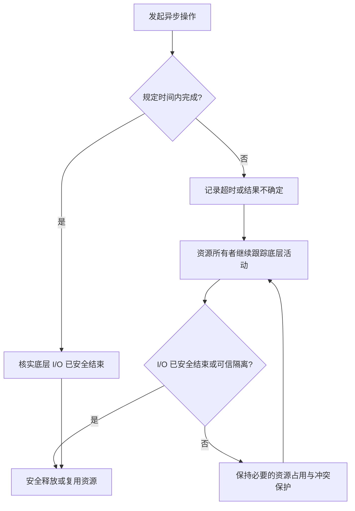

<p class="figure-caption">图 2-1 异步操作超时与资源安全释放流程</p>

对异步操作应区分超时、取消、异常和正常结束；不能仅凭调用方返回、Future/Task 取消或连接状态判断底层 I/O 已安全结束。

### 2.1.5 性能与资源有界原则

性能设计围绕明确的负载与质量要求展开，而不是无依据地增加并发或缓存。

<p class="table-caption">表 2-5 性能与资源有界设计要求</p>

| 设计要求 | 具体规定 |
|---|---|
| 负载模型 | 明确请求规模、并发规模、数据量及运行条件 |
| 容量约束 | 队列、线程、Task、连接、缓存及存储资源应有合理边界 |
| 背压 | 资源不足时明确等待、拒绝、丢弃或降级策略及适用条件 |
| 缓存 | 明确缓存用途、权威数据来源、失效与容量策略 |
| 性能指标 | 明确时延、吞吐、资源占用及测量口径 |
| 性能取舍 | 不得以违反正确性、安全性和可靠性约束换取性能 |

### 2.1.6 故障可控与恢复原则

设计应覆盖正常运行及合理预期的异常场景，明确故障影响范围和恢复条件。

<p class="table-caption">表 2-6 故障与恢复设计要求</p>

| 设计要求 | 具体规定 |
|---|---|
| 故障识别 | 明确可能的超时、通信失败、存储失败、任务异常和进程崩溃 |
| 故障隔离 | 限制故障传播，避免无关组件或资源被错误影响 |
| 状态可信 | 不将未知状态解释为确定成功或失败 |
| 重试与恢复 | 明确允许重试的条件，禁止可能产生危险副作用的盲目重试 |
| 持久化恢复 | 规定异常中断后的数据一致性及状态恢复规则 |
| 生命周期 | 明确启动、就绪、运行、关闭和重启期间的异常处理 |
| 失效行为 | 无法恢复时应有明确的降级、阻塞或停止服务条件 |

### 2.1.7 横切能力非侵入式原则

日志、审计、指标、追踪、权限校验等横切能力应与核心业务逻辑分离，优先通过统一的边界组件、装饰器、中间件或独立服务实现，不应将重复的技术处理流程散布在业务代码中。非侵入式不等于隐藏业务约束：凡影响业务准入、执行结果、事务一致性或故障处理的规则，必须在业务契约中明确，并保留必要的显式调用点。

<p class="table-caption">表 2-7 横切能力非侵入式设计要求</p>

| 设计要求 | 具体规定 |
|---|---|
| 职责分离 | 业务组件负责业务规则与状态转换；横切组件负责统一的记录、采集、校验与传输机制 |
| 边界统一 | 在服务入口、应用服务边界、消息发布边界等明确位置接入横切能力，避免各业务分支重复编排 |
| 最小侵入 | 不为记录日志、采集指标或传播追踪上下文而改变业务方法的核心控制流程和返回语义 |
| 审计正确性 | 审计事件的业务含义及产生时机由业务契约定义；持久化、投递、重试等通用机制与业务处理解耦，同时保证要求的一致性 |
| 故障影响 | 明确横切能力故障时的阻断、降级或重试规则；不得默认其失败不会影响业务，也不得默默吞掉必须处理的错误 |
| 可读性与验证 | 业务代码能够直接体现主流程；横切处理可独立测试，端到端测试验证其与业务契约一致 |

不为追求形式上的非侵入而引入复杂框架或过多抽象；简单、清晰的显式边界优先于难以追踪的隐式执行机制。

### 2.1.8 公共能力复用与冗余控制原则

优先使用符合需求的标准库、成熟软件包、现有工具及公共组件；相同且稳定的职责才提炼为公共能力，不重复发明、不为假设性扩展提前设计框架。

<p class="table-caption">表 2-8 公共能力复用与冗余控制要求</p>

| 设计要求 | 具体规定 |
|---|---|
| 复用优先 | 先评估现成组件是否满足功能、安全、性能及维护要求，再决定是否自行实现。 |
| 提炼公共职责 | 多模块存在稳定相同的职责时统一实现；业务规则留在所属业务模块。 |
| 控制依赖 | 核查成熟度、许可证、版本、安全维护及引入成本。 |
| 控制抽象 | 避免仅为减少少量重复而引入复杂框架或多层转发。 |
| 清理冗余 | 统一能力落地后删除重复、废弃和不必要的兼容实现。 |

### 2.1.9 图表表达与设计一致性原则

设计优先使用合适的图形和表格表达结构、流程、时序、状态及约束，图表不能代替必要的精确定义。

<p class="table-caption">表 2-9 图表表达与一致性设计要求</p>

| 设计要求 | 具体规定 |
|---|---|
| 视图完整 | 使用 4+1 架构视图组织系统设计，覆盖适用内容 |
| 图形选择 | 根据表达目的选择结构图、状态图、时序图、活动图等 |
| 图表一致 | 图形、表格和正文不得相互矛盾 |
| 跨章节一致 | 同一接口、状态、参数及资源规则保持一致 |
| 设计深度 | 明确影响系统行为的契约，允许自主选择内部实现细节 |
| 可验证性 | 关键设计要求应能够对应测试条件与验收证据 |

### 2.1.10 软件设计工作流程

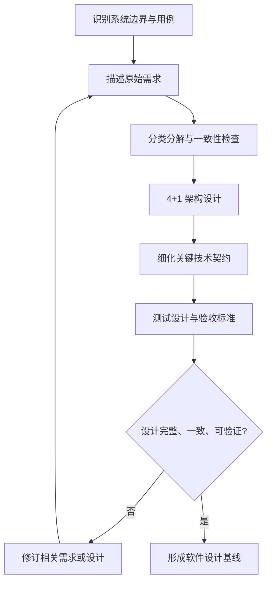

<p class="figure-caption">图 2-2 软件设计编制流程</p>

工作流程允许迭代，不要求传统瀑布式阶段。发现缺口或冲突时直接修订相关需求、架构视图或契约，不通过追加覆盖性条款解决。

### 2.1.11 规范性参考文献及项目无关性

本章为跨项目通用设计与编制规范，不得写入具体仓库、服务、业务协议、接口文件路径或项目专有指标。设计正文引用具体项目的源码、配置和协议文件时，应放在相关业务章节或接口/数据契约章节。

- **《符号体系.md》**：数学量类型、变量命名、标量/矢量/矩阵/张量、下标和公式运算的规范性依据。统计业务中的普通标量同样遵守其标量与阵列的区分原则。
- **《软件系统建模图形与表达规范.md》**：业务流程、DFD、活动/状态/时序图、算法图、伪代码和图元语义的规范性依据。

规范性引用以文件标题和相应章节为准，不复制全文；引用之间存在冲突时先识别并修订冲突，不擅自切换符号或重新解释图元。任何设计实例的具体接口名称、消息字段和技术约束均在第三章及后续适当章节给出。

## 2.2 需求体系及描述规范

需求采用“识别用例 → 逐条描述原始需求 → 分类分解 → 总分一致性检查”的方法。用例应从外部使用者及运行场景出发，覆盖适用的部署、启动、正常使用、配置、运维、正常关闭、重启及异常恢复过程；不局限于业务 RPC，也不将内部技术机制机械列为用例。用例识别属于需求分析，第 4 章用例视图负责表达参与者、边界及用例关系。

<p class="table-caption">表 2-10 原始需求描述字段</p>

| 字段 | 描述要求 |
|---|---|
| 编号 | 唯一原始需求标识，例如 `UR-01` |
| 名称 | 准确概括使用者需要的能力或运行场景 |
| 请求方（Requester） | 发起操作的外部系统、服务或接口，如外部客户端、上层服务、进程管理系统；消息和周期自动触发时可以没有直接请求方，标记“不适用” |
| 触发方式（Trigger） | 标明触发类型、事件来源、触发条件及必要的周期或接口；允许多个类型组合，区分外部触发和内部自动步骤 |
| 输入（Input） | 请求方向本系统提供的数据、参数和信息 |
| 反馈（Response） | 本系统返回请求方的确认、状态、结果及错误信息 |
| 目标方（Destination） | 接收本系统业务输出的外部系统、消息中间件或现场设备；没有时标记“不适用” |
| 业务输出（Output） | 本系统发往目标方的数据、消息或控制指令；没有时标记“不适用” |
| 业务流程（Flow） | 用 Mermaid 表达主要控制流程、数据输入/输出及重要异常，已表达的动作不重复 |
| 业务规则（Business Rules） | 补充主流程未精确定义的术语、公式、算法、初始化、阈值和边界；允许文字分条、LaTeX、图、伪代码或表格，不重复业务流程 |
| 关键约束（Constraints） | 性能、可靠性、安全、审计、可观测性、错误信息、缓存、I/O 与背压等可验证的非功能要求 |

反馈与业务输出必须分开：反馈面向请求方，业务输出面向目标方；请求方与目标方可有多个，且请求方断连不必然撤销已接受的业务操作。

### 2.2.1 触发方式分类与标注规则

原始需求必须列出实际适用的触发方式；同一需求可以组合多种触发方式，不能把处理流程中的普通步骤误写成独立触发。触发方式描述“何时、由什么启动”，不预先决定线程、定时器或队列等内部实现。

- **消息触发（Message）**：外部消息到达，例如实时消息或可靠消息；标明消息来源与订阅范围。
- **周期触发（Periodic）**：达到配置周期，例如实时周期输出或变化加周期保底；标明周期来源及生效条件。
- **API 触发（API）**：收到明确的外部接口请求，例如任务启动或配置应用接口；标明接口和调用方。
- **状态触发（State）**：受监控对象的状态发生满足条件的变化，例如外部依赖从不可用恢复可用；标明状态条件，不把普通循环迭代误列为触发。
- **生命周期触发（Lifecycle）**：服务进入启动、关闭、重启或配置生效等阶段；标明阶段及必要前置条件。

周期触发与消息触发可以同时存在：消息到达更新数据，周期到达决定何时输出。若无外部直接请求方，Requester 写“不适用（自动触发）”，但仍须列出消息生产者或状态来源；触发方式不替代 Input、Response 与 Output 的定义。

### 2.2.2 原始需求四节结构与写作原则

各 UR 固定为四节：**基本信息与触发方式、业务流程、业务规则、关键约束**。根据语义选择最清晰的表达形式；文字、公式、图形、伪代码和表格地位平等；**业务流程图已清楚表达的处理不得在后两节复述**。规则和约束必须有唯一规范定义，其他章节仅引用。

1. **基本信息与触发方式**：表格列出 Requester、Trigger、Input、Response、Destination、Output。Trigger 采用第 2.2.1 节分类，明确事件来源、触发条件及周期或 API。
2. **业务流程**：Mermaid Flowchart 或适用的 UML 活动图表达触发入口、主要处理、判断、数据输入输出、重要异常及恢复出口；复杂算法通过“预定义过程”节点指向第三节，不在总流程中堆叠实现细节。
3. **业务规则**：仅描述流程图无法精确表达的算法、公式、阈值、初始化、状态不变量、顺序及边界。允许文字分条定义、算法流程图、DFG、LaTeX 公式、表格或明确标为 `text` 的伪代码；必须说明输入、输出、初始值、边界及终止条件。无额外内容时标注“无额外规则”。
4. **关键约束**：**优先给出定量要求**（带单位、作用范围、测量窗口、默认值或硬上限、验收方法）；不能合理量化的才采用具有明确判定条件的定性要求。**仅放可核验的非功能要求**，按性能与容量、可靠性与恢复、安全与授权、审计、可观测性、错误信息、缓存与有效期、I/O 资源安全、背压与过载分类；无关分类可以省略或说明不适用。约束应给出故障条件、正确结果、测量或验收口径，不得用抽象口号代替。

### 2.2.3 业务图形元素与数据语义

参照《软件系统建模图形与表达规范.md》第 5.1 节 Flowchart、第 7.1 节 DFD 与第 8.1 节算法规范。业务活动图的控制流箭头表示处理顺序，DFD 箭头表示数据流，**两者不得混用**。图中应以不同形状区分处理、判断和数据。

| 元素 | Mermaid 写法 | 语义 |
|---|---|---|
| 开始/结束 | `A([开始/结束])` | 明确入口和完成/失败出口 |
| 处理 Process | `B["更新缓存"]` | 矩形，表达动作而非数据 |
| 判断 Decision | `C{"已过期?"}` | 菱形，分支标明条件 |
| 输入/输出 Data | `D[/"采样消息"/]` | 平行四边形，表达数据输入/输出 |
| 预定义子过程 | `E[["计算统计指标"]]` | 双边矩形，引用业务规则的算法说明 |
| 数据存储 | `F[("最新值缓存")]` | 存储节点；仅在理解读写关系必要时出现 |

不因形式要求增加无意义数据节点。数据来源、存储及复杂数据变换应单独绘制 DFD，避免业务活动图变成混杂的控制/数据流图。Mermaid 第一行初始化配置、图编号和图题仍须符合第一章。

### 2.2.4 业务规则、输出定义与关键约束的具体要求

- **业务规则**：定义与边界条件优先文字分条；涉及数学关系必须使用 LaTeX 独立公式；复杂步骤按需使用 Flowchart/DFG 或伪代码补充。表达形式不限于图和表；精确定义阈值、边界、初始化、更新基准和不可变条件，不复述主流程动作。算法必须能够独立据输入判断预期输出。
- **性能与容量**：优先用定量指标给出负载范围、时延/吞吐口径、并发及资源上限；必须区分设计目标、默认配置、不可突破的资源上限和验收实测值；未确定的阈值不得虚构。
- **可靠性及 I/O**：明确超时、结果不确定、重试、恢复、安全收敛及资源释放条件。调用返回或 Task 取消不代表底层 I/O 已结束。
- **错误信息**：定义错误类别、错误码或结果、对象与关联标识、发生阶段、可检索证据及敏感信息脱敏；禁止把 UNKNOWN 伪装为成功或明确失败。
- **缓存与背压**：规定缓存键、容量、更新/覆盖、过期、丢弃、等待、拒绝、暂停消费及恢复条件；所有超限策略必须可观测。
- **安全与审计**：列出认证、授权、控制边界以及需审计的操作、事件产生时机、关联 ID、可信保存与失败处理；运行日志不能代替审计。
- **可观测性**：指标、统计窗口、状态、事件、更新时间、无数据语义及告警；可结合真实场景验收。

**指标、计算和输出契约完整性（强制）：**凡使用“计算、统计、比较、阈值、状态、错误、容量、返回结果”等词定义业务能力，必须形成封闭的输出集合；不得用“等”“包括但不限于”替代本版本必须实现的清单。每个指标/派生字段至少定义以下内容；其中数学计算不得仅写在表格单元格内，必须另列可渲染的 LaTeX 公式：

| 必填字段 | 内容 |
|---|---|
| 唯一标识、类型和单位 | 与公开接口字段或指标名一致；明示 `counter/gauge/histogram`、计量单位 |
| 统计层级和数据来源 | 系统 / 进程 / 组件 / 任务 / 消费者；事件记录点、分子和分母来源 |
| 计算公式与口径 | 累计/窗口/瞬时，窗口端点、去重规则、事件计数次数、百分位算法 |
| 触发、初始化和重置 | 何时采集/计算、初始值、首个周期、进程重启、配置热更新 |
| 边界与缺失 | 零分母、空样本、UNKNOWN、超时、重复投递、源不可达的值域与 `unavailable` 语义 |
| 输出与验收 | 指标名、采样时间、窗口、可用性表达、配置边界及给定数据可独立验算的实例 |

**示例与可复算性（强制）：**当业务规则涉及多种计数口径、状态转换、时间窗口、边界分支或重试等易混淆情形时，至少给出一个具体输入—处理过程—预期输出的完整算例。算例必须标明初始条件、计量单位、每一步事件及最终结果；若同时存在样本条数、批次数、I/O 尝试次数等不同统计单位，须分别列出，禁止混用。算例应覆盖易误解的边界（例如重试成功仍有失败尝试记录），且结果必须可直接转化为确定性测试断言。算例是对定义的验证，不得取代规范性定义，也不应重复流程图中的全部步骤；涉及计算关系仍按第一章使用 LaTeX。

**数学定义与表达门禁：**业务规则的文字定义应独立成段或分条；涉及计算时，必须在定义后给出独立 LaTeX 公式，逐一释义变量、单位、取值域以及零分母、空样本和无效值。算法图与伪代码是可选的精度增强手段，不得要求所有业务规则使用表格。公式与中文混排遵守第一章 §1.3.1。

**约束定量优先门禁（强制）：**关键约束首先给出数值、单位、统计范围、采样方法、允许误差、测试条件和通过标准；可配置阈值应列出默认值及合法范围。仅当约束本质上无法定量（例如禁止错误 ACK）时，才用可判定的定性约束。不得用“及时、足够、合理、有界、尽可能、低延迟、高可靠”等词代替具体要求；未完成基准测试的数值应标明“设计验收目标，尚未实测”，不得声称达标。

**完备性门禁：**业务规则涉及的状态枚举、错误分类/错误信息字段、缓存容量及淘汰策略、I/O 结果、背压策略、审计与统计输出均应列举封闭集合和边界输入；凡无法根据文档构造确定预期结果的要求，视为需求未完成，不得标记为可编码。参数可以配置，但必须说明合法范围、默认/缺省行为及越界错误；性能数值未经验证时不得伪称已达标。每项约束必须可追溯至可执行的 UC/System 场景。

每项业务规则和关键约束须能由 UC/场景及第 14 章测试追溯；第 5～13 章详述实现契约时应引用 UR，不得另造冲突定义。

统一样式：

```text
### 3.x UR-xx 需求名称
#### 3.x.1 基本信息与触发方式
Requester / Trigger / Input / Response / Destination / Output
#### 3.x.2 业务流程
Mermaid 活动流程图，含重要异常及数据输入输出
#### 3.x.3 业务规则
可用文字、LaTeX、伪代码、图或表格精确定义算法、初始化与边界，不重复流程
#### 3.x.4 关键约束
按性能、可靠性、安全、审计、可观测性、错误、缓存、I/O、背压列可验证要求
```

本节也是第三章及后续章节的强制完整性验收标准。

<p class="table-caption">表 2-11 分类需求体系与描述重点</p>

| 类别 | 核心问题 | 典型要求 |
|---|---|---|
| 功能需求（Functionality） | 系统提供什么行为 | 对外能力、业务流程、业务规则、输入输出与状态反馈 |
| 性能需求（Performance） | 运行速度与资源上限 | 时延、吞吐、并发、调度、公平性、容量、背压、资源消耗、扩展能力 |
| 可靠性需求（Reliability） | 故障时如何保持正确与恢复 | 容错、超时、重试、请求关联、事务、持久化、故障恢复、可用性、未结束操作的资源管理 |
| 安全需求（Safety & Security） | 如何防止危险或非法控制 | 控制权、互锁、失效安全、认证、授权、通信及数据安全 |
| 横切能力（Cross-cutting Concerns） | 如何观测、管理与追责 | 审计（操作证据、可靠投递、完整性、追溯）、日志、指标、追踪、配置、版本、可测试性、可维护性 |

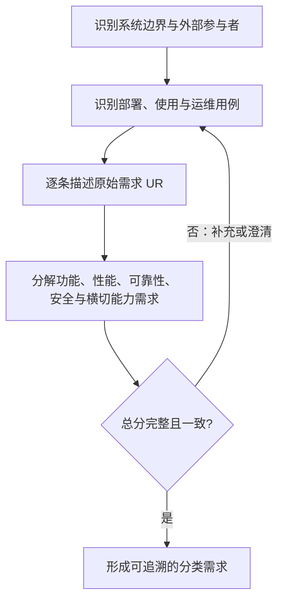

<p class="figure-caption">图 2-3 需求识别、分解与一致性检查流程</p>

分类需求必须从原始需求的输入、反馈、业务输出、规则和约束中推导，不得遗漏、矛盾或未经确认增加能力；多条原始需求的共同约束可以合并，但必须保留来源编号。每条分类需求应给出可核验条件，性能要求还需明确测量口径，不虚构现场阈值。审计应独立于普通日志定义，不得以运行日志代替审计证据。

需求分类与设计专题是不同维度：启动、正常关闭、重启及 Reload 属于跨需求的运行生命周期设计，统一在进程视图展开；相应行为和质量约束分别由原始需求及分类需求追溯。

## 2.3 4+1 架构视图：内涵、外延与表达规范

<p class="table-caption">表 2-12 4+1 架构视图的职责与成果</p>

| 视图 | 关注范围 | 主要成果 | 不应混淆 |
|---|---|---|---|
| 用例视图（+1） | 参与者、系统边界、典型/异常场景 | 系统上下文、用例、业务流程 | 不负责线程调度 |
| 逻辑视图（Logical） | 组件职责、模型、接口、状态规则、依赖 | 组件图、类/数据关系、状态图 | 不等于源码目录树 |
| 进程视图（Process） | 进程、线程、Event Loop、Task、协作、生命周期、同步、并发、资源、背压、缓存、故障恢复 | 运行结构图、任务所有权表、时序/状态/活动图、资源预算 | Task 不等于 OS 线程；图名须区分标准 UML 与示意图 |
| 开发视图（Development） | 软件模块边界、层次、静态依赖、公共契约与复用关系 | 模块图、依赖图、模块职责表 | 不描述真实并发拓扑，也不列现有代码修改清单 |
| 物理视图（Physical/Deployment） | 节点、进程部署、存储、网络、控制权和现场外部依赖 | 部署图、网络/故障域/外部依赖表 | 不是现场设备内部物理结构模型 |

### 2.3.1 用例视图的场景编写规范

用例以参与者的完整业务目标为单位组织，而非以原始需求、RPC 或内部模块为单位逐条改名。一项用例可以关联多项原始需求；一项原始需求也可以由多个业务场景共同覆盖。用例视图回答“在具体业务场景中系统如何工作”，不代替逻辑视图、进程视图和数据设计。

<p class="table-caption">表 2-13 业务场景用例的必备描述要素</p>

| 要素 | 编写规定 |
|---|---|
| 用例身份与目标 | 给出唯一编号、业务场景名称及参与者要达成的可观察目标；名称使用业务活动，不使用内部机制命名 |
| 参与者与触发条件 | 列明实际发起操作的外部角色；内部定时任务、恢复及发布等自动步骤不得虚构外部参与者 |
| 前置条件 | 列明系统就绪、授权、配置或数据存在等必要条件；不得混入未确认的实现假设 |
| 主业务流程 | 以 Mermaid 业务活动图（flowchart）为主要表达，覆盖触发、校验、关键处理、反馈及后置结果；以判断节点表达重要分支，避免大段编号文字复述 |
| 分支与异常流程 | 在活动图中呈现影响业务结果的主要异常出口；罕见或不宜展开的异常在简明说明表中概括，避免为了完整而画出所有技术异常 |
| 后置条件 | 明确成功和失败之后的业务状态、外部可见结果、未完成事项及后续查询方式 |
| 需求追溯 | 标明相关 UR；核对全部 UR 在真实场景中得到覆盖，但不要求 UR 与 UC 一一对应 |

跨用例共享的内部机制（如存储、审计发布和调度）应作为相关业务流程中的自动步骤或支撑行为描述；只有存在独立业务目标时才另立用例。应避免将一串 gRPC 方法名或 CRUD 操作直接当作完整用例，也不得在用例章节展开线程、锁、表结构及类方法等实现细节。

用例的正文采用“一张业务活动图 + 一张简明用例说明表”的表达形式。活动图包含主路径、必要判断以及重要异常分支；图中节点使用业务动作，不展开展示内部类、锁和数据库事务。说明表只填写参与者、业务目标、前置条件、主要异常、后置条件及关联需求。业务分支已在图中完整表达时，不再重复书写大段“主业务流程”和“异常流程”；复杂跨参与者消息时序可在独立小节补充时序图。图题和表题按文档约定独立编号。

进程视图应按四个设计专题组织，而不是按需求类别重复划分：

<p class="table-caption">表 2-14 进程视图的四类设计专题</p>

| 专题 | 必须明确的设计对象 | 推荐表达 |
|---|---|---|
| 运行时结构 | 进程、线程、Event Loop、Task、线程池、组件与资源所有权 | 分层运行结构图、Task 职责表 |
| 运行生命周期（Runtime Lifecycle） | 启动、初始化、就绪、运行、Reload、正常关闭、重启及其阶段转换 | 生命周期状态图、启动/关闭/Reload 时序图 |
| 并发与资源管理 | Task 协作、队列、通知、同步、调度、容量限额、背压、缓存及释放 | 任务协作时序图、资源与背压策略表 |
| 异常与恢复 | 超时、取消、故障隔离、未收敛 I/O、崩溃恢复与降级 | 故障状态图、异常裁决矩阵 |

各专题共享同一运行模型，明确创建者、所有者、同步关系和退出条件；不因分节而重复定义状态或资源。生命周期是进程视图的独立设计专题，不是第六类需求。

图表仅使用其可准确表达的语义：结构关系用 Mermaid Flowchart；行为交互用 Sequence Diagram；状态约束用 State Diagram；条件控制用活动/流程图。图题说明对象、范围及图类型。关键质量属性贯穿各视图，不能只写在单独的“非功能要求”段落。

## 2.4 测试设计方法、组织及验收规范

测试设计以测试层级组织物理目录，以 Marker 描述测试层级、测试专题与运行场景。测试文件名应清楚表达验证对象或行为；测试文件及其标记、验证说明统一登记在测试矩阵中。需求、用例及重要技术契约必须能追溯到实际测试，不为同一目的建立重复测试体系。

<p class="table-caption">表 2-15 测试层级与目录规范</p>

| 层级 Marker | 物理目录 | 验证范围 |
|---|---|---|
| `unit` | `unit/` | 状态转换、业务规则、纯逻辑，无外部服务依赖 |
| `component` | `component/` | 单组件职责及其可控依赖 |
| `integration` | `integration/` | 组件之间及真实外部依赖的接口协作 |
| `system` | `system/` | 独立进程、完整业务场景及端到端行为 |

<p class="table-caption">表 2-16 测试 Marker 与矩阵编制规范</p>

| 事项 | 规范 |
|---|---|
| 层级 Marker | 每项测试必须且仅属于 `unit`、`component`、`integration`、`system` 之一，与目录对应 |
| 专题 Marker | 标识可靠性、安全、性能等验证主题，可与层级及场景 Marker 叠加；无专项主题时可为空 |
| 场景 Marker | 标识并发、超时、恢复、负载、现场等执行条件或情境；有相应场景时标记 |
| 测试矩阵 | 至少包含“测试文件名、层级 Marker、专题 Marker、场景 Marker、测试说明”五列；每项重要测试应有可定位的文件归属 |
| 标记粒度 | 标记以具体测试函数或类为准；同文件可包含不同专题与场景，矩阵列出涉及的 Marker |
| 运行条件 | 通过 Fixture 和环境准备明确外部依赖；现场专用测试与常规回归分离，未执行不视为通过 |
| 执行规则 | 提供按目录、Marker 及其布尔组合的 pytest 命令；所有 Marker 在项目配置中注册 |
| 可追溯性 | 测试说明与需求、用例或技术契约对应；行为变更时同步检查测试及矩阵 |
| 验收证据 | 保留运行环境、命令、实际结果、指标和未验证项，禁止把设计目标当作测试结果 |

目录划分测试层级，专题与场景通过 Marker 横向组合；可靠性测试不单独设第五类目录。测试矩阵用于定位和筛选测试，不预设每个实现文件必须存在，也不要求每个文件仅能有一种测试场景。

### 2.4.1 测试依据及 System 覆盖要求

各层级测试必须依据已确认的设计成果编制；System Test 以用例视图为主基线，以原始需求及技术契约补充覆盖，不得由测试人员凭经验任意缩减范围。

<p class="table-caption">表 2-17 各测试层级的设计依据</p>

| 测试层级 | 主要依据 | 验证重点 |
|---|---|---|
| Unit | 详细设计、函数及算法契约 | 纯逻辑、状态转换、参数及边界规则 |
| Component | 逻辑视图、组件职责及内部接口契约 | 单组件行为、依赖协作及异常处理 |
| Integration | 接口与通信契约、开发视图、物理视图 | 真实接口调用、跨组件通信及外部依赖 |
| **System** | **用例视图（UC）及原始需求（UR）**，并补充接口、运行、部署、安全及性能约束 | **从真实受测服务进程及其通信入口验证业务目标、异常、边界与恢复行为** |

System Test 必须遵守以下规定：

1. **用例覆盖率 100%**：每项 UC 至少有一项 System Test 作为验证证据；同一测试可以覆盖多个 UC，同一 UC 可以由多个测试覆盖，**不按测试数量与 UC 数量的大小关系判定覆盖**。
2. **规定场景覆盖率 100%**：每项 UC 明确的主流程、关键分支、异常流程、边界和恢复场景均必须有对应 System Test；不能仅以一条正常路径代表整个 UC 已覆盖。
3. **需求覆盖率 100%**：每项 UR 必须能够经一个或多个 UC 追溯至 System Test；若某项需求未能被 UC 覆盖，必须先补全用例，不得直接以技术测试代替业务用例。
4. **技术约束补充覆盖**：用例未充分表达的性能、容量、并发、安全、权限、超时和可靠性要求，依据对应技术契约补充测试；不得因 UC 未逐项列出而豁免。
5. **真实系统边界**：System Test 通过真实受测服务进程和适用的外部依赖、通信链路执行；Mock 不得代替本次明确纳入验收范围的基础设施及通信链路。
6. **覆盖与通过分开裁定**：测试已关联不等于已执行；失败、跳过及未运行均不得计为通过。验收报告分别给出需求覆盖、用例及场景覆盖、执行情况和通过情况；缺少真实环境时标记 `NOT_RUN`，不得用模拟结果替代。
7. **变更同步**：任何 UR、UC、接口或行为约束的新增、删除、调整，必须同步核查 System Test、测试矩阵和验收条款；新增 UC 不得留下无测试映射。

<p class="table-caption">表 2-18 System Test 追溯矩阵规范</p>

| 字段 | 要求 |
|---|---|
| UR 编号 | 被验证的原始需求编号，可列多个 |
| UC 编号与场景 | 用例编号及主流程、异常、边界或恢复场景标识 |
| 技术契约 | 相关接口、配置、运行或安全约束的章节编号；没有则记“—” |
| 测试文件名／测试标识 | 可定位的 System Test 文件名及测试函数或参数化场景标识 |
| 层级／专题／场景 Marker | 层级固定为 `system`，其余按第 2.4 节定义填写 |
| 验证内容与预期结果 | 从用户可观察行为与副作用表述判定依据 |
| 执行环境及结果 | 真实依赖、执行证据、`PASS`／`FAIL`／`SKIP`／`NOT_RUN` 等状态 |

追溯链为 **UR → UC／用例场景 → System Test → 执行结果与证据**，技术契约作为补充依据进入相应测试。第 4 章负责编制完整 UC 和场景，第 14 章依据本规范给出实际测试矩阵及验收安排，两章必须双向核对。


# 3. 软件需求

**集成后权威**：本设计以 main 中的 `src/storage_service/`、`src/contracts/storage_service.proto`、`src/contracts/configuration_repository.proto`、Sink Kafka v2 输出和对应测试为准。曾在开发分支记录的 G-01/G-02、S1/S2 或 NOT_RUN 是当时的验收历史，不代表主分支当前状态；本次文档归并不代替独立运行复测。


## 3.1 系统边界与基线

Storage Service 是独立时序数据持久化与访问模块；由 Kafka Reliable Record 消费数据，按需为 TDengine 创建库、超级表和设备子表，并提供历史查询、统计、导出、备份及状态诊断。配置唯一权威为 Configuration Service；Storage 只读，不参与发布。目标职责划分为 Collector 保留采集来源数据、Sink 根据 Delivery 选择 `raw`、`protocol`、`business` 三种输出等级并编码 Kafka，Storage 按等级原样持久化，不重复执行 Sink 的协议解码或业务换算。Storage 开发分支目前已有 Collector SampleBatch v3 与 Sink Kafka JSON v2 的生产实现和定向测试证据，但不能以设计文本替代完整链路复测；设计分支 Contracts v1_40 仍有不同的 `raw/engineering/business` 描述，属于外部契约冲突，本轮不修改其他模块。Storage 仅消费经过验证的 `raw/protocol/business` Kafka JSON v2，不提供有损兼容。

基准为实际读取的 `design/config-activation-selection-20261121` 分支总体架构 v1_26、Contracts v1_40、Configuration v1_17，以及当前 Storage 开发分支已有的 `src/contracts/storage_service.proto` 与生产实现。Storage 专用接口只能按现有共享 Contracts 实现；本轮**不修改其他模块代码、共享 Proto、CLI、Core 或 Configuration**。跨分支尚未引入的配置查询 RPC 按第 8 章作为独立联调阻断，不能以假接口替代。

## 3.2 需求清单

| ID | 需求 | 验收依据 |
|---|---|---|
| R-01 | 消费 Sink→Kafka Reliable 单点记录；业务等级由记录 `data_level` 指示 | 拒绝不支持的线格式与等级 |
| R-02 | 以 `wind_farm_id`、`device_type`、`device_id`、`point_table_id` 定位存储归属 | 不靠 Kafka JSON 的 `schema_version` 推断点表版本 |
| R-03 | TDengine 不存在库、超级表、子表时按需创建，再写数据 | 空数据库首批合法样本入库 |
| R-04 | 按 `deployment_id/service_id` 获取 Deployment 当前选中的服务有效闭包；验证所有不可变文件、绑定及目标摘要后原子切换 | 不按 `ListConfigs` 推荐版本选择；缺少正式配置 RPC 则阻断联调 |
| R-05 | 首次遇到未知 `point_table_id` 立即查询可信历史闭包并核验原始 Device/Model/PointTable 身份 | 缺少完整历史证据时暂停分区、不提交 Offset，不替换为当前活动版本 |
| R-06 | 广播提示、进程启动、配置重连和周期对账触发配置收敛 | 丢广播不永久丢配置更新；独立生效 |
| R-07 | 数据确认写入后才提交 Kafka Offset；重放必须幂等且不覆盖不相关点位 | 数据库故障、超时、重启无静默丢失 |
| R-08 | 提供有界历史查询、统计、CSV 导出、备份、诊断 | 真实数据库验证，不以 Mock 代替 |
| R-09 | 缓存、Kafka 积压、DDL、SQL、查询、导出、备份均有边界 | 资源饱和后可诊断和可恢复 |
| R-10 | 本轮仅修改 Storage 的代码、设计、Storage 专属配置与测试；共享接口差异记录为外部依赖 | 不修改 Collector/Sink/Contracts/Configuration/Core/CLI 的生产文件 |
| R-11 | Storage Service 业务配置声明 TDengine 原生数据库参数，特别是数据最长保留期 `KEEP` | 首次建库准确应用原生参数；不自行开发定时清理器 |
| R-12 | 启动/重启、服务配置生效后自动对账本模块管理的 TDengine 数据库参数 | 差异可见；支持在线修改者执行受控 `ALTER DATABASE` 并复查 |
| R-13 | 不可在线修改参数、DDL 失败或结构冲突时停止受影响库的写入，不删库重建 | 故障可诊断，不错误提交 Kafka Offset，不影响无关数据库 |
| R-14 | 缩短 `KEEP` 的配置变更必须显式授权并预警潜在历史数据过期 | 不因静默自动收敛造成意外数据清理 |
| R-15 | Kafka Partition 内顺序消费与完成，跨 Partition 有界并行 | 任意先后完成顺序均不越过最早未确认 Offset |
| R-16 | DDL、配置快照、TDengine 数据库收敛和 Rebalance 具有明确资源所有者与同步边界 | 不使用全局大锁、无过期成员 Offset 提交、无新旧配置混用 |
| R-17 | Storage 将输入 `data_level` 映射为 `RAW=1`、`PROTOCOL=2`、`BUSINESS=3`，在 TDengine 中保留该标识 | 读回数值和语义一致，不允许缺失等级时静默默认为 BUSINESS |
| R-18 | 同一来源测点、时间戳和样本在不同数据等级下独立保存，不允许跨等级冲突或覆盖 | RAW、PROTOCOL、BUSINESS 均可独立查询，重复消费各自幂等 |
| R-19 | 三种等级保持各自的数据类型与来源属性；RAW 支持未来二进制载荷但不凭空推断当前 JSON 标量为原始帧 | 数据类型、编码、完整性与 Kafka 契约一致；不以 DOUBLE 强制承载全部等级 |
| UR-20 | 单实例理想持续接入 30 台机组、10 Hz、每台 500 测点的 Kafka 数据并持久化至 TDengine | 150,000 点/s 单等级目标；持续容量、积压、数据正确性、资源占用均须实测 |
| UR-21 | 不能满足理想目标时，必须完成有证据的优化并提交准确的可持续性能参数及受限条件 | 依固定负载矩阵与验收规则给出最大稳定容量，不得虚报达标 |

## 3.3 限制与质量要求

- 可靠性：Offset 只确认已持久化的连续消费前缀；不保证数据库与 Kafka 之间天然原子事务，以确定的幂等键弥补重放。
- 配置一致性：配置快照原子切换，业务记录始终绑定所携带的不可变 `point_table_id`，不以运行中的最新修订替代历史解释。
- 容错：Configuration 暂不可用时允许使用**已验证且含精确 ID**的缓存；否则暂停受影响分区，不提交对应 Offset。
- 安全：模块间 gRPC 采用新版设计规定的受控隔离网络与应用令牌授权，**不使用 mTLS**；Kafka/TDengine 按各自连接安全机制认证。
- 性能：**理想持续接入目标为 30 台机组 × 10 Hz × 500 测点 = 150,000 点/s（单一数据等级）**。若每个测点的三种数据等级同时独立落库，则极限场景为 450,000 条记录/s，该场景独立计量。使用批量 SQL、连接池、可配置背压；持续容量、时延 P50/P95/P99、积压与资源占用均通过实测确定，不得把短时峰值或仅消费 Kafka 的速度报告为持久化吞吐。

---


## 3.4 UR-20 理想容量与持续接入性能

### 3.4.1 基本信息与触发方式

| 字段 | 定义 |
|---|---|
| Requester | 风电场数据平台运维方；自动采集链路 |
| Trigger | Message：Sink 向 Kafka 交付采样记录；Lifecycle：Storage 启动及持续运行 |
| Input | 30 台风机、每台 500 个测点、每秒 10 次采样；Kafka JSON 记录及稳定样本身份 |
| Response | 管理面可查询实际吞吐、消费积压、写入延迟及资源用量 |
| Destination | TDengine |
| Output | 与输入逐点对应、按数据等级隔离、可读回核验的时序样本 |

### 3.4.2 业务流程

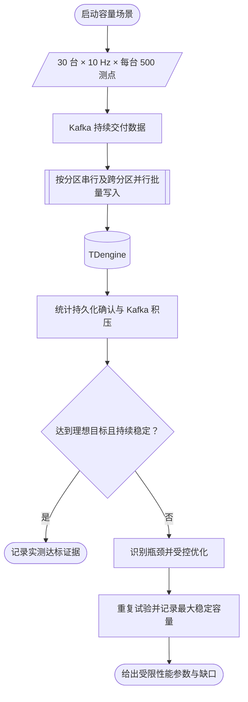

<p class="figure-caption">图 3-1 Storage 持续接入容量需求与实测闭环</p>

### 3.4.3 业务规则

单一数据等级下，理想写入速率为：

$$
R_{\mathrm{target}}=N_{\mathrm{device}} f_{\mathrm{sample}} N_{\mathrm{point}}
=30\times10\times500=150\,000\ \mathrm{point/s}
$$

其中，$N_{\mathrm{device}}=30$ 为设备数量，$f_{\mathrm{sample}}=10\ \mathrm{Hz}$ 为设备采样频率，$N_{\mathrm{point}}=500$ 为每次采样的测点数，$R_{\mathrm{target}}$ 为单等级目标持久化速率。

对于同时保留三个独立数据等级且每一级全部产生记录的极限场景：

$$
R_{\mathrm{three\_levels}}=3R_{\mathrm{target}}
=450\,000\ \mathrm{record/s}
$$

正常主验收的 **150,000 点/s** 与三级全部落库的 **450,000 Record/s** 必须分开记录；不得在数据等级数量不同的条件下直接比较吞吐量。当前 Kafka 目标契约为每测点一条 Record；如果未来修改为批量 Record，仍以**实际持久化的逻辑测点条数**作为容量标准，并额外记录 Kafka Record/s。

### 3.4.4 关键约束

1. **目标与实测分离**：150,000 点/s 是设计理想目标，不是已通过验收的指标。
2. **正确性优先**：无错误覆盖、无静默丢失、正确版本与等级、Offset 只越过已持久化连续前缀；性能优化不得降低这些要求。
3. **稳定性**：每个负载档位需记录完整测试时长、冷/热启动、Kafka Lag 趋势、TDengine 查询读回和资源水位；稳定运行时长在测试计划中显式固定。
4. **数据等级边界**：主要容量场景先以 BUSINESS 单等级执行；RAW、PROTOCOL 及三级并行场景分别验收。
5. **可追溯性**：性能场景须关联 UC-08、§7.6、§13.4 与 §14.4。

## 3.5 UR-21 未达目标时的优化与容量报告

### 3.5.1 基本信息与触发方式

| 字段 | 定义 |
|---|---|
| Requester | 性能验收方 |
| Trigger | State：理想容量试验未满足持续稳定判据 |
| Input | 可复现的负载、资源采样、延迟、Kafka Lag、数据库结果和瓶颈定位证据 |
| Response | 最大稳定容量、优化参数、限制条件与未完成目标 |
| Destination | 不适用 |
| Output | 性能验收报告及可重复的参数集合 |

### 3.5.2 业务流程

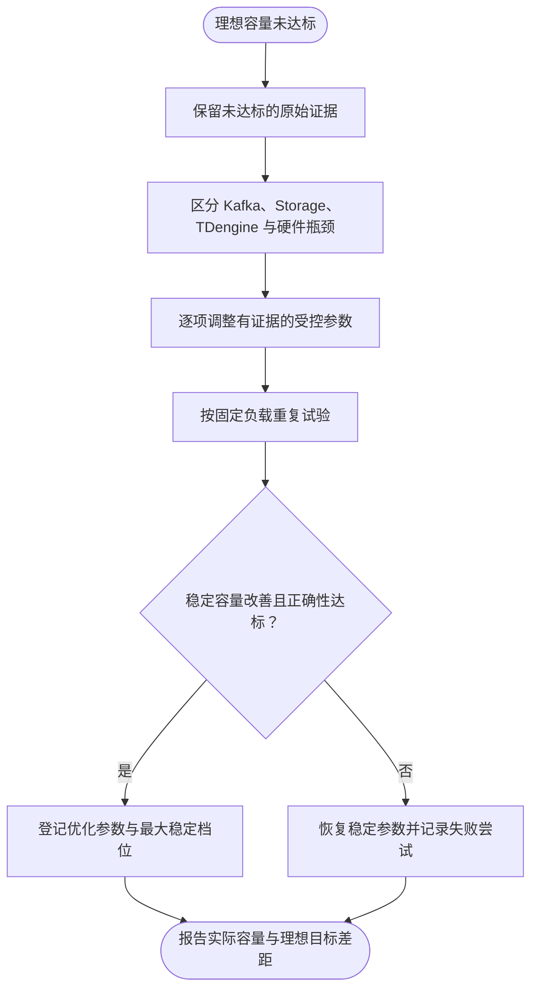

<p class="figure-caption">图 3-2 性能不足时的优化及能力确认流程</p>

### 3.5.3 业务规则

最大稳定持久化速率 $R_{\mathrm{stable}}$ 由完整试验期间的确认入库记录数和有效持续时间确定；不得使用 Kafka 拉取条数代替入库确认条数。等效可服务设备数量按相同采样模型计算：

$$
N_{\mathrm{supported}}=
\left\lfloor\frac{R_{\mathrm{stable}}}
{f_{\mathrm{sample}}N_{\mathrm{point}}}\right\rfloor
$$

例如在同样 10 Hz、500 点/台且仅存储一种数据等级时，如果**假设**实测稳定吞吐为 90,000 点/s，则等效支持 18 台；该数字仅为计算示例，不代表实际测试结果。

### 3.5.4 关键约束

- 未达理想目标时，准出结果必须明确标记为 **PASS WITH PERFORMANCE LIMITATIONS** 或 **FAIL**；前者要求正确性、可靠性、安全门禁均通过，且有明确的最大稳定容量、运行条件与已知限制。
- 不得自行降低 30 台 × 10 Hz × 500 点的理想目标；可以报告在既定硬件上的更低稳定容量，并给出扩容或后续优化建议。
- 报告需包含配置与版本、Kafka 分区/批大小、TDengine 参数、CPU/内存/磁盘、吞吐、P50/P95/P99、Lag、逐点核对及重复试验结果；失败场景不可被排除统计。

---

# 4. 用例视图

## 4.1 UC-01 首次收到设备及 PointTable 版本

**触发**：Kafka 出现有效且此前未见的 `(wind_farm_id, device_type, device_id, point_table_id)`。

**流程**：校验 Kafka JSON v2 → 查找当前不可变配置快照 → 缺失则执行 UC-03 → 精确确定 PointTable/BusinessPoint/Units 的版本化映射 → 计算并验证目标 Schema → 建库/超级表/子表（缺者才建）→ 批量写入 → 提交 Offset。

**业务规则**：DDL 幂等；不能通过 Kafka 任意字段动态拼 SQL；成功建表不等于记录写入成功。

**关键约束**：未经完整配置校验、未能确定数据归属、或 Schema 不兼容，一律不得入库。

## 4.2 UC-02 已有设备持续写入与历史重放

**触发**：已存在表的 Kafka Record，或故障恢复引起旧 Offset 重放。

**流程**：以消息原始 `point_table_id` 确认固定版本映射 → 根据 `sample_id`、设备和点位等确定事件身份 → 幂等写入 → 仅在持久化成功后提交连续 Offset。

**业务规则**：记录的 `sample_time` 不保证唯一；同一时间多个点以及同一点多个事件不得错误覆盖；相同事件重复消费只能有一次逻辑结果。

**关键约束**：幂等策略必须用 TDengine 实际主键/写入行为验证，不能仅依赖 `IF NOT EXISTS`。

## 4.3 UC-03 本地缺少 PointTable 版本

**触发**：当前 Kafka Record 的 `point_table_id` 在本地已验证配置快照中不存在。

**流程**：暂停受影响分区后续提交 → 查找本地不可变历史归档 → 必要时按完整 `point_table_id` 查询历史受管闭包 → 验证 PointTable/DeviceModel/Device Instance 的固定版本及内容摘要 → 持久化可信历史证据并再次匹配原始 `point_table_id` → 找到后恢复 UC-01/02。当前分支缺失历史查询 RPC 时本步骤明确 BLOCKED_EXTERNAL，不回退旧的推荐版本查询。

**业务规则**：Storage 维护一套活动服务闭包和独立累积的历史语义归档；历史检索不替换当前活动 Service。不同固定版本分别建立索引，同一 `config_id` 的历史版本不折叠成最新版本。服务闭包摘要、仓库发布游标和 Kafka 线格式版本各有独立含义。

**关键约束**：重新拉取后仍没有原 ID 时，不采用其他 PointTable 版本、不能凭 `device_type` 猜测字段；保持分区暂停和告警。若最新闭包未包含需要的历史版本，属于配置可获得性/闭包覆盖缺口，不可宣称拉取已解决。

## 4.4 UC-04 配置更新与错过广播

**触发**：启动、`wh.config.changed` 提示、网络重连或周期对账。

**流程**：先订阅 NATS Core 普通 Pub/Sub，再查询当前可获得的发布修订；重复/乱序提示合并为最新目标；按模块根及修订拉取完整闭包，校验通过后持久化并原子更新；自身决定无变化/局部热更新/重启要求。

**业务规则**：广播不是配置正文和强一致提交凭据；一个模块失联不阻断其他模块。`GetCurrentRevision` 是设计中的目标新 RPC、当前不允许作为本版依赖；修订获取必须依现有查询能力与可验证的返回值实现，具体对账实现见 §8.2。

**关键约束**：消息处理中不切换已经解析的单条数据的解释版本；切换中断时仍使用旧的有效快照。

## 4.5 UC-05 数据库/Kafka/配置故障恢复

**触发**：TDengine 超时、Kafka 断线、Configuration 不可达、进程崩溃、磁盘满、Schema 冲突。

**流程**：记录未确认状态 → 暂停受影响消费并实施有限重试 → 恢复后重验目标 Schema 和批次身份 → 幂等重放 → 确认后提交连续 Offset。

**业务规则**：数据库写入超时视为未知，不得直接提交或假设失败；Schema 冲突保持阻断并暴露诊断结果。

**关键约束**：Consumer 仍应维持 Kafka Poll/心跳、避免超过最大处理间隔导致无界 Rebalance；配置等待和 DDL 任务数有界。

## 4.6 UC-06 查询、导出、备份

**触发**：授权 CLI/gRPC 查询或导出请求。

**流程**：确定站点/设备/点位/PointTable 版本过滤条件 → 有界查询或异步任务 → 返回数据、游标或结果状态。

**业务规则**：跨版本查询以明确的字段语义合并，版本不能通过同名猜测；导出流和备份独立限流。

**关键约束**：禁止任意 SQL 输入、服务端任意路径访问以及无界全表查询。

## 4.7 UC-07 TDengine 数据库配置检查及收敛

**触发条件**：Storage 启动或重启、完整 Storage Service 配置快照成功切换，或恢复先前失败的数据库配置检查。

**业务流程**：读取经验证的服务配置 → 枚举已登记且属于本 Storage 管理的数据库 → `information_schema.ins_databases` 查询当前参数 → 归一化比较 → 对允许在线修改且授权的差异逐项执行 `ALTER DATABASE` → 回读并确认 → 更新数据库就绪状态。尚不存在的数据库保持按需建库，不在启动时为所有设备预建库表。

**业务规则**：`KEEP` 为数据最长保留期，由 TDengine 原生过期管理负责清理；其他数据库参数由允许列表显式配置。完整快照原子切换并不意味 TDengine DDL 跨库原子执行，需独立记录每库收敛状态。

**关键约束**：已存在数据库的 `PRECISION`、`DURATION` 等不支持常规在线修改的参数不自动重建；`KEEP` 缩短先完成风险校验和显式授权；参数修改成功必须重新读取核对，未收敛时禁止向受影响数据库写入，Kafka Offset 不前进。

---


## 4.8 UC-08 30 台风机高负载持续入库及受限容量判定

**参与者**：风电场运维方、测试系统、Kafka、TDengine。

**主场景**：准备 30 台风机、每台 500 个独立测点、10 Hz 持续写入；在真实 Kafka 与 TDengine 记录持续入库速率、Kafka Lag、写入延迟、数据一致性及资源水位；验证理想容量目标。

**替代场景**：若理想目标未达，则保持同一数据与硬件基准，按 100,000、75,000、50,000 点/s 等阶梯负载定位最大稳定容量，优化批写与消费并行度后复测，最终记录实际能力和约束。

**异常场景**：TDengine 写入失败、Kafka Rebalance、配置缺失、重复消费和磁盘资源不足时，正确性门禁不得被性能模式绕过。

**关联需求**：UR-20、UR-21、R-07、R-09、R-15～R-19。**System 追溯**：T-46～T-53；专项真实负载对账见 §14.4。

# 5. 逻辑视图与数据流

## 5.1 模块上下文（DFD）

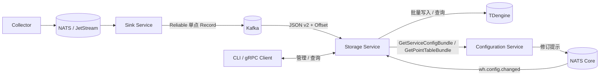

<p class="figure-caption">图 5-1 Storage 外部数据流及配置关系</p>

## 5.2 模块内部结构

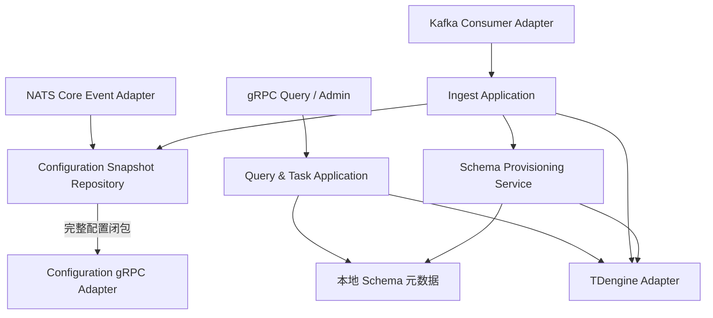

<p class="figure-caption">图 5-2 Storage 模块职责结构</p>

- Application 控制消费、配置对账、Schema 校验、Offset 决策、查询任务。
- Domain 定义记录身份、表归属、数据有效性、幂等和版本匹配规则。
- Infrastructure 实现 Kafka、Configuration、NATS、TDengine 和持久化缓存适配器。
- Interfaces 提供 gRPC、CLI 启动入口，不通过 Domain 操作外部驱动。

---

# 6. 数据身份与 TDengine 模型

## 6.1 统一数据身份及 Kafka 输入

依据 Storage 开发分支当前 Sink Kafka JSON v2 实现及设计分支 Contracts 的目标线格式，**每个 SampleItem 一条 Record**，必填身份字段包括：`wind_farm_id`、`collector_id`、`task_id`、`device_type`、`device_id`、`point_table_id`、`batch_id`、`point_id`、`sample_id`。记录还含 `data_level`、`business_point_id`、`unit`、`value`、`quality`、`sample_time`、`publish_time`、`receive_time`、`max_staleness_ms`。原样保留 Quality、时间戳和样本身份。

- `point_table_id = point_table_<template_id>_v<file_version>`（不含 `.yaml`），例如 `point_table_modbus_wtg_sim_v1.0.0`；**一个 ID 已同时标识点表及版本**。
- `schema_version=2` 是 Kafka JSON **线格式版本**；`file_version` 是受管 YAML 文件版本；`revision_id` 是 Configuration 全局发布视图版本。三者不可当作 PointTable 数据身份。
- **不增加 `data_version` 或 `config_revision_id`**，不得从 Kafka 分区或接收时刻推测 PointTable 版本。
- BUSINESS 存储使用标准 `business_point_id` 和标准 `unit`；RAW/PROTOCOL 使用来源 `point_id` 及本等级定义的值/单位身份，不能混写为同一标准业务列。
- `data_level` 是**数据处理等级**，与 Kafka `schema_version`（消息结构版本）以及 `point_table_id`（不可变解释规则版本）严格分离。

Storage 开发分支已有 SampleBatch v3、Sink Kafka JSON v2 的实现；最终准出仍需真实数据链及运行配置证明。独立配置设计分支 Contracts v1_40 尚有 `engineering` 的旧表述，与当前生产枚举不一致，作为外部契约冲突登记。本轮不修改 Sink 或共享 Contracts。

## 6.2 PointTable 与版本索引

配置快照中以完整 `point_table_id` 作为键，每一条包含：设备类别、精确 PointTable 文件/版本、源 Point 集合、转换参数、BusinessPoint 固定版本引用、Units 固定版本引用、内容哈希及依赖闭包哈希。收到消息必须校验 `device_type` 一致、目标点存在及业务级别与映射一致。

Configuration 全局快照可能包含同一个逻辑模板的多个 `file_version`，只要闭包返回就必须分别保留；不得把多个版本按 `template_id` 合并。版本升级时旧记录仍按原 `point_table_id` 查询。

## 6.3 TDengine 物理组织（规范性 DDL 见 §16.2）

| 层级 | 建议键 | 创建时机 |
|---|---|---|
| Database | `wind_farm_id` | 首次收到该场站合法 Record |
| Super Table | `device_type + point_table_id + data_level + schema_fingerprint` | 首次出现所需存储 Schema |
| Sub Table | `wind_farm_id + device_type + device_id + point_table_id + data_level` | 首次出现设备在该 Schema 的数据 |

SQL 对象名称按第 10 章所规定的版本化、全域唯一、可回查的确定性算法生成，原始身份和映射必须持久化；严禁直接将外部字符串拼接到 SQL 标识符。相同物理 PointTable 若升级只改变注释、不影响 Schema，是否复用超级表为性能选项；**即使物理表复用也必须保留原 `point_table_id` 的可查询身份**。首版优先分版本隔离，避免历史解析歧义。

原 v0_1 提出的“宽表逐点部分列 UPDATE”存在同时间戳缺点覆盖风险。首版冻结为**窄记录模型**：一个源样本对应一条逻辑记录，保留 `sample_time`、`sample_id`、测点身份、值、质量及版本关联；类型化列、数据上限及 DDL 统一见 §16.2，目标版本兼容性由 G-01 验证。不能假定 `(ts,sample_id)` 主键自然支持任意随机字符串或多主键；按 TDengine 3.3.6.13 的实际 DDL/插入实验冻结方案。

## 6.4 Schema 元数据与兼容性

建立持久映射：逻辑身份键、实际 Database/SuperTable/SubTable 名称、`point_table_id`、`data_level`、闭包哈希、DDL 校验摘要和创建时间。服务启动/崩溃恢复时回读实际 TDengine 元数据，不单信进程缓存。若同名物理表的 Schema 与所需闭包不一致：拒绝写入并告警，不自动破坏性 ALTER。


## 6.5 三级数据等级、处理边界与入库标志

### 6.5.1 数据等级的唯一定义

用户确认将 Sink 后续输出等级统一命名为 **RAW / PROTOCOL / BUSINESS**。`data_level` 为强制单选枚举，不是三个可同时为真的布尔位。

| 业务等级 | Kafka 枚举字符串 | TDengine `data_level` 整数 | 数据含义 | 最小必要身份 |
|---|---|---:|---|---|
| L1 原始 | `raw` | `1` | **目标定义**为协议解码前采集到的原始载荷；可能是字节序列，不预设是数字标量 | 来源设备、来源点或帧定位、时间及样本 ID |
| L2 协议 | `protocol` | `2` | 已按协议编码规则解释类型、字序等形成有类型的值，但尚未做 BusinessPoint 标准化 | 来源 `point_id`、协议解码数据类型及时间 |
| L3 业务 | `business` | `3` | 基于不可变 PointTable、BusinessPoint 和 Units 完成工程转换、业务映射及标准单位变换 | 源 `point_id`、`business_point_id`、标准单位及时间 |

**已集成的数据等级契约**：Sink 与 Storage 采用 `raw/protocol/business` 三等级及 Kafka JSON v2。旧 `engineering` 属历史数据语义，不得转换为 `protocol` 别名。RAW 仅允许有真实协议解码前载荷的来源；缺失时 fail-closed，Storage 不自行合成。

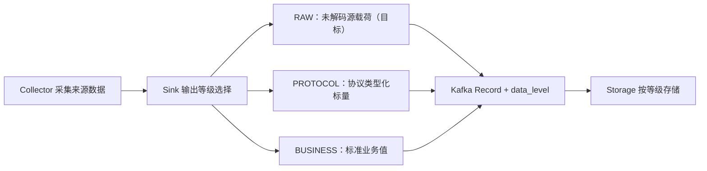

<p class="figure-caption">图 6-1 三级数据处理责任及 Storage 存储入口</p>

### 6.5.2 Kafka 至 TDengine 的字段映射

Kafka 的 `data_level` 必须为小写字符串 `raw` / `protocol` / `business`，Storage 在校验后转换为数据库数值 `1` / `2` / `3`。枚举数值和名称一经入库不得复用、重定义。

| Storage 逻辑字段 | 来源 | 持久化规则 |
|---|---|---|
| `data_level` | Kafka `data_level` | **必填**，`TINYINT`，只允许 1、2、3；不接受未知值及空值 |
| `sample_time` / `ts` | Kafka `sample_time` | UTC，保留原精度及精度边界处理结果 |
| `sample_id` / `sample_key` | Kafka 样本身份及确定性身份算法 | 原始 ID 和稳定去重键分别持久保存或可可信回查 |
| `point_id` | Kafka 来源点 ID | 保留，不因业务映射覆盖 |
| `business_point_id` | Kafka 业务点 ID | BUSINESS 必须有合法映射；其他等级按正式协议允许 `null` |
| `unit` | Kafka 单位 | 仅在对应等级定义允许时存在，RAW 不推测工程单位 |
| `value_*` / `payload_*` | Kafka 值或原始载荷 | 类型化存储；RAW 字节序列不得无损性未经证明就转浮点 |
| `quality` | Kafka 质量 | 原样保留，非法/未知状态不得伪装为 good |
| `point_table_id` | Kafka 不可变 PointTable ID | 作为版本化物理存储身份，保存完整 ID |

同一笔 Kafka Record 的 `data_level` 应当与所属表族的等级 TAG/不可变存储映射相等；即使采用每等级独立超级表，**仍保留数据库记录中的 `data_level`**，供查询、导出、审计和一致性校验。TAG 可冗余，但不代替记录级标志字段。SQL 物理列名固定为 `data_level`，类型优先 `TINYINT`；实际 DDL 以 TDengine 3.3.6.13 验证结果为准。

### 6.5.3 类型、空值、幂等及等级隔离

- 三等级使用独立 Super Table/Sub Table 族（§6.3、§10.4），并在样本身份及幂等计算中**包含 `data_level`**。同来源 `sample_id`、同 `sample_time`、同 `point_id` 的三个等级是三条合法不同记录；同等级同身份同内容重复写入必须幂等。
- RAW 可携带二进制数据的能力只是 Storage 的未来类型约束；实际 Kafka 线格式若采用 JSON，原始字节须先由上游明确编码方式（如有界 Base64）和载荷长度/解码规则；Storage 不自行创造新的 Producer 字段或默认隐式 Base64。
- PROTOCOL 保存协议类型化值，不使用 BusinessPoint 标准单位伪装为已业务转换；BUSINESS 的 `business_point_id`、`unit`、值域必须与消息及固定 PointTable 闭包一致；Storage 不重复执行任何转换。
- `value` 为 `null` 时保留缺值与质量语义，不将 `null` 变为零。数字类型、无符号整数、布尔、文本和字节载荷采用明确的无损类型化列或受控编码；具体 SQL 值列方案须经 TDengine 实测后冻结。
- 等级非法、Payload 与等级不匹配、表 TAG 等级不一致、同键异内容等属于确定性校验错误；不得回退到其他等级或静默提交 Kafka Offset。

### 6.5.4 查询与接口兼容性

查询及导出必须允许按 `data_level` 精确过滤，并在每条返回样本中保留等级。默认查询等级必须由请求或 Storage 正式服务配置明确指定，**不得隐式混合不同等级后求平均、累计或覆盖**。跨等级比较属于显式分析操作，不是默认历史查询聚合行为。Kafka 旧 `engineering` 值属于现行上游契约：在后续 Sink 正式更改前，不可冒充新 `protocol`；对旧记录的接收策略和数据迁移必须单独验证，不能凭字符串替换沿用相同语义。

---

# 7. Kafka 消费与按需建库建表

## 7.1 主流程

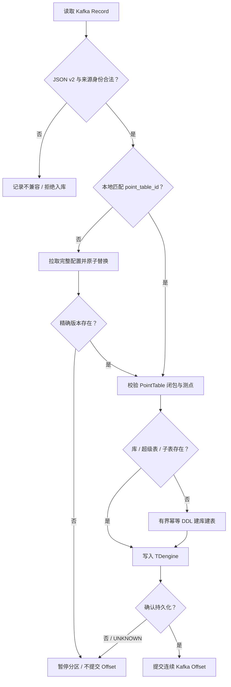

<p class="figure-caption">图 7-1 版本化数据按需建表与持久化确认</p>

## 7.1.1 首次建库应用 TDengine 原生配置

当首次合法数据需要创建尚不存在的数据库时，从**当前已验证的 Storage Service 配置代际**读取对应原生数据库参数；校验 `KEEP` 与 `DURATION` 的关系、单位、范围、数据库所属范围和权限后，以白名单 SQL 模板构建 `CREATE DATABASE IF NOT EXISTS`。创建成功后同样必须回读 `information_schema.ins_databases` 确认实际参数（`IF NOT EXISTS` 不能证明已有对象符合期望）。

同一进程只允许对已授权的 Storage 管理数据库执行 DDL；不同设备可以共用配置确定的一个数据库，但不得用 Kafka 任意字符串直接构造数据库名。首次创建和已有数据库复核采用同一个收敛函数，避免启动与首批写入规则分叉。

## 7.2 DDL 幂等规则（并发所有权详见 §7.5）

- 以逻辑 Schema 身份执行单飞（single-flight）DDL，限制并发数；跨进程并发需靠数据库实际幂等 DDL 与 Schema 复核保证正确。
- 检查存在与实际 DDL 之间可能存在竞态：以 `IF NOT EXISTS`/受支持的安全 DDL 配合事后核验；失败不改写已有 Schema。
- 数据写入、Offset 提交与 DDL 三者不是一个跨系统事务，必须能够从“建表成功、写入未确认、Offset 未提交”恢复。
- 缓存中版本数可受内存限制，但持久快照不应因 LRU 清理丢失唯一的历史版本证据。

## 7.3 幂等写入与 Offset

消费按每 Kafka 分区顺序跟踪处理状态，只有从该分区上一个已提交 Offset 起连续确认的记录才能推进提交水位。跨分区可以并发，单分区处理不能越过前面的未完成记录提交。

幂等逻辑至少包含来源 `(wind_farm_id, collector_id, task_id, device_id, point_table_id, sample_id, point_id)`；具体数据库主键/冲突策略须证明同一事件重复写入无副作用、同时间戳不同来源点不会覆盖，并具有可检测的冲突处理。禁止仅以 `sample_time` 或 Kafka Offset 作为全局样本身份。

## 7.4 失败分类（处置细则见第 11 章）

| 情况 | 处理 | Offset |
|---|---|---|
| Configuration 暂不可用，但缓存有精确闭包 | 继续安全写入，后台对账 | 成功写入后才提交 |
| 未知 PointTable ID | 主动全量拉取、验证、原子替换 | 缺失期间不提交 |
| 全量拉取后原 ID 仍不存在 | 重试间隔有界，暂停分区并告警 | 不提交 |
| 缺失历史依赖或哈希冲突 | Fail-closed，禁止用最新版本补全 | 不提交 |
| TDengine 不可用 / 写入结果未知 | 背压、幂等重试、状态可观测 | 未确认不提交 |
| 非法字段 / Schema 不兼容 | 拒绝入库，事件上报，按人工审查或后续受控错误隔离策略处理 | 未明确确定处理策略前不提交 |


## 7.5 并发模型与资源所有权

本节规定 Storage 首版的并发、配置切换与资源生命周期。**采用 Partition 内串行、Partition 间并行的最小模型**；没有实测收益和明确需求，不引入同一 Partition 内乱序写入调度、跨实例分布式锁或通用任务编排框架。这里的“串行”指一条分区处理链在前一条 Record 得到可证明处理结论前，不继续将后一条 Record 交给写入执行；可在不改变此顺序的前提下组成有界批次。Kafka 协议允许一个 Consumer 读取多个 Partition，不要求每分区独立线程。

### 7.5.1 并发执行结构

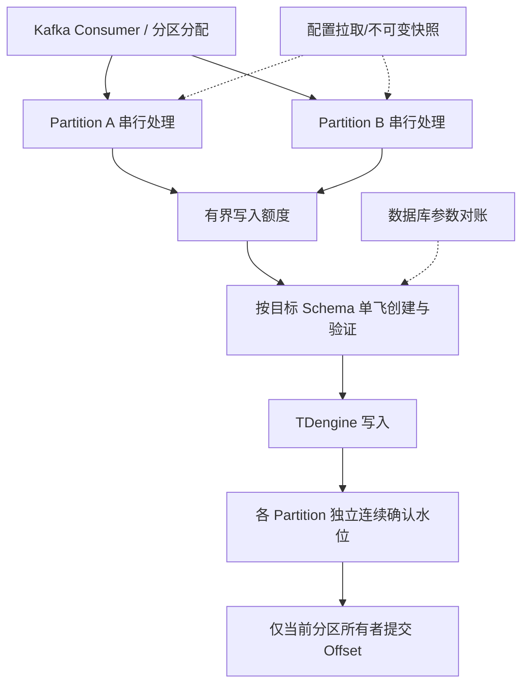

<p class="figure-caption">图 7-2 Storage 分区串行与跨分区有界并行结构</p>

| 资源/状态 | 唯一负责者 | 并发边界 | 正确性条件 |
|---|---|---|---|
| Kafka Consumer 和分区分配 | Consumer 管理组件 | Consumer 所属事件循环/线程 | 消费、暂停、恢复和提交在客户端规定的安全调用上下文执行 |
| 单个 Partition 的 Record 序列与 Offset 水位 | 该分区当前有效所有者 | Partition 内串行；不同 Partition 可并行 | 未确认前序 Record 不得被后续成功记录越过提交 |
| TDengine 写连接及在途请求 | 写入 Worker / 连接池 | 全局有界；按连接的驱动线程安全约束使用 | 超时后请求可能仍执行，不提前复用危险资源 |
| Schema 创建状态 | Schema 管理组件 | 按完整逻辑 Schema 身份单飞 | `IF NOT EXISTS` 后读取实际结构并校验，不能只依赖本地锁 |
| 配置快照与历史 PointTable 索引 | 配置管理组件 | 单飞拉取、完整校验、原子切换不可变快照 | 每条 Record 从开始到结束固定一个已验证快照引用 |
| TDengine 库级参数及收敛状态 | 数据库管理组件 | 同一数据库串行对账/ALTER | 受影响数据库禁止在不一致状态接收新写入 |
| Offset 提交请求 | 分区当前有效所有者 | 同分区提交串行化 | 成功或重试只基于当前代际的连续成功前缀 |

### 7.5.2 Partition 所有权、顺序与回收

1. Consumer Group 每个分区任一代际最多有一个**有效**消费所有者；Rebalance 前后的旧处理任务可能短时重叠，因此不能只靠 Broker 分配语义保证本进程异步任务不冲突。
2. 每次分区分配生成本进程的分区**所有权代际**（局部递增令牌，不进入 Kafka Record、TDengine 或公共 Contracts）。每条在途任务绑定当时代际；撤销或丢失分区时标记该代际失效、停止领取新记录。
3. 旧代际任务可能在撤销后才取得 TDengine 写入成功响应；可以保留结果用于诊断，但**不得由旧代际提交 Offset、恢复分区或修改新代际水位**。已入库数据由新所有者在重放时通过稳定样本身份去重。
4. 同一分区至少记录 `next_offset`、`confirmed_offset`、`committed_offset` 与 `assignment_generation`；Offset 提交使用 Kafka 语义的“下一条待读 Offset”，只推进连续已持久化前缀。提交失败时不改变持久化结论，允许重放。
5. 暂停分区或等待外部服务期间，仍须满足 Kafka 客户端的 Poll/心跳与 `max.poll.interval.ms` 约束；不能在 Consumer 回调线程上执行无界 TDengine I/O 或睡眠。需要重新分配时按本节所有权代际恢复，不自行跳转 Offset。

### 7.5.3 建库建表单飞与跨实例边界

- 单飞键使用**完整逻辑身份**，而非仅表名短哈希：Database 按场站，Super Table 按设备类型/PointTable/数据等级/Schema 指纹，Sub Table 再包含设备完整身份；与第 10 章命名算法保持一致。
- 进程内同一键只有一个创建执行者，其余等待同一结果；对不同键的 DDL 使用全局并发额度限制。创建请求的取消不能令已开始的底层 DDL 假定撤销。
- 并发竞争采用 TDengine 支持的 `IF NOT EXISTS`，之后**每一个竞争者都校验**对象归属、TAG、列定义和哈希；不一致一律 `SCHEMA_CONFLICT`。进程内单飞只减少冗余 DDL，不替代数据库侧验证。
- 首版限制**每个受管数据库只有一个有权限执行配置收敛的 Storage 实例**。Kafka Consumer 可多实例消费不同分区，但未授权的实例不执行库级参数 ALTER；跨进程建表仍依赖安全 DDL 和实际 Schema 验证，不引入分布式锁。多实例部署须明确唯一数据库策略所有者的运维配置，否则不满足自动收敛准入条件。

### 7.5.4 配置切换与数据库参数收敛

- Configuration 下载完成后，先校验完整闭包及哈希，再生成新的**不可变快照**。发布新快照只进行原子引用替换；已经开始处理的 Record 继续持有原引用，未开始的 Record 才绑定新引用。旧快照在最后一个引用释放后回收。
- 收到重复或乱序广播时合并修订目标，拉取操作单飞；较旧的拉取结果不能覆盖已发布的较新快照。PointTable 依据消息携带的完整 ID 精确解析，不因快照切换自动换为推荐版本。
- 对某数据库执行受控 `ALTER DATABASE` 前设置该库的写入门闩：停止接收**新**写操作，等待或可信隔离既有在途写入，再执行检查、ALTER 和回读。不能在单纯等待超时后假设旧写入已经停止；对账成功且门闩仍对应当前有效配置代际，才能恢复该库写入。
- 新配置在对账过程中到达时，原收敛操作完成后重新读取**最新目标配置**，禁止旧结果直接宣称新代际已收敛。不同数据库独立收敛；无关库和分区继续运行，但同一 Kafka 分区仍受未确认前序 Offset 限制。

### 7.5.5 资源限额和关闭顺序

首版使用现有 Kafka Consumer 分区串行机制和统一有界 TDengine 写入额度，不预设每分区专属线程。资源上限至少覆盖：最大并行分区处理数、最大在途 SQL、等待 Schema 创建数、配置拉取并发和数据库收敛并发。达到限额时暂停新记录的处理并形成背压，不创建无界 Future、任务或缓存。具体默认值须按压力测试冻结，不能直接复用 Sink 的在途额度。

优雅停止按 **停止领取新 Record → 撤销新写入资格 → 等待已有 I/O 安全结束或可信隔离 → 提交仍归本 Consumer 所有的连续成功 Offset → 关闭 Consumer、数据库连接及配置快照资源** 的顺序执行。`UNKNOWN` 不计为确认成功；无法安全结束的底层请求保留必要的隔离与可观测状态，重启后按 Kafka 重放恢复。

**禁止事项**：全局锁包住全部数据库写入；在持锁期间跨网络长时间等待；由后台 Worker 自行提交已撤销分区的 Offset；根据 `IF NOT EXISTS` 返回直接认定表结构正确；用取消 Future 代替确认 TDengine I/O 完成；为首版引入 Redis/NATS 分布式互斥协调服务。

---


## 7.6 性能负载、写入批量与资源所有权

### 7.6.1 目标负载与任务组织

首版以 **30 台风机、10 Hz、每台 500 测点**作为单等级理想满载工况，真实 Kafka JSON 逐点 Record 口径为 150,000 Record/s。该规模是 Storage 单实例目标，不代表当前 Kafka、Sink 或 TDengine 已经实现相应吞吐。

每个 Kafka Partition 内按 Offset 顺序执行确认，Partition 间在全局额度下并行；采用有界记录聚合与 TDengine 批量写入。批量大小、最长等待时间、Consumer 并行分区、SQL 并发、连接池容量是**明确的调优参数**，而非固定的硬编码常量。一次批写可容纳不同 Record，但须保留逐条结果与所属 Partition/Offset，禁止因“批量成功”而误认其中未持久化的记录成功。

### 7.6.2 资源预算与容量边界

| 资源 | 预算或限制要求 | 饱和时行为 |
|---|---|---|
| Kafka 分区处理 | 每分区仅一条有效处理链，全局并行数可配置 | 停止继续领取或暂停相关分区 |
| Kafka 消费缓存 | 条数、总字节数均可配置且必须有硬上限 | 背压，不丢弃尚未持久化记录 |
| TDengine 批量写入 | 最大记录数、最大请求字节数、等待时长明确 | 达额立即提交本批；不可无界聚合 |
| TDengine 在途 I/O | 全局最大请求数与连接池容量均受限 | 有界等待后暂停领取 |
| Schema 建立 | 仅未知库表首次 DDL，跨键并发数受限 | 阻塞受影响键，不阻塞无关表 |
| 配置快照 | 已验证版本闭包及缓存有可观测大小 | 失败保持旧快照；未解析版本阻断 |
| 查询与导出 | 查询超时、分页、导出并行数和字节上限 | 显式拒绝或降级查询，不占满写入额度 |

**禁止**为达吞吐目标提前确认 Kafka Offset、忽略 SQL UNKNOWN、放弃 Schema 校验或绕过正确性检查。具体参数的默认值与上下限应在 Storage Service YAML 与验证记录中统一冻结，不复制 Sink Service 的数字。

# 8. Configuration 集成与版本演进

## 8.1 配置身份、来源和唯一选择

依照总体架构 v1_26 §5.7、Contracts v1_40 §10、Configuration v1_17，配置仅使用 **Service → Instances → Templates**，由 Deployment 明确选择 Service/Instance 的不可变文件版本：

- `deployment_id` 和 `service_id` 来源于 Storage 本地最小引导；业务 Service 只声明 `config_sources.instances.site`、`config_sources.instances.devices` 两个**Instance 逻辑 ID**。Site/Device 由 Deployment 选择精确文件版本；Device Instance 的 model 引用固定 DeviceModel ID/版本，DeviceModel 固定引用 PointTable ID/版本。其他依赖（业务点、单位）由精确不可变 Template 引用构成，无最新推荐版本兜底。
- 一个 Deployment 的 `services.storage-main` 必须选到同名 Service；`instances.site.<id>`、`instances.device.<id>` 必须分别选择且能完整闭合。Deployment 是版本选择清单而非独立运行服务；Configuration 通过完整目录候选和一次 `PublishCandidate` 原子提交，不存在第二次 Activate RPC。
- 不允许 Service 自身 `config_sources` 直接携带 PointTable/BusinessPoint/Units 模板路径或版本列表；这些旧字段从 Storage 配置结构、读取逻辑和测试样例删除。多个 Deployment 共存不能互相覆盖；与 Storage 闭包无关的 Repository 变更不得改变其活动状态。
- Service 运行参数（Kafka、TDengine、认证、备份、查询、重试等）仍归 Service YAML。只读历史语义闭包属于**数据解释证据**，不应为了保留历史而人为让当前 Service 引用所有过去的模板版本。

## 8.2 唯一查询接口及真实依赖边界

Storage 查询部署目标使用正式 Contracts 的 `GetServiceConfigBundle(deployment_id,service_id,revision_id=0)`，返回仓库游标、服务闭包 `target_revision`、文件集合及 Manifest。文档校验依次验证：调用身份、部署选择、返回 Revision/Manifest/字节长度、各文件 SHA-256 与语义内容哈希、配置身份/文件版本、Instance 引用、Template 固定版本、设备绑定、业务点与单位闭包，然后才允许进入候选状态。

`GetCurrentRevision` 仅用于查询仓库发布游标；`wh.config.changed` 是非权威提示。历史固定版本优先使用 `GetPointTableBundle(point_table_id,expected_manifest_sha256)` 与既有可信归档，**但该接口当前设计返回的 `point_table_id/device_type/documents/manifest` 不能天然证明某一历史 `wind_farm_id + device_id` 的设备实例归属**。因此独立的 Device Instance→DeviceModel→PointTable 历史绑定证据也必须有可核验的文件与摘要，缺失时拒绝将 Kafka 自报 `device_type` 当成建表准入证据。

**主分支依赖闭包**：`GetServiceConfigBundle`、`GetCurrentRevision`、`GetPointTableBundle` 已由 `src/contracts/configuration_repository.proto` 定义，Storage 通过正式生成的 Stub 调用；不得复制 Proto 或退回推荐版本猜测历史依赖。

## 8.3 target_revision / active_revision / 发布游标

配置版本具有三种不同身份：

| 字段 | 数据类型/来源 | 含义 |
|---|---|---|
| `repository_revision_id` | uint64；Configuration 发布游标 | 仅用于通知、并发发现和快照读取 |
| `target_revision` | SHA-256 小写 64 位十六进制；有效目标闭包 | Deployment 当前为本 Service 选择的全部不可变配置 |
| `active_revision` | 同一算法、同一范围；有效活动闭包 | 此进程已完整生效的配置 |

闭包摘要必须复用 Core `closure_sha256(deployment_id,service_id,documents)`：对 `config_type/config_id/file_version/content_sha256` 四元组规范排序，逐字段 UTF-8 长度前缀编码并包含 `deployment_id/service_id`。严格校验 Repository 返回的目标摘要，不能由 Storage 自定义略有差异的哈希算法。

- 未发生本 Service 有效闭包变化：保持 target/active，不重启组件、不重建数据库，即使全局发布游标递增。
- 完整热更新成功：完成新闭包验证、持久化、原子可见性切换后同时更新 active=target。
- 存在不可热更新差异：目标更新为新完整闭包，但活动保持旧完整闭包，`restart_required=true`；局部允许更新的数据语义索引仅在能够保持旧活动业务行为、且单独持久化历史证据时应用，**不能**错误宣称全目标已激活。
- 完整新目标不可信：保留活动配置；若权威目标摘要不可确认，报告 `CONFIG_RECONCILE_DEGRADED`，不能伪造目标摘要。无可信活动缓存时服务 `NOT_READY`。
- 进程停止或启动尚未加载配置时，`active_revision` 不得表示当前进程仍活动。

对外状态/诊断需包含 `deployment_id`、`service_id`、三个修订字段、`restart_required`、`last_reconcile_error` 和按数据库/Partition 的独立健康状态；若现有 Common Proto 缺少字段，本阶段标记**外部契约待对齐**，不得修改共享接口或通过字符串塞入不相干字段。

## 8.4 发布通知与原子生效时序

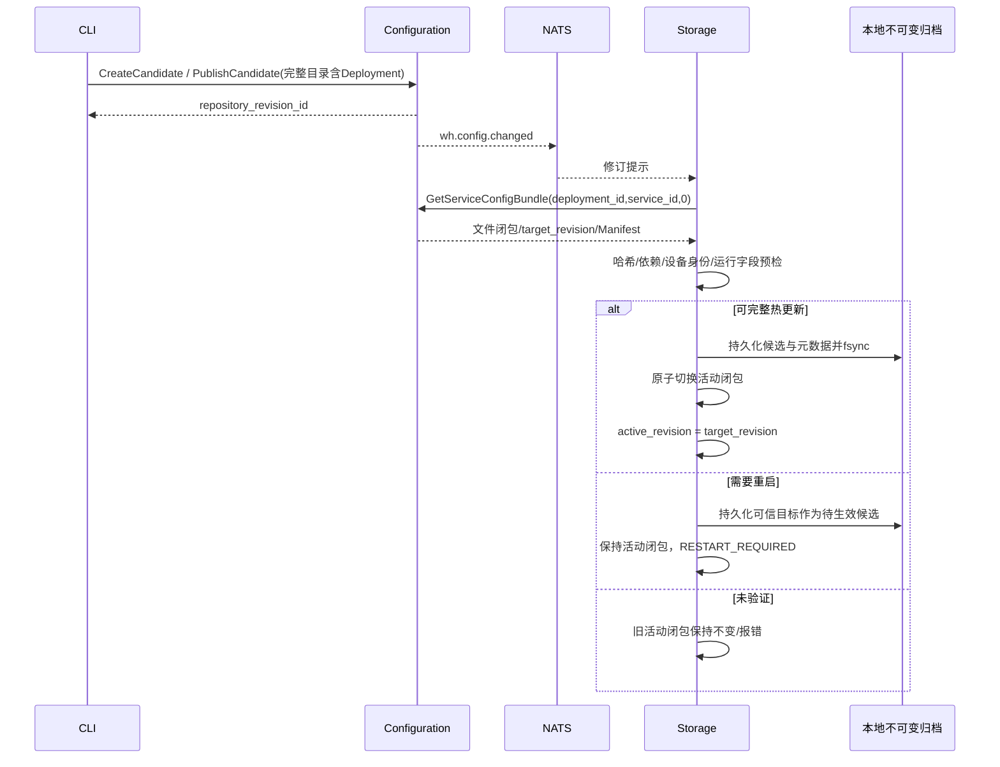

- 启动顺序为：读取最小引导 → 建立通知订阅 → 主动获取目标 → 验证并保存可信候选 → 原子应用可热更新的一致性单元 → 允许数据接入。订阅失败可用周期对账补偿；无法证明权威目标时仅能按已验证缓存受控运行。
- 普通 NATS Pub/Sub 非 Queue Group；广播不保证投递，一次失败不影响其他服务。周期对账、重连、重复/乱序通知、未知 PointTable 的历史拉取通过单飞协调，合并重复刷新；有界退避和资源限额。
- **先全量验证，再写持久介质**：配置中的不可变设备身份冲突、点表版本冲突、Manifest 不一致必须在写 SQLite 元数据、CURRENT 指针或任何对业务可见状态前拒绝。异常中止后恢复时检查校验和及代际标记，不允许磁盘已经切换但内存仍报告旧目标已激活。
- Kafka 记录和 DDL 在入队时绑定固定且经验证的解释上下文，跨版本切换的在途批次继续使用原上下文；失败保留 Partition Offset，绝不采用新的 PointTable 解释已有数据。

## 8.5 完整的动态/静态字段分类

| 配置类型 | 动态策略 | 活动生效条件 |
|---|---|---|
| 仓库无关发布/Deployment 中其他 Service 改动 | 不更新 | target/active 摘要保持不变 |
| PointTable / DeviceModel / Instance 固定版本的新历史证据 | 只添加可信历史归档；允许当前业务闭包的安全语义增量切换 | 既有历史身份不能重绑定，依赖完整且持久化 |
| Kafka bootstrap/topic/group、Storage 服务身份、Deployment ID、TDengine endpoint/credential、进程端口及访问授权策略 | **重启** | 旧进程不触碰新静态资源；完整重启后重新解析 |
| TDengine 首次建库的 PRECISION/DURATION 及数据库所有权 | 不可原地转换 | 发生差异进入 CONFLICT，不删除/重建 |
| TDengine KEEP/CACHEMODEL/CACHESIZE | DB 级受控收敛 | §9.4 回读确认，KEEP 缩短额外一次性许可 |
| 查询/导出/备份限额、Kafka buffer/batch、重试和对账间隔 | **首版统一重启**，避免跨线程/在途任务半代配置 | 后续确需热更新时先设计整组原子切换，不能悄悄改写 |
| 不可验证的设备闭包、非法 BusinessPoint/Units 映射 | 拒绝 | 不创建新库表，不推进 Offset |

初版热更新范围**有意收窄**：仅已验证的配置引用闭包/历史语义索引，其他 Service 运行字段一律待重启；不无证据宣称动态修改全部进程的运行参数。新目标静态变化时即使同时带有可增量归档的历史配置，也只有在整个服务目标已经生效后才可令 active=target。

## 8.6 历史版本独立解析及回滚

- Kafka JSON v2 的 `point_table_id` 是精确、不可变的语义 ID；`device_id/device_type` 必须从固定版本的 Device Instance/DeviceModel 证明。历史重放不依赖当前 Deployment 最新选择，不重复执行协议/业务转换，不将数据记录时的含义反向修改。
- 本地以内容寻址归档保存固定原始 YAML 与全部引用闭包摘要；保留重启恢复索引。未知版本触发可信历史查询与归档，查不到则 `CONFIG_HISTORY_UNAVAILABLE`，暂停受影响分区但保持其他分区可推进。
- 用户回滚通过 CLI 再次完整目录发布已有历史 Deployment 引用；Storage 没有额外 Activate。回退可重用相同文件版本/哈希，**不能**覆写已归档的相同完整身份。
- 缩短 KEEP 需要特定数据库/原保留期/目标保留期/发布修订的一次性授权，且与当前安全策略一致；仅在 Service 配置中长期启用布尔标志不足以授权删除数据。

## 8.7 与其他分支的接口差异及处理权限

| 差异 | 当前事实 | S2 处理约束 |
|---|---|---|
| 配置 RPC | 设计分支 Proto 有 GetServiceConfigBundle 等；Storage 分支 Proto 无 | 仅改 Storage 的适配器和纯逻辑；联调之前报告共享接口前置阻断，不自行扩展 Contracts |
| 数据等级 | 设计分支 Contracts v1_40 的 engineering 与 Storage 的 protocol 语义不同 | Storage 继续严格验证当前正式 JSON v2 枚举，不创建兼容别名、不修改 Sink/Collector |
| 安全 | 内部 gRPC 取消 TLS/mTLS，保留敏感操作令牌鉴权 | Storage 只修改自身分级授权，不改变 Gateway/Recovery Authority |
| 运行状态 | Storage 现有 Common Proto 未必有 target/active 两个独立字段 | 优先复用已定义字段；无正式字段时作为外部契约差异记录，不伪造 RPC |
| 测试 | legacy full-chain 含退役 CLI 和旧线格式假设 | 只修 Storage 配套测试，跨模块问题交外部模块维护方 |

**进入 S2 的条件**：本章行为、字段分组、失败语义和测试验收冻结，明确以上外部前置能力；允许独立完成 Storage 开发，但禁止将依赖未满足的集成场景判 PASS。

# 9. 查询、统计、导出与生命周期

## 9.1 查询

提供站点、设备类型、设备号、`point_table_id`、数据等级、`point_id`/`business_point_id`、时间范围、质量筛选；有界分页和稳定排序。跨版本标准业务点的聚合须验证数据类型、单位及语义兼容；不能直接按同名 `point_id` 合并。

## 9.2 统计

支持时间窗口内数量、最小、最大、平均、可选分位数等有定义统计。对 BAD/UNCERTAIN、NULL、重复样本的计入口径必须明确，聚合结果保留覆盖范围和质量信息。

## 9.3 导出、备份与保留

CSV 导出必须流式/异步，限制时间跨度、行数、任务数及磁盘容量；备份生成可校验清单并记录任务状态，禁止任意远程传入服务端绝对路径。

### 9.3.1 TDengine 原生数据保留期

首版由数据库级 `KEEP` 决定时间序列记录的最长保留时长；TDengine 自行执行过期文件清理，Storage 不实现定期 `DELETE`、后台清理器或自定义 TTL。首版不使用超级表级 `KEEP`，不启用复杂的多级保留/降采样作为必需能力。`KEEP` 不等同于 Kafka Retention、TDengine WAL Retention、备份保留期或导出文件保留期。

`KEEP` 必须满足目标 TDengine 版本的取值规则，并且通常要求 `KEEP` 不小于三倍 `DURATION`。配置变化后不能保证历史数据在 `ALTER` 返回的瞬间立即被清理；状态及验收以 TDengine 实际行为为准。**缩短保留期可能导致现存历史数据随后被删除**，因此默认为禁止自动缩短，只有 `allow_retention_shrink: true` 才可执行，并要求审计记录原值、目标值、操作者已发布配置身份及影响数据库。授权不保证支持撤销已过期数据。

## 9.4 TDengine 原生参数与数据库配置收敛

### 9.4.1 参数分类和版本能力边界

首版提供明确的受控参数白名单，不开放任意 SQL 或任意 TDengine 全局配置。下表描述设计支持策略，并非已经在本项目 TDengine 3.3.6.13 全部验证通过。

| 参数 | 用途 | 首次建库 | 已有数据库处理 |
|---|---|---|---|
| `KEEP` | 最长数据保留时间 | `CREATE DATABASE` | 原生 `ALTER DATABASE`，缩短需授权 |
| `CACHEMODEL`、`CACHESIZE` | 最新值缓存模式/容量 | `CREATE DATABASE` | 原生 `ALTER DATABASE`，修改后复查 |
| `BUFFER` | vnode 写入缓冲区 | `CREATE DATABASE` | 候选可调整项；3.3.6.13 实测确认后启用自动修改 |
| `WAL_FSYNC_PERIOD`、`WAL_RETENTION_PERIOD` | WAL 刷盘与日志保留 | `CREATE DATABASE` | 候选可调整项；先验证目标版本及权限 |
| `PRECISION` | 时间戳精度 | `CREATE DATABASE` | 不执行自动修改，报 `RESTART_SCHEMA_CONFLICT` |
| `DURATION` | 时序数据文件跨度 | `CREATE DATABASE` | 不执行自动修改，报 `RESTART_SCHEMA_CONFLICT` |
| `COMP`、`WAL_LEVEL` | 文件压缩、WAL 策略 | 按实际版本支持创建 | 已有库修改须经专项兼容验证，不默认自动改 |
| `REPLICA` | 数据副本数 | 按集群与版本能力创建 | 不纳入首版自动调整，需受控运维操作 |

注意：TDengine 官网 SQL 页面持续更新，包含高于 3.3.6.13 的功能。例如 `MAXROWS` 在线修改在 3.4.2.8 发行说明中明确增加，因此**不能照搬当前网页宣称 3.3.6.13 支持所有 `ALTER` 选项**。第一阶段可自动收敛的最小集合固定为经确认的 `KEEP`、`CACHEMODEL`、`CACHESIZE`；其余要先实测并登记能力矩阵，不成功时明确失败，绝不以忽略差异代替收敛。

### 9.4.2 实际参数查询与归一化

使用 TDengine 原生元数据 API 获取当前事实，示例如下（`farm_a` 为已校验的管理库名）：

```sql
SELECT *
FROM information_schema.ins_databases
WHERE name = 'farm_a';
```

必要时对照 `SHOW CREATE DATABASE farm_a;`。对比时将 `KEEP`、`DURATION` 统一转换为同一时间单位，将 `CACHEMODEL` 等规范化为同一枚举形式；未显式配置的字段不参与强制修改，避免将数据库系统默认值误判为不一致。查询缺失的列、版本不匹配或读取失败视为 `UNVERIFIED`，不得推断为一致。

### 9.4.3 受控更新与复核流程

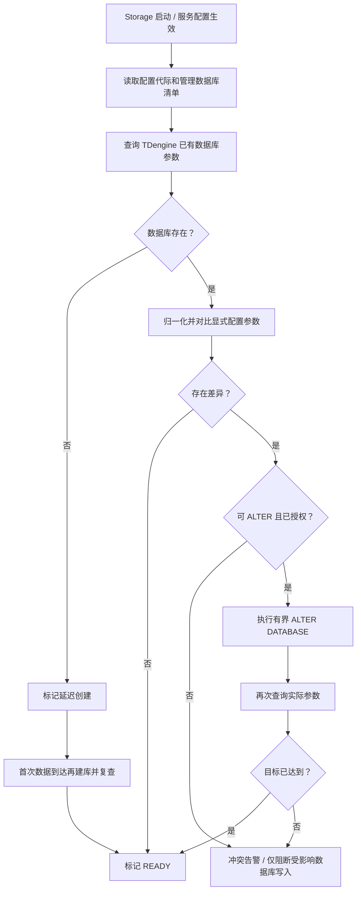

<p class="figure-caption">图 9-1 TDengine 原生参数检查及收敛流程</p>

收敛操作以数据库为互斥边界，同一库串行执行；配置发布期间发生新一轮更新时必须拒绝旧目标覆盖新目标。执行前确认管理所有权；执行后重新读取并与**当前有效配置代际**比较。`ALTER` 调用超时属结果未知，先回读后决定下一步，不盲目连续执行。

### 9.4.4 失败边界及状态

| 状态 | 条件 | 写入处理 |
|---|---|---|
| `READY` | 明确配置参数一致、表结构兼容 | 正常写入 |
| `PENDING_CREATE` | 不存在且尚无业务数据 | 允许启动消费，首次记录先建库验证再写入 |
| `RECONCILING` | 正执行支持的在线修改 | 暂停受影响库的写入、其他库独立运行 |
| `CONFLICT` | 不可在线修改或未经授权的变更 | 拒绝相关库写入并报告具体参数差异 |
| `UNVERIFIED` | 无法取得可验证元数据、ALTER 结果未知 | 暂停相关库写入并重试；Offset 不前进 |

不允许通过删除/重建数据库、迁移全部历史表、静默忽略冲突、自动修改不受 Storage 管理的数据库，来规避差异。已存在数据库的 Schema 仍须按 §6.4 检查，数据库参数一致并不等于表结构一致。

### 9.4.5 受控 SQL 示例

以下是 TDengine SQL **示意**，实际语法、单位和能力按目标版本检验；命名经 Storage 受控映射：

```sql
CREATE DATABASE IF NOT EXISTS farm_a
  PRECISION 'us' DURATION 10d KEEP 365d
  CACHEMODEL 'none' CACHESIZE 1;

ALTER DATABASE farm_a KEEP 365d;
ALTER DATABASE farm_a CACHEMODEL 'none';
ALTER DATABASE farm_a CACHESIZE 1;
```

SQL 中的 `365d` 是演示配置，不是系统默认保留期，也不是性能指标。系统不自动执行 `TRIM DATABASE` 或 `DROP DATABASE`。SQL 行为应由真实 TDengine 3.3.6.13 集成测试验证。


---

# 10. TDengine 存储对象命名与 Schema 一致性

## 10.1 目标、适用范围和唯一权威

本章定义 Storage 自动创建与管理 TDengine Database、Super Table、Sub Table、列、TAG 和逻辑身份映射的**唯一命名契约**。所有创建、查询、回放、重启校验和恢复操作调用同一个命名组件，严禁各 Adapter 单独拼接名称。命名规则只作用于 TDengine 物理对象，不改变 Kafka JSON v2、Configuration 的 `point_table_id` 或业务字段名称。

命名函数具有**纯函数、确定性、无环境依赖**特征：输入身份及算法版本相同时，重启、跨节点和重放得到相同名称。Storage 只能为它被授权管理的场站数据库建库建表，不从 Kafka 载荷派生任意 SQL。

## 10.2 身份域、哈希和命名算法

### 10.2.1 原始身份

| 对象 | 唯一逻辑身份（有序元组） | 来源与校验 |
|---|---|---|
| Database | `wind_farm_id` | Kafka，且需符合 Storage 已授权场站范围 |
| Super Table | `wind_farm_id, device_type, point_table_id, data_level, schema_fingerprint` | Kafka + 已验证 Configuration 闭包 + Storage 物理模型版本 |
| Sub Table | `wind_farm_id, device_type, device_id, point_table_id, data_level, schema_fingerprint` | Kafka + 上述闭包；不得只用设备号 |
| 业务列身份 | `data_level, business_point_id` 或 `data_level, point_id` | 由该版本 PointTable/BusinessPoint 精确匹配；不得由无验证的字段产生 DDL |

`schema_fingerprint` 是对**冻结的物理列/TAG 定义、类型、排序和主键策略**的规范化描述计算的摘要，不能直接取 `point_table_id` 或 YAML 字节哈希代替。物理模型改变必须显式产生新的 fingerprint 和表族，不原地重解释旧表。`device_type` 取 Kafka 已定义的设备类别，并与配置闭包逐项核验；当前样例里 `device_type_id: turbine` 与 Kafka 示例 `wtg` 不等同，缺少明确转换证据时拒绝写入。

### 10.2.2 确定性哈希

1. 对身份元组按顺序组成 JSON 数组，元素必须是原始 UTF-8 字符串，禁止不明确的拼接分隔符；`null` 或空标识不可参与生成。
2. 采用 UTF-8、无冗余空白的规范化 JSON 字节序列（每个值转义规则固定；Python 参考 `json.dumps(values, ensure_ascii=False, separators=(',', ':')).encode('utf-8')`）。仅用于身份编码，不接受浮点数或隐式类型转换。
3. 使用 SHA-256 计算十六进制小写摘要，取前 **24 个十六进制字符（96 bit）**作为物理名称的哈希后缀。摘要截断仅用于物理对象标识，完整原始身份及 256-bit 摘要必须保留并在所有 DDL 前核对。
4. 发现截断哈希相同而完整身份不同时，**阻断建表并报告 `NAME_COLLISION`**，不得静默追加随机字符或改用另一个算法。
5. 不允许直接对原始 ID 执行小写化、删除特殊字符、截断后当作身份：`WTG-01` 与 `wtg_01` 等可能归并。

### 10.2.3 唯一物理名称

| 对象 | 固定格式 | 示例（`<hash24>` 为计算结果占位，不是实际摘要） |
|---|---|---|
| Database | `wh_<hash24>` | `wh_0123456789abcdef01234567` |
| Super Table | `st_<hash24>` | `st_1123456789abcdef01234567` |
| Sub Table | `tb_<hash24>` | `tb_2123456789abcdef01234567` |

三个前缀分别标识对象类别；名称仅使用 ASCII 小写字母、数字和下划线，正则为 `^[a-z][a-z0-9_]*$`。固定长度远低于 TDengine 对表名的 192 字符上限，也避免用户标识非法字符。**不得用人类可读原始场站或设备 ID 取代哈希**；可读名称、版本信息通过映射查询和 TAG 恢复。

完整算法在首次正式建表前冻结，命名规则代际属于 Storage 物理存储契约，不能随配置热更新改动。业务点新增、更名、单位变动导致 PointTable 身份变化时创建新表族，不重命名旧表。

## 10.3 Database 命名、所有权与保留策略

数据库仅以授权的 `wind_farm_id` 生成，并由 Storage 的受控身份映射记录反向绑定。场站的 `site_id` 不自动等同于 `wind_farm_id`；目前样例配置 `example_site` 与消息示例 `farm-a` 不一致，须通过显式已验证关系解释。

首次数据触发的建库操作必须同时满足：(1) 场站授权；(2) Storage 业务配置有效；(3) 物理数据库不存在或已验证归属；(4) 目标 TDengine 数据库参数通过本设计 §9.4 校验。库已存在时检查归属、`KEEP` 等原生参数和预期配置；无法证明归属时禁止执行 `ALTER` 或写入。库的生命周期不因设备停用、配置文件移除或消费组变更而自动 `DROP`。

库级 `KEEP` 为首版唯一数据保留策略，不另外对每个设备/测点生成 TTL 清理器。若需同场站多个保留策略，属于新的数据库划分契约，不能临时修改现有命名输入。

## 10.4 Super Table 与 Sub Table 的版本隔离

同一 `wind_farm_id + device_type + point_table_id + data_level + schema_fingerprint` 使用同一个超级表。不同不可变 PointTable ID 即使当前列结构相同，**首版仍分别建超级表**，防止历史版本混读；`RAW`、`PROTOCOL`、`BUSINESS` 彼此隔离。

同一设备在每个超级表中对应一张子表：以完整身份元组生成 `tb_<hash24>`。不能仅用 `device_id` 或 `sample_time` 命名及定位，避免不同场站、设备类型、配置版本之间的碰撞。

示例说明（摘要仅为占位）：

```text
wind_farm_id=farm-a
  wh_<farm_hash24>
    st_<wtg_point_table_v1_business_schema_hash24>
      tb_<WTG001_v1_business_hash24>
      tb_<WTG002_v1_business_hash24>
    st_<wtg_point_table_v2_business_schema_hash24>
      tb_<WTG001_v2_business_hash24>
```

这里的尖括号是解释性占位，不是实际 SQL 名称。创建成功后必须建立并校验 `logical_identity → database/stable/table` 的一一映射；重复建表必须返回同一映射。

## 10.5 列、TAG 与原始身份保存

首版采用**窄表模型**：每个 Kafka SampleItem 对应一条逻辑样本，存储 `sample_time`、样本唯一身份、强制 `data_level TINYINT`、源 `point_id`、BUSINESS `business_point_id`、该等级的类型化值或原始载荷、`quality` 及必要时间字段。列名由固定数据模型定义，例如 `ts`、`sample_key`、`sample_id`、`data_level`、`point_id`、`business_point_id`、`value_*`、`payload_*`、`quality`、`publish_time`、`receive_time`；数据类型由已验证 BusinessPoint 类型选择，**不允许根据任意 Kafka JSON Key 自动新增列**。`value_*` 的类型化列已在 §16.2 冻结，其数据库运行兼容性按 G-01 验证，不以一个 `DOUBLE` 强制承载 `bool`、`uint64` 和字符串而损失精度。

TAG 至少需能够恢复完整设备身份、PointTable ID 和等级语义；如果 TDengine TAG 字节上限不足以直接保存全部字段，则通过受控、持久的**身份映射元数据**保存全值，TAG 保留可校验的稳定键。源 `point_id` 与 `business_point_id` 必须分开保留，且映射从固定版本闭包获得。数据库与表映射不得只放在进程内 LRU；重启后必须可恢复并证明所有权。

**复合主键是额外的写入正确性契约**：同一子表内仅凭 `ts` 不能区分多个测点，`(ts, sample_key)` 的第二键需在同时间戳下区分不同来源测点与不同有效事件。`sample_key` 由包含 `data_level` 的稳定来源身份生成并保存完整映射证据；再次消费同一业务样本必须产生相同键。同键不同内容不能直接让 TDengine 的覆盖/UPSERT 语义吞掉冲突，必须先有可验证的比较或冲突检测策略。实际复合主键 DDL、键长度及重写行为未在 TDengine 3.3.6.13 实测前均标注 **待验证**。

## 10.6 建表操作及 Schema 对账

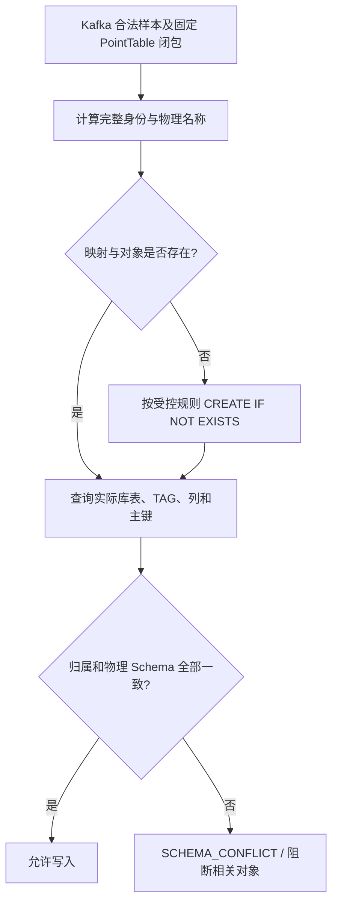

<p class="figure-caption">图 10-1 存储对象的命名、创建及回读核验</p>

启动检查**已有受管对象**；首次出现新 PointTable 时惰性建表。校验范围包括：完整映射身份、数据库所属场站、超级表及子表绑定关系、TAG 值、列顺序/名称/数据类型、主键形态、物理模型指纹、TDengine 数据库参数。`IF NOT EXISTS` 的执行成功并不构成这些条件的证明。

在同一对象上实行单飞、总并发限额及 SQL 白名单；跨进程竞争依赖实际 DDL 的幂等性和事后校验。建表成功而写入失败时保留空表，不做删除式补偿；下次消费仍按上述流程校验后重试。

## 10.7 查询与重启的命名兼容性

历史查询先以 `wind_farm_id/device_type/device_id/point_table_id/data_level` 找到所有已验证的物理表，不能从当前最新 PointTable 推算旧表。重启时重建/校验持久映射，发现命名算法版本与已有元数据不一致或表被外部改名时进入受限状态；不得自动新建一套同名逻辑的空表掩盖原历史数据。

配置中可设置受控的库表数量和 DDL 速率限制，但不可改变命名散列算法、前缀及哈希长度。每次变更预期建库、建表数须有计数器及配额告警。

---

# 11. 存储异常处理与故障恢复

## 11.1 正确性目标与故障等级

Storage 保证：**只有 TDengine 持久化结果可信时才推进该 Kafka 分区已连续处理记录的 Offset**；消费链路以 At-Least-Once 为基础，通过稳定业务样本身份和幂等写入消除重复消费副作用。Kafka Offset 与 TDengine 写事务之间不存在跨系统原子提交，不能声称 Exactly-Once 端到端事务。

内部处理结果统一区分 `SUCCESS`、`FAILURE`、`UNKNOWN`；此处是模块内部判定，不新增公共 RPC 枚举。`UNKNOWN` 必须回读或幂等重试，不得等同于已失败。明确拒绝的不合法数据既不能存为有效点，也不能在没有可靠隔离证据时提交其 Offset。

## 11.2 异常分类及处理矩阵

| 故障类别 | 场景/触发 | 隔离与恢复 | Offset 规则 |
|---|---|---|---|
| Kafka | Broker 断线、Rebalance、授权失效、Offset 不可用 | 重连、重新分配；检查消费水位和保留期 | 仅提交连续成功区间 |
| 数据输入 | 非法 JSON、字段缺失、非有限数、时间异常、类型溢出 | 保留原始 Topic/Partition/Offset 与错误证据；等待受控隔离/处置 | 未可靠隔离前不提交 |
| 版本与语义 | `point_table_id` 未命中、版本闭包缺失/冲突、源测点不匹配 | 先完整重拉配置并原子替换；仍缺失则阻断受影响分区 | 不提交 |
| Configuration | 断线、超时、Manifest/哈希错误 | 有合法精确版本快照可用则继续；否则受限退避 | 视是否成功写入 |
| DDL | 建库/建表超时、并发创建、同名不同结构 | 回读元数据、幂等重试或 `SCHEMA_CONFLICT` | 未成功写入不提交 |
| DML | 网络超时、结果 UNKNOWN、重复样本内容冲突、部分成功 | 按稳定样本键核验与重试；冲突隔离 | 未全部确认不提交 |
| TDengine | 磁盘满、WAL 问题、只读/不可达、连接池耗尽 | 背压、熔断/有界重试、容量告警 | 不提交未确认记录 |
| 配置收敛 | `KEEP` 缩短未授权、不可 ALTER 参数、ALTER UNKNOWN | 回读比较；冲突阻断受影响库 | 不提交相关记录 |
| 进程生命周期 | 崩溃、SIGTERM、任务取消、超时后 I/O 仍在途 | 恢复已提交 Offset、重复消费、追踪悬挂 I/O | 不凭退出/超时确认写入 |

## 11.3 写入 UNKNOWN、部分成功与幂等性

```mermaid
%%{init: {"sequence": {"useMaxWidth": true}}}%%
sequenceDiagram
    participant K as Kafka
    participant S as Storage
    participant D as TDengine
    K->>S: Record A (稳定 sample_id)
    S->>D: INSERT A
    D->>D: 实际已写入
    D--xS: ACK 丢失 / 超时
    Note over S: UNKNOWN; Offset 不提交
    S->>D: 按完整身份查询或幂等 INSERT A
    D-->>S: 核实 A 存在且内容一致
    S->>K: Commit 连续 Offset
```

<p class="figure-caption">图 11-1 数据库写入结果未知与恢复</p>

写入批量可能部分成功：只能为有单条可信确认及明确映射的记录标记成功；无法逐条证明时整个批次维持 `UNKNOWN`，利用稳定主键重放，并禁止提交越过最早未知记录的 Offset。同一 `(sample_time, sample_key)` 但 `data_level/value/quality/point_id/版本` 内容不同属于**业务冲突**，不能让最后写入胜出；实现需选用可验证的冲突前置校验、稳定内容哈希或安全的持久记录策略。仅在 TDengine 真实验证后冻结具体 SQL。

## 11.4 Kafka Offset、水位与 Rebalance

每个分区保持已获取、已写入、已确认、已提交四类单调水位，按 §7.5 绑定有效分区所有权代际。允许跨分区并发；同分区即使使用批处理或异步写入，也只能推进**从前一个已提交位置起连续成功的最大水位**。先持久化后提交 Offset；提交失败时重放是正常行为，不能生成新的 `sample_id`。

Consumer 分区撤销时停止该分区领取新记录，受控等待/取消并跟踪尚未完成 I/O；在可靠确认前不得提交超前水位。长时间暂停处理仍维持必要的 poll/心跳与组成员资格；发生不可恢复 Rebalance 时通过持久样本身份重放，不使用内存状态伪造写入完成。

Kafka 记录过期、Offset 越界或 Broker 删除尚未消费数据时报告独立**数据缺口**；不能静默重置到 latest/earliest 然后声称无丢失。监控最老未处理消息年龄、Consumer Lag 与 Kafka retention 剩余安全窗口。故障恢复期间未能在 Broker 保留期内恢复的数据不能由 Storage 自行重建。

## 11.5 缺失配置与热更新并发

收到未知 `point_table_id` 时先查本地不可变历史归档，再按当前正式可用的历史闭包查询能力取得固定版本及设备绑定证据；成功验证后只补充历史索引，不改变活动 Service 版本。**当前发布配置不等于可以替换历史点表**；历史查询 RPC 在本开发分支缺失时保持受影响 Partition/Offset 阻断，绝不退回推荐版本或猜测身份。

配置切换时每个批次固定引用一个已验证快照代际，不能中途换单位/类型。配置失效期间，若现有快照包含消息所需不可变闭包，可依旧代际完成当前数据写入；若需新的库策略而无法验证，禁止该库写入。拉取单飞、退避有上限；快照落盘和 CURRENT 指针切换须可断电恢复。

## 11.6 DDL 部分成功、Schema 冲突与数据库参数

`CREATE DATABASE`、`CREATE STABLE`、`CREATE TABLE`、`INSERT` 不构成一个跨语句事务。遇到创建成功、后续写入失败，保留已创建对象，下次按第 10 章查询并复用，不做 `DROP` 回滚。两名 Worker 并发发现同一子表时，一个创建、另一个验证；`IF NOT EXISTS` 成功但结构不同仍进入 `SCHEMA_CONFLICT`。

已有数据库在重启和配置更新时按 §9.4 执行受控参数对账。`ALTER DATABASE` 超时先回读实际值；`PRECISION`/`DURATION` 差异或缩短 `KEEP` 未获授权时不执行危险变更。禁止自动删除、重建或迁移全部历史表来规避冲突。

## 11.7 故障隔离与状态机

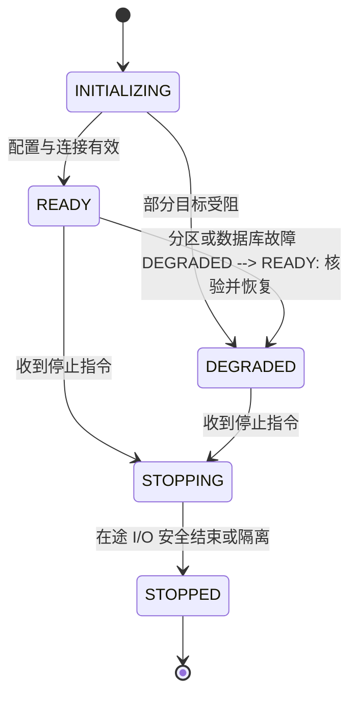

<p class="figure-caption">图 11-2 Storage 服务运行与降级状态</p>

服务健康状态应复用项目既有契约，不私自新增公共状态枚举；`CONFIG_MISSING`、`SCHEMA_CONFLICT`、`DDL_UNKNOWN`、`DML_UNKNOWN`、`RETENTION_CONFLICT`、`OFFSET_GAP` 等作为内部诊断原因。单条异常不得无理由阻塞其他分区；但一个分区出现未完成的前置 Offset 时不能越过它提交后续记录。全局 TDengine 不可达可降级整体写入，而查询服务是否还能工作须按真实连接状态分别判定。

## 11.8 确定性坏消息与隔离证据

不可恢复的数据格式错误不应无限无意义重试；但跳过坏消息也不能无证据推进 Offset。首版定义**默认停留在该 Offset 并告警**；可扩展的受控隔离策略必须先对原始 Kafka 字节、Topic、Partition、Offset、时间、错误类型、内容摘要建立**持久、可校验、有限容量**的异常记录，并证明隔离证据已落盘之后才允许作为已处理推进。隔离存储故障或容量不足时 fail-closed，不能跳过。不得不经用户要求引入新的必需外部中间件或修改 Sink DLQ 契约。

## 11.9 停机与重启恢复顺序

1. **启动**：加载最小引导、恢复已验证配置快照和命名元数据；连接 Configuration、TDengine、Kafka，验证 TDengine 版本与管理数据库归属及原生参数。
2. **一致性对账**：校验数据库/超级表/子表、TAG、Schema 和异常记录存储；对允许变更的参数执行受控 ALTER 后回读。未存在的库保持惰性创建。
3. **恢复消费**：从 Kafka Consumer Group 已提交水位恢复；重放可能已持久化但 Offset 未提交的样本，以稳定键去重，不重复创建新表族。
4. **退出**：停止领取新数据，等待在途写入结果可信确认或安全隔离；仅对连续确认的数据提交 Offset；释放 Kafka、TDengine 与缓存资源。截止时间到达不等于 I/O 已安全结束，不得把 UNKNOWN 标为成功。

## 11.10 指标和验收要点

必须按场站、数据库、分区及失败类型统计：版本缓存未命中/重拉结果、自动 DDL 次数及冲突、数据写入 `SUCCESS/FAILURE/UNKNOWN`、样本冲突、重复消费、Offset 提交失败、Kafka Lag、最老未处理消息年龄、TDengine 写入背压、参数收敛差异和恢复时长。指标标签使用受限维度，单个 `sample_id` 不作为时序指标标签。

验收必须在真实 Kafka/TDengine 环境注入：ACK 丢失、INSERT 后断连、Offset 提交失败、重复样本同键异值、同时间戳多点、同名冲突、DDL 部分成功、历史 PointTable 缺失、配置热更新、保留期收缩、磁盘满、Rebalance 和进程崩溃。没有运行记录不能宣称可靠性已验收。

---

# 12. 接口、配置与开发结构

## 12.1 对外接口范围

Storage 对外 RPC 以主分支 `src/contracts/storage_service.proto` 与 `src/contracts/common.proto` 为唯一可执行权威；配置闭包接口以已发布的 `configuration_repository.proto` 为权威。Storage 只实现既有 Server，禁止自行复制/拓展共享 Proto。Config/状态目标字段不在现有共享接口时标记外部前置，不通过私有扩展假造已支持。

| 业务组 | 计划操作 | 输出 |
|---|---|---|
| 数据查询 | `QuerySamples`, `QueryAggregates` | 有界记录及统计 |
| 导出 | `CreateExport`, `GetExportTask` | 异步任务、结果元数据 |
| 备份 | `CreateBackup`, `GetBackupTask` | 备份任务、完整性摘要 |
| 运维 | `GetStorageStats` | Kafka 水位、Schema 数量、TDengine 容量与故障指标 |

## 12.2 配置结构

Storage 启动依赖受控最小引导文件；实际字段与启动校验以主分支实现为准。仅靠引导不构成完整 Service 配置，实际编译和启动准入须校验 Configuration 提供的被选中 Service 闭包：

```yaml
# Storage 最小引导配置（本机，非 Configuration 全局业务文件）
# schema_version: 必填，整数 1
# file_version: 必填，MAJOR.MINOR.PATCH
# service_id: 必填，字符串，对应 Deployment 所选 Service ID
# deployment_id: 必填，字符串，对应独立部署域
# configuration.endpoint: 必填，隔离内网 gRPC 地址
# nats.servers: 必填，非空 URI 列表
# configuration.token_env: 必填，令牌环境变量名称；不填密钥明文
# cache.directory: 必填，本机持久化绝对路径
schema_version: 1
file_version: 1.0.0
service_id: storage-main
deployment_id: prod-a
configuration:
  endpoint: 127.0.0.1:51060
  token_env: WIND_HUB_STORAGE_CONFIG_TOKEN
nats:
  servers: [nats://127.0.0.1:4222]
cache:
  directory: /var/lib/wind-hub/storage/config-cache
```

Kafka Topic/Group、TDengine 地址/认证、DDL 并发、消费背压、查询/保留、备份根及重试参数均为 **Configuration 集中发布的 Storage Service 业务配置**；本地引导不重复携带完整业务配置。

### 12.2.1 Storage Service 集中业务配置完整示例

以下原样展示本开发分支 `configs/services/service_storage-main_v1.1.0.yaml` 的正式 Storage 目标结构。Configuration 的 Service Schema v2 顶层仅包含通用字段（`schema_version`、`file_version`、`service_id`、`config_sources`、`service`），所有 Storage 运行参数严格置于 `service` 对象下；服务端 `load_storage_config` 只接受此布局。Deployment 必须选择该文件版本。尚未完成跨分支真实联调。

```yaml
# Storage Service v2: Deployment-selected instances; operational parameters under service.
# schema_version: required int 2; file_version: required semantic triple MAJOR.MINOR.PATCH.
# service_id: required nonempty string <= 256 bytes.
# allowed_wind_farms: required nonempty unique list of authorized farm IDs;
#   all Kafka records outside this list are blocked before SQL/DDL.
# config_sources.instances.site: required logical Site Instance ID, version from Deployment.
# config_sources.instances.devices: required logical Device Instance ID, version from Deployment.
#   Device Instance pins DeviceModel which pins PointTable; no Template sources in Service.
# grpc.listen_host: loopback 127.0.0.1 or ::1; listen_port [1,65535];
#   max_active_rpcs [1,512], allow_unauthenticated_status bool default false.
#   Only three sanitized Common status RPCs may be public when explicitly enabled.
# auth.callers: required list of {token_env, permissions, wind_farms}; each token_env
#   refers to a unique environment variable; wind_farms must explicitly list
#   authorized farm IDs (use "*" only for admin operations).
#   permissions: storage.read|storage.export|storage.backup|storage.inspect|
#   storage.operate|storage.admin. No plaintext secrets in YAML.
# kafka.bootstrap_servers: required broker host:port list, comma-separated; no implicit localhost.
# kafka.topic/group_id: required nonempty strings; max_poll_records [1,5000] records;
#   max_partition_workers [1,64] partitions; max_buffer_records [100,100000] records;
#   max_buffer_bytes [1048576,536870912] bytes; commit_interval_ms [100,10000] ms.
# tdengine.endpoint: REST address; credential_ref: required env:VARIABLE, no plaintext.
#   database.precision fixed us; duration/keep positive integer days with keep >= 3*duration.
#   database.cachemodel: none|last_row|last_value|both; cachesize [1,1024] MB.
#   max_connections [1,64]; max_inflight_sql [1,32], <= max_connections;
#   max_concurrent_ddl [1,8]; batch_max_records [1,10000] records;
#   batch_max_bytes [4096,8388608] bytes; batch_wait_ms [0,1000] ms;
#   write_timeout_ms [100,120000] ms.
# configuration.reconcile_interval_s [5,3600] s;
#   cache_max_bytes [16777216,2147483648] bytes.
# query.max_page_size [1,1000] points; max_range_days [1,365] days;
#   max_concurrent [1,32]; timeout_ms [100,120000] ms.
# export.root: authorized absolute directory; max_jobs [1,16];
#   max_bytes [1048576,10737418240] bytes.
# backup.enabled: false until target TDengine 3.3.6.13 secure taosdump auth/restore Spike passes.
# backup.root: authorized absolute directory; max_jobs [1,4];
#   max_bytes [1048576,1099511627776] bytes; timeout_s [30,14400] seconds.
# retry.initial_ms [100,60000], max_ms [1000,600000] and >= initial_ms;
#   max_attempts [0,100] where 0 means retry count is unbounded but concurrency is bounded.
# reconciliation.auto_alter and allow_retention_shrink: boolean, default false.
#   KEEP shrink additionally requires independent one-use authorization evidence.
#   owner_instance_id: required, equals service_id; v1 is single-instance only.
schema_version: 2
file_version: 1.1.0
service_id: storage-main
config_sources:
  instances:
    site: example_site
    devices: farm-a
service:
  allowed_wind_farms: [farm-a]
  grpc:
    listen_host: 127.0.0.1
    listen_port: 51110
    max_active_rpcs: 64
    allow_unauthenticated_status: false
  auth:
    callers:
      - token_env: WIND_HUB_STORAGE_OPERATOR_TOKEN
        permissions:
          [storage.read, storage.export, storage.backup, storage.inspect, storage.operate, storage.admin]
        wind_farms: [farm-a]
  kafka:
    bootstrap_servers: 127.0.0.1:9092
    topic: windhub-history
    group_id: storage-main
    max_poll_records: 500
    max_partition_workers: 4
    max_buffer_records: 20000
    max_buffer_bytes: 67108864
    commit_interval_ms: 1000
  tdengine:
    endpoint: 127.0.0.1:6041
    credential_ref: env:WIND_HUB_TDENGINE_PASSWORD
    database:
      precision: us
      duration: 10d
      keep: 365d
      cachemodel: none
      cachesize: 1
    max_connections: 8
    max_inflight_sql: 4
    max_concurrent_ddl: 2
    batch_max_records: 1000
    batch_max_bytes: 1048576
    batch_wait_ms: 20
    write_timeout_ms: 10000
  configuration:
    reconcile_interval_s: 60
    cache_max_bytes: 268435456
  query:
    max_page_size: 1000
    max_range_days: 31
    max_concurrent: 4
    timeout_ms: 30000
  export:
    root: /var/lib/wind-hub/storage/exports
    max_jobs: 2
    max_bytes: 1073741824
  backup:
    enabled: false
    root: /var/lib/wind-hub/storage/backups
    max_jobs: 1
    max_bytes: 53687091200
    timeout_s: 600
  retry:
    initial_ms: 500
    max_ms: 30000
    max_attempts: 0
  reconciliation:
    auto_alter: false
    allow_retention_shrink: false
    owner_instance_id: storage-main
```

### 12.2.2 Deployment 与 Service 引用示例（目标，须随配置服务一起落地）

```yaml
# configs/services/service_storage-main_v1.1.0.yaml（目标配置身份示意，运行参数沿用 §16.8）
schema_version: 2
file_version: 1.1.0
service_id: storage-main
config_sources:
  instances:
    site: example_site
    devices: farm-a

# configs/deployments/deployment_prod-a_v1.4.0.yaml（仅展示 Storage 增量选择）
# services.storage-main: {config_id: storage-main, file_version: "1.1.0"}
# instances.site.example_site.file_version: "1.1.0"
# instances.device.farm-a.file_version: "1.4.0"
```

Storage 只选择 Site/Devices **Instance 逻辑 ID**；Service v2 运行参数置于独立 `service` 对象；Device Instance → DeviceModel → PointTable 属模板层固定依赖。Deployment 必须增加相应版本选择，示例不是直接可发布的完整 Deployment 文件。完整的 Storage Service 文件必须保留全部 Kafka、TDengine、auth、query、backup、reconciliation 等生产配置字段及文件头说明。不得将上面示意性内容直接作为生产可运行 YAML。

## 12.3 开发视图

```text
src/storage_service/
  domain/                 # 样本身份、Schema 及版本不变式
  application/            # Ingest、版本收敛、查询和任务用例
  infrastructure/
    adapters/             # Kafka / NATS / gRPC Configuration / TDengine
    persistence/          # 受控持久化配置代际、Schema 元数据
  interfaces/
    grpc/                 # Storage Service RPC
  assembly.py             # 依赖装配
  main.py                 # CLI 可启动的进程入口

tests/src/storage_service/
  unit/
  component/
  integration/
  system/
```

目录是设计目标，避免新增 `/src/typings` 或 `/src/configuration`；通用解析复用 `core.configuration`。模块及代码文件名不含设计版本号。

## 12.4 部署与进程

首版一个 Storage 服务进程；Kafka、TDengine、NATS、Configuration 属外部依赖。E2E 中各业务模块均通过正式 CLI 启动，Kafka/NATS/TDengine 由独立测试 Fixture 启动；不使用 Mock 替代真实消息链路。

---

# 13. 安全、可观测与性能

## 13.1 安全与 RPC 分级授权

内部 gRPC 使用标准明文 HTTP/2 连接，默认绑定 loopback；跨主机仅允许部署于隔离专用网络并依赖主机/容器访问控制，**不配置 TLS/mTLS、CA、客户端证书或证书主体映射**。明文内网无法保障传输保密，不能当作可信外部网络通信方案。Storage 只采用需要时的应用层 Bearer 令牌鉴权，不使用来源请求体自报的 caller_id 代替认证。

**按接口而不是一律按 gRPC 服务端口授权**：

| 接口 | 令牌策略 | 数据暴露边界 |
|---|---|---|
| `GetServiceInfo`, `GetServiceStatus`, `GetCapabilities` | 仅允许受控内网、按显式配置允许免 Bearer；默认仍要求 `storage.inspect` | 无令牌响应只包含服务角色、粗粒度 HEALTHY/DEGRADED、固定能力名；不得包含配置、Broker/TDengine 地址、场站、任务 ID、异常堆栈或敏感依赖详情 |
| `QuerySamples`, `QueryAggregates` | 必须 `storage.read` + 指定 `wind_farm_id` 范围；不开放匿名跨场站查询 | 必须在 SQL 查询前鉴权并限制时间窗和条数 |
| `GetStorageStats`, `ListBlockedPartitions` | 必须 `storage.inspect`，跨场站/全局诊断仅 `storage.admin` | Offset、分区、故障原始摘要等均非公开信息 |
| `CreateExport`, `GetExportTask` | 必须 `storage.export` + 风场范围 + 创建者任务所有权 | 任务存在性与导出路径不得泄露给其他调用方 |
| `CreateBackup`, `GetBackupTask` | 必须 `storage.backup` + 风场范围 + 所有权 | 备份文件/路径、数据范围不得匿名查询 |
| `RetryBlockedPartition` | 必须全局 `storage.operate` + `storage.admin` 权限门槛（可由 admin 涵盖），审计理由与目标分区 | 未确认 Offset 不得因权限放宽被跳过 |
| 其他 Common 管理/配置 RPC | 未实现则返回 UNIMPLEMENTED；若未来实现变更操作必须鉴权 | 不能把未实现操作当成免鉴权通道 |

- 在 Service 配置新增 `grpc.allow_unauthenticated_status: bool`，**默认 false**。只有 loopback 或受控隔离网络的实际部署访问控制符合要求时才能为 true；对外开放匿名仅限三项已脱敏 Common 方法。S2 必须同步严格 Config Schema 与测试；不实现依赖网络来源 IP 字符串的伪认证。
- 已通过 Bearer 的只读/管理调用仍需令牌有效、权限和风场范围校验；认证失败 UNAUTHENTICATED，权限不足 PERMISSION_DENIED。仅允许匿名状态接口时不需要 token，且没有匿名上升为 `storage.read` 的路径。
- `Storage→Configuration` 的配置读取涉及服务配置和敏感凭据引用，继续使用受控 Bearer 与查询权限，不因普通状态接口可免令牌而开放。
- Kafka 与 TDengine 使用各自独立的受控认证和最小权限；禁止把任意 Kafka 身份直接拼接成 SQL 标识符或接受用户任意绝对路径。保留风场隔离、操作审计及已有 fail-closed 语义。

## 13.2 核心指标

- Kafka：消费速率、提交 Offset、水位落后、暂停分区、重平衡次数及延迟。
- 配置：`repository_revision_id`（游标）、`deployment_id/service_id`、`target_revision`、`active_revision`（闭包摘要）、`restart_required`、拉取延迟、失败数与历史闭包验证失败。
- TDengine：写入成功/失败/UNKNOWN、批次条数、DDL 次数/冲突、主键冲突、重放去重、SQL 时延。
- 存储：数据库/表/设备数、存储用量、查询/导出/备份任务及剩余空间。
- TDengine 配置：按库的 `READY/PENDING_CREATE/RECONCILING/CONFLICT/UNVERIFIED` 状态、参数差异数量、`ALTER` 次数/失败率、保留期缩短授权审计及目标配置代际。

## 13.3 资源边界

Kafka 分区处理队列、配置拉取单飞、版本索引内存、TDengine 连接池、DDL 并发、SQL 批量、查询分页、导出/备份资源均设置正整数上限；没有已验证容量阈值前不称通过性能 SLA。

---


## 13.4 理想接入能力、性能指标与优化策略

### 13.4.1 性能指标口径

理想负载见 UR-20。性能报告至少分别统计以下**封闭的核心指标集合**：

| 指标 | 单位 | 来源与口径 | 边界与验收 |
|---|---|---|---|
| `storage.persisted_points_total` | counter，point | 确认落库的唯一逻辑测点；按等级分开统计 | 重放同一幂等样本不得重复累加 |
| `storage.persisted_points_rate` | gauge，point/s | 指定有效窗口内唯一持久化点数除以秒数 | 无有效窗口标记 unavailable，不虚构 0 |
| `storage.kafka_records_rate` | gauge，record/s | Kafka 成功解析且提交处理链的 Record 数/秒 | 与持久化点数分别报告 |
| `storage.kafka_lag` | gauge，record | Consumer Group 各分区最新 Offset 与安全提交位置差值 | 记录每分区及汇总，Broker 无法读取时 unavailable |
| `storage.write_latency` | histogram，ms | Consumer 获得记录至 TDengine 明确写入确认的耗时 | 给出 P50/P95/P99、样本数和时间窗 |
| `storage.write_unknown_total` | counter，attempt | TDengine 写入结果无法确认次数 | UNKNOWN 不得累计为成功 |
| `storage.cpu_usage` | gauge，core 或 % | Storage 进程 CPU 使用量 | 明确核心数量和采样周期 |
| `storage.memory_rss_bytes` | gauge，byte | Storage 进程驻留内存 | 记录峰值和稳定值 |
| `storage.tdengine_disk_bytes` | gauge，byte | TDengine 实际磁盘占用 | TDengine 无法提供时 unavailable |
| `storage.backpressure_seconds` | counter，s | 因受控资源不足暂停消费的累计时长 | 分原因统计，不以空闲误认为背压 |

窗口统计以单调计时计算测试区间时长；事件时间用于业务样本语义与历史查询，不用设备时钟偏差推断进程 I/O 延迟。所有 Counter 的初始化及重启后连续性必须在测试报告标识：进程内计数允许重置，不得将进程计数直接视作跨重启唯一数据总量。

### 13.4.2 稳态与吞吐判据

**实际确认持久化的唯一逻辑测点数**为主判据。对测试窗口内入库唯一测点数 $N_{\mathrm{persisted}}$ 与有效计时 $T_{\mathrm{window}}$（单位秒），定义：

$$
R_{\mathrm{persisted}}=
\frac{N_{\mathrm{persisted}}}{T_{\mathrm{window}}}
$$

稳态必须同时满足：数据逐点对账无未解释缺失/错误覆盖；Kafka Lag 没有持续正增长趋势；无不可恢复的配置或 Schema 阻断；测试窗口完整执行；CPU、RSS、SQL 在途请求数、缓冲队列和磁盘使用量在明确容量范围内。若 Kafka Lag 持续增长，即使短时写入峰值超过 150,000 点/s，也不得判定稳态达标。

建议每档至少 10 分钟稳定负载试验；最终最大稳定容量另外执行 60 分钟长稳测试（均属于本版拟定的**验收试验时长**，尚未执行），再进行数据库断连、Kafka Rebalance 和进程重启恢复试验。调优时先固定 Kafka、TDengine、硬件、测点集合及数据等级，仅改变单项参数并复测，不得混合不同硬件结果。

### 13.4.3 调优顺序

1. 验证 Kafka Producer 输入足量及 Consumer Group 分区分布，排除上游供数不足。
2. 保证 TDengine 批量写入而不是逐点独立 SQL，测量 SQL 时延和每批确认数。
3. 检查 Kafka 分区数、Partition 间并行度、Consumer Poll 与缓冲界限。
4. 检查 TDengine WAL、磁盘 I/O、CPU、数据库原生参数与批次并发。
5. 检查 JSON 解码、版本查找、缓存和指标统计的 CPU 成本。
6. 对瓶颈有证据后执行局部优化，保持 Offset、Schema 和幂等契约不变。

### 13.4.4 性能结果裁决

- **PASS**：在目标负载、规定试验时长和正确性门禁下实测稳定达到 150,000 点/s。
- **PASS WITH PERFORMANCE LIMITATIONS**：未达到理想负载，但正确性、可靠性、安全与要求的故障恢复测试全部通过；提供已优化后的最大稳定容量、适用部署资源、参数集合、负载边界和待改进项。不得对外宣称已满足 30 台满载目标。
- **FAIL**：正确性、Offset、故障恢复不通过，或未能提供可重现的稳定容量证据。

上述是本版拟定的 Storage 专项性能判定，最终总体准出还须遵守项目既有统一质量门禁。未执行的性能场景记 `NOT_RUN`，不计通过。

# 14. 测试设计与验收

## 14.1 测试层级

按 `tests/src/storage_service/{unit,component,integration,system}` 组织，标记与目录一致。开发中的基础契约测试以真实样本和仓库版本快照为依据；系统测试必须使用真实 Kafka/TDengine/Configuration（若配置服务未完成目标发布迁移，应标注真实限制）。

## 14.2 核心验收矩阵

| ID | 场景 | 通过标准 |
|---|---|---|
| T-01 | 无库首次写入 | 自动建库、超级表、子表并成功查询 |
| T-02 | 不同设备/设备类别 | 不串库、不串表、不混设备身份 |
| T-03 | 同设备 PointTable v1/v2 并存 | 版本隔离且旧版重放使用旧 ID |
| T-04 | Configuration 包含历史与当前 PointTable | 同逻辑 ID 多版本全部索引，原子切换不丢版本 |
| T-05 | 未知 `point_table_id` | 优先精确历史配置查询/可信归档；无法证明完整身份闭包则保持 Offset 并阻断分区 |
| T-06 | 重新拉取仍缺版本 | 暂停分区、告警、不提交 Offset、不猜新版本 |
| T-07 | 广播丢失/重复/乱序 | 独立对账，重复不回退；说明实际修订发现边界 |
| T-08 | 拉取校验失败/进程崩溃 | 原快照仍可用，CURRENT 不指向不完整数据 |
| T-09 | Kafka 重放/同时间戳多点 | 无重复、无错误覆盖、Offset 连续提交 |
| T-10 | TDengine 超时或中断 | 写入未知不提交，恢复幂等重放 |
| T-11 | 并发首次 DDL | 幂等，实际 Schema 与预期一致 |
| T-12 | 配置哈希冲突/非法单位 | 拒绝解释并阻断入库 |
| T-13 | Query/Aggregate/CSV/Backup | 实库读回、边界控制及任务恢复 |
| T-14 | 完整 E2E | DG→Gateway→Collector→NATS→Sink→Kafka→Storage→TDengine 真实比对 |
| T-15 | Kafka JSON v1 与当前严格 v2 | 旧格式必须拒绝；当前 Sink v2 需由真实 Producer Record 与 Storage 入库验证，未实测不能 PASS |
| T-16 | 首次建库原生 KEEP、DURATION、PRECISION | 生成 DDL，回读实际数据库参数符合配置 |
| T-17 | 重启后已有库 KEEP 不一致 | 授权条件下 `ALTER DATABASE` 成功，回读一致，保持全部已有表 |
| T-18 | 配置热更新 CACHEMODEL/CACHESIZE | 仅变更有差异参数，复查后恢复受影响库写入 |
| T-19 | PRECISION/DURATION 不一致 | 报 CONFLICT，不删库、不盲目改表、不确认未写记录 Offset |
| T-20 | KEEP 缩短及权限控制 | 默认拒绝；显式授权才修改，记录审计并验证已存在数据处理行为 |
| T-21 | ALTER 断连、超时或失败 | 回读判定结果，未收敛的库停止写入，其他库可正常工作 |
| T-22 | 真实 3.3.6.13 参数能力矩阵 | 特别验证 KEEP/CACHEMODEL/CACHESIZE；不将 3.4.x 语法误判为支持 |
| T-23 | 相同完整身份跨进程生成物理名称 | SHA-256 结果稳定、库表命名一致、命名组件单一 |
| T-24 | `WTG-01` / `wtg_01` 及不同场站同名设备 | 不混淆逻辑身份和子表，TAG/持久映射可回查 |
| T-25 | 截断哈希碰撞与外部同名表 | 检出 NAME_COLLISION / SCHEMA_CONFLICT，不执行危险 DDL |
| T-26 | 重启实际库表及元数据映射不一致 | 检出并阻断相关库表，不生成另一套掩盖历史数据 |
| T-27 | 同时间戳多点及同键不同内容 | 多点均保留，重复消息幂等，异值冲突不静默覆盖 |
| T-28 | DML 写入后确认丢失及 Offset 提交失败 | UNKNOWN 回读/重试，重放后不丢不重 |
| T-29 | Kafka Rebalance、暂停及 Broker 保留窗口耗尽 | 连续 Offset 安全；保留失效明确报告缺口 |
| T-30 | DDL 建表成功后进程崩溃 | 复用已存在表，校验后继续写，绝不 DROP 回滚 |
| T-31 | 格式坏消息及隔离证据落盘失败 | 默认保持 Offset 不变；证据失败不能跳过 |
| T-32 | 单库故障、其他库继续写入 | 限定影响范围；跨分区仍能并发推进 |
| T-33 | 同 Partition 写入延迟、后续记录先完成的模拟场景 | 首版保持分区串行；不提交超过最早未确认记录的 Offset |
| T-34 | 不同 Partition 并行写入及单库故障 | 独立分区互不串扰，资源上限与受影响库门闩有效 |
| T-35 | Rebalance 后旧代际 SQL 迟到成功 | 旧代际不提交 Offset、不覆盖新代际水位；重放正确去重 |
| T-36 | 配置快照切换与在途写入重叠 | 单条 Record 全程引用同一已验证快照，不混用 PointTable/Units |
| T-37 | 两 Worker 竞争首次建表、DDL 完成后响应丢失 | 进程内单飞、实际结构复核、无错误覆盖 |
| T-38 | ALTER 与写入交叠、配置连续更新 | 受影响库写入门闩有效，旧收敛代际不覆盖新目标，无关库继续处理 |
| T-39 | 进程退出时 TDengine I/O 未完成 | 不误认取消为成功，当前所有者仅提交已确认连续 Offset |
| T-40 | RAW/PROTOCOL/BUSINESS 三级输入及查询 | Kafka 字符串分别写成 1/2/3，单条记录可精确读回 `data_level` |
| T-41 | 同时间戳/同来源样本三等级并存 | 三条记录不互相覆盖，各自重复消费保持幂等 |
| T-42 | 非法等级、缺失等级、等级与 Payload 不匹配 | 拒绝入库、不静默转换、不误提交 Offset |
| T-43 | RAW 字节载荷与 PROTOCOL/ BUSINESS 类型保真 | 无损存取字节/有符号及无符号整数/布尔/文本；对未实施的 Producer 格式标 NOT_RUN |
| T-44 | 旧 `engineering` 数据拒绝及三级契约 | 不误映射为 PROTOCOL；现行 Sink/Storage 按严格等级校验 |
| T-45 | 查询、统计、导出跨等级筛选 | 默认不混合等级；等级字段与表族 TAG、映射一致 |

| T-46 | 理想业务数据单等级 30 台×10 Hz×500 测点持续写入 | System；实际 ≥150,000 点/s，连续 10 分钟；Lag 无持续增长，逐点对账一致 |
| T-47 | 同负载 60 分钟长期稳定性 | System；资源与 Lag 不呈持续失控增长，准确记录最大稳定吞吐 |
| T-48 | 100,000、75,000、50,000 点/s 阶梯回退 | System；确定各档稳定性，不能达到更高档时如实记录限制 |
| T-49 | 三等级同时落库的 450,000 Record/s 极限负载 | Integration/System；独立容量试验，区分 Record 与点、资源使用和数据等级 |
| T-50 | Kafka 足量但 TDengine 慢写导致积压 | Integration；测量 Lag 及背压，不提前提交 Offset、不无界缓存 |
| T-51 | 同条件优化前后批量与 Partition 参数对比 | Integration/System；保存相同硬件、版本、输入、指标和复测证据 |
| T-52 | 满载下触发 Rebalance、TDengine 短故障与重启 | System；恢复后逐点对账，正确 Offset 与最终积压清空 |
| T-53 | 未达 150,000 点/s 的性能准出报告 | System；最大稳定容量、限制参数、瓶颈、未通过项和裁决齐全 |

| T-54 | Deployment 明确选择 Storage Service 与 Site/Device Instance 的文件版本 | 不从推荐版本/目录路径隐式选择；未选 Storage 无 READY |
| T-55 | 全量发布包含 Storage 无关文件改动、丢广播、乱序广播 | target/active 不发生无谓变化；周期查询能最终收敛 |
| T-56 | 新目标含静态字段变化、热更新部分可生效 | target 为新完整闭包摘要，active 保持上一个完整活动闭包，返回 RESTART_REQUIRED |
| T-57 | 设备 Instance→DeviceModel→PointTable 固定版本切换、旧数据重放 | 历史版本解释不漂移、旧 PointTable 仍可验证、非法 device_type 不执行 DDL |
| T-58 | 不可变配置绑定冲突与快照切换故障注入 | 在写 SQLite、CURRENT 之前拒绝，重启后仍保持原活动代际 |
| T-59 | 跨分支数据等级与配置 RPC 契约一致性 | Contracts、Sink、Storage 唯一线格式；生成代码、运行态一致 |
| T-60 | Storage gRPC 分级鉴权 | 受控内网的三项脱敏 Common 状态 RPC 按开关可免令牌；其他敏感查询/管理必须验证 Bearer、权限、风场范围；无 mTLS |
| T-61 | 匿名状态开关与安全暴露 | 默认 false；true 时不得返回场站/地址/详细依赖状态，任何匿名调用不能访问样本、统计、任务或故障诊断 |
| T-62 | Repository 完整闭包 SHA-256 | 仅 Deployment 选中版本影响 target_revision；无关全局发布不改变 target/active |
| T-63 | 静态配置变更/服务重启 | target 新、active 旧且 RESTART_REQUIRED；重启后使用选定版本并更新 active |
| T-64 | 配置候选校验及持久化原子性 | 冲突拒绝发生在 SQLite/CURRENT 变更前；中断恢复不能混用不完整代际 |
| T-65 | 历史配置隔离/缺失及回滚 | 旧数据按独立历史闭包解释，缺失证据保留 Offset，不以当前 Deployment 替换 |
| T-66 | 缺少跨分支配置 RPC 的环境 | 显式 NOT_RUN/BLOCKED_EXTERNAL_CONTRACT，不伪造接口、无 recommended_version 回退 |
| T-67 | 协议/权限静态扫描 | Storage 无内部 TLS/mTLS 证书路径；未修改共享 Contracts/其他模块生产代码 |

## 14.3 静态与集成检查

需要执行 `ruff check`、`ruff format --check`、`mypy`、`lint-imports`、Proto 生成一致性检查、测试层级覆盖和真实服务进程退出回收。对未实际执行的项目不得填写 PASS。

---


## 14.4 性能测试配置、步骤与验收证据

### 14.4.1 统一测试条件

| 项目 | 固定要求 |
|---|---|
| 业务设备 | 30 台机组；每台 500 个测点；采样频率 10 Hz |
| 数据等级 | 主基线为 `business`，其他等级与三级同时存储独立分组 |
| 输入 | Kafka 中真实 JSON Record；所有记录有稳定 `sample_id`、`point_table_id`、时间戳与质量 |
| 配置 | Storage 服务配置、PointTable/BusinessPoint/Units 的不可变版本，以及 Kafka/TDengine 具体参数全部留档 |
| 运行基础 | Kafka、NATS、TDengine 由测试 Fixture 启动；Configuration、DG、Gateway、Collector、Sink、Storage 通过真实 CLI 独立进程启动 |
| 激励 | 恒定源输入，配置固定；DG 可将湍流度设为 0 以获得确定性真值 |
| 输出 | TDengine 可查询记录、Kafka Lag/Offset、进程 CPU/RSS、SQL 时延、错误及审计证据 |
| 数据对账 | 依据 DG 真值 JSONL 与目标级别的预期转换值逐点核对；RAW/PROTOCOL/BUSINESS 不混算 |
| 试验时长 | 每档建议 10 分钟稳态；最大稳定容量 60 分钟长稳；实际起止时间与剔除区间须记录 |

测量的真实链路仍取决于 Collector/Sink 是否支持目标三级数据格式；未实现上游时，Storage 专项可先使用真实 Kafka Record 注入进行 Integration 验证，而完整 System/E2E 必须标 `NOT_RUN`，不能偷换 Mock 为真实全链。

### 14.4.2 执行步骤

1. 使用指定版本的配置根目录部署 Configuration，启动 Kafka、NATS 与 TDengine 独立测试资源，并检查 Storage 的数据库参数和 Schema。
2. 由 CLI 启动业务服务进程；确认 Kafka Topic/Partition、Consumer Group 和 Storage 就绪；记录启动时间、版本及机器规格。
3. 设置采样负载，运行 30 台 × 10 Hz × 500 点的单等级场景，记录 10 分钟稳定窗口内的唯一入库记录数、Kafka Lag 与时延分布。
4. 若理想负载稳定通过，则延长至 60 分钟；若未通过，执行规定阶梯负载与逐项参数优化，完成最大稳定容量 60 分钟长稳复测。
5. 重复真实数据库故障、Consumer Rebalance 与 Storage 重启注入，确认安全 Offset、幂等写入、积压恢复及历史数据查询。
6. 输出逐点对账、异常记录、环境参数与准出结论；对未运行的测试标注 `NOT_RUN`。

### 14.4.3 追溯与报告要求

| 追溯链 | 关联 |
|---|---|
| UR-20 → UC-08 → System | T-46、T-47、T-49、T-52 |
| UR-21 → UC-08 → System | T-48、T-51、T-53 |
| R-07、R-09、R-15 → UC-08 → System | T-50、T-52 |

正式执行的测试矩阵必须遵守本文件第 2 章的 **Unit/Component/Integration/System 层级 Marker、专题 Marker、场景 Marker、文件路径及实际执行证据** 要求。现有 T-01～T-53 属测试场景索引；真实测试文件名、函数名、pytest Marker、Fixtures 与每一 UC 的主/异常/恢复场景应在编写测试代码时同步登记，并完成覆盖核对。未实际执行不记 PASS。

# 15. 现有实现差距与待验证事项

| 编号 | 已核实事实 / 缺口 | 强制收口 |
|---|---|---|
| D-01 | Storage 分支已有 SampleBatch v3 与 Sink Kafka JSON v2 代码和真实 TDengine 验证报告 | 全链旧 E2E 测试与新线格式复核，不能仅据测试报告假定生产整体 PASS |
| D-02 | 配置设计分支已定义 Deployment Service/Instance 目标选择、`GetServiceConfigBundle` 和闭包摘要 | **仅修改 Storage**；依赖共享 Contracts/Configuration 完成联调前置，不在本轮改动其他模块 |
| D-03 | 当前 Storage `StorageConfig.config_sources` 为固定版本文档列表，与新 `config_sources.instances` 契约冲突 | Schema、业务 YAML、服务解析及 Configuration 客户端必须同步更新，不保留兼容双路径 |
| D-04 | 当前 Storage `StorageBundle.revision_id` 是全局整数，Watcher 用它表示已激活配置 | 加入有效闭包 target/active SHA-256，不把全局游标误报为活动版本 |
| D-05 | Contracts v1_40 的 `engineering` 与 Storage `protocol` 存在实质语义冲突 | Storage 坚持严格 JSON v2 当前枚举；将跨模块语义统一登记为外部依赖，不私自改动 Contracts/Sink |
| D-06 | 当前 Storage 设备绑定通过 Service 中直接固定 Site/Device/Model 版本获得 | 改为从 Deployment 选中的 Instance 经固定模板闭包验证，历史引用不得漂移 |
| D-07 | Claude 的 Storage 实现中存在快照持久化先于不可变绑定检查的风险 | 已在 Storage 开发分支实现验证前置修复；需独立复测异常注入 |
| D-08 | TDengine 3.3.6.13 真机库表及操作超时已由 Claude 定向验证 | SQL 阻塞、异步线程关闭、连接池所有权继续独立验证，不把模拟测试冒充现场 |
| D-09 | legacy full-chain 的 config push/apply、证书主体、73 个 CLI 分母与新协议不符 | Storage 配套测试更新；其他模块兼容矩阵交各自维护方，不得改生产代码 |
| D-10 | PV/BESS GatewayOutput 目标变量回零根因未定 | 作为外部缺陷隔离记录；本轮不修改 Gateway/Sink/Collector |
| D-11 | 真实 taosdump 恢复、部分长时性能未完成 | 保持 NOT_EXECUTED，不计 C2 PASS；按最终验收阶段执行 |
| D-12 | Claude 新增的 Collector BatchBuilder._item 在采集侧调用 engineering_value/convert_value，并把原解码标量作为 RAW；与 Sink 负责等级选择及 Storage 文档“RAW 可为未解码协议载荷”的边界不一致 | 统一正式语义和数据来源，明确无原始载荷时 RAW 能力边界；不能伪造上游原始字节，也不能把 ENGINEERING 改名成 PROTOCOL |
| D-13 | Collector BatchBuilder._batch 暂把 task_id 设置为 device_id，新设计采用独立 collector_tasks Instance + Device.group | 随 Task Instance / group 契约迁移正确传播任务身份，更新 CLI 与完整 E2E 断言 |
| D-14 | Sink GatewayOutput 的 PV/BESS golden 值回零，Claude 尚未定位根因 | 外部缺陷待其模块维护方处理；Storage 全链验收须如实登记限制 |

## 15.1 TDengine 规范性 SQL 参考

- [TDengine 数据库 DDL：建库、ALTER DATABASE、KEEP 与元数据查询](https://docs.tdengine.com/tdengine-sql/ddl/database/)
- [TDengine 最新数据缓存说明](https://docs.tdengine.com/tdengine-sql/data-query/cache-query/)
- [TDengine 3.3.6.0 发行说明：超级表级 KEEP 引入](https://docs.tdengine.com/release-history/notes/3.3.6.0/)
- [TDengine 3.4.2.8 发行说明：MAXROWS 在线修改能力](https://docs.tdengine.com/release-history/notes/3.4.2.8/)

这些资料用于限定设计能力；还未取代目标 TDengine 3.3.6.13 实机验收记录。

## 15.2 本版边界

Storage 的配置消费、历史入库、查询与故障恢复已集成到 main；本次文档归并不修改生产模块，不等同于重新运行 E2E 或性能测试。

---

# 16. 编码冻结及准入

## 16.1 权威与可执行边界

本章规定现行主分支的实现与验收边界；Storage 专用 RPC 由 `src/contracts/storage_service.proto` 定义。可靠数据按 Kafka JSON v2 的 `raw/protocol/business` 等级存储，旧 `engineering` 不自动转换。

## 16.2 冻结 TDengine 物理模型

首版采用窄行模型：一条 Kafka SampleItem 对应一个逻辑样本。每场站一个 Database；SuperTable 按场站、设备类型、精确 PointTable ID、数据等级、Schema 指纹隔离；设备子表按完整身份隔离。物理名称遵守第 10 章 SHA-256 前 96 位哈希命名，完整身份持久化。固定通用类型化列，绝不根据消息任意键动态新增 SQL 列。

| 字段 | TDengine 类型 | 规则 |
|---|---|---|
| ts | TIMESTAMP | UTC，数据库固定 us 精度；高于 us 精度拒绝，不截断 |
| sample_key | VARCHAR(64) COMPOSITE KEY | 逻辑事件与内容指纹联合形成 |
| logical_key/content_sha256 | VARCHAR(64) | 两个独立完整 SHA-256 十六进制摘要 |
| sample_id/point_id/business_point_id | VARCHAR(256) | 保留原始标识；超限拒绝 |
| data_level/value_kind/quality | TINYINT | 必须校验枚举，不能猜测等级 |
| value_i64/value_u64/value_f64 | BIGINT/UBIGINT/DOUBLE | 有符号、无符号、浮点保真 |
| value_bool/value_text | BOOL/VARCHAR(2048) | 不进行数字强制转换 |
| payload_bytes | VARBINARY(4096) | 原始字节仅在正式上游契约具备时使用 |
| publish_time/receive_time | TIMESTAMP | UTC，时间精度按契约校验 |

质量字段取 Core Quality 的 good/bad/uncertain，数据库映射为 1/2/3；读取 RPC 必须反向映射为原始字符串，未知值拒绝。正常值按 value_kind 只允许一个值列非 NULL；MISSING 时全部值列 NULL，质量和缺值语义仍保留。业务字段标准单位和原始单位可通过持久的不可变配置闭包回查。禁止 NaN、Inf、整数溢出、偷偷转 DOUBLE。最大原始字节数 4096 为首版单点记录上限，逐帧大包不在首版范围。

~~~sql
CREATE STABLE IF NOT EXISTS <stable_name> (
  ts TIMESTAMP,
  sample_key VARCHAR(64) COMPOSITE KEY,
  logical_key VARCHAR(64),
  content_sha256 VARCHAR(64),
  sample_id VARCHAR(256),
  point_id VARCHAR(256),
  business_point_id VARCHAR(256),
  data_level TINYINT,
  value_kind TINYINT,
  value_i64 BIGINT,
  value_u64 UBIGINT,
  value_f64 DOUBLE,
  value_bool BOOL,
  value_text VARCHAR(2048),
  payload_bytes VARBINARY(4096),
  quality TINYINT,
  publish_time TIMESTAMP,
  receive_time TIMESTAMP
) TAGS (
  identity_hash VARCHAR(64),
  point_table_hash VARCHAR(64),
  device_hash VARCHAR(64),
  level_tag TINYINT
);
CREATE TABLE IF NOT EXISTS <table_name>
 USING <stable_name>
 TAGS ('<identity_hash>','<point_table_hash>','<device_hash>',3);
~~~

尖括号仅为说明性占位，不允许原样执行。业务 SQL 必须由受控名称和参数绑定生成，数据库 CREATE 固定 PRECISION us 并回读。上述语法必须在指定 TDengine 3.3.6.13 上通过技术 Spike；特别是复合键、VARBINARY、UBIGINT、Tag 与驱动绑定。未通过时禁止擅自改类型或宣称编码准入 PASS，须回到本设计修订物理方案。

## 16.3 幂等键、冲突与重复写

所有身份使用按有序数组的规范 JSON UTF-8（明确分隔、大小写、空值），SHA-256 64 位小写十六进制。logical_key 摘要输入严格为 [wind_farm_id,device_type,device_id,point_table_id,data_level,point_id,business_point_id,sample_time,sample_id]，其中 business_point_id 在 RAW/PROTOCOL 为固定空字符串，在 BUSINESS 必须为精确业务点 ID（允许一来源点映射多个业务点而不误判为冲突），sample_time 统一表示为 UTC 微秒整数，其他 ID 为原始 UTF-8 字符串；collector_id、task_id 为传输审计而非业务去重身份。上游须证明 sample_id 在重复交付与重启后稳定，无法证明即阻断。

content_sha256 摘要输入严格为 [value_kind,typed_value_or_payload_bytes,quality,business_point_id,unit]（publish_time、receive_time 属传输观测时间，不能参与逻辑内容指纹，否则同一采样事件重新投递可能被误判成异值冲突）；字节按原始字节流，浮点按确定性 IEEE-754 位型编码（负零规范化）；对参与字段不做静默省略。sample_key 摘要输入为 [logical_key,content_sha256]。将内容纳入复合主键的目的：即使 TDengine 同键 INSERT 具有覆盖语义，异值记录也不会覆盖原先内容。

同一 logical_key 对应多个不同 content_sha256 属于 SAMPLE_CONFLICT：**物理库可以含冲突候选，但逻辑查询不能任选一条作为有效样本，计数不得计成功逻辑点，Kafka 不提交造成冲突的 Offset**。写入前及 UNKNOWN 恢复后核验该 logical_key 的所有候选；不宣称普通 SELECT+INSERT 原子解决并发。跨实例初版禁止并行双写同一归属库；同一逻辑源 Kafka Key 须稳定路由同一 Partition。对冲突组的过滤查询和报警必须执行。重复同内容可重写同一物理键但不得累计第二次成功点数。不同等级始终拥有不同 logical_key。

## 16.4 Consumer 与批写状态机

单 Consumer 管理分配和 Commit；每 Partition 一个有效代际和 FIFO 处理链、最多一个在途写批；跨 Partition 有界合批。批量限额取 batch_max_records、batch_max_bytes、batch_wait_ms 中最早触发者。不可同时超过最大缓存条数与字节数。批 SQL 明确 SUCCESS 才标记参加的 Record 成功；UNKNOWN 或部分写入无可信逐条证明则全部待核验，按稳定主键逐条回读后才恢复。任何分区只能提交从已提交下一 Offset 开始的连续成功前缀；Commit 使用 next offset 语义。Rebalance 撤销旧代际后旧 Worker 可以完成 DML，但无权 Commit、Resume 或修改新代际水位。

确定性非法输入首版停在该 Offset，记录原始 Kafka topic/partition/offset/内容摘要及错误原因，不自动 DLQ、不跳过。故障恢复通过修复配置或上游数据再调用 RetryBlockedPartition（由 Contracts 定义）重新处理；首版不提供人工跳 Offset。Kafka retention 耗尽明确进入 OFFSET_GAP，不能自动 seek latest/earliest 宣称完整。

## 16.5 历史配置与归档

Storage 通过 `GetServiceConfigBundle(deployment_id,service_id,0)` 获取部署当前选中的有效闭包，Service 不得直接列出任意 Template 的固定版本。历史数据解释独立使用 `GetPointTableBundle(point_table_id,expected_manifest_sha256)` 或历史不可变归档，验证 PointTable、DeviceModel、Device Instance、Site、BusinessPoint、Units 的原始身份及完整语义哈希；若当前 Contracts 查询未返回充分的历史设备身份，必须补充正式契约并验证，不能据 Kafka 自报 device_type 建表。

对历史引用过的固定版本采用内容寻址不可变文件及摘要持久化；下载后先校验、持久化并 fsync，再将代际原子加入历史索引。SQLite 元数据登记、配置缓存和运行态可见性必须按预先验证的顺序提交，拒绝重绑定不得留下已持久化的非法配置。历史版本不能因 Deployment 回退或某 Service 新版本生效而自动清除。缺失原始版本时阻断该 Partition 并保留 Offset；不向最新版本漂移。

Repository `revision_id` 仅做游标；目标和活动闭包摘要使用 §8.2 统一算法，不加入采样 logical_key。配置启动不可达但本地存在完整、可信历史和活动闭包时可受控恢复；否则 fail-closed。KEEP 缩短保留独立一次性授权证据。


## 16.6 元数据所有权、DDL 与重启

单实例首版通过本地持久 SQLite（与任务/幂等请求记录同一管理数据库）建立 Storage 独立的持久身份登记，至少保存 full_identity_json、full_sha256、logical_identity_hash、physical_database、stable_name、table_name、schema_fingerprint、closure_hash、creation_state、created_at。实际库表和登记之间无跨 SQL 事务，流程为登记 CREATING、幂等 DDL、回读表结构/TAG/数据库参数、状态变成 READY。进程崩溃后双向校验实际物理结构与映射，CREATING 只允许按证据恢复；同名冲突进入 SCHEMA_CONFLICT，绝不 DROP 或重建。首版明确只部署一个 Storage 实例；SQLite 使用进程独占锁和事务，失去独占锁时拒绝启动。跨实例、跨主机共用必须重设计统一元数据权威和同步协议，不能宣称已支持多副本。首版**仅允许一个 Storage 实例运行并拥有库级 DDL/ALTER 权限**，避免用未实现的分布式锁伪装正确性。

## 16.7 查询和异步任务实现边界

查询/聚合/导出/备份由 `src/contracts/storage_service.proto` 中的 StorageService RPC 定义。样本查询按 UTC [start,end)；按 (ts,logical_key,content_sha256) 稳定顺序分页，最大 1000 条/页、单次 31 日、游标绑定过滤条件及有效期。并发补写旧时间的记录可能只在新的查询中显示，不声称跨页数据库 MVCC 快照。统计仅支持明确兼容的数值型、GOOD、非 NULL、同单位同版本业务点，不对异等级自动求平均；冲突组在查询/聚合时排除并告警。

导出与备份是持久异步任务：Create 返回 task_id，Get 返回 QUEUED/RUNNING/SUCCEEDED/FAILED/INTERRUPTED；request_id 对同参数幂等、异参冲突。CSV 导出使用授权固定根目录、上限和配额；备份必须使用 TDengine 官方可验证机制，并校验生成物/Manifest，CSV 不冒充数据库备份。不得接受任意服务器绝对路径。重启时未完成任务必须核查实际结果并最终转入明确状态，不允许永远 RUNNING。

## 16.8 配置字段冻结

集中业务配置沿用统一 `service_<info>_vMAJOR.MINOR.PATCH.yaml` 文件命名；新 Deployment 结构需要提升 Storage Service Schema 版本并更新 file_version，两个字段均必填；Storage 在 Configuration 中登记自身服务 Schema，密钥只用受控 env 引用。业务配置最少具有以下全部字段，初始默认值仅为开发起点，性能压测允许在合法范围内调整：

| 字段 | 默认值 | 合法范围 |
|---|---|---|
| kafka.topic/group_id | 必填 | 非空；授权 Topic/Group |
| kafka.max_poll_records | 500 | 1..5000 |
| kafka.max_partition_workers | 4 | 1..64 |
| kafka.max_buffer_records | 20000 | 100..100000 |
| kafka.max_buffer_bytes | 67108864 | 1MiB..512MiB |
| kafka.commit_interval_ms | 1000 | 100..10000 ms |
| tdengine.endpoint/credential_ref | 必填 | 非空地址/安全引用 |
| tdengine.database.precision | us | 首版固定 us |
| tdengine.database.duration/keep | 10d/365d | 以目标版本原生合法范围校验，KEEP >= 3 DURATION |
| tdengine.database.cachemodel/cachesize | none/1 | 按目标版本原生支持范围 |
| tdengine.max_connections | 8 | 1..64 |
| tdengine.max_inflight_sql | 4 | 1..32 且不大于连接数 |
| tdengine.max_concurrent_ddl | 2 | 1..8 |
| tdengine.batch_max_records | 1000 | 1..10000 |
| tdengine.batch_max_bytes | 1048576 | 4KiB..8MiB |
| tdengine.batch_wait_ms | 20 | 0..1000 |
| tdengine.write_timeout_ms | 10000 | 100..120000 ms |
| configuration.reconcile_interval_s | 60 | 5..3600 s |
| configuration.cache_max_bytes | 268435456 | 16MiB..2GiB |
| query.max_page_size/max_range_days | 1000/31 | 1..1000 条 / 1..365 日 |
| query.max_concurrent/timeout_ms | 4/30000 | 1..32 / 100..120000 ms |
| export.root/max_jobs/max_bytes | 必填/2/1073741824 | 固定安全目录/1..16/1MiB..10GiB |
| backup.root/max_jobs | 必填/1 | 固定安全目录/1..4 |
| retry.initial_ms/max_ms/max_attempts | 500/30000/0 | 100..60000/1000..600000/0..100 |
| reconciliation.auto_alter/allow_retention_shrink | false/false | boolean；KEEP 缩短另需一次性审批 |
| reconciliation.owner_instance_id | 必填 | 单实例 ID 一致 |

顶层 Service v2 必须具有 `config_sources.instances`（Site、Devices 两个 Storage 必需 Instance 身份）及 `service` 对象（包含所有 Storage 专属参数）和 `grpc.allow_unauthenticated_status` 可选 bool（默认 false，只有脱敏状态接口适用），不包含直接模板路径/版本；实际版本均由 Deployment 唯一选择。完整生产 YAML 文件头必须记录**所有**字段的必选性、取值范围、单位和示例；未知字段拒绝。Topic、Group、数据库时间精度、认证与管理者 ID 变更要求重启；首版批次大小、重试、查询限额亦要求重启，避免在途半代应用，只有经验证的历史语义索引/安全引用闭包允许受控热更新。


### 16.8.1 完整 Service YAML 与 Deployment 选择

本版唯一完整 Storage Service 示例见 §12.2.1；版本选择见 §12.2.2 与第 8 章。实际文件交付须遵守 Configuration 已定义的通用 Service v2 Schema、Deployment 选择，修改 Storage Config 解析及所有 Fixture，禁止使用无版本固定源列表或直接 Template 路径。§16.8 的全部运行参数必须保留并验证，不能仅提交含 `config_sources` 的简化 Service 文件。

## 16.9 容量计算与性能试验

目标为 30 台 × 10 Hz × 500 点 = 150000 个唯一逻辑点/s（单等级），三级独立满量则 450000 Record/s。按 86400 秒：每天 12960000000 行，30 天 388800000000 行。令实际每行压缩平均物理占用为 b byte、保留天数为 d，数据区粗估容量为 12960000000*b*d byte；另外单独量测索引、WAL、副本、备份、预留空间。b 不能按逻辑列宽代替实测压缩尺寸。稳态以真实 TDengine 可读回唯一逻辑点、无冲突、Kafka Lag 不持续增长及资源不无界增长共同判定；每档 10 分钟、最大稳定容量 60 分钟；不达标报告等效设备数和硬件/参数。

### 16.9.1 S3 审查新增不可变性要求

1. Configuration YAML 进入 Storage 前须同时校验原始字节 `yaml_sha256` 和按 Configuration 严格 YAML 语义规范计算的 `content_sha256`；不接受重复键、别名、非法数字或非规范化内容。
2. 静态运行参数更新只持久化到独立 `target_bundle.json`；`accepted_bundle.json` 只记录已完整生效的活动闭包。进程重启时可激活已经验证的待重启目标，激活后必须推进活动快照。
3. SQLite 内不可变设备绑定必须与已有或本事务写入的 PointTable 版本 pin 对应；同一设备版本不能被重新解释。任何异常均回滚事务且不得提前提交 Kafka Offset。
4. 通用 Service Schema v2 顶层不允许直接平铺 Storage `kafka`、`tdengine`、`auth` 等字段；只允许 `service` 对象包含模块专属配置。
5. Configuration 的 Deployment 中 Storage 服务和 Site/Devices Instance 精确版本是现场发布前置条件。当前仅按参考 Contracts 开发，尚未在本分支真实编译或联调，不得宣称门禁 PASS。

## 16.10 编码准入与验收否决项

### S1 → S2 入口检查

| 准入项 | 设计结论 |
|---|---|
| S1-01 仅 Storage 修改范围 | PASS；共享 Contracts/Configuration 只读参考，其他模块不纳入提交 |
| S1-02 mTLS/鉴权边界 | PASS；内部无 TLS/mTLS，普通脱敏状态按开关可免 Bearer，敏感读/写仍验证令牌与范围 |
| S1-03 Deployment 引用与完整闭包摘要 | PASS（目标设计）；唯一选择、目标/活动状态、回滚与冻结策略明确 |
| S1-04 热更新/待重启/持久化失败语义 | PASS（目标设计）；首版热更新范围受控且无部分生效冒充全部收敛 |
| S1-05 历史设备与点表权威绑定 | PASS（目标设计）；无法证明的历史闭包阻断而不替换 |
| S1-06 测试追踪 | PASS（设计）；新增 T-60～T-67，需 S4 独立实施 |
| S1-07 配置 API 可联调 | BLOCKED_EXTERNAL；Storage 开发分支尚无新配置 RPC，禁止假定可运行 |
| S1-08 静态门禁及实际测试 | NOT_RUN；本轮仅更新设计文档 |

**S2 可以开始 Storage 自有实现**；S2-A 必须先明确接口 Adapter 的可编译边界，只有共享 Proto/Configuration 正式可用后才能关闭完整集成门禁。C2 在 S4 实测前仍为 FAIL。

| 门禁 | 完成条件 |
|---|---|
| G-01 Schema | 目标版本 TDengine 3.3.6.13 执行 §16.2 DDL、插入、查询和类型往返 |
| G-02 幂等 | 异值同 logical_key 不静默覆盖、同内容重放无额外逻辑点、旧代际响应不提前提交 |
| G-03 配置 | Deployment 闭包目标/活动摘要、未知 PointTable 的历史精确查询、不可变归档、断电恢复和旧版本回放；外部配置 RPC 缺失时不宣称 PASS |
| G-04 Contracts | 当前共享 storage_service.proto 唯一接口权威；不在 Storage 复制接口，配置新增 RPC 缺失时明确外部阻断 |
| G-05 安全与运行 | 无 TLS/mTLS，按风险分级授权、脱敏状态可选免令牌；受限 SQL/路径、单实例启动拒绝多主 |
| G-06 E2E | Unit/Component/Integration/System 对应真实证据；Sink v2 线格式和身份链完整验证，外部阻断逐项注明 |
| G-07 质量 | ruff、mypy、lint-imports、pytest、proto 一致性独立复测，无伪造 PASS |

## 16.11 S2 Storage 集中编码工作包与外部依赖

| 工作包 | Storage 文件范围 | 编码目标 / 准入验证 |
|---|---|---|
| S2-A 配置解析 | `application/config.py`, `settings.py` | Schema v2、Deployment ID、本地引导、Service 仅引用 Site/Devices Instance 逻辑 ID；严格删除旧固定版本列表；同步 Storage 专属配置示例 |
| S2-B 配置与闭包适配 | `infrastructure/adapters/outbound/configuration_grpc.py`, `configuration_archive.py`, `configuration_snapshot.py`, `configuration_watch.py` | 正式接口边界、精确绑定、目标/活动闭包和仓库游标区分；单飞/通知/周期补偿；先验证再持久化；失败保持活动旧代 |
| S2-C 运行态与身份 | `main.py`, `application/ingestion.py`, `infrastructure/adapters/outbound/metadata_store.py` | 引导与闭包选择、Kafka/TDengine 动态边界、历史归档与在途 Record 代际固定；不提前提交 Offset |
| S2-D 安全 | `infrastructure/adapters/inbound/grpc_server.py`, `application/config.py` | 无 TLS/mTLS；仅三项脱敏 Common 状态在显式开关下可匿名；敏感读/写强制 Bearer、场站范围、任务所有权、拒绝越权 |
| S2-E 一致性审查 | `src/storage_service/**` 与 Storage 专属配置/测试/设计 | 所有调用方、引用、注释一致；无旧路径回退/重复实现；静态门禁和定向测试后统一交 Claude 复测 |

**严格修改白名单**：`src/storage_service/**`、`tests/storage_service/**`、Storage 专属 `configs/services/service_storage-*` 和 `configs/services/storage_bootstrap_*`、本 Storage 设计文档；不得改共享 Contracts/Core、Configuration、CLI、Collector、Sink、Gateway 的代码及通用配置。必要的 Storage 专属集成 Fixture 仅在测试目录中修改；跨模块测试由 Claude 依独立验收计划负责。

**外部前置登记**：
- E-01：Configuration 开发分支正式 Proto/服务端缺少 `GetServiceConfigBundle/GetPointTableBundle/GetCurrentRevision`。未经合流，不可调用、不补私有实现，S2 可完成自身类型与校验逻辑，但跨服务集成为 BLOCKED_EXTERNAL。
- E-02：服务通用状态若无 `target_revision/active_revision` 独立字段，不自行修改 `common.proto`，按外部契约依赖登记；不能以全局整数修订伪装两个 SHA-256。
- E-03：旧 `engineering` 记录无可信转换证据时仍须拒绝；当前主分支三级数据等级不允许兼容别名。
- E-04：PV/BESS GatewayOutput 非 Storage 缺陷不纳入本轮代码；如阻断系统链路，独立记录 P1 与复现证据。

**S2 出口**：Storage 自有静态检查及定向测试有实际证据，完成代码自审并形成外部阻断清单；尚未就绪的共享 RPC 不得造成虚假的全绿结论。Claude 只进行独立测试、测试代码/Fixture 与小修复，较大生产缺陷仍由 ChatGPT 负责。

---

**S1 设计收口结论：READY_FOR_S2（仅限 Storage 范围，外部接口联调仍受阻）。C2 仍未满足准出条件。** G-01 的真实 TDengine 3.3.6.13 定向验证已有独立报告；G-02、G-03 必须在完成 Deployment 统一配置契约、数据等级统一、完整 E2E 与故障注入后重新验收。ChatGPT 负责全部生产代码设计、集中开发和缺陷修复；Claude Code 只承担独立审查、测试、Fixture 及小范围修复。未经指令不创建 PR、不合并 main。
