<h1 class="title">Industrial Gateway 软件设计</h1>

<p class="subtitle">v1_33 · 20261113</p>

<style>
body {
  font-family: "Microsoft YaHei";
  font-size: 16px;
  line-height: 1.75;
  color: #24292f;
}
.title {
  font-family: "Microsoft YaHei";
  font-size: 32px;
  line-height: 1.30;
  font-weight: 700;
  text-align: center;
}
.subtitle {
  font-family: "Microsoft YaHei";
  font-size: 18px;
  line-height: 1.50;
  font-weight: 400;
  text-align: center;
}
h1 {
  font-family: "Microsoft YaHei";
  font-size: 28px;
  line-height: 1.40;
  font-weight: 700;
}
h2 {
  font-family: "Microsoft YaHei";
  font-size: 22px;
  line-height: 1.40;
  font-weight: 700;
}
h3 {
  font-family: "Microsoft YaHei";
  font-size: 18px;
  line-height: 1.50;
  font-weight: 700;
}
h4 {
  font-family: "Microsoft YaHei";
  font-size: 16px;
  line-height: 1.50;
  font-weight: 700;
}
p, li {
  font-family: "Microsoft YaHei";
  font-size: 16px;
  line-height: 1.75;
}
.figure-caption,
.formula-caption {
  font-family: "Microsoft YaHei";
  font-size: 14px;
  line-height: 1.50;
  font-weight: 600;
  text-align: center;
  margin: 0.65em 0 0.35em 0;
}
.table-caption {
  font-family: "Microsoft YaHei";
  font-size: 13px;
  line-height: 1.40;
  font-weight: 500;
  text-align: center;
  margin: 0.65em 0 0.35em 0;
}
.mermaid,
.mermaid text,
.mermaid .label {
  font-family: "Microsoft YaHei" !important;
  font-size: 14px !important;
  line-height: 1.20;
}
table {
  width: 100%;
  border-collapse: collapse;
  font-family: "Microsoft YaHei";
  font-size: 13px;
  line-height: 1.45;
}
table th,
table th p,
table th li {
  font-family: "Microsoft YaHei";
  font-size: 13px;
  line-height: 1.40;
  font-weight: 600;
}
table td,
table td p,
table td li,
table td strong,
table td b {
  font-family: "Microsoft YaHei";
  font-size: 13px;
  line-height: 1.45;
  font-weight: 400;
}
table th,
table td {
  padding: 0.40em 0.60em;
  vertical-align: top;
}
code, pre {
  font-family: "Cascadia Code";
  font-size: 14px;
  line-height: 1.50;
}
p code, li code, td code {
  color: #24292f;
  background: #f3f4f6;
  padding: 0.08em 0.28em;
  border-radius: 3px;
}
pre {
  color: #c9d1d9;
  background: #0d1117;
  padding: 1em;
  border-radius: 6px;
  overflow-x: auto;
}
pre code {
  color: inherit;
  background: transparent;
  padding: 0;
}
.hljs-comment, .hljs-quote,
.token.comment, .token.prolog, .token.doctype, .token.cdata {
  color: #8b949e;
  font-style: italic;
}
.hljs-keyword, .hljs-selector-tag, .hljs-literal,
.token.keyword, .token.boolean { color: #ff7b72; }
.hljs-string, .hljs-doctag, .hljs-regexp,
.token.string, .token.char, .token.regex { color: #a5d6ff; }
.hljs-number, .token.number { color: #79c0ff; }
.hljs-title, .hljs-function, .token.function { color: #d2a8ff; }
.hljs-title.class_, .hljs-type, .hljs-built_in,
.token.class-name, .token.builtin { color: #ffa657; }
.hljs-variable, .hljs-attr, .hljs-property,
.token.variable, .token.property, .token.attr-name { color: #7ee787; }
.hljs-operator, .hljs-punctuation,
.token.operator, .token.punctuation { color: #c9d1d9; }
</style>

---

## 目录

1. [文档约定](#1-文档约定)  
2. [软件设计指导原则与编制方法](#2-软件设计指导原则与编制方法)  
3. [软件需求](#3-软件需求)  
4. [用例视图](#4-用例视图)  
5. [逻辑视图](#5-逻辑视图)  
6. [进程视图](#6-进程视图)  
7. [开发视图](#7-开发视图)  
8. [物理视图（部署视图）](#8-物理视图部署视图)  
9. [对外接口与通信契约](#9-对外接口与通信契约)  
10. [核心技术与数据契约](#10-核心技术与数据契约)  
11. [配置设计](#11-配置设计)  
12. [外部适配与集成契约](#12-外部适配与集成契约)  
13. [安全、可观测性与运行指标](#13-安全可观测性与运行指标)  
14. [测试体系与验收](#14-测试体系与验收)  

---


# 1. 文档约定

本章是全文的固定排版与表达规范。文档修订、补充和派生版本均应遵守本章，不再根据个人习惯调整字体、字号、行距、图题、表题、公式或代码样式。

本文开头的 `<style>...</style>` 是 HTML `style` 元素，其中包含内部 CSS 样式表，本文简称为 CSS 样式块。第 1.1～1.4 节规定目标样式；CSS 样式块通过 `h1`、`h2`、`p`、`table`、`th`、`td`、`pre`、`code` 等选择器，将规范应用到 Markdown 渲染后生成的 HTML 元素。

## 1.1 字体约定

<p class="table-caption">表 1-1 文档字体与排版规范</p>

| 文档元素 | 字体 | 字号 | 行间距/行高 | 字重 | 对齐方式 |
|---|---|---:|---:|---:|---|
| 文档标题 | Microsoft YaHei | 32 px | 1.30 | 700 | 居中 |
| 文档副标题 | Microsoft YaHei | 18 px | 1.50 | 400 | 居中 |
| 一级标题 | Microsoft YaHei | 28 px | 1.40 | 700 | 左对齐 |
| 二级标题 | Microsoft YaHei | 22 px | 1.40 | 700 | 左对齐 |
| 三级标题 | Microsoft YaHei | 18 px | 1.50 | 700 | 左对齐 |
| 四级标题 | Microsoft YaHei | 16 px | 1.50 | 700 | 左对齐 |
| 正文 | Microsoft YaHei | 16 px | 1.75 | 400 | 左对齐 |
| 图题 | Microsoft YaHei | 14 px | 1.50 | 600 | 居中 |
| 图内文字 | Microsoft YaHei | 14 px | 1.20 | 400 | 按图形布局 |
| 表题 | Microsoft YaHei | 13 px | 1.40 | 500 | 居中 |
| 表头 | Microsoft YaHei | 13 px | 1.40 | 600 | 左对齐 |
| 表格正文 | Microsoft YaHei | 13 px | 1.45 | 400 | 左对齐 |
| 公式题 | Microsoft YaHei | 14 px | 1.50 | 600 | 居中 |
| 代码文字 | Cascadia Code | 14 px | 1.50 | 400 | 左对齐 |

以上规范已经通过本文开头的 CSS 样式块固定。其中，正文为 `16 px`；表题、表头和表格正文均为 `13 px`。表头字重为 `600`，低于标题字重；表格正文行高为 `1.45`，因此表格在字号、字重和行距上均明显弱于正文。英文业务对象、数据库对象和程序标识符仍按所在文本元素的字号排版，但使用行内代码形式，例如 `Asset`、`Connection`、`task_id`。

## 1.2 绘图约定

1. 上下文图、第 0 层及更深层 DFD、总体流程图和关系流程图统一使用 Mermaid。
2. 每一个 Mermaid 图都必须在 Mermaid 代码块第一行加入初始化配置，统一只设置 `useMaxWidth: true`。初始化配置格式为：

```text
%%{init: {"<Mermaid 图类型配置域>": {"useMaxWidth": true}}}%%
```

其中 `<Mermaid 图类型配置域>` 必须根据实际 Mermaid 图类型替换，不得固定写成 `flowchart`，也不得使用与实际图类型不匹配的配置域。

<p class="table-caption">表 1-2 Mermaid 图类型与初始化配置</p>

| Mermaid 图类型 | 图声明 | 第一行初始化配置 |
|---|---|---|
| Flowchart | `flowchart TB/LR/...` | `%%{init: {"flowchart": {"useMaxWidth": true}}}%%` |
| Sequence Diagram | `sequenceDiagram` | `%%{init: {"sequence": {"useMaxWidth": true}}}%%` |
| State Diagram | `stateDiagram-v2` | `%%{init: {"state": {"useMaxWidth": true}}}%%` |
| Class Diagram | `classDiagram` | `%%{init: {"class": {"useMaxWidth": true}}}%%` |
| ER Diagram | `erDiagram` | `%%{init: {"er": {"useMaxWidth": true}}}%%` |

若后续使用其他 Mermaid 图类型，也必须遵守同一规则：

```text
实际图类型
    ↓
确定该图类型对应的 Mermaid 配置域
    ↓
第一行写入：
%%{init: {"对应配置域": {"useMaxWidth": true}}}%%
```

不得额外加入 `wrap` 等非统一配置；如确有特殊需要，应在对应图的局部设计说明中单独论证。

3. 每张图必须有图编号和图题，编号采用“章节号-本章图序号”，例如“图 7-2”。
4. 图题必须使用普通图题样式，不得使用 Markdown 标题。统一写法为：

```html
<p class="figure-caption">图 1-1 图题</p>
```

## 1.3 公式约定

1. 行内公式使用单美元符号，例如 `$E_1$`。
2. 独立公式使用双美元符号，例如：

```text
$$
\mathrm{Entity}=E_1\land(E_2\lor E_3\lor E_4)\land E_5
$$
```

3. 正式公式不得放入代码块。
4. 不使用 `\[` 与 `\]` 作为公式定界符。
5. 变量下标统一写成 `E_1`、`R_1`；逻辑“与”和“或”统一写成 `\land`、`\lor`。
6. 公式必须使用 LaTeX，不使用普通文本模拟数学符号。
7. 需要编号的公式使用“式（章节号-本章公式序号）”，式题采用普通公式题样式：

```html
<p class="formula-caption">式（8-1）实体判断逻辑</p>
```

### 1.3.1 中文文字与 LaTeX 公式混排和渲染

1. 数学量、指标计算式、分段定义与不等式使用 LaTeX；符号的字体、上下标及几何量/阵列类型遵从规范性参考文献《符号体系.md》。业务字段名使用行内代码表示；数学变量与业务字段之间必须建立明确映射，不能把标量、向量、张量混用。
2. 简短符号可使用行内 `$...$`，完整指标定义、分式、求和、分段函数及多行等式应使用独立的 `$$...$$`；独立公式定界符必须独占一行，公式块前后各留一个空行。不得把独立公式置于 Markdown 表格单元、列表行、HTML 标签内部或围栏代码块中。
3. 中文解释写在公式外的自然段或独立列表项中。数学环境中仅为短标签使用 `\text{...}`；不把长段中文及中文标点塞入公式，不让 `$` 跨越换行或 Markdown 表格列界。
4. 表格单元格仅放简短行内变量或公式；含 `|`、分段、多行、复杂上下标、分式的定义一律移到表格外。若一条规则包含先决条件、数学定义和异常处理，采用“文字定义 → 独立公式 → 文字边界说明”布局。
5. 所有数学符号必须在第一次出现处定义，包括物理/业务含义、类型、单位、取值域、采样或统计时刻；公式运算中单位必须一致，必要时写出秒与毫秒之间的换算。
6. 必须在最终 Markdown 渲染器中检查中文与行内公式、独立公式与列表边界、下标、上下标、百分位、分式、转义字符和 Mermaid/HTML 混排。静态代码围栏检查不能替代实际渲染验收。若渲染器不支持某类语法，应先调整表达方式，不得以不可渲染公式交付。

## 1.4 代码约定

1. 多行代码必须使用带语言标识的围栏代码块，例如 `python`、`sql`、`json`、`yaml`、`mermaid` 或 `text`。
2. 单个标识符、字段名、命令和短代码使用行内代码，例如 `PRIMARY KEY`、`Connection`。
3. 伪代码必须明确标记为 `text` 或在正文中说明“以下为伪代码”；不得使读者误认为它可以直接运行。
4. 代码块统一使用深色背景，颜色为 `#0D1117`；普通代码文字颜色为 `#C9D1D9`。
5. 语法高亮统一采用表 1-3 的配色。Markdown 渲染器应使用 Highlight.js 或 Prism 可识别的语言标识；渲染器不支持高亮时，至少保留代码背景色和普通代码文字颜色。

<p class="table-caption">表 1-3 代码语法高亮配色</p>

| 语法元素 | 颜色 | 十六进制 |
|---|---|---|
| 代码背景 | 深黑蓝 | `#0D1117` |
| 普通文字、运算符和标点 | 浅灰 | `#C9D1D9` |
| 注释 | 灰色 | `#8B949E` |
| 关键字和布尔值 | 红色 | `#FF7B72` |
| 字符串和正则表达式 | 浅蓝 | `#A5D6FF` |
| 数值 | 蓝色 | `#79C0FF` |
| 函数名 | 紫色 | `#D2A8FF` |
| 类型、类名和内置对象 | 橙色 | `#FFA657` |
| 变量、属性和字段 | 绿色 | `#7EE787` |


---


# 2. 软件设计指导原则与编制方法

本章规定本设计书的编制准则，不是特定系统的内部实现说明，也不要求按传统瀑布流程开发。后续章节必须以需求为依据；非适用事项应注明理由，不机械增加模块或抽象。

### 2.0 规范性参考文献与优先级

本设计书的公式和图形表达必须参考并遵守下列项目规范，引用文件为本设计的规范性依据，而非可选阅读材料：

| 规范文献 | 适用范围 | 强制规则 |
|---|---|---|
| 《符号体系.md》（v1_1） | 数学公式、标量、矢量、矩阵、张量、时间导数等 | 同一物理或数学量必须保持符号和对象层级一致，不得因编码便利擅自换符号；统计标量可新增本文件局部符号，但须显式定义、不与既有符号冲突 |
| 《软件系统建模图形与表达规范.md》（v0_2） | 业务流程、算法流程、DFD、状态、时序、伪代码、图题及图形语义 | 按建模目的选图；流程图区分过程、判断、输入输出、子过程与存储；数据流与控制流不得混用；Mermaid 初始化及图题遵循对应条款 |
| “项目对外接口定义”、“项目专用接口定义”、“项目数据契约” | 对外 RPC 和采样数据契约 | 实际字段、枚举、消息结构以代码库当前已冻结契约为准，不在需求书臆造字段或新接口 |

规范发生冲突时：实际对外数据契约按已冻结 Contract 执行；符号记法遵从《符号体系》；绘图遵从《软件系统建模图形与表达规范》；本章补充具体业务编制与验收口径。若仍存在冲突，应明确列出待决差异而不能暗中选取一种表述。

## 2.1 总则

本节规定软件设计书的编制原则、设计深度和工作流程。软件设计以需求为依据，以架构视图组织设计内容，以明确的行为与接口契约约束实现，并通过测试与验收验证设计目标。优先采用简单、安全、高效的方案，避免无依据的功能扩展和过度设计。

### 2.1.1 需求驱动原则

软件设计必须来源于已确认的需求，不应从技术方案反向编造需求。

<p class="table-caption">表 2-1 需求驱动设计要求</p>

| 设计要求 | 具体规定 |
|---|---|
| 需求依据 | 关键功能、技术机制和质量约束应能够追溯至需求 |
| 设计范围 | 不擅自增加功能或扩大系统职责 |
| 需求分解 | 原始需求与分类需求保持完整、一致 |
| 设计取舍 | 同样满足需求时，优先选择职责更少、依赖更少的方案 |
| 需求变更 | 新增或改变系统行为时，先核对需求，再修订相关设计 |

### 2.1.2 职责与边界明确原则

系统及组件必须具有清晰的职责、依赖方向和状态所有权。

<p class="table-caption">表 2-2 职责与边界设计要求</p>

| 设计要求 | 具体规定 |
|---|---|
| 系统边界 | 明确本系统负责什么、不负责什么 |
| 组件职责 | 重要职责有明确的负责组件，避免重复承担 |
| 状态所有权 | 关键状态具有明确的权威来源和修改责任 |
| 接口边界 | 区分内部接口、对外接口与外部依赖 |
| 依赖控制 | 避免循环依赖和不必要的跨层访问 |
| 简单性 | 不因假设性的扩展需要增加抽象、兼容层或冗余实现 |

### 2.1.3 行为与契约确定原则

设计应消除影响正确性的重要歧义，但不规定无关的私有方法。

<p class="table-caption">表 2-3 行为与契约设计要求</p>

| 设计对象 | 必须明确的内容 |
|---|---|
| 业务操作 | 触发条件、输入、反馈、业务输出及处理规则 |
| 接口 | 参数、类型、返回值、错误、超时及版本语义 |
| 状态 | 状态定义、转换条件、终态与非法转换 |
| 数据 | 数据结构、约束、所有权、一致性与生命周期 |
| 并发操作 | 执行顺序、同步条件、互斥范围与竞争裁决 |
| 异常操作 | 失败条件、处理结果、恢复行为及禁止行为 |

同一契约应有唯一的规范定义位置，其他章节通过引用关联，不重复规定矛盾规则。

### 2.1.4 资源与异步操作安全原则

异步操作的业务结果、底层执行活动和资源生命周期必须分别判断。

<p class="table-caption">表 2-4 异步操作与资源管理原则</p>

| 概念 | 定义及设计要求 |
|---|---|
| 操作逻辑终结 | 业务层已形成最终处理结果，不代表底层活动已经结束 |
| 底层 I/O 安全结束 | 有可信证据表明相关 I/O 不再继续执行或产生新的相关资源访问 |
| 安全隔离 | 通过可验证措施，使未结束操作无法与后续操作发生有害冲突 |
| 资源所有权 | 明确谁创建、持有、跟踪和释放资源 |
| 资源安全释放 | 满足安全结束或可信隔离条件后，才允许释放或复用可能产生冲突的资源 |

核心原则：操作超时不等于底层 I/O 结束；未确认 I/O 安全结束或隔离前，不得释放可能引发冲突操作的执行资源。

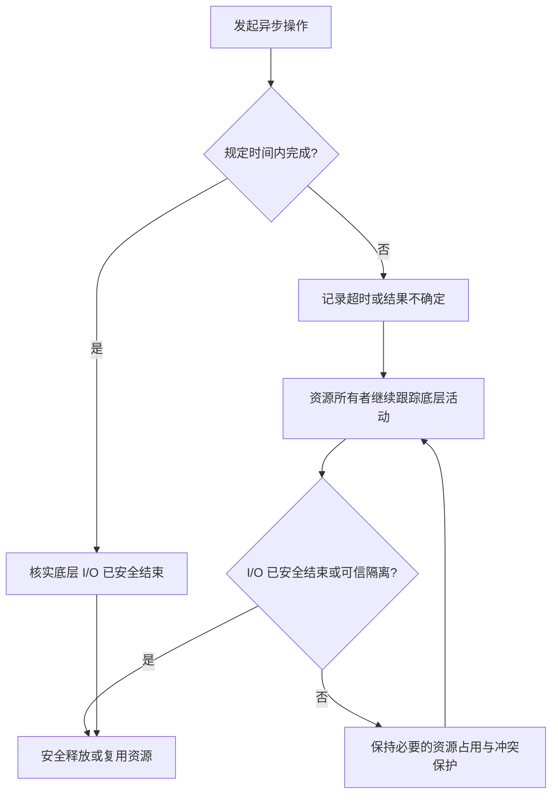

<p class="figure-caption">图 2-1 异步操作超时与资源安全释放流程</p>

对异步操作应区分超时、取消、异常和正常结束；不能仅凭调用方返回、Future/Task 取消或连接状态判断底层 I/O 已安全结束。

### 2.1.5 性能与资源有界原则

性能设计围绕明确的负载与质量要求展开，而不是无依据地增加并发或缓存。

<p class="table-caption">表 2-5 性能与资源有界设计要求</p>

| 设计要求 | 具体规定 |
|---|---|
| 负载模型 | 明确请求规模、并发规模、数据量及运行条件 |
| 容量约束 | 队列、线程、Task、连接、缓存及存储资源应有合理边界 |
| 背压 | 资源不足时明确等待、拒绝、丢弃或降级策略及适用条件 |
| 缓存 | 明确缓存用途、权威数据来源、失效与容量策略 |
| 性能指标 | 明确时延、吞吐、资源占用及测量口径 |
| 性能取舍 | 不得以违反正确性、安全性和可靠性约束换取性能 |

### 2.1.6 故障可控与恢复原则

设计应覆盖正常运行及合理预期的异常场景，明确故障影响范围和恢复条件。

<p class="table-caption">表 2-6 故障与恢复设计要求</p>

| 设计要求 | 具体规定 |
|---|---|
| 故障识别 | 明确可能的超时、通信失败、存储失败、任务异常和进程崩溃 |
| 故障隔离 | 限制故障传播，避免无关组件或资源被错误影响 |
| 状态可信 | 不将未知状态解释为确定成功或失败 |
| 重试与恢复 | 明确允许重试的条件，禁止可能产生危险副作用的盲目重试 |
| 持久化恢复 | 规定异常中断后的数据一致性及状态恢复规则 |
| 生命周期 | 明确启动、就绪、运行、关闭和重启期间的异常处理 |
| 失效行为 | 无法恢复时应有明确的降级、阻塞或停止服务条件 |

### 2.1.7 横切能力非侵入式原则

日志、审计、指标、追踪、权限校验等横切能力应与核心业务逻辑分离，优先通过统一的边界组件、装饰器、中间件或独立服务实现，不应将重复的技术处理流程散布在业务代码中。非侵入式不等于隐藏业务约束：凡影响业务准入、执行结果、事务一致性或故障处理的规则，必须在业务契约中明确，并保留必要的显式调用点。

<p class="table-caption">表 2-7 横切能力非侵入式设计要求</p>

| 设计要求 | 具体规定 |
|---|---|
| 职责分离 | 业务组件负责业务规则与状态转换；横切组件负责统一的记录、采集、校验与传输机制 |
| 边界统一 | 在服务入口、应用服务边界、消息发布边界等明确位置接入横切能力，避免各业务分支重复编排 |
| 最小侵入 | 不为记录日志、采集指标或传播追踪上下文而改变业务方法的核心控制流程和返回语义 |
| 审计正确性 | 审计事件的业务含义及产生时机由业务契约定义；持久化、投递、重试等通用机制与业务处理解耦，同时保证要求的一致性 |
| 故障影响 | 明确横切能力故障时的阻断、降级或重试规则；不得默认其失败不会影响业务，也不得默默吞掉必须处理的错误 |
| 可读性与验证 | 业务代码能够直接体现主流程；横切处理可独立测试，端到端测试验证其与业务契约一致 |

不为追求形式上的非侵入而引入复杂框架或过多抽象；简单、清晰的显式边界优先于难以追踪的隐式执行机制。

### 2.1.8 公共能力复用与冗余控制原则

优先使用符合需求的标准库、成熟软件包、现有工具及公共组件；相同且稳定的职责才提炼为公共能力，不重复发明、不为假设性扩展提前设计框架。

<p class="table-caption">表 2-8 公共能力复用与冗余控制要求</p>

| 设计要求 | 具体规定 |
|---|---|
| 复用优先 | 先评估现成组件是否满足功能、安全、性能及维护要求，再决定是否自行实现。 |
| 提炼公共职责 | 多模块存在稳定相同的职责时统一实现；业务规则留在所属业务模块。 |
| 控制依赖 | 核查成熟度、许可证、版本、安全维护及引入成本。 |
| 控制抽象 | 避免仅为减少少量重复而引入复杂框架或多层转发。 |
| 清理冗余 | 统一能力落地后删除重复、废弃和不必要的兼容实现。 |

### 2.1.9 图表表达与设计一致性原则

设计优先使用合适的图形和表格表达结构、流程、时序、状态及约束，图表不能代替必要的精确定义。

<p class="table-caption">表 2-9 图表表达与一致性设计要求</p>

| 设计要求 | 具体规定 |
|---|---|
| 视图完整 | 使用 4+1 架构视图组织系统设计，覆盖适用内容 |
| 图形选择 | 根据表达目的选择结构图、状态图、时序图、活动图等 |
| 图表一致 | 图形、表格和正文不得相互矛盾 |
| 跨章节一致 | 同一接口、状态、参数及资源规则保持一致 |
| 设计深度 | 明确影响系统行为的契约，允许自主选择内部实现细节 |
| 可验证性 | 关键设计要求应能够对应测试条件与验收证据 |

### 2.1.10 软件设计工作流程

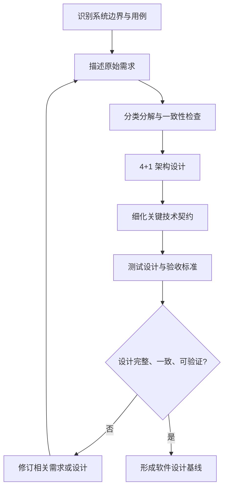

<p class="figure-caption">图 2-2 软件设计编制流程</p>

工作流程允许迭代，不要求传统瀑布式阶段。发现缺口或冲突时直接修订相关需求、架构视图或契约，不通过追加覆盖性条款解决。

### 2.1.11 规范性参考文献及项目无关性

本章为跨项目通用设计与编制规范，不得写入具体仓库、服务、业务协议、接口文件路径或项目专有指标。设计正文引用具体项目的源码、配置和协议文件时，应放在相关业务章节或接口/数据契约章节。

- **《符号体系.md》**：数学量类型、变量命名、标量/矢量/矩阵/张量、下标和公式运算的规范性依据。统计业务中的普通标量同样遵守其标量与阵列的区分原则。
- **《软件系统建模图形与表达规范.md》**：业务流程、DFD、活动/状态/时序图、算法图、伪代码和图元语义的规范性依据。

规范性引用以文件标题和相应章节为准，不复制全文；引用之间存在冲突时先识别并修订冲突，不擅自切换符号或重新解释图元。任何设计实例的具体接口名称、消息字段和技术约束均在第三章及后续适当章节给出。

## 2.2 需求体系及描述规范

需求采用“识别用例 → 逐条描述原始需求 → 分类分解 → 总分一致性检查”的方法。用例应从外部使用者及运行场景出发，覆盖适用的部署、启动、正常使用、配置、运维、正常关闭、重启及异常恢复过程；不局限于业务 RPC，也不将内部技术机制机械列为用例。用例识别属于需求分析，第 4 章用例视图负责表达参与者、边界及用例关系。

<p class="table-caption">表 2-10 原始需求描述字段</p>

| 字段 | 描述要求 |
|---|---|
| 编号 | 唯一原始需求标识，例如 `UR-01` |
| 名称 | 准确概括使用者需要的能力或运行场景 |
| 请求方（Requester） | 发起操作的外部系统、服务或接口，如外部客户端、上层服务、进程管理系统；消息和周期自动触发时可以没有直接请求方，标记“不适用” |
| 触发方式（Trigger） | 标明触发类型、事件来源、触发条件及必要的周期或接口；允许多个类型组合，区分外部触发和内部自动步骤 |
| 输入（Input） | 请求方向本系统提供的数据、参数和信息 |
| 反馈（Response） | 本系统返回请求方的确认、状态、结果及错误信息 |
| 目标方（Destination） | 接收本系统业务输出的外部系统、消息中间件或现场设备；没有时标记“不适用” |
| 业务输出（Output） | 本系统发往目标方的数据、消息或控制指令；没有时标记“不适用” |
| 业务流程（Flow） | 用 Mermaid 表达主要控制流程、数据输入/输出及重要异常，已表达的动作不重复 |
| 业务规则（Business Rules） | 补充主流程未精确定义的术语、公式、算法、初始化、阈值和边界；允许文字分条、LaTeX、图、伪代码或表格，不重复业务流程 |
| 关键约束（Constraints） | 性能、可靠性、安全、审计、可观测性、错误信息、缓存、I/O 与背压等可验证的非功能要求 |

反馈与业务输出必须分开：反馈面向请求方，业务输出面向目标方；请求方与目标方可有多个，且请求方断连不必然撤销已接受的业务操作。

### 2.2.1 触发方式分类与标注规则

原始需求必须列出实际适用的触发方式；同一需求可以组合多种触发方式，不能把处理流程中的普通步骤误写成独立触发。触发方式描述“何时、由什么启动”，不预先决定线程、定时器或队列等内部实现。

- **消息触发（Message）**：外部消息到达，例如实时消息或可靠消息；标明消息来源与订阅范围。
- **周期触发（Periodic）**：达到配置周期，例如实时周期输出或变化加周期保底；标明周期来源及生效条件。
- **API 触发（API）**：收到明确的外部接口请求，例如任务启动或配置应用接口；标明接口和调用方。
- **状态触发（State）**：受监控对象的状态发生满足条件的变化，例如外部依赖从不可用恢复可用；标明状态条件，不把普通循环迭代误列为触发。
- **生命周期触发（Lifecycle）**：服务进入启动、关闭、重启或配置生效等阶段；标明阶段及必要前置条件。

周期触发与消息触发可以同时存在：消息到达更新数据，周期到达决定何时输出。若无外部直接请求方，Requester 写“不适用（自动触发）”，但仍须列出消息生产者或状态来源；触发方式不替代 Input、Response 与 Output 的定义。

### 2.2.2 原始需求四节结构与写作原则

各 UR 固定为四节：**基本信息与触发方式、业务流程、业务规则、关键约束**。根据语义选择最清晰的表达形式；文字、公式、图形、伪代码和表格地位平等；**业务流程图已清楚表达的处理不得在后两节复述**。规则和约束必须有唯一规范定义，其他章节仅引用。

1. **基本信息与触发方式**：表格列出 Requester、Trigger、Input、Response、Destination、Output。Trigger 采用第 2.2.1 节分类，明确事件来源、触发条件及周期或 API。
2. **业务流程**：Mermaid Flowchart 或适用的 UML 活动图表达触发入口、主要处理、判断、数据输入输出、重要异常及恢复出口；复杂算法通过“预定义过程”节点指向第三节，不在总流程中堆叠实现细节。
3. **业务规则**：仅描述流程图无法精确表达的算法、公式、阈值、初始化、状态不变量、顺序及边界。允许文字分条定义、算法流程图、DFG、LaTeX 公式、表格或明确标为 `text` 的伪代码；必须说明输入、输出、初始值、边界及终止条件。无额外内容时标注“无额外规则”。
4. **关键约束**：**优先给出定量要求**（带单位、作用范围、测量窗口、默认值或硬上限、验收方法）；不能合理量化的才采用具有明确判定条件的定性要求。**仅放可核验的非功能要求**，按性能与容量、可靠性与恢复、安全与授权、审计、可观测性、错误信息、缓存与有效期、I/O 资源安全、背压与过载分类；无关分类可以省略或说明不适用。约束应给出故障条件、正确结果、测量或验收口径，不得用抽象口号代替。

### 2.2.3 业务图形元素与数据语义

参照《软件系统建模图形与表达规范.md》第 5.1 节 Flowchart、第 7.1 节 DFD 与第 8.1 节算法规范。业务活动图的控制流箭头表示处理顺序，DFD 箭头表示数据流，**两者不得混用**。图中应以不同形状区分处理、判断和数据。

| 元素 | Mermaid 写法 | 语义 |
|---|---|---|
| 开始/结束 | `A([开始/结束])` | 明确入口和完成/失败出口 |
| 处理 Process | `B["更新缓存"]` | 矩形，表达动作而非数据 |
| 判断 Decision | `C{"已过期?"}` | 菱形，分支标明条件 |
| 输入/输出 Data | `D[/"采样消息"/]` | 平行四边形，表达数据输入/输出 |
| 预定义子过程 | `E[["计算统计指标"]]` | 双边矩形，引用业务规则的算法说明 |
| 数据存储 | `F[("最新值缓存")]` | 存储节点；仅在理解读写关系必要时出现 |

不因形式要求增加无意义数据节点。数据来源、存储及复杂数据变换应单独绘制 DFD，避免业务活动图变成混杂的控制/数据流图。Mermaid 第一行初始化配置、图编号和图题仍须符合第一章。

### 2.2.4 业务规则、输出定义与关键约束的具体要求

- **业务规则**：定义与边界条件优先文字分条；涉及数学关系必须使用 LaTeX 独立公式；复杂步骤按需使用 Flowchart/DFG 或伪代码补充。表达形式不限于图和表；精确定义阈值、边界、初始化、更新基准和不可变条件，不复述主流程动作。算法必须能够独立据输入判断预期输出。
- **性能与容量**：优先用定量指标给出负载范围、时延/吞吐口径、并发及资源上限；必须区分设计目标、默认配置、不可突破的资源上限和验收实测值；未确定的阈值不得虚构。
- **可靠性及 I/O**：明确超时、结果不确定、重试、恢复、安全收敛及资源释放条件。调用返回或 Task 取消不代表底层 I/O 已结束。
- **错误信息**：定义错误类别、错误码或结果、对象与关联标识、发生阶段、可检索证据及敏感信息脱敏；禁止把 UNKNOWN 伪装为成功或明确失败。
- **缓存与背压**：规定缓存键、容量、更新/覆盖、过期、丢弃、等待、拒绝、暂停消费及恢复条件；所有超限策略必须可观测。
- **安全与审计**：列出认证、授权、控制边界以及需审计的操作、事件产生时机、关联 ID、可信保存与失败处理；运行日志不能代替审计。
- **可观测性**：指标、统计窗口、状态、事件、更新时间、无数据语义及告警；可结合真实场景验收。

**指标、计算和输出契约完整性（强制）：**凡使用“计算、统计、比较、阈值、状态、错误、容量、返回结果”等词定义业务能力，必须形成封闭的输出集合；不得用“等”“包括但不限于”替代本版本必须实现的清单。每个指标/派生字段至少定义以下内容；其中数学计算不得仅写在表格单元格内，必须另列可渲染的 LaTeX 公式：

| 必填字段 | 内容 |
|---|---|
| 唯一标识、类型和单位 | 与公开接口字段或指标名一致；明示 `counter/gauge/histogram`、计量单位 |
| 统计层级和数据来源 | 系统 / 进程 / 组件 / 任务 / 消费者；事件记录点、分子和分母来源 |
| 计算公式与口径 | 累计/窗口/瞬时，窗口端点、去重规则、事件计数次数、百分位算法 |
| 触发、初始化和重置 | 何时采集/计算、初始值、首个周期、进程重启、配置热更新 |
| 边界与缺失 | 零分母、空样本、UNKNOWN、超时、重复投递、源不可达的值域与 `unavailable` 语义 |
| 输出与验收 | 指标名、采样时间、窗口、可用性表达、配置边界及给定数据可独立验算的实例 |

**示例与可复算性（强制）：**当业务规则涉及多种计数口径、状态转换、时间窗口、边界分支或重试等易混淆情形时，至少给出一个具体输入—处理过程—预期输出的完整算例。算例必须标明初始条件、计量单位、每一步事件及最终结果；若同时存在样本条数、批次数、I/O 尝试次数等不同统计单位，须分别列出，禁止混用。算例应覆盖易误解的边界（例如重试成功仍有失败尝试记录），且结果必须可直接转化为确定性测试断言。算例是对定义的验证，不得取代规范性定义，也不应重复流程图中的全部步骤；涉及计算关系仍按第一章使用 LaTeX。

**数学定义与表达门禁：**业务规则的文字定义应独立成段或分条；涉及计算时，必须在定义后给出独立 LaTeX 公式，逐一释义变量、单位、取值域以及零分母、空样本和无效值。算法图与伪代码是可选的精度增强手段，不得要求所有业务规则使用表格。公式与中文混排遵守第一章 §1.3.1。

**约束定量优先门禁（强制）：**关键约束首先给出数值、单位、统计范围、采样方法、允许误差、测试条件和通过标准；可配置阈值应列出默认值及合法范围。仅当约束本质上无法定量（例如禁止错误 ACK）时，才用可判定的定性约束。不得用“及时、足够、合理、有界、尽可能、低延迟、高可靠”等词代替具体要求；未完成基准测试的数值应标明“设计验收目标，尚未实测”，不得声称达标。

**完备性门禁：**业务规则涉及的状态枚举、错误分类/错误信息字段、缓存容量及淘汰策略、I/O 结果、背压策略、审计与统计输出均应列举封闭集合和边界输入；凡无法根据文档构造确定预期结果的要求，视为需求未完成，不得标记为可编码。参数可以配置，但必须说明合法范围、默认/缺省行为及越界错误；性能数值未经验证时不得伪称已达标。每项约束必须可追溯至可执行的 UC/System 场景。

每项业务规则和关键约束须能由 UC/场景及第 14 章测试追溯；第 5～13 章详述实现契约时应引用 UR，不得另造冲突定义。

统一样式：

```text
### 3.x UR-xx 需求名称
#### 3.x.1 基本信息与触发方式
Requester / Trigger / Input / Response / Destination / Output
#### 3.x.2 业务流程
Mermaid 活动流程图，含重要异常及数据输入输出
#### 3.x.3 业务规则
可用文字、LaTeX、伪代码、图或表格精确定义算法、初始化与边界，不重复流程
#### 3.x.4 关键约束
按性能、可靠性、安全、审计、可观测性、错误、缓存、I/O、背压列可验证要求
```

本节也是第三章及后续章节的强制完整性验收标准。

<p class="table-caption">表 2-11 分类需求体系与描述重点</p>

| 类别 | 核心问题 | 典型要求 |
|---|---|---|
| 功能需求（Functionality） | 系统提供什么行为 | 对外能力、业务流程、业务规则、输入输出与状态反馈 |
| 性能需求（Performance） | 运行速度与资源上限 | 时延、吞吐、并发、调度、公平性、容量、背压、资源消耗、扩展能力 |
| 可靠性需求（Reliability） | 故障时如何保持正确与恢复 | 容错、超时、重试、请求关联、事务、持久化、故障恢复、可用性、未结束操作的资源管理 |
| 安全需求（Safety & Security） | 如何防止危险或非法控制 | 控制权、互锁、失效安全、认证、授权、通信及数据安全 |
| 横切能力（Cross-cutting Concerns） | 如何观测、管理与追责 | 审计（操作证据、可靠投递、完整性、追溯）、日志、指标、追踪、配置、版本、可测试性、可维护性 |

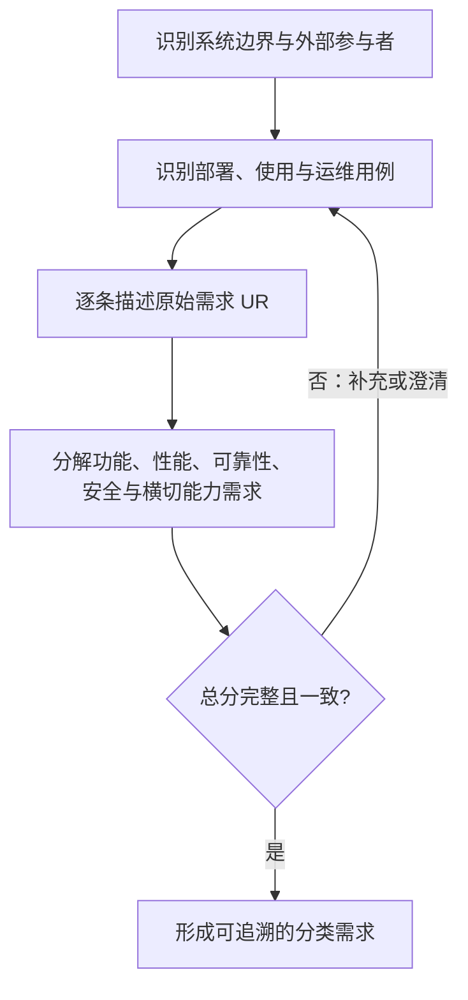

<p class="figure-caption">图 2-3 需求识别、分解与一致性检查流程</p>

分类需求必须从原始需求的输入、反馈、业务输出、规则和约束中推导，不得遗漏、矛盾或未经确认增加能力；多条原始需求的共同约束可以合并，但必须保留来源编号。每条分类需求应给出可核验条件，性能要求还需明确测量口径，不虚构现场阈值。审计应独立于普通日志定义，不得以运行日志代替审计证据。

需求分类与设计专题是不同维度：启动、正常关闭、重启及 Reload 属于跨需求的运行生命周期设计，统一在进程视图展开；相应行为和质量约束分别由原始需求及分类需求追溯。

## 2.3 4+1 架构视图：内涵、外延与表达规范

<p class="table-caption">表 2-12 4+1 架构视图的职责与成果</p>

| 视图 | 关注范围 | 主要成果 | 不应混淆 |
|---|---|---|---|
| 用例视图（+1） | 参与者、系统边界、典型/异常场景 | 系统上下文、用例、业务流程 | 不负责线程调度 |
| 逻辑视图（Logical） | 组件职责、模型、接口、状态规则、依赖 | 组件图、类/数据关系、状态图 | 不等于源码目录树 |
| 进程视图（Process） | 进程、线程、Event Loop、Task、协作、生命周期、同步、并发、资源、背压、缓存、故障恢复 | 运行结构图、任务所有权表、时序/状态/活动图、资源预算 | Task 不等于 OS 线程；图名须区分标准 UML 与示意图 |
| 开发视图（Development） | 软件模块边界、层次、静态依赖、公共契约与复用关系 | 模块图、依赖图、模块职责表 | 不描述真实并发拓扑，也不列现有代码修改清单 |
| 物理视图（Physical/Deployment） | 节点、进程部署、存储、网络、控制权和现场外部依赖 | 部署图、网络/故障域/外部依赖表 | 不是现场设备内部物理结构模型 |

### 2.3.1 用例视图的场景编写规范

用例以参与者的完整业务目标为单位组织，而非以原始需求、RPC 或内部模块为单位逐条改名。一项用例可以关联多项原始需求；一项原始需求也可以由多个业务场景共同覆盖。用例视图回答“在具体业务场景中系统如何工作”，不代替逻辑视图、进程视图和数据设计。

<p class="table-caption">表 2-13 业务场景用例的必备描述要素</p>

| 要素 | 编写规定 |
|---|---|
| 用例身份与目标 | 给出唯一编号、业务场景名称及参与者要达成的可观察目标；名称使用业务活动，不使用内部机制命名 |
| 参与者与触发条件 | 列明实际发起操作的外部角色；内部定时任务、恢复及发布等自动步骤不得虚构外部参与者 |
| 前置条件 | 列明系统就绪、授权、配置或数据存在等必要条件；不得混入未确认的实现假设 |
| 主业务流程 | 以 Mermaid 业务活动图（flowchart）为主要表达，覆盖触发、校验、关键处理、反馈及后置结果；以判断节点表达重要分支，避免大段编号文字复述 |
| 分支与异常流程 | 在活动图中呈现影响业务结果的主要异常出口；罕见或不宜展开的异常在简明说明表中概括，避免为了完整而画出所有技术异常 |
| 后置条件 | 明确成功和失败之后的业务状态、外部可见结果、未完成事项及后续查询方式 |
| 需求追溯 | 标明相关 UR；核对全部 UR 在真实场景中得到覆盖，但不要求 UR 与 UC 一一对应 |

跨用例共享的内部机制（如存储、审计发布和调度）应作为相关业务流程中的自动步骤或支撑行为描述；只有存在独立业务目标时才另立用例。应避免将一串 gRPC 方法名或 CRUD 操作直接当作完整用例，也不得在用例章节展开线程、锁、表结构及类方法等实现细节。

用例的正文采用“一张业务活动图 + 一张简明用例说明表”的表达形式。活动图包含主路径、必要判断以及重要异常分支；图中节点使用业务动作，不展开展示内部类、锁和数据库事务。说明表只填写参与者、业务目标、前置条件、主要异常、后置条件及关联需求。业务分支已在图中完整表达时，不再重复书写大段“主业务流程”和“异常流程”；复杂跨参与者消息时序可在独立小节补充时序图。图题和表题按文档约定独立编号。

进程视图应按四个设计专题组织，而不是按需求类别重复划分：

<p class="table-caption">表 2-14 进程视图的四类设计专题</p>

| 专题 | 必须明确的设计对象 | 推荐表达 |
|---|---|---|
| 运行时结构 | 进程、线程、Event Loop、Task、线程池、组件与资源所有权 | 分层运行结构图、Task 职责表 |
| 运行生命周期（Runtime Lifecycle） | 启动、初始化、就绪、运行、Reload、正常关闭、重启及其阶段转换 | 生命周期状态图、启动/关闭/Reload 时序图 |
| 并发与资源管理 | Task 协作、队列、通知、同步、调度、容量限额、背压、缓存及释放 | 任务协作时序图、资源与背压策略表 |
| 异常与恢复 | 超时、取消、故障隔离、未收敛 I/O、崩溃恢复与降级 | 故障状态图、异常裁决矩阵 |

各专题共享同一运行模型，明确创建者、所有者、同步关系和退出条件；不因分节而重复定义状态或资源。生命周期是进程视图的独立设计专题，不是第六类需求。

图表仅使用其可准确表达的语义：结构关系用 Mermaid Flowchart；行为交互用 Sequence Diagram；状态约束用 State Diagram；条件控制用活动/流程图。图题说明对象、范围及图类型。关键质量属性贯穿各视图，不能只写在单独的“非功能要求”段落。

## 2.4 测试设计方法、组织及验收规范

测试设计以测试层级组织物理目录，以 Marker 描述测试层级、测试专题与运行场景。测试文件名应清楚表达验证对象或行为；测试文件及其标记、验证说明统一登记在测试矩阵中。需求、用例及重要技术契约必须能追溯到实际测试，不为同一目的建立重复测试体系。

<p class="table-caption">表 2-15 测试层级与目录规范</p>

| 层级 Marker | 物理目录 | 验证范围 |
|---|---|---|
| `unit` | `unit/` | 状态转换、业务规则、纯逻辑，无外部服务依赖 |
| `component` | `component/` | 单组件职责及其可控依赖 |
| `integration` | `integration/` | 组件之间及真实外部依赖的接口协作 |
| `system` | `system/` | 独立进程、完整业务场景及端到端行为 |

<p class="table-caption">表 2-16 测试 Marker 与矩阵编制规范</p>

| 事项 | 规范 |
|---|---|
| 层级 Marker | 每项测试必须且仅属于 `unit`、`component`、`integration`、`system` 之一，与目录对应 |
| 专题 Marker | 标识可靠性、安全、性能等验证主题，可与层级及场景 Marker 叠加；无专项主题时可为空 |
| 场景 Marker | 标识并发、超时、恢复、负载、现场等执行条件或情境；有相应场景时标记 |
| 测试矩阵 | 至少包含“测试文件名、层级 Marker、专题 Marker、场景 Marker、测试说明”五列；每项重要测试应有可定位的文件归属 |
| 标记粒度 | 标记以具体测试函数或类为准；同文件可包含不同专题与场景，矩阵列出涉及的 Marker |
| 运行条件 | 通过 Fixture 和环境准备明确外部依赖；现场专用测试与常规回归分离，未执行不视为通过 |
| 执行规则 | 提供按目录、Marker 及其布尔组合的 pytest 命令；所有 Marker 在项目配置中注册 |
| 可追溯性 | 测试说明与需求、用例或技术契约对应；行为变更时同步检查测试及矩阵 |
| 验收证据 | 保留运行环境、命令、实际结果、指标和未验证项，禁止把设计目标当作测试结果 |

目录划分测试层级，专题与场景通过 Marker 横向组合；可靠性测试不单独设第五类目录。测试矩阵用于定位和筛选测试，不预设每个实现文件必须存在，也不要求每个文件仅能有一种测试场景。

### 2.4.1 测试依据及 System 覆盖要求

各层级测试必须依据已确认的设计成果编制；System Test 以用例视图为主基线，以原始需求及技术契约补充覆盖，不得由测试人员凭经验任意缩减范围。

<p class="table-caption">表 2-17 各测试层级的设计依据</p>

| 测试层级 | 主要依据 | 验证重点 |
|---|---|---|
| Unit | 详细设计、函数及算法契约 | 纯逻辑、状态转换、参数及边界规则 |
| Component | 逻辑视图、组件职责及内部接口契约 | 单组件行为、依赖协作及异常处理 |
| Integration | 接口与通信契约、开发视图、物理视图 | 真实接口调用、跨组件通信及外部依赖 |
| **System** | **用例视图（UC）及原始需求（UR）**，并补充接口、运行、部署、安全及性能约束 | **从真实受测服务进程及其通信入口验证业务目标、异常、边界与恢复行为** |

System Test 必须遵守以下规定：

1. **用例覆盖率 100%**：每项 UC 至少有一项 System Test 作为验证证据；同一测试可以覆盖多个 UC，同一 UC 可以由多个测试覆盖，**不按测试数量与 UC 数量的大小关系判定覆盖**。
2. **规定场景覆盖率 100%**：每项 UC 明确的主流程、关键分支、异常流程、边界和恢复场景均必须有对应 System Test；不能仅以一条正常路径代表整个 UC 已覆盖。
3. **需求覆盖率 100%**：每项 UR 必须能够经一个或多个 UC 追溯至 System Test；若某项需求未能被 UC 覆盖，必须先补全用例，不得直接以技术测试代替业务用例。
4. **技术约束补充覆盖**：用例未充分表达的性能、容量、并发、安全、权限、超时和可靠性要求，依据对应技术契约补充测试；不得因 UC 未逐项列出而豁免。
5. **真实系统边界**：System Test 通过真实受测服务进程和适用的外部依赖、通信链路执行；Mock 不得代替本次明确纳入验收范围的基础设施及通信链路。
6. **覆盖与通过分开裁定**：测试已关联不等于已执行；失败、跳过及未运行均不得计为通过。验收报告分别给出需求覆盖、用例及场景覆盖、执行情况和通过情况；缺少真实环境时标记 `NOT_RUN`，不得用模拟结果替代。
7. **变更同步**：任何 UR、UC、接口或行为约束的新增、删除、调整，必须同步核查 System Test、测试矩阵和验收条款；新增 UC 不得留下无测试映射。

<p class="table-caption">表 2-18 System Test 追溯矩阵规范</p>

| 字段 | 要求 |
|---|---|
| UR 编号 | 被验证的原始需求编号，可列多个 |
| UC 编号与场景 | 用例编号及主流程、异常、边界或恢复场景标识 |
| 技术契约 | 相关接口、配置、运行或安全约束的章节编号；没有则记“—” |
| 测试文件名／测试标识 | 可定位的 System Test 文件名及测试函数或参数化场景标识 |
| 层级／专题／场景 Marker | 层级固定为 `system`，其余按第 2.4 节定义填写 |
| 验证内容与预期结果 | 从用户可观察行为与副作用表述判定依据 |
| 执行环境及结果 | 真实依赖、执行证据、`PASS`／`FAIL`／`SKIP`／`NOT_RUN` 等状态 |

追溯链为 **UR → UC／用例场景 → System Test → 执行结果与证据**，技术契约作为补充依据进入相应测试。第 4 章负责编制完整 UC 和场景，第 14 章依据本规范给出实际测试矩阵及验收安排，两章必须双向核对。

# 3. 软件需求

按第 2.2、2.2.1、2.2.2 节规定，本章采用“基本信息与触发方式 → 业务活动图 → 业务规则 → 关键约束”的唯一格式；完整业务场景见第 4 章，接口及运行机制见第 9～13 章。图已表示的判断和处理不再在文字中重复。

## 3.1 业务需求总表

<p class="table-caption">表 3-1 Industrial Gateway 业务需求总表</p>

| 编号 | 业务需求 | 业务目标 | 触发方式 |
|---|---|---|---|
| UR-01 | 网关数据更新 | 接收上游样本并更新真实协议 Server 的变量，供工业客户端访问且不触发现场控制 | API |
| UR-02 | 工业协议 Server 运行管理 | 按实际设备 1:1 管理协议 Server 创建、启动、监控、停止和故障恢复 | API、Lifecycle、State |
| UR-03 | 指令写入监听与映射转发 | 对请求级写入事件按映射尽力提交 Commander，正确处理 UNKNOWN 和过载 | Message |
| UR-04 | gRPC 接口实现 | 按正式 Proto 提供公共运维和网关管理接口、上游数据更新入口及 Commander Client | API、Lifecycle |
| UR-05 | 网关配置管理 | 引用公共 Template/Instance，仅维护 Gateway 专属 Service 配置与快照生效 | API、Lifecycle、State |
| UR-06 | 链路诊断（Diagnose） | 主动检查数据注入、工业协议服务、控制转发并返回可信分阶段证据 | API |
| UR-07 | 运行指标管理（Metrics） | 周期统计服务、工业协议请求、数据更新和控制转发指标并支持查询 | Periodic、API、State |

Gateway 管理实际工业协议 Server，保持协议库原生读写语义。上游通过 gRPC 更新数据；工业客户端命令写入事件才可能转发 Commander。Gateway 不直接控制真实 PLC，不验证实际控制效果。

**契约版本边界：** 以当前正式 Proto 为现行已实现契约依据：CommonService 9 项、IndustrialGatewayService 8 项，共 **17 个 Unary RPC**。Gateway 8 项包含 `UpdateVariables` 与 `ClaimTargets`，前者具有 `lease_token` 字段。此次修订将已验收的扩展正式纳入设计，不将其误记为 v1_9 的原始契约。

## 3.2 UR-01 网关数据更新

### 3.2.1 基本信息与触发方式

| 字段 | 内容 |
|---|---|
| 请求方（Requester） | Data Generator、Collector 或获授权的上游服务 |
| 触发方式（Trigger） | API：正式 `IndustrialGatewayService.UpdateVariables` |
| 输入（Input） | `gateway_id`、`values[]`、`lease_token`；每项包含 `variable_id` 和 `ScalarValue value`。Proto 不含质量、采样时间或期望版本 |
| 反馈（Response） | `results[]`：按请求项顺序返回 `variable_id`、`success`、`error_code`、`message`；允许部分成功 |
| 目标方（Destination） | Gateway 当前字段存储及协议 Server 的字段访问接口 |
| 业务输出（Output） | 已成功项更新为新当前值；工业客户端在协议侧读取新值；不触发 Commander |

### 3.2.2 业务流程

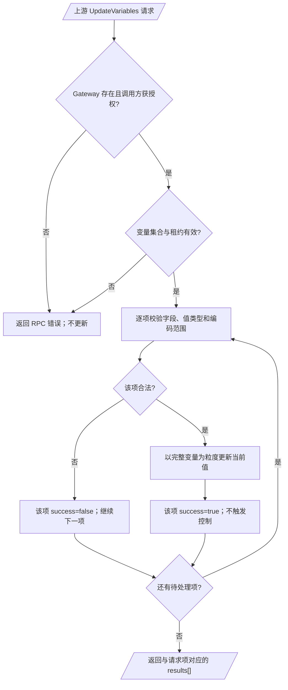

<p class="figure-caption">图 3-1 UR-01 网关数据更新业务活动图</p>

### 3.2.3 业务规则

**R01-01 正式契约优先。** 依照 `src/contracts/industrial_gateway.proto`，一次请求可包含多个 `VariableUpdate`；每项独立成功/失败，某项失败**不回滚其他有效项**。本版本不引入整批原子性、`expected_revision`、`quality` 或 `sample_timestamp` 字段。空 `values` 返回空 `results`，不产生副作用；字段缺失、类型或范围不合法时只将该项标记失败。

**R01-02 更新可见性。** 每个变量内部更新不得产生撕裂读；同一请求的不同变量允许在不同时间被工业客户端看到，不保证批次快照一致。Server 停止期间仍可更新当前值，启动后使用最新值。协议端只读字段与 command 字段均允许获授权 gRPC 更新；由内部调用来源标识阻止 Commander 转发。

**R01-03 返回与重试。** 每个请求项按顺序给出一条结果；同批请求出现重复 `variable_id` 时以 `INVALID_ARGUMENT` 整批拒绝，**不允许产生部分写入**。RPC 连接中断时调用方不能依赖响应确定处理结果，读取当前值只能核对最终状态，不能证明历史处理次数。单次调用只能说明 Gateway 当前值更新，不证明工业协议客户端已消费。

**租约主体绑定：**RPC 的可信调用主体从服务端验证的 mTLS 客户端证书 CN 获取，开发环境仅在受限 loopback 明文模式下使用本地身份。服务端除校验 `inject` 权限外，在租约中保存该主体身份；ACQUIRE/RENEW/RELEASE 使用相同可信主体，UpdateVariables 仅允许持有同一主体租约令牌的调用方更新。`owner_id` 仍为 Generation/管理操作的业务标识，不能代替认证身份，不能通过自报相同 `owner_id` 接管其他主体的租约。各状态变更和写入均需验证相同主体；授权不成立时失败且不得修改变量。该约束属于 Gateway 内部授权逻辑，不增改任何 Proto 字段。

**R01-04 目标租约保护。** `ClaimTargets` 以单 Gateway 为作用域申请变量集合租约。`ACQUIRE` 原子占用全部目标；`RENEW`、`RELEASE` 要求原 `owner_id`、完全一致的目标集合和 `lease_token`。租约持续时间 `lease_ms` 为 1000～60000 ms，按单调时间计时；同一目标同一时刻只允许一个有效租约。一个租约覆盖多个变量，令牌只能写入其占用的集合。任何 `UpdateVariables` 写入均须携带本调用方通过 `ClaimTargets(ACQUIRE)` 获得、当前有效且覆盖完整目标集合的 `lease_token`；目标尚未被租约占用不构成无令牌写入许可。空令牌、失效令牌、目标集合不匹配或他人令牌均拒绝整份更新请求。令牌过期、释放、Server 重新配置/删除或进程重启后不可恢复。租约仅约束数据注入，不改变工业协议写入及 Commander 控制的权限边界。无权访问、非法目标、重复目标、租约失效均不得造成字段修改。

**R01-05 请求级隔离。** `UpdateVariables` 在开始逐项更新之前，须完整校验重复目标及租约权限；有任一租约授权错误，则整个请求失败且全部字段不变。租约预检通过后，值类型、范围及字段不存在等业务错误仍逐项返回，且合法项不回滚。对每个 Gateway 的申请、续期、释放与更新实行串行化，以防在途批次被到期接管者穿插写入。无效或无值变量不产生成功更新记录。

**算例 R01-A。** 初始字段 A=1、B=2；依次提交 A=3、未知字段 X=9、B=4。结果依次为成功、失败、成功，最终 A=3、B=4；成功变量更新项数为 2，失败项数为 1；Commander 调用数为 0。

### 3.2.4 关键约束

| 约束类别 | 可验证要求 |
|---|---|
| 容量与性能 | 设计负载 10 Hz、每批 500 项；完整变量读不得撕裂；**不承诺跨变量原子性**。租约申请变量数最多 5000 项；租约 TTL 为 1000～60000 ms。单批最大可接受项数由 RPC 请求大小及实际服务限制共同约束，不能把 500 项性能负载误写为已验证的强制拒绝阈值。 |
| 错误及部分成功 | 合法项与非法项共存时合法项成功且非法项失败；`results[]` 与请求项一一对应，不默默丢项。 |
| 安全 | 数据更新不得产生 Commander 提交；被授权 gRPC 更新不受工业客户端读写权限限制，但必须通过租约防护；有租约冲突时不得写入。 |
| 契约 | 不使用 Proto 不存在的质量、时间、版本和批次整体结果字段；必须使用已定义的 `lease_token` 和 `ClaimTargets`。 |

**R01-06 性能实测边界。** 已验收环境记录 10 Hz × 500 点 × 5 个 Server，吞吐量 25213 点/s，延迟 P50 7.4 ms、P95 9.9 ms、P99 23.5 ms。该数据只证明指定隔离测试环境下的表现；真机硬件、netem 故障注入、长稳 soak 及三分支整栈不在此次通过范围内。

## 3.3 UR-02 工业协议 Server 运行管理

### 3.3.1 基本信息与触发方式

<p class="table-caption">表 3-4 UR-02 基本信息</p>

| 字段 | 内容 |
|---|---|
| 请求方（Requester） | 进程管理系统、授权 Gateway 运维客户端；自动故障恢复无外部请求方 |
| 触发方式（Trigger） | Lifecycle：启动、停止、重启及配置 Apply；API：`StartGateway`／`StopGateway`；State：协议 Server 异常退出且期望运行状态为 START |
| 输入（Input） | 唯一 Server 实例、公共 `device_id` 引用、独立监听 Endpoint、desired_state、配置版本 |
| 反馈（Response） | Server 实际运行状态、失败原因、重启次数、版本及时间；通过正式 Gateway RPC 查询 |
| 目标方（Destination） | 所选真实工业协议 Server 库对象 |
| 业务输出（Output） | 创建、启动、正常停止或故障恢复一个与实际设备 1:1 绑定的协议 Server |

### 3.3.2 业务流程

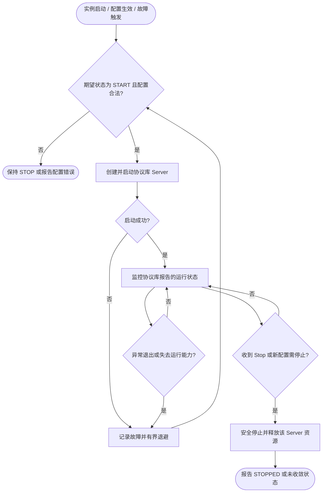

<p class="figure-caption">图 3-2 UR-02 工业协议 Server 生命周期活动图</p>

### 3.3.3 业务规则

**R02-01 一对一绑定。** 一个 Gateway Server 实例必须且仅能绑定一个真实设备 `device_id`；同一配置域一个 `device_id` 不得绑定多个活动 Server。每个 Server 的所有字段与 Commander 映射均归属于该实际设备。协议库内部即使支持多 Unit ID／多站号，本服务也只允许为当前设备暴露一个有效站号空间，不允许将多设备封装成一个 Server。

**R02-02 职责边界。** 连接、协议解码、标准读写、应答、会话、协议支持的上送由协议 Server 库自行处理；Gateway **仅**创建、配置、运行监控、停止和异常恢复 Server。UR-01 负责字段值更新，UR-03 负责协议库暴露的写入事件，均不属于本 UR 的协议处理实现。Server 停止不影响 UR-01 对字段权威存储的修改。

**R02-03 恢复边界。** `desired_state=START` 才允许自动重建；手动 STOP 禁止恢复。监控优先使用库的运行状态和异常证据，单纯端口可连接不证明协议业务健康。重新创建旧实例前必须确保旧监听和未结束 I/O 安全终结或隔离，防止地址冲突。

### 3.3.4 关键约束

<p class="table-caption">表 3-22 UR-02 非功能约束</p>

| 约束类别 | 可验证要求 |
|---|---|
| 绑定与隔离 | 每 Server 设备数严格为 1；同一设备重复活动 Server 数为 0；端口和协议站号冲突在配置校验阶段拒绝。 |
| 生命周期 | 手动 STOP 后自动重启次数为 0；异常重启次数和最近失败时间可查询。 |
| 资源安全 | 不因 Task 取消或超时误认底层 I/O 结束；旧监听未安全释放时不能构造冲突新实例。 |
| 协议实现 | 不在 Gateway 实现协议请求解析及标准响应；首版 Modbus TCP Server 能力需经真实库验证。 |

## 3.4 UR-03 指令写入监听与映射转发

### 3.4.1 基本信息与触发方式

| 字段 | 内容 |
|---|---|
| 请求方（Requester） | 工业协议客户端 |
| 触发方式（Trigger） | Message：协议 Server 收到并验证合法写入请求 |
| 输入（Input） | 当前 Server/设备、变量、解码值、写入事件顺序、已生效控制映射 |
| 反馈（Response） | 协议库的标准读写应答；**不代表** Commander 执行结果 |
| 目标方（Destination） | Commander；仿真控制亦先由 Commander 裁决，不允许 Gateway 直接提交 Data Generator |
| 业务输出（Output） | 对 Commander 发起 `SubmitCommand` 并记录 ACCEPTED/REJECTED/UNKNOWN；不得直达 Data Generator |

### 3.4.2 业务流程

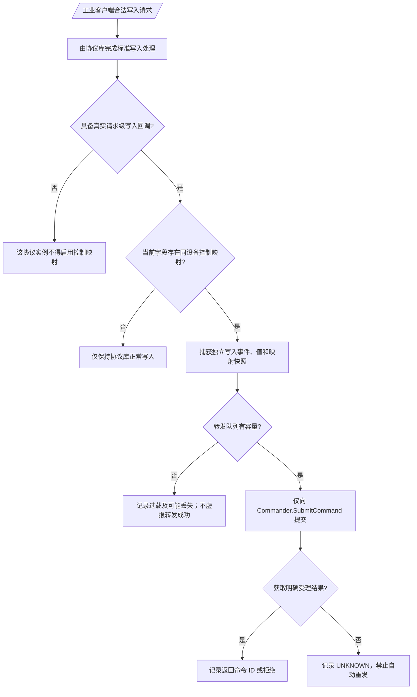

<p class="figure-caption">图 3-3 UR-03 写入监听与控制转发业务活动图</p>

### 3.4.3 业务规则

**R03-01 请求级事件。** 同一数值连续写入两次代表两个不同的工业协议请求，不按变化去重。只有工业协议客户端的合法写入事件可能触发转发；`UpdateVariables` 绝不触发。IEC 104 Select 阶段不提交控制，Execute 阶段根据协议完成有效写入后触发；其他协议由实际库回调能力确认。

**R03-02 控制映射。** 仅显式启用且目标 `device_id` 与 Server 所绑定真实设备相同的字段可转发。事件在接收时固定映射目标和修订版本；热更不会把已捕获事件指向新目标。协议库负责标准 ACK，Gateway 不把 ACK 表述为控制成功。

**R03-03 尽力交付。** 本版本不实现本地持久化控制事件日志、跨重启重放和恰好一次投递。Gateway 将捕获事件送入有界内存转发通道；超限或进程崩溃可能造成控制转发丢失，必须记录可观测失败（进程崩溃前尚未记录的事件无法审计）。Commander 接收后负责命令执行、持久化及审计；仿真模型输入须经 Commander 权威裁决及 Gateway 专用仿真执行 RPC，不拥有 Commander 审计语义。提交超时且无 `command_id` 视为 UNKNOWN，**不自动重试**。若要求 ACK 前可靠接收与崩溃不丢失，必须另立需求，不能声称本版本支持。

**R03-04 协议库准入。** 不能在协议处理路径区分 gRPC 注入与真实客户端写入，或仅能观察值变化而非每次写请求的库，不允许启用 Commander 控制映射。支持写事件但不支持写前拒绝的库可按尽力交付运行，必须对使用方说明可能 ACK 成功而控制未转发。

**算例 R03-A。** 两次向同一字段写入 50.0，回调均成功到达且转发容量充足时产生两个事件并各提交一次；第二次提交超时无命令 ID，则第二次记录 UNKNOWN、不自动重发。若队列已满，协议库仍可能已 ACK，本次事件记过载且不承诺到达 Commander。

### 3.4.4 关键约束

| 约束类别 | 可验证要求 |
|---|---|
| 事件真实性 | 请求级回调可用时同值写入两次产生两个事件；gRPC 更新引发 Commander 提交次数为 0。 |
| 转发边界 | 同一捕获事件最多发起一次 `SubmitCommand`；UNKNOWN 自动重发次数为 0；不保证崩溃期间已 ACK 控制不丢失。 |
| 容量 | 转发通道默认最大 1024 个事件；在途提交默认上限 16；满载记过载并明确丢失风险。 |
| 协议可用性 | 首版 Modbus TCP 的写请求钩子必须由真实协议库与协议客户端集成测试验证；IEC 104、ADS 仅在各自能力验证后启用控制映射。 |

## 3.5 UR-04 gRPC 接口实现

### 3.5.1 基本信息与触发方式

<p class="table-caption">表 3-8 UR-04 基本信息</p>

| 字段 | 内容 |
|---|---|
| 请求方（Requester） | 获认证的上游、CLI 和运维平台；进程管理器 |
| 触发方式（Trigger） | API：正式 9 个 Common + 8 个 Gateway Unary；Lifecycle：Server 启停 |
| 输入（Input） | `src/contracts/common.proto`、`industrial_gateway.proto` 请求及 mTLS 身份 |
| 反馈（Response） | 对应响应或 gRPC Status；不自行创造未定义 wire 字段 |
| 目标方（Destination） | 内部业务组件、Commander gRPC Server |
| 业务输出（Output） | 17 个正式入站 RPC 的处理结果（公共 9 项 + Gateway 8 项） |

### 3.5.2 业务流程

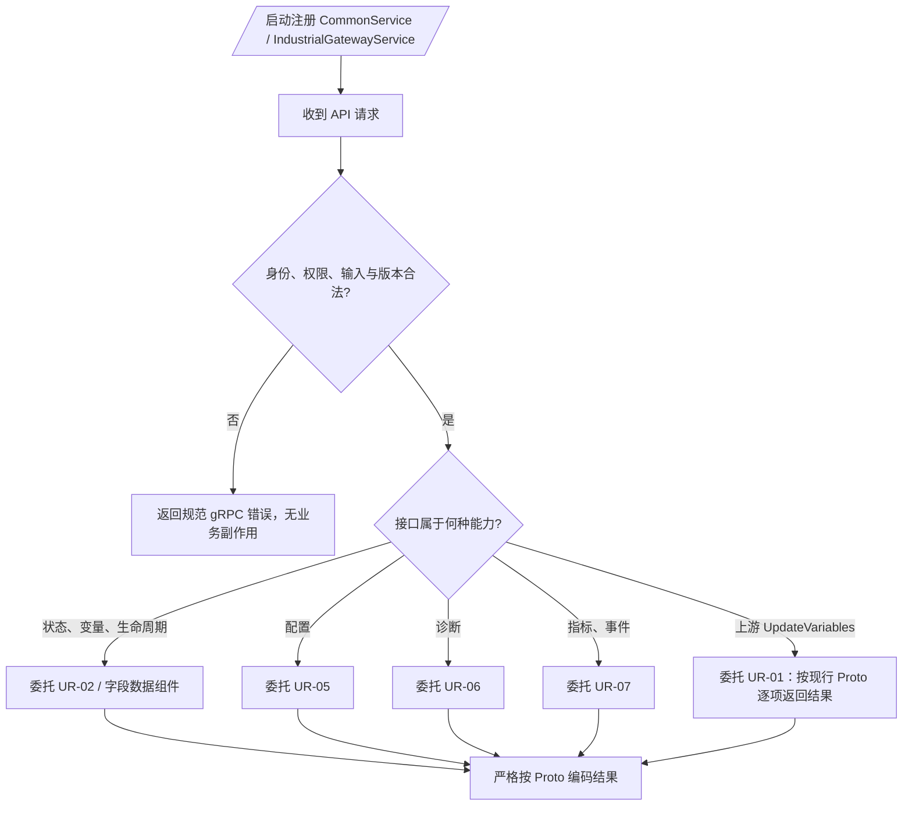

<p class="figure-caption">图 3-4 UR-04 gRPC 接口实现业务活动图</p>

### 3.5.3 业务规则

**R04-01 现有入站契约全集。** `CommonService` 9 项：`GetServiceInfo`、`GetServiceStatus`、`GetCapabilities`、`GetConfigSnapshot`、`PushConfigSnapshot`、`ApplyConfigSnapshot`、`GetMetrics`、`GetEvents`、`Diagnose`；`IndustrialGatewayService` 8 项：`ListGateways`、`GetGateway`、`StartGateway`、`StopGateway`、`ListVariables`、`ReadVariables`、`UpdateVariables`、`ClaimTargets`。合计 **17 个 Unary RPC**。

**R04-02 出站契约。** Commander 控制提交/查询使用 `SubmitCommand`、`GetCommandResult`、`GetRequestResult`；辅助映射校验可使用 `ListDevices`、`GetDevice`、`ListPoints`。这些方法属于出站客户端，不属于 Gateway Server。

**R04-03 契约前置。** `UpdateVariablesRequest` 的字段为 `gateway_id`、`values[]`、`lease_token`，逐项结果包含 `success`、`error_code`、`message`；`ClaimTargetsRequest` 包含 `gateway_id`、`owner_id`、`variable_ids[]`、`action`、`lease_token`、`lease_ms`。不得添加未定义的 `expected_revision`、质量和采样时间字段。`ClaimTargetsResponse.accepted` 只表示租约操作结果，不表示变量已写入或现场指令已执行。

### 3.5.4 关键约束

<p class="table-caption">表 3-24 UR-04 非功能约束</p>

| 约束类别 | 可验证要求 |
|---|---|
| 接口 | 现行入站 17 个 Unary RPC 必须全部注册，其中包括 `UpdateVariables` 与 `ClaimTargets`；每次副作用操作均受认证/授权/版本检查。 |
| 容量与错误 | 请求体最大值建议 2 MiB，单服务活跃 RPC 建议默认 64，默认期限 5000 ms；超限明确拒绝，不以截断数据伪报成功。 |
| 资源安全 | 客户端断连不能回滚已持久化事实；停止 RPC 不等于未完成 I/O 安全结束。 |

## 3.6 UR-05 网关配置管理

### 3.6.1 基本信息与触发方式

<p class="table-caption">表 3-10 UR-05 基本信息</p>

| 字段 | 内容 |
|---|---|
| 请求方（Requester） | 获授权配置客户端；服务启动加载配置自动触发 |
| 触发方式（Trigger） | API：GetConfigSnapshot/PushConfigSnapshot/ApplyConfigSnapshot；Lifecycle：重启加载；State：等待受影响实例安全收敛 |
| 输入（Input） | 受管 SnapshotFile 文件集、candidate_id、expected_revision、公共设备及模板的只读引用 |
| 反馈（Response） | 完整快照、验证问题、磁盘提交结果、逐实例生效状态与 restart_required |
| 目标方（Destination） | 正式配置文件集合、受影响 Gateway Server 实例 |
| 业务输出（Output） | 持久化新正式配置；按安全边界局部热生效 |

### 3.6.2 业务流程

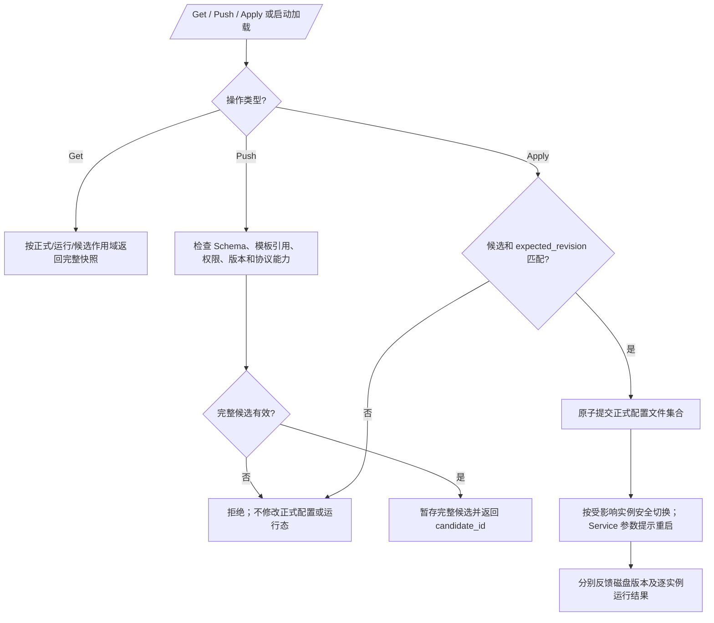

<p class="figure-caption">图 3-5 UR-05 网关配置管理业务活动图</p>

### 3.6.3 业务规则

**R05-01 三类配置。** Service 负责进程、TLS、额度与内存转发限额，正式提交后重启生效；Template 有确定 `schema_version`、不可变 `file_version`；Instance 有确定修订版并引用精确 Template 版本。 Service 必须通过 `config_sources.instances.devices` 指定直接使用的设备实例 pathname，通过 `config_sources.templates.root` 指定公共模板根目录 pathname。两者均为必填；只解析 Instance/Template 的实际引用链，不读取隐式默认实例文件、不扫描或回退默认模板目录。

**R05-02 快照与竞争。** Get 读取 DISK/RUNTIME/CANDIDATE 的完整一致文件集；Push 仅验证与暂存；Apply 用候选 ID 和 `expected_revision` 做 CAS，并采用 Gateway 专属文件集合原子提交（公共配置不由 Gateway 改写）。文件提交与实例运行生效必须分别报告。

**R05-03 在途版本。** 控制事件、旧连接及未收敛操作持有其原映射版本；安全切换不能改变已捕获事件目标。提交成功但部分实例失败时保留已提交磁盘版，逐实例报告真实失败，不伪装全局回滚。

### 3.6.4 关键约束

<p class="table-caption">表 3-25 UR-05 非功能约束</p>

| 约束类别 | 可验证要求 |
|---|---|
| 一致性 | 同一配置源同时写入者数量上限 1；Gateway 专属文件提交不得出现部分正式版本；候选大小不超过 2 MiB（设计默认上限）。 |
| 版本与错误 | 预期修订号冲突必须拒绝；Apply 对每受影响实例报告状态；文件提交成功但实例部分失败，不得返回全成功。 |
| 来源路径 | 缺失任一 `config_sources` 必填 pathname、文件不存在、模板引用或版本失配必须拒绝；切换 pathname 后不得混用新旧配置源。 |
| 审计 | 记录可信操作者、candidate_id、旧/新 revision、文件提交标识及逐实例结果。 |

## 3.7 UR-06 链路诊断（Diagnose）

### 3.7.1 基本信息与触发方式

<p class="table-caption">表 3-12 UR-06 基本信息</p>

| 字段 | 内容 |
|---|---|
| 请求方（Requester） | 授权 CLI、运维平台或诊断客户端 |
| 触发方式（Trigger） | API：`CommonService.Diagnose` |
| 输入（Input） | target_id、stages、timeout_ms、correlation_id |
| 反馈（Response） | overall_status、逐阶段状态、耗时、来源、错误、证据和 limitations |
| 目标方（Destination） | Gateway 内部观察源、协议 Server 安全只读端点、Commander 可达性 |
| 业务输出（Output） | 仅安全探测和结构化证据，不修改生产变量/控制状态 |

### 3.7.2 业务流程

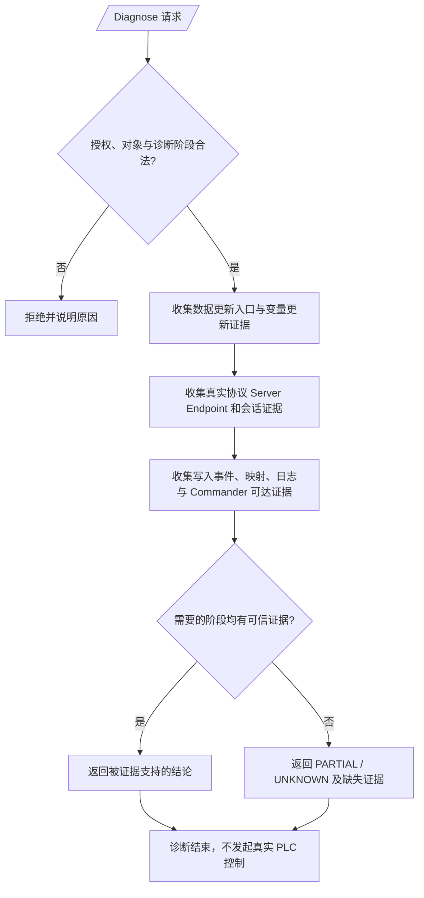

<p class="figure-caption">图 3-6 UR-06 链路诊断（Diagnose）业务活动图</p>

### 3.7.3 业务规则

**R06-01 诊断阶段。** 数据更新链路覆盖上游 gRPC、变量映射及 Server 字段证据；协议链路覆盖 Endpoint、连接和读写可用证据；控制链路覆盖写入事件、转发记录、Commander 可达性及可用的命令结果。

**R06-02 证据判定。** `PASS` 只适用于确实执行且证据完整的阶段；`FAIL` 为已核实故障；`UNKNOWN` 为证据不足；`NOT_RUN` 为未执行；`NOT_SUPPORTED` 为目标缺少安全探测能力。总体结论不得优于必选阶段的实际证据。

**R06-03 无副作用。** Diagnose 不触发 PLC 真实控制、不生成新工业写入事件、不修改生产字段、映射或控制转发记录；只读探测没有能力时报告局限，而不以测试控制补足。

### 3.7.4 关键约束

<p class="table-caption">表 3-26 UR-06 非功能约束</p>

| 约束类别 | 可验证要求 |
|---|---|
| 性能与容量 | 总诊断期限默认 5000 ms；同时运行诊断任务默认上限 4；返回体最大 1 MiB；超时后只能返回已取得证据。 |
| 安全 | 允许产生实际 PLC 控制的诊断调用次数为 0；不可安全探测阶段必须 NOT_SUPPORTED。 |
| 错误与证据 | 每阶段包含 stage、status、duration_ms、error_code、observed_at、source 和 evidence；缺失关键证据不得 PASS。 |

## 3.8 UR-07 运行指标管理（Metrics）

### 3.8.1 基本信息与触发方式

<p class="table-caption">表 3-14 UR-07 基本信息</p>

| 字段 | 内容 |
|---|---|
| 请求方（Requester） | 监控客户端（查询）；周期采样器无外部请求方 |
| 触发方式（Trigger） | Periodic：按服务统计窗口更新；API：GetMetrics/GetEvents；State：状态/故障事件到达 |
| 输入（Input） | scope、window_ms、事件时间过滤及分页参数 |
| 反馈（Response） | Metric[]（名称、值、单位、窗口、采样时间）；Event[] 与分页信息 |
| 目标方（Destination） | 不适用（只读查询） |
| 业务输出（Output） | 不适用；指标在本服务内部滚动更新并供查询 |

### 3.8.2 业务流程

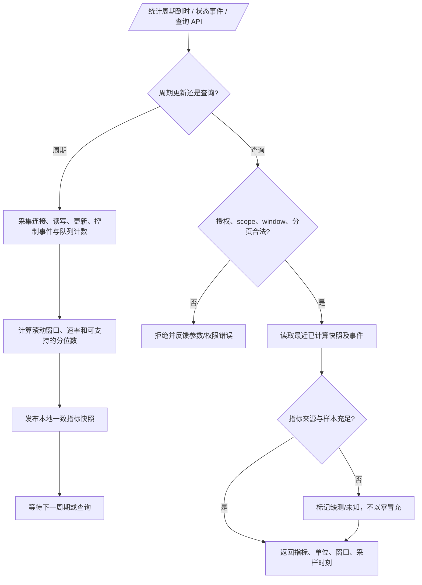

<p class="figure-caption">图 3-7 UR-07 运行指标管理（Metrics）业务活动图</p>

### 3.8.3 业务规则

**R07-01 统计单位与计数时机。** 指标按 Gateway 实例记录，数据批次、变量条数和工业协议写入事件不得混为同一单位。`update_batches_total` 按收到并完成处理的上游请求计次；`updated_variables_total` 只计返回 success=true 的变量项数；`client_writes_total` 计每次合法工业客户端字段写入事件（相同值重复写入分别计）；`forward_accepted_total` 只计 Commander 权威接受的提交；`forward_unknown_total` 计可能送达但无权威回执而转 UNKNOWN 的事件，不重复递增。

**算例 R07-A。** 初始累计计数均为 0；一个包含 500 个变量的上游批次成功，随后一个包含 3 个变量但有 1 个非法值的请求，其余 2 项成功；工业客户端对同一命令字段重复写入 2 次，第一次 Commander 明确接受，第二次结果 UNKNOWN。则 `update_batches_total=2` 次、`updated_variables_total=502` 条、`client_writes_total=2` 次、`forward_accepted_total=1` 次、`forward_unknown_total=1` 次。

**R07-02 周期与窗口。** 以单调时钟统计，UTC 记录快照时间。设统计时刻为 $t$（秒）、纪元起点为 $t_0$（秒）、窗口长度为 $W$（秒，$W>0$），有效统计窗口及覆盖时长为：

$$
\mathcal{W}(t)=(\max(t_0,t-W),t]
$$

$$
T(t)=\min(W,t-t_0)
$$

窗口内成功更新的变量数为 $N_v(t)$（条），则更新吞吐率为：

$$
\lambda_v(t)=\frac{N_v(t)}{T(t)},\qquad T(t)>0
$$

$\lambda_v$ 单位为条/秒；覆盖时长为 0 时无效，覆盖时长大于 0 且无成功更新时为 0。

**R07-03 P99。** 仅使用有明确完成结果的上游批次响应耗时，单位毫秒；将窗口内 $n>0$ 个样本升序排列为 $d_{(1)},\ldots,d_{(n)}$，采用最近秩定义：

$$
Q_{0.99}=d_{(\lceil 0.99n\rceil)}
$$

没有耗时样本时不输出 P99；不得用零冒充。

**R07-04 统计快照及封闭指标集合。** 首版必选 9 项：`update_batches_total`（Counter，次）、`updated_variables_total`（Counter，条）、`client_writes_total`（Counter，次）、`forward_accepted_total`（Counter，次）、`forward_unknown_total`（Counter，次）、`updated_variables_rate_per_second`（Gauge，条/秒）、`update_latency_ms_p99`（Gauge，毫秒）、`control_events_pending`（Gauge，条）、`metrics_covered_ms`（Gauge，毫秒）。统计来源分别为批次提交边界、协议库请求级回调、Commander 回执和内存未终结转发记录。计数器进程重启后以新纪元初始化为 0，窗口清空；Gauge 的缺失数据不可当成 0。快照周期计算后原子替换，首次计算前为 NOT_READY，通过服务状态/事件给出。

### 3.8.4 关键约束

<p class="table-caption">表 3-27 UR-07 非功能约束</p>

| 约束类别 | 可验证要求 |
|---|---|
| 周期与容量 | 统计周期默认 1000 ms，可配置 100～60000 ms；窗口默认 60000 ms，可配置 1000～3600000 ms，且不得小于周期；同一周期计算并发上限 1。 |
| 计算与缺失 | 首次周期之前不返回伪造快照；P99 样本数为 0 时不输出指标；Broker/Commander 不可用时相应瞬时 Gauge 不以零代替。 |
| 安全与可观测性 | 指标必须包含名称、单位、窗口、采样时间和作用域；不得以 event_id 等高基数字段作为持续维度；统计不得阻塞协议 ACK。 |

## 3.9 需求追溯与可核验边界

<p class="table-caption">表 3-16 原始需求、用例与实施契约对应</p>

| 原始需求 | 主要用例 | 主要设计与测试依据 |
|---|---|
| UR-01 | UC-01 | 第 9.2 节正式更新接口、第 10 章数据一致性、第 14 章系统测试 |
| UR-02 | UC-02、UC-08 | 第 5～8 章真实 Server 与生命周期、第 14 章真实协议测试 |
| UR-03 | UC-03、UC-08 | 第 10.2～10.3 节事件及尽力转发边界、第 9 章 Commander、第 14 章故障恢复 |
| UR-04 | UC-01、UC-04～UC-08 | 第 9 章已定义 17 项入站 RPC（含 UpdateVariables、ClaimTargets）、第 14 章契约测试 |
| UR-05 | UC-05、UC-08 | 第 11 章三类配置和 Get/Push/Apply、第 14 章版本与恢复测试 |
| UR-06 | UC-06 | 第 9 章 Diagnose、第 13 章安全、第 14 章诊断场景 |
| UR-07 | UC-07 | 第 9 章 GetMetrics/GetEvents、第 3.8.3 节统计定义与第 13 章观测、第 14 章窗口场景 |

本章分类说明不增加新的业务能力；性能、可靠性、安全和横切约束已逐项放入 UR 关键约束并由后续技术章节细化。第 14 章须保证每项 UC、每个 S01/S02/S03 及图中的关键分支均具有对应 System Test；测试映射不等于测试通过。


# 4. 用例视图

## 4.1 系统上下文

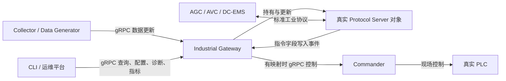

<p class="figure-caption">图 4-1 Gateway 系统上下文图</p>

UC-01 的上游更新及租约 gRPC 已进入正式 Proto；独立验收分支已验证真实 grpc.aio 和 Modbus 链路（第 14 章），跨分支完整实栈及硬件环境仍须另行验证。本章从外部使用者的完整业务目标组织用例，不以单个 RPC 或内部组件命名。场景统一以 `UC-xx-S01`（主流程）、`UC-xx-S02`（关键边界）、`UC-xx-S03`（异常与恢复）编号；表中列出的并列情况均需独立测试或参数化验证。工业协议客户端仅面向真实协议 Server 实例，不通过 gRPC 访问其寄存器。

<p class="table-caption">表 4-1 用例—需求总表</p>

| 用例 | 业务目标 | 关联需求 |
|---|---|---|
| UC-01 | 上游数据注入并对工业客户端可见 | UR-01、UR-04 |
| UC-02 | 启动并保持协议 Server 正常运行 | UR-02 |
| UC-03 | 指令写入监听并转发实际控制 | UR-02、UR-03 |
| UC-04 | 查询网关实例、变量与运行状态 | UR-04 |
| UC-05 | 获取、推送并应用网关配置 | UR-04、UR-05 |
| UC-06 | 诊断 Gateway 数据、协议和控制链路 | UR-04、UR-06 |
| UC-07 | 查看网关运行指标 | UR-04、UR-07 |
| UC-08 | 管理网关实例生命周期及故障恢复 | UR-02、UR-03、UR-05 |

## 4.2 UC-01 上游数据注入并对工业客户端可见

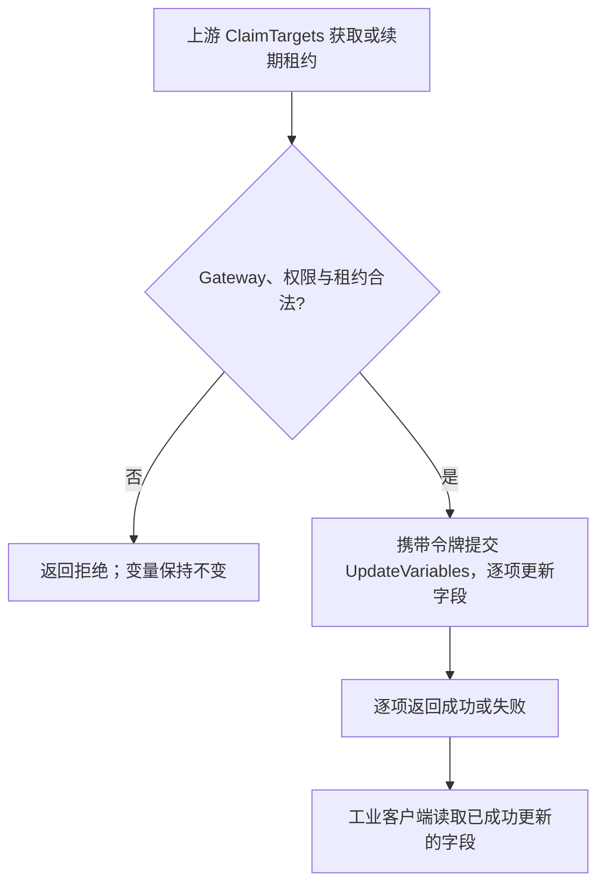

<p class="figure-caption">图 4-2 UC-01 业务活动图</p>

| 要素 | 内容 |
|---|---|
| 参与者 | Data Generator、Collector |
| 业务目标 | 合法项更新 Gateway 当前值并由真实工业协议客户端读取 |
| 前置条件 | Gateway 字段已配置，上游获授权；若目标被租约占用则具备有效令牌；Protocol Server 可停止 |
| 主要异常 | 字段不存在、单项类型错误、服务未就绪、RPC 超时 |
| 后置条件 | 有效项成功、无效项失败且互不回滚；不触发 Commander |
| 关联需求 | UR-01、UR-04 |
| UC-01-S01 主流程 | 多项合法更新全部成功，并通过协议端验证 |
| UC-01-S02 关键边界 | 空请求、重复字段整批拒绝、合法项与非法值混合、租约申领/续期/释放、只读/command 字段、Server 停止时更新；完整变量不撕裂 |
| UC-01-S03 异常与恢复 | 不存在字段、类型错误、单项失败、冲突/过期/旧租约令牌、Apply 失效及进程重启、并发更新与连接中断后的可见状态 |

## 4.3 UC-02 启动并保持协议 Server 正常运行

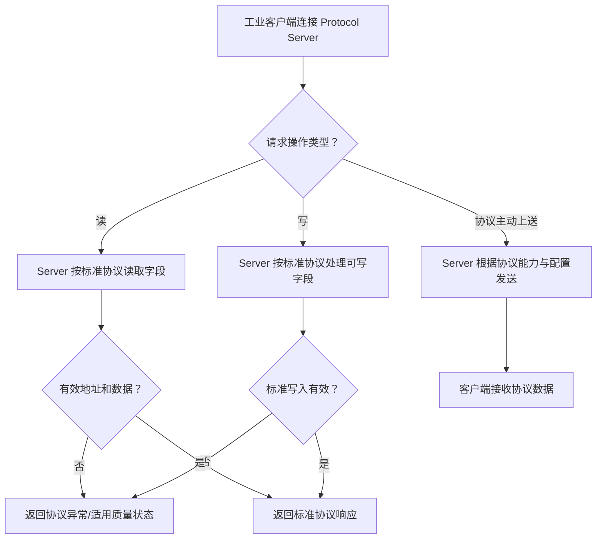

<p class="figure-caption">图 4-3 UC-02 业务活动图</p>

<p class="table-caption">表 4-3 UC-02 用例说明与规定场景</p>

| 要素 | 内容 |
|---|---|
| 参与者 | AGC、AVC、DC-EMS 工业客户端 |
| 业务目标 | 像访问真正 PLC 一样通过标准工业协议访问 Server |
| 前置条件 | Server Endpoint 已监听，工业客户端满足协议及访问条件 |
| 主要异常 | 地址无效、权限不足、会话中断、数据未初始化或已失效、主动上送故障 |
| 后置条件 | 标准协议读写由 Server 处理；协议支持的主动上送按配置发生；无现场 PLC 主动读取 |
| 关联需求 | UR-02 |
| UC-02-S01 主流程 | 真实工业客户端建连、读取、写入并获得标准响应 |
| UC-02-S02 关键边界 | 不同站号、地址边界、数据类型、无映射普通写入；协议支持时的主动上送 |
| UC-02-S03 异常与恢复 | 非法功能码、客户端断连、数据失效、上送中断与恢复 |

## 4.4 UC-03 工业客户端指令写入并转发 Commander

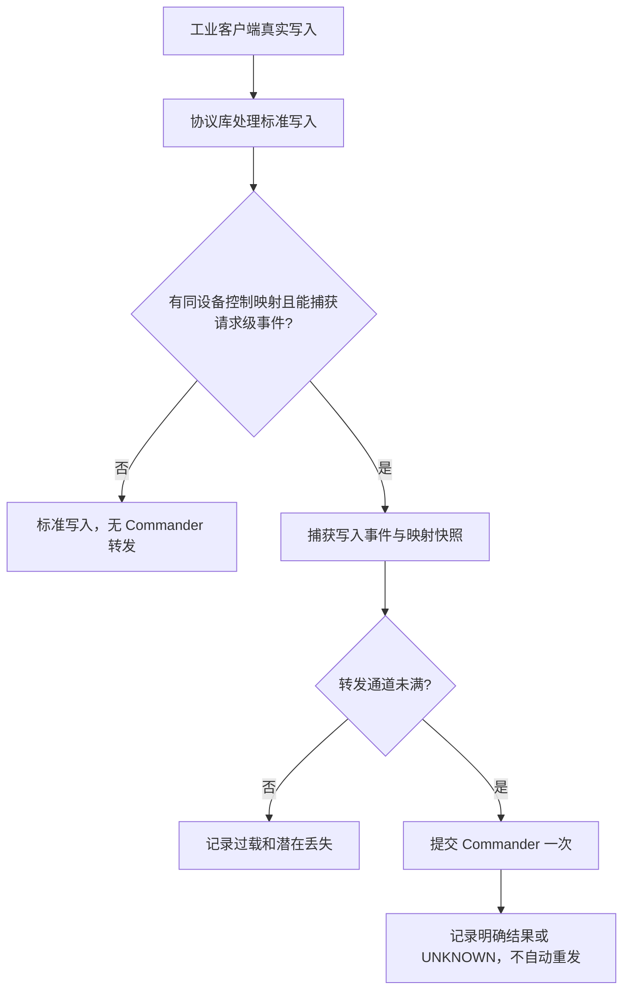

<p class="figure-caption">图 4-4 UC-03 业务活动图</p>

| 要素 | 内容 |
|---|---|
| 参与者 | AGC、AVC、DC-EMS 工业客户端 |
| 业务目标 | 被捕获且可排队的真实写指令按同设备映射提交 Commander |
| 前置条件 | 协议库具有经验证的请求级写回调；映射合法且已启用 |
| 主要异常 | 同值重复写、无映射、队列过载、Commander 拒绝或超时、进程崩溃 |
| 后置条件 | 每次捕获独立处理；无映射不转发；UNKNOWN 不自动重发；ACK 不保证控制交付 |
| 关联需求 | UR-02、UR-03 |
| UC-03-S01 主流程 | 单次真实客户端写入，成功捕获并调用 Commander |
| UC-03-S02 关键边界 | 同值连续两次、无映射、跨设备映射拒绝、并发及旧配置映射快照 |
| UC-03-S03 异常与恢复 | 过载、Commander 失联/拒绝/UNKNOWN、ACK 后崩溃造成转发丢失的明确边界 |

## 4.5 UC-04 查询网关实例、变量与运行状态

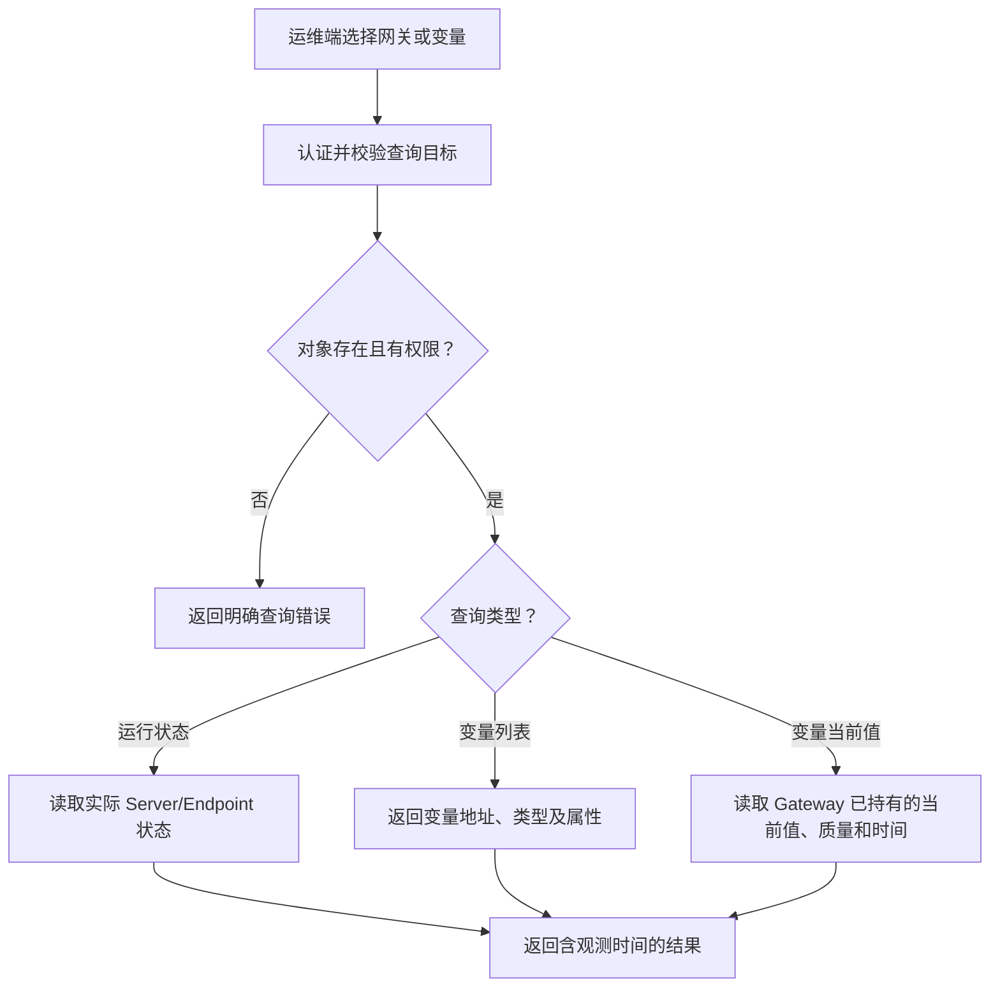

<p class="figure-caption">图 4-5 UC-04 业务活动图</p>

<p class="table-caption">表 4-5 UC-04 用例说明与规定场景</p>

| 要素 | 内容 |
|---|---|
| 参与者 | CLI、运维平台 |
| 业务目标 | 查询 Gateway、Protocol Server、Endpoint、变量及实际运行状态 |
| 前置条件 | 调用方已认证并具有只读权限 |
| 主要异常 | 网关/变量不存在、未就绪、无值或过期、部分变量失败、无权限 |
| 后置条件 | 返回权威运行状态及 Server 当前变量值、质量和观测时间；不访问真实 PLC |
| 关联需求 | UR-04 |
| UC-04-S01 主流程 | 查询实例、Endpoint、变量列表和当前变量值 |
| UC-04-S02 关键边界 | 空列表、批量变量与质量/时间、未初始化值、分页 |
| UC-04-S03 异常与恢复 | 对象缺失、未就绪、访问拒绝、部分失败 |

## 4.6 UC-05 获取、推送并应用网关配置

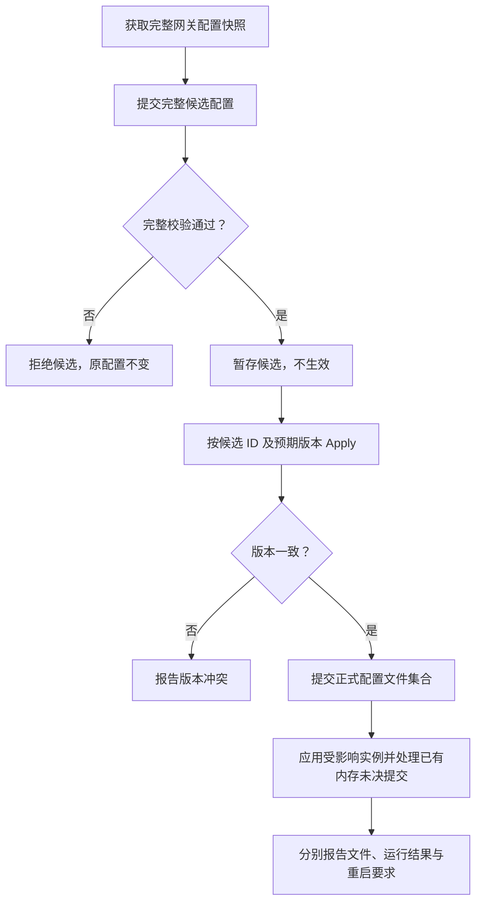

<p class="figure-caption">图 4-6 UC-05 业务活动图</p>

<p class="table-caption">表 4-6 UC-05 用例说明与规定场景</p>

| 要素 | 内容 |
|---|---|
| 参与者 | 授权 CLI、运维平台 |
| 业务目标 | 完成网关整套配置的获取、候选校验和生效 |
| 前置条件 | 具备配置权限，有完整快照和预期版本 |
| 主要异常 | 候选校验失败、引用失效、版本冲突、文件提交故障、部分实例未生效、未决映射事件 |
| 后置条件 | Push 不修改运行和正式文件；Apply 分别报告文件提交、运行生效及重启要求；已捕获事件沿用原映射快照 |
| 关联需求 | UR-04、UR-05 |
| UC-05-S01 主流程 | Get、Push、Apply 完整配置；验证运行结果 |
| UC-05-S02 关键边界 | Template 版本引用、无请求级写回调的协议、Endpoint 变化及候选隔离 |
| UC-05-S03 异常与恢复 | 非法路径或版本、磁盘故障、热更部分失败、在途事件持有旧映射快照 |

## 4.7 UC-06 诊断 Gateway 数据、协议和控制链路

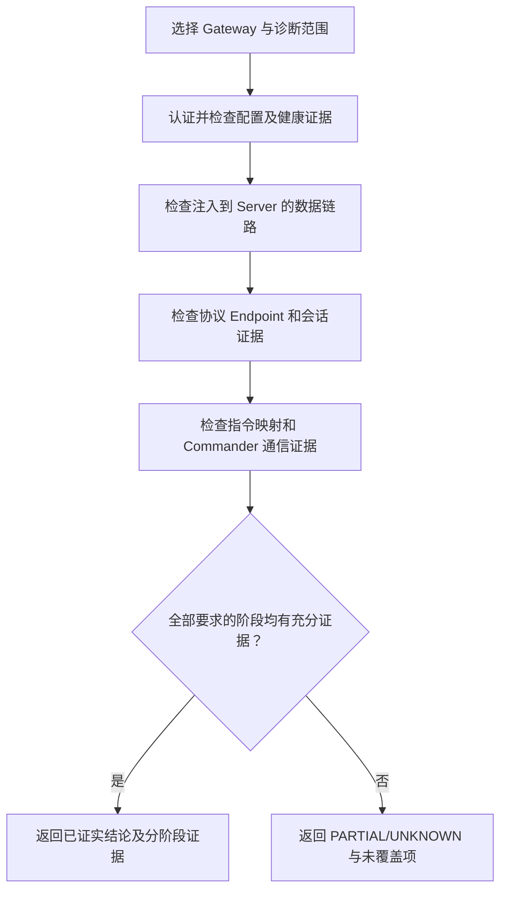

<p class="figure-caption">图 4-7 UC-06 业务活动图</p>

<p class="table-caption">表 4-7 UC-06 用例说明与规定场景</p>

| 要素 | 内容 |
|---|---|
| 参与者 | 授权 CLI、运维平台 |
| 业务目标 | 定位 gRPC 注入、Protocol Server 和 Commander 转发链路异常 |
| 前置条件 | 指定诊断目标、阶段和期限，拥有诊断权限 |
| 主要异常 | 阶段超时、Server 不可达、映射错误、证据不足、Commander 失联、权限拒绝 |
| 后置条件 | 返回逐阶段状态和证据，无法证实的阶段标为 UNKNOWN/PARTIAL；不向真实 PLC 下发诊断控制 |
| 关联需求 | UR-04、UR-06 |
| UC-06-S01 主流程 | 分阶段诊断数据注入、协议服务、控制映射可达性 |
| UC-06-S02 关键边界 | 仅部分阶段可诊断、无有效历史证据、检查范围为空 |
| UC-06-S03 异常与恢复 | 阶段超时、权限拒绝、Endpoint 中断、Commander 不可达 |

## 4.8 UC-07 查看网关运行指标

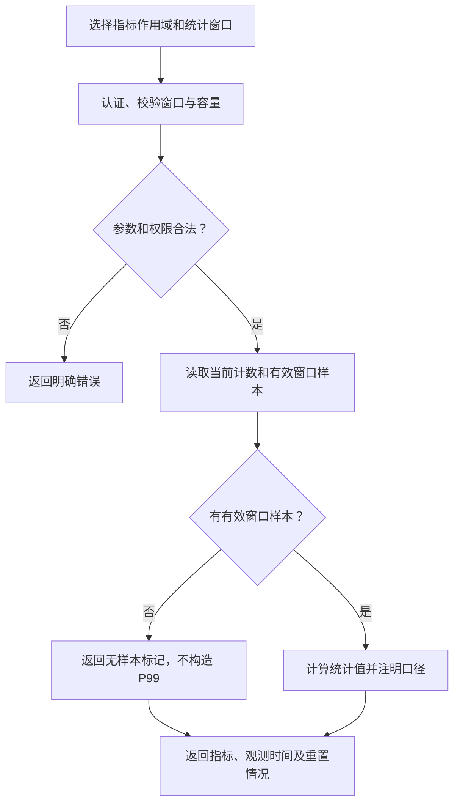

<p class="figure-caption">图 4-8 UC-07 业务活动图</p>

<p class="table-caption">表 4-8 UC-07 用例说明与规定场景</p>

| 要素 | 内容 |
|---|---|
| 参与者 | CLI、运维平台 |
| 业务目标 | 查询服务、协议、数据、控制及资源指标 |
| 前置条件 | 指定有效作用域、统计窗口并具备查询权限 |
| 主要异常 | 无样本、统计重置、非法时间窗口、权限拒绝、数据采集故障 |
| 后置条件 | 返回数值、单位、窗口、观测时间与缺测说明；不虚构无样本 P99 |
| 关联需求 | UR-04、UR-07 |
| UC-07-S01 主流程 | 查询瞬时量、累计量、窗口指标及其采样时间 |
| UC-07-S02 关键边界 | 空统计窗口、分页/容量上限、重启导致计数重置 |
| UC-07-S03 异常与恢复 | 统计采集失败、窗口非法、无权限、连接断开 |

## 4.9 UC-08 管理网关实例生命周期及故障恢复

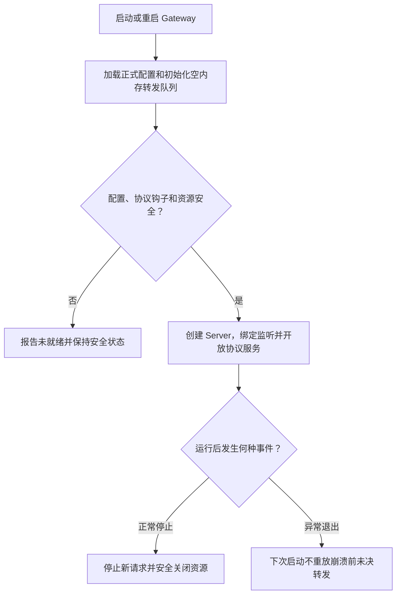

<p class="figure-caption">图 4-9 UC-08 业务活动图</p>

<p class="table-caption">表 4-9 UC-08 用例说明与规定场景</p>

| 要素 | 内容 |
|---|---|
| 参与者 | 进程管理系统、授权运维端 |
| 业务目标 | 服务能够安全启动、停止、重启，并恢复服务运行，但不重放崩溃前未完成转发 |
| 前置条件 | 配置和协议库可访问 |
| 主要异常 | 端口冲突、协议监听钩子不可用、配置不一致、未决控制、异常退出 |
| 后置条件 | 未准备就绪不得对外宣称 READY；重启后可能已提交的控制不自动重发；安全停止 Server 和相关任务 |
| 关联需求 | UR-02、UR-03、UR-05 |
| UC-08-S01 主流程 | 正常启动、就绪、停止及重启 |
| UC-08-S02 关键边界 | 多 Server 实例、部分 Endpoint 故障、在途事件持有旧映射 |
| UC-08-S03 异常与恢复 | 监听失败、端口冲突、异常退出及转发丢失边界、UNKNOWN 防重发 |

第 14 章依据本章全部 24 个 `UC-xx-Syy` 规定场景建立 System Test 映射；一个场景中并列的操作、异常和边界必须分别参数化，不得以单一主路径替代。


# 5. 逻辑视图

## 5.1 组件与职责

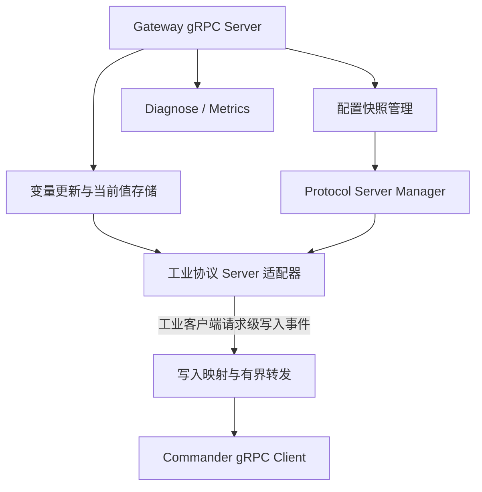

<p class="figure-caption">图 5-1 Gateway 逻辑组件关系图</p>

| 组件 | 职责及状态所有权 | 不承担 |
|---|---|---|
| Server Manager | 每 Server 绑定唯一实际设备、配置和运行状态、故障恢复 | 自行实现工业协议栈 |
| 当前值存储 | 变量当前值唯一权威，按变量安全更新；无跨变量事务承诺 | PLC 实际值采集 |
| 协议 Server 适配器 | 现有工业协议库的读写、会话、请求级事件桥接 | Command 执行判断 |
| 转发组件 | 同设备映射校验、事件顺序、内存有界队列、单次 Commander 提交和 UNKNOWN 可观测 | 持久化重放、PLC 执行、Commander 审计 |
| 配置组件 | Gateway 服务配置与候选快照；公共设备和模板只读解析 | 私自修改公共配置 |
| 观测组件 | 无副作用的诊断、指标和运行事件查询 | 用测试控制命令探测现场 |

## 5.2 核心对象与一致性

| 对象 | 不变量 |
|---|---|
| ServerBinding | `server_id` 唯一；一个 Server 对应一个 `device_id`；同一服务域设备不能重复绑定 |
| VariableState | 以 Server/变量定位当前值；一个变量更新不可发生撕裂；未初始化值独立于数值零 |
| WriteEvent | 每次真实客户端写请求独立标识；带变量值及生效映射快照；仅存在进程内 |
| ControlMapping | Commander 目标设备必须与该 Server 的设备一致；无映射不发控制 |
| ConfigSnapshot | 候选、文件、运行版本分别跟踪；公共配置只读 |

## 5.3 状态和更新关系

Server 运行状态由 Manager 持有，变量当前值不依赖 Server 是否已启动。工业客户端写入可以更新 Protocol Server 所映射的当前值；gRPC `UpdateVariables` 只更新当前值，不模拟协议写入消息。转发事件状态仅记录当前进程可观察的 `QUEUED`、`SUBMITTING`、`ACCEPTED`、`REJECTED`、`UNKNOWN`、`OVERLOADED`；重启后不恢复这些内存状态，不推断历史成功或失败。

# 6. 进程视图

## 6.1 运行时结构

```mermaid
%%{init: {"flowchart": {"useMaxWidth": true}}}%%
flowchart TB
 P["Gateway 进程"] --> L["gRPC 与生命周期 Event Loop"]
 L --> M["Server Manager"]
 M --> S1["Server A：设备 A"]
 M --> S2["Server B：设备 B"]
 S1 --> Q["有界内存事件队列"]
 S2 --> Q
 Q --> W["Commander 转发任务"]
 L --> O["诊断 / Metrics"]
```

<p class="figure-caption">图 6-1 Gateway 运行结构图</p>

协议库可能在独立线程触发写事件；适配层必须通过线程安全方式交付 Event Loop，不阻塞库的网络线程。Server 监听端口由 Service 配置分配，不复用公共设备实例中的 PLC 连接 Endpoint。

## 6.2 生命周期

1. 启动时校验 Service 直接依赖 pathname、公共模板引用闭包、Server 设备一对一关系、监听冲突以及实际协议库能力；启动失败不宣称 READY。
2. `desired_state=START` 的 Server 在异常退出且旧监听安全结束后可有界退避恢复；手动 STOP 不自动恢复。当前值由独立存储在同一进程生命周期中保存，Server 重新启动装载最新值。
3. 服务进程重启不承诺保留未显式持久化的变量值或未提交的控制转发；公共配置重新加载，转发队列为空。已发送但无结果的 Commander 操作由 Commander 负责底层安全性，Gateway 不重发。
4. 配置热更新的事件保留其接收时绑定的映射快照；新配置从切换点开始影响新的写事件。Service 级参数重启生效；监听端点变动需先安全关闭旧端点。

## 6.3 并发与容量

每个变量的值更新和协议端读取必须同步保证不撕裂；不同变量不保证请求级快照。转发通道默认容量 1024，Commander 在途上限 16；每个控制目标的捕获顺序应保持，跨目标可并发。满载计为过载，且该控制转发可能丢失，不对客户端协议 ACK 追加未经库验证的含义。内存对象、线程、I/O 资源必须有所有者；调用超时不能强制认为 Commander 原生 I/O 已终结。

## 6.4 失败与恢复裁决

| 情形 | Gateway 对外行为 | 限制 |
|---|---|---|
| 配置缺失或引用错误 | 拒绝启动或候选 | 不回退默认路径 |
| 协议 Server 监听失败 | 对应 Server 不就绪 | 不隐藏端口冲突 |
| 单个 Server 异常退出 | desired START 可自动恢复 | 不能先于旧实例安全释放重绑定 |
| Commander 明确拒绝 | 记录 REJECTED | 不报告控制成功 |
| Commander 超时无命令 ID | 记录 UNKNOWN | 不自动重发 |
| 转发队列满 | 记录 OVERLOADED | 已成功协议 ACK 仍可能未转发 |
| Gateway 进程崩溃 | 重启恢复 Server/配置，不重放内存事件 | 不提供控制交付持久保证 |
| Metrics/Diagnose 故障 | 只报告观测功能局部失败 | 不发现场控制探针 |

# 7. 开发视图

## 7.1 模块边界

```text
src/
├── industrial_gateway/     # gRPC Server、协议 Server 管理、数据注入、指令事件、配置、指标、诊断
├── contracts/              # 外部统一维护的 Proto 与生成契约
└── core/                   # 仅稳定通用能力
```

**Ports & Adapters 代码整改**：`application/` 负责 Gateway 实例生命周期、变量更新和控制事件转发用例；`application/ports/` 声明协议 Server、Commander Client、仿真执行与存储的业务依赖契约；`infrastructure/adapters/inbound/` 实现 gRPC 与 Modbus TCP Server 等协议入口，`infrastructure/adapters/outbound/` 实现 Commander Client、Data Generator 模型输入 Client，`infrastructure/config/` 仅负责 Schema 解析。现有 `infrastructure/runtime.py` 的应用级协调须按职责迁出，装配入口只负责注入。应先依据 DFD 和正式 RPC 契约重构，不制造第二份变量状态或重复业务流程。

目录结构仅规定按职责分层，不预先规定无职责的空目录与文件名。Gateway 可以引用成熟 Modbus/IEC 104 Server 库，不复制或重写协议栈。新增对现有 `PointStore`/`WriteService` 的保留须证明其与真实 Server 字段权威不冲突；如果仅属旧的平行镜像，应移除而非建立双重权威状态。

## 7.2 静态依赖

```mermaid
%%{init: {"flowchart": {"useMaxWidth": true}}}%%
flowchart TB
    GW["industrial_gateway"] --> CO["contracts"]
    GW --> CORE["core 公共能力"]
    GW --> LIB["工业协议 Server 库"]
    GW -->|"仅调用 RPC"| CM["Commander gRPC Server"]
```

<p class="figure-caption">图 7-1 Gateway 开发依赖关系图</p>

Gateway 不导入 Commander 应用层业务模块，不在自身定义目标 Proto，不将 CLI 作为基础依赖。多协议共享抽象以确实存在的稳定接口能力为前提。

# 8. 物理视图（部署视图）

```mermaid
%%{init: {"flowchart": {"useMaxWidth": true}}}%%
flowchart LR
    subgraph HOST["Gateway 节点/容器"]
        G["Gateway 进程"]
        P["工业协议 Server 监听端口"]
        G --- P
    end
    UP["Collector / Data Generator"] -->|"gRPC"| G
    OPS["CLI"] -->|"gRPC/mTLS"| G
    EMS["AGC / AVC / DC-EMS"] <-->|"Modbus TCP / IEC 104 等"| P
    G -->|"gRPC/mTLS"| CM["Commander"]
    CM -->|"工业协议控制"| PLC["PLC"]
```

<p class="figure-caption">图 8-1 Gateway 部署与通信边界图</p>

<p class="table-caption">表 8-1 部署及故障域</p>

| 区域 | 通信 | 约束 |
|---|---|---|
| 上游数据服务 → Gateway | gRPC 数据注入 | 认证、限流及字段权限；不产生控制事件 |
| 工业客户端 ↔ Protocol Server | 标准工业协议 TCP 会话 | 端口、地址、会话权限与网络隔离按协议配置 |
| Gateway ↔ Commander | gRPC 控制提交及状态查询 | 与物理 PLC 完全隔离，不直接操作 PLC |
| CLI → Gateway | gRPC 运维接口 | 配置、诊断和指标受授权控制 |
| 本地配置及在途控制 | 受控文件/存储 | 权限、完整性与重启恢复有明确策略 |

Gateway Server 监听端点必须来自专属 Service 配置，公共设备 Endpoint 仅代表真实设备连接目标；实际地址、容器网络、Server 库版本与部署规模以项目配置及部署验证为准；示例值不作为现场承诺。

# 9. 对外接口与通信契约

以当前 `src/contracts/common.proto`、`industrial_gateway.proto`、`commander.proto` 为现行接口基准。入站 **CommonService 9 RPC + IndustrialGatewayService 8 RPC = 17 个现行 Unary RPC**；按 Contracts v1_25 §3.3 增加两个仿真执行 RPC 后目标为 19 个，落地前不得声明已实现。

## 9.1 CommonService 入站全集

| RPC | 请求 → 响应 | 本服务行为 |
|---|---|---|
| GetServiceInfo | `Empty` → `GetServiceInfoResponse` | 服务身份、版本、启动时间 |
| GetServiceStatus | `Empty` → `GetServiceStatusResponse` | 进程及 Server 健康状态 |
| GetCapabilities | `Empty` → `GetCapabilitiesResponse` | 仅报告真实已验收协议和功能 |
| GetConfigSnapshot | `GetConfigSnapshotRequest` → `GetConfigSnapshotResponse` | 候选/磁盘/运行快照 |
| PushConfigSnapshot | `PushConfigSnapshotRequest` → `PushConfigSnapshotResponse` | 验证与暂存 Service 候选 |
| ApplyConfigSnapshot | `ApplyConfigSnapshotRequest` → `ApplyConfigSnapshotResponse` | Service 文件提交与运行结果 |
| GetMetrics | `GetMetricsRequest` → `GetMetricsResponse` | 已定义指标快照 |
| GetEvents | `GetEventsRequest` → `GetEventsResponse` | 运行事件查询 |
| Diagnose | `DiagnoseRequest` → `DiagnoseResponse` | 安全只读诊断 |

## 9.2 IndustrialGatewayService 入站全集

| RPC | 请求 → 响应 | 关键语义 |
|---|---|---|
| ListGateways | `ListGatewaysRequest` → `ListGatewaysResponse` | 分页与实例过滤 |
| GetGateway | `ObjectId` → `GetGatewayResponse` | 设备绑定、监听、实际状态及版本 |
| StartGateway | `OperationRequest` → `OperationResult` | 实例启动；accepted 不等于最终运行成功 |
| StopGateway | `OperationRequest` → `OperationResult` | 实例停止；不停止服务进程 |
| ListVariables | `ListVariablesRequest` → `ListVariablesResponse` | 变量类型、可读写和 AddressField[] |
| ReadVariables | `ReadVariablesRequest` → `ReadVariablesResponse` | 当前值，Sample.value 可缺失；非 PLC 现场读 |
| UpdateVariables | `UpdateVariablesRequest` → `UpdateVariablesResponse` | `gateway_id` + `values[]` + `lease_token`；租约预检后逐项返回结果，非法租约整批拒绝 |
| **ClaimTargets** | `ClaimTargetsRequest` → `ClaimTargetsResponse` | `ACQUIRE`/`RENEW`/`RELEASE`，Gateway 作用域原子申领、多目标隔离、过期失效及防止旧令牌写入 |

正式更新消息：`VariableUpdate { variable_id, value: ScalarValue }`，不包含 `quality`、`sample_timestamp`、`expected_revision`；更新请求增加 `lease_token`；响应 `results[]` 不包含全局 `revision` 或 `gateway_id`。重复变量 ID 整批拒绝；合法租约覆盖时逐项更新，无权限/失效令牌不允许产生写入。

`ClaimTargetsRequest`：`gateway_id`、`owner_id`、`variable_ids[]`、`action`（`ACQUIRE`/`RENEW`/`RELEASE`）、`lease_token`、`lease_ms`。`ClaimTargetsResponse`：`accepted`、`lease_token`、`error_code`、`message`。同一 Gateway 的重叠目标租约互斥；获取全部成功或全部失败；TTL 1000～60000 ms；目标数上限 5000；重新配置及进程重启均使旧令牌失效。该租约保护只针对 Gateway 数据更新，**不是** Commander 命令幂等凭证。

## 9.3 Commander 出站契约与仿真执行接口前置条件

`CommanderService` 按 Contracts v1_21 设计共 7 项：`ListDevices`、`GetDevice`、`ListPoints` 可用于只读映射验证；`SubmitCommand` 用于一次控制提交；已获得 `command_id` 后才可用 `GetCommandResult` 查询结果。`SubmitCommandRequest` 必须携带 Gateway 转发器在每个真实工业客户端写事件发生时预先生成、绑定该事件的唯一 `request_id`，并填 `device_id`、`point_id`、`value`、`expires_at` 和 `expected_revision`；Commander 返回 `command_id`。响应丢失时 Gateway 可以用原 `request_id` 调用 `GetRequestResult` 查结果，但不得生成新 ID 自动重发，亦不得根据 NOT_FOUND 假定未执行。

## 9.4 错误与身份

对象缺失、参数错误、权限不足、配置版本冲突、状态不允许等分别使用适用的 gRPC Status。`UpdateVariables` 的单项业务失败使用 `results[]` 而非把整批回滚；请求级认证失败或 Gateway 不存在可直接返回 gRPC 错误。`GetMetricsResponse` 仅有 `Metric[]`，`Metric` 字段为 name/value/unit/window_ms/sampled_at；当前 Proto 不存在每条指标单独的 `unavailable` 字段。缺失指标应省略或通过 `GetEvents`/状态说明，不能发明 wire 字段。工业协议 ACK 不代表 Commander 命令提交或 PLC 完成。

Commander 入站业务拒绝的 Forwarder 终态须按第 10.3 节分类：只有具有执行前拒绝证据的状态码才是 `REJECTED`；RPC 传输或执行结果不明时为 `UNKNOWN`。已验收分支 `1af46e83` 修复此缺陷，`301a070b` 独立复测关闭 FWD-SEM-01。

## 9.6 RPC 生成对象的唯一持有边界（规范性）

所有 generated `*_pb2`、`*_pb2_grpc` 的运行时引用只允许出现在 `infrastructure/grpc/` 及既有 Contracts 生成目录；不得由 `assembly`、`runtime`、`config/snapshots`、`variable_leases`、`observability` 或 `commander/forwarder` 直接持有。内部边界使用不可变或受控的普通 Python 对象，gRPC adapter 对照冻结 Contracts v1_21 负责双向字段映射。

- `ClaimTargets`：Gateway Runtime 使用 `ClaimRequest/ClaimResult`，Grpc Service 将其转换为冻结的 Request/Response；每个字段含义及拒绝码保持不变。
- `UpdateVariables`：仍先在 Gateway 租约层整批验证 token，再逐变量返回结果，不绕过授权和保护。
- `Get/Push/ApplyConfigSnapshot`：事务和 `DISK/CANDIDATE/RUNTIME` 状态由 `ConfigSnapshots` 持有，返回普通快照文件、校验问题、应用结果对象；Common gRPC adapter 负责组装 SnapshotFile、ValidationIssue 和 ApplicationResult。
- `GetMetrics/GetEvents`：采集器保留普通计量及事件数据；Common gRPC adapter 将时间戳、单位、分页以及空快照映射为原 Proto，不能因重构改变九指标含义或事件排序。
- `Diagnose`：仅作 RPC 响应装配的诊断适配器直接放在 `infrastructure/grpc/diagnostics.py`，不执行现场写入。
- 转发器：同目标 FIFO 队列/事件状态机与 Commander gRPC 客户端分离，`CommanderRpcClient` 独占 Proto 编码、通道和 Stub。转发器保留失败语义分类与 UNKNOWN 禁止盲重试。

**验收要求**：执行 `tests/core/architecture/test_rpc_boundary.py`，七个历史越界点必须清零，不得增加白名单、忽略规则或保留旧模块别名；真实 Gateway gRPC 请求/响应必须做字节字段与业务语义回归，并复测全部原有工业协议 Server、诊断、Metrics、快照及并发转发用例。内部数据对象变动引起的测试 Fixture/直接调用变化应由测试侧据此调整，但不允许放宽正式 RPC 的断言。

## 9.5 同目标捕获顺序与并行执行边界（规范性）

Gateway 在 `capture()` 将事件放入全局有界队列后，以该队列的**实际出队顺序**为基准；多个转发 worker 必须在任何异步等待前，为 `(device_id,point_id)` 记录前驱事件。后继同目标事件仅能在前驱完成提交判定后进入 Commander 提交，不能依靠互斥锁竞争顺序冒充 FIFO。不同目标仍允许并行。事件捕获顺序不等于多个并发 TCP 客户端在测试代码中的创建顺序；验收应按捕获记录关联 event_id 和 Commander's 实际受理记录，保留同目标在途≤1、无重复提交及不同 command_id 的断言。取消等待前驱的 worker 不得取消前驱自身的完成凭证。超时、断开与 UNKNOWN 不得盲重提。\n\n## 9.5 冻结基础契约核对（规范性）

以 Contracts v1_21 的 `industrial_gateway.proto` 为唯一正式线协议：8 个专属 RPC 加 9 个 Common RPC。ClaimTargets 字段为 gateway_id、owner_id、variable_ids、action、lease_token、lease_ms；UpdateVariables 字段为 gateway_id、values、lease_token，结果逐变量表示 success/error_code/message。不得自行添加质量、时间戳或批序号字段。

**数据注入路径**：Data Generator 获取完整目标集合的有效租约后使用 UpdateVariables 更新 Gateway 内部变量；租约预检失败整批零修改，之后值校验允许逐点部分成功。不同 Gateway 无跨服务事务，UpdateVariables 绝不触发 Commander。

**工业客户端写入路径**：协议 Server 以请求级写事件为准，而非变量值变化；同值重复写必须保留不同事件。IEC104 Select 阶段不转发，仅有效 Execute 阶段允许提交。Gateway 对每个请求生成且保存独立 request_id，使用 Commander SubmitCommand 和 GetRequestResult，未知受理不得以新 ID 重发。协议 ACK、Commander 接受、实际设备完成是三类不同证据；仅支持写后回调或无法区分事件来源的协议库不得声称具备写前拒绝或可靠控制确认。Core 协议 Client Driver 不代替此处的协议 Server。

**配置及测试**：Service 从 config_sources.instances.devices / templates.root 装载已解析路径，Configuration 共享库按总体设计第 5 章管理共享版本与源清单，Gateway 管理协议 Server 及变量运行态。租约令牌过期、释放、重启或配置变更后失效。System ST 覆盖协议真实客户端同值重复写、IEC104 Select/Execute、租约抢占与失效、无权批次零修改、逐点部分失败、UpdateVariables 不转发 Commander、Commander UNKNOWN 与协议 ACK 差异；没有真实协议环境时标 NOT_RUN。

# 10. 核心技术与数据契约

## 10.1 单一字段权威

Gateway 管理的当前字段存储是协议适配器的统一数据来源；gRPC 更新不要求 Server 运行，Protocol Server 启动时装载最新内存值；Server 库自有数据区若无法共享，则必须在每个已成功字段更新后同步到库的数据存储接口。**同一个变量的完整解码值不可撕裂；不同变量没有批量事务保证。** 租约授权在逐项写入前按整批预检，预检失败不允许任何字段更新；租约本身不提供跨变量原子提交。

## 10.2 写入事件及映射语义

实际工业协议客户端的每次合法写请求都作为独立事件；同值重复写不合并。gRPC 注入不是工业协议写事件。映射仅限当前 Server 对应设备，捕获时固定映射修订版本。无映射写入完全交给协议库处理。Modbus FC15/FC16 的一次合法请求如跨越多个映射控制点，**按各点独立更新及转发**：每个被映射点捕获一个事件并尝试一次 Commander 提交，不提供这些控制点之间的原子性，也不保证 Commander 全部受理。不得将 FC15/FC16 的协议响应解释为现场多命令原子成功。IEC 104 Select 不得作为实际 Execute 控制重复下发；协议细节见第 12 章。

## 10.3 转发与失效边界

本版本使用有界进程内队列向 Commander 尽力交付，不设置持久化事件日志或恢复调度器。队列拥塞、ACK 后进程崩溃、Commander 失联都可能导致已经协议 ACK 的写入没有变成真实控制。已经发出但未收到权威结果的提交为 UNKNOWN，禁止盲目重试；由 Commander 明确在执行前拒绝（`INVALID_ARGUMENT`、`PERMISSION_DENIED`、`UNAUTHENTICATED`、`FAILED_PRECONDITION`、`NOT_FOUND`、`OUT_OF_RANGE`、`UNIMPLEMENTED`）为 REJECTED。`UNAVAILABLE`、`DEADLINE_EXCEEDED`、`CANCELLED`、`INTERNAL`、`ABORTED`、`RESOURCE_EXHAUSTED` 不足以证明未执行，仍为 UNKNOWN。明确拒绝使该设备修订号缓存失效；UNKNOWN 不失效缓存，不自动重试。事件转发记录仅供本进程诊断和指标，Commander 仍是现场命令结果与审计权威。**严禁将尽力交付描述为可靠一次或恰好一次控制。**

## 10.4 数据模型与生效约束

一个 `server_id` 只能绑定一个实际 `device_id`，同一服务域一个设备不能绑定两个 Server；公共设备实例的连接 endpoint 与 Gateway Server 的 listen 分离。对当前协议库不能实现请求级事件、读写来源隔离或合法地址映射的实例，禁止声明对应的控制映射已受支持。未验证的行为必须在 `GetCapabilities` 和测试报告中明确列为未支持。

# 11. 配置设计

## 11.1 配置文件与权威边界

以现行 Service 配置和总体设计 v1_13 第 5 章为配置权威：`configs/services/industrial_gateway.yaml` 使用 `config_sources` 显式引用共享 `instances/devices.yaml` 与 `templates` 根目录，不包含旧式内嵌 `endpoints`/`point_tables`/`devices`。`services/` 为服务专属配置；`instances/` 和 `templates/` 为跨模块公共配置。

<p class="table-caption">表 11-1 配置源、路径及权威</p>

| 配置项 | 示例值 | 配置性质与用途 |
|---|---|---|
| `configs/services/industrial_gateway.yaml` | 服务启动参数指定的 Service 文件 | Gateway 唯一专属服务配置，含配置源引用、gRPC、Server 监听及控制转发参数 |
| `config_sources.instances.devices` | `configs/instances/devices.yaml` | **必填**；直接指定公共设备实例文件 pathname；实际文件名可变，不使用默认文件名 |
| `config_sources.templates.root` | `configs/templates` | **必填**；指定公共模板根目录；通过实例或模板所声明的 ID、版本关系解析间接依赖 |
| 公共设备实例中的 `endpoint` | 由公共文件定义 | 指向实际设备的客户端连接目的端点，**不是** Gateway 协议 Server 的监听端点 |
| Service `servers[].listen` | 由本 Service 定义 | 工业协议 Server 对外监听地址和端口；一个 Server 仅关联一个实际设备 |

**路径约定：** `config_sources` 中的 pathname 采用相对**仓库/部署配置工作根目录**的路径，例子保留 `configs/` 前缀；部署可以显式设置绝对配置根位置，但解析不得受当前工作目录变化影响。`configs/instances/devices.yaml` 只是示例路径，不能作为缺省值或硬编码回退路径。禁止把 `configs/` 前缀再次拼接成 `configs/configs/`。路径不存在、不允许访问或文件结构不合法时，配置校验失败。

## 11.2 直接依赖声明与间接模板解析

Service **仅显式声明直接使用的 Instance 文件 pathname 和 Template 根目录 pathname**；不枚举 Instance 间接引用的各型号、协议 Template 文件，也不把公共模板复制到 Service。模板文件具体路径应由公共 Loader（需先改造为支持显式设备实例 pathname）在指定 `templates.root` 内，按公共引用契约的模板 ID、版本逐级解析；禁止扫描目录选择“最近版本”、退回默认模板目录或静默补全缺失的模板。

```mermaid
%%{init: {"flowchart": {"useMaxWidth": true}}}%%
flowchart TB
    S[("Service：config_sources")] --> I["读取指定的 instances.devices 文件"]
    S --> R["确定指定的 templates.root 根目录"]
    I --> D["读取设备、型号 ID 与版本引用"]
    D --> L["configuration 共享配置装配"]
    R --> L
    L --> T["按 ID / 版本逐级解析所需公共模板"]
    T --> V{"引用、版本、字段映射全部有效？"}
    V -->|否| E["拒绝候选或启动；报告路径与错误"]
    V -->|是| G["校验 Server 与设备 1:1 绑定"]
    G --> P["构建并启动协议 Server"]
```

<p class="figure-caption">图 11-1 Service 直接引用与公共模板间接解析</p>

**实现前置：** 依据总体设计 v1_13、Core v1_34，wind-hub 共享实例/模板引用装配归 `configuration`，Core 仅执行调用方指定的通用 YAML/数据处理。`config_sources.instances.devices` 与 `config_sources.templates.root` 的显式来源及引用图须由配置装配边界处理；Gateway 不应扩展 Core 的业务加载接口，也不得自行建立重复的共享引用解析实现。若现有装配入口无法表达显式路径，应在 `configuration` 层解决并同步调用方，不改变 Core 公共接口；禁止 Gateway 自行绕过公共 Loader 实现第二套模板解析。`site.yaml` 未由本服务直接引用且不属于设备型号解析链时不得作为 Gateway 启动必需文件；`units.yaml`、`business_points.yaml` 等公共目录文件仅在设备/点表解析确有依赖时由公共 Loader 解析，不要求 Service 重复声明。不得把固定默认文件误认为 Service 已声明。

加载入口为用户明确指定的 Service 文件：先读取 `config_sources` 并校验两个必填路径，再读取所声明的 Instance 文件，以 `templates.root` 为**唯一**模板解析范围，最后装配 Gateway 设备绑定。除已经由实例或模板声明的引用链外，不自动加载其他公共 Instance 文件。模板解析失败时报告精确引用（源文件、模板 ID、版本及失败原因），而不是选择目录内其他文件。

## 11.3 Gateway 专属配置完整示例（已实现 Schema）

此示例只定义 Gateway 专属运行参数与公共配置引用，**不重复定义公共设备、测点、型号和协议地址**。`config_sources` 的键名和两个 pathname 采用本轮确认的格式，其他服务参数仍须与实现和公共配置 Loader 对齐。

```yaml
# configs/services/industrial_gateway.yaml
schema_version: 1                   # 整数 1；不支持其他 Schema 版本时必须拒绝
file_version: "1.0.0"              # 服务配置文件版本，MAJOR.MINOR.PATCH
config_sources:
  instances:
    devices: configs/instances/devices.yaml  # 必填；公共设备实例 pathname，无默认文件
  templates:
    root: configs/templates                 # 必填；模板解析根 pathname，无默认目录
grpc:
  listen_host: "127.0.0.1"        # 本地 gRPC 监听主机；非本机访问必须配 mTLS
  listen_port: 50073              # 1..65535；必须与活动协议监听端口不冲突
  max_active_rpcs: 64             # 正整数；设计默认并发上限
  request_max_bytes: 2097152      # 字节；设计默认 2 MiB
  tls:
    enabled: false                # 仅限受控本机部署；跨主机生产部署必须启用 mTLS
    cert_file: ""                 # enabled=true 时必填，可读路径
    key_file: ""                  # enabled=true 时必填，权限受控
    ca_file: ""                   # enabled=true 时必填，可信 CA
servers:
  - server_id: "gateway-tz01"    # 必填；本 Service 唯一
    device_id: "TZ01"            # 必填；仅引用指定实例文件中的一个实际设备
    listen_host: "0.0.0.0"       # 工业协议 Server 的监听主机
    listen_port: 15020            # 1..65535；活动监听端点不得冲突
    desired_state: START          # START | STOP；仅 START 自动恢复
    control_enabled: false        # 映射控制未通过协议库能力验证前必须 false
    command_mappings:             # 可为空；只允许映射到同一 device_id 的已定义字段
      - variable_id: "power_setpoint"
        commander_point_id: "power_setpoint"
control:
  commander_endpoint: "127.0.0.1:50052"
  forward_queue_capacity: 1024  # 1..65536；进程内事件队列，不持久化
  max_forward_inflight: 16       # 1..256；转发在途上限
  submit_deadline_ms: 5000       # 1..60000，超时 UNKNOWN 时不重发
metrics:
  window_seconds: 60              # 1..3600，且不小于采集周期
  collect_interval_ms: 1000       # 100..60000
```

`TZ01` 和 `power_setpoint` 为关联写法示例；若指定公共 Instance 和模板无法解析该字段，必须拒绝候选，不能修改或补充公共文件来使示例“自动通过”。`listen_port: 15020` 是 Gateway Server 监听端口，与实际设备在公共实例中的 `endpoint.port` 语义独立。

<p class="table-caption">表 11-2 配置读取与绑定校验</p>

| 情形 | 裁决 |
|---|---|
| `config_sources.instances.devices` 或 `config_sources.templates.root` 缺失、为空、类型不符 | 拒绝配置；不得补默认目录或文件名 |
| 指定 Instance 文件、Template 根目录不存在或不可访问 | 拒绝配置；返回带来源路径的错误 |
| Instance 引用的模板 ID/版本无法在指定根目录解析 | 拒绝配置；不得搜索其他根目录或使用最新版代替 |
| 目录中存在未被引用的模板 | 不加载，不因此创建额外设备或 Server |
| `device_id` 不存在、禁用或重复绑定；`server_id` 重复 | 拒绝候选，不能自动生成设备实例 |
| 字段、协议地址、控制映射无法由公共配置解析，或跨设备映射 | 拒绝候选；Service 不能自带替代点表 |
| 两个活动 Server 监听端点冲突，或一个 Server 试图承载多个设备/Unit ID | 拒绝；保持 Server ↔ 实际设备 1:1 |
| 协议库不具备规定写入事件/ACK 扩展能力却启用真实控制 | 拒绝控制映射启用；不妨碍不含真实控制的合法 Server 使用 |

## 11.4 Get / Push / Apply 与生效范围

<p class="table-caption">表 11-3 配置快照操作</p>

| 操作 | 输入 | 行为与边界 | 输出 |
|---|---|---|---|
| Get | `SnapshotScope`、候选 ID（适用时） | 读取真实作用域的配置快照；包含 Service 的 `config_sources` 原始 pathname，不替换为 Loader 发现的文件 | 文件集合、版本、应用结果 |
| Push | 完整候选、`expected_revision` | 校验必填路径、指定实例文件及其在指定模板根目录的依赖闭包；只暂存候选，不修改运行态 | `candidate_id`、逐项验证结果 |
| Apply | `candidate_id`、`expected_revision` | 先提交受管配置文件集合，再按受影响范围应用；Server 监听和进程级参数的生效需遵守重启规则 | 磁盘修订号、运行修订号、逐实例结果、`restart_required` |

**一致性边界：** Service 配置快照只拥有 Gateway 专属文件；Gateway 私有 Apply 不得静默改写公共 Instance 和 Template。公共配置由项目统一的配置 Writer/发布路径管理，修改前检查全部引用服务。Service 指定的 `instances.devices` 或 `templates.root` 发生变更时，作为配置源切换处理：候选阶段重新验证整条引用链，禁止混用不同根目录或不同版本的部分解析结果。成功提交磁盘文件不等同运行态全部生效；部分失败必须逐实例报告。

## 11.5 实现状态与适配边界

已验收的 Gateway v1 采用 `SharedDocumentLoader` 显式传入 Instance pathname 和 Template 根目录，解析公共设备、型号、协议及点表引用；Service 快照不私自修改共享配置。Modbus TCP 请求级写回调、完整变量读写、同值重复写、数据注入与工业控制分离、端口交换、配置热更及三态快照均有独立测试证据。

当前基线已实现 Modbus TCP Server、Gateway 17 个入站 RPC 及既有 Commander 转发；新增 Commander→Gateway→Data Generator 仿真执行接口仍未实现，须单独验收。IEC 104 与 ADS Server 仍属后续适配，未通过真实协议能力验证前不得宣称已支持。Data Generator、Sink Service 的跨分支完整整栈尚未完成，此范围独立列入集成验收，不改变本模块已验收结果。

## 11.6 迁移与兼容边界

已验收分支使用新 Schema，旧的内嵌 `data_grpc_bind`、`endpoints`、`point_tables`、`devices` 结构不得再作为兼容来源。合入 main 前仍须核查其他分支调用方、配置文件、配置验证及测试；三分支集成与旧 Seahorse 路径迁移在此次独立验收中未完成，不能据此声称系统级全部兼容。


## 11.7 工业控制事件统一提交 Commander

Gateway 的控制事件出口仅为 Commander，禁止按 `control.target.kind=data_generator` 直接调用 Data Generator。协议 Server 捕获每一次真实工业客户端控制写请求，生成稳定 request_id，按同目标 FIFO 和容量边界提交 Commander。被授权的 `ClaimTargets/UpdateVariables` 仅更新 Gateway 变量存储，不触发控制转发。

### 11.7.1 配置与执行边界

- 服务级/Server 级配置仅声明是否启用控制、Commander 正式 endpoint、鉴权、容量、超时及 `variable_id -> target_point_id` 映射；不保留 `data_generator` 直接转发的目标枚举或 `generation_binding`。
- 无有效 Commander 目标的控制字段不得误报下游已执行；协议 Server 的 ACK 与 Commander 受理、最终执行分别报告。
- Commander 裁决真实/仿真目标。真实目标使用 Core 协议 Client；仿真目标经正式的 Gateway 仿真执行 RPC 再将允许的模型输入交由 Data Generator。
- **Contracts 前置条件**：现有 Gateway `UpdateVariables` 是数据注入接口，不得作为 Commander 仿真执行的替身。先定义专用的受授权仿真执行 RPC，包含 request_id、设备与测点、目标值、预期版本/有效期及明确结果查询/UNKNOWN 语义，再同步修改 Commander/Gateway/Data Generator 的契约实现。该能力未实现前必须标记 NOT_IMPLEMENTED，不得宣称完整仿真控制链路通过。

### 11.7.2 仿真执行接口、绑定与权威结果

Gateway 对工业写事件只出站调用 Commander `SubmitCommand`。来自 Commander 的 `ExecuteSimulationCommand` 属于**独立入站控制执行 Adapter**，并与对 Generator 的 `UpdateVariables` 出站 Client 分离。禁止用 Gateway 的数据注入 `UpdateVariables` 代替执行接口。

- Proto 请求与响应字段号、状态、查询接口严格按 Contracts v1_25 §3.3，不在 Gateway 重复定义同名线契约。
- Gateway 实例的 Service 配置声明每台仿真设备的 Scenario 绑定、目标变量映射和允许的模型输入；不得将运行态 `generation_id` 写死在静态配置。活动 Generation 必须通过 Generator 正式 RPC 解析且版本一致。
- 接受执行 RPC 前验证 Commander 认证主体、request_id、expires_at、revision、目标属性及唯一 Generation。拒绝失败不改变变量或模型；同 request_id 同内容保持同一结果，不创建二次执行。
- Generator `UpdateVariables` 的 `accepted/effective_step` 仅作为有效步准入证据；未观测已生效步不得返回 APPLIED。取消或断连后归 UNKNOWN，不能盲重试新 ID；Commander 对外提供最终查询。
- Gateway 的控制转发任务与仿真执行用例属于 Application，通信 Client、Server、TLS 和模型输入 RPC 属于 Infrastructure，依赖装配统一在 Bootstrap。

### 11.7.2 唯一控制链路

```mermaid
flowchart LR
  CLIENT["协议 Client"] --> GW["Gateway 协议 Server"]
  GW -->|"SubmitCommand(request_id)"| CMD["Commander：授权/幂等/裁决"]
  CMD -->|"仿真执行 RPC（新增正式契约）"| GWE["Gateway 仿真执行入口"]
  GWE -->|"模型输入更新"| DG["Data Generator"]
```

禁止 Gateway 直接对 Data Generator 提交工业写事件；Generator 仍可通过独立的 `UpdateVariables` 接口向 Gateway 注入测量输出，两个方向不能互相触发形成循环。验收覆盖拒绝、超时 UNKNOWN、重复 request_id、权限、同点 FIFO、部分失败及无控制递归。

## 11.8 仿真设备统一模板与 Data Generator 设备级路由

Industrial Gateway 和 Data Generator 共享 `configs/instances/devices_sim.yaml` 及其精确引用的独立 `*_sim_physical_1.0.0.yaml` 型号、仿真 Point Table。前者拥有工业协议 Server 的点位、地址、读写行为及控制转发映射；后者只生成 `device_id + point_id` 的原始值。Data Generator 的 Scenario 仅按设备选择 Gateway 实例，不维护逐点 `feedback_mapping`；Gateway `ListVariables` 中的变量 ID 与共享 Point Table 的点 ID 相同，`UpdateVariables` 仍须完成租约、类型及变量所有权校验。Gateway 自有的控制转发 `control.mappings` 不受此规则影响。

# 12. 外部适配与集成契约

## 12.1 工业协议 Server 适配能力

| 协议 | 首版定位 | 必须验证的接口能力 | 不满足时的裁决 |
|---|---|---|---|
| Modbus TCP | 首版最小可执行基线 | 真实 Server 创建/停止、寄存器完整变量读写、请求级写回调、重复同值写与多寄存器写 | 不得启用控制映射；不能以仅观测数值变化代替写入请求 |
| IEC 104 | 后续协议适配目标 | Server 读/主动上送、信息对象、Select/Execute 分阶段写命令回调及状态 | 未验证前 GetCapabilities 不宣称支持控制转发 |
| ADS | 后续协议适配目标 | 可用的真正 ADS Server 库、AMS 路由、写请求回调；`pyads` 客户端通知不足以替代 Server 回调 | 无合适 Server 库时明确 NOT_SUPPORTED，不自行实现全协议栈 |

这些是**适配器验收条件**，不是当前仓库已完成的能力声明。工业协议正常读写、报文解码、会话和标准 ACK 由协议库负责；Gateway 仅管理其生命周期、字段映射和写请求监听。

## 12.2 数据和控制地址映射

公共设备实例与型号/协议/点表模板提供设备身份和字段地址语义；Gateway 不创建第二份公共点表。Server 的监听地址只来自 Service；Commander 目标 `device_id` 必须等于 Server 绑定的实际设备。字序、数据类型、多寄存器边界及地址范围按真实库验证。普通写入不产生 Commander 请求；开启控制映射需真实写请求回调能力证据。

## 12.3 资源及安全边界

每个 Server 的端口、协议对象、Task 与关闭顺序均有唯一所有者。故障恢复仅对期望运行的实例进行，旧监听安全释放前不复用冲突端口。协议库只提供 ACK 后通知时仍可尽力转发，但必须告知 ACK 与 Commander 提交不是一个事务。用户可选择仅启用数据 Server，不开启 Commander 转发。

# 13. 安全、可观测性与运行指标

## 13.1 认证和授权

Gateway gRPC 通过受信身份认证和权限控制区分读、配置、数据注入、启停和诊断权限；工业协议侧依赖协议自身安全能力以及现场网络隔离。控制映射默认关闭，只有明确配置且协议回调能力通过验收才可开启。Gateway 不直接访问真实 PLC，不把诊断当作真实控制探针。

## 13.2 日志与事件

运行日志和 `GetEvents` 记录 Server 启停、配置应用、数据更新错误、控制转发受理/拒绝/UNKNOWN/过载及关联信息。事件记录为进程内运行证据，不取代 Commander 的持久化命令审计；Gateway 进程崩溃前未落盘的诊断或事件不承诺恢复，避免虚假审计保证。不得记录证书私钥、Token 等敏感凭据。

## 13.3 指标口径

UR-07 所定义的九个首版指标为闭合清单；采用窗口为 60 秒、统计周期为 1 秒的设计默认（见 3.8），数值和窗口由 `Metric[]` 返回。计数器进程重启归零，窗口未形成或无样本时缺失指标不编造 0；P99 使用 3.8.3 定义的最近秩算法。对于 `GetMetrics` 当前 Proto 未提供每项指标的独立可用性标识，只能省略不具备足够证据的 Gauge，并在 `GetEvents` 或 `GetServiceStatus` 报告观测故障。转发拥塞单列为运行事件，不能用已确认受理数减去已捕获数猜测 Commander 执行成功。

## 13.4 诊断、健康与证据

`Diagnose` 分离上游数据入口、当前值存储、协议 Server、Commander 连接及控制映射。仅报告有证据支持的阶段结果：PASS、FAIL、UNKNOWN、NOT_RUN 或 NOT_SUPPORTED；不执行会引发现实 PLC 控制的写入探测。进程存活不等于具体 Server 已可响应工业协议请求。**显式 STOP 且实际 STOPPED 时，实际状态符合期望，整体健康统计为 HEALTHY，详情必须保留 STOPPED；仅 START 期望未达成、异常退出或探测失败等情况才按证据计 DEGRADED/故障。** HEALTHY 不等于该实例当前提供工业协议服务。

# 14. 测试体系与验收

## 14.1 层级与执行原则

Gateway System Test 的真实入口为**上游 gRPC 客户端、工业协议客户端和运维 gRPC 客户端**，按第 2.4.1 节执行。


使用 `unit/component/integration/system` 四层级，Marker 明确层级、专题、场景；System Test 在真实 Gateway 进程、真实协议 Server、真实工业协议客户端及真实 gRPC 网络边界下验证。Commander 或 PLC 危险副作用应在隔离测试环境中以受控仿真目标承接，不能用 Mock 代替协议 Server 真实读写和写入事件验证。

## 14.2 测试目录、文件与 Marker 矩阵

测试目录采用**模块优先、层级其次**的物理组织方式，统一放在 `tests/src/industrial_gateway/` 下，不在 `tests/` 根目录建立四个跨模块测试层级目录：

```text
tests/
└── src/
    └── industrial_gateway/
    ├── unit/
    ├── component/
    ├── integration/
    └── system/
```

当前验收代码同时含 `performance/` 专题以及少量根级历史测试；性能专题须按项目已注册的 Marker 组织，不得以目录名替代 Marker。

四层功能测试的层级 Marker 必须且仅能为 `unit`、`component`、`integration`、`system` 中的一项，并与所在层级目录一致；独立 performance 专题按照项目配置标识；专题 Marker、场景 Marker 在项目 pytest 配置中注册，可叠加。下表**测试文件名仅填写文件名**，父目录由层级 Marker 确定；具体测试标识在第 14.3 节和第 14.3.1 节追溯。共享 Fixture 和通用测试支持代码应按项目现有约定复用，不在本模块重复建设。

<p class="table-caption">表 14-1 当前验收分支测试文件矩阵</p>

| 测试文件名 | 层级 Marker | 专题 Marker | 场景 Marker | 测试说明 |
|---|---|---|---|---|
| `test_variable_store.py` | unit | contract | variable | 字段状态、完整变量写入与读取 |
| `test_variable_leases.py` | unit | safety | lease | 多目标租约、原子性、过期、fencing、不同可信主体同 owner/token 不得续期、释放或写入 |
| `test_server_lifecycle.py` | unit | reliability | lifecycle | 期望/实际状态及恢复策略 |
| `test_observability.py` | unit | observability | metrics | 指标事件和健康状态 |
| `test_forwarder.py` | component | reliability | command | Commander 终态分类、明确拒绝、UNKNOWN、无重试 |
| `test_grpc_gateways.py` | component | contract | grpc | 网关 RPC、状态和分页 |
| `test_grpc_updates_and_claims.py` | component | safety | lease | 真实 grpc.aio 注入、租约和重复目标 |
| `test_claims_reload_and_rpc_lifecycle.py` | component | reliability | reload | Apply 对租约失效、RPC 生命周期 |
| `test_config_snapshots.py` | component | contract | config | 配置三态、CAS、热重载、端口交换 |
| `test_mtls_authorization.py` | component | safety | authorization | 真实 PKI、权限与明文保护 |
| `test_observability_rpc.py` | component | observability | metrics | RPC 指标、事件和诊断 |
| `test_command_outcomes.py` | integration | reliability | command | 真实 Commander RPC 终态和业务拒绝 |
| `test_modbus_matrix.py` | integration | contract | modbus | FC01～FC16、FC15/16 跨点及请求级转发 |
| `test_claims_restart.py` | system | safety | restart | 进程重启后租约不可复用 |
| `test_config_churn.py` | system | reliability | reload | 多轮配置热更与实例隔离 |
| `test_fifty_devices.py` | system | performance | scale | 50 设备 Server 与子进程生命周期 |
| `test_modbus_framing.py` | system | contract | framing | 半包、分帧、溢出、错误 Unit |
| `test_process_lifecycle.py` | system | reliability | lifecycle | 进程启动停止及资源释放 |
| `test_watchdog_recovery.py` | system | reliability | watchdog | 故障恢复与显式 STOP 不复活 |
| `test_injection_load.py` | performance | performance | injection | 10 Hz、500 点、5 Server 性能 |

表中专题和场景为**设计归类**；实际 pytest Marker 以仓库已注册配置及测试源码为准，不得把归类当作实际执行参数。另有少量历史根级测试，验收统计以测试报告记录为准。

**Gateway gRPC 契约验收补充：** 入站 RPC 共 17 项；`UpdateVariables` 验证正常、逐项部分成功、重复 ID 整批拒绝、租约防护、认证及断连；`ClaimTargets` 验证 ACQUIRE/RENEW/RELEASE、多目标互斥、过期、Apply/重启失效和无令牌越权。第 9.1～9.2 节每项 RPC 均需真实服务调用与错误场景。已执行结果见本章验收记录；尚未执行的跨分支及硬件场景必须明确列 `NOT_RUN`。

**当前主要实测文件：** `component/test_forwarder.py`、`component/test_grpc_gateways.py`、`component/test_grpc_updates_and_claims.py`、`component/test_claims_reload_and_rpc_lifecycle.py`、`component/test_config_snapshots.py`、`component/test_mtls_authorization.py`、`integration/test_command_outcomes.py`、`integration/test_modbus_matrix.py`、`system/test_claims_restart.py`、`system/test_config_churn.py`、`system/test_fifty_devices.py`、`system/test_modbus_framing.py`、`system/test_process_lifecycle.py`、`system/test_watchdog_recovery.py` 和 `performance/test_injection_load.py`。上表为需求场景的逻辑覆盖设计，不能直接当作这些实测文件的物理清单。

## 14.3 System 场景追溯矩阵

下表覆盖第四章全部 8 项 UC、24 项规定场景，标识为**场景追溯目标**而非当前源码实际测试函数名。实测文件采用第 14.2 节列出的当前目录；各场景实际通过情况和限制必须以 `docs/industrial-gateway-v1-acceptance.md` 的证据为准，不能把追溯表直接视为测试通过。

<p class="table-caption">表 14-2 System Test 全场景映射</p>

| UR | UC / 场景 | 技术契约 | 测试文件 / 测试标识 | 层级 Marker | 专题 Marker | 场景 Marker | 验证与预期结果 |
|---|---|---|---|---|---|---|---|
| UR-01、UR-04 | UC-01-S01 | 9.2、10.1 | `test_modbus_matrix.py / test_grpc_updates_and_claims.py` | `system` | `contract` | `normal` | 多项合法注入并经真实协议客户端读取；验证相应协议／gRPC 对外结果及副作用 |
| UR-01、UR-04 | UC-01-S02 | 9.2、10.1 | `test_modbus_matrix.py / test_grpc_updates_and_claims.py` | `system` | `contract` | `exception` | 空请求、重复字段整批拒绝、租约冲突、混合合法/非法项、多寄存器完整性；验证相应协议／gRPC 对外结果及副作用 |
| UR-01、UR-04 | UC-01-S03 | 9.2、10.1 | `test_modbus_matrix.py / test_grpc_updates_and_claims.py` | `system` | `reliability` | `exception` | 非法字段、混合成功失败、Server 停止、并发更新；验证相应协议／gRPC 对外结果及副作用 |
| UR-02 | UC-02-S01 | 9.2、10.1 | `test_modbus_matrix.py / test_grpc_updates_and_claims.py` | `system` | `contract` | `normal` | 真实工业客户端建连、读取、写入并获得标准响应；验证相应协议／gRPC 对外结果及副作用 |
| UR-02 | UC-02-S02 | 9.2、10.1 | `test_modbus_matrix.py / test_grpc_updates_and_claims.py` | `system` | `contract` | `exception` | 不同站号、地址边界、数据类型、无映射普通写入；协议支持时的主动上送；验证相应协议／gRPC 对外结果及副作用 |
| UR-02 | UC-02-S03 | 9.2、10.1 | `test_modbus_matrix.py / test_grpc_updates_and_claims.py` | `system` | `reliability` | `exception` | 非法功能码、客户端断连、数据失效、上送中断与恢复；验证相应协议／gRPC 对外结果及副作用 |
| UR-02、UR-03 | UC-03-S01 | 9.3、10.2 | `test_command_outcomes.py / test_modbus_matrix.py` | `system` | `safety` | `normal` | 真实客户端对映射指令写入，写入事件捕获并提交 Commander 一次；验证相应协议／gRPC 对外结果及副作用 |
| UR-02、UR-03 | UC-03-S02 | 9.3、10.2 | `test_command_outcomes.py / test_modbus_matrix.py` | `system` | `safety` | `exception` | 同值连续两次、无映射、FC15/FC16 跨多个控制点逐点转发（非原子）、并发及旧映射版本的在途事件；验证相应协议／gRPC 对外结果及副作用 |
| UR-02、UR-03 | UC-03-S03 | 9.3、10.2 | `test_command_outcomes.py / test_modbus_matrix.py` | `system` | `reliability` | `exception` | 事件通道拥塞、Commander 失联/拒绝/UNKNOWN、ACK 后崩溃丢失风险；验证相应协议／gRPC 对外结果及副作用 |
| UR-04 | UC-04-S01 | 9.1、13 | `test_grpc_gateways.py / test_config_snapshots.py` | `system` | `contract` | `normal` | 查询实例、Endpoint、变量列表和当前变量值；验证相应协议／gRPC 对外结果及副作用 |
| UR-04 | UC-04-S02 | 9.1、13 | `test_grpc_gateways.py / test_config_snapshots.py` | `system` | `contract` | `exception` | 空列表、批量变量与质量/时间、未初始化值、分页；验证相应协议／gRPC 对外结果及副作用 |
| UR-04 | UC-04-S03 | 9.1、13 | `test_grpc_gateways.py / test_config_snapshots.py` | `system` | `reliability` | `exception` | 对象缺失、未就绪、访问拒绝、部分失败；验证相应协议／gRPC 对外结果及副作用 |
| UR-04、UR-05 | UC-05-S01 | 11.2～11.3 | `test_grpc_gateways.py / test_config_snapshots.py` | `system` | `contract` | `normal` | Get、Push、Apply 完整配置；验证运行结果；验证相应协议／gRPC 对外结果及副作用 |
| UR-04、UR-05 | UC-05-S02 | 11.2～11.3 | `test_grpc_gateways.py / test_config_snapshots.py` | `system` | `contract` | `exception` | 自定义实例文件名、Template 根目录及间接版本引用、无请求级写回调的协议、Endpoint 变化及候选隔离；验证相应协议／gRPC 对外结果及副作用 |
| UR-04、UR-05 | UC-05-S03 | 11.2～11.3 | `test_grpc_gateways.py / test_config_snapshots.py` | `system` | `reliability` | `exception` | 缺失或错误 `config_sources` 路径、模板引用失败、不允许默认回退、磁盘故障、热更部分失败、在途事件持有旧映射快照；验证相应协议／gRPC 对外结果及副作用 |
| UR-04、UR-06 | UC-06-S01 | 13.1 | `test_grpc_gateways.py / test_config_snapshots.py` | `system` | `safety` | `normal` | 分阶段诊断数据注入、协议服务、控制映射可达性；验证相应协议／gRPC 对外结果及副作用 |
| UR-04、UR-06 | UC-06-S02 | 13.1 | `test_grpc_gateways.py / test_config_snapshots.py` | `system` | `safety` | `exception` | 仅部分阶段可诊断、无有效历史证据、检查范围为空；验证相应协议／gRPC 对外结果及副作用 |
| UR-04、UR-06 | UC-06-S03 | 13.1 | `test_grpc_gateways.py / test_config_snapshots.py` | `system` | `safety` | `exception` | 阶段超时、权限拒绝、Endpoint 中断、Commander 不可达；验证相应协议／gRPC 对外结果及副作用 |
| UR-04、UR-07 | UC-07-S01 | 13.1 | `test_grpc_gateways.py / test_config_snapshots.py` | `system` | `observability` | `normal` | 查询瞬时量、累计量、窗口指标及其采样时间；验证相应协议／gRPC 对外结果及副作用 |
| UR-04、UR-07 | UC-07-S02 | 13.1 | `test_grpc_gateways.py / test_config_snapshots.py` | `system` | `observability` | `exception` | 空统计窗口、分页/容量上限、重启导致计数重置；验证相应协议／gRPC 对外结果及副作用 |
| UR-04、UR-07 | UC-07-S03 | 13.1 | `test_grpc_gateways.py / test_config_snapshots.py` | `system` | `observability` | `exception` | 统计采集失败、窗口非法、无权限、连接断开；验证相应协议／gRPC 对外结果及副作用 |
| UR-02、UR-03、UR-05 | UC-08-S01 | 6.2、10.2、12 | `test_process_lifecycle.py / test_watchdog_recovery.py` | `system` | `contract` | `normal` | 正常启动、就绪、停止及重启；验证相应协议／gRPC 对外结果及副作用 |
| UR-02、UR-03、UR-05 | UC-08-S02 | 6.2、10.2、12 | `test_process_lifecycle.py / test_watchdog_recovery.py` | `system` | `contract` | `exception` | 多 Server 实例、部分 Endpoint 故障、在途事件持有旧映射；验证相应协议／gRPC 对外结果及副作用 |
| UR-02、UR-03、UR-05 | UC-08-S03 | 6.2、10.2、12 | `test_process_lifecycle.py / test_watchdog_recovery.py` | `system` | `reliability` | `exception` | 监听失败、端口冲突、异常退出及转发丢失边界、UNKNOWN 防重发；验证相应协议／gRPC 对外结果及副作用 |

执行环境需包含独立 Gateway 进程、真实 Modbus Protocol Server 与协议客户端、真实 gRPC 通信链路；Commander 对端使用隔离受控服务，不得向生产 PLC 发送测试控制。IEC104 为独立扩展，只有进入实现验收范围后才开展完整主动上送 System Test；未实施时标记 `NOT_RUN`，不得宣称已支持。所有测试结果按真实执行证据记录，不得把场景映射等同通过。

### 14.3.1 关键契约的 System 场景补充

<p class="table-caption">表 14-5 1:1 设备绑定、独立数据更新与写入事件场景</p>

| UR / UC | 必测情形 | 测试标识 | 预期结果 |
|---|---|---|---|
| UR-01 / UC-01-S02 | Server 已 STOP、客户端未连接，gRPC 更新协议侧只读字段 | `test_gateway_update_when_stopped` | 更新成功；下一次启动后读到最新值；Commander 调用数 0 |
| UR-01 / UC-01-S02 | gRPC 更新协议侧 command 字段 | `test_gateway_update_command_no_forward` | 字段值更新成功；Commander 调用数 0 |
| UR-02 / UC-02-S02 | 一个 Server 配置多台实际设备或重复 `device_id` 绑定 | `test_gateway_single_device_binding` | Push 配置拒绝，活动 Server 设备绑定数严格为 1 |
| UR-05 / UC-05-S02 | Service 中重复定义公共设备/点表、引用不存在的设备模板 | `test_gateway_shared_config_reference` | 拒绝并报告公共引用错误，不产生第二份设备权威 |
| UR-05 / UC-05-S03 | 公共 `devices.yaml` 的真实设备 Endpoint 与 Server 监听端点语义混用 | `test_gateway_endpoint_role_separation` | Loader 保留真实设备目标端点，Gateway 监听按服务配置独立确定 |
| UR-05 / UC-05-S03 | Gateway 私有 Apply 尝试改写其他服务引用的共享设备实例 | `test_gateway_shared_config_write_boundary` | 拒绝越权提交，共享文件版本保持不变 |
| UR-05 / UC-05-S02 | Service 指向自定义文件名的 Instance 及非默认 Template 根目录 | `test_gateway_config_custom_path` | 仅按配置路径读取，按间接模板 ID/版本解析，不加载默认实例 |
| UR-05 / UC-05-S03 | Service 缺失任一路径、文件不存在、模板根目录引用失配 | `test_gateway_config_missing_source` | Push/启动拒绝，报告明确路径，不回退默认位置 |
| UR-05 / UC-05-S03 | `templates.root` 切换时旧模板仍在缓存中 | `test_gateway_config_root_switch` | 重新验证指定根目录内引用闭包，不混合新旧根的模板 |
| UR-02 / UC-08-S03 | Server 异常退出、desired START 与手动 STOP | `test_gateway_server_restart_policy` | START 自动恢复；STOP 不自动恢复；无重复监听 |
| UR-03 / UC-03-S02 | 同一工业客户端连续两次写入相同命令值 | `test_gateway_repeat_same_value_write` | 产生两个不同写入事件，分别依映射处理 |
| UR-03 / UC-03-S03 | 已映射控制跨设备目标与 请求级写回调能力缺失 | `test_gateway_control_mapping_guard` | 配置拒绝；不能让无请求级写回调的控制字段正常启用 |
| UR-01 / UC-01-S03 | UpdateVariables 混合合法与非法条目 | `test_gateway_partial_update_results` | 逐项响应，合法项生效、非法项不修改；不回滚全部 |
| UR-05 / UC-05-S03 | 公共 SharedDocumentLoader 固定 devices.yaml 的旧行为 | `test_gateway_loader_custom_instance_path` | Loader 能按 Service 指定 pathname 加载，不回退默认 devices.yaml |
| UR-01 / UC-01-S03 | 多寄存器变量更新与同时读取 | `test_gateway_no_torn_variable_read` | 单变量读值无新旧寄存器撕裂；不同变量不要求原子快照 |
| UR-01 / UC-01-S02 | 无 lease_token，且目标当前无人认领 | `test_gateway_requires_lease_for_unclaimed_target` | 按 Contracts v1_21 必须拒绝，变量及审计状态不改变；不得将“无竞争”作为绕过 ClaimTargets 的条件 |
| UR-01 / UC-01-S02 | token 伪造、过期或未覆盖请求全部目标 | `test_gateway_requires_matching_lease_for_full_batch` | 全批拒绝，零变量改变；已合法占用的无关目标不受影响 |

上述标识为设计追溯标识，实际执行测试函数与测试文件可按当前代码实现组织，必须由验收报告映射；不能把示例标识当作已存在文件，也不能以设计矩阵代替执行证据。

## 14.4 执行命令与质量门禁

```bash
# 模块完整测试与按层级执行
pytest tests/src/industrial_gateway
pytest tests/src/industrial_gateway/unit -m unit
pytest tests/src/industrial_gateway/component -m component
pytest tests/src/industrial_gateway/integration -m integration
pytest tests/src/industrial_gateway/system -m system
# 专题/场景筛选（标记注册后使用）
pytest tests/src/industrial_gateway -m "system and reliability"
ruff check src/industrial_gateway tests/src/industrial_gateway
ruff format --check src/industrial_gateway tests/src/industrial_gateway
mypy src/industrial_gateway
lint-imports
```

上述命令用于后续变更复测。
