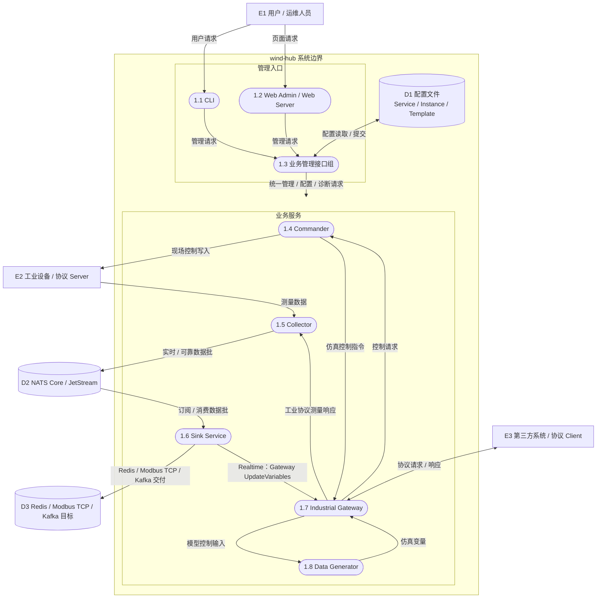
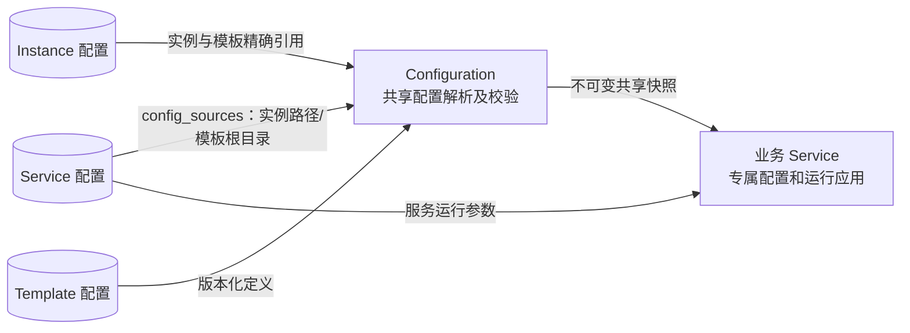
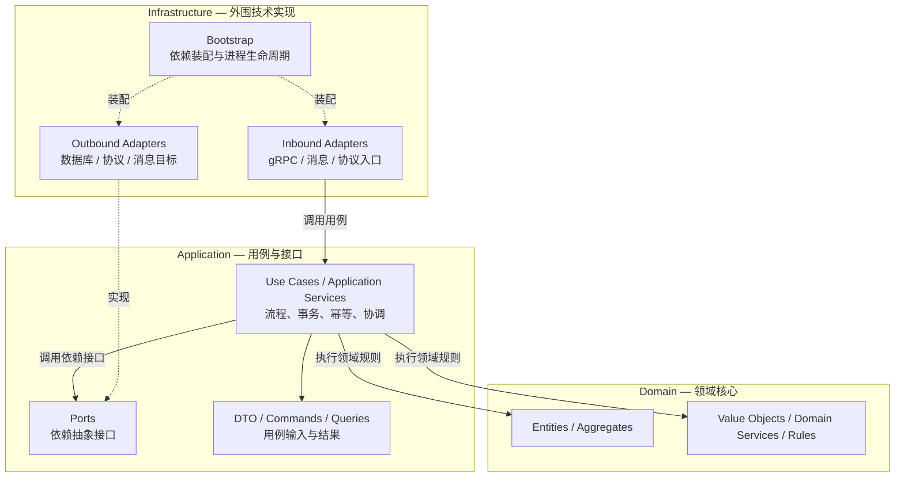

<h1 class="title">wind-hub 总体逻辑架构设计</h1>

<p class="subtitle">v1_15 · 20261113 · 系统级数据流、配置管理与模块内部架构</p>

<style>
body { font-family: "Microsoft YaHei"; font-size: 16px; line-height: 1.75; color: #24292f; }
.title { font-family: "Microsoft YaHei"; font-size: 32px; line-height: 1.30; font-weight: 700; text-align: center; }
.subtitle { font-family: "Microsoft YaHei"; font-size: 18px; line-height: 1.50; font-weight: 400; text-align: center; }
h1 { font-family: "Microsoft YaHei"; font-size: 28px; line-height: 1.40; font-weight: 700; text-align: left; }
h2 { font-family: "Microsoft YaHei"; font-size: 22px; line-height: 1.40; font-weight: 700; }
h3 { font-family: "Microsoft YaHei"; font-size: 18px; line-height: 1.50; font-weight: 700; }
h4 { font-family: "Microsoft YaHei"; font-size: 16px; line-height: 1.50; font-weight: 700; }
p, li { font-family: "Microsoft YaHei"; font-size: 16px; line-height: 1.75; }
.figure-caption, .formula-caption { font-family: "Microsoft YaHei"; font-size: 14px; line-height: 1.50; font-weight: 600; text-align: center; margin: 0.65em 0 0.35em; }
.table-caption { font-family: "Microsoft YaHei"; font-size: 13px; line-height: 1.40; font-weight: 500; text-align: center; margin: 0.65em 0 0.35em; }
.mermaid, .mermaid text, .mermaid .label { font-family: "Microsoft YaHei" !important; font-size: 14px !important; line-height: 1.20; }
table { width: 100%; border-collapse: collapse; font-family: "Microsoft YaHei"; font-size: 13px; line-height: 1.45; }
table th, table th p, table th li { font-family: "Microsoft YaHei"; font-size: 13px; line-height: 1.40; font-weight: 600; }
table td, table td p, table td li { font-family: "Microsoft YaHei"; font-size: 13px; line-height: 1.45; font-weight: 400; }
table th, table td { padding: 0.40em 0.60em; vertical-align: top; }
code, pre { font-family: "Cascadia Code"; font-size: 14px; line-height: 1.50; }
p code, li code, td code { color: #24292f; background: #f3f4f6; padding: 0.08em 0.28em; border-radius: 3px; }
pre { color: #c9d1d9; background: #0d1117; padding: 1em; border-radius: 6px; overflow-x: auto; }
pre code { color: inherit; background: transparent; }
.hljs-comment, .hljs-quote, .token.comment, .token.prolog, .token.doctype, .token.cdata { color: #8b949e; font-style: italic; }
.hljs-keyword, .hljs-selector-tag, .hljs-literal, .token.keyword, .token.boolean { color: #ff7b72; }
.hljs-string, .hljs-doctag, .hljs-regexp, .token.string, .token.char, .token.regex { color: #a5d6ff; }
.hljs-number, .token.number { color: #79c0ff; }
.hljs-title, .hljs-function, .token.function { color: #d2a8ff; }
.hljs-title.class_, .hljs-type, .hljs-built_in, .token.class-name, .token.builtin { color: #ffa657; }
.hljs-variable, .hljs-attr, .hljs-property, .token.variable, .token.property, .token.attr-name { color: #7ee787; }
.hljs-operator, .hljs-punctuation, .token.operator, .token.punctuation { color: #c9d1d9; }
</style>

---

## 目录

1. [文档约定](#1-文档约定)
2. [文档定位与使用方式](#2-文档定位与使用方式)
3. [系统边界与模块职责](#3-系统边界与模块职责)
4. [系统级数据流与依赖](#4-系统级数据流与依赖)
5. [Configuration 统一配置体系](#5-configuration-统一配置体系)
6. [Ports & Adapters 模块架构规范](#6-ports--adapters-模块架构规范)
7. [总体架构约束](#7-总体架构约束)

---

# 1. 文档约定

本章是全文的固定排版与表达规范。文档修订、补充和派生版本均应遵守本章，不再根据个人习惯调整字体、字号、行距、图题、表题、公式或代码样式。

本文开头的 `<style>...</style>` 是 HTML `style` 元素，其中包含内部 CSS 样式表，本文简称为 **CSS 样式块**。第 1.1～1.4 节规定目标样式；CSS 样式块通过 `h1`、`h2`、`p`、`table`、`th`、`td`、`pre`、`code` 等选择器，将规范应用到 Markdown 渲染后生成的 HTML 元素。

## 1.1 字体约定

<p class="table-caption">表 1-1 文档字体与排版规范</p>

| 文档元素 | 字体 | 字号 | 行间距/行高 | 字重 | 对齐方式 |
|---|---|---:|---:|---:|---|
| 文档标题 | Microsoft YaHei | 32 px | 1.30 | 700 | 居中 |
| 文档副标题 | Microsoft YaHei | 18 px | 1.50 | 400 | 居中 |
| 一级标题 | Microsoft YaHei | 28 px | 1.40 | 700 | 左对齐 |
| 二级标题 | Microsoft YaHei | 22 px | 1.40 | 700 | 左对齐 |
| 三级标题 | Microsoft YaHei | 18 px | 1.50 | 700 | 左对齐 |
| 四级标题 | Microsoft YaHei | 16 px | 1.50 | 700 | 左对齐 |
| 正文 | Microsoft YaHei | 16 px | 1.75 | 400 | 左对齐 |
| 图题 | Microsoft YaHei | 14 px | 1.50 | 600 | 居中 |
| 图内文字 | Microsoft YaHei | 14 px | 1.20 | 400 | 按图形布局 |
| 表题 | Microsoft YaHei | 13 px | 1.40 | 500 | 居中 |
| 表头 | Microsoft YaHei | 13 px | 1.40 | 600 | 左对齐 |
| 表格正文 | Microsoft YaHei | 13 px | 1.45 | 400 | 左对齐 |
| 公式题 | Microsoft YaHei | 14 px | 1.50 | 600 | 居中 |
| 代码文字 | Cascadia Code | 14 px | 1.50 | 400 | 左对齐 |

以上规范已经通过本文开头的 CSS 样式块固定。其中，正文为 `16 px`；表题、表头和表格正文均为 `13 px`。表头字重为 `600`，低于标题字重；表格正文行高为 `1.45`，因此表格在字号、字重和行距上均明显弱于正文。英文业务对象、数据库对象和程序标识符仍按所在文本元素的字号排版，但使用行内代码形式，例如 `Asset`、`Connection`、`task_id`。

## 1.2 绘图约定

1. 上下文图、第 0 层及更深层 DFD、总体流程图和关系流程图统一使用 Mermaid。
2. 每一个 Mermaid 图都必须在 Mermaid 代码块第一行加入初始化配置，统一只设置 `useMaxWidth: true`。初始化配置格式为：

```text
%%{init: {"<Mermaid 图类型配置域>": {"useMaxWidth": true}}}%%
```

其中 `<Mermaid 图类型配置域>` 必须根据实际 Mermaid 图类型替换，不得固定写成 `flowchart`，也不得使用与实际图类型不匹配的配置域。

<p class="table-caption">表 1-2 Mermaid 图类型与初始化配置</p>

| Mermaid 图类型 | 图声明 | 第一行初始化配置 |
|---|---|---|
| Flowchart | `flowchart TB/LR/...` | `%%{init: {"flowchart": {"useMaxWidth": true}}}%%` |
| Sequence Diagram | `sequenceDiagram` | `%%{init: {"sequence": {"useMaxWidth": true}}}%%` |
| State Diagram | `stateDiagram-v2` | `%%{init: {"state": {"useMaxWidth": true}}}%%` |
| Class Diagram | `classDiagram` | `%%{init: {"class": {"useMaxWidth": true}}}%%` |
| ER Diagram | `erDiagram` | `%%{init: {"er": {"useMaxWidth": true}}}%%` |

若后续使用其他 Mermaid 图类型，也必须遵守同一规则：

```text
实际图类型
    ↓
确定该图类型对应的 Mermaid 配置域
    ↓
第一行写入：
%%{init: {"对应配置域": {"useMaxWidth": true}}}%%
```

不得额外加入 `wrap` 等非统一配置；如确有特殊需要，应在对应图的局部设计说明中单独论证。

3. 每张图必须有图编号和图题，编号采用“章节号-本章图序号”，例如“图 7-2”。
4. 图题必须使用普通图题样式，不得使用 Markdown 标题。统一写法为：

```html
<p class="figure-caption">图 7-2 图题</p>
```

## 1.3 公式约定

1. 行内公式使用单美元符号，例如 `$E_1$`。
2. 独立公式使用双美元符号，例如：

```text
$$
\mathrm{Entity}=E_1\land(E_2\lor E_3\lor E_4)\land E_5
$$
```

3. 正式公式不得放入代码块。
4. 不使用 `\[` 与 `\]` 作为公式定界符。
5. 变量下标统一写成 `E_1`、`R_1`；逻辑“与”和“或”统一写成 `\land` 和 `\lor`。
6. 公式必须使用 LaTeX，不使用普通文本模拟数学符号。
7. 需要编号的公式使用“式（章节号-本章公式序号）”，式题采用普通公式题样式：

```html
<p class="formula-caption">式（8-1）实体判断逻辑</p>
```

## 1.4 代码约定

1. 多行代码必须使用带语言标识的围栏代码块，例如 `python`、`sql`、`json`、`yaml`、`mermaid` 或 `text`。
2. 单个标识符、字段名、命令和短代码使用行内代码，例如 `PRIMARY KEY`、`Connection`。
3. 伪代码必须明确标记为 `text` 或在正文中说明“以下为伪代码”；不得使读者误认为它可以直接运行。
4. 代码块统一使用深色背景，颜色为 `#0D1117`；普通代码文字颜色为 `#C9D1D9`。
5. 语法高亮统一采用表 1-2 的配色。Markdown 渲染器应使用 Highlight.js 或 Prism 可识别的语言标识；渲染器不支持高亮时，至少保留代码背景色和普通代码文字颜色。

<p class="table-caption">表 1-2 代码语法高亮配色</p>

| 语法元素 | 颜色 | 十六进制 |
|---|---|---|
| 代码背景 | 深黑蓝 | `#0D1117` |
| 普通文字、运算符和标点 | 浅灰 | `#C9D1D9` |
| 注释 | 灰色 | `#8B949E` |
| 关键字和布尔值 | 红色 | `#FF7B72` |
| 字符串和正则表达式 | 浅蓝 | `#A5D6FF` |
| 数值 | 蓝色 | `#79C0FF` |
| 函数名 | 紫色 | `#D2A8FF` |
| 类型、类名和内置对象 | 橙色 | `#FFA657` |
| 变量、属性和字段 | 绿色 | `#7EE787` |

---

# 2. 文档定位与使用方式

## 2.1 适用对象

本文是 wind-hub 全部模块的**总体逻辑架构约束**，适用于 Core（含 core.configuration）、Contracts、Collector、Commander、Industrial Gateway、Data Generator、Sink Service、Web Server、Web Admin、CLI 的设计、开发与审查。NATS Core / JetStream 是独立运行的消息基础设施，不是 Core 的内部组件。

本文明确模块责任、允许的静态代码依赖及主要运行时协作关系。模块内部流程、RPC 字段、消息线协议、配置参数和测试细节分别以所属模块设计、Contracts 设计及正式源码为准；本文件不取代这些设计。图中的运行调用是目标架构约束，不能代替对实际部署链路的验收。

## 2.2 目标

1. 为模块划分提供稳定且唯一的权威：一个业务职责只有一个归属，不让 Core 公共配置能力或 Contracts 承担业务服务逻辑。
2. 区分**静态代码依赖**与**运行时数据/控制流**；经 gRPC、HTTP 或 NATS 协作，不要求业务模块直接 import 对方内部实现。
3. 保留最小必要耦合：公共能力统一复用，公共线协议统一定义，业务服务独立持有状态和生命周期。
4. 当某模块设计与本文存在职责或依赖冲突时，先审查总体架构，再协调修订相关设计与调用方；不通过新增冗余代码绕过冲突。

---

# 3. 系统边界与模块职责

## 3.1 系统边界与分层

wind-hub 按管理入口、业务服务、公共基础能力三层组织。外部工业设备、工业协议对端、第三方系统、NATS/JetStream、Redis、Kafka 及其他目标服务均不属于 wind-hub 的进程边界。仓库内配置文件作为系统的逻辑数据存储。

<p class="table-caption">表 3-1 系统模块分工</p>

| 逻辑层 | 模块 | 职责 |
|---|---|---|
| 管理入口 | CLI | 通过正式 RPC 执行配置、启停、诊断、监视及控制操作；不直接执行业务服务的内部逻辑 |
| 管理入口 | Web Admin / Web Server | Web Admin 提供界面；Web Server 提供管理 API、身份和权限边界，通过正式接口调用业务模块 |
| 业务服务 | Collector | 设备数据采集、批量组织及 Realtime/Reliable 发布 |
| 业务服务 | Commander | 控制命令校验、调度、执行与权威结果裁决 |
| 业务服务 | Industrial Gateway | 工业协议 Server、模拟变量寄存与授权注入、控制事件转发 |
| 业务服务 | Data Generator | 随机、回放及简单物理模型驱动的仿真数据生成，向 Gateway 注入数据 |
| 业务服务 | Sink Service | 订阅/消费数据批，按 Delivery 向外部目标派发并处理交付确认 |
| 公共基础 | Core | 通用领域原语、协议客户端、YAML 基础处理、技术横切能力及内置的共享配置子包 `core.configuration` |
| Core 内部能力 | `core.configuration` | 共享配置语义、版本引用、实例与模板校验及有效配置装配；不独立发布为顶级服务 |
| 公共基础 | Contracts | 跨进程 RPC、消息格式及线协议契约 |

## 3.2 外部对象

<p class="table-caption">表 3-2 系统外部实体与存储</p>

| 外部对象 | 主要交互 | 边界说明 |
|---|---|---|
| 用户 / 运维人员 | 管理操作与结果查看 | 通过 CLI / Web Admin 使用系统 |
| 工业设备 / 工业协议 Server | 测量读取、控制写入、反馈 | 实际现场或独立模拟的协议对端 |
| 第三方系统 / 工业协议 Client | 访问 Gateway 暴露的协议 Server | 不直接修改内部应用状态 |
| NATS Core / JetStream | Realtime / Reliable 批量传输 | 外部消息基础设施，不归 Core 启动或托管 |
| Redis / Kafka / 工业协议目标 | Sink 下游数据交付 | 交付成功由相应下游语义判定 |

# 4. 系统级数据流与依赖

## 4.1 Level 1 DFD

图 4-1 将管理入口和业务服务按层分组。为避免重复线条，来自 CLI / Web Server 的同类管理请求汇聚为一个逻辑流；具体接收服务由正式 Contracts 决定。图中只表示数据与请求/结果交换，**不表示源代码依赖**。分组框不是独立执行进程，也不是 DFD 的处理节点。



<p class="figure-caption">图 4-1 wind-hub 系统一级数据流图</p>

其中 `1.3 业务管理接口组` 是图形汇聚节点，代表业务服务正式管理接口的集合，不是新增运行进程或网关服务；从该节点到“业务服务”分组的一根线代表面向多个服务的同类管理数据流，不要求每个操作访问全部模块。配置的具体读取与提交由目标服务负责，不经管理接口组代存。为保持一级图清晰，各业务模块直接读取配置的链路在第 5 章说明。图中省略返回方向的管理结果线，管理请求应按正式接口返回结果。

## 4.2 核心数据链路

<p class="table-caption">表 4-1 系统主要数据与控制链路</p>

| 链路 | 逻辑路径 | 责任边界 |
|---|---|---|
| 真实采集 | 工业协议 Server → Collector → NATS/JetStream → Sink Service → Redis / Modbus TCP / Kafka | Collector 负责源数据发布；Sink 负责下游交付 |
| 实时回注 | NATS Core → Sink Service → Industrial Gateway | Sink Realtime 通过 Gateway 正式更新接口批量写入变量，Gateway 不因此触发控制事件 |
| 控制执行 | CLI/Web Server 或 Gateway → Commander → 工业协议 Server | Commander 裁决命令执行和结果 |
| 仿真测量 | Data Generator → Industrial Gateway → Collector | Generator 产生数据；Gateway 持有变量并提供协议 Server |
| 仿真控制 | 协议 Client → Gateway → Commander → Gateway → Data Generator | Gateway 捕获写事件并仅向 Commander 提交；Commander 授权和裁决后经 Gateway 仿真执行接口转发 Data Generator 的可写输入。此接口需先纳入 Contracts，不能复用仅用于数据注入的 UpdateVariables |
| 管理和配置 | CLI/Web Server → 目标业务服务 → 本服务配置管理能力 | 目标服务持有配置提交与运行生效状态 |

可靠消息的各 Delivery 通过独立 JetStream Durable Consumer 管理确认责任；Collector 发布成功不等于 Sink 下游交付成功。工业协议请求接受不等于现场控制已完成。Gateway 的变量注入和控制请求是不同操作，不得互相替代。

## 4.3 核心控制与数据状态权威

外部管理调用方通过正式 Proto 调用业务服务。Commander 对 `SubmitCommand(s)` 的接收、执行、幂等记录及权威结果负责；`accepted` 不等于现场操作完成。Core 协议驱动提供 `read_one`、`read_many`、`write_one`、`write_many` 的技术能力，不承担 Commander 的批次业务原子性与结果裁决。

Gateway 对工业协议 Server、变量、租约和注入结果负责；工业协议控制写事件只能提交 Commander，禁止直接调用 Data Generator 绕过统一控制裁决。Commander 对真实设备调用 Core 协议客户端，对仿真设备经 Gateway 仿真执行接口调用 Data Generator；该接口的请求身份、幂等、权限、结果与 UNKNOWN 语义须在 Contracts 正式定义并验收后实现。变量注入不得自动触发控制转发。Data Generator 只允许更新受权的模型输入，不允许把计算输出直接作为外部可写输入。Collector 对采集和采样发布负责；Sink 每条 Delivery 的确认、重试及 DLQ 由该 Delivery 自身负责，NATS/JetStream 消息 ACK 不能代替下游交付确认。

配置查询与变更的候选态、持久态、运行态由目标业务服务持有。`core.configuration` 提供共享源解析、校验和只读快照，不提供独立配置 RPC，不承担跨服务原子 Apply。

## 4.4 静态代码依赖

<p class="table-caption">表 4-2 跨模块允许的依赖方向</p>

| 调用方 | 允许依赖 | 禁止行为 |
|---|---|---|
| Core（通用原语、协议及基础设施） | 标准库与通用第三方库 | 反向依赖业务模块或 Contracts；通用原语不得反向依赖 `core.configuration` |
| `core.configuration` | `core.domain`、`core.infrastructure.config` 等已公开 Core 基础能力 | 直接依赖业务 Service、Contracts 或业务私有 Schema；建立循环导入 |
| Contracts | Protobuf 等契约基础库 | 引入业务服务内部实现 |
| 业务服务 | 使用到的 Core（含 `core.configuration`）、Contracts 正式 API | 导入其他业务服务的内部状态、应用服务、仓储 |
| CLI / Web Server | Contracts 及必要公共能力 | 直接调用业务模块内部实现以绕过 RPC |
| Web Admin | Web Server 公开 API | 绕过 Web Server 直接访问业务 gRPC |

业务模块之间的协作使用 RPC、消息或规定的工业协议；静态依赖不能由运行时箭头推断。

# 5. Configuration 统一配置体系

## 5.1 配置对象与分类

wind-hub 配置统一划分为 **Service、Instance、Template** 三类；分类依据是配置对象的**用途和所有权**，而不是是否带版本号或 YAML 的物理文件数量。`configs/` 是逻辑配置根目录，各服务通过明确路径使用所需配置。

<p class="table-caption">表 5-1 配置对象分类</p>

| 类别 | 典型对象 | 目录 | 定义及用途 |
|---|---|---|---|
| Service | Collector、Commander、Industrial Gateway、Data Generator、Sink Service、CLI | `configs/services/` | 定义服务监听、授权、资源、运行策略、监控、配置来源及服务专属场景或任务运行参数 |
| Instance | Site、Device、Sink、Delivery | `configs/instances/` | 定义具有稳定身份或业务关系的具体实例及对模板的引用；真实、仿真设备可用不同文件但遵循同一实例 Schema |
| Template | Device Model、Protocol、Point Table、Task、Sink、Delivery 模板 | `configs/templates/` 下对应类别目录 | 定义可复用的型号、协议、测点、任务及交付能力或规则 |
| Template | Units、Business Points | `configs/templates/` | 定义工程单位和标准业务测点语义，属于公共参考定义 |

**内容归属规则：** Service 规定如何运行；Instance 规定运行对象是谁、引用何种型号或策略；Template 规定可复用对象是什么以及具备何种属性和约束。同一事实只在其权威配置中定义，不跨类别重复维护。

设备通信端点归 Instance；协议参数 Schema、点表与型号固定参数归 Template；运行调度、生成场景选择与外部输入归所属 Service。物理仿真型号的额定值、结构参数、查表及固定控制策略属于 Device Model Template；不把这些定义重复写入设备实例或运行场景。

## 5.2 管理职责与引用关系

Configuration 是 **Core 内部**的 `src/core/configuration/` 共享 Python 子包（正式导入前缀 `core.configuration`），**不是顶级 `src/configuration/` 包，不是独立进程，也不提供配置 RPC**。本章定义目标结构；当前分支代码仍保留 `src/configuration/`，须在 R2-C 集中迁移，统一修改 imports、包发布配置、import-linter、测试及设计引用，删除旧包，不保留 re-export 或兼容别名。公共组件与业务服务的分工如下。

<p class="table-caption">表 5-2 配置管理职责</p>

| 责任主体 | 职责边界 |
|---|---|
| `core.infrastructure.config` | 模块无关的 YAML 读写和基础数据处理；不判断 Service 配置业务语义 |
| `core.configuration` | 解析 wind-hub 共享 Instance 与 Template、校验显式引用及版本关系、装配不可变共享配置快照；不负责业务 Service 应用结果 |
| 业务 Service | 选择配置来源、定义专属 Schema、处理配置请求与候选、协调持久化、应用运行配置并报告权威结果 |
| Contracts | 统一规定跨进程配置查询、提交、应用和结果查询的线协议 |
| CLI / Web Server | 调用业务服务正式接口进行配置管理；不直接取代业务服务执行配置应用 |



<p class="figure-caption">图 5-1 三类配置的引用、解析及使用关系</p>

Service 可通过可选的 `config_sources.instances` 显式指向需要的 Instance 文件，通过 `config_sources.templates.root` 指定模板解析根目录；实际允许的子键由该 Service 的 Schema 确定。Instance 中对 Template 的引用采用精确标识与版本，不自动搜索或选择最新版本。引用路径相对于规定的配置根目录解析；不得以进程工作目录或目录扫描代替显式来源。

## 5.3 配置处理与生效规则

配置处理分为**来源加载、共享校验、有效装配、业务应用**四个阶段。Configuration 负责共享语义，业务服务负责专属验证及生效；服务独立管理其配置状态，不产生跨服务原子应用的隐含保证。


<p class="figure-caption">图 5-2 配置加载、校验与运行应用流程</p>

1. **加载**：仅读取 Service 显式选择的实例及其所需模板；共享模板按完整标识与版本定位。
2. **校验**：区分通用语法/结构校验、共享配置语义校验、服务专属业务校验；任一阶段失败时不得宣称配置生效成功。
3. **装配**：配置解析结果形成可验证来源与版本的不可变快照；不得以调用方可修改的共享字典作为权威快照。
4. **持久化和生效**：业务服务拥有候选、持久及运行配置状态，校验并协调自己的配置提交和运行应用。磁盘提交完成不等于运行态完成；需要重启的参数不得伪称热生效。
5. **一致性**：同一共享配置引用闭包的多文件提交须由明确的协调写入方负责；并发修改以正式配置契约规定的版本/修订条件裁决。跨业务服务配置操作不默认构成统一事务。
6. **结果查询**：异步配置请求按照正式 Contracts 及所属服务设计追踪请求与最终结果，调用接受不代表运行应用成功。

## 5.4 配置文件命名规则

所有配置文件采用**相同的可选版本后缀规则**，不同配置对象仅使用不同前缀。表中名称均为规范格式示例，不限制配置对象只能使用表中示例名称。

<p class="table-caption">表 5-3 配置文件命名示例</p>

| 类型 | 前缀 | 示例 |
|---|---|---|
| Service | `service_` | `service_collector_v1.0.0.yaml` |
| Site | `site_` | `site_wind_farm_a.yaml` |
| Device | `device_` | `device_wtg01_v1.0.0.yaml` |
| Sink | `sink_` | `sink_redis_v1.0.0.yaml` |
| Delivery | `delivery_` | `delivery_realtime_v1.0.0.yaml` |
| Device Model | `device_model_` | `device_model_wtg_2mw_v1.0.0.yaml` |
| Protocol | `protocol_` | `protocol_modbus_tcp_v1.0.0.yaml` |
| Point Table | `point_table_` | `point_table_wtg_v1.0.0.yaml` |
| Task | `task_` | `task_wtg_collect_v1.0.0.yaml` |
| Units | `units_` | `units_standard_v1.0.0.yaml` |
| Business Points | `business_points_` | `business_points_standard_v1.0.0.yaml` |

统一文件名格式为：

```text
<前缀><名称>[_vMAJOR.MINOR.PATCH].yaml
```

名称由小写字母、数字和下划线组成。版本号 `MAJOR.MINOR.PATCH` 的三个分量均为非负整数：主版本表示不兼容变更、次版本表示兼容扩展、修订版本表示兼容修正。版本后缀对全部类型均为可选项；带版本后缀时，文件名版本必须与正文 `file_version` 一致。配置引用使用明确文件名或精确模板版本；已发布版本化模板不可原位改写。文件名中的 `v` 不写入 `file_version`。

## 5.5 YAML 文件内部结构与注释规范

### 5.5.1 通用字段

所有配置文件的 YAML 顶层是 Mapping，均包含 `schema_version` 和 `file_version`。其余通用字段仅在该配置对象的 Schema 允许时出现。

<p class="table-caption">表 5-4 YAML 通用字段</p>

| 字段 | 必填性 | 类型与格式 | 用途 |
|---|---|---|---|
| `schema_version` | 必填 | 正整数，如 `1` | 配置 Schema 结构版本 |
| `file_version` | 必填 | `MAJOR.MINOR.PATCH` 字符串，如 `"1.0.0"` | 文件内容版本，不带 `v` |
| `config_sources` | 可选 | Mapping | Service 显式声明直接依赖的配置来源 |
| `template_id` | 条件必填 | 非空标识字符串 | 版本化模板的稳定身份，与所规定的模板名称匹配 |
| `revision` | 可选 | 非空字符串 | 受管配置的并发修订标识，不代替文件版本 |

`config_sources` 的通用组织形式为：

```yaml
config_sources:
  instances:
    site: configs/instances/site.yaml
    devices: configs/instances/devices.yaml
  templates:
    root: configs/templates
```

`instances` 是可选的直接实例文件路径映射，`templates.root` 是可选的模板根目录声明；具体子键、必要性和允许路径由使用它的 Service Schema 约束。不得随意给不支持该字段的配置文件添加 `config_sources`，也不得用它代替 Template 内部的精确版本引用。

### 5.5.2 文件头注释

每份 YAML 配置文件必须以**可直接复制使用的完整注释模板**为文件头，模板取消逐行注释后应形成能够通过对应 Schema 校验的完整配置正文。文件头逐项覆盖该 Schema 的全部必填及可选字段，包含嵌套字段、动态列表元素、开放映射的值结构；不得只解释当前正文出现的参数。

每个字段在其所在 YAML 行旁或紧邻注释中写明：功能或控制作用、类型、必填性、默认值（无默认值应写明）、允许值或范围、单位、相互约束、敏感信息引用方式、修改后的生效条件。枚举字段写出全部合法取值；开放字段写清 Schema/引用来源；涉及算法或函数选择的字段说明所选方法、输入和执行语义。文件头与正文的字段名称、类型、层级和约束必须一致。

### 5.5.3 Service 文件示例

以下是以 `configs/services/collector.yaml` 的现有配置字段制作的**文件头与完整正文组织示例**。文件头逐行去除 `# ` 即得到与下方正文相同的有效 YAML；注释中数值为示例值，不能代替所属服务 Schema 的默认值和完整可选字段清单。实际交付文件仍须根据全部正式配置字段补齐逐项说明。

```yaml
# =============================================================================
# Collector Service 配置
# 用途：采集服务的实例来源、运行资源、发布通道和监控配置。
# 使用方法：复制下方完整注释模板，逐行删除行首的“# ”，
#           修改参数并替换正文；不要同时保留两份未注释的正文。
# 固定字段：schema_version 为正整数结构版本；file_version 为语义版本字符串。
# 生效规则：由 Collector 的配置应用契约决定是否重启或增量生效。
# ----------------------------------------------------------------------------
# schema_version: 1                 # 必填；整数；当前结构版本 1
# file_version: "1.0.0"             # 必填；MAJOR.MINOR.PATCH
# config_sources:                   # 配置直接来源
#   instances:
#     site: configs/instances/site.yaml      # 场站实例 pathname
#     devices: configs/instances/devices.yaml # 设备实例 pathname
#   templates:
#     root: configs/templates       # 模板根目录 pathname
# runtime:
#   shutdown_timeout: 30           # 秒，正数；进程关闭等待上限
#   connect_timeout: 10            # 秒，正数；连接超时
#   read_timeout: 5                # 秒，正数；读取超时
#   thread_pool:
#     max_workers: 32              # 正整数；线程数上限
# watchdog:
#   interval: 5                    # 秒，正数；健康检查间隔
#   health_timeout: 1              # 秒，正数；健康检查超时
# messaging:
#   servers:                       # 非空 URL 列表；NATS 服务地址
#     - nats://127.0.0.1:4222
#   delivery: realtime             # realtime | reliable；消息交付模式
#   max_staleness_ms: 500          # 毫秒，正整数；实时数据陈旧度
#   max_samples_per_batch: 100     # 正整数；每批采样点上限
#   max_batch_bytes: 1048576       # 字节，正整数；批次大小上限
#   queue_capacity: 2048          # 正整数；待发布队列容量
#   enqueue_timeout_s: 2.0        # 秒，非负数；入队等待上限
# metrics:
#   enabled: true                  # true | false；启用指标
#   windows: [60, 300, 3600]      # 秒，正整数列表；统计窗口
#   publish_interval: 60          # 秒，正数；指标发布间隔
#   max_staleness: 300             # 秒，正数；指标陈旧度阈值
#   event_capacity: 1000          # 正整数；事件缓存上限
#   pending_capacity: 120         # 正整数；待处理指标上限
# =============================================================================

schema_version: 1
file_version: "1.0.0"
config_sources:
  instances:
    site: configs/instances/site.yaml
    devices: configs/instances/devices.yaml
  templates:
    root: configs/templates
runtime:
  shutdown_timeout: 30
  connect_timeout: 10
  read_timeout: 5
  thread_pool:
    max_workers: 32
watchdog:
  interval: 5
  health_timeout: 1
messaging:
  servers:
    - nats://127.0.0.1:4222
  delivery: realtime
  max_staleness_ms: 500
  max_samples_per_batch: 100
  max_batch_bytes: 1048576
  queue_capacity: 2048
  enqueue_timeout_s: 2.0
metrics:
  enabled: true
  windows: [60, 300, 3600]
  publish_interval: 60
  max_staleness: 300
  event_capacity: 1000
  pending_capacity: 120
```

### 5.5.4 交付校验

交付时应验证：文件名与内容版本匹配；YAML 顶层结构、必填字段、禁止重复键及引用合法；`schema_version` 和 `file_version` 有效；模板标识与精确版本一致；文件头复制出来的配置可解析并通过对应 Schema；文件头完整覆盖每个可配置项的功能、类型、默认值、单位、允许值及约束，并与当前实现同步。

# 6. Ports & Adapters 模块架构规范

## 6.1 适用原则

**仅对明确采用 Ports & Adapters 架构的业务模块适用**。Collector、Commander、Industrial Gateway、Data Generator、Sink Service 按各自设计采用该架构；Core（含 `core.configuration`）、Contracts、CLI、Web Server、Web Admin 和工具脚本不因本章而必须采用它。其他模块以其自身设计和实际职责组织目录。

对已采用 Ports & Adapters 的业务模块，内部以 **Domain / Application / Infrastructure** 三个逻辑层组织。Ports 属于应用核心所拥有的依赖契约；Adapters 属于 Infrastructure 的具体实现，不额外建立与三层并列的顶级 Ports/Adapters 层。模块可以按实际职责精简目录，不得创建空目录或没有使用者的抽象层。CLI、Contracts 及简单工具不强制套用业务领域分层。

## 6.2 分层职责与依赖



<p class="figure-caption">图 6-1 Ports & Adapters 内部逻辑分层（实线为调用，虚线为实现/装配）</p>

<p class="table-caption">表 6-1 三层职责</p>

| 层次 | 内容 | 不应承担 |
|---|---|---|
| Domain | Entities、Aggregates、Value Objects、身份类型、领域服务、领域事件、业务不变量与状态转换 | gRPC、NATS、数据库、文件读写等技术实现 |
| Application | 用例服务、命令/查询处理、流程编排、协调与幂等边界、应用 Ports、DTO、运行结果 | 协议栈、持久化驱动、网络客户端的具体代码 |
| Infrastructure | 入站/出站 Adapters、数据库仓储、服务配置解析、协议编解码、外部通信、依赖装配及进程启动 | 领域业务规则与跨用例的业务决策 |

Domain 不依赖 Application 和 Infrastructure；Application 依赖 Domain 及其所拥有的抽象 Ports，不能直接 import 具体 Infrastructure；Infrastructure 依赖应用接口并实现 Ports。Bootstrap 是装配入口，允许引用各层，不承载业务决策。外部 gRPC/消息的字段须由 Infrastructure 转换为 Application 命令/查询或 Domain 类型，不得让 Protobuf 请求对象成为领域实体。

## 6.3 Ports & Adapters 参考目录结构

以下为推荐逻辑结构；只有存在对应职责才创建子目录。多个简单对象可以合并为同层模块，不能跨越依赖边界。

```text
src/<module>/
├── domain/
│   ├── entities/            # 实体与聚合
│   ├── value_objects/       # 值对象、标识及枚举
│   ├── services/            # 跨实体的纯领域规则
│   ├── events/              # 领域事件（按需）
│   └── exceptions.py        # 领域异常（按需）
├── application/
│   ├── use_cases/           # 命令、查询及业务用例
│   ├── services/            # 用例组合与运行协调
│   ├── ports/               # 对外部资源的抽象接口
│   └── dto/                 # 用例输入和结果（按需）
├── infrastructure/
│   ├── adapters/
│   │   ├── inbound/         # RPC、订阅、协议 Server 入口
│   │   └── outbound/        # 协议 Client、消息发布、外部存储
│   ├── persistence/         # 数据访问和事务实现（按需）
│   └── config/              # 专属 Service Schema / 配置技术解析
├── bootstrap.py             # 装配入口（名称可按现有工程惯例）
└── main.py                  # 进程入口（适用时）
```

**适用范围**：仅采用 Ports & Adapters 的业务模块按上方职责归属入口、用例、端口、适配器；不据此要求其他模块新建 `domain/`、`application/ports/` 或 `infrastructure/adapters/`。**全仓命名规则**：项目内 Python 源文件、测试文件和内部模块/函数名不得携带历史设计版本号（例如 `v1_schema.py`、`v2_server.py`、`load_gateway_v1`）；按正常语义使用 `schema.py`、`server.py`、`load_gateway`，重命名时同步修改全部静态/动态导入、测试、配置、文档与打包入口，不保留兼容别名。正式 Proto package（如 `windhub.gateway.v1`）、HTTP API 的 `v1/` 路由目录、`schema_version` 和 `file_version` 不受此规则约束。目录示例仅是所采用架构的**参考目标，非现行代码状态**；迁移前须全仓检索确保无残留旧路径。CLI 使用命令工具架构，不强制引入 Domain/Ports/Adapters 三层，但仍必须仅依赖正式 RPC、公共能力，不得引用业务 Service 内部实现。

`domain/entities` 只放有稳定身份的领域对象；无实体身份、以值相等定义的对象归 `value_objects`。Domain Service 仅承载不归属于单一实体的领域规则；涉及外部 I/O 和步骤编排的逻辑归 Application。`application/ports` 以业务能力命名，如 `SnapshotRepositoryPort`、`ProtocolWriterPort`，不以某数据库厂商命名。`infrastructure/config/` 的 Pydantic/YAML Schema 是技术配置模型，不等于 Domain Value Object；生效后的业务模型按职责映射。

## 6.4 示例与复用边界

`src/core/domain/__init__.py` 公开 `Device`、`Site`、`Point` 等领域模型与 `ConnectionEndpoint`、`PointAccess` 等值对象；`src/collector/application/configuration.py` 使用 `SnapshotRepositoryPort` / `RuntimeConfigurationPort` 抽象磁盘仓储和运行应用；`src/industrial_gateway/infrastructure/config/schema.py` 作为服务专属严格 Schema 的实现路径。这些实现体现分工规则。共享领域原语优先从 Core 正式 API 复用；业务特有实体和业务状态归属相应服务，不得为了跨模块复用而迁入 Core。

## 6.5 模块设计书的落实要求

**采用 Ports & Adapters 的业务模块**需在设计书中列明实际 Domain 对象、Application 用例及 Ports、Infrastructure Adapters、模块特有目录、依赖方向和业务配置应用方式。每种业务输入、输出和协议必须有“DFD 流—负责模块—Application 用例—Port—Adapter—验收场景”逐项对应关系；模块需求章节先明确支持的目标及通道，不得在实现章才临时决定。不得重复定义总体架构的三层原则。不采用 Ports & Adapters 的模块按明确职责、实际代码结构、公共接口和静态依赖组织；无需额外构造 Port/Adapter 或空层级。

# 7. 总体架构约束

## 7.1 职责与接口

1. **唯一归属**：通用技术能力归 Core；wind-hub 共享配置语义归 Core 内的 `core.configuration`；跨进程数据契约归 Contracts；业务判定和运行状态归各业务服务。
2. **模块隔离**：基础模块不反向依赖业务模块；跨业务模块经正式 RPC、消息或工业协议协作。
3. **状态权威**：调用受理、执行结果与最终状态分别判定；外部管理界面只展示权威结果，不自行推断完成。
4. **配置一致性**：Service 明确配置来源；共享模板版本不可原位覆写；单一写入协调与候选/磁盘/运行态分离。
5. **内部依赖**：采用 Ports & Adapters 的业务模块遵守三层单向依赖，不以目录命名替代真正的职责分离。

## 7.2 安全、可靠性与变更

1. 控制请求的接受、拒绝、完成、失败和未知必须分开；UNKNOWN 不得解释为失败后盲目重发。
2. Collector 发布、消息中间件存储、Sink ACK、外部交付各有独立成功定义；不能跨层替代确认。
3. 资源、任务、线程、队列及连接采用明确的所有权、有界容量、超时和安全退出策略。
4. 安全认证、权限和审计在可信服务边界执行；前端禁用按钮不构成权限约束。
5. 设计变更若修改公共 API、配置或数据契约，须同步核对调用方、测试、配置与文档；不保留无依据的旧接口及兼容实现。
6. 逻辑模块、静态代码依赖和运行部署是不同视图；不强制全部业务模块在同一进程或容器内运行。
