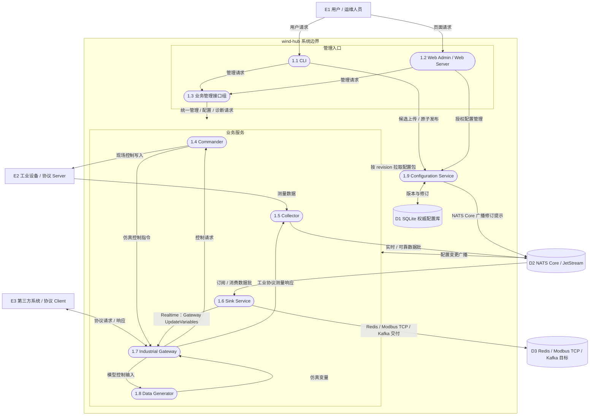
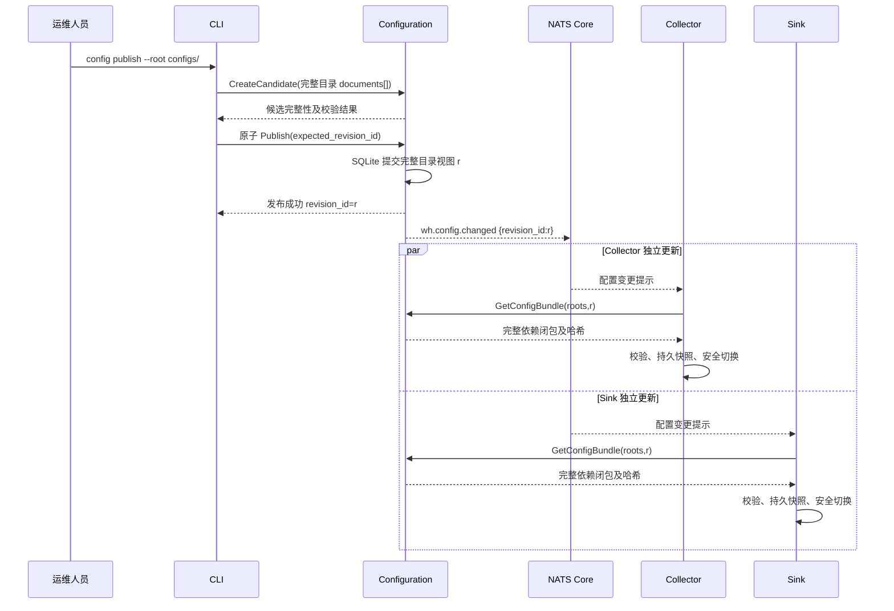
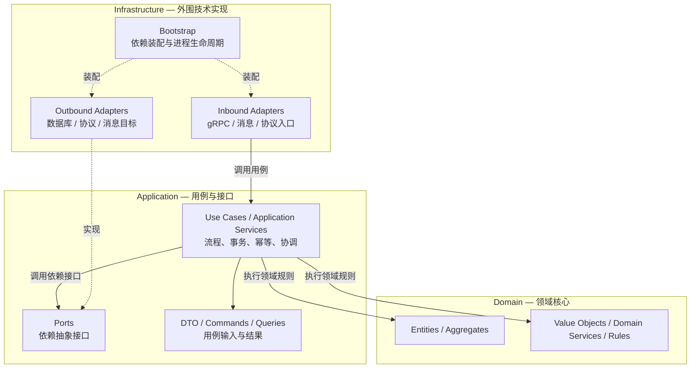

<h1 class="title">wind-hub 总体逻辑架构设计</h1>

<p class="subtitle">v1_23 · 20261118 · 系统级数据流、配置管理与模块内部架构</p>

<style>
body { font-family: "Microsoft YaHei"; font-size: 16px; line-height: 1.75; color: #24292f; }
.title { font-family: "Microsoft YaHei"; font-size: 32px; line-height: 1.30; font-weight: 700; text-align: center; }
.subtitle { font-family: "Microsoft YaHei"; font-size: 18px; line-height: 1.50; font-weight: 400; text-align: center; }
h1 { font-family: "Microsoft YaHei"; font-size: 28px; line-height: 1.40; font-weight: 700; text-align: left; }
h2 { font-family: "Microsoft YaHei"; font-size: 22px; line-height: 1.40; font-weight: 700; }
h3 { font-family: "Microsoft YaHei"; font-size: 18px; line-height: 1.50; font-weight: 700; }
h4 { font-family: "Microsoft YaHei"; font-size: 16px; line-height: 1.50; font-weight: 700; }
p, li { font-family: "Microsoft YaHei"; font-size: 16px; line-height: 1.75; }
.figure-caption, .formula-caption { font-family: "Microsoft YaHei"; font-size: 14px; line-height: 1.50; font-weight: 600; text-align: center; margin: 0.65em 0 0.35em; }
.table-caption { font-family: "Microsoft YaHei"; font-size: 13px; line-height: 1.40; font-weight: 500; text-align: center; margin: 0.65em 0 0.35em; }
.mermaid, .mermaid text, .mermaid .label { font-family: "Microsoft YaHei" !important; font-size: 14px !important; line-height: 1.20; }
table { width: 100%; border-collapse: collapse; font-family: "Microsoft YaHei"; font-size: 13px; line-height: 1.45; }
table th, table th p, table th li { font-family: "Microsoft YaHei"; font-size: 13px; line-height: 1.40; font-weight: 600; }
table td, table td p, table td li { font-family: "Microsoft YaHei"; font-size: 13px; line-height: 1.45; font-weight: 400; }
table th, table td { padding: 0.40em 0.60em; vertical-align: top; }
code, pre { font-family: "Cascadia Code"; font-size: 14px; line-height: 1.50; }
p code, li code, td code { color: #24292f; background: #f3f4f6; padding: 0.08em 0.28em; border-radius: 3px; }
pre { color: #c9d1d9; background: #0d1117; padding: 1em; border-radius: 6px; overflow-x: auto; }
pre code { color: inherit; background: transparent; }
.hljs-comment, .hljs-quote, .token.comment, .token.prolog, .token.doctype, .token.cdata { color: #8b949e; font-style: italic; }
.hljs-keyword, .hljs-selector-tag, .hljs-literal, .token.keyword, .token.boolean { color: #ff7b72; }
.hljs-string, .hljs-doctag, .hljs-regexp, .token.string, .token.char, .token.regex { color: #a5d6ff; }
.hljs-number, .token.number { color: #79c0ff; }
.hljs-title, .hljs-function, .token.function { color: #d2a8ff; }
.hljs-title.class_, .hljs-type, .hljs-built_in, .token.class-name, .token.builtin { color: #ffa657; }
.hljs-variable, .hljs-attr, .hljs-property, .token.variable, .token.property, .token.attr-name { color: #7ee787; }
.hljs-operator, .hljs-punctuation, .token.operator, .token.punctuation { color: #c9d1d9; }
</style>

---

## 目录

1. [文档约定](#1-文档约定)
2. [文档定位与使用方式](#2-文档定位与使用方式)
3. [系统边界与模块职责](#3-系统边界与模块职责)
4. [系统级数据流与依赖](#4-系统级数据流与依赖)
5. [Configuration 统一配置体系](#5-configuration-统一配置体系)
6. [Ports & Adapters 模块架构规范](#6-ports--adapters-模块架构规范)
7. [总体架构约束](#7-总体架构约束)

---

# 1. 文档约定

本章是全文的固定排版与表达规范。文档修订、补充和派生版本均应遵守本章，不再根据个人习惯调整字体、字号、行距、图题、表题、公式或代码样式。

本文开头的 `<style>...</style>` 是 HTML `style` 元素，其中包含内部 CSS 样式表，本文简称为 **CSS 样式块**。第 1.1～1.4 节规定目标样式；CSS 样式块通过 `h1`、`h2`、`p`、`table`、`th`、`td`、`pre`、`code` 等选择器，将规范应用到 Markdown 渲染后生成的 HTML 元素。

## 1.1 字体约定

<p class="table-caption">表 1-1 文档字体与排版规范</p>

| 文档元素 | 字体 | 字号 | 行间距/行高 | 字重 | 对齐方式 |
|---|---|---:|---:|---:|---|
| 文档标题 | Microsoft YaHei | 32 px | 1.30 | 700 | 居中 |
| 文档副标题 | Microsoft YaHei | 18 px | 1.50 | 400 | 居中 |
| 一级标题 | Microsoft YaHei | 28 px | 1.40 | 700 | 左对齐 |
| 二级标题 | Microsoft YaHei | 22 px | 1.40 | 700 | 左对齐 |
| 三级标题 | Microsoft YaHei | 18 px | 1.50 | 700 | 左对齐 |
| 四级标题 | Microsoft YaHei | 16 px | 1.50 | 700 | 左对齐 |
| 正文 | Microsoft YaHei | 16 px | 1.75 | 400 | 左对齐 |
| 图题 | Microsoft YaHei | 14 px | 1.50 | 600 | 居中 |
| 图内文字 | Microsoft YaHei | 14 px | 1.20 | 400 | 按图形布局 |
| 表题 | Microsoft YaHei | 13 px | 1.40 | 500 | 居中 |
| 表头 | Microsoft YaHei | 13 px | 1.40 | 600 | 左对齐 |
| 表格正文 | Microsoft YaHei | 13 px | 1.45 | 400 | 左对齐 |
| 公式题 | Microsoft YaHei | 14 px | 1.50 | 600 | 居中 |
| 代码文字 | Cascadia Code | 14 px | 1.50 | 400 | 左对齐 |

以上规范已经通过本文开头的 CSS 样式块固定。其中，正文为 `16 px`；表题、表头和表格正文均为 `13 px`。表头字重为 `600`，低于标题字重；表格正文行高为 `1.45`，因此表格在字号、字重和行距上均明显弱于正文。英文业务对象、数据库对象和程序标识符仍按所在文本元素的字号排版，但使用行内代码形式，例如 `Asset`、`Connection`、`task_id`。

## 1.2 绘图约定

1. 上下文图、第 0 层及更深层 DFD、总体流程图和关系流程图统一使用 Mermaid。
2. 每一个 Mermaid 图都必须在 Mermaid 代码块第一行加入初始化配置，统一只设置 `useMaxWidth: true`。初始化配置格式为：

```text
%%{init: {"<Mermaid 图类型配置域>": {"useMaxWidth": true}}}%%
```

其中 `<Mermaid 图类型配置域>` 必须根据实际 Mermaid 图类型替换，不得固定写成 `flowchart`，也不得使用与实际图类型不匹配的配置域。

<p class="table-caption">表 1-2 Mermaid 图类型与初始化配置</p>

| Mermaid 图类型 | 图声明 | 第一行初始化配置 |
|---|---|---|
| Flowchart | `flowchart TB/LR/...` | `%%{init: {"flowchart": {"useMaxWidth": true}}}%%` |
| Sequence Diagram | `sequenceDiagram` | `%%{init: {"sequence": {"useMaxWidth": true}}}%%` |
| State Diagram | `stateDiagram-v2` | `%%{init: {"state": {"useMaxWidth": true}}}%%` |
| Class Diagram | `classDiagram` | `%%{init: {"class": {"useMaxWidth": true}}}%%` |
| ER Diagram | `erDiagram` | `%%{init: {"er": {"useMaxWidth": true}}}%%` |

若后续使用其他 Mermaid 图类型，也必须遵守同一规则：

```text
实际图类型
    ↓
确定该图类型对应的 Mermaid 配置域
    ↓
第一行写入：
%%{init: {"对应配置域": {"useMaxWidth": true}}}%%
```

不得额外加入 `wrap` 等非统一配置；如确有特殊需要，应在对应图的局部设计说明中单独论证。

3. 每张图必须有图编号和图题，编号采用“章节号-本章图序号”，例如“图 7-2”。
4. 图题必须使用普通图题样式，不得使用 Markdown 标题。统一写法为：

```html
<p class="figure-caption">图 7-2 图题</p>
```

## 1.3 公式约定

1. 行内公式使用单美元符号，例如 `$E_1$`。
2. 独立公式使用双美元符号，例如：

```text
$$
\mathrm{Entity}=E_1\land(E_2\lor E_3\lor E_4)\land E_5
$$
```

3. 正式公式不得放入代码块。
4. 不使用 `\[` 与 `\]` 作为公式定界符。
5. 变量下标统一写成 `E_1`、`R_1`；逻辑“与”和“或”统一写成 `\land` 和 `\lor`。
6. 公式必须使用 LaTeX，不使用普通文本模拟数学符号。
7. 需要编号的公式使用“式（章节号-本章公式序号）”，式题采用普通公式题样式：

```html
<p class="formula-caption">式（8-1）实体判断逻辑</p>
```

## 1.4 代码约定

1. 多行代码必须使用带语言标识的围栏代码块，例如 `python`、`sql`、`json`、`yaml`、`mermaid` 或 `text`。
2. 单个标识符、字段名、命令和短代码使用行内代码，例如 `PRIMARY KEY`、`Connection`。
3. 伪代码必须明确标记为 `text` 或在正文中说明“以下为伪代码”；不得使读者误认为它可以直接运行。
4. 代码块统一使用深色背景，颜色为 `#0D1117`；普通代码文字颜色为 `#C9D1D9`。
5. 语法高亮统一采用表 1-2 的配色。Markdown 渲染器应使用 Highlight.js 或 Prism 可识别的语言标识；渲染器不支持高亮时，至少保留代码背景色和普通代码文字颜色。

<p class="table-caption">表 1-2 代码语法高亮配色</p>

| 语法元素 | 颜色 | 十六进制 |
|---|---|---|
| 代码背景 | 深黑蓝 | `#0D1117` |
| 普通文字、运算符和标点 | 浅灰 | `#C9D1D9` |
| 注释 | 灰色 | `#8B949E` |
| 关键字和布尔值 | 红色 | `#FF7B72` |
| 字符串和正则表达式 | 浅蓝 | `#A5D6FF` |
| 数值 | 蓝色 | `#79C0FF` |
| 函数名 | 紫色 | `#D2A8FF` |
| 类型、类名和内置对象 | 橙色 | `#FFA657` |
| 变量、属性和字段 | 绿色 | `#7EE787` |

---

# 2. 文档定位与使用方式

## 2.1 适用对象

本文是 wind-hub 全部模块的**总体逻辑架构约束**，适用于 Core（含 core.configuration）、Contracts、Collector、Commander、Industrial Gateway、Data Generator、Sink Service、Web Server、Web Admin、CLI 的设计、开发与审查。NATS Core / JetStream 是独立运行的消息基础设施，不是 Core 的内部组件。

本文明确模块责任、允许的静态代码依赖及主要运行时协作关系。模块内部流程、RPC 字段、消息线协议、配置参数和测试细节分别以所属模块设计、Contracts 设计及正式源码为准；本文件不取代这些设计。图中的运行调用是目标架构约束，不能代替对实际部署链路的验收。

## 2.2 目标

1. 为模块划分提供稳定且唯一的权威：一个业务职责只有一个归属，不让 Core 公共配置能力或 Contracts 承担业务服务逻辑。
2. 区分**静态代码依赖**与**运行时数据/控制流**；经 gRPC、HTTP 或 NATS 协作，不要求业务模块直接 import 对方内部实现。
3. 保留最小必要耦合：公共能力统一复用，公共线协议统一定义，业务服务独立持有状态和生命周期。
4. 当某模块设计与本文存在职责或依赖冲突时，先审查总体架构，再协调修订相关设计与调用方；不通过新增冗余代码绕过冲突。

---

# 3. 系统边界与模块职责

## 3.1 系统边界与分层

wind-hub 按管理入口、业务服务、公共基础能力三层组织。外部工业设备、工业协议对端、第三方系统、NATS/JetStream、Redis、Kafka 及其他目标服务均不属于 wind-hub 的进程边界。Configuration Service 的 SQLite 为已发布配置的权威逻辑存储；仓库中的 YAML 文件作为导入、导出和服务引导的交换形式。

<p class="table-caption">表 3-1 系统模块分工</p>

| 逻辑层 | 模块 | 职责 |
|---|---|---|
| 管理入口 | CLI | 通过正式 RPC 执行配置、启停、诊断、监视及控制操作；不直接执行业务服务的内部逻辑 |
| 管理入口 | Web Admin / Web Server | Web Admin 提供界面；Web Server 提供管理 API、身份和权限边界，通过正式接口调用业务模块 |
| 业务服务 | Collector | 工业设备采集、原始标量与质量/时间戳记录、数据配置修订身份绑定、批量组织及 Realtime/Reliable 发布；不承担工程或业务标准化转换 |
| 业务服务 | Commander | 控制命令校验、调度、执行与权威结果裁决 |
| 业务服务 | Industrial Gateway | 工业协议 Server、模拟变量寄存与授权注入、控制事件转发 |
| 业务服务 | Data Generator | 随机、回放及简单物理模型驱动的仿真数据生成，向 Gateway 注入数据 |
| 业务服务 | Sink Service | 校验批次、按源配置修订加载映射，按 Delivery 提供 RAW/ENGINEERING/BUSINESS 递进转换（默认 BUSINESS），并负责下游协议编码、交付确认 |
| 公共基础 | Core | 通用领域原语、协议客户端、YAML 基础处理与共享配置解析原语；不存储全系统权威配置 |
| 公共基础服务 | Configuration Service | SQLite 权威配置库、不可变版本、全局修订、引用闭包及配置包 gRPC 查询；不执行各业务模块的运行生效 |
| 公共基础 | Contracts | 跨进程 RPC、消息格式及线协议契约 |

## 3.2 外部对象

<p class="table-caption">表 3-2 系统外部实体与存储</p>

| 外部对象 | 主要交互 | 边界说明 |
|---|---|---|
| 用户 / 运维人员 | 管理操作与结果查看 | 通过 CLI / Web Admin 使用系统 |
| 工业设备 / 工业协议 Server | 测量读取、控制写入、反馈 | 实际现场或独立模拟的协议对端 |
| 第三方系统 / 工业协议 Client | 访问 Gateway 暴露的协议 Server | 不直接修改内部应用状态 |
| NATS Core / JetStream | Realtime / Reliable 批量传输 | 外部消息基础设施，不归 Core 启动或托管 |
| Redis / Kafka / 工业协议目标 | Sink 下游数据交付 | 交付成功由相应下游语义判定 |

# 4. 系统级数据流与依赖

## 4.1 Level 1 DFD

图 4-1 将管理入口和业务服务按层分组。为避免重复线条，来自 CLI / Web Server 的同类管理请求汇聚为一个逻辑流；具体接收服务由正式 Contracts 决定。图中只表示数据与请求/结果交换，**不表示源代码依赖**。分组框不是独立执行进程，也不是 DFD 的处理节点。



<p class="figure-caption">图 4-1 wind-hub 系统一级数据流图</p>

其中 `1.3 业务管理接口组` 是图形汇聚节点，代表业务服务正式管理接口的集合，不是新增运行进程或网关服务；从该节点到“业务服务”分组的一根线代表面向多个服务的同类管理数据流，不要求每个操作访问全部模块。Configuration Service 是独立进程和配置数据的唯一权威库；Configuration 在 SQLite 发布后通过 NATS Core 广播修订提示，业务模块直接调用 Configuration Service 的 gRPC 查询接口拉取完整闭包。管理接口组不存储配置。图中省略返回方向的管理结果线，管理请求应按正式接口返回结果。

## 4.2 核心数据链路

<p class="table-caption">表 4-1 系统主要数据与控制链路</p>

| 链路 | 逻辑路径 | 责任边界 |
|---|---|---|
| 真实采集 | 工业协议 Server → Core 协议驱动 → Collector → NATS/JetStream → Sink Service → 下游目标 | Core 解码协议字段；Collector 发布未做工程换算的标量与不可变 PointTable ID；Sink 负责映射、换算、标准化及交付 |
| 实时回注 | NATS Core → Sink Service → Industrial Gateway | Sink Realtime 通过 Gateway 正式更新接口批量写入变量，Gateway 不因此触发控制事件 |
| 控制执行 | CLI/Web Server 或 Gateway → Commander → 工业协议 Server | Commander 裁决命令执行和结果 |
| 仿真测量 | Data Generator → Industrial Gateway → Collector | Generator 产生数据；Gateway 持有变量并提供协议 Server |
| 仿真控制 | 协议 Client → Gateway → Commander → Gateway → Data Generator | Gateway 捕获写事件并仅向 Commander 提交；Commander 授权和裁决后经 Gateway 仿真执行接口转发 Data Generator 的可写输入。此接口需先纳入 Contracts，不能复用仅用于数据注入的 UpdateVariables |
| 配置发布 | CLI → Configuration Service → SQLite | Configuration Service 持有全局版本和原子发布修订；发布不等于运行生效 |
| 配置分发 | CLI → Configuration Service（完整目录发布）→ NATS 广播 → 业务服务独立拉取 | Configuration 广播；业务服务独立校验和应用，记录运行修订与失败原因 |

可靠消息的各 Delivery 通过独立 JetStream Durable Consumer 管理确认责任；Collector 发布成功不等于 Sink 下游交付成功。工业协议请求接受不等于现场控制已完成。Gateway 的变量注入和控制请求是不同操作，不得互相替代。

## 4.3 核心控制与数据状态权威

外部管理调用方通过正式 Proto 调用业务服务。Commander 对 `SubmitCommand(s)` 的接收、执行、幂等记录及权威结果负责；`accepted` 不等于现场操作完成。Core 协议驱动提供 `read_one`、`read_many`、`write_one`、`write_many` 的技术能力，不承担 Commander 的批次业务原子性与结果裁决。

Gateway 对工业协议 Server、变量、租约和注入结果负责；工业协议控制写事件只能提交 Commander，禁止直接调用 Data Generator 绕过统一控制裁决。Commander 对真实设备调用 Core 协议客户端，对仿真设备经 Gateway 仿真执行接口调用 Data Generator；该接口的请求身份、幂等、权限、结果与 UNKNOWN 语义须在 Contracts 正式定义并验收后实现。变量注入不得自动触发控制转发。Data Generator 只允许更新受权的模型输入，不允许把计算输出直接作为外部可写输入。Collector 对原始标量采集、采样身份及不可变 `point_table_id` 绑定负责；Sink 按该历史点表身份获取完整固定依赖闭包并实施数据转换，各 Delivery 的确认、重试及 DLQ 由该 Delivery 自身负责，NATS/JetStream 消息 ACK 不能代替下游交付确认。

Configuration Service 统一持有全局候选、不可变版本和已发布修订；业务模块持有本地已拉取及运行生效修订。`core.configuration` 仅提供共享解析与校验原语。Configuration 的广播不构成跨业务服务原子 Apply。

## 4.4 静态代码依赖

<p class="table-caption">表 4-2 跨模块允许的依赖方向</p>

| 调用方 | 允许依赖 | 禁止行为 |
|---|---|---|
| Core（通用原语、协议及基础设施） | 标准库与通用第三方库 | 反向依赖业务模块或 Contracts；通用原语不得反向依赖 `core.configuration` |
| `core.configuration` | `core.domain`、`core.infrastructure.config` 等已公开 Core 基础能力 | 直接依赖业务 Service、Contracts 或业务私有 Schema；建立循环导入 |
| Contracts | Protobuf 等契约基础库 | 引入业务服务内部实现 |
| 业务服务 | 使用到的 Core（含 `core.configuration`）、Contracts 正式 API | 导入其他业务服务的内部状态、应用服务、仓储 |
| CLI / Web Server | Contracts 及必要公共能力 | 直接调用业务模块内部实现以绕过 RPC |
| Web Admin | Web Server 公开 API | 绕过 Web Server 直接访问业务 gRPC |

业务模块之间的协作使用 RPC、消息或规定的工业协议；静态依赖不能由运行时箭头推断。

# 5. Configuration 统一配置体系

### 2026-11-21 统一配置契约（规范性修订）
旧版 Service 直接声明模板目录、固定版本 Instance 路径以及推荐版本自动切换的描述均废止；编码阶段应同步清理旧字段和调用方。
1. 配置依赖为 Service → Instances → Templates。Service 仅引用 Instance 逻辑身份、不引用 Template；Instance 固定引用不可变 Template ID 和版本；禁止 latest 漂移引用。
2. CLI 继续全量发布；Configuration 保存不可变版本、部署选择与全局发布修订。Deployment 依据部署域明确选择 Service/Instance 的版本；发布新版本不自动激活。
3. Deployment 修改采用 CAS、request_id 幂等和闭包校验。Service 启动、收到广播及周期对账时读取自己的目标配置和固定模板闭包，验证内容摘要。离线 Service 不阻断其他服务。
4. Service 自行决定热更新或等待重启；相关配置按照一致性单元切换，失败保留可用配置。回滚仅调整 Deployment 指向的已有版本。
5. 状态报告 target_revision 和 active_revision，二者表示服务的完整有效闭包而非单独 Service 文件版本。部分热更新不能报告完全收敛，无关模块修改不能引起虚假不一致。
6. Configuration 自身引导配置本地独立，避免自引用循环。

Deployment 是版本选择表；Service 引用 devices-farm-a、collector-tasks-a 等实例逻辑身份，Deployment 唯一解析为固定版本。Task 属于 Collector 专属 Instance；Device Instance 增加 group，Device Model 不含 Task。


## 5.1 配置对象与分类

wind-hub 配置统一划分为 **Service、Instance、Template** 三类；分类依据是配置对象的**用途和所有权**，而不是是否带版本号或 YAML 的物理文件数量。`configs/` 是逻辑配置根目录，各服务通过明确路径使用所需配置。

<p class="table-caption">表 5-1 配置对象分类</p>

| 类别 | 典型对象 | 目录 | 定义及用途 |
|---|---|---|---|
| Service | Collector、Commander、Industrial Gateway、Data Generator、Sink Service、CLI | `configs/services/` | 定义服务监听、授权、资源、运行策略、监控、配置来源及服务专属场景或任务运行参数 |
| Instance | Site、Device、Sink、Delivery | `configs/instances/` | 定义具有稳定身份或业务关系的具体实例及对模板的引用；真实、仿真设备可用不同文件但遵循同一实例 Schema |
| Template | Device Model、Protocol、Point Table、Task、Sink、Delivery 模板 | `configs/templates/` 下对应类别目录 | 定义可复用的型号、协议、测点、任务及交付能力或规则 |
| Template | Units、Business Points | `configs/templates/` | 定义工程单位和标准业务测点语义，属于公共参考定义 |

**内容归属规则：** Service 规定如何运行；Instance 规定运行对象是谁、引用何种型号或策略；Template 规定可复用对象是什么以及具备何种属性和约束。同一事实只在其权威配置中定义，不跨类别重复维护。

设备通信端点归 Instance；协议参数 Schema、点表与型号固定参数归 Template；运行调度、生成场景选择与外部输入归所属 Service。物理仿真型号的额定值、结构参数、查表及固定控制策略属于 Device Model Template；不把这些定义重复写入设备实例或运行场景。

## 5.2 权威配置库与全量目录快照

Configuration Service 的 SQLite 是配置权威，`configs/` 是 CLI 导入的**完整目标目录快照**。首次初始化及后续更新使用同一入口 `wind-hub config publish --root PATH`；CLI 递归扫描受控根目录，上传全部有效 YAML 及相对路径，不要求运维人员指定增量文件清单。Service 自身用于打开 SQLite 的引导配置不纳入自身版本库；其他服务的业务配置由库集中管理。

| 责任主体 | 唯一职责 |
|---|---|
| CLI | 安全扫描根目录、稳定排序和上传全量文件、提交基准修订 CAS、展示配置库校验与发布结果；不逐模块通知/应用 |
| Configuration Service | 对**完整目录快照**校验并用一次 SQLite 事务替换当前目录成员视图；不可变版本复用/新增、历史留存、全局修订、NATS Core 广播 |
| 业务模块 | 从最小本地引导参数获取服务身份/Configuration 与 NATS 地址，订阅全局变更；按固定修订拉取**自身完整依赖闭包**、本地持久化、独立校验及生效 |
| Contracts | 规定全量目录候选上传、CAS 发布、完整配置闭包和按 PointTable ID 不可变闭包读取的 RPC，以及广播消息 Schema |
| Core | 提供通用解析、引用、Schema、内容哈希及共享配置对象；不拥有跨模块修订 |
| Web 相关模块 | 本轮不修改生产代码；后续复用正式管理接口，不绕过 Configuration 发布机制 |

目录中可以同时包含同一配置对象的不同 `file_version`：这些是合法的独立历史候选；**不会因版本号更大自动生效**。Service、Device、DeviceModel 及其他业务引用确定实际有效闭包；同一 `config_type + config_id + file_version` 不得关联两种内容及两套依赖。完整快照中已不存在的对象版本从**当前目录成员视图**移除，不删除 SQLite 内历史不可变版本；如仍被当前生效依赖引用，则整个发布失败。旧版未被当前引用仍可保留在库中供历史重放。

全量指**提交者的目录内容集合完整**，不是每次重新插入全部数据库行：服务端基于规范化文件内容、逻辑身份和 SHA-256 复用未改变对象，仅变更当前目录视图并递增有效修订。若相同目录与当前发布视图等价，应按幂等语义返回现有修订，不重复广播。正式入口复用一次 `CreateCandidate(documents[])` Unary 请求，传输整个目录清单及全部文件；服务端按完整候选进行校验。若超过明确配置的 gRPC 请求字节或文件数上限，必须拒绝并报告容量错误，**首版不引入分片候选会话**。发布与并发冲突使用 `expected_revision_id` CAS；不允许用全量上传绕过并发保护。

## 5.3 发布后广播、完整闭包拉取与独立应用



<p class="figure-caption">图 5-1 全量目录发布、变更广播与模块独立拉取</p>

1. **全量目录发布**：CLI 递归读取整个受控根目录（仅允许受支持 YAML、无路径穿越或符号链接逃逸），将相对路径和 UTF-8 内容在单次 `CreateCandidate(documents[])` 中提交。服务端校验**全体文件**、业务 Schema、版本身份、引用闭包与文件集完整性；不以缺失文件作为可忽略的增量输入。
2. **单事务替换**：只有候选整体合法、CAS 成功才一次性写入不可变版本/目录成员/全局修订；任何失败不影响旧配置视图。目录中文件删除仅改变当前成员集合，历史版本保留。发布成功不能等同模块已生效。
3. **广播**：**由 Configuration Service** 在 SQLite 提交之后向 `wh.config.changed` 发送最简通知 `{"revision_id":r}`。所有模块建立各自普通 Pub/Sub 订阅，**不能共享 NATS Queue Group**；不维护逐模块发送清单，也不调用 `NotifyConfigRevision` RPC。广播失败不得回滚已提交版本，但必须记录/告警；Core NATS 消息只作提示，并非配置正文或可靠提交证明。
4. **独立拉取**：模块收到提示后以 Configuration 当前已发布修订为准，调用 `GetConfigBundle` 拉取自身**完整**依赖闭包，检验 manifest、版本与文件哈希，不进行跨修订文件拼接。模块保留经验证的持久化本地快照，完整拉取不等于销毁重建全部运行资源。
5. **独立应用**：各模块串行化自身配置应用，依据新旧配置比较决定无变化、局部热更新或 `restart_required`；不能通过广播强制跨模块原子切换。某一模块失败/离线不能影响 Configuration 提交或其他模块；每模块独立记录 `seen_revision`、`downloaded_revision`、`effective_revision` 和错误。
6. **丢通知恢复**：模块先建立订阅、再查询当前最新修订；收到多条通知时合并为最新目标；重连及周期（可配置、有限）查询修订并对账。Configuration 不可用时使用合法已验证的本地运行快照；首次没有合法快照则不报告 READY。广播事件乱序/重复不得使模块回退。
7. **引导边界**：Configuration 服务仅从本地最小启动 YAML 获得 SQLite 与 NATS 连接；业务模块仅从本地/CLI 受控引导获得 `service_id`、Configuration Endpoint、NATS Endpoint、访问令牌来源和缓存位置，其他业务参数统一远端获取。无 TLS 的内部 gRPC 限制在受控隔离网络，敏感操作保留应用令牌授权。
8. **删除旧契约**：不新增 `NotifyConfigRevision`；先前设计要求的 CLI 逐模块通知和推送/Apply 业务配置路径属于待移除旧实现。复用既有 `CreateCandidate` 和 `PublishCandidate` RPC，将 documents[] 统一解释为**完整目录成员集合**；须同步修改服务器处理语义、CLI、数据库目录视图及测试；严禁以普通增量候选冒充完整目录发布。

### 5.3.0 最小引导配置与发布安全边界

Configuration 自身的 SQLite 路径、监听与 NATS 连接配置由部署启动文件（位于发布根目录之外）提供。其他模块及 CLI 仅使用如下最小引导信息连接权威配置库，**业务 Service YAML 仍位于 Configuration 的已发布配置集合**：

```yaml
# 这是业务模块本机最小引导配置示意，不作为集中发布的业务 Service 文件。
# schema_version: 必填正整数；本引导配置结构版本
# file_version: 必填 MAJOR.MINOR.PATCH；引导文件版本
# service_id: 必填；与 Configuration 内业务 Service ID 对应
# configuration.endpoint: 必填；内部隔离网络中的 gRPC host:port
# nats.servers: 必填；NATS Core URI 列表
# auth.token_env: 必填；提供操作/查询令牌的环境变量名，非令牌明文
# cache.directory: 必填；受控本地持久化快照目录
schema_version: 1
file_version: 1.0.0
service_id: collector-main
configuration:
  endpoint: 127.0.0.1:51060
nats:
  servers: [nats://127.0.0.1:4222]
auth:
  token_env: WIND_HUB_COLLECTOR_CONFIG_TOKEN
cache:
  directory: /var/lib/wind-hub/collector/config-cache
```

该示例是**目标引导 Schema**，不是现有源码可直接加载的配置；实现时须同步启动器、CLI、各模块和测试。新业务配置更新从 Configuration 拉取，不将 `configs/` 的全量根目录复制到每个业务模块；冷启动无权威库/无合法缓存不应报告 READY。接口使用标准无 TLS gRPC，访问令牌仅在可信隔离网络内传输，不能暴露公网。配置权限仅限本服务授权范围，不能读取其他模块敏感配置。

## 5.3.1 配置生效修订与遥测 PointTable 身份

全局 Configuration `revision_id` 只用于配置发布、通知、运行生效及审计；**不放入 Collector/Sink 数据包**。Collector 在 Task 装配阶段按已生效设备实例/型号解析 `point_table_id` 并固定在不可变采集计划；每个源 SampleBatch 标识唯一不可变 PointTable。PointTable ID 规范为 `point_table_<template_id>_v<file_version>`（不带 `.yaml`），由点表逻辑 ID/版本唯一生成并验证；该字符串含完整模板版本。PointTable ID 及其版本化依赖闭包必须共同确定每个测点的类型、工程转换、标准单位和 BusinessPoint 语义。上述解释规则改变时换新 `point_table_id`，不能就地覆盖旧 ID。Sink/Storage 以该 ID 解释历史记录，不得查询最新推荐点表替代旧版。

## 5.3.2 安全认证与性能边界

模块间 gRPC 不启用 TLS；Core 只复用连接管理、受控令牌校验和公共权限技术能力，业务模块负责 RPC 及资源级授权。高频采样通路不进行逐点身份鉴别或签名。NATS/JetStream 与下游协议按自身连接安全机制处理，不能以“同机部署”为由无条件关闭认证。控制写入、配置发布和诊断管理接口严格鉴权；高频数据路径复用已建立连接并保持有界资源消耗。

## 5.3.3 设备测点与业务语义模型

`BusinessPoint` 是可在**同类设备不同型号、真实与仿真设备之间复用**的业务语义标准，包含稳定 `business_point_id`、标准数据类型、标准单位及必要的业务含义。相同物理含义不因协议、型号、实例或仿真标记而复制为不同业务标准；不同测量位置、相别、叶片或统计口径必须明确消歧。型号和协议差异由 `PointTable` 中的 `Point` 描述。

约束为：每个实际 `Point` 必须精确引用一个有效 `BusinessPoint`；**同一有效 PointTable 内，同一 `business_point_id` 最多绑定一个 `point_id`**，即已映射部分为一一对应；目录中并非每个 BusinessPoint 都必须在每台设备出现。跨 PointTable 可以多对一复用同一 BusinessPoint。单位量纲、数据类型及物理量必须兼容；不允许缺省 `business_point_id` 后直接猜测业务身份。现有 `points_for_business()` 多结果接口和隐式同名回退需在生产迁移中清理，不保留旧映射的旁路。

## 5.3.4 Sink 三级数据表达与转换责任

| 等级 | 配置值 | 表达、处理范围 | 典型用途 |
|---|---|---|---|
| L1 | `raw` | 工业驱动从协议帧提取的原始标量（寄存器/字段已按协议编码解出，但尚未按点表比例、偏移换算）；保留源 `point_id` | 原始值对账、定位设备及协议异常 |
| L2 | `engineering` | L1 + PointTable 中的数据类型、比例、偏移和源工程单位处理，保留实际测点身份 | 点表/单位调试、工程诊断 |
| L3（默认） | `business` | L2 + BusinessPoint 唯一身份映射、单位标准化、标准数据类型与质量保留 | 统一业务消费及历史存储 |

三级采用相同 `SampleBatch` 源数据，**逐级派生、不反向覆盖原始值**。RAW 仅需线格式与来源身份校验，不依赖配置库在线或点表加载，因此在配置故障期间仍可用于诊断；ENGINEERING 才需历史 PointTable，BUSINESS 进一步需要 BusinessPoint/Units。每个 Delivery 在其配置中声明 `output.data_level`，默认 `business`；下游目标仍由 Sink Adapter 完成各自 Modbus/Redis/Kafka/Gateway 线格式编码（与业务三级不是同一维度）。若数据类型、单位或业务映射不合法，应报告明确错误、可靠路径按 Delivery 失败策略处理，不能静默降级到 RAW 或篡改质量状态。除显式 RAW 输出外，转换失败不应伪装为成功派发。

RAW 不是工业链路上的原始字节报文。若未来需要完整帧留存，须另立协议诊断捕获能力，不得将既有 `value` 当成字节帧。

## 5.3.5 Collector 与 Sink 的唯一数据契约

Contracts §11.6 统一规定 Collector→NATS→Sink 的 SampleBatch v3 输入字段、JSON 示例、严格校验及 Realtime/Reliable 的差异；Contracts §11.9 规定 Sink→Kafka/Redis 的单点 JSON v2 以及 Modbus TCP/Gateway 的受限映射输出。Collector 与 Sink 设计只引用 Contracts，不再另行定义第二套 Schema。

`schema_version` 保留，用于线格式变更（NATS v3 和 Kafka/Redis JSON v2 分别独立），不承担设备点表版本职责。数据包携带 `device_type`、`device_id`、`point_table_id`；**不再增加 `config_revision_id`、`data_version`**。Storage 依据设备和不可变 PointTable 标识确定数据存储及语义归属，具体库表自动创建逻辑由 Storage 设计约束。

受控编码迁移前，现有生产 Source Batch v2 与 Kafka JSON v1 不符合目标格式，不得把目标契约称为已实施。

## 5.4 配置文件命名规则

所有配置文件采用**相同的可选版本后缀规则**，不同配置对象仅使用不同前缀。表中名称均为规范格式示例，不限制配置对象只能使用表中示例名称。

<p class="table-caption">表 5-3 配置文件命名示例</p>

| 类型 | 前缀 | 示例 |
|---|---|---|
| Service | `service_` | `service_collector_v1.0.0.yaml` |
| Site | `site_` | `site_wind_farm_a.yaml` |
| Device | `device_` | `device_wtg01_v1.0.0.yaml` |
| Sink | `sink_` | `sink_redis_v1.0.0.yaml` |
| Delivery | `delivery_` | `delivery_realtime_v1.0.0.yaml` |
| Device Model | `device_model_` | `device_model_wtg_2mw_v1.0.0.yaml` |
| Protocol | `protocol_` | `protocol_modbus_tcp_v1.0.0.yaml` |
| Point Table | `point_table_` | `point_table_wtg_v1.0.0.yaml` |
| Task | `task_` | `task_wtg_collect_v1.0.0.yaml` |
| Units | `units_` | `units_standard_v1.0.0.yaml` |
| Business Points | `business_points_` | `business_points_standard_v1.0.0.yaml` |

统一文件名格式为：

```text
<前缀><名称>[_vMAJOR.MINOR.PATCH].yaml
```

名称由小写字母、数字和下划线组成。版本号 `MAJOR.MINOR.PATCH` 的三个分量均为非负整数：主版本表示不兼容变更、次版本表示兼容扩展、修订版本表示兼容修正。版本后缀对全部类型均为可选项；带版本后缀时，文件名版本必须与正文 `file_version` 一致。配置引用使用明确文件名或精确模板版本；已发布版本化模板不可原位改写。文件名中的 `v` 不写入 `file_version`。

## 5.5 YAML 文件内部结构与注释规范

### 5.5.1 通用字段

所有配置文件的 YAML 顶层是 Mapping，均包含 `schema_version` 和 `file_version`。其余通用字段仅在该配置对象的 Schema 允许时出现。

<p class="table-caption">表 5-4 YAML 通用字段</p>

| 字段 | 必填性 | 类型与格式 | 用途 |
|---|---|---|---|
| `schema_version` | 必填 | 正整数，如 `1` | 配置 Schema 结构版本 |
| `file_version` | 必填 | `MAJOR.MINOR.PATCH` 字符串，如 `"1.0.0"` | 文件内容版本，不带 `v` |
| `config_sources` | 可选 | Mapping | Service 显式声明直接依赖的配置来源 |
| `template_id` | 条件必填 | 非空标识字符串 | 版本化模板的稳定身份，与所规定的模板名称匹配 |
| `revision` | 可选 | 非空字符串 | 受管配置的并发修订标识，不代替文件版本 |

`config_sources` 的通用组织形式为：

```yaml
config_sources:
  instances:
    site: site-farm-a
    devices: devices-farm-a
```

`instances` 是可选的直接实例文件路径映射，`templates.root` 是可选的模板根目录声明；具体子键、必要性和允许路径由使用它的 Service Schema 约束。不得随意给不支持该字段的配置文件添加 `config_sources`，也不得用它代替 Template 内部的精确版本引用。

### 5.5.2 文件头注释

每份 YAML 配置文件必须以**可直接复制使用的完整注释模板**为文件头，模板取消逐行注释后应形成能够通过对应 Schema 校验的完整配置正文。文件头逐项覆盖该 Schema 的全部必填及可选字段，包含嵌套字段、动态列表元素、开放映射的值结构；不得只解释当前正文出现的参数。

每个字段在其所在 YAML 行旁或紧邻注释中写明：功能或控制作用、类型、必填性、默认值（无默认值应写明）、允许值或范围、单位、相互约束、敏感信息引用方式、修改后的生效条件。枚举字段写出全部合法取值；开放字段写清 Schema/引用来源；涉及算法或函数选择的字段说明所选方法、输入和执行语义。文件头与正文的字段名称、类型、层级和约束必须一致。

### 5.5.3 Service 文件示例

以下是以 `configs/services/collector.yaml` 的现有配置字段制作的**文件头与完整正文组织示例**。文件头逐行去除 `# ` 即得到与下方正文相同的有效 YAML；注释中数值为示例值，不能代替所属服务 Schema 的默认值和完整可选字段清单。实际交付文件仍须根据全部正式配置字段补齐逐项说明。

```yaml
# =============================================================================
# Collector Service 配置
# 用途：采集服务的实例来源、运行资源、发布通道和监控配置。
# 使用方法：复制下方完整注释模板，逐行删除行首的“# ”，
#           修改参数并替换正文；不要同时保留两份未注释的正文。
# 固定字段：schema_version 为正整数结构版本；file_version 为语义版本字符串。
# 生效规则：由 Collector 的配置应用契约决定是否重启或增量生效。
# ----------------------------------------------------------------------------
# schema_version: 1                 # 必填；整数；当前结构版本 1
# file_version: "1.0.0"             # 必填；MAJOR.MINOR.PATCH
# config_sources:                   # 配置直接来源
#   instances:
#     site: site-farm-a      # 场站实例 pathname
#     devices: devices-farm-a # 设备实例 pathname
#   templates:
#     root: configs/templates       # 模板根目录 pathname
# runtime:
#   shutdown_timeout: 30           # 秒，正数；进程关闭等待上限
#   connect_timeout: 10            # 秒，正数；连接超时
#   read_timeout: 5                # 秒，正数；读取超时
#   thread_pool:
#     max_workers: 32              # 正整数；线程数上限
# watchdog:
#   interval: 5                    # 秒，正数；健康检查间隔
#   health_timeout: 1              # 秒，正数；健康检查超时
# messaging:
#   servers:                       # 非空 URL 列表；NATS 服务地址
#     - nats://127.0.0.1:4222
#   delivery: realtime             # realtime | reliable；消息交付模式
#   max_staleness_ms: 500          # 毫秒，正整数；实时数据陈旧度
#   max_samples_per_batch: 100     # 正整数；每批采样点上限
#   max_batch_bytes: 1048576       # 字节，正整数；批次大小上限
#   queue_capacity: 2048          # 正整数；待发布队列容量
#   enqueue_timeout_s: 2.0        # 秒，非负数；入队等待上限
# metrics:
#   enabled: true                  # true | false；启用指标
#   windows: [60, 300, 3600]      # 秒，正整数列表；统计窗口
#   publish_interval: 60          # 秒，正数；指标发布间隔
#   max_staleness: 300             # 秒，正数；指标陈旧度阈值
#   event_capacity: 1000          # 正整数；事件缓存上限
#   pending_capacity: 120         # 正整数；待处理指标上限
# =============================================================================

schema_version: 1
file_version: "1.0.0"
config_sources:
  instances:
    site: site-farm-a
    devices: devices-farm-a
runtime:
  shutdown_timeout: 30
  connect_timeout: 10
  read_timeout: 5
  thread_pool:
    max_workers: 32
watchdog:
  interval: 5
  health_timeout: 1
messaging:
  servers:
    - nats://127.0.0.1:4222
  delivery: realtime
  max_staleness_ms: 500
  max_samples_per_batch: 100
  max_batch_bytes: 1048576
  queue_capacity: 2048
  enqueue_timeout_s: 2.0
metrics:
  enabled: true
  windows: [60, 300, 3600]
  publish_interval: 60
  max_staleness: 300
  event_capacity: 1000
  pending_capacity: 120
```

### 5.5.4 交付校验

交付时应验证：文件名与内容版本匹配；YAML 顶层结构、必填字段、禁止重复键及引用合法；`schema_version` 和 `file_version` 有效；模板标识与精确版本一致；文件头复制出来的配置可解析并通过对应 Schema；文件头完整覆盖每个可配置项的功能、类型、默认值、单位、允许值及约束，并与当前实现同步。

# 6. Ports & Adapters 模块架构规范

## 6.1 适用原则

**仅对明确采用 Ports & Adapters 架构的业务模块适用**。Collector、Commander、Industrial Gateway、Data Generator、Sink Service 按各自设计采用该架构；Core（含 `core.configuration`）、Contracts、CLI、Web Server、Web Admin 和工具脚本不因本章而必须采用它。其他模块以其自身设计和实际职责组织目录。

对已采用 Ports & Adapters 的业务模块，内部以 **Domain / Application / Infrastructure** 三个逻辑层组织。Ports 属于应用核心所拥有的依赖契约；Adapters 属于 Infrastructure 的具体实现，不额外建立与三层并列的顶级 Ports/Adapters 层。模块可以按实际职责精简目录，不得创建空目录或没有使用者的抽象层。CLI、Contracts 及简单工具不强制套用业务领域分层。

## 6.2 分层职责与依赖



<p class="figure-caption">图 6-1 Ports & Adapters 内部逻辑分层（实线为调用，虚线为实现/装配）</p>

<p class="table-caption">表 6-1 三层职责</p>

| 层次 | 内容 | 不应承担 |
|---|---|---|
| Domain | Entities、Aggregates、Value Objects、身份类型、领域服务、领域事件、业务不变量与状态转换 | gRPC、NATS、数据库、文件读写等技术实现 |
| Application | 用例服务、命令/查询处理、流程编排、协调与幂等边界、应用 Ports、DTO、运行结果 | 协议栈、持久化驱动、网络客户端的具体代码 |
| Infrastructure | 入站/出站 Adapters、数据库仓储、服务配置解析、协议编解码、外部通信、依赖装配及进程启动 | 领域业务规则与跨用例的业务决策 |

Domain 不依赖 Application 和 Infrastructure；Application 依赖 Domain 及其所拥有的抽象 Ports，不能直接 import 具体 Infrastructure；Infrastructure 依赖应用接口并实现 Ports。Bootstrap 是装配入口，允许引用各层，不承载业务决策。外部 gRPC/消息的字段须由 Infrastructure 转换为 Application 命令/查询或 Domain 类型，不得让 Protobuf 请求对象成为领域实体。

## 6.3 Ports & Adapters 参考目录结构

以下为推荐逻辑结构；只有存在对应职责才创建子目录。多个简单对象可以合并为同层模块，不能跨越依赖边界。

```text
src/<module>/
├── domain/
│   ├── entities/            # 实体与聚合
│   ├── value_objects/       # 值对象、标识及枚举
│   ├── services/            # 跨实体的纯领域规则
│   ├── events/              # 领域事件（按需）
│   └── exceptions.py        # 领域异常（按需）
├── application/
│   ├── use_cases/           # 命令、查询及业务用例
│   ├── services/            # 用例组合与运行协调
│   ├── ports/               # 对外部资源的抽象接口
│   └── dto/                 # 用例输入和结果（按需）
├── infrastructure/
│   ├── adapters/
│   │   ├── inbound/         # RPC、订阅、协议 Server 入口
│   │   └── outbound/        # 协议 Client、消息发布、外部存储
│   ├── persistence/         # 数据访问和事务实现（按需）
│   └── config/              # 专属 Service Schema / 配置技术解析
├── bootstrap.py             # 装配入口（名称可按现有工程惯例）
└── main.py                  # 进程入口（适用时）
```

**适用范围**：仅采用 Ports & Adapters 的业务模块按上方职责归属入口、用例、端口、适配器；不据此要求其他模块新建 `domain/`、`application/ports/` 或 `infrastructure/adapters/`。**全仓命名规则**：项目内 Python 源文件、测试文件和内部模块/函数名不得携带历史设计版本号（例如 `v1_schema.py`、`v2_server.py`、`load_gateway_v1`）；按正常语义使用 `schema.py`、`server.py`、`load_gateway`，重命名时同步修改全部静态/动态导入、测试、配置、文档与打包入口，不保留兼容别名。正式 Proto package（如 `windhub.gateway.v1`）、HTTP API 的 `v1/` 路由目录、`schema_version` 和 `file_version` 不受此规则约束。目录示例仅是所采用架构的**参考目标，非现行代码状态**；迁移前须全仓检索确保无残留旧路径。CLI 使用命令工具架构，不强制引入 Domain/Ports/Adapters 三层，但仍必须仅依赖正式 RPC、公共能力，不得引用业务 Service 内部实现。

`domain/entities` 只放有稳定身份的领域对象；无实体身份、以值相等定义的对象归 `value_objects`。Domain Service 仅承载不归属于单一实体的领域规则；涉及外部 I/O 和步骤编排的逻辑归 Application。`application/ports` 以业务能力命名，如 `SnapshotRepositoryPort`、`ProtocolWriterPort`，不以某数据库厂商命名。`infrastructure/config/` 的 Pydantic/YAML Schema 是技术配置模型，不等于 Domain Value Object；生效后的业务模型按职责映射。

## 6.4 示例与复用边界

`src/core/domain/__init__.py` 公开 `Device`、`Site`、`Point` 等领域模型与 `ConnectionEndpoint`、`PointAccess` 等值对象；`src/collector/application/configuration.py` 使用 `SnapshotRepositoryPort` / `RuntimeConfigurationPort` 抽象磁盘仓储和运行应用；`src/industrial_gateway/infrastructure/config/schema.py` 作为服务专属严格 Schema 的实现路径。这些实现体现分工规则。共享领域原语优先从 Core 正式 API 复用；业务特有实体和业务状态归属相应服务，不得为了跨模块复用而迁入 Core。

## 6.5 模块设计书的落实要求

**采用 Ports & Adapters 的业务模块**需在设计书中列明实际 Domain 对象、Application 用例及 Ports、Infrastructure Adapters、模块特有目录、依赖方向和业务配置应用方式。每种业务输入、输出和协议必须有“DFD 流—负责模块—Application 用例—Port—Adapter—验收场景”逐项对应关系；模块需求章节先明确支持的目标及通道，不得在实现章才临时决定。不得重复定义总体架构的三层原则。不采用 Ports & Adapters 的模块按明确职责、实际代码结构、公共接口和静态依赖组织；无需额外构造 Port/Adapter 或空层级。

# 7. 总体架构约束

## 7.1 职责与接口

1. **唯一归属**：通用技术能力归 Core；wind-hub 共享配置语义归 Core 内的 `core.configuration`；跨进程数据契约归 Contracts；业务判定和运行状态归各业务服务。
2. **模块隔离**：基础模块不反向依赖业务模块；跨业务模块经正式 RPC、消息或工业协议协作。
3. **状态权威**：调用受理、执行结果与最终状态分别判定；外部管理界面只展示权威结果，不自行推断完成。
4. **配置一致性**：Service 明确配置来源；共享模板版本不可原位覆写；单一写入协调与候选/磁盘/运行态分离。
5. **内部依赖**：采用 Ports & Adapters 的业务模块遵守三层单向依赖，不以目录命名替代真正的职责分离。

## 7.2 安全、可靠性与变更

1. 控制请求的接受、拒绝、完成、失败和未知必须分开；UNKNOWN 不得解释为失败后盲目重发。
2. Collector 发布、消息中间件存储、Sink ACK、外部交付各有独立成功定义；不能跨层替代确认。
3. 资源、任务、线程、队列及连接采用明确的所有权、有界容量、超时和安全退出策略。
4. 安全认证、权限和审计在可信服务边界执行；前端禁用按钮不构成权限约束。
5. 设计变更若修改公共 API、配置或数据契约，须同步核对调用方、测试、配置与文档；不保留无依据的旧接口及兼容实现。
6. 逻辑模块、静态代码依赖和运行部署是不同视图；不强制全部业务模块在同一进程或容器内运行。

## 7.3 Python 标识符、接口与文件命名规范

本节适用于全部手写 Python 生产代码、测试和工具脚本。依据 Python 官方 PEP 8（命名与公开 API）、PEP 257（文档字符串）以及 Google Python Style Guide（描述性命名、缩写、文件与测试）。这些是通用规范；下列动词选择、业务术语、接口后缀是 wind-hub 的工程补充，并非声称国际标准规定了特定业务动词。

规范依据：
- PEP 8 — Style Guide for Python Code：https://peps.python.org/pep-0008/
- PEP 257 — Docstring Conventions：https://peps.python.org/pep-0257/
- Google Python Style Guide：https://google.github.io/styleguide/pyguide.html

总体原则：**类型是名词，动作默认动词加宾语，变量是名词，状态是可判断的语义。** 公开 API 优先描述使用意图而非内部实现。禁止在内部 Python 包、目录、文件、类、函数、方法、变量和接口名中添加设计版本号、日期、迁移阶段或历史代际标记。正式 Proto package、HTTP API 路由、持久化迁移文件和配置版本字段按照各自外部契约管理，不受该内部禁令约束。

### 7.3.1 命名形式与可见性

<p class="table-caption">表 7-1 Python 标识符命名形式</p>

| 对象 | 形式 | 示例 | 要求 |
|---|---|---|---|
| 包名 | 简短全小写，必要时使用下划线 | collector、sink_service | 用职责划分，不因技术栈或开发阶段命名 |
| 模块和 Python 文件 | snake_case.py | delivery_registry.py、shared_snapshot.py | 具体职责、全小写、不用连字符 |
| 类、数据类、抽象类型 | PascalCase | DeviceWorker、SnapshotCandidate | 单数名词或名词短语 |
| 异常 | PascalCase，实际错误以 Error 结尾 | ConfigurationError、RevisionConflictError | 与外部状态码解耦 |
| 函数、方法、参数、局部变量 | snake_case | validate_snapshot、expected_revision | 动作与数据有别，见下节 |
| 实例属性、领域字段 | snake_case | delivery_id、actual_state | 与业务术语保持一致 |
| 非公开成员 | 单前导下划线 | _reconcile、_pending | 不利用名称伪装安全隔离 |
| 全局、类级常量 | UPPER_SNAKE_CASE | COMMIT_MARKER、_PAGE_LIMIT | 私有常量加前导下划线，运行期不可重绑定 |
| 模块级可变状态 | _snake_case | _active_sessions | 原则上禁止；确需时说明所有权、同步和关闭 |
| 枚举类与成员 | PascalCase 类、UPPER_SNAKE_CASE 成员 | ActualState.RUNNING | 字符串值遵守协议契约 |
| 类型别名、类型变量 | PascalCase，泛型允许简短类型参数 | ScalarMap、ResultT | 不与运行变量混用 |

禁止自行制造双前后下划线名称；保留标准特殊方法（如 __init__、__post_init__）。双前导下划线只在继承名称冲突确有需要时使用。禁止单字符 l、O、I；普通变量优先完整名称。已有公开 API 若语义清晰，不因拼写偏好机械改名。

### 7.3.2 方法命名：动宾、选择动词与确认边界

**一般使用动词 + 宾语**：validate_snapshot()、resolve_device_templates()、publish_batch()、commit_configuration()、record_event()。类的对象已经由接收者唯一确定时，允许 start()、stop()、close()、connect()、reload()、ack() 等单动词。属性及只读状态不强制动宾。禁止 do_work、handle_data、process_item 这类没有具体责任的公开方法名。

<p class="table-caption">表 7-2 函数动词选择及使用条件</p>

| 动词 | 使用条件 | 推荐示例 | 不可混淆的语义 |
|---|---|---|---|
| get | 已知 ID 查询单一对象 | get_delivery | 缺失由公开契约决定 None 或异常，不用于列表 |
| list | 查询对象集合，可分页过滤 | list_deliveries | 用复数宾语，不用 get_all_delivery |
| find | 条件查找，结果可能为空或不唯一 | find_candidate | 不暗示唯一性 |
| read | 真正读取文件、设备、流、持久存储 | read_points、read_snapshot | 不用于单纯内存字段 |
| load | 读取并解析、校验或装配成可用对象 | load_service_settings | 不表示仅返回字节 |
| parse | 将字节或文本转为结构 | parse_yaml | 不代表业务校验完成 |
| validate | 校验不变量，无对外副作用 | validate_snapshot | 不隐含修复或提交 |
| resolve | 解析引用、继承和默认参数 | resolve_effective_device | 不暗中启动设备 |
| build / create | build 组装无持久身份的值；create 创建具有身份或所有权的对象 | build_shared_snapshot、create_session | 创建不等于提交 |
| register / unregister | 对受控登记表的增删 | register_delivery | 不等于外部持久写入 |
| set / update | 设置目标值 / 更新已有对象字段 | set_desired_state、update_variables | 不暗示已持久化 |
| apply | 将配置或意图作用于明确对象 | apply_configuration | 不等于保存候选 |
| commit | 完成确定的持久提交或事务 | commit_configuration | 不等于物理执行完成 |
| start / stop / restart | 业务生命周期变更 | start_delivery、stop_server | 区分受理与安全收敛 |
| connect / disconnect / close | 外部连接及资源释放 | connect、close | 不与业务 STOP 混用 |
| send / publish / deliver | 向端点发送 / 向消息服务发布 / 实现业务交付 | send_request、publish_batch、deliver_samples | 各自确认条件不同 |
| ack / nak | 消息协议确认及拒绝 | ack、nak | 不等于目标 I/O 成功 |
| record / emit | 记录业务事实 / 发出事件或指标 | record_event、emit_metric | 输出日志不等于审计持久化 |
| calculate / compute / convert | 数值计算、派生结果、类型或单位转换 | calculate_rate、compute_revision、convert_unit | 不应隐含外部副作用 |
| is / has / can / should | 布尔状态、存在性、能力和策略谓词 | is_ready、has_pending_io、can_retry、should_reconcile | 优先正向判断，避免双重否定 |

命名先检查真实副作用及完成条件，再选择动词；同一公开能力不同时提供 get、fetch、retrieve 三套同义入口。query、fetch 只在数据库查询或外部 SDK 的正式语境中使用。handle、process、manage、ensure、run、sync 不作为新公开接口的默认前缀；协议事件回调可使用 _on_<event> 形式。同步与异步方法命名原则一致，不统一加 async_ 后缀。

### 7.3.3 数据变量、全局与局部、量纲

数据对象用名词短语；布尔值以 is、has、can、should 或既有明确状态属性开头。标识符采用 <业务对象>_id，避免跨对象上下文中的孤立 id、key、name。集合使用复数（devices、deliveries）；按键索引的字典说明键（devices_by_id）；数量用 count，字节容量用 bytes，时间长度使用 ms、seconds 等后缀。

<p class="table-caption">表 7-3 业务数据命名示例</p>

| 语义 | 推荐名称 | 避免 |
|---|---|---|
| 身份 | device_id、delivery_id、request_id | 在同一过程内泛用 id |
| 版本与修订 | schema_version、file_version、revision、expected_revision | 含义不明的 version |
| 目标与实况 | desired_state、actual_state | 一个 state 同时表达两个权威 |
| 集合和索引 | devices、deliveries_by_id | 不说明键的 map |
| 计数与容量 | pending_count、max_batch_bytes | size、count 同时表示字节 |
| 事件时刻与历时 | created_at、sampled_at、elapsed_ms | time 不区分时间点和时长 |
| 周期和速率 | interval_seconds、rate_per_second | 无量纲说明的 interval、rate |
| 布尔 | is_ready、has_pending_io、enabled | ready_flag、双重否定 |
| 配置层次 | raw_options、effective_options、resolved_config | 全程仅使用 config |
| 错误和状态 | error_code、last_error、actual_state | 把 UNKNOWN 伪装为 FAILED |

作用域规则：可局部定义的不提升为对象属性；需要跨任务共享的运行态由生命周期明确的实例持有，禁止成为隐式全局单例。函数局部不随意用全大写；类和模块的真正固定常量使用大写。简短循环索引 i、j、k，捕获异常 exc 及占位符 _ 属于允许例外；多行跨作用域变量不得用 tmp、obj、val、cnt、dev 等含混缩写。

### 7.3.4 类、接口及组件后缀

<p class="table-caption">表 7-4 类型命名与职责</p>

| 后缀 | 适用责任 | 示例 |
|---|---|---|
| Port | Application 所拥有的外部依赖契约 | DeliveryPort、SnapshotRepositoryPort |
| Adapter | 将技术实现转换为应用能力 | GatewayOutputAdapter |
| Client / Server | 对外通信客户端或服务端 | GrpcClient、ModbusServer |
| Repository | 持久化或配置仓储边界 | SnapshotRepository |
| Registry | 受控对象登记、定位和索引 | DeliveryRegistry |
| Factory | 有明确创建策略的对象生产 | SessionFactory |
| Runtime | 持有运行态、任务及资源生命周期 | GatewayApplicationRuntime |
| Coordinator | 协调多个对象或事务，不重复持有权威状态 | WorkerCoordinator |
| Service | 定义清晰的业务服务或正式入站服务 | ConfigService |
| Policy | 无外部 I/O 的业务规则 | RetryPolicy |
| Request / Result / State / View | 输入、结果、状态值、只读投影 | ApplyRequest、ApplyResult、DeliveryView |

Port 以业务能力命名，不随外部存储供应商变更；Adapter 可含协议名称。禁止凭目录机械添加 Service、Manager、Handler，也不要求每个抽象都有独立文件。必要的 Application Runtime 和 Infrastructure 装配类型要用职责限定，而非重复导出同名类。

### 7.3.5 文件、目录及测试命名规则

PEP 8 规定模块名短小、全小写且可用下划线；Google Python Style Guide 明确要求描述性文件名、Python 源文件采用 .py 扩展名并禁止连字符。模块按单一内聚责任组织，既不强制一个类一个文件，也不将所有职责堆入 common、utils、helpers。

<p class="table-caption">表 7-5 文件名及职责对照</p>

| 文件类型 | 正式命名方式 | 示例 |
|---|---|---|
| Domain 实体与规则 | 单数业务名词或名词加职责 | device.py、delivery_policy.py |
| Application 用例与协调 | 业务对象加动作/职责 | config_apply.py、delivery_registry.py |
| Port | 用能力或资源命名 | output.py、snapshot_repository.py |
| Infrastructure 入站/出站 | 协议名加角色，优先由目录提供方向 | grpc_server.py、gateway_client.py |
| 配置 | 区分配置 Schema、解析和 I/O | config_schema.py、config_io.py |
| 执行入口 | 遵守包现有约定 | main.py、__main__.py |
| 单元测试 | test_<subject>.py | test_delivery_registry.py |
| 场景测试 | test_<subject>_<condition>.py | test_snapshot_revision_conflict.py |
| 性能测试 | <subject>_benchmark.py | read_pipeline_benchmark.py |
| Fixture | conftest.py 或按测试资源命名 | conftest.py、gateway_fixtures.py |
| 生成代码 | 保持生成器指定文件名 | 不手动修改、重命名生成文件 |

测试函数采用 test_<behavior>_<condition>_<expected_outcome> 的可读形式，例如 test_apply_snapshot_revision_conflict_rejected；简单场景可适当缩短。Fixture 名称表达提供的资源，不统一追加 fixture。文件名禁止日期、阶段词、设计版本号、new_、old_、temp_、utils2；不得使用连字符、空格、随机缩写。保留标准 __init__.py、__main__.py、conftest.py。正式 Proto package、HTTP API 路由和数据库迁移文件是外部契约例外，遵守其自身规则。

### 7.3.6 缩写与专有名词

Google Python Style Guide 要求使用可理解的描述性命名，避免自造缩写；PEP 8 对 PascalCase 中的缩略词通常要求首字母保持大写。内部统一优先使用完整英文单词；已有稳定公开类名若语义明确，为避免无收益破坏可以保留，但不能同时新增同义类型别名。

<p class="table-caption">表 7-6 缩写规范</p>

| 类别 | 规则 | 示例 |
|---|---|---|
| 常用技术词 | 采用标准拼写、snake_case 中整体小写 | id、url、http、rpc、grpc、io |
| 工业协议及消息系统 | 使用行业正式名称 | ads、modbus、iec104、nats、kafka |
| 格式及传输 | 使用广泛认同的缩写 | json、yaml、tcp、tls |
| 单位 | 使用清晰的后缀并遵守统一约定 | _ms、_seconds、_bytes、_count |
| 消息确认 | 使用协议既有术语 | ack、nak、dlq |
| 自造短写 | 不允许进入新增公共接口 | cfg、msg、resp、dev、cnt、mgr |
| PascalCase 缩略词 | 默认遵循 PEP 8；既有公开名可稳定沿用 | HTTPServer、RPCClient；已有 GrpcClient 可保留 |

不得在同一公开接口体系中混用 config/cfg、request/req、count/cnt。外部公开 SDK、正式协议字段及生成类型的大小写不改变。业务缩写第一次出现在设计书时应说明英文全称；专业物理符号遵循相应符号体系，不套用一般业务变量规则。

### 7.3.7 Docstring、例外及验收

公开模块、类、函数及复杂方法遵守 PEP 257，使用三重双引号的 Docstring；摘要应清楚陈述行为，必要时说明副作用、状态转换、异常及返回的确认语义，不重复逐字解释名称。内部简短方法可根据复杂度省略文档字符串。

外部已发布 RPC/Proto、HTTP、CLI、数据库字段、配置字段、第三方 SDK 函数签名、自动生成代码以及 Python 特殊方法保持其正式命名，内部差异在边界转换。任何公开重命名必须在同一变更中核对静态与动态导入、装配、打包、类型声明、配置、测试、Fixture、文档及调用方；不保留无依据的旧别名和兼容转发。稳定且含义清晰的既有名称不做纯形式批量更名。只有最终 HEAD 上 Ruff、Mypy、import-linter 和相关测试实际通过，方可声明代码命名整改完成。

## 附录 B：模块间通信安全的简化目标设计

wind-hub 内部模块之间的 gRPC 使用**不启用 TLS 的标准 gRPC 连接**，不部署证书、CA、双向证书认证或证书身份映射。默认仅绑定 `127.0.0.1`；跨主机部署必须使用明确隔离的受控专用网络并配置主机/容器网络访问控制，不得将内部 RPC 端口直接暴露公网或不可信办公网。通信安全前提是部署隔离；若无法保证网络可信，**不能宣称该设计提供传输机密性或抗中间人攻击**，应先补足网络隔离方案。

只有需要修改配置、启停任务、更新变量或下发现场控制的操作才使用轻量的应用层授权：按服务声明的运行身份/角色配置受限令牌（从受控环境变量或密钥文件读取；只存哈希或受控校验值，不在 YAML 正文、日志、RPC 回显中写明文）。服务端必须验证令牌与操作/资源授权，不信任客户端请求体自报的 caller_id 或 operator_id。只读接口可根据部署边界实行受控访问，但配置版本/敏感字段查询不得对任意网络主体开放。身份令牌经未加密内网传输，故**不适用于非可信网络**。

Commander 的指令幂等、独立隔离证明、fencing、SQLite 持久结果与审计，以及 Gateway 的租约持有者一致性和目标级权限，均继续有效；移除传输层证书不能取消这些控制安全约束。原先依赖证书主体的隔离标识改由服务端验证的令牌主体给出，不接受无鉴别的 caller_id。

**接口与配置迁移**：所有模块启动配置删除仅供内部 gRPC 证书认证的 `tls`、`ca_cert`、`client_cert`、`client_key`、`tls_profile` 等字段；明确新 Schema、调用端配置与启动方式，不保留隐式安全降级或兼容路径。外部第三方网络连接如有独立协议安全需求，不受内部 gRPC 简化设计取代。

**代码状态**：当前 main 的部分模块仍包含证书加载、证书身份解析和相关集成测试；本附录是**目标设计而非已实现行为**，需在生产代码集中整改后才能验收通过。相关旧测试应按正式新契约更新，严禁简单跳过权限、租约、隔离证明与控制安全测试。
