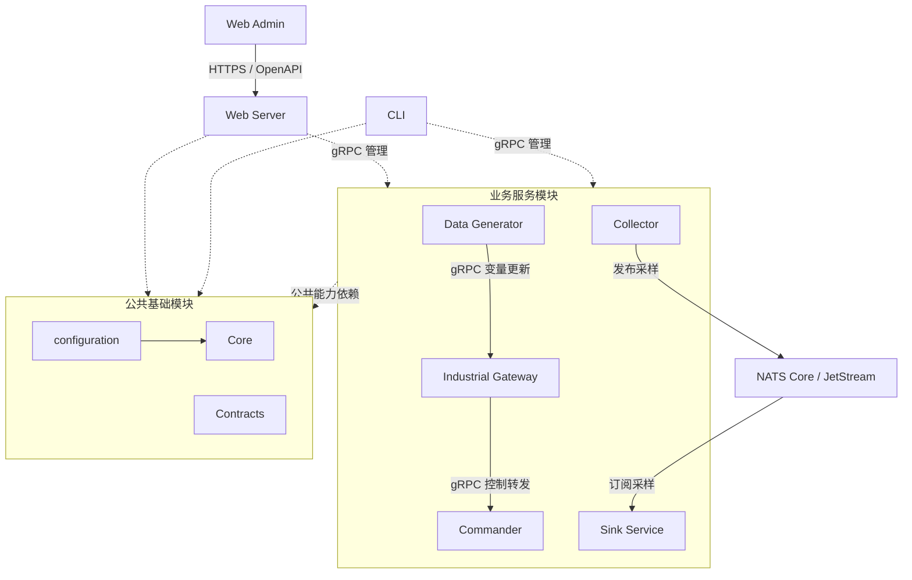
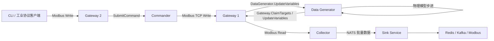

<h1 class="title">wind-hub 总体逻辑架构设计</h1>

<p class="subtitle">v1_8 · 20261112 · 系统模块职责与依赖基线</p>

<style>
body {
  font-family: "Microsoft YaHei";
  font-size: 16px;
  line-height: 1.75;
  color: #24292f;
}
.title {
  font-family: "Microsoft YaHei";
  font-size: 32px;
  line-height: 1.30;
  font-weight: 700;
  text-align: center;
}
.subtitle {
  font-family: "Microsoft YaHei";
  font-size: 18px;
  line-height: 1.50;
  font-weight: 400;
  text-align: center;
}
h1 {
  font-family: "Microsoft YaHei";
  font-size: 28px;
  line-height: 1.40;
  font-weight: 700;
}
h2 {
  font-family: "Microsoft YaHei";
  font-size: 22px;
  line-height: 1.40;
  font-weight: 700;
}
h3 {
  font-family: "Microsoft YaHei";
  font-size: 18px;
  line-height: 1.50;
  font-weight: 700;
}
h4 {
  font-family: "Microsoft YaHei";
  font-size: 16px;
  line-height: 1.50;
  font-weight: 700;
}
p, li {
  font-family: "Microsoft YaHei";
  font-size: 16px;
  line-height: 1.75;
}
.figure-caption,
.formula-caption {
  font-family: "Microsoft YaHei";
  font-size: 14px;
  line-height: 1.50;
  font-weight: 600;
  text-align: center;
  margin: 0.65em 0 0.35em 0;
}
.table-caption {
  font-family: "Microsoft YaHei";
  font-size: 13px;
  line-height: 1.40;
  font-weight: 500;
  text-align: center;
  margin: 0.65em 0 0.35em 0;
}
.mermaid,
.mermaid text,
.mermaid .label {
  font-family: "Microsoft YaHei" !important;
  font-size: 14px !important;
  line-height: 1.20;
}
table {
  width: 100%;
  border-collapse: collapse;
  font-family: "Microsoft YaHei";
  font-size: 13px;
  line-height: 1.45;
}
table th,
table th p,
table th li {
  font-family: "Microsoft YaHei";
  font-size: 13px;
  line-height: 1.40;
  font-weight: 600;
}
table td,
table td p,
table td li {
  font-family: "Microsoft YaHei";
  font-size: 13px;
  line-height: 1.45;
  font-weight: 400;
}
table th,
table td {
  padding: 0.40em 0.60em;
  vertical-align: top;
}
code, pre {
  font-family: "Cascadia Code";
  font-size: 14px;
  line-height: 1.50;
}
p code, li code, td code {
  color: #24292f;
  background: #f3f4f6;
  padding: 0.08em 0.28em;
  border-radius: 3px;
}
pre {
  color: #c9d1d9;
  background: #0d1117;
  padding: 1em;
  border-radius: 6px;
  overflow-x: auto;
}
pre code {
  color: inherit;
  background: transparent;
  padding: 0;
}
.hljs-comment, .hljs-quote,
.token.comment, .token.prolog, .token.doctype, .token.cdata {
  color: #8b949e;
  font-style: italic;
}
.hljs-keyword, .hljs-selector-tag, .hljs-literal,
.token.keyword, .token.boolean { color: #ff7b72; }
.hljs-string, .hljs-doctag, .hljs-regexp,
.token.string, .token.char, .token.regex { color: #a5d6ff; }
.hljs-number, .token.number { color: #79c0ff; }
.hljs-title, .hljs-function, .token.function { color: #d2a8ff; }
.hljs-title.class_, .hljs-type, .hljs-built_in,
.token.class-name, .token.builtin { color: #ffa657; }
.hljs-variable, .hljs-attr, .hljs-property,
.token.variable, .token.property, .token.attr-name { color: #7ee787; }
.hljs-operator, .hljs-punctuation,
.token.operator, .token.punctuation { color: #c9d1d9; }
</style>

---

## 目录

1. [文档约定](#1-文档约定)  
2. [文档定位与使用方式](#2-文档定位与使用方式)  
3. [模块职责](#3-模块职责)  
4. [模块关系与依赖](#4-模块关系与依赖)  
5. [总体架构约束](#5-总体架构约束)  

---

---
# 1. 文档约定

本章是全文的固定排版与表达规范。文档修订、补充和派生版本均应遵守本章，不再根据个人习惯调整字体、字号、行距、图题、表题、公式或代码样式。

本文开头的 `<style>...</style>` 是 HTML `style` 元素，其中包含内部 CSS 样式表，本文简称为 **CSS 样式块**。第 1.1～1.4 节规定目标样式；CSS 样式块通过 `h1`、`h2`、`p`、`table`、`th`、`td`、`pre`、`code` 等选择器，将规范应用到 Markdown 渲染后生成的 HTML 元素。

## 1.1 字体约定

<p class="table-caption">表 1-1 文档字体与排版规范</p>

| 文档元素 | 字体 | 字号 | 行间距/行高 | 字重 | 对齐方式 |
|---|---|---:|---:|---:|---|
| 文档标题 | Microsoft YaHei | 32 px | 1.30 | 700 | 居中 |
| 文档副标题 | Microsoft YaHei | 18 px | 1.50 | 400 | 居中 |
| 一级标题 | Microsoft YaHei | 28 px | 1.40 | 700 | 左对齐 |
| 二级标题 | Microsoft YaHei | 22 px | 1.40 | 700 | 左对齐 |
| 三级标题 | Microsoft YaHei | 18 px | 1.50 | 700 | 左对齐 |
| 四级标题 | Microsoft YaHei | 16 px | 1.50 | 700 | 左对齐 |
| 正文 | Microsoft YaHei | 16 px | 1.75 | 400 | 左对齐 |
| 图题 | Microsoft YaHei | 14 px | 1.50 | 600 | 居中 |
| 图内文字 | Microsoft YaHei | 14 px | 1.20 | 400 | 按图形布局 |
| 表题 | Microsoft YaHei | 13 px | 1.40 | 500 | 居中 |
| 表头 | Microsoft YaHei | 13 px | 1.40 | 600 | 左对齐 |
| 表格正文 | Microsoft YaHei | 13 px | 1.45 | 400 | 左对齐 |
| 公式题 | Microsoft YaHei | 14 px | 1.50 | 600 | 居中 |
| 代码文字 | Cascadia Code | 14 px | 1.50 | 400 | 左对齐 |

以上规范已经通过本文开头的 CSS 样式块固定。其中，正文为 `16 px`；表题、表头和表格正文均为 `13 px`。表头字重为 `600`，低于标题字重；表格正文行高为 `1.45`，因此表格在字号、字重和行距上均明显弱于正文。英文业务对象、数据库对象和程序标识符仍按所在文本元素的字号排版，但使用行内代码形式，例如 `Asset`、`Connection`、`task_id`。

## 1.2 绘图约定

1. 上下文图、第 0 层及更深层 DFD、总体流程图和关系流程图统一使用 Mermaid。
2. 每一个 Mermaid 图都必须在 Mermaid 代码块第一行加入初始化配置，统一只设置 `useMaxWidth: true`。初始化配置格式为：

```text
%%{init: {"<Mermaid 图类型配置域>": {"useMaxWidth": true}}}%%
```

其中 `<Mermaid 图类型配置域>` 必须根据实际 Mermaid 图类型替换，不得固定写成 `flowchart`，也不得使用与实际图类型不匹配的配置域。

<p class="table-caption">表 1-2 Mermaid 图类型与初始化配置</p>

| Mermaid 图类型 | 图声明 | 第一行初始化配置 |
|---|---|---|
| Flowchart | `flowchart TB/LR/...` | `%%{init: {"flowchart": {"useMaxWidth": true}}}%%` |
| Sequence Diagram | `sequenceDiagram` | `%%{init: {"sequence": {"useMaxWidth": true}}}%%` |
| State Diagram | `stateDiagram-v2` | `%%{init: {"state": {"useMaxWidth": true}}}%%` |
| Class Diagram | `classDiagram` | `%%{init: {"class": {"useMaxWidth": true}}}%%` |
| ER Diagram | `erDiagram` | `%%{init: {"er": {"useMaxWidth": true}}}%%` |

若后续使用其他 Mermaid 图类型，也必须遵守同一规则：

```text
实际图类型
    ↓
确定该图类型对应的 Mermaid 配置域
    ↓
第一行写入：
%%{init: {"对应配置域": {"useMaxWidth": true}}}%%
```

不得额外加入 `wrap` 等非统一配置；如确有特殊需要，应在对应图的局部设计说明中单独论证。

3. 每张图必须有图编号和图题，编号采用“章节号-本章图序号”，例如“图 7-2”。
4. 图题必须使用普通图题样式，不得使用 Markdown 标题。统一写法为：

```html
<p class="figure-caption">图 7-2 图题</p>
```

## 1.3 公式约定

1. 行内公式使用单美元符号，例如 `$E_1$`。
2. 独立公式使用双美元符号，例如：

```text
$$
\mathrm{Entity}=E_1\land(E_2\lor E_3\lor E_4)\land E_5
$$
```

3. 正式公式不得放入代码块。
4. 不使用 `\[` 与 `\]` 作为公式定界符。
5. 变量下标统一写成 `E_1`、`R_1`；逻辑“与”和“或”统一写成 `\land`、`\lor`。
6. 公式必须使用 LaTeX，不使用普通文本模拟数学符号。
7. 需要编号的公式使用“式（章节号-本章公式序号）”，式题采用普通公式题样式：

```html
<p class="formula-caption">式（8-1）实体判断逻辑</p>
```

## 1.4 代码约定

1. 多行代码必须使用带语言标识的围栏代码块，例如 `python`、`sql`、`json`、`yaml`、`mermaid` 或 `text`。
2. 单个标识符、字段名、命令和短代码使用行内代码，例如 `PRIMARY KEY`、`Connection`。
3. 伪代码必须明确标记为 `text` 或在正文中说明“以下为伪代码”；不得使读者误认为它可以直接运行。
4. 代码块统一使用深色背景，颜色为 `#0D1117`；普通代码文字颜色为 `#C9D1D9`。
5. 语法高亮统一采用表 1-2 的配色。Markdown 渲染器应使用 Highlight.js 或 Prism 可识别的语言标识；渲染器不支持高亮时，至少保留代码背景色和普通代码文字颜色。

<p class="table-caption">表 1-2 代码语法高亮配色</p>

| 语法元素 | 颜色 | 十六进制 |
|---|---|---|
| 代码背景 | 深黑蓝 | `#0D1117` |
| 普通文字、运算符和标点 | 浅灰 | `#C9D1D9` |
| 注释 | 灰色 | `#8B949E` |
| 关键字和布尔值 | 红色 | `#FF7B72` |
| 字符串和正则表达式 | 浅蓝 | `#A5D6FF` |
| 数值 | 蓝色 | `#79C0FF` |
| 函数名 | 紫色 | `#D2A8FF` |
| 类型、类名和内置对象 | 橙色 | `#FFA657` |
| 变量、属性和字段 | 绿色 | `#7EE787` |

---

# 2. 文档定位与使用方式

## 2.1 适用对象

本文是 wind-hub 全部模块的**总体逻辑架构约束**，适用于 Core、configuration、Contracts、Collector、Commander、Industrial Gateway、Data Generator、Sink Service、Web Server、Web Admin、CLI 的设计、开发与审查。NATS Core / JetStream 是独立运行的消息基础设施，不是 Core 的内部组件。

本文明确模块责任、允许的静态代码依赖及主要运行时协作关系。模块内部流程、RPC 字段、消息线协议、配置参数和测试细节分别以所属模块设计、Contracts 设计及正式源码为准；本文件不取代这些设计。图中的运行调用是目标架构约束，不能代替对实际部署链路的验收。

## 2.2 目标

1. 为模块划分提供稳定且唯一的权威：一个业务职责只有一个归属，不让 Core、configuration 或 Contracts 承担业务服务逻辑。
2. 区分**静态代码依赖**与**运行时数据/控制流**；经 gRPC、HTTP 或 NATS 协作，不要求业务模块直接 import 对方内部实现。
3. 保留最小必要耦合：公共能力统一复用，公共线协议统一定义，业务服务独立持有状态和生命周期。
4. 当某模块设计与本文存在职责或依赖冲突时，先审查总体架构，再协调修订相关设计与调用方；不通过新增冗余代码绕过冲突。

---

# 3. 模块职责

<p class="table-caption">表 3-1 模块主要职责与明确边界</p>

| 模块 | 主要职责 | 不负责 |
|---|---|---|
| **Core** | 通用 YAML 处理、工业协议 Client 通信、通用领域对象、日志/指标/追踪等横切能力、网络与协议诊断原语 | 业务配置装配、服务状态机、业务 RPC、消息中间件 |
| **configuration** | wind-hub 的共享 Instance / Template 加载、版本及引用校验、设备有效配置装配、共享配置一致性协调 | 重复实现 Core 通用 YAML/结构差异；解释各业务服务运行状态机 |
| **Contracts** | gRPC Proto、共享传输消息、编解码和跨服务线协议版本/字段语义 | 工业设备 I/O、业务 RPC Server、配置文件装配及业务判定 |
| **Collector** | 工业设备采集、采样任务及采样数据发布 | 下游交付、现场写入控制 |
| **Commander** | 现场设备控制、执行状态和结果查询、控制审计 | 周期采集、数据派发 |
| **Industrial Gateway** | 对外提供工业协议 Server、持有网关变量，并将外部写入请求转交 Commander | 自行代替 Commander 执行现场控制业务规则 |
| **Data Generator** | 仿真/随机/回放数据生成及生成任务管理，向 Gateway 注入变量 | 管理 Gateway 协议 Server、直接修改 Commander 的现场控制结果 |
| **Sink Service** | 订阅采样消息，按配置执行实时/可靠派发、重试和结果记账 | 替代 Collector 采集、替代 Commander 控制 |
| **Web Server** | 提供 Web 管理 API、认证授权及请求适配/编排，访问各业务服务的正式接口 | 重复实现业务服务的权威状态机及工业协议驱动 |
| **Web Admin** | 浏览器前端，提供监视、配置、操作、诊断的用户界面 | 绕过 Web Server 直接操作业务服务、工业协议设备或共享配置文件 |
| **CLI** | 命令行运行管理、监视、控制和诊断，通过正式接口访问服务 | 复制业务模块内部运行实现 |

Web Server 与 Web Admin 均为正式系统模块，不能从总体架构中遗漏。Web Admin 使用 Web Server 提供的 HTTP/HTTPS API；Web Server 负责将管理操作转换为适当的服务请求。CLI 是独立的命令行入口，不经 Web Admin 转发。

---

# 4. 模块关系与依赖

## 4.1 总体逻辑关系



<p class="figure-caption">图 4-1 wind-hub 总体逻辑架构；实线表示主要运行时数据/控制流，虚线表示调用或公共能力的逻辑依赖</p>

图中“业务服务模块 → 公共基础模块”是**集合级静态依赖关系**，不要求每个业务服务同时直接 import 全部三个基础模块；具体允许的直接依赖按实际职责和正式 API 决定。“Web Server/CLI → 业务服务模块”是经正式 gRPC 接口的远程管理关系，**不是**导入业务模块的 Python 实现。图仅画主要跨模块流，不以线条穷举所有 RPC、配置查询、监控与指标交互。

## 4.2 静态代码依赖

<p class="table-caption">表 4-1 允许的静态依赖方向</p>

| 调用方 | 允许依赖 | 约束 |
|---|---|---|
| Core | 标准库与所需第三方基础技术库 | 不导入 configuration、Contracts 或任一业务模块 |
| configuration | Core | wind-hub 专属配置语义集中于此；不反向依赖业务模块或 Contracts |
| Contracts | Protobuf / 消息编解码所需基础库 | 不依赖 Core、configuration 或业务模块；线协议唯一权威 |
| 业务服务 | Core、configuration、Contracts 中实际使用的公共接口 | 不 import 其他业务服务的内部类、仓储、应用服务或状态机 |
| Web Server | 正式 Contracts、必要的 Core 公共能力 | 不通过导入业务服务内部实现绕过 RPC 边界 |
| Web Admin | Web Server 公开 HTTP/OpenAPI 契约 | 不依赖 Python 内部模块或直接调用业务 gRPC |
| CLI | 正式 Contracts、必要的 Core 公共能力 | 不直接 import 业务服务实现；诊断尽量复用 Core |

当前源码如存在不符合上述方向的依赖，属于**后续待整改项**，不能因为本文规定目标关系就宣称实际代码已经满足。以最小必要变更消除真实依赖冲突和重复能力，不进行仅为目录形式的重构。

## 4.3 运行时协作关系

<p class="table-caption">表 4-2 主要跨模块数据与控制流</p>

| 发起方 | 接收方 | 传输与业务含义 | 权威约束 |
|---|---|---|---|
| Web Admin | Web Server | HTTP/HTTPS 管理请求 | Web Server 负责 API 边界与授权，不让前端直连设备 |
| Web Server、CLI | 各业务服务 | gRPC 管理、诊断、配置、监视和控制请求 | 以 Contracts 正式 Proto 为准；由被调用服务判定业务结果 |
| Data Generator | Industrial Gateway | gRPC ClaimTargets / UpdateVariables 等变量注入 | Gateway 强制验证有效租约与 fencing token；无凭证写入必须拒绝 |
| Industrial Gateway | Commander | 现场控制转发 | Commander 是现场控制执行和结果的权威 |
| Collector | NATS Core / JetStream | Realtime / Reliable 采样发布 | 消息 Schema、Subject、版本由 Contracts 统一定义 |
| NATS Core / JetStream | Sink Service | Realtime 订阅与 Reliable 消费 | Sink 管理下游确认、派发、重试及 DLQ |
| Collector、Commander 等 | 现场设备/协议对端 | 工业协议 Client 读写 | 优先使用 Core 协议能力；协议 Server 属于对应业务适配器 |
| 工业协议客户端 | Industrial Gateway | 访问 Gateway 提供的工业协议 Server | Gateway 持有变量和协议 Server 生命周期 |

Reliable 的每个 Delivery 持有独立 JetStream Durable Consumer；同一源批可以被多个 Durable 分别接收、确认或重投。ACK 只在当前 Durable 对应 Delivery 的全部匹配点成功确认或持久 DLQ 转移后执行，不存在跨 Durable 的统一 ACK。其他 Delivery 的确认不替代本 Delivery 的交付责任。

NATS Core 与 JetStream 逻辑上承载不同的实时/可靠传输保证，但共同属于外部消息基础设施。**Collector 的发布成功不等于 Sink 目标派发成功**，JetStream 的源消息 ACK 也不能提前代替下游交付确认。具体批量信封、ACK 和重试边界见 Contracts 与 Sink Service 的专属设计。

---

## 4.4 控制、变量注入与配置变更的权威边界

**可靠消息裁决顺序：**先以 Contracts 严格校验源消息/Subject 身份，再由 Sink 判断是否匹配 Delivery，最后对已匹配的每个目标进行交付确认。合法源未匹配当前配置可以安全跳过；非法来源或格式必须遵守持久 DLQ 后 ACK 的契约；多 Delivery 目标的未决责任不可被单个目标成功掩盖。普通 CLI 对 Gateway 租约的申请必须有服务端明确授予的主体权限，否则拒绝，不能冒用 Generation 身份。


| 交互 | 唯一状态与业务裁决方 | 上游不能假定的结果 |
|---|---|---|
| CLI / Gateway → Commander `SubmitCommand(s)` | Commander；以认证调用方及客户端 `request_id` 进行持久幂等登记 | `accepted=true` 不表示现场写入已完成 |
| Commander → Core Protocol Driver | Commander 执行决策；Core 提供能力声明与逐点 I/O 结果 | 驱动 `WRITE_MANY` 不承诺现场原子执行；不支持必须拒绝或由 Commander 逐点执行 |
| 工业客户端 → Gateway → Commander | Gateway 为协议 Server 和转发事件所有者；Commander 为实际现场控制权威 | 协议 ACK 不等于 Commander 接受或 PLC 已执行 |
| Data Generator → Gateway `ClaimTargets/UpdateVariables` | Gateway 为目标租约、当前变量及逐项更新的权威；所有 UpdateVariables 均必须提供当前有效 lease_token | 单 Gateway 更新不等于跨 Gateway 原子提交，也不触发 Commander |
| 客户端 → 各 Service `Get/Push/ApplyConfigSnapshot` | 目标 Service 负责专属配置、候选、文件提交和运行生效；Configuration 只提供共享源验证与快照 | DISK、CANDIDATE、RUNTIME 不得混用；单服务 Apply 不等于跨服务原子生效 |

已实现的 RPC 与字段以当前 `src/contracts/*.proto` 为准；目标新增接口以 Contracts v1_22 为设计依据。Data Generator 以原 6 项为基线的专属 RPC，目标增加 `ListVariables/UpdateVariables` 两项至 8 项，须在 Proto、Server、CLI 和 Gateway 转发调用方全部实施后才视为可用；本章不另定义 RPC。Core v1_33 的 `read_one/read_many/write_one/write_many` 是客户端协议 Port，不构成 Gateway 协议 Server 的实现约束。Configuration v1_15 是库而非进程，不提供独立配置 RPC。所有 Service 必须从专属配置中的 `config_sources` 显式解析直接来源；共享 Template 已发布版本不可原位覆写。公共文件仅由唯一协调写入方按同一物理协调根提交，多文件提交需可恢复的事务机制。


## 4.5 仿真设备控制与测量反馈闭环



**Gateway** 仅提供被动 gRPC 测量注入和工业协议 Server；不定义 `upstream.kind`，不主动访问“数据来源”。数据源可为 Data Generator 或其他授权注入客户端，Gateway 的 `UpdateVariables` 不触发控制转发。工业控制写入事件通过每 Server 唯一的 `control.target.kind` 选择 `commander/data_generator/none`。Gateway2→Commander→Gateway1→Data Generator 是 E2E 中的控制闭环；Gateway1 的控制写入**只**指向 Data Generator，绝不再次递交 Commander。控制确认、模型输入应用、功率实际跟踪到设定值是独立状态，不得混为成功。

Data Generator 目标新增只读 `ListVariables` 和运行时输入更新 `UpdateVariables`：共享设备型号仅引用协议与 PointTable，仿真额定参数及物理模型配置归 Data Generator 专属 Scenario；设备控制点由共享点表定义，平均风速/风向是独立气象模型输入而非 Modbus 点。只有明确开放的 INPUT 才允许经授权更新，配置参数、实际 SOC、转速、转矩及其他计算输出不可直接写入。模型覆盖风机、光伏、储能、电网等值和电厂 AGC/AVC/FFR 控制，具备确定性时间推进和基本能量、电气、机械约束；不承诺电磁暂态精度。

**共享配置**：`configs/instances/devices.yaml` 作为真实设备实例文件，设计目标中的 `configs/instances/devices_sim.yaml` 作为仿真设备实例文件，二者采用同一 Schema；当前仓库尚无 `devices_sim.yaml`，属于待编码和配置交付事项，不得当作已发布文件。服务实例按 `config_sources.instances.devices` 明确加载其中一个，现阶段不要求冻结基础模块支持两文件合并；仿真和真实模板分别版本化存放于共同的 `configs/templates/device_models/`、`point_tables/`、`business_points.yaml`、`units.yaml` 中。一个实际运行部署内 `device_id` 不得交叉冲突。Collector、Commander、Sink 和 Core 的既有协议/中间件合同保持不变；CLI 只增加仿真变量目录与更新的客户端操作，并严格区分 Gateway 数据注入和工业控制。

**版本边界**：此项对应 Data Generator v1_36、Contracts v1_22、Industrial Gateway v1_28、CLI 当前有效设计 和跨模块测试设计当前有效版本 的目标契约；实际 Proto/Schema、配置、代码、调用方和测试未完成前不得视为已实现功能。跨模块测试设计只能引用本体设计，不能独立定义新的生产接口。

# 5. 总体架构约束

## 5.1 职责与接口

1. **唯一归属**：通用技术能力归 Core；wind-hub 共享配置语义归 configuration；跨进程通信格式归 Contracts；业务判定和运行状态归各自 Service。
2. **依赖单向**：基础模块不能反向依赖业务服务；跨业务运行协作使用正式 RPC 或消息，不引入内部实现耦合。
3. **接口稳定**：公共 API、Proto、消息 Schema、配置路径和版本规则一旦冻结，修改须审查全部调用方、测试、配置及设计文档；不无故保留旧接口、兼容层和重复实现。
4. **配置所有权**：Service 配置明确引用 Instance 与 Template 文件路径；不得依靠隐式默认目录。Core 的单文件原子保存不等于共享配置多文件事务，协调责任应明确。
5. **对外真实性**：Web Server/CLI 的状态、指标、诊断与操作结果来自业务服务的权威接口，不凭缓存视图或传输层成功推断业务已完成。

## 5.2 安全、可靠性与变更

1. 现场控制的提交、拒绝、确认失败和结果未知必须区分；**UNKNOWN 不得自动转成失败或盲目重发**。
2. 采集、消息中间件与派发职责分开；超时、背压、重投、幂等和确认边界由各拥有者处理，不能跨模块偷换成功语义。
3. Web 管理请求应在可信服务端执行身份认证、权限判断和必要审计，前端显示控制不视为安全边界。
4. 不强制全部模块部署在同一进程或同一容器；代码依赖、通信协议和实际部署拓扑分别建模。
5. **设计协同约束**：基础公共契约稳定后，Collector、Commander、Industrial Gateway、Data Generator、Sink Service 和 CLI 均按正式协议与职责边界执行；变更必须同步检查相关调用方和测试。Web Server、Web Admin 的内部设计不属于本次审核范围，其公开调用边界仍受本架构约束。

本文为总体职责与依赖的设计基线，**不宣布任何未执行的代码整改或系统测试已完成**。
