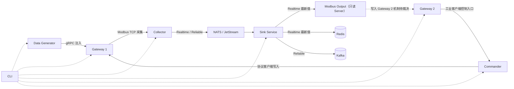

<h1 class="title">wind-hub 跨模块测试设计</h1>

<p class="subtitle">v0_1 · 20261111 · 初稿（待审核）</p>

<style>
body {
  font-family: "Microsoft YaHei";
  font-size: 16px;
  line-height: 1.75;
  color: #24292f;
}
.title {
  font-family: "Microsoft YaHei";
  font-size: 32px;
  line-height: 1.30;
  font-weight: 700;
  text-align: center;
}
.subtitle {
  font-family: "Microsoft YaHei";
  font-size: 18px;
  line-height: 1.50;
  font-weight: 400;
  text-align: center;
}
h1 {
  font-family: "Microsoft YaHei";
  font-size: 28px;
  line-height: 1.40;
  font-weight: 700;
}
h2 {
  font-family: "Microsoft YaHei";
  font-size: 22px;
  line-height: 1.40;
  font-weight: 700;
}
h3 {
  font-family: "Microsoft YaHei";
  font-size: 18px;
  line-height: 1.50;
  font-weight: 700;
}
h4 {
  font-family: "Microsoft YaHei";
  font-size: 16px;
  line-height: 1.50;
  font-weight: 700;
}
p, li {
  font-family: "Microsoft YaHei";
  font-size: 16px;
  line-height: 1.75;
}
.figure-caption,
.formula-caption {
  font-family: "Microsoft YaHei";
  font-size: 14px;
  line-height: 1.50;
  font-weight: 600;
  text-align: center;
  margin: 0.65em 0 0.35em 0;
}
.table-caption {
  font-family: "Microsoft YaHei";
  font-size: 13px;
  line-height: 1.40;
  font-weight: 500;
  text-align: center;
  margin: 0.65em 0 0.35em 0;
}
.mermaid,
.mermaid text,
.mermaid .label {
  font-family: "Microsoft YaHei" !important;
  font-size: 14px !important;
  line-height: 1.20;
}
table {
  width: 100%;
  border-collapse: collapse;
  font-family: "Microsoft YaHei";
  font-size: 13px;
  line-height: 1.45;
}
table th,
table th p,
table th li {
  font-family: "Microsoft YaHei";
  font-size: 13px;
  line-height: 1.40;
  font-weight: 600;
}
table td,
table td p,
table td li {
  font-family: "Microsoft YaHei";
  font-size: 13px;
  line-height: 1.45;
  font-weight: 400;
}
table th,
table td {
  padding: 0.40em 0.60em;
  vertical-align: top;
}
code, pre {
  font-family: "Cascadia Code";
  font-size: 14px;
  line-height: 1.50;
}
p code, li code, td code {
  color: #24292f;
  background: #f3f4f6;
  padding: 0.08em 0.28em;
  border-radius: 3px;
}
pre {
  color: #c9d1d9;
  background: #0d1117;
  padding: 1em;
  border-radius: 6px;
  overflow-x: auto;
}
pre code {
  color: inherit;
  background: transparent;
  padding: 0;
}
.hljs-comment, .hljs-quote,
.token.comment, .token.prolog, .token.doctype, .token.cdata {
  color: #8b949e;
  font-style: italic;
}
.hljs-keyword, .hljs-selector-tag, .hljs-literal,
.token.keyword, .token.boolean { color: #ff7b72; }
.hljs-string, .hljs-doctag, .hljs-regexp,
.token.string, .token.char, .token.regex { color: #a5d6ff; }
.hljs-number, .token.number { color: #79c0ff; }
.hljs-title, .hljs-function, .token.function { color: #d2a8ff; }
.hljs-title.class_, .hljs-type, .hljs-built_in,
.token.class-name, .token.builtin { color: #ffa657; }
.hljs-variable, .hljs-attr, .hljs-property,
.token.variable, .token.property, .token.attr-name { color: #7ee787; }
.hljs-operator, .hljs-punctuation,
.token.operator, .token.punctuation { color: #c9d1d9; }
</style>

---

## 目录

1. [文档约定](#1-文档约定)
2. [文档定位与使用方式](#2-文档定位与使用方式)
3. [范围、基线与判定](#3-范围基线与判定)
4. [测试拓扑与数据契约](#4-测试拓扑与数据契约)
5. [Integration 设计](#5-integration-设计)
6. [E2E 设计](#6-e2e-设计)
7. [Performance 设计](#7-performance-设计)
8. [Reliability 设计](#8-reliability-设计)
9. [配置与环境](#9-配置与环境)
10. [测试组织与 Marker](#10-测试组织与-marker)
11. [验收与追溯](#11-验收与追溯)
12. [审核决策](#12-审核决策)

---

# 1. 文档约定

本章是全文的固定排版与表达规范。文档修订、补充和派生版本均应遵守本章，不再根据个人习惯调整字体、字号、行距、图题、表题、公式或代码样式。

本文开头的 `<style>...</style>` 是 HTML `style` 元素，其中包含内部 CSS 样式表，本文简称为 **CSS 样式块**。第 1.1～1.4 节规定目标样式；CSS 样式块通过 `h1`、`h2`、`p`、`table`、`th`、`td`、`pre`、`code` 等选择器，将规范应用到 Markdown 渲染后生成的 HTML 元素。

## 1.1 字体约定

<p class="table-caption">表 1-1 文档字体与排版规范</p>

| 文档元素 | 字体 | 字号 | 行间距/行高 | 字重 | 对齐方式 |
|---|---|---:|---:|---:|---|
| 文档标题 | Microsoft YaHei | 32 px | 1.30 | 700 | 居中 |
| 文档副标题 | Microsoft YaHei | 18 px | 1.50 | 400 | 居中 |
| 一级标题 | Microsoft YaHei | 28 px | 1.40 | 700 | 左对齐 |
| 二级标题 | Microsoft YaHei | 22 px | 1.40 | 700 | 左对齐 |
| 三级标题 | Microsoft YaHei | 18 px | 1.50 | 700 | 左对齐 |
| 四级标题 | Microsoft YaHei | 16 px | 1.50 | 700 | 左对齐 |
| 正文 | Microsoft YaHei | 16 px | 1.75 | 400 | 左对齐 |
| 图题 | Microsoft YaHei | 14 px | 1.50 | 600 | 居中 |
| 图内文字 | Microsoft YaHei | 14 px | 1.20 | 400 | 按图形布局 |
| 表题 | Microsoft YaHei | 13 px | 1.40 | 500 | 居中 |
| 表头 | Microsoft YaHei | 13 px | 1.40 | 600 | 左对齐 |
| 表格正文 | Microsoft YaHei | 13 px | 1.45 | 400 | 左对齐 |
| 公式题 | Microsoft YaHei | 14 px | 1.50 | 600 | 居中 |
| 代码文字 | Cascadia Code | 14 px | 1.50 | 400 | 左对齐 |

以上规范已经通过本文开头的 CSS 样式块固定。其中，正文为 `16 px`；表题、表头和表格正文均为 `13 px`。表头字重为 `600`，低于标题字重；表格正文行高为 `1.45`，因此表格在字号、字重和行距上均明显弱于正文。英文业务对象、数据库对象和程序标识符仍按所在文本元素的字号排版，但使用行内代码形式，例如 `Asset`、`Connection`、`task_id`。

## 1.2 绘图约定

1. 上下文图、第 0 层及更深层 DFD、总体流程图和关系流程图统一使用 Mermaid。
2. 每一个 Mermaid 图都必须在 Mermaid 代码块第一行加入初始化配置，统一只设置 `useMaxWidth: true`。初始化配置格式为：

```text
%%{init: {"<Mermaid 图类型配置域>": {"useMaxWidth": true}}}%%
```

其中 `<Mermaid 图类型配置域>` 必须根据实际 Mermaid 图类型替换，不得固定写成 `flowchart`，也不得使用与实际图类型不匹配的配置域。

<p class="table-caption">表 1-2 Mermaid 图类型与初始化配置</p>

| Mermaid 图类型 | 图声明 | 第一行初始化配置 |
|---|---|---|
| Flowchart | `flowchart TB/LR/...` | `%%{init: {"flowchart": {"useMaxWidth": true}}}%%` |
| Sequence Diagram | `sequenceDiagram` | `%%{init: {"sequence": {"useMaxWidth": true}}}%%` |
| State Diagram | `stateDiagram-v2` | `%%{init: {"state": {"useMaxWidth": true}}}%%` |
| Class Diagram | `classDiagram` | `%%{init: {"class": {"useMaxWidth": true}}}%%` |
| ER Diagram | `erDiagram` | `%%{init: {"er": {"useMaxWidth": true}}}%%` |

若后续使用其他 Mermaid 图类型，也必须遵守同一规则：

```text
实际图类型
    ↓
确定该图类型对应的 Mermaid 配置域
    ↓
第一行写入：
%%{init: {"对应配置域": {"useMaxWidth": true}}}%%
```

不得额外加入 `wrap` 等非统一配置；如确有特殊需要，应在对应图的局部设计说明中单独论证。

3. 每张图必须有图编号和图题，编号采用“章节号-本章图序号”，例如“图 7-2”。
4. 图题必须使用普通图题样式，不得使用 Markdown 标题。统一写法为：

```html
<p class="figure-caption">图 7-2 图题</p>
```

## 1.3 公式约定

1. 行内公式使用单美元符号，例如 `$E_1$`。
2. 独立公式使用双美元符号，例如：

```text
$$
\mathrm{Entity}=E_1\land(E_2\lor E_3\lor E_4)\land E_5
$$
```

3. 正式公式不得放入代码块。
4. 不使用 `\[` 与 `\]` 作为公式定界符。
5. 变量下标统一写成 `E_1`、`R_1`；逻辑“与”和“或”统一写成 `\land`、`\lor`。
6. 公式必须使用 LaTeX，不使用普通文本模拟数学符号。
7. 需要编号的公式使用“式（章节号-本章公式序号）”，式题采用普通公式题样式：

```html
<p class="formula-caption">式（8-1）实体判断逻辑</p>
```

## 1.4 代码约定

1. 多行代码必须使用带语言标识的围栏代码块，例如 `python`、`sql`、`json`、`yaml`、`mermaid` 或 `text`。
2. 单个标识符、字段名、命令和短代码使用行内代码，例如 `PRIMARY KEY`、`Connection`。
3. 伪代码必须明确标记为 `text` 或在正文中说明“以下为伪代码”；不得使读者误认为它可以直接运行。
4. 代码块统一使用深色背景，颜色为 `#0D1117`；普通代码文字颜色为 `#C9D1D9`。
5. 语法高亮统一采用表 1-2 的配色。Markdown 渲染器应使用 Highlight.js 或 Prism 可识别的语言标识；渲染器不支持高亮时，至少保留代码背景色和普通代码文字颜色。

<p class="table-caption">表 1-2 代码语法高亮配色</p>

| 语法元素 | 颜色 | 十六进制 |
|---|---|---|
| 代码背景 | 深黑蓝 | `#0D1117` |
| 普通文字、运算符和标点 | 浅灰 | `#C9D1D9` |
| 注释 | 灰色 | `#8B949E` |
| 关键字和布尔值 | 红色 | `#FF7B72` |
| 字符串和正则表达式 | 浅蓝 | `#A5D6FF` |
| 数值 | 蓝色 | `#79C0FF` |
| 函数名 | 紫色 | `#D2A8FF` |
| 类型、类名和内置对象 | 橙色 | `#FFA657` |
| 变量、属性和字段 | 绿色 | `#7EE787` |

---

---

# 2. 文档定位与使用方式

## 2.1 适用对象

适用于 wind-hub **跨业务模块**分段集成及完整系统 E2E 测试；也适用于跨模块性能、可靠性和 CLI 联动验收。单个业务模块的 Unit、Component、Contract、模块内部 Integration/System 测试仍由对应最新模块设计负责。

本文作为跨模块验收的唯一测试设计依据，不定义新的运行时 RPC、Proto、Core 接口、Configuration 契约、工业设备或 Sink Adapter 实现。已有十份模块设计优先作为实现权威，本文规定其组合场景的验证方法。

## 2.2 目标

1. 将跨模块 Integration、完整 E2E、Performance、Reliability 的拓扑、边界、测试数据、验收断言及执行门禁统一定义，杜绝分段测试冒充完整 E2E。
2. 建立需求—链路—场景—测试—Marker—证据的双向追溯；完整 E2E 的 **Modbus、Redis、Kafka 三类 Sink 输出必须同时在线且实际交付**。
3. 采用与生产共享 Schema 兼容的隔离配置及可重复数据，保证失败可定位、资源可回收、结果可复测。
4. 本版仅是设计审核稿：**不得据此自动开发跨模块测试或更改生产接口**，待决项必须经审核形成明确决定。

---

# 3. 范围、基线与判定

## 3.1 权威来源

- 代码基线：审查分支由 `audit/design-contract-consistency-20261111@a1b80dae` 创建；冻结主干依据 `main@567e30ff`。
- 文档依据：总体架构 v1_4、Contracts v1_20、Core v1_33、Configuration v1_15、Collector v1_20、Commander v1_30、Industrial Gateway v1_27、Data Generator v1_23、Sink Service v1_50、CLI v1_26。
- `src/contracts/*.proto` 是 wire 契约权威；模块真实代码和配置 Schema 用于判断能力是否已实现。仅存在于设计中的接口不能作为已可运行能力。
- R1 独立验收结论为 `PASS WITH LIMITATIONS`；跨模块运行证据为 `DEFERRED`，不作 PASS 宣称。

## 3.2 测试级别的确定性边界

| 类别 | 允许范围 | 不允许替代 |
|---|---|---|
| 模块独立测试 | 单业务模块；外部受控 Stub/Fake | 不冒充跨模块真实联调 |
| `integration` | 相邻模块或分段链路；可由真实中间件承载 | 不标记 `end_to_end` |
| `system + end_to_end` | 全部六类真实业务模块、两个 Gateway 实例、全部三个 Sink 目标及双链路 | 不以部分进程健康、Fake Sink、只验单支路作为成功 |
| `performance` | 可附着在模块、分段、整链路 | 不把模块性能当成整链路性能 |
| `reliability` | 可附着在模块、分段、整链路 | 不把局部恢复当成全系统恢复 |

`system` 是测试层级，`end_to_end` 表示本文完整 E2E 资格；必须同时具备 `system`、`end_to_end` 且使用真实服务时才记为完整 E2E。现存名称带 `e2e` 的单模块测试不能仅因文件名沿用而被认定为完整系统测试。

## 3.3 执行裁决

| 条件 | 裁决 |
|---|---|
| 必要设备/依赖实际可用且所有断言满足 | PASS |
| 实测出现错误、违背安全/数据契约或未达到强制能力 | FAIL |
| 环境缺必要真实依赖而未执行 | NOT_RUN，并记录前置缺失 |
| 经批准暂不属于本阶段范围 | DEFERRED，不计算 PASS |
| 部分验证通过但有明确非阻断约束 | PASS WITH LIMITATIONS，并区分已执行/未执行证据 |

---

# 4. 测试拓扑与数据契约

## 4.1 目标业务拓扑



<p class="figure-caption">图 4-1 双业务链路及三目标系统测试拓扑（虚线表示管理关系或待解决的写入机制）</p>

**已核实的边界：**`src/sink_service/infrastructure/realtime_adapters.py` 中 `ModbusOutput` 是只读 Modbus TCP **Server**，在 `write_batch` 内更新其自身寄存器镜像，外部写操作被拒绝；Gateway 2 当前也作为协议 Server 运行。两个 Server 不能直接建立“Sink 主动写入 Gateway 2”的链路。

**待决 T-01：**在不更改已冻结协议/业务职责的前提下，确定 Gateway 2 如何从 Sink Modbus Server 获得最新值。如需新增桥接读取客户端、明确 Gateway 2 的输入来源或调整系统拓扑，必须先独立评审并更新适用模块设计；**禁止在 E2E Fixture 中隐式引入生产不存在的桥接实现**。

## 4.2 业务数据

| 类别 | 初期建议数量 | 验证责任 |
|---|---:|---|
| 非控制模拟量 | 8 | 类型、映射、采样序号、最新值 |
| 非控制状态量 | 4 | 离散类型、状态变化、质量 |
| 控制量 | 4 | 工业写入、Commander 处理、结果及反馈 |
| 合计 | 16 | 不以点数替代类型覆盖 |

测试应使用可重放、可预期的确定性数据；随机生成仅作补充。以实际 Schema 的身份、质量、时间戳及变量类型为准，不在本文发明新字段。输入每批记录测试运行 ID、可追踪的源批与点身份，输出用相同映射关系核对。

## 4.3 三个 Sink 目标

| 目标 | 路径 | 断言 |
|---|---|---|
| Modbus | Realtime → Modbus Output | 寄存器编码、最新值覆盖、TTL/质量、协议读回；Gateway 2 可见性依 T-01 批准后的真实路径验证 |
| Redis | Realtime → Redis | key 映射、最新值覆盖、TTL/质量、合法丢弃与过期 |
| Kafka | Reliable → Kafka | 批次及点位载荷、顺序边界、目标确认、消息重投、重复责任和 DLQ |

Kafka 幂等 Producer 不意味着整个源到目标链路自动恰好一次；测量重复次数并按正式契约判断。

---

# 5. Integration 设计

## 5.1 分段场景

<p class="table-caption">表 5-1 分段 Integration 测试</p>

| 编号 | 组合 | 核心断言 | 前置条件 |
|---|---|---|---|
| IT-01 | Data Generator → Gateway 1 | 按 Generation 映射写入，租约认证主体、点值、失效围栏正确 | Gateway 实体 gRPC |
| IT-02 | Gateway 1 → Collector | 真实 Modbus 读取、地址映射、类型及质量正确 | Gateway 协议 Server |
| IT-03 | Collector → NATS → Sink | 真实源批/Subject/Schema 与 Consumer 过滤一致，消息无无效 ACK | NATS/JetStream |
| IT-04 | Sink → Modbus Output | 真实 Modbus 客户端读寄存器、最新值与 TTL 一致 | Modbus Output Server |
| IT-05 | Sink → Redis | 最新值、覆盖/删除、TTL/质量 | Redis |
| IT-06 | Sink → Kafka | Reliable 载荷、确认、顺序、故障重投 | Kafka KRaft |
| IT-07 | Gateway 2 → Commander | 协议写入到控制事件、命令受理/拒绝/UNKNOWN | Gateway 控制映射 |
| IT-08 | Commander → Gateway 1 | 协议写入、幂等、结果判定 | 被控 Gateway |
| IT-09 | CLI → 单业务模块 | 正式 RPC/参数、权限及退出码 | 真实客户端与目标模块 |

## 5.2 准入规则

分段可以只启动所测段落依赖，其他模块可以不启动；必要受控 Stub/Fake 必须明示并标记 `mock_service`，不能标为所有目标真实交付。所有 IT 用例标记 `integration`，不得标记 `end_to_end`。涉及硬件/容器依赖，环境缺失应标 NOT_RUN，禁止静默回退为 Mock PASS。

---

# 6. E2E 设计

## 6.1 完整系统准入

真实 Data Generator、Gateway 1、Collector、Sink Service、Gateway 2、Commander、NATS/JetStream、Redis、Kafka 必须同时运行。Sink 至少三项独立 Delivery（Modbus、Redis、Kafka）被激活并实际交付；两条业务链路均可达。CLI 使用真实命令行进程。

`full_system` Fixture 在测试前验证进程、协议端点、授权、三类目标、所有必要 Delivery 与映射版本；测试期间对三路交付分别采集成功证据。任何一目标仅配置存在而没有实测交付，不能判 PASS。

由于 T-01 未裁决，**完整 E2E 当前为设计目标，不得声称已具备可运行的最终拓扑**。

## 6.2 E2E 场景矩阵

<p class="table-caption">表 6-1 完整链路场景</p>

| 编号 | 场景 | 必须同时断言 |
|---|---|---|
| E2E-01 | 连续非控制采集和三目标交付 | Modbus 最新值、Redis 最新值、Kafka 可靠消息均与源映射一致 |
| E2E-02 | 工业控制与反馈闭环 | Gateway 2 写入→Commander 处理→Gateway 1 执行；其后采集反馈被三目标中的相应路径观察；不得把“受理”当作“执行成功” |
| E2E-03 | CLI 功能全覆盖 | CLI 正式命令覆盖矩阵无缺项；每项拥有实际结果/拒绝证据 |
| E2E-04 | 配置版本更新 | 依各模块正式 Apply/Reload 契约；禁止丢失未知 I/O 责任 |
| E2E-05 | 三目标并行压力下业务正确性 | 各目标交付、控制与反馈都持续可用，不出现资源越界 |

CLI 自身的纯本地配置、网络诊断等命令可在模块独立测试验证；E2E-03 的“全覆盖”是审计全部正式命令的适当验收归属，不要求所有 CLI 子命令强制在每个 E2E 用例执行。

---

# 7. Performance 设计

## 7.1 测量边界

| 层级 | 观测指标 | 说明 |
|---|---|---|
| 分段 | offered、accepted、delivered、dropped、P50/P95/P99、积压 | 指标粒度和语义按 Sink/Collector 设计 |
| 完整数据链 | 源点值/s、各目标成功值/s、最新值延迟、Kafka 确认延迟 | 三目标分别核算，防止合并统计掩盖失败 |
| 控制闭环 | 从写入/提交到明确结果及反馈时延 | Accepted、UNKNOWN、真实物理生效分开 |
| 资源 | CPU、RSS、线程/Task、FD、队列深度 | 负载窗口、样本数及硬件环境必须记录 |

## 7.2 负载级别

初始用 1 台模拟设备、16 点验证可复现性，后续逐级扩大设备数、点数、采样频率与 Delivery 扇出。30 台 × 10 Hz 及每台实时/可靠点数仅在对应最新版模块设计下作为指定参考负载，**不将尚未实测的参考值视为已满足的硬性结果**。

参考达成率按同一目标的“成功确认测点事件数 / 对应输入测点事件数”记录；Realtime 合法覆盖、可靠消息重投与多 Delivery 扇出分别统计，不混入同一分母。具体指标符号及量纲以项目《符号体系》为准，正式公式在审核时统一补充。

不同 Delivery 扇出不直接累加到源端分母；合法 Realtime 覆盖与失败丢失必须分开。

---

# 8. Reliability 设计

## 8.1 故障矩阵

<p class="table-caption">表 8-1 故障注入与恢复</p>

| 编号 | 注入位置 | 验证责任 |
|---|---|---|
| REL-01 | Generator/Gateway 1 重启 | 租约失效、无旧 token 越权；源状态可定位 |
| REL-02 | Collector/连接中断 | 采集恢复、队列背压、不可伪造样本 |
| REL-03 | NATS/JetStream 中断 | Reliable 不提前 ACK；Realtime 合法覆盖 |
| REL-04 | Redis 中断 | Realtime 交付失败/恢复、TTL 正确、无无界队列 |
| REL-05 | Kafka 中断 | NAK/重投、分区/设备顺序边界、DLQ 责任 |
| REL-06 | Sink 子进程异常 | 资源所有权及 Durable 消费恢复 |
| REL-07 | Commander UNKNOWN | 不盲重试、结果查询与幂等 |
| REL-08 | Gateway 2 中断 | Modbus 输出及控制链故障隔离 |
| REL-09 | 全系统 STOP/Restart/Reload | 统一清理、无重复真实副作用、无悬空租约 |

## 8.2 强制约束

必须区分“系统拒绝”“结果未知”“明确目标成功”；超时不能推定副作用未发生。恢复后以 Broker 和目标的真实证据判断，不能仅靠 Mock 次数。对存在未确认结果的 Reliable 目标保留责任，所有进程退出有上限及资源回收证据。

---

# 9. 配置与环境

## 9.1 测试配置目录

```text
tests/e2e/
├── conftest.py
├── configs/
│   ├── services/
│   │   ├── data-generator-service.yaml
│   │   ├── gateway1.yaml
│   │   ├── gateway2.yaml
│   │   ├── collector.yaml
│   │   ├── commander.yaml
│   │   └── sink-service.yaml
│   ├── instances/
│   │   ├── site.yaml
│   │   ├── devices.yaml
│   │   └── data-generator.yaml
│   └── templates/
│       ├── protocols/
│       ├── device_models/
│       ├── point_tables/
│       ├── sinks/
│       └── deliveries/
└── support/
```

现有 `configs/` 中的模板作为 Schema 事实参考；测试配置可裁剪点表和设备数量，但完整保留正式校验必需的键与版本约束。不得硬编码生产路径、共享实际数据库或在生产配置目录写入测试变更。

## 9.2 环境隔离

测试启动时使用隔离的临时工作目录和动态端口、独立 NATS Stream/Durable、Redis Key 前缀、Kafka Topic、证书及进程所有权记录。环境清理不得删除非测试资源。测试失败应保留日志、配置快照与关键中间件状态。适用时使用单独的 Docker/容器编排；不可用时报告 NOT_RUN。

---

# 10. 测试组织与 Marker

## 10.1 目录与归属

| 路径 | 职责 |
|---|---|
| `tests/<module>/` | 各模块单独设计负责的测试；模块内部 Unit/Component/Contract/Integration/System |
| `tests/integration/` | 至少两个真实业务模块的分段集成测试 |
| `tests/e2e/` | 本文准入条件下的完整系统 E2E |
| `tests/tooling/` | CI、测试工具与配置路由自身的回归 |
| `tests/support/` | 共享 Fixture 与测试服务，不放业务断言 |
| `tests/fixtures/` | 静态资源和受控服务 |

原 `tests/src/` 取消多余层级；原 `tests/system/` 逐文件迁入模块级 `system/`、跨模块 `integration/` 或满足资格的 `e2e/`。不得因目录名自动认定测试层级；多项专项属性使用 Marker，而不再建立 `tests/performance/`、`tests/reliability/` 作为新的横切重复目录。

## 10.2 Marker 契约

复用现行 `pyproject.toml` 的 `unit`、`component`、`contract`、`integration`、`system`、`performance`、`reliability`、`end_to_end`、`real_service`、`mock_service` 等 Marker。新测试不得为同义概念再创建 `e2e` Marker。

- 模块测试：按实际层级标记；`reliability`、`performance` 是叠加专题，不得取代层级。
- `tests/integration/` 中的用例：标记 `integration`，禁止 `end_to_end`。
- `tests/e2e/` 中的完整链路用例：必须同时具有 `system`、`end_to_end`、`real_service`，且依赖标准 `full_system` Fixture。
- 完整恢复/性能测试附加 `reliability`/`performance`，保留同一完整系统资格。
- 真实依赖不可用时按 NOT_RUN，不能把 `mock_service` 测试算入正式 E2E PASS。

建议的正式运行方式（待审核实施后可使用）：

```bash
pytest tests/integration -m "integration and not end_to_end"
pytest tests/e2e -m "system and end_to_end and real_service"
pytest tests/e2e -m "system and end_to_end and reliability"
pytest tests/e2e -m "system and end_to_end and performance"
```

---

# 11. 验收与追溯

## 11.1 覆盖矩阵

<p class="table-caption">表 11-1 测试需求追溯字段</p>

| 字段 | 含义 |
|---|---|
| `test_requirement_id` | 本文 IT/E2E/REL/PERF 编号 |
| `design_ref` | 十份模块设计的实际章节及权威契约 |
| `source_ref` | 实际源码、配置、Proto 声明 |
| `test_nodeid` | 完整 pytest node ID |
| `markers` | 层级、专题、真实性 |
| `assertions` | 断言、依据、容差、时序责任 |
| `evidence` | 日志、外部中间件状态、输出记录、统计 |
| `result` | PASS/FAIL/NOT_RUN/DEFERRED 与原因 |

## 11.2 质量门禁

- 静态：Ruff check/format、项目类型检查、Import Linter、Proto/Schema 一致性、CI 路由、Marker 及测试收集；
- 用例：场景双向追溯无缺项、真实目标断言完整、Fixture 无越界写入、环境自清理；
- E2E：三 Sink 同时真实输出、双链路控制反馈均成功；T-01 等待裁决时保持 DEFERRED；
- 报告：按目标分别统计，不用整体平均成功率掩盖目标缺失；NOT_RUN 不能算作 PASS。

---

# 12. 审核决策

本稿审核前，不实施跨模块测试、完整系统 Fixture、跨模块配置目录或生产适配器调整。

<p class="table-caption">表 12-1 待审核的架构及测试决策</p>

| ID | 待决事项 | 建议 |
|---|---|---|
| T-01 | 只读 Sink Modbus Server 与 Gateway 2 Server 如何形成数据可见链路 | 明确正式的协议客户端/映射责任后再开发；不临时暗加桥接 |
| T-02 | 是否将三目标在线及真实交付作为所有 `end_to_end` 的硬性准入 | 是 |
| T-03 | 分段测试与完整 E2E 是否独立目录/Marker | 是，`integration` vs `system+end_to_end` |
| T-04 | Performance/Reliability 是否用横切 Marker 而非新顶级目录 | 是 |
| T-05 | 初期小配置是否使用 1 设备/16 点，随后扩容 | 是，点表字段以正式 Schema 为准 |
| T-06 | CLI 所有正式命令如何分配模块独立与完整 E2E 覆盖 | 以命令—场景—断言矩阵追溯，不要求每条命令执行完整拓扑 |

