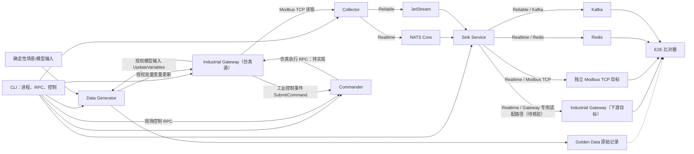
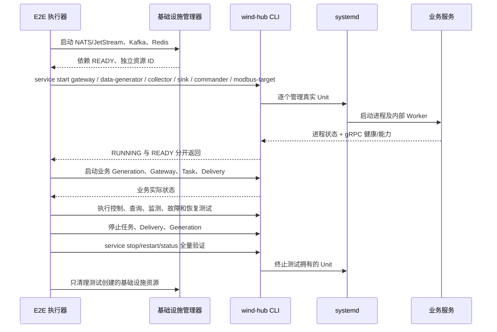

<h1 class="title">wind-hub 跨模块测试设计</h1>

<p class="subtitle">v0_11 · 20261113 · 统一配置、CLI 进程管理与完整链路验收设计</p>

<style>
body { font-family: "Microsoft YaHei"; font-size: 16px; line-height: 1.75; color: #24292f; }
.title { font-family: "Microsoft YaHei"; font-size: 32px; line-height: 1.30; font-weight: 700; text-align: center; }
.subtitle { font-family: "Microsoft YaHei"; font-size: 18px; line-height: 1.50; font-weight: 400; text-align: center; }
h1 { font-family: "Microsoft YaHei"; font-size: 28px; line-height: 1.40; font-weight: 700; }
h2 { font-family: "Microsoft YaHei"; font-size: 22px; line-height: 1.40; font-weight: 700; }
h3 { font-family: "Microsoft YaHei"; font-size: 18px; line-height: 1.50; font-weight: 700; }
h4 { font-family: "Microsoft YaHei"; font-size: 16px; line-height: 1.50; font-weight: 700; }
p, li { font-family: "Microsoft YaHei"; font-size: 16px; line-height: 1.75; }
.figure-caption, .formula-caption { font-family: "Microsoft YaHei"; font-size: 14px; line-height: 1.50; font-weight: 600; text-align: center; margin: 0.65em 0 0.35em; }
.table-caption { font-family: "Microsoft YaHei"; font-size: 13px; line-height: 1.40; font-weight: 500; text-align: center; margin: 0.65em 0 0.35em; }
.mermaid, .mermaid text, .mermaid .label { font-family: "Microsoft YaHei" !important; font-size: 14px !important; line-height: 1.20; }
table { width: 100%; border-collapse: collapse; font-family: "Microsoft YaHei"; font-size: 13px; line-height: 1.45; }
table th, table th p, table th li { font-family: "Microsoft YaHei"; font-size: 13px; line-height: 1.40; font-weight: 600; }
table td, table td p, table td li { font-family: "Microsoft YaHei"; font-size: 13px; line-height: 1.45; font-weight: 400; }
table th, table td { padding: 0.40em 0.60em; vertical-align: top; }
code, pre { font-family: "Cascadia Code"; font-size: 14px; line-height: 1.50; }
p code, li code, td code { color: #24292f; background: #f3f4f6; padding: 0.08em 0.28em; border-radius: 3px; }
pre { color: #c9d1d9; background: #0d1117; padding: 1em; border-radius: 6px; overflow-x: auto; }
pre code { color: inherit; background: transparent; padding: 0; }
.hljs-comment, .hljs-quote, .token.comment, .token.prolog, .token.doctype, .token.cdata { color: #8b949e; font-style: italic; }
.hljs-keyword, .hljs-selector-tag, .hljs-literal, .token.keyword, .token.boolean { color: #ff7b72; }
.hljs-string, .hljs-doctag, .hljs-regexp, .token.string, .token.char, .token.regex { color: #a5d6ff; }
.hljs-number, .token.number { color: #79c0ff; }
.hljs-title, .hljs-function, .token.function { color: #d2a8ff; }
.hljs-title.class_, .hljs-type, .hljs-built_in, .token.class-name, .token.builtin { color: #ffa657; }
.hljs-variable, .hljs-attr, .hljs-property, .token.variable, .token.property, .token.attr-name { color: #7ee787; }
.hljs-operator, .hljs-punctuation, .token.operator, .token.punctuation { color: #c9d1d9; }
</style>

---

## 目录

1. [文档约定](#1-文档约定)
2. [文档定位与使用方式](#2-文档定位与使用方式)
3. [测试目标、范围与总体要求](#3-测试目标范围与总体要求)
4. [完整测试场景与总体数据流](#4-完整测试场景与总体数据流)
5. [共享配置、运行环境与进程启动](#5-共享配置运行环境与进程启动)
6. [Integration 分段测试](#6-integration-分段测试)
7. [E2E 完整场景](#7-e2e-完整场景)
8. [CLI 与 gRPC 全功能覆盖](#8-cli-与-grpc-全功能覆盖)
9. [Golden Data、采样率与输出比较](#9-golden-data采样率与输出比较)
10. [性能、故障与安全验收](#10-性能故障与安全验收)
11. [测试执行、目录、Marker 与报告](#11-测试执行目录marker-与报告)
12. [准入、裁决及实施缺口](#12-准入裁决及实施缺口)

---

# 1. 文档约定

本章是全文的固定排版与表达规范。文档修订、补充和派生版本均应遵守本章，不再根据个人习惯调整字体、字号、行距、图题、表题、公式或代码样式。

本文开头的 `<style>...</style>` 是 HTML `style` 元素，其中包含内部 CSS 样式表，本文简称为 **CSS 样式块**。第 1.1～1.4 节规定目标样式；CSS 样式块通过 `h1`、`h2`、`p`、`table`、`th`、`td`、`pre`、`code` 等选择器，将规范应用到 Markdown 渲染后生成的 HTML 元素。

## 1.1 字体约定

<p class="table-caption">表 1-1 文档字体与排版规范</p>

| 文档元素 | 字体 | 字号 | 行间距/行高 | 字重 | 对齐方式 |
|---|---|---:|---:|---:|---|
| 文档标题 | Microsoft YaHei | 32 px | 1.30 | 700 | 居中 |
| 文档副标题 | Microsoft YaHei | 18 px | 1.50 | 400 | 居中 |
| 一级标题 | Microsoft YaHei | 28 px | 1.40 | 700 | 左对齐 |
| 二级标题 | Microsoft YaHei | 22 px | 1.40 | 700 | 左对齐 |
| 三级标题 | Microsoft YaHei | 18 px | 1.50 | 700 | 左对齐 |
| 四级标题 | Microsoft YaHei | 16 px | 1.50 | 700 | 左对齐 |
| 正文 | Microsoft YaHei | 16 px | 1.75 | 400 | 左对齐 |
| 图题 | Microsoft YaHei | 14 px | 1.50 | 600 | 居中 |
| 图内文字 | Microsoft YaHei | 14 px | 1.20 | 400 | 按图形布局 |
| 表题 | Microsoft YaHei | 13 px | 1.40 | 500 | 居中 |
| 表头 | Microsoft YaHei | 13 px | 1.40 | 600 | 左对齐 |
| 表格正文 | Microsoft YaHei | 13 px | 1.45 | 400 | 左对齐 |
| 公式题 | Microsoft YaHei | 14 px | 1.50 | 600 | 居中 |
| 代码文字 | Cascadia Code | 14 px | 1.50 | 400 | 左对齐 |

以上规范已经通过本文开头的 CSS 样式块固定。其中，正文为 `16 px`；表题、表头和表格正文均为 `13 px`。表头字重为 `600`，低于标题字重；表格正文行高为 `1.45`，因此表格在字号、字重和行距上均明显弱于正文。英文业务对象、数据库对象和程序标识符仍按所在文本元素的字号排版，但使用行内代码形式，例如 `Asset`、`Connection`、`task_id`。

## 1.2 绘图约定

1. 上下文图、第 0 层及更深层 DFD、总体流程图和关系流程图统一使用 Mermaid。
2. 每一个 Mermaid 图都必须在 Mermaid 代码块第一行加入初始化配置，统一只设置 `useMaxWidth: true`。初始化配置格式为：

```text
%%{init: {"<Mermaid 图类型配置域>": {"useMaxWidth": true}}}%%
```

其中 `<Mermaid 图类型配置域>` 必须根据实际 Mermaid 图类型替换，不得固定写成 `flowchart`，也不得使用与实际图类型不匹配的配置域。

<p class="table-caption">表 1-2 Mermaid 图类型与初始化配置</p>

| Mermaid 图类型 | 图声明 | 第一行初始化配置 |
|---|---|---|
| Flowchart | `flowchart TB/LR/...` | `%%{init: {"flowchart": {"useMaxWidth": true}}}%%` |
| Sequence Diagram | `sequenceDiagram` | `%%{init: {"sequence": {"useMaxWidth": true}}}%%` |
| State Diagram | `stateDiagram-v2` | `%%{init: {"state": {"useMaxWidth": true}}}%%` |
| Class Diagram | `classDiagram` | `%%{init: {"class": {"useMaxWidth": true}}}%%` |
| ER Diagram | `erDiagram` | `%%{init: {"er": {"useMaxWidth": true}}}%%` |

若后续使用其他 Mermaid 图类型，也必须遵守同一规则：先确认实际图类型，再确定其配置域，最后在首行仅配置 `useMaxWidth: true`。不得额外加入 `wrap` 等非统一配置；特殊需要应单独论证。

3. 每张图必须有图编号和图题，编号采用“章节号-本章图序号”，例如“图 7-2”。
4. 图题必须使用普通图题样式，不得使用 Markdown 标题。统一写法为：

```html
<p class="figure-caption">图 7-2 图题</p>
```

## 1.3 公式约定

1. 行内公式使用单美元符号，例如 `$E_1$`。
2. 独立公式使用双美元符号，例如：

```text
$$
\mathrm{Entity}=E_1\land(E_2\lor E_3\lor E_4)\land E_5
$$
```

3. 正式公式不得放入代码块。
4. 不使用 `\[` 与 `\]` 作为公式定界符。
5. 变量下标统一写成 `E_1`、`R_1`；逻辑“与”和“或”统一写成 `\land`、`\lor`。
6. 公式必须使用 LaTeX，不使用普通文本模拟数学符号。
7. 需要编号的公式使用“式（章节号-本章公式序号）”，式题采用普通公式题样式：

```html
<p class="formula-caption">式（8-1）实体判断逻辑</p>
```

## 1.4 代码约定

1. 多行代码必须使用带语言标识的围栏代码块，例如 `python`、`sql`、`json`、`yaml`、`mermaid` 或 `text`。
2. 单个标识符、字段名、命令和短代码使用行内代码，例如 `PRIMARY KEY`、`Connection`。
3. 伪代码必须明确标记为 `text` 或说明“以下为伪代码”；不得使读者误认为可以直接运行。
4. 代码块统一使用深色背景 `#0D1117`；普通代码文字颜色 `#C9D1D9`。
5. 语法高亮按照下表；不支持高亮的渲染器至少保留代码背景与普通文字颜色。

<p class="table-caption">表 1-3 代码语法高亮配色</p>

| 语法元素 | 颜色 | 十六进制 |
|---|---|---|
| 代码背景 | 深黑蓝 | `#0D1117` |
| 普通文字、运算符和标点 | 浅灰 | `#C9D1D9` |
| 注释 | 灰色 | `#8B949E` |
| 关键字和布尔值 | 红色 | `#FF7B72` |
| 字符串和正则表达式 | 浅蓝 | `#A5D6FF` |
| 数值 | 蓝色 | `#79C0FF` |
| 函数名 | 紫色 | `#D2A8FF` |
| 类型、类名和内置对象 | 橙色 | `#FFA657` |
| 变量、属性和字段 | 绿色 | `#7EE787` |

---

# 2. 文档定位与使用方式

本文件为 wind-hub 的跨模块测试**目标设计与可执行验收方案**；使用 `feat/data-generator-physical-model-v1` 分支的设计及 `configs/` 作为核对基线。本次只设计，不声称任何未执行项目已通过。

**范围**：Integration、完整 E2E、全量 CLI/gRPC、性能、可靠性、安全；全部 wind-hub 业务进程均通过 **真实 CLI → Linux 进程管理器**启停，当前不使用容器。NATS/JetStream、Kafka、Redis 为外部基础设施，由 E2E 环境准备器负责；不算 wind-hub 业务进程，也不通过 CLI 管理。Integration 与 E2E 使用同一 `configs/` 资产与同一配置选择规则。

**权威性**：RPC 字段以实际 Contracts Proto 为准；物理模型以 Data Generator 设计为准；CLI 命令以 CLI 设计及当前可执行帮助为准；配置以对应模块设计、实际 Schema 和 `configs/` 为准。本文示例启动脚本、文件名、测试输入是**目标建议**，不是现有命令/配置已实现的证明。

# 3. 测试目标、范围与总体要求

## 3.1 测试目标

- 验证五类仿真设备：风机（WTG）、光伏（PV）、储能（BESS）、电网（GRID）、电厂控制器（PPC），及随机模型、历史回放。
- 通过确定性刺激产生可复现数据：风速湍流度 `0`、固定风向/辐照等，以及可控阶跃；必要时保留固定种子随机用例。
- 验证完整链路：**Data Generator → Industrial Gateway（仿真设备 Modbus TCP Server）→ Collector → NATS/JetStream → Sink → 四种下游目标**。
- Sink 四个下游验收目标：**Industrial Gateway、独立 Modbus TCP 目标、Redis（Realtime）和 Kafka（Reliable）**；四者分别验收，不互相代替。
- 覆盖 CLI **每项功能**、正式 Proto **每项 RPC**及其主要成功、非法输入、权限与失败路径；包括 CLI 启停、重启全部业务服务进程。
- 验证不同生成步长、Collector 采集周期、Realtime 最新值覆盖、Reliable 历史序列、Sink 目标类型及不同更新速率。
- 将执行证据追溯到 `用例 ID → 输入配置/CLI → RPC → 源记录 → 目标观测 → 断言/裁决`。

## 3.2 关键约束

1. 不允许在 E2E 使用核心业务 Mock；外部真实 NATS/JetStream、Kafka、Redis 与真实目标 Server 运行。
2. Integration/E2E 运行所需的服务配置与共享模板统一存于 `configs/`。测试代码、激励清单、断言和运行产物放 `tests/src/`，不复制第二份配置树。
3. 所有 wind-hub **业务服务**（包括模拟 Modbus 目标若由 wind-hub 实现）必须经真实 CLI 的 `service start/stop/restart/status` 管理；禁止测试 Fixture 直接 `subprocess.Popen()` 启动这些进程。仅 NATS/JetStream、Kafka、Redis 等中间件例外，由基础设施管理器启动。独立 Modbus TCP 测试目标服务也须纳入 CLI 进程管理（如由现有 wind-hub Modbus Server 实例承担）；无法通过 CLI 启动的目标进程不得纳入本轮完整 E2E 的 PASS。
4. 对外部依赖的 `RUNNING`、业务服务进程 `RUNNING`、gRPC `READY`、任务 `RUNNING` 分别验收，不得混淆。
5. 每个用例指定配置文件、启动/前置进程、激励、预期输出、步骤、验收断言及清理策略；失败或不可执行必须分别标记 `FAIL`、`NOT_RUN`、`NOT_IMPLEMENTED`。
6. 本阶段 Linux 原生进程，不测试 containerd、iSulad；禁止因此将容器能力标记 PASS。

## 3.3 设计与实现基线

| 域 | 当前分支设计参考 | 核对重点 |
|---|---|---|
| Contracts / Core / Configuration | `Contracts_软件设计_v1_25.md`、`Core_软件设计_v1_34.md`、`wind-hub_总体逻辑架构设计_v1_13.md` 第 5 章 | RPC/消息、配置与模板解释 |
| Data Generator | `Data_Generator_软件设计_v1_40.md` | Scenario/Generation、五类模型、输出映射 |
| Gateway / Collector / Commander | `industrial_gateway_软件设计_v1_33.md`、`Collector_软件设计_v1_21.md`、`Commander_软件设计_v1_32.md` | 工业协议、采集、控制分权 |
| Sink / CLI | `Sink_Service_软件设计_v1_53.md`、`CLI_软件设计_v1_33.md` | 双通道交付、进程管理、RPC 全覆盖 |
| 总体架构 | `wind-hub_总体逻辑架构设计_v1_13.md` | 数据流和业务所有权 |

设计基线：总体架构 v1_13；执行验收前重新获取受测分支 HEAD 并核对所有正式 Proto。设计文件版本不是实现完成证明。

# 4. 完整测试场景与总体数据流

## 4.1 总体数据与控制流


<p class="figure-caption">图 4-1 E2E 完整数据链路与四类 Sink 输出目标</p>

**Important—Gateway 下游连接契约缺口**：用户要求 Sink 的 Realtime 下游包括 Industrial Gateway，但当前已核对的 Sink v1_50 首批适配器为 `Redis Client / Modbus TCP Server / Kafka Producer`，而 Gateway 仿真运行配置主要是 **Modbus TCP Server**。因此**不能直接画成既有 Sink Adapter 对 Gateway Server 写入成功**。E2E 的 Industrial Gateway 目标必须在设计与代码中确认一个真正可用、授权的写入接口/适配器（例如已正式存在的 Gateway RPC 写变量客户端）；不得假定两个 Modbus TCP Server 可直连，也不得私造新的 RPC。若该路径未实现，单独裁决 `NOT_IMPLEMENTED`；其他三路继续验收。

**源 Gateway 与目标 Gateway**：两者可以是同一业务模块的**不同实例/不同设备变量空间**，必须明确端口与目标键；不得用 Sink 输出回写到原采集输入点造成环路，除非有特定隔离且明确的闭环场景。

**DFD 验收原则**：System Test 逐项核验真实采集、仿真测量、仿真控制、Realtime/ Reliable 派发、Gateway Realtime 回注、配置管理五类链路。任一链路的业务 Owner、正式接口、Port/Adapter 与真实进程启动证据必须一致。不得用 Stub 测试或仅代码存在取代端到端验收。

## 4.2 全部必测业务场景

| 场景组 | 设备/控制刺激 | 预期观测 |
|---|---|---|
| P1 风机 | 平均风速固定/阶跃；转速控制、恒功率、限功率、偏航 | 模型源记录、Gateway 读数、Collector、各 Sink 输出一致且符合采样语义 |
| P2 光伏 | 日照零→额定、遮云、温度 | DC/AC 与逆变器容量边界、传输正确 |
| P3 储能 | 充/放电、SOC 边界、PCS 无功 | SOC 连续、P/Q 合法及对应下游输出 |
| P4 电网 | P/Q 聚合、频率/电压阶跃 | 变量输出与模拟目标一致 |
| P5 PPC | AGC、AVC、FFR 命令 | 控制受理、有效步、状态变化与端到端结果 |
| P6 随机与回放 | 固定种子/固定 CSV | 同输入复现、时序不丢失 |
| P7 采样与多目标 | 50/100/200/1000 ms 采样组合；四类下游 | 按各通道语义检验采样、覆盖、重投、编码与目标读回 |
| P8 运维/失败 | 全 CLI、进程重启、断线、非法配置、权限拒绝 | 响应、状态、输出、恢复均有证据 |

数字为建议测试矩阵值，不是对所有模块已支持这些周期的断言。业务模型内部物理量不以链路 Golden Data 证明其数值方程正确性；数学正确性由模型自身测试负责。

# 5. 共享配置、运行环境与进程启动

## 5.1 当前仓库 `configs/` 的真实结构

```text
configs/
├── instances/
│   ├── site.yaml
│   ├── devices.yaml                       # 真实设备
│   ├── devices_sim.yaml                   # WTG_SIM01/PV_SIM01/BESS_SIM01/GRID_SIM01/PPC_SIM01
│   ├── data-generator.yaml                # 既有随机/回放场景
│   ├── data-generator-sim.yaml            # 五类物理仿真场景
│   ├── sinks.yaml
│   └── deliveries.yaml
├── services/
│   ├── cli.example.yaml
│   ├── collector.yaml
│   ├── commander.yaml
│   ├── data-generator-service.yaml
│   ├── data-generator-sim.example.yaml
│   ├── industrial_gateway.yaml
│   ├── industrial_gateway-sim.example.yaml
│   └── sink_service.yaml
├── templates/
│   ├── device_models/                     # 五个 *_sim_1.0.0.yaml + 真实型号
│   ├── point_tables/                      # 五个 modbus_*_sim_1.0.0.yaml + 真实点表
│   ├── protocols/                         # Modbus TCP / ADS / IEC104
│   ├── sinks/                             # Redis/Kafka/Modbus 模板
│   ├── deliveries/                        # realtime_power / reliable_history
│   ├── tasks/                             # 当前 turbine_all_1.0.0.yaml
│   ├── business_points.yaml
│   └── units.yaml
└── history/demo.csv
```
<p class="figure-caption">图 5-1 当前配置资产目录（省略各模板小版本）</p>

**原始文件复用**：所有模块必须按 `config_sources` 显式引用同一套 `configs/templates`、设备/场景实例文件。测试共享 `configs/`；不创建 `tests/src/integration/configs/`、`tests/src/e2e/configs/`。只读载入现有配置；测试专用差异采用 `configs/services/*-sim`、`configs/instances/*-sim` 和经过审核新增的独立仿真文件。不得覆盖 `devices.yaml` 或真实服务现场配置。

## 5.2 配置引用与当前缺口（按现有文件核对）

| 角色 | 已有或应使用的文件 | 已核实的状态/需补齐项 |
|---|---|---|
| 模拟设备 | `instances/devices_sim.yaml`、五类 `templates/device_models/*_sim_1.0.0.yaml`、对应 `templates/point_tables/modbus_*_sim_1.0.0.yaml` | **已存在**五实例，Modbus 端口 `15021`～`15025`；先校验实际 schema 与点表完整性 |
| 模拟物理/随机 | `instances/data-generator-sim.yaml`、`instances/data-generator.yaml` | 物理 Scenario 已有，当前风速 `turbulence_intensity: 0.12`；需**独立确定性测试场景**设 0，且不能改变随机/回放场景默认用途 |
| Generator Service | `services/data-generator-sim.example.yaml` | 已引用 `site.yaml`、`devices_sim.yaml`、`data-generator-sim.yaml`；证书、录制与监听端口需完成可运行配置 |
| 源 Gateway | `services/industrial_gateway-sim.example.yaml` | 已有五个 Server `15021`～`15025` 与管理 gRPC `50073`；PPC 写控制映射需检验，TLS 文件引用需对齐 |
| Collector | `services/collector.yaml`、`templates/tasks/turbine_all_1.0.0.yaml` | 当前 Collector **仍引用 `devices.yaml`**，任务模板周期为 `1.0` 秒、`STOP`；应加独立模拟 Collector 服务配置及五类采集任务（明确不同频率） |
| Sink | `services/sink_service.yaml`、`instances/sinks.yaml`、`instances/deliveries.yaml`、`templates/sinks/*`、`templates/deliveries/*` | `deliveries.yaml` 当前仍含 `WT001/WT002`，`sinks.yaml` Redis/Kafka 仍是示例外部地址；需独立模拟 Delivery/Sink 实例，匹配 `*_SIM01`、双通道及四种下游 |
| Sink → Gateway | Gateway 目标 Service、Sink `gateway_realtime` 模板及 `target_mappings` | **明确缺口**：写入目标接口/地址/授权、Adapter 实现及配置契约待审查；不得直接将现有 Modbus TCP Server 视为支持接收 Sink 写入 |
| CLI | `services/cli.example.yaml` | 当前混合 `containerd`、`isulad`、`systemd`；需在 `configs/services/` 下增加正式本机 E2E CLI 配置，所有 wind-hub 服务目标为真实 `systemd` Unit 且端口与 TLS 对齐 |
| Commander | `services/commander.yaml` | 需核对模拟受控设备及操作权限，避免触碰真实设备 |
| 共享其他 | `instances/site.yaml`、`templates/business_points.yaml`、`templates/units.yaml`、协议模板 | 复用现有文件，不复制；含缺少的业务点需正式扩展并校验 |

**端口冲突提醒**：当前 Generator 仿真示例采用 gRPC `127.0.0.1:50061`，而 Sink 服务示例也使用管理端口 `50061`。E2E 必须给不同进程分配唯一端口并同步 CLI、服务引用、TLS 与断言，不能原样同时启动。

## 5.3 配置文件组织目标（待落地）

建议保留 `configs/instances/devices_sim.yaml` 与 `data-generator-sim.yaml`，在正式 `configs/` 下增加**最少必要**且同名语义清楚的仿真专用配置，例如：

```text
configs/services/
  cli-e2e.yaml                    # 全部进程 systemd 白名单与 gRPC 端点
  collector-sim.yaml              # devices_sim.yaml、采集周期与 NATS
  sink_service-sim.yaml           # Sink、Delivery、JetStream、凭据
  commander-sim.yaml              # 如现有控制目标无法隔离时新增
  data-generator-sim.yaml         # 从 .example 形成有效运行文件
  industrial_gateway-sim.yaml    # 从 .example 形成有效运行文件
configs/instances/
  collector-tasks-sim.yaml        # 仅在正式 Collector 配置契约支持时引入
  sinks_sim.yaml                  # 四目标连接，无真实目标
  deliveries_sim.yaml             # *_SIM01 + Realtime/Reliable
  data-generator-e2e.yaml        # 若不同工况无法通过现有 Scenario 安全表达
```

以上均为**建议新增文件，不是当前文件**。不得无故引入冗余文件；若某项能由现有 Scenario 中**新增一个命名场景**解决，不另立文件。`config_sources` 必须严格按对应模块既有 Schema，不因为测试方便引入 `instances.*` 的非法配置键。

## 5.4 测试进程与基础设施所有权

| 对象 | 实际启动者 | 方式与判定 |
|---|---|---|
| NATS/JetStream | 测试环境准备器/用户运维 | 启动独立 NATS，创建隔离 Stream/Subject，确认可发布/消费 |
| Kafka Broker | 测试环境准备器/用户运维 | 外部服务进程，创建隔离 Topic，读取端可核验 |
| Redis Server | 测试环境准备器/用户运维 | 独立端口、DB/Key 前缀，确认只清理由测试拥有的资源 |
| Data Generator、Gateway、Collector、Sink、Commander | **CLI** | CLI `service start/stop/restart/status` → **真实 systemd 管理器** → 原生 Linux 进程/进程组 |
| Sink Main / Realtime / Reliable | **CLI 管理 Sink 总体生命周期** | 由 Sink 正式服务入口负责内部三进程，不由 E2E 私自启动两个 Worker |
| 独立 Modbus TCP 目标 Server | **CLI** | 推荐使用独立 wind-hub Modbus Server 测试实例并由 CLI 管理；不允许作为非中间件特例绕过 CLI |
| E2E 驱动、观察器、pytest | 测试执行器 | 可启动测试自身进程，但不得绕开 CLI 启动业务服务 |

**CLI 先于业务服务运行**，其进程命令通过 `cli-e2e.yaml` 的明确白名单 systemd Unit 执行；Linux 目标必须有可访问的真实 systemd Manager。仅执行本地 `Popen` 不构成 CLI 进程管理通过。无 systemd 时标记相应测试 NOT_RUN，而非模拟管理成功。

### 5.4.1 启动、停止与恢复顺序


<p class="figure-caption">图 5-2 进程式 E2E 全生命周期与责任划分</p>

**进程级启动顺序**：先确保 Gateway 接收端就绪，再启动 Generator；Collector 与 Sink 需先确保 NATS 已就绪，Sink 输出端需先确保 Redis/Kafka/Modbus 目标就绪。顺序允许按依赖细分，但实际全部业务进程必须有 CLI 命令证据、进程 PID/Unit 状态和 gRPC 就绪证据。

# 6. Integration 分段测试

Integration 不替代完整 E2E，仅作为定位阶段。**它和 E2E 使用同一套 `configs/` 文件及 CLI 启动方式**；仅选择不同子场景和部分进程。每个分段均需观测真实边界，不把上游受理等同下游成功。

| ID | 使用配置 | CLI 启动的业务进程 | 激励 | 最终输出及断言 | 执行步骤 |
|---|---|---|---|---|---|
| I-01 | `devices_sim.yaml`、`data-generator-sim.yaml`、`data-generator-sim.yaml` 服务配置、Gateway 仿真服务配置 | Gateway、Data Generator | 固定风速/固定种子；`generation start` | Gateway 变量读回与源 Golden Data 对齐；无非法重复目标 | ① CLI 启动两服务并查 READY；② CLI 启动 Generation；③ 查询 Gateway；④ 比对；⑤ CLI 停止 |
| I-02 | Gateway 仿真服务、Collector 模拟配置、`templates/tasks/`、`devices_sim.yaml` | Gateway、Collector | 通过正式 Gateway 变量更新或 I-01 的真实 Generator | Collector `ReadPoints` 结果及实际采集任务数据与对应寄存器值匹配 | ① CLI 启动 Gateway/Collector；② 设定源值；③ CLI 启动 Task；④ 按周期观测；⑤ 停止 |
| I-03 | Collector 模拟配置、NATS 配置/Stream、点表 | Gateway、Collector（如无 Generator 可用固定可授权输入） | 改变输入测点 | NATS realtime/latest 与 JetStream 的真实消息类型、身份、时间、序列可检查 | ① 环境启动 NATS；② CLI 启服务和 Task；③ 消费器观测；④ 断言；⑤ 停止 |
| I-04 | Sink 模拟服务、`sinks_sim.yaml`、`deliveries_sim.yaml` | Sink Service | 向真实 NATS 发布符合正式 `SampleBatch` 的固定输入 | Redis/Modbus 目标与 Kafka 分通道准确入库 | ① 基础设施启动；② CLI 启 Sink、独立 Modbus 目标及 Delivery；③ 测试 Publisher 供数；④ 各目标独立读回；⑤ 停止 |
| I-05 | Gateway、Commander、Generator 仿真控制配置及拟增仿真执行 RPC | Gateway、Commander、Data Generator | 工业 FC06/FC16 写入、独立 Gateway UpdateVariables 数据注入 | 工业控制写必须经过 Commander 再由 Gateway 更新 Generator 模型输入；数据注入不得触发控制 | ① CLI 启进程；② 分别激励控制与注入；③ 查询 request_id 与有效步；④ 验证无直接转发和循环；⑤ 新 RPC 未实现时标 NOT_IMPLEMENTED |
| I-06 | CLI 的 `cli-e2e.yaml`、所有相应服务配置 | 按被测服务逐个启动 | CLI `service start/restart/stop/status` | systemd Unit、PID、gRPC READY、终止资源真实变化 | ① 全部 stopped；② CLI start；③ status；④ restart；⑤ stop；⑥ 无遗留进程 |
| I-07 | Sink Gateway 模板/实例/Delivery `target_mappings` 与 Gateway 仿真配置 | Sink、Gateway | 固定 Realtime 批 | Gateway **目标变量**变化且不回灌源输入 | ① 验证适配器及权限存在；② 启服务；③ 供数；④ 查询目标值；⑤ 停止；缺口时 NOT_IMPLEMENTED |

分段可用测试 Publisher 作为**边界输入激励**，但不能因此声称端到端 E2E 通过；不能替代真实 NATS 或目标服务。若 CLI 不能管理相应服务，测试失败或 NOT_IMPLEMENTED，不可悄悄绕开 CLI。

# 7. E2E 完整场景

## 7.1 场景执行通用步骤

1. 校验 HEAD、Proto Descriptor、CLI 帮助、配置哈希、Schema、证书、端口和测试资源白名单。
2. 环境准备器启动并检查 NATS/JetStream、Kafka、Redis；独立 Modbus 目标通过 CLI 启动并检查；为每轮分配独立 Stream/Topic/Key/端口或可验证的隔离命名空间。
3. **只通过 CLI** 启动 Gateway、Generator、Collector、Sink、Commander 以及独立 Modbus 目标（该场景需要时），逐个核对 `RUNNING` 和 `READY`。
4. CLI 管理 Generation、Gateway 实例、Collector Task、Sink Delivery，记录实际生效版本和运行状态。
5. 用 CLI/RPC 输入明确激励；记录每个 request_id、effective_step、配置 revision、实际仿真时间。
6. 同时收集 Golden Data、Gateway、Collector、NATS、Redis/Modbus/Gateway 目标、Kafka；按单路语义验算。
7. CLI 查询状态、指标、事件、诊断；逐项比较预期与实际；失败保留证据。
8. 用 CLI 停止业务任务/进程并验证资源释放；环境管理器只清理本次创建的中间件资源。

## 7.2 主场景矩阵（每行均执行 7.1 完整步骤）

| ID | 配置与进程 | 激励/固定输入 | 预期输出与判据 | 特有执行操作 |
|---|---|---|---|---|
| E2E-01 固定风速风机 | `devices_sim.yaml`、Generator 模拟 Scenario、Gateway/Collector/Sink 模拟服务配置、四目标 Delivery；CLI 启 Generator/Gateway/Collector/Sink | WTG 风速 10 m/s、湍流 0；固定初始状态 | Golden Data 与 Gateway/下游对应样本一致；不要求瞬时稳态 | 稳定后改变风速 10→12 m/s，跟踪时间序列和每路结果 |
| E2E-02 光伏 | 同上五类模拟设备配置 | 辐照 0→800→1000 W/m²，温度固定 | 输出符合模型边界且四路样本可追溯 | CLI 修改气象 INPUT，读回 PV 变化 |
| E2E-03 储能 | 同上 | P 充/放阶跃，SOC 初值固定、越界命令 | SOC/P/Q 连续且越界被拒；链路不发生单位/符号翻转 | CLI 写合法与非法目标、查有效步 |
| E2E-04 电网/PPC | GRID/PPC 模型、Commander 和 Gateway 控制配置 | AGC/AVC/FFR、频率阶跃 | 权限、命令 ID、控制反馈及源→目标对齐 | CLI 提交命令，查询完成并检查测量反馈 |
| E2E-05 随机/回放 | `data-generator.yaml`、`history/demo.csv`，仍复用同一模板根 | 固定种子或固定 CSV | 相同条件可重放；source_time/顺序符合契约 | 分别启动、停止两类 Generation |
| E2E-06 多速率 | Generator/Collector 模拟配置及任务模板 | 生成步 50 ms，Collector 50/100/200/1000 ms（按支持能力分组） | 采样时间窗、样本内容、延迟和覆盖规则正确 | 逐组运行；不能把每条生成记录都强制要求下游出现 |
| E2E-07 多 Sink | Realtime Gateway/Modbus/Redis Delivery，Reliable Kafka Delivery | 同一设备的固定序列 + 值阶跃 | 三路 Realtime 最新值与 Kafka Reliable 顺序/确认按自身语义通过 | 启用四目标、分别读回；Gateway 路径无实现时单独 NOT_IMPLEMENTED |
| E2E-08 CLI 全覆盖 | `cli-e2e.yaml` 与所有服务配置 | 逐条命令表的正常/异常输入 | CLI 返回、RPC 响应、状态与副作用逐条核验 | 执行第 8 章自动生成的覆盖清单，不能抽样代替 |
| E2E-09 生命周期 | `cli-e2e.yaml`、全部模拟服务配置 | 对全部业务服务 start/stop/restart、重复调用 | Unit/PID/READY/任务恢复状态与预期一致 | 全部进程必须由 CLI 启动/停止；包含 Sink 子进程安全结束 |
| E2E-10 故障与恢复 | 同上 + 基础设施故障控制 | 断 NATS、Kafka、Redis、Gateway；断 CLI，重复 request_id | Realtime 最新值和 Reliable ACK/DLQ/重投按设计恢复，UNKNOWN 不冒充成功 | 仅对本测试持有的资源注入故障并保留恢复证据 |

## 7.3 四个 Sink 输出验收用例（不能合并裁决）

**控制链路必须单独验收**：工业 Client → Gateway → Commander → Gateway.ExecuteSimulationCommand → DataGenerator.UpdateVariables。测试要验证 Gateway 的任何工业控制写入不会直连 Generator；拒绝、超时 UNKNOWN、重复 request_id、Generation 绑定切换、非授权主体、明确接受但未真正执行的状态均须有证据。新增 Gateway 2 RPC 未入正式 Proto 时 E2E 仿真控制仅能记 NOT_IMPLEMENTED，不得以 Data Generator 现有 8 RPC 的调用成功替代。


| ID | 通道与目标 | 前置配置/启动 | 激励 | 输出证明与通过条件 |
|---|---|---|---|---|
| OUT-01 | **Realtime → Industrial Gateway** | Gateway 仿真目标实例、Sink 专用目标配置；CLI 启 Gateway/Sink | 固定 `SampleBatch`，包括设备点和时间标识 | 通过 Gateway 正式读取接口观测目标变量；校验授权、映射、回环隔离；无支持的正式写入适配器则 NOT_IMPLEMENTED |
| OUT-02 | **Realtime → 独立 Modbus TCP 目标** | 独立目标实际 Server、Sink Modbus 模板/Delivery；CLI 启所有业务进程及独立 Modbus 目标 | 已知 float/int/bool 值，边界值 | 真实 Modbus Client 读回寄存器，并检查大小端、缩放、类型、更新速率；若 Sink 正式 Adapter 为 Server 模式，按实际数据方向验收，不能假定它主动写第三方 Server |
| OUT-03 | **Realtime → Redis** | Redis Server、Sink Redis 模板/Delivery；CLI 启 Sink | 高频变化最新值、质量码 | Redis 独立客户端读回最终值/源身份/时间；覆盖语义、延迟与键隔离符合契约 |
| OUT-04 | **Reliable → Kafka** | Kafka Broker/Topic、Sink Kafka 模板/Delivery；CLI 启 Sink | 连续序列、故障重连/重试 | 独立 Kafka Consumer 读回全部应交付记录；顺序、幂等边界、ACK 与失败状态符合正式契约 |

**Modbus 方向区分**：Industrial Gateway 作为 Sink 下游是一个明确的目标模块；独立 Modbus TCP 目标则按 Sink 当前适配器的 Server 模式组织客户端读取测试。二者都属 Realtime，但**不能将两个 Server 直接互连当成客户端写入完成**。若业务目标确实要求 Sink 主动向外部 Modbus Server 写寄存器，应在 Sink 设计书中先增加正式 Modbus Client 能力，随后再补本测试的配置和验收，不在本文件静默发明功能。

# 8. CLI 与 gRPC 全功能覆盖

## 8.1 全覆盖的计算规则

**禁止仅以业务场景覆盖率代替命令覆盖率**。测试前通过 `--help` / Shell 帮助枚举 CLI 全部**叶子命令**，同时解析当前 Contracts Proto Descriptor 枚举所有服务的 RPC（包括 CommonService），形成两个版本化清单。每个 CLI 叶子命令至少一次成功或符合定义的拒绝路径，并覆盖其关键参数及错误语义；每个正式 RPC 至少有一次真实调用记录，按支持与否关联 CLI 命令（RPC 不对外暴露的要说明直接调用的原因）。

```text
cli_command_id,syntax,service,rpc(s),case_id,input,expected_exit,expected_response,observed_state,status
rpc_service,rpc_method,cli_command_id_or_direct,case_id,input,expected_status,observed_status,status
```

覆盖率按**明确已登记的可执行清单**计算；`NOT_RUN`/`NOT_IMPLEMENTED` 永远不计 PASS，不允许删除不支持条目缩小分母。

## 8.2 命令分组与用例要求

| 分组 | 必测内容 | 独立观察 |
|---|---|---|
| CLI 本地 | Shell、help、退出、解析、配置 compare、网络扫描与探测 | 退出码、输出结构、实际本地行为 |
| 服务进程 | 所有配置的 `service start/stop/restart/status` | systemd 真 Unit/PID 与 gRPC READY，不借助直接 OS 启业务进程 |
| 公共 RPC | GetServiceInfo/Status/Capabilities、Config Get/Push/Apply、Diagnose、Metrics/Events 等以实际 Proto 清单为准 | 响应字段及版本状态 |
| Data Generator | Devices/Device/Scenarios/Generation、Variables list/update、任务启停 | 有效步、权限、变量角色、Golden Data |
| Gateway | Server 查询/启停、变量读/更新、租约、诊断 | 内存 Store 与真实 Modbus 寄存器读回、控制隔离 |
| Collector | Devices/Points/Tasks、启动停止、ReadPoints、Watch、发布状态 | 主动读取不等同 NATS 发布；定时任务另证 |
| Sink | Sink/Delivery 配置、启停、状态、指标、事件 | Realtime/Reliable 进程与四目标各自真实结果 |
| Commander | SubmitCommand(s)、GetResult(s)、幂等与权限 | 真实控制副作用和 request_id 结果隔离 |

## 8.3 CLI 用例标准格式

每个用例必须提供：`CLI 实际语法`、`调用 RPC`、`完整输入`、`预期退出码和响应`、`配置文件`、`前置服务（通过 CLI 启动）`、`刺激步骤`、`独立读回`、`清理动作`、`日志/记录路径`。禁止凭空填写不存在的命令参数或 gRPC 返回字段。

示例（**命令骨架，须在实际 CLI 帮助核对后替换完整参数**）：

```text
前置：env start NATS/Redis/Kafka；CLI service start gateway
命令：wind-hub service status gateway
预期：管理器状态 RUNNING；独立 gRPC 健康 READY
命令：wind-hub service restart gateway
预期：Unit 实际重启；旧进程退出；新进程 READY；配置契约有效
异常：不存在的服务目标、无权限管理、端口占用、启动超时
清理：wind-hub service stop gateway；核对停止及文件句柄释放
```

`service` 管理命令的语法来自 CLI v1_30；数据类子命令以实际帮助为准。CLI 不提供的功能不得假冒为已覆盖，需登记设计/实现差异。

# 9. Golden Data、采样率与输出比较

## 9.1 Data Generator 可选原始记录（待设计/实现）

在 Data Generator Service 配置中新增**默认关闭**的 recording 开关、输出目录与格式；以下仅为候选结构，尚不是当前 Schema：

```yaml
recording:
  enabled: false
  output_dir: "data/e2e-recordings"
  format: jsonl
```

记录包含 `run_id / generation_id / scenario_id / model_step / device_id / point_id / source_time / produced_at / value / quality`（具体字段应先与生产 DataBatch 合同对齐）。必须保证记录来源为模型实际输出的不可变快照，并标识 flush 完成、文件校验和丢弃数量；记录失败不得无限阻塞模型运算，测试有记录缺口时直接判 `INCONCLUSIVE`/FAIL，不作为真值使用。Recording 对应每个数据点的源值，不承担单模块物理模型正确性论证。

## 9.2 采样率测试：并非简单等步长抽取

| 生成周期 | Collector 周期 | 目标 | 主要断言 |
|---:|---:|---|---|
| 50 ms | 50 ms | Redis、Gateway、Modbus | 最新状态、数据来源、更新时延 |
| 50 ms | 100 ms | Redis、Kafka | 采样间隔和可靠消息数与**实际采集记录**一致 |
| 50 ms | 200 ms | Kafka | 采样时刻/源记录关联，不伪造不存在的样本 |
| 50 ms | 1000 ms | Realtime 四目标中实际支持的三目标 | 最新值覆盖、慢采样不以无丢失要求裁决 |
| 100 ms | 50 ms | Redis、Kafka | 同源状态可能被多次采集；重复语义由实际 sample_id 判断 |

所有表中周期是待验证组合，必须由合法配置启用；不支持的频率不得按支持判定。以**真实采集时刻、source_time、样本 ID 及编码后值**对应 Golden Data；必要时允许调度时差容差，不能按整数倍机械取样。

## 9.3 数值与最终状态比较

- **Gateway**：按变量映射及单位转换比较 Golden Data 与读回；明确物理写入生效步与 Gateway 最新值的边界。
- **Collector**：以实际采集时刻选取允许的源样本，校验读/组批/质量/身份；不能把 `ReadPoints` 一次主动读冒充缓存和发布。
- **Realtime**：对应 Redis、Gateway 和 Modbus，验证最新值与允许覆盖；不要求每个仿真步的历史都存在。
- **Reliable/Kafka**：按发布到 JetStream 的实际应交付源样本核对持久目标；按重试、幂等与去重契约检查，不草率宣称恰好一次。
- **数值容差**：精确整数/布尔/枚举与字符串逐值比较；浮点根据源精度、编码和缩放给出 `abs_tol`、`rel_tol`；时间按源时钟、传输及调度延迟分开统计。
- **隔离性**：每种 Sink 单独确认，**不同 Sink 的 PASS 不可互相代替**。

# 10. 性能、故障与安全验收

## 10.1 性能测试

在功能通过之后，从单设备扩展为多设备，记录实际每秒值数、批数、生成/采集/发布/交付速率、p50/p95/p99 延迟、CPU/RSS、积压与丢弃。Realtime 允许符合覆盖策略的历史样本不出现；Reliable 对已受理消息的责任边界按 JetStream ACK、重投、DLQ 与 Kafka 确认独立裁决。既有 Sink 负载指标不自动代表这次环境已达到。

## 10.2 故障、安全与恢复

必须验证：服务启动超时与 READY 假阳性、重复 CLI start/stop、systemd 重启与遗留进程、NATS 不可用、JetStream 流容量、Kafka/Redis 断线、Gateway 租约失效、控制无权限、旧 Generation 回写、重复 request_id、Modbus 地址与类型错误、无效证书、配置版本冲突、记录文件损坏与清理隔离。每项记录故障前、中、后状态，不禁用 mTLS/授权或修改设计契约来“通过”。

# 11. 测试执行、目录、Marker 与报告

## 11.1 统一目录组织

```text
tests/src/
  integration/                 # 分段 Integration；引用正式 configs/
  e2e/
    scenarios/                 # 输入刺激和预期结果（不是服务配置）
    fixtures/                  # CLI/基础设施控制与读回
    assertions/                # Golden Data 和多目标断言
    test_*.py
  # 运行证据在受控临时目录，如 tests/.runs/<run_id>/，不提交数据文件
configs/                       # 唯一配置资产（两级测试共用）
```

Integration 与 E2E 共享相同的启动基础设施、CLI 控制器、场景记录格式和结果比对组件；不能各维护一套独立的 YAML 设备型号与点表。

## 11.2 Marker 和执行门禁

- Integration 使用已注册的 `integration`；E2E 使用已注册 `system`，`end_to_end` 仅在 `pyproject.toml`/pytest 配置注册后使用；性能、可靠性、安全复用项目已批准 Marker。
- 执行示例：`pytest tests/src/integration -m integration`、`pytest tests/src/e2e -m system`；以实际测试文件和 Marker 注册为准。
- 测试运行前自动校验所有用例的实际 CLI 语法、Proto 方法清单和配置引用，不存在的命令或接口明确列为缺口。
- 静态门禁：Ruff Lint、Ruff Format、项目指定类型检查、import-linter 及相关测试；测试实现由独立测试方验收，报告必须记录最终执行命令与退出码。

## 11.3 测试证据模板

```yaml
case_id: E2E-07-OUT-04
branch: feat/data-generator-physical-model-v1
commit: "<actual_sha>"
config_files: ["configs/instances/devices_sim.yaml", "configs/instances/deliveries_sim.yaml"]
processes_started_by_cli: ["gateway", "data-generator", "collector", "sink"]
infrastructure: ["nats", "kafka", "redis"]
input: {scenario: "deterministic-wind", step: "fixed"}
expected: {target: "kafka", channel: "reliable", policy: "all_accepted_samples_accounted"}
actual: {artifact: "<run_dir>/kafka-readback.jsonl"}
status: NOT_RUN
reason: "示例模板，尚未执行"
```

# 12. 准入、裁决及实施缺口

## 12.1 运行前必须完成

1. 使 `configs/services/` 中全部模拟服务和 CLI 配置可以**同机、同次 E2E**合法启动，解决端口/TLS/服务名称冲突。
2. Collector 建立模拟设备引用及多周期任务；Sink 提供独立模拟 Sink/Delivery 绑定；生产真实配置不被修改。
3. 明确 Sink→Industrial Gateway 的正式写入 Adapter/通信契约及与普通 Modbus TCP Server 模式的区别；没有则只对此路径标记 `NOT_IMPLEMENTED`。
4. Data Generator 增加可选录制与完整性标志，形成可比对 Golden Data；现有程序实现和配置契约必须同步验证。
5. CLI 在真实 systemd 上具备所有业务服务启动、停止、重启、状态功能；不允许测试框架直接替代业务进程启动。
6. 获取当前 Proto/CLI 完整功能清单，生成逐命令/逐 RPC 用例及预期结果，并落实 P1–P8、I-01–I-07、E2E-01–10 与 OUT-01–04。

## 12.2 裁决口径

`PASS`：该用例全部命令、数据读回与断言通过，证据完整。`FAIL`：已实施且执行后违反契约。`NOT_IMPLEMENTED`：设计目标缺对应正式接口/代码/配置能力。`NOT_RUN`：前置环境、权限或依赖不足且未实际执行。`INCONCLUSIVE`：记录不完整，无法确认结果。**任何未覆盖的 CLI 叶子命令或 RPC 都不得将 E2E 全功能标记为 PASS。**

本文件为设计交付，不包括代码修改、配置改动、测试执行、commit、push 或 PR。
