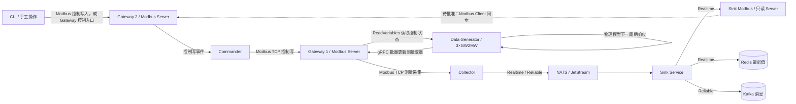
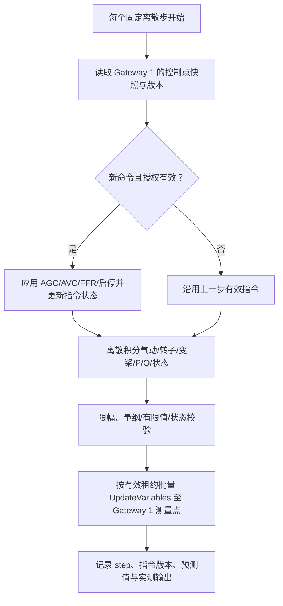
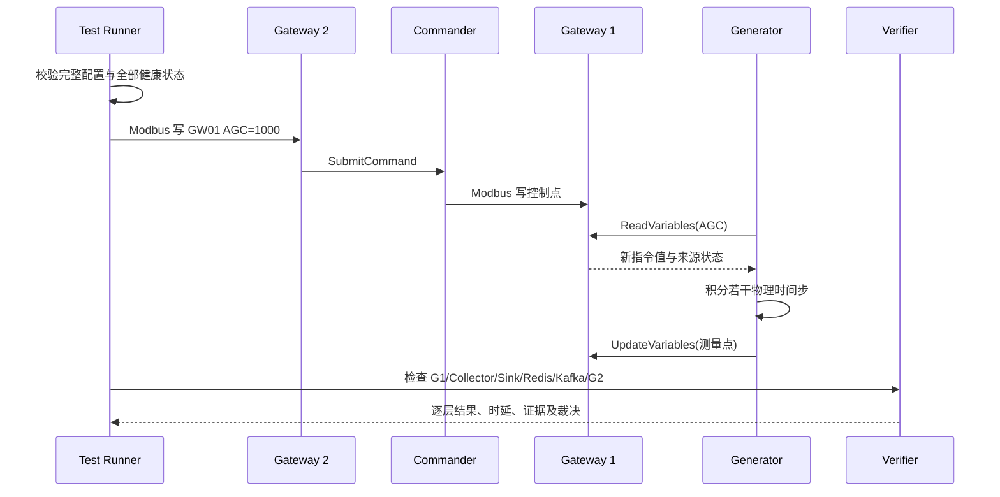

<h1 class="title">wind-hub 跨模块测试设计</h1>

<p class="subtitle">v0_2 · 20261111 · 详细初稿（待审核）</p>

<style>
body {
  font-family: "Microsoft YaHei";
  font-size: 16px;
  line-height: 1.75;
  color: #24292f;
}
.title {
  font-family: "Microsoft YaHei";
  font-size: 32px;
  line-height: 1.30;
  font-weight: 700;
  text-align: center;
}
.subtitle {
  font-family: "Microsoft YaHei";
  font-size: 18px;
  line-height: 1.50;
  font-weight: 400;
  text-align: center;
}
h1 {
  font-family: "Microsoft YaHei";
  font-size: 28px;
  line-height: 1.40;
  font-weight: 700;
}
h2 {
  font-family: "Microsoft YaHei";
  font-size: 22px;
  line-height: 1.40;
  font-weight: 700;
}
h3 {
  font-family: "Microsoft YaHei";
  font-size: 18px;
  line-height: 1.50;
  font-weight: 700;
}
h4 {
  font-family: "Microsoft YaHei";
  font-size: 16px;
  line-height: 1.50;
  font-weight: 700;
}
p, li {
  font-family: "Microsoft YaHei";
  font-size: 16px;
  line-height: 1.75;
}
.figure-caption,
.formula-caption {
  font-family: "Microsoft YaHei";
  font-size: 14px;
  line-height: 1.50;
  font-weight: 600;
  text-align: center;
  margin: 0.65em 0 0.35em 0;
}
.table-caption {
  font-family: "Microsoft YaHei";
  font-size: 13px;
  line-height: 1.40;
  font-weight: 500;
  text-align: center;
  margin: 0.65em 0 0.35em 0;
}
.mermaid,
.mermaid text,
.mermaid .label {
  font-family: "Microsoft YaHei" !important;
  font-size: 14px !important;
  line-height: 1.20;
}
table {
  width: 100%;
  border-collapse: collapse;
  font-family: "Microsoft YaHei";
  font-size: 13px;
  line-height: 1.45;
}
table th,
table th p,
table th li {
  font-family: "Microsoft YaHei";
  font-size: 13px;
  line-height: 1.40;
  font-weight: 600;
}
table td,
table td p,
table td li {
  font-family: "Microsoft YaHei";
  font-size: 13px;
  line-height: 1.45;
  font-weight: 400;
}
table th,
table td {
  padding: 0.40em 0.60em;
  vertical-align: top;
}
code, pre {
  font-family: "Cascadia Code";
  font-size: 14px;
  line-height: 1.50;
}
p code, li code, td code {
  color: #24292f;
  background: #f3f4f6;
  padding: 0.08em 0.28em;
  border-radius: 3px;
}
pre {
  color: #c9d1d9;
  background: #0d1117;
  padding: 1em;
  border-radius: 6px;
  overflow-x: auto;
}
pre code {
  color: inherit;
  background: transparent;
  padding: 0;
}
.hljs-comment, .hljs-quote,
.token.comment, .token.prolog, .token.doctype, .token.cdata {
  color: #8b949e;
  font-style: italic;
}
.hljs-keyword, .hljs-selector-tag, .hljs-literal,
.token.keyword, .token.boolean { color: #ff7b72; }
.hljs-string, .hljs-doctag, .hljs-regexp,
.token.string, .token.char, .token.regex { color: #a5d6ff; }
.hljs-number, .token.number { color: #79c0ff; }
.hljs-title, .hljs-function, .token.function { color: #d2a8ff; }
.hljs-title.class_, .hljs-type, .hljs-built_in,
.token.class-name, .token.builtin { color: #ffa657; }
.hljs-variable, .hljs-attr, .hljs-property,
.token.variable, .token.property, .token.attr-name { color: #7ee787; }
.hljs-operator, .hljs-punctuation,
.token.operator, .token.punctuation { color: #c9d1d9; }
</style>

---

## 目录

1. [文档约定](#1-文档约定)
2. [文档定位与使用方式](#2-文档定位与使用方式)
3. [范围、基线与判定](#3-范围基线与判定)
4. [测试拓扑与数据契约](#4-测试拓扑与数据契约)
5. [Integration 设计](#5-integration-设计)
6. [E2E 设计](#6-e2e-设计)
7. [Performance 设计](#7-performance-设计)
8. [Reliability 设计](#8-reliability-设计)
9. [配置与环境](#9-配置与环境)
10. [测试组织与 Marker](#10-测试组织与-marker)
11. [验收与追溯](#11-验收与追溯)
12. [审核决策](#12-审核决策)

---

# 1. 文档约定

本章是全文的固定排版与表达规范。文档修订、补充和派生版本均应遵守本章，不再根据个人习惯调整字体、字号、行距、图题、表题、公式或代码样式。

本文开头的 `<style>...</style>` 是 HTML `style` 元素，其中包含内部 CSS 样式表，本文简称为 **CSS 样式块**。第 1.1～1.4 节规定目标样式；CSS 样式块通过 `h1`、`h2`、`p`、`table`、`th`、`td`、`pre`、`code` 等选择器，将规范应用到 Markdown 渲染后生成的 HTML 元素。

## 1.1 字体约定

<p class="table-caption">表 1-1 文档字体与排版规范</p>

| 文档元素 | 字体 | 字号 | 行间距/行高 | 字重 | 对齐方式 |
|---|---|---:|---:|---:|---|
| 文档标题 | Microsoft YaHei | 32 px | 1.30 | 700 | 居中 |
| 文档副标题 | Microsoft YaHei | 18 px | 1.50 | 400 | 居中 |
| 一级标题 | Microsoft YaHei | 28 px | 1.40 | 700 | 左对齐 |
| 二级标题 | Microsoft YaHei | 22 px | 1.40 | 700 | 左对齐 |
| 三级标题 | Microsoft YaHei | 18 px | 1.50 | 700 | 左对齐 |
| 四级标题 | Microsoft YaHei | 16 px | 1.50 | 700 | 左对齐 |
| 正文 | Microsoft YaHei | 16 px | 1.75 | 400 | 左对齐 |
| 图题 | Microsoft YaHei | 14 px | 1.50 | 600 | 居中 |
| 图内文字 | Microsoft YaHei | 14 px | 1.20 | 400 | 按图形布局 |
| 表题 | Microsoft YaHei | 13 px | 1.40 | 500 | 居中 |
| 表头 | Microsoft YaHei | 13 px | 1.40 | 600 | 左对齐 |
| 表格正文 | Microsoft YaHei | 13 px | 1.45 | 400 | 左对齐 |
| 公式题 | Microsoft YaHei | 14 px | 1.50 | 600 | 居中 |
| 代码文字 | Cascadia Code | 14 px | 1.50 | 400 | 左对齐 |

以上规范已经通过本文开头的 CSS 样式块固定。其中，正文为 `16 px`；表题、表头和表格正文均为 `13 px`。表头字重为 `600`，低于标题字重；表格正文行高为 `1.45`，因此表格在字号、字重和行距上均明显弱于正文。英文业务对象、数据库对象和程序标识符仍按所在文本元素的字号排版，但使用行内代码形式，例如 `Asset`、`Connection`、`task_id`。

## 1.2 绘图约定

1. 上下文图、第 0 层及更深层 DFD、总体流程图和关系流程图统一使用 Mermaid。
2. 每一个 Mermaid 图都必须在 Mermaid 代码块第一行加入初始化配置，统一只设置 `useMaxWidth: true`。初始化配置格式为：

```text
%%{init: {"<Mermaid 图类型配置域>": {"useMaxWidth": true}}}%%
```

其中 `<Mermaid 图类型配置域>` 必须根据实际 Mermaid 图类型替换，不得固定写成 `flowchart`，也不得使用与实际图类型不匹配的配置域。

<p class="table-caption">表 1-2 Mermaid 图类型与初始化配置</p>

| Mermaid 图类型 | 图声明 | 第一行初始化配置 |
|---|---|---|
| Flowchart | `flowchart TB/LR/...` | `%%{init: {"flowchart": {"useMaxWidth": true}}}%%` |
| Sequence Diagram | `sequenceDiagram` | `%%{init: {"sequence": {"useMaxWidth": true}}}%%` |
| State Diagram | `stateDiagram-v2` | `%%{init: {"state": {"useMaxWidth": true}}}%%` |
| Class Diagram | `classDiagram` | `%%{init: {"class": {"useMaxWidth": true}}}%%` |
| ER Diagram | `erDiagram` | `%%{init: {"er": {"useMaxWidth": true}}}%%` |

若后续使用其他 Mermaid 图类型，也必须遵守同一规则：

```text
实际图类型
    ↓
确定该图类型对应的 Mermaid 配置域
    ↓
第一行写入：
%%{init: {"对应配置域": {"useMaxWidth": true}}}%%
```

不得额外加入 `wrap` 等非统一配置；如确有特殊需要，应在对应图的局部设计说明中单独论证。

3. 每张图必须有图编号和图题，编号采用“章节号-本章图序号”，例如“图 7-2”。
4. 图题必须使用普通图题样式，不得使用 Markdown 标题。统一写法为：

```html
<p class="figure-caption">图 7-2 图题</p>
```

## 1.3 公式约定

1. 行内公式使用单美元符号，例如 `$E_1$`。
2. 独立公式使用双美元符号，例如：

```text
$$
\mathrm{Entity}=E_1\land(E_2\lor E_3\lor E_4)\land E_5
$$
```

3. 正式公式不得放入代码块。
4. 不使用 `\[` 与 `\]` 作为公式定界符。
5. 变量下标统一写成 `E_1`、`R_1`；逻辑“与”和“或”统一写成 `\land`、`\lor`。
6. 公式必须使用 LaTeX，不使用普通文本模拟数学符号。
7. 需要编号的公式使用“式（章节号-本章公式序号）”，式题采用普通公式题样式：

```html
<p class="formula-caption">式（8-1）实体判断逻辑</p>
```

## 1.4 代码约定

1. 多行代码必须使用带语言标识的围栏代码块，例如 `python`、`sql`、`json`、`yaml`、`mermaid` 或 `text`。
2. 单个标识符、字段名、命令和短代码使用行内代码，例如 `PRIMARY KEY`、`Connection`。
3. 伪代码必须明确标记为 `text` 或在正文中说明“以下为伪代码”；不得使读者误认为它可以直接运行。
4. 代码块统一使用深色背景，颜色为 `#0D1117`；普通代码文字颜色为 `#C9D1D9`。
5. 语法高亮统一采用表 1-2 的配色。Markdown 渲染器应使用 Highlight.js 或 Prism 可识别的语言标识；渲染器不支持高亮时，至少保留代码背景色和普通代码文字颜色。

<p class="table-caption">表 1-2 代码语法高亮配色</p>

| 语法元素 | 颜色 | 十六进制 |
|---|---|---|
| 代码背景 | 深黑蓝 | `#0D1117` |
| 普通文字、运算符和标点 | 浅灰 | `#C9D1D9` |
| 注释 | 灰色 | `#8B949E` |
| 关键字和布尔值 | 红色 | `#FF7B72` |
| 字符串和正则表达式 | 浅蓝 | `#A5D6FF` |
| 数值 | 蓝色 | `#79C0FF` |
| 函数名 | 紫色 | `#D2A8FF` |
| 类型、类名和内置对象 | 橙色 | `#FFA657` |
| 变量、属性和字段 | 绿色 | `#7EE787` |

---

---


# 2. 文档定位与使用方式

## 2.1 适用对象

本设计用于 wind-hub **跨模块 Integration、完整 E2E、Performance、Reliability 及全套 CLI 功能验收**；基线为 `audit/design-contract-consistency-20261111` R1 验收后的十份设计。单模块测试仍以对应设计为准。本设计不取代 Contracts、Core、Configuration 的契约权威。

## 2.2 目标

- 以 **GW2MW 三台风机、两台 Modbus Gateway、一个 Data Generator、Collector、Sink、Commander、CLI、NATS/JetStream、Redis、Kafka** 构建可追踪的完整物理仿真闭环。
- 每台风机不超过 30 个变量，含 AGC、AVC、快速调频和 CLI 必需控制点；三台设备共用一个 GW2MW 物理模型、参数可按设备覆盖。
- 提供**完整可实现的 configs 设计**：文件树、逐文件职责、引用关系、数据模型参数、设备实例、点表映射、权限、Sink Delivery、运行场景、端口、证书与检测脚本。
- 明确 Gateway 上游允许 `plc`、`data_generator`、`none`，并设计 Generator 对控制反馈的有状态响应。
- 将自动验收的正确值、范围、时限和观测渠道写进场景矩阵，供 pytest 与手工 CLI/Redis/Kafka 验证。
- **本版本为设计审核稿：不实施任何跨模块测试及生产能力开发。** 需要改动其他模块设计时必须逐份升版、先审核后实施。

---

# 3. 测试范围与真实系统边界

## 3.1 逻辑拓扑



<p class="figure-caption">图 3-1 双链路、三目标与有状态物理反馈拓扑；虚线为待实现的显式协议同步职责</p>

- **控制入口修正**：CLI 对 Gateway 2 的真实 Modbus TCP 控制寄存器写入才会触发 `Gateway2 → Commander → Gateway1`。现有 `cli gateway update` 调用的是 `UpdateVariables`，其正式契约为**只更新 Gateway 自有变量而不触发工业命令转发**；不得将该命令伪装成控制闭环。要覆盖 CLI 控制，必须用 CLI 的正式 `proto`/工业写入命令（需核实具体命令），或单独评审新增“经授权的控制写入”能力。
- **Gateway 1**：控制点由 Commander 通过 Modbus 写入；测量点由 Generator 通过 gRPC 写入；`control_enabled=false` 防止控制循环反向转发；Generator 定期通过 `ReadVariables` 获取控制点并驱动下一次仿真。
- **Gateway 2**：工业 Modbus Server，控制点使能 Commander Forwarder；测量点反映 Sink 最新值。Sink Modbus Output 同样是只读 Modbus Server，不能直接写 Gateway 2，需明确额外 Modbus Client 的实现位置、授权及原子映射。
- **三种 Sink**：Modbus 最新值、Redis 最新值、Kafka Reliable 消息必须同时运行。不是 TDengine。
- **真实环境**：完整 E2E 禁止以 Mock 替代上述模块、Broker 或目标；分段 Integration 允许在场景明示的受控替身。

## 3.2 Gateway 上游类型契约（待同步 Gateway 设计）

| `upstream.kind` | 上游定义 | 数据路径与控制写入 |
|---|---|---|
| `plc` | 真实 PLC 或受控工业设备 | 工业协议客户端采集真实 PLC；合法控制命令写至 PLC；Gateway 本身仍可以向外提供 Modbus Server |
| `data_generator` | Data Generator 虚拟物理设备 | Generator gRPC 注入测量值；控制变量先落 Gateway Store，Generator 读取并作用于模型 |
| `none` | 无现场设备上游 | 仅 Gateway 本地变量 Store 与合法外部更新；不隐式转发、模拟物理响应 |

配置必须显式声明上游类型，不能通过空 endpoint 推断；`plc` 需要协议、连接和映射，`data_generator` 需要已授权源和变量所有权，`none` 禁止虚构上游测量。**现行 Gateway 源码尚未实现该完整枚举契约，应升级其设计后由生产开发实现。**

## 3.3 设备与服务数量

| 对象 | 数量 | 实际职责 |
|---|---:|---|
| GW2MW 模型 | 1 种 | 2 MW 水平轴变速变桨机组，三台独立状态 |
| GW2MW 设备 | 3 台 | `GW01`、`GW02`、`GW03`，每台 29 点 |
| Gateway 实例 | 2 进程 | Gateway 1 与 Gateway 2，每台承载三个独立 Modbus Server 端口/设备实例 |
| Generator、Collector、Sink、Commander | 各 1 | 一个 Generation 对三台机组；Collector 和 Sink 批量处理 |
| NATS/JetStream、Redis、Kafka | 各 1 实体服务或集群 | Kafka 用 KRaft 测试 Broker；不能用 Fake 代替 |
| CLI | 1+ 会话 | 命令与服务进程分离；支持自动和手动执行 |

本设计的“3 台”指 **3 台独立 GW2MW 风机设备**，不是三个型号，也不是简单复制同一测量序列。每台维护独立转子速度、桨距角、功率、指令、模型时间和运行状态。

---

# 4. 测试数据：GW2MW 单机 29 变量

## 4.1 变量清单

以下 ID 是**拟新增的 E2E Modbus 共享测试业务点 ID**，不是声称原 ADS Symbol 中同名点均已具备。以现有 `ads_wtg_gw2mw_1.0.0.yaml` 的风速、变桨、变流、发电机等真实语义为参考，测试点表需定义独立的 Modbus 地址和数据类型；不覆盖原 ADS 点表。

<p class="table-caption">表 4-1 每台 GW2MW 的 29 个测试变量</p>

| # | 测试 point_id | 方向 | 单位/类型 | 功能与 CLI 观察 |
|---:|---|---|---|---|
| 1 | `wind_speed` | 测量 | m/s, float32 | 风速输入 |
| 2 | `rotor_speed` | 测量 | rpm, float32 | 转子转速 |
| 3 | `generator_speed` | 测量 | rpm, float32 | 发电机转速 |
| 4 | `pitch_angle` | 测量 | deg, float32 | 实际桨距角 |
| 5 | `yaw_angle` | 测量 | deg, float32 | 偏航角 |
| 6 | `air_density` | 测量 | kg/m³, float32 | 空气密度 |
| 7 | `aerodynamic_power` | 测量 | kW, float32 | 气动功率 |
| 8 | `available_power` | 测量 | kW, float32 | 可利用有功 |
| 9 | `active_power` | 测量 | kW, float32 | 实际并网有功 |
| 10 | `reactive_power` | 测量 | kvar, float32 | 实际无功 |
| 11 | `grid_voltage` | 测量 | V, float32 | 并网电压 |
| 12 | `grid_current` | 测量 | A, float32 | 并网电流 |
| 13 | `grid_frequency` | 测量/输入 | Hz, float32 | 电网频率 |
| 14 | `power_factor` | 测量 | 1, float32 | 功率因数 |
| 15 | `generator_temperature` | 测量 | °C, float32 | 机舱发电机温度 |
| 16 | `converter_temperature` | 测量 | °C, float32 | 变流器温度 |
| 17 | `running_status` | 状态 | bool | 运行标志 |
| 18 | `fault_status` | 状态 | bool | 故障标志 |
| 19 | `agc_power_setpoint` | 控制 | kW, float32 | AGC 限功率指令 |
| 20 | `avc_voltage_setpoint` | 控制 | V, float32 | AVC 电压目标 |
| 21 | `avc_reactive_setpoint` | 控制 | kvar, float32 | AVC 无功目标 |
| 22 | `ffr_power_command` | 控制 | kW, float32 | 快速调频附加有功 |
| 23 | `ffr_enable` | 控制 | bool | 快速调频允许 |
| 24 | `agc_enable` | 控制 | bool | AGC 允许 |
| 25 | `avc_enable` | 控制 | bool | AVC 允许 |
| 26 | `start_command` | 控制 | bool | 启机 |
| 27 | `stop_command` | 控制 | bool | 停机 |
| 28 | `reset_fault_command` | 控制 | bool | 故障复位 |
| 29 | `control_result` | 反馈 | enum/int16 | 最近一条控制指令执行状态 |

单位代码必须映射到 `units.yaml` 的实际单元 ID；`air_density`、`rpm` 等如无现成有效编码，则在隔离测试业务点目录中采用合法的现有量纲/单位配置，并同步 Configuration 设计，禁止自造不受 Schema 接受的字符串。三台机组每台 29 点，合计 87 点。

## 4.2 点位与协议分区

- 各风机独立 Modbus 监听端口，Unit ID 默认为 1；数据类型以正式 Core Modbus Codec 可接受的类型为准。
- 测量点使用 **Input Registers/Discrete Inputs（只读）**，控制点使用 **Holding Registers/Coils（可写）**，状态码使用 Input Registers；不允许地址重叠。
- `float32` 占两个 16 位寄存器，`int16` 占一个，`bool` 优先使用 Coil/Discrete Input；按正式寄存器编解码规则配置 `word_order`。
- GW1 和 GW2 的同一业务点允许采用不同协议地址，但必须经显式映射表关联，不通过字符串拼接臆造。
- `agc_power_setpoint` 与 `ffr_power_command` 不能与实际 `active_power` 共用同一物理寄存器；`UpdateVariables` 更新的 Store 和工业 FC06/FC16 控制写入需遵守不同语义。
- CLI 变量发现与读取至少覆盖 29 点；工业控制命令至少覆盖 #19–#28，`control_result` 可核验拒绝/受理/执行。只读数据不得被写成控制数据。

---

# 5. 有状态物理模型：三台 GW2MW

## 5.1 模型类型与边界

采用 **固定步长、离散时间、确定性风机简化动态模型**，由气动功率、转动惯量、变桨一阶滞后、并网有功一阶跟踪、无功/电压响应及快速调频叠加构成。该模型用于系统软件测试，**不是气弹耦合工程认证模型**；不模拟复杂叶片弹性、塔架多体动力学、PWM 电磁暂态或真实电网潮流。

每台风机状态独立；风速和电网扰动作为给定外部输入，随机种子可选但必须可复现。无风、故障、停机时输出符合模型限幅和状态机规则。数值积分采用统一离散步长，步长必须小于最短动态时间常数的明确稳定性限制。

## 5.2 风能捕获

标准标量关系（标量普通字体、几何矢量及惯量张量符号遵从《符号体系.md》）：

$$
P_{\mathrm{aero}}=\frac{1}{2}\rho A C_p(\lambda,\beta)v^3
$$

$$
\lambda=\frac{\omega R}{v}
$$

其中 `P_aero` 是气动功率，`rho` 空气密度，`A` 叶轮扫掠面积，`R` 叶轮半径，`v` 风速，`omega` 转子角速度，`beta` 桨距角。避免 `v=0` 的除零；低风速应进入停机/零功率分支。\(C_p\) 函数采用**有界、非负、可复现的经验曲面/曲线模型**，需指定确定参数与 \(C_p\leq 0.593\) 的物理约束；不得简单把 `P ∝ v³` 当作所有工况的无条件正确模型。


### 5.2.1 明确的 \(C_p\) 数学模型

本测试选用六系数经验模型，而非待实现的任意曲线。设 \(\lambda\) 为叶尖速比、\(\beta\) 为桨距角（degree），定义：

$
\frac{1}{\lambda_i}=\frac{1}{\lambda+0.08\beta}-\frac{0.035}{\beta^3+1}
$

$
C_p(\lambda,\beta)
=\operatorname{clip}_{[0,0.593]}
\left[
0.5176\left(\frac{116}{\lambda_i}-0.4\beta-5\right)
\exp\left(-\frac{21}{\lambda_i}\right)+0.0068\lambda
\right]
$

<p class="formula-caption">式（5-1）GW2MW 测试用有界气动效率经验模型</p>

超低风速、\(\lambda_i\) 无效或低于切入风速时返回零功率，不直接计算奇异表达式；切出风速及停机状态按明确状态机执行。\(C_p\) 参数为**确定性测试模型选型**，不代表金风真实功率曲线或控制器系数，不得用于现场工程预测。若现场采用精确厂家 \(C_p\) 参数，需另行辨识并升级模型版本。

### 5.2.2 可利用功率的定义

\`available_power\` 是未执行当前 AGC/FFR 限发时，固定当前风速与当前安全状态下的最大可实现电有功；先通过 \(\beta=0\)（或配置的最优桨距）及当前风速的最优运行点求得，再以发电机/变流器效率和机组额定功率裁剪。它**不等于**已经受 AGC 限发影响的 \`active_power\`；否则限发指令会循环压低本次计算的可利用功率，产生错误的控制反馈。

### 5.2.3 转动惯量和发电机转矩

\(\boldsymbol J\) 专指几何惯量张量，\`J_eq\`（数学记作 \(J_{\mathrm{eq}}\)）是按同一转轴折算后的**标量轴转动惯量**，其量纲为 \(\mathrm{kg\,m^2}\)。发电机电磁转矩按同一轴侧转换（传动比、效率必须在参数表中给出），转子低速分支避免分母趋零。能量流满足转动动能变化率等于气动输入减电磁输出及损耗，不可凭空生成机械功率。


## 5.3 转子动力学、变桨与电功率

采用轴向折算后的等效转动惯量（若采用完整几何模型，惯量张量符号统一为 \(\boldsymbol J\)，不得用 \(\boldsymbol I\) 表示惯量）：

$$
J_{\mathrm{eq}}\frac{\mathrm d\omega}{\mathrm dt}
=T_{\mathrm{aero}}-T_{\mathrm{gen}}-B\omega
$$

$$
\tau_{\beta}\frac{\mathrm d\beta}{\mathrm dt}
=\beta_{\mathrm{ref}}-\beta
$$

$$
\tau_P\frac{\mathrm dP_{\mathrm{grid}}}{\mathrm dt}
=P_{\mathrm{target}}-P_{\mathrm{grid}}
$$

其中 \(T_{\mathrm{aero}}=P_{\mathrm{aero}}/\omega\) 只在安全转速区有效，低速用受限转矩模型。桨距参考由额定转速/目标功率形成的受限控制器确定；桨距角与角速度均需饱和。发电功率 \(P_{\mathrm{grid}}\) 的目标不得超过变流器限值或风可利用功率；动态功率采用有界斜率并保持非负，停机阶段例外采用明确退出响应。

## 5.4 AGC、AVC、快速调频叠加

**AGC** 是基础有功约束。按许可范围裁剪（执行状态异常时采用安全默认行为）：

$$
P_{\mathrm{base}}=\min(P_{\mathrm{available}},P_{\mathrm{rated}},P_{\mathrm{AGC}})
$$

**快速调频**采用显式启用信号、频率偏差、死区和附加调频功率的组合，附加量可由控制寄存器 `ffr_power_command` 给定，或按配置的下垂系数从频差生成，禁止同时重复计算：

$$
P_{\mathrm{target}}=
\operatorname{sat}_{[0,P_{\mathrm{available}}]}
\left(P_{\mathrm{base}}+\Delta P_{\mathrm{FFR}}\right)
$$

AGC、快速调频动作的**优先级与限功率允许范围必须可配置且在设计中固定**，不能隐式突破机组的额定电功率、变流器容量、变桨约束。此处默认 `ffr_power_command=0`，AGC 限功率可单独验收。

**AVC** 以无功目标（或电压误差经下垂控制转为无功目标）驱动一阶无功响应，受变流器视在功率约束：

$$
\tau_Q\frac{\mathrm dQ}{\mathrm dt}=Q_{\mathrm{target}}-Q
$$

$$
P_{\mathrm{grid}}^2+Q^2\leq S_{\mathrm{rated}}^2
$$

单独测试电压设定模式和无功设定模式，二者同时出现时以配置的唯一模式为权威；测试环境非电网潮流仿真，`grid_voltage` 是外生电网条件或明确的简化网络方程响应，不得声称单机 Q 调节必然使真实母线电压按同一幅度变化。

## 5.5 数值更新与反馈闭环



<p class="figure-caption">图 5-1 单风机模型步进与控制反馈流程</p>

- 命令作用于下一有效仿真步；必须定义一致的命令读取截止时间及快照序号，避免半步读取不同指令版本。
- Generator 不得以普通数据生成过程覆盖 Gateway 1 中由 Commander 写入的**控制点**；租约仅针对 Generator 拥有的**测量反馈点**。
- Generator 在 `ReadVariables` 获取三台的控制变量（当前已有该 RPC）后，将差异写入独立模型状态并保存最后消费的命令版本/值；控制幂等、过期及未知结果应明确。
- 当前 `src/data_generator/application/models.py` 的实现**仅支持 `random` 与无状态 `static/linear_table`**，不具有上述动态闭环。实现本模型需先升级 Data Generator 设计及生产应用模块，且不能伪装为现有 `static` Model。
- 参数由实例/模板配置，统一包括：额定功率、额定视在功率、叶轮半径、空气密度、额定转速、等效惯量、摩擦、\(C_p\) 曲面参数、转矩上限、变桨角/速率、功率与无功时间常数、P/Q 斜率限值、频率死区、下垂系数、启停逻辑以及初始状态。全部参数可配置，文档附可重放样例值而不把样例值写死为默认规范。

## 5.6 强制 AGC 案例：2000 → 1000 kW

前置：GW01 风速足够使 `available_power ≥ 2000 kW`，已并网、无故障、AGC 使能、FFR 关闭，初始 `agc_power_setpoint=2000 kW`、`active_power` 近 2000 kW。

1. CLI 经**真正的 Modbus 工业写入口**在 Gateway 2 上将 GW01 的 AGC 设定从 2000 kW 改为 1000 kW。
2. Gateway 2 记录 Modbus 写入并转发 Commander；Commander 经 Modbus 写入 Gateway 1 的控制寄存器。
3. Generator 读取 Gateway 1 的 AGC 值 1000 kW，更新 GW01 模型状态并在后续积分步响应；GW02、GW03 不应受影响。
4. GW01 的 `active_power` **随模型时间常数/斜率逐步下降**，最终稳定于 1000 kW 的容差内；不能瞬间强行将测量点写为 1000 冒充物理响应。
5. 从 Gateway 1 读数、Collector 样本、Sink Modbus 寄存器、Redis 最新值、Kafka Reliable 消息验证同一物理变化；Gateway 2 反馈经待审核的 Modbus 数据同步链路确认。
6. 反向把 AGC 从 1000 调回 2000；受风速、功率斜率和限制约束，最终值不得超过可利用功率及额定功率。

自动验收对稳态终值要求 `abs(P-1000) ≤ 20 kW` **作为提议的初始测试容差**；收敛时间上限必须由 \(\tau_P\)、斜率及采样间隔推导并写入 configs，而非任意设定 1 秒成功。全过程记录事件时间与 `command_id`/模型 step，以证明因果方向。


## 5.7 物理参数样例与数值正确性（非生产默认值）

<p class="table-caption">表 5-2 可重放测试物理参数样例</p>

| 参数 | 三机初始样例 | 单位 | 约束与来源 |
|---|---:|---|---|
| 额定有功功率 | 2000 | kW | GW2MW 额定值，三机一致 |
| 额定视在功率 | 2200 | kVA | 测试样例，须满足 Q 能力曲线 |
| 叶轮半径 | 40 | m | 测试样例，非断言厂家真实尺寸 |
| 空气密度 | 1.225 | kg/m³ | 可由设备实例分别覆盖 |
| 额定风速参考 | 12 | m/s | 测试样例，用于设置初始功率工况 |
| 切入/切出风速 | 3 / 25 | m/s | 配置参数，可覆盖 |
| 发电机与转子传动比 | 100 | 1 | 仅在物理模型将发电机转速由转子转速换算时使用 |
| 转子侧等效转动惯量 | 4.0e6 | kg·m² | 测试样例，需在模型中统一折算轴系 |
| 初始桨距角 | 0 | degree | 变桨动作限制 0–90 degree |
| 变桨时间常数 / 最大桨距速率 | 2 / 8 | s / degree·s⁻¹ | 离散一阶滞后和角速度限幅 |
| 电有功跟踪时间常数 | 3 | s | 配置可覆盖、带限幅与爬坡 |
| 有功最大变化率 | 500 | kW/s | 确保 AGC 不瞬跳 |
| 无功响应时间常数 | 2 | s | AVC 测试样例 |
| 电网频率参考 | 50 | Hz | 场景可覆盖为 50/60 Hz，不硬编码 |
| 无功控制模式 | `Q` | 枚举 | `Q` 或 `V` 二选一 |
| 数值积分步长 | 0.1 | s | 10 Hz；保持固定步长和确定性重放 |

上述示例配置**仅用于测试输入**，不能声称为厂家经过辨识的 GW2MW 真机参数。对风速约 12 m/s 的有功可用性应由同一组实际 \(C_p\) 参数算得，并验证达到 2000 kW 的前置条件；若不能满足，则由场景校准风速/叶轮参数，而不是跳过物理约束。

正式采用第 5.2.1 节的确定性经验模型，参数写入 `gw2mw_physics.yaml` 并与本文数学表达保持一致；模型测试参考轨迹必须使用同一参数集。数值实现严格执行：空气密度/风速有限值、\(0\le C_p\le 0.593\)、低转速正则化、限功率/转矩/转速及变桨限幅，Euler 或改进 Euler 迭代一致。必须验证 \(h\) 与各时间常数满足稳定性条件，不许用不受控积分求出负的机械能。

三台机组的外部时序至少不同：

| 机组 | 初始风速 | 初始 AGC 设定 | 用例意图 |
|---|---:|---:|---|
| GW01 | 12 m/s | 2000 kW | AGC 2000 → 1000 → 2000 |
| GW02 | 11 m/s | 1800 kW | 验证 AGC 隔离、不受 GW01 指令影响 |
| GW03 | 10 m/s | 1500 kW | AVC/FFR 与状态指令，不影响其他设备 |

模型以初始状态/已收敛稳态条件启动；由真实 \(C_p\) 模型确定上述风速下可利用功率和限值，任何设定超过可利用功率时应按物理约束裁剪并据此建立自动验收期望值。

---

# 6. 完整 configs 设计（核心验收输入）

## 6.1 文件层次及作用

```text
tests/e2e/configs/
├── services/
│   ├── data-generator-service.yaml
│   ├── gateway1.yaml
│   ├── gateway2.yaml
│   ├── collector.yaml
│   ├── commander.yaml
│   ├── sink_service.yaml
│   └── cli.yaml                       # 仅在现行 CLI Schema 允许时
├── instances/
│   ├── site.yaml
│   ├── devices.yaml                   # GW01/GW02/GW03：GW2MW Modbus
│   ├── data-generator.yaml            # 一场景 × 三台独立有状态风机
│   ├── sinks.yaml                     # 3 个 Sink 实例
│   └── deliveries.yaml                # 3 个独立 Delivery
├── templates/
│   ├── protocols/
│   │   └── modbus_tcp_1.0.0.yaml
│   ├── device_models/
│   │   └── wtg_gw2mw_e2e_1.0.0.yaml
│   ├── point_tables/
│   │   └── modbus_wtg_gw2mw_e2e_1.0.0.yaml
│   ├── tasks/
│   │   └── gw2mw_e2e_all_1.0.0.yaml
│   ├── sinks/
│   │   ├── e2e_modbus_1.0.0.yaml
│   │   ├── e2e_redis_1.0.0.yaml
│   │   └── e2e_kafka_1.0.0.yaml
│   ├── deliveries/
│   │   ├── e2e_rt_modbus_1.0.0.yaml
│   │   ├── e2e_rt_redis_1.0.0.yaml
│   │   └── e2e_rel_kafka_1.0.0.yaml
│   ├── business_points.yaml
│   └── units.yaml
├── model/
│   ├── gw2mw_physics.yaml             # 待新增的 Generator 物理模型配置契约
│   └── wind_profiles.yaml             # 三台机组确定性风速、频率输入
└── security/
    └── identities.yaml               # 仅存证书身份/路径映射，不存私钥正文
```

注意：上表是最终建议的**测试配置资产结构**，并非声称每个目录/文件均已被现行加载器接受。配置读取入口必须保持已冻结的 `config_sources` 明确路径规则；`model/` 是否作为 `data_generator.yaml` 的正式可引用子资源，必须先通过 Generator/Configuration Schema 设计审查。证书、端口、Kafka Topic、Redis Key 和 NATS Durable 在运行时拷贝到临时环境，禁止测试直接写生产 `configs/`。

## 6.2 各文件的配置契约矩阵

<p class="table-caption">表 6-1 各类配置文件、权威来源与校验</p>

| 文件 | 权威读取方 | 必要字段及约束 | 复用/调整 |
|---|---|---|---|
| `site.yaml` | Configuration/Core | `schema_version`、`file_version`、`site_id`、`name` | 复用现行结构 |
| `devices.yaml` | Collector、Gateway、Commander、Generator | 3 个设备、精确 `model.id/version`、各自 `endpoint.host/port` | 从现有 GW01–03 裁剪；模型引用改为测试 Modbus 版本 |
| `modbus_tcp_1.0.0.yaml` | Core | `mode=tcp`、`slave_id`、`timeout`、`word_order` | 复制现有正式模板，端口不存于协议模板 |
| `wtg_gw2mw_e2e_1.0.0.yaml` | Configuration/Core | 协议、点表、任务的版本精确引用；`device_type_id=turbine` | 参照正式 `wtg_gw2mw_1.1.0.yaml`；测试 Modbus 专用 |
| `modbus_wtg_gw2mw_e2e_1.0.0.yaml` | Core/Collector/Gateway | 29 点 `business_point_id`、类型、地址、单位、scale/offset、point_groups | 新增精简点表，必须通过 Core 地址冲突/重叠校验 |
| `gw2mw_e2e_all_1.0.0.yaml` | Collector/Core | 固定采样周期、点组、批量读取预算 | 精确引用现有 Task 模板结构 |
| `data-generator.yaml` | Data Generator | scenario、source、3 devices、model、gateways、feedback_mapping | 拓展现有场景字段以承载有状态模型 |
| `gw2mw_physics.yaml` | Data Generator | 物理参数、初始状态、限值、模型数值步长、响应模式 | **新模型 Schema，待正式设计升级** |
| `wind_profiles.yaml` | Data Generator | 三设备时间序列、频率/电压扰动、确定性采样 | **新模型输入资源，待正式设计升级** |
| `gateway1.yaml` | Gateway 1 | 明确 `config_sources`、3 个 Server、Modbus 端口、`control_enabled=false` | 增补 `upstream.kind=data_generator` 需 Schema 升级 |
| `gateway2.yaml` | Gateway 2 | 3 个 Server、控制映射及 Commander Endpoint | 增补测量源同步责任需 Schema/组件评审 |
| `collector.yaml` | Collector | 单独设备/模板路径、NATS、采样周期、每批点数/容量 | 参照当前 `configs/services/collector.yaml` |
| `commander.yaml` | Commander | 三设备控制、证书、审计、幂等、总并发/超时 | 参照现行 `commander.yaml`；不能关闭 mTLS 绕过 |
| `sink_service.yaml` | Sink Service | `service_id`、`wind_farm_id`、`deployment_id`、`config_root`、`config_sources.instances.sinks/deliveries`、NATS、运行额度 | 复制正式服务 Schema，替换测试独立值 |
| `sinks.yaml` | Sink Service | Modbus/Redis/Kafka 各 1 实例及对应模板版本/连接 | 模板实例结构以 `src/sink_service/application/config.py` 为准 |
| `deliveries.yaml` | Sink Service | 三条独立 Delivery，每条唯一 `delivery_id`、`sink_id`、`source`、模板版本 | Realtime→Modbus/Redis；Reliable→Kafka |
| `templates/sinks/*.yaml` | Sink Service | 每种 Adapter 的 `kind`、`capabilities`、`connection`、`output` | 复制正式模板，`modbus_tcp` 只读 Server |
| `templates/deliveries/*.yaml` | Sink Service | `delivery_mode`、`source_filter`、触发策略、输出规则 | Realtime/Reliable 必须分开 |
| `business_points.yaml` / `units.yaml` | Configuration/Core | 正式业务点和单位词汇，精确类型与量纲 | 从现有文件做最小有效子集，不改变全局词汇语义 |
| `identities.yaml` | 测试环境编排器 | 证书 CN、角色、访问范围、密钥文件路径 | 仅测试侧映射，不替代任何服务安全配置 |

## 6.3 三台 GW2MW 设备实例：建议样例

以下示例仅使用已核实的设备实例字段，型号 ID 指向拟新增测试模板：

```yaml
schema_version: 1
file_version: "1.0.0"
devices:
  GW01:
    name: "GW2MW-E2E-01"
    enabled: true
    model: {id: wtg_gw2mw_e2e, version: "1.0.0"}
    endpoint: {host: 127.0.0.1, port: 15101}
    overrides: {}
  GW02:
    name: "GW2MW-E2E-02"
    enabled: true
    model: {id: wtg_gw2mw_e2e, version: "1.0.0"}
    endpoint: {host: 127.0.0.1, port: 15102}
    overrides: {}
  GW03:
    name: "GW2MW-E2E-03"
    enabled: true
    model: {id: wtg_gw2mw_e2e, version: "1.0.0"}
    endpoint: {host: 127.0.0.1, port: 15103}
    overrides: {}
```

Gateway 1 对应服务端口建议 15101–15103；Gateway 2 对应 15201–15203；Sink Modbus Output 15301（单实例可包含 87 点）。**这些是测试示例端口，不是生产默认值**；测试运行时须检查无冲突，并将 Gateway 2 所需的设备引用和其自己监听端口正确分离。若当前 Gateway Schema 不能把设备 endpoint 和 Server listen_port 独立表达，应先在 Gateway 设计解决，不能通过修改共享设备模型绕过。

## 6.4 设备模型引用：示例

```yaml
schema_version: 1
template_id: wtg_gw2mw_e2e
file_version: "1.0.0"
name: GW2MW-E2E-Modbus
device_type_id: turbine
protocol: {id: modbus_tcp, version: "1.0.0"}
point_table: {id: modbus_wtg_gw2mw_e2e, version: "1.0.0"}
task: {id: gw2mw_e2e_all, version: "1.0.0"}
```

必须验证 `protocol.id` 是否与现有 `configs/templates/protocols/modbus_tcp_1.0.0.yaml` 的模板 ID 一致，以及 `protocol: modbus` 的内部判别关系。原 `wtg_gw2mw_1.1.0.yaml` 引用 ADS 1.1.0，**不得在测试中直接用 ADS 模型强行标记为 Modbus**。

## 6.5 点表地址设计：逐点可验证

采用每风机独立 Unit 1、相同地址布局的方案。协议地址定义与工程单位必须经 Core Codec 验证。推荐的寄存器布局原则如下：

| 组 | 量 | 建议分区 | 分配 |
|---|---|---|---|
| 读数模拟量 | #1–#16 | Input Registers | 每点 2 个 word；按顺序从 100 起分配，地址逐点间隔 2 |
| 运行状态 | #17–#18 | Discrete Inputs | 2 bit |
| AGC/AVC/调频模拟控制 | #19–#22 | Holding Registers | 每点 2 word；从 200 起，连续分配 |
| 使能/启停/复位控制 | #23–#28 | Coils | 6 bit |
| 命令状态 | #29 | Input Registers | 1 word（int16） |

此布局仅为**点表生成规则**，正式 `points` 需要对 29 个 point_id 逐一展开 `address.register_type/address/count/slave_id`、`data_type`、`business_point_id`、`unit`、`scale`、`offset`、`point_groups`。不得拿这一张表冒充可加载 YAML；自动测试必须校验 **29 点完整、地址无重叠、写权限正确、类型匹配、三设备实例共同引用合法模板**。

## 6.6 Gateway 服务配置：控制与测量分区

```yaml
# 仅演示服务端当前已存在的主要字段；其余按正式 Schema 补齐
schema_version: 1
file_version: "1.0.0"
config_sources:
  instances: {devices: configs/instances/devices.yaml}
  templates: {root: configs/templates}
grpc:
  listen_host: "127.0.0.1"
  listen_port: 50171
  max_active_rpcs: 64
  request_max_bytes: 2097152
  tls: {enabled: true}
servers:
  - server_id: gateway1-GW01
    device_id: GW01
    listen_host: "127.0.0.1"
    listen_port: 15101
    desired_state: START
    control_enabled: false
    command_mappings: []
  - server_id: gateway1-GW02
    device_id: GW02
    listen_host: "127.0.0.1"
    listen_port: 15102
    desired_state: START
    control_enabled: false
    command_mappings: []
  - server_id: gateway1-GW03
    device_id: GW03
    listen_host: "127.0.0.1"
    listen_port: 15103
    desired_state: START
    control_enabled: false
    command_mappings: []
control:
  commander_endpoint: "127.0.0.1:50152"
  forward_queue_capacity: 1024
  max_forward_inflight: 16
  submit_deadline_ms: 5000
metrics: {window_seconds: 60, collect_interval_ms: 1000}
```

Gateway 2 使用相同 `config_sources`，将每台 Server 的 `server_id`、`listen_port` 改为 `gateway2-GWxx`、15201–15203，`control_enabled=true`，并将 #19–#28 的可写点映射到 Commander 的正式 `device_id` / `commander_point_id`。其上游 `data_generator/none/plc` 字段不在此**现行字段示例**内，须待对应设计升级才写入正式 YAML；不能把未识别字段加进去后依赖解析器忽略它。

Gateway 1 与 Gateway 2 应使用不同 gRPC 监听端口、不同 `server_id`、相同逻辑设备 ID 的显式关联。必须检查 Commander 对三个设备路由的是 Gateway 1，避免指令循环发回 Gateway 2。

## 6.7 Data Generator 场景：三台有状态模型

场景字段应基于现行 `configs/instances/data-generator.yaml` 的 `scenarios/source/devices/points/gateways/feedback_mapping` 结构扩展。下面仅列出**待设计的新增逻辑字段**，不得直接投喂现行 parser：

```yaml
# PROPOSED-SCHEMA: Data Generator 设计升级后才能执行
scenario_id: gw2mw-3t-physical
source:
  kind: simulation
  interval_seconds: 0.1
  seed: 20261111
  physical_model:
    id: gw2mw_dynamic
    version: "1.0.0"
    params_ref: model/gw2mw_physics.yaml
    exogenous_ref: model/wind_profiles.yaml
devices:
  - device_id: GW01
    model_state: independent
  - device_id: GW02
    model_state: independent
  - device_id: GW03
    model_state: independent
feedback:
  read_from: gateway1
  read_method: ReadVariables
  read_before_step: true
  command_points:
    - agc_power_setpoint
    - avc_voltage_setpoint
    - avc_reactive_setpoint
    - ffr_power_command
    - ffr_enable
    - agc_enable
    - avc_enable
    - start_command
    - stop_command
    - reset_fault_command
```

真实 `feedback_mapping` 要逐设备、逐输出测点映射至 Gateway 1 变量；测量点最多 19 项/设备（29 点中 #19–#28 是控制点，不属于 Generator 的 UpdateVariables 写入所有权）。不得在更新目标集中加入 Commander 控制点。新模型的控制读取必须经过授权只读 RPC 与快照一致性校验。

## 6.8 Sink 三输出实例与 Delivery

需要依据已实现的 `src/sink_service/application/config.py` 校验模板 `kind` 为 `modbus_tcp`、`redis`、`kafka`，并保证：

| Sink | `kind` | Delivery | 模式 | 配置要点 |
|---|---|---|---|---|
| `modbus-latest` | `modbus_tcp` | `rt-modbus` | Realtime | 只读 TCP Server 15301、完整 3 设备测量映射、寄存器与质量区不冲突 |
| `redis-latest` | `redis` | `rt-redis` | Realtime | 127.0.0.1:6379、独立 namespace、键名带设备 ID、测试 TTL |
| `kafka-history` | `kafka` | `rel-kafka` | Reliable | KRaft Broker、隔离 Topic、`acks=all`、幂等 Producer、顺序/重投/去重身份 |

三条 Delivery 分别引用其准确版本的 Sink 模板和 Delivery 模板；配置文件要包括 source_filter、触发、容量、超时、回退与 DLQ，不得仅列 `sink_id`。通过 Sink 正式 Config Validate / Apply 后才允许启动完整 E2E。三目标都要包含同一批测试设备的数据，且可靠交付以独立 Durable ACK 为准。

**未获批准前不新增第 4 种目标或更改现行 Sink Adapter。** 只读 Modbus 与 Gateway 2 的衔接属于 Gateway2 的数据订阅/协议客户端职责待决项，不应偷偷改写 Sink Modbus 为 Modbus Client。

## 6.9 其余服务与安全环境

- Collector 配置必须精确指向测试 `site.yaml/devices.yaml/templates`，按 `interval_seconds=0.1` 设计 10 Hz 采集任务；检查任务配置支持该周期，保证两通道 SampleBatch 不超过各服务可接受批次容量。
- Commander `config_sources` 指向三设备共享目录，服务端 mTLS 与调用方授权必须开启；Gateway 2、CLI 使用不同测试身份，真实认证成功后才能控制；Commander 协议点表写目标是 GW01–03 的 Gateway 1 Modbus Server。
- NATS/JetStream 使用独立 `WH_HISTORY`、`WH_DLQ` 和测试 Subject，保留真实 PubAck、Durable、ACK 的 Broker 证据；Consumer 生命周期与测试用例绑定。
- Redis 使用独立数据库或强制 Key namespace；Kafka 独立 Topic；数据不能混入真实业务服务。
- 主进程运行目录应生成最终配置快照、SHA256、证书身份、网络端口和进程 PID 列表；结束仅清理有明确测试所有权的资源。
- CLI 的 gRPC 服务端点映射和 Modbus 网络命令必须与两 Gateway、三设备对应；`gateway read` 应分别在 G1/G2 查询变量，CLI 不能把 G1/G2 状态混为同一实例。

## 6.10 配置验证门禁

在启动测试之前，配置检查器必须完成：

1. 文件存在、JSON/YAML 类型、Schema 版本和强制字段正确，模板精确引用无悬空、无循环。
2. 三个实例完全独立，型号全部 GW2MW E2E Modbus，点表恰为 29 点/台；合计 87 点，设备端口不冲突。
3. 所有 Modbus FC 读/写权限、寄存器长度/字序、数据类型、单位及业务点语义均通过 Core/Configuration 校验。
4. Gateway1 三 Server 的测量写租约归 Generator，控制 FC 写归 Commander；Gateway2 三 Server 的控制映射目标均为 GW1 对应设备。
5. Sink 三目标/三 Delivery 全部在线、模式与通道匹配；三台数据均被覆盖。
6. Generator 模型参数满足物理边界、输入可重放、三状态独立；初始条件的物理模型求解稳定且有界。
7. CLI 能发现和读取两个 Gateway 的每台设备数据；正式 Modbus 控制入口通过权限测试。
8. 文件夹内部完整闭包可复制到临时目录运行；不依赖生产 `configs/` 的隐式默认路径。


---

# 7. Integration 分段测试

## 7.1 分段与实现前置

Integration 只负责**局部真实组件协作**，不使用 `end_to_end`。每段可独立启动，不要求同时运行三个 Sink 输出。

<p class="table-caption">表 7-1 分段测试与回读验收</p>

| 编号 | 分段 | 控制输入 | 自动验收 |
|---|---|---|---|
| IT-01 | Generator → Gateway 1 | 三台独立确定性测量序列 | `ReadVariables` 逐点校验值/时间戳/质量/设备身份；租约围栏 |
| IT-02 | Gateway 1 → Collector | 3×29 点表中 19 项测量点 | Modbus FC03/04 等正式读操作及 Collector 样本值一一对应 |
| IT-03 | Collector → NATS → Sink | 10 Hz 输入，三设备 | 批次 Schema/Subject/设备数一致，Realtime/JetStream 职责不混淆 |
| IT-04 | Sink → Modbus Output | 连续样本 | 真 Modbus 客户端读回最新值、质量/过期行为 |
| IT-05 | Sink → Redis | 连续样本 | 逐设备 Key/采样版本/值/TTL，旧值正确覆盖 |
| IT-06 | Sink → Kafka | Reliable 批次 | 真 Kafka Consumer 按 Topic/Partition/Key 校验消息、序列与 ACK |
| IT-07 | CLI → Gateway 2 | AGC/AVC/FFR 控制写 | 真 Modbus FC 写触发 Gateway 2 事件；无权限/只读拒绝 |
| IT-08 | Gateway 2 → Commander | AGC 由 2000 改 1000 | 请求参数、命令受理及结果查询有明确证据 |
| IT-09 | Commander → Gateway 1 | 指定 GW01 控制写 | Gateway 1 控制寄存器真实值改变，GW02/GW03 不变 |
| IT-10 | Gateway 1 → Generator | AGC/AVC/FFR 状态变更 | 下一步读取生效、模型状态更新且不覆盖控制点 |
| IT-11 | Modbus Sink → Gateway 2 | 真实协议最新值传播 | **仅在 T-01 解决后执行**；两个 Server 之间必须有正式客户端 |
| IT-12 | CLI 查询与诊断 | Gateway 1、Gateway 2 分别查询 | 两实例/六个网关设备对象正确列举、读取及鉴权 |

分段场景必须明确哪些测试依赖真实 NATS/Kafka/Redis，未提供依赖时为 NOT_RUN 而非 Mock PASS。IT-07 的 CLI Modbus 工业写入必须先确认现有 CLI 真实命令的参数/协议能力，如欠缺则在 CLI 设计中立项，不得借用 `gateway update` 的状态注入语义绕过控制。

## 7.2 分段准入和退出

- 输入数据和预期输出严格来自同一版本的场景文件、参数快照和点表；测试上下文不能暗改模型常数。
- 每段先验证连接、授权、点表、协议编码，然后执行功能测试。
- 必须保存 Request ID、批次 ID、设备 ID、数据点 ID、控制版本和预测值，不能用单个全局成功计数代替逐点确认。
- 一段失败只判该段 FAIL，不能将未执行的其他段记为失败或通过。
- 已存在的模块内部系统测试即使包含真实 Gateway，也不因命名包含 `e2e` 就迁移到完整系统 E2E。

---

# 8. 完整 E2E 与 CLI 全功能测试

## 8.1 唯一完整系统启动 Fixture

标准 `full_system` 统一启动六类业务服务、两个 Gateway 进程、三台 GW2MW、NATS/JetStream、Redis、Kafka，校验：

1. 各服务成功使用测试私有配置与证书启动、通过真实健康/权限探测；
2. Gateway 1 和 Gateway 2 的三个设备 Server 均可读，控制写权限与反向转发围栏有效；
3. 三条 Sink Delivery 均生效且来自同一批测试输入，Modbus/Redis/Kafka 各自实测至少一条交付；
4. Generator 三个模型实例可读取控制快照，继续生成并发送可预测测量批；
5. CLI 可分别访问 Gateway 1 和 Gateway 2，且 Modbus 工业控制入口可完成一次实际控制写；
6. IT-11 的 Modbus 最新值同步结构已由批准后的设计和实现提供；
7. 测试使用唯一的环境标识隔离 Kafka Topic、Redis Key、NATS Stream、临时配置和生成证书。

全部准入满足才能运行具有 `system` 与 `end_to_end` 的测试。任意 Sink 目标未运行、某一业务链路缺失或关键能力仍为待决，不允许 E2E PASS。

## 8.2 全量 E2E 场景

<p class="table-caption">表 8-1 E2E 用例与预期</p>

| 编号 | 场景 | 核心自动断言 | 人工验证 |
|---|---|---|---|
| E2E-01 | 三台并网，三目标并行 | 每台相同源版本出现在 Modbus/Redis/Kafka 适当目标；数据不串台；最新值覆盖合理 | CLI 分别查两 Gateway；Redis/Kafka 查询 |
| E2E-02 | GW01 AGC 2000→1000 | G2 控制→Commander→G1→Generator；动态功率下降；G1/G2/Redis/Modbus/Kafka 输出因果一致 | CLI 写 AGC、轮询 G1/G2 `active_power` |
| E2E-03 | GW01 AGC 1000→2000 | 功率按可利用功率与爬坡限幅恢复，不产生异常超调 | CLI 持续监测 |
| E2E-04 | GW02 AVC 无功指令 | Q 依一阶模型变化，P/Q 满足容量约束，其他设备独立 | CLI 读取 `reactive_power` 与电压 |
| E2E-05 | GW03 快速调频 | FFR 使能/关闭、正负附加功率、频率死区与 AGC 优先级正确 | CLI 查频率、有功及调频指令 |
| E2E-06 | 启停与故障复位 | 状态机正确、失效命令被拒、恢复后按模型爬坡 | CLI 状态与事件 |
| E2E-07 | 三设备并发/隔离 | GW01 命令不修改 GW02/GW03 的控制点或响应曲线 | 多设备 CLI read + Redis |
| E2E-08 | CLI 全命令矩阵 | 所有正式命令均有归属用例，参数/权限/结果正确 | 额外手动运行脚本 |
| E2E-09 | 配置受控生效 | 正式 Apply/Reload 不重复占有租约、不失真当前状态 | CLI 查看配置版本 |
| E2E-10 | 可靠重投与最新值并行 | Realtime 不阻塞 Reliable、各自确认语义正确 | Redis/Kafka 对照 |

**闭环关键判断：** Modbus 写响应只是协议接受；Commander 接受只是指令受理；Gateway 1 寄存器变化是控制实际到达；Generator 模型状态变化才是虚拟设备执行；Collector/Sink 观测反馈是完整效果。四层证据必须关联。

## 8.3 CLI 命令覆盖矩阵

CLI 命令以当前 Typer 注册结构、`--help` 实际输出和最新 CLI 设计形成**动态完整清单**，不可在测试设计中固定假定现有代码没有新增命令。必须至少覆盖：

| CLI 命令域 | 系统验收义务 | 所需变量/服务 |
|---|---|---|
| `gateway list/status/variables/read` | 两个 Gateway 各三个 Server，查点、读最新值 | 29 点、G1/G2 RPC |
| `gateway update` | 对有权注入的非控制变量执行租约/UpdateVariables/Release；**不产生控制下发** | Gateway 测量点、mTLS |
| `gateway start/stop` | 单对象启停和结果及错误 | G1/G2 生命周期 |
| `commander` | 设备/点发现、命令提交、结果查询、幂等/UNKNOWN | 10 控制点、3 设备 |
| `collector` | 状态、任务、测点读取/轮询、配置、指标 | 19 测量反馈点、10 Hz |
| `sink` | Sink/Delivery/指标/事件、配置状态 | Modbus、Redis、Kafka |
| `data-generator` | 3 设备、场景列表、启动/停止、诊断/状态 | 物理模型场景 |
| `service` | 服务发现、健康、版本 | 六类业务服务 |
| `config` | 本地文件比对、合法/非法配置及远程接口 | 测试 configs |
| `net` / `proto` / `diagnose` | Modbus 连接探测、读/写测试、真实端口/协议问题诊断 | G1/G2 端口、29 点、权限 |

已核对 `src/cli/main.py`：当前没有注册 `proto` 命令组；`net industrial` 是探测接口，`gateway update` 是 gRPC Store 注入而非 Modbus 控制写。故 CLI 直接写 Gateway 2 的工业控制能力当前未具备。如果 CLI 缺少工业写命令，则 **T-02 待决：扩展 CLI，还是以 CLI `commander submit` 完成控制并另用受控 Modbus 客户端验证 G2 入口**。两条路径效果不同；严格要求“CLI 直接写 Gateway 2”时，需在 CLI 设计中补齐权限明确、退出码可审计的 Modbus 写能力。不得擅自把 `gateway update` 改成自动触发 Commander。

## 8.4 AGC 自动验收判据

具体 `GW01` 场景由环境编排器在命令前验证 `available_power≥2000 kW` 且机组正常；如不满足，应报告前置条件 FAIL（配置错误），不得仍期待稳态 1000 kW。

<p class="table-caption">表 8-2 AGC 限功率操作的自动检查</p>

| 检查点 | 断言 |
|---|---|
| A1 | G2 写入成功；生成唯一控制事件/时间戳 |
| A2 | Commander 产生对应 `request_id/command_id` 及最终结果或 UNKNOWN 的明确状态 |
| A3 | G1 的 GW01 `agc_power_setpoint=1000`，GW02/03 不变 |
| A4 | Generator 读取到新版本命令，后续 step 的目标 `P_target` 变成由模型计算的值 |
| A5 | 有功不瞬间从约 2000 跳为 1000；每 step 变化受时间常数和 500 kW/s 样例斜率约束 |
| A6 | 稳态 `active_power` 收敛至 1000±20 kW（待审定的测试容差）；收敛上限由模型参数推导 |
| A7 | G1→Collector→Sink→Redis/Modbus，最终最新值与模型值相符；G2 反馈值同源 |
| A8 | Kafka 在时间窗口内包含控制前、过渡、稳态的可靠采样；如允许合批或重投，应按设计正确解析而非简单比较消息个数 |
| A9 | 系统执行中所有关键证据带设备、点、运行 ID 与实际时刻；无跨设备污染 |
| A10 | 恢复 2000 kW 时按可用功率和动态约束响应，其他两个设备不受扰动 |

采用物理模型的数值参考实现生成逐步参考轨迹；对浮点数据采用已批准误差而不是字符串完全相等。源时间戳、接收时间戳与控制执行时间分别采集，不能把 Kafka 消息最终到达时间当作模型步进时间。

---

# 9. Performance 与 Reliability

## 9.1 性能负载等级

| 等级 | 设备×点数 | 采样 | 目标 |
|---|---|---|---|
| PERF-01 | 3×29 | 10 Hz | 物理模型 + 完整链路基准，三目标同时交付 |
| PERF-02 | 3×29 | 10 Hz，增加控制频次 | 控制闭环延迟、命令与实时数据互不饿死 |
| PERF-03 | 逐步增至 30 台 | 10 Hz | 验证 Sink 单实例容量；数据模型复用但状态独立 |
| PERF-04 | 按模块设计的实时/可靠点数扩大 | 10 Hz | 测试批量交付、积压、CPU/RSS/P99、背压和恢复 |

计量每台源点/s、NATS 出口批次/s、Modbus/Redis 最新值延迟、Kafka Reliable 确认时延、丢弃/重投/重复、CPU、RSS、FD、事件循环延迟及队列深度。Realtime 允许合法覆盖，不能按全部输入样本保存判断“丢失”；Reliable 的确认责任以真实 Broker 和目标消息为准。每个性能阶段固定运行时长、预热/测量窗口、硬件配置及负载输入，报告标注准确目标和测得值，不能将未实测的 30 台负载记为达标。

## 9.2 可靠性测试矩阵

<p class="table-caption">表 9-1 故障与恢复</p>

| 编号 | 故障注入 | 验收责任 |
|---|---|---|
| REL-01 | 三台 Generator 中单台模型故障 | 故障机组状态安全，另外两台数据持续 |
| REL-02 | Gateway 1 进程崩溃/重启 | 源租约和旧 token 围栏，Generation 不伪造成功写入 |
| REL-03 | Gateway 2 停止/恢复 | 控制入口拒绝/UNKNOWN、Sink 最新值同步恢复，无错误重复控制 |
| REL-04 | Collector 断线/恢复 | 数据质量/过期、恢复采样，不生成伪样本 |
| REL-05 | NATS/JetStream 故障 | 最新值与 Reliable 责任独立；不提前 ACK |
| REL-06 | Redis 故障 | 键/TTL 恢复，最新值追赶，不保存全部历史伪装最新值 |
| REL-07 | Kafka 故障 | 真实 Broker 重投、DLQ、幂等/顺序、负载恢复 |
| REL-08 | Sink Worker 崩溃 | 各 Delivery 独立重启与资源回收 |
| REL-09 | Commander 处理超时 | UNKNOWN 不盲目重试，结果查询或人工审计有证据 |
| REL-10 | 频繁 AGC/AVC/FFR/启停与重载 | 执行顺序、状态机、功率限幅、控制版本不混乱 |
| REL-11 | 全系统重启 | 独立配置、证书、数据存储和租约正确恢复，无残留进程/端口 |
| REL-12 | 资源耗尽或磁盘配额 | 有界背压、错误码、数据责任不虚假消失 |

`performance` 和 `reliability` 是专题 Marker，可叠加模块、分段或完整 E2E；**只有完整 E2E 层级才同时具备 `system` 与 `end_to_end`**。长稳/硬件/netem 不能执行时应分别 NOT_RUN，不得借用短时结果推断。

---

# 10. 自动验收与人工验收

## 10.1 自动验收执行协议



<p class="figure-caption">图 10-1 AGC 控制闭环的自动验收时序；Gateway2 最新值同步路径在 T-01 审核后补齐</p>

自动执行器须从固定场景实例参数中计算参考轨迹和稳态预期。每个测试点至少有四层判定：请求受理、业务执行、物理反馈、下游可观察结果。中间任何一个步骤失败，不能仅以最终某个 Redis 值恰好相同判断通过。

## 10.2 用户人工操作

自动验收运行时保留**只读观测**能力，输出一份可复制的操作手册和环境清单。用户可以：

- 通过 CLI 的 `gateway list/status/variables/read` 查询两台 Gateway 和三台设备，区别控制设定与实际物理反馈；
- 使用 CLI 的合法 Modbus 控制命令修改 Gateway 2 的 GW01 AGC 设定，确认 Gateway 1 接收并且 Generator 后续测量变化；
- 查询 CLI 的 Commander 结果、Data Generator 状态、Collector 指标、Sink Delivery 状态；
- 使用 Redis CLI 读取 GW01–03 最新值、版本及 TTL；使用 Kafka Console Consumer 或等效工具读取本轮唯一 Topic；
- 在需要时直接用 Modbus Client 读 Sink Modbus Output，并对照 Gateway 2 变量。

手动修改应在自动测试的独立运行实例或预留的**人工验收窗口**中进行；自动执行器在人工窗口暂停施加控制刺激，避免手工操作干扰自动参考轨迹，随后可重置模型初始状态重跑。手工执行结果必须独立记录，不作为自动 PASS 的替代证据。

## 10.3 结果结构与误差

- 每个测试用例记录 test ID、场景配置 SHA、完整测试环境身份、模型参数、预期、实际、时间窗口、证据路径、裁决；
- 模型值/寄存器编码值分开保存，先按正式 scale/offset 解码再比较工程值；
- 布尔与枚举严格相等；整数无损编码；浮点按参数化绝对误差和相对误差；
- 延迟在统一单调计时基础上观察；多进程时间戳以同步时钟作辅助，不以跨机绝对时刻直接求高置信度亚毫秒延迟；
- Kafka Reliable 检查已确认终态及内容，避免通过数到某个固定消息数误判；
- 输出 `PASS`、`FAIL`、`NOT_RUN`、`DEFERRED`、`PASS WITH LIMITATIONS`，附明确原因，不把 skip 当 PASS；
- 报告按三台机组、三 Sink 目标和控制闭环分别列出，不用平均值掩盖单台或单目标失败。

---

# 11. 测试代码归属、简化 Marker 与覆盖

## 11.1 路径

```text
tests/
├── contracts/ core/ configuration/ collector/ commander/
├── industrial_gateway/ data_generator/ sink_service/ cli/
├── web_server/ web_admin/
├── integration/             # 分段跨业务模块
├── e2e/                     # 完整三台风机、双链路、三 Sink
│   ├── conftest.py
│   ├── configs/
│   ├── test_data.py
│   ├── test_control.py
│   ├── test_cli.py
│   ├── test_recovery.py
│   └── test_performance.py
├── support/                 # 公共 test helper/fixture
├── tooling/                 # 测试工具和 CI 自测
├── fixtures/                # 静态资源/受控服务
└── conftest.py
```

清理旧的 `tests/src/` 及混合 `tests/system/` 时，必须逐文件判断设计归属、冗余、历史兼容、Fixture 引用和 CI 路由；模块独立 `system` 应留在 `tests/<module>/system/`，不可因“有真实进程”就搬到完整 E2E。未证明过时的测试不得直接删除。

## 11.2 极简 Marker

测试代码中只规定**最多两个层级/专题词**：

| 目录/目的 | 示例 Marker | 说明 |
|---|---|---|
| 模块级 Unit/Component/Contract | `unit` / `component` / `contract` | 保留现有项目注册词；无需装饰性堆叠 |
| 分段跨模块 | `integration` | 单一层级词 |
| 完整双链路 E2E | `system`、`end_to_end` | 两个词；运行入口统一检查完整 Fixture |
| 专项性能或可靠性 | `performance` 或 `reliability` | 可由目录/场景元数据确定层级，不强制每函数堆叠 4–5 个词 |

不新增 `e2e`、`full_stack`、`three_sinks` 等重复 Marker；`real_service`/环境依赖在 Test Fixture 元数据及环境准入中验证，不要求每个函数重复写这些 Marker。强制核对 `tests/e2e/` 全部用例都依赖 `full_system`；仅具有 `end_to_end` 但未启动全系统的测试属于标记错误。

推荐运行命令（实际 CI 路由须审查后生效）：

```bash
pytest tests/integration -m integration
pytest tests/e2e -m "system and end_to_end"
pytest tests/e2e -m "system and end_to_end" -k performance
pytest tests/e2e -m "system and end_to_end" -k recovery
```

## 11.3 追溯结构

每个测试对应 `设计章节 / 测试需求编号 / 生产实现 / 配置路径 / pytest nodeid / 关键断言 / 自动证据 / 人工复核点 / 裁决`。所有 CLI 正式命令从实际 Typer Registry 与 `--help` 自动发现，逐条纳入覆盖表；过时/重复测试以设计一致性裁决，不能单靠 `pytest` 绿灯保留。

---

# 12. 需要审核的设计变更清单

<p class="table-caption">表 12-1 跨模块测试设计 v0_2 待决</p>

| ID | 事项 | 建议与影响 |
|---|---|---|
| T-01 | Sink Modbus Output 与 Gateway 2 最新数据同步 | 正式指定独立 Modbus Client 数据订阅/写入责任，避免两个 Server 直接相连；需要 Gateway 设计升级 |
| T-02 | CLI 直接控制 Gateway 2 | 确认/补充 CLI 真 Modbus 协议写命令；不得把 `gateway update` 变成自动转发；CLI 设计升级 |
| T-03 | Gateway 上游三态 | 新增明确 `plc/data_generator/none` 及行为约束；Gateway 设计升级 |
| T-04 | Generator 有状态动力学及控制读取 | 增加 2 MW 风机动力学模型、配置 Schema、固定步长、模型状态与 ReadVariables 控制快照；Generator 设计升级 |
| T-05 | 独立三机 GW2MW Modbus 点表 | 增加 29 点×3 设备、任务/协议/型号模板，保持 ADS 正式点表不变；Core/Configuration 按需审查 |
| T-06 | 最终 Sink 目标 | 固定 Modbus 最新值、Redis 最新值、Kafka Reliable 同时存在，且实测成功 |
| T-07 | 自动/手工验收并行 | 自动执行真实过程与断言；人工读取 CLI/Redis/Kafka，互不干扰 |
| T-08 | Marker 简化 | 分段单 `integration`；完整 E2E 双 `system,end_to_end`；专题仅必要标签 |
| T-09 | 基础点表单位及数据类型 | 逐项校验 `units.yaml`、`business_points.yaml` 和 Core 编解码，禁止以未确认的 ADS PLC 类型代替 Modbus 测试契约 |
| T-10 | 物理模型参数与参考验收值 | GW2MW 2 MW 物理样例参数、\(C_p\) 经验曲面、动态状态和稳态容差需审核确认；不能用随机数替代 |

**执行冻结边界：**本 v0_2 尚未批准，不能据此创建跨模块测试代码、Fixture、`tests/e2e/configs/` 文件或修改任何模块生产源码、Proto。若批准 T-01～T-05，再分别修订 Gateway、Data Generator、CLI 等模块设计并递增版本，完成必要生产功能后才准许创建 E2E 配置和代码。

