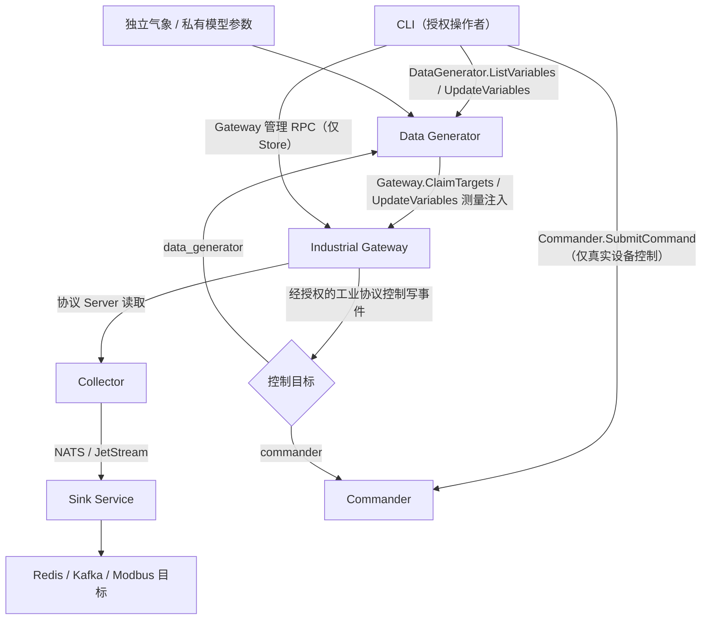

<h1 class="title">wind-hub 跨模块测试设计</h1>

<p class="subtitle">v0_5 · 20261112 · 跨模块验收设计</p>

<style>
body {
  font-family: "Microsoft YaHei";
  font-size: 16px;
  line-height: 1.75;
  color: #24292f;
}
.title {
  font-family: "Microsoft YaHei";
  font-size: 32px;
  line-height: 1.30;
  font-weight: 700;
  text-align: center;
}
.subtitle {
  font-family: "Microsoft YaHei";
  font-size: 18px;
  line-height: 1.50;
  font-weight: 400;
  text-align: center;
}
h1 {
  font-family: "Microsoft YaHei";
  font-size: 28px;
  line-height: 1.40;
  font-weight: 700;
}
h2 {
  font-family: "Microsoft YaHei";
  font-size: 22px;
  line-height: 1.40;
  font-weight: 700;
}
h3 {
  font-family: "Microsoft YaHei";
  font-size: 18px;
  line-height: 1.50;
  font-weight: 700;
}
h4 {
  font-family: "Microsoft YaHei";
  font-size: 16px;
  line-height: 1.50;
  font-weight: 700;
}
p, li {
  font-family: "Microsoft YaHei";
  font-size: 16px;
  line-height: 1.75;
}
.figure-caption,
.formula-caption {
  font-family: "Microsoft YaHei";
  font-size: 14px;
  line-height: 1.50;
  font-weight: 600;
  text-align: center;
  margin: 0.65em 0 0.35em 0;
}
.table-caption {
  font-family: "Microsoft YaHei";
  font-size: 13px;
  line-height: 1.40;
  font-weight: 500;
  text-align: center;
  margin: 0.65em 0 0.35em 0;
}
.mermaid,
.mermaid text,
.mermaid .label {
  font-family: "Microsoft YaHei" !important;
  font-size: 14px !important;
  line-height: 1.20;
}
table {
  width: 100%;
  border-collapse: collapse;
  font-family: "Microsoft YaHei";
  font-size: 13px;
  line-height: 1.45;
}
table th,
table th p,
table th li {
  font-family: "Microsoft YaHei";
  font-size: 13px;
  line-height: 1.40;
  font-weight: 600;
}
table td,
table td p,
table td li {
  font-family: "Microsoft YaHei";
  font-size: 13px;
  line-height: 1.45;
  font-weight: 400;
}
table th,
table td {
  padding: 0.40em 0.60em;
  vertical-align: top;
}
code, pre {
  font-family: "Cascadia Code";
  font-size: 14px;
  line-height: 1.50;
}
p code, li code, td code {
  color: #24292f;
  background: #f3f4f6;
  padding: 0.08em 0.28em;
  border-radius: 3px;
}
pre {
  color: #c9d1d9;
  background: #0d1117;
  padding: 1em;
  border-radius: 6px;
  overflow-x: auto;
}
pre code {
  color: inherit;
  background: transparent;
  padding: 0;
}
.hljs-comment, .hljs-quote,
.token.comment, .token.prolog, .token.doctype, .token.cdata {
  color: #8b949e;
  font-style: italic;
}
.hljs-keyword, .hljs-selector-tag, .hljs-literal,
.token.keyword, .token.boolean { color: #ff7b72; }
.hljs-string, .hljs-doctag, .hljs-regexp,
.token.string, .token.char, .token.regex { color: #a5d6ff; }
.hljs-number, .token.number { color: #79c0ff; }
.hljs-title, .hljs-function, .token.function { color: #d2a8ff; }
.hljs-title.class_, .hljs-type, .hljs-built_in,
.token.class-name, .token.builtin { color: #ffa657; }
.hljs-variable, .hljs-attr, .hljs-property,
.token.variable, .token.property, .token.attr-name { color: #7ee787; }
.hljs-operator, .hljs-punctuation,
.token.operator, .token.punctuation { color: #c9d1d9; }
</style>

---

## 目录

1. [文档约定](#1-文档约定)
2. [文档定位与使用方式](#2-文档定位与使用方式)
3. [范围、基线与判定](#3-范围基线与判定)
4. [测试拓扑与数据契约](#4-测试拓扑与数据契约)
5. [Integration 设计](#5-integration-设计)
6. [E2E 设计](#6-e2e-设计)
7. [Performance 设计](#7-performance-设计)
8. [Reliability 设计](#8-reliability-设计)
9. [配置与环境](#9-配置与环境)
10. [测试组织与 Marker](#10-测试组织与-marker)
11. [验收与追溯](#11-验收与追溯)
12. [审核决策](#12-审核决策)

---

# 1. 文档约定

本章是全文的固定排版与表达规范。文档修订、补充和派生版本均应遵守本章，不再根据个人习惯调整字体、字号、行距、图题、表题、公式或代码样式。

本文开头的 `<style>...</style>` 是 HTML `style` 元素，其中包含内部 CSS 样式表，本文简称为 **CSS 样式块**。第 1.1～1.4 节规定目标样式；CSS 样式块通过 `h1`、`h2`、`p`、`table`、`th`、`td`、`pre`、`code` 等选择器，将规范应用到 Markdown 渲染后生成的 HTML 元素。

## 1.1 字体约定

<p class="table-caption">表 1-1 文档字体与排版规范</p>

| 文档元素 | 字体 | 字号 | 行间距/行高 | 字重 | 对齐方式 |
|---|---|---:|---:|---:|---|
| 文档标题 | Microsoft YaHei | 32 px | 1.30 | 700 | 居中 |
| 文档副标题 | Microsoft YaHei | 18 px | 1.50 | 400 | 居中 |
| 一级标题 | Microsoft YaHei | 28 px | 1.40 | 700 | 左对齐 |
| 二级标题 | Microsoft YaHei | 22 px | 1.40 | 700 | 左对齐 |
| 三级标题 | Microsoft YaHei | 18 px | 1.50 | 700 | 左对齐 |
| 四级标题 | Microsoft YaHei | 16 px | 1.50 | 700 | 左对齐 |
| 正文 | Microsoft YaHei | 16 px | 1.75 | 400 | 左对齐 |
| 图题 | Microsoft YaHei | 14 px | 1.50 | 600 | 居中 |
| 图内文字 | Microsoft YaHei | 14 px | 1.20 | 400 | 按图形布局 |
| 表题 | Microsoft YaHei | 13 px | 1.40 | 500 | 居中 |
| 表头 | Microsoft YaHei | 13 px | 1.40 | 600 | 左对齐 |
| 表格正文 | Microsoft YaHei | 13 px | 1.45 | 400 | 左对齐 |
| 公式题 | Microsoft YaHei | 14 px | 1.50 | 600 | 居中 |
| 代码文字 | Cascadia Code | 14 px | 1.50 | 400 | 左对齐 |

以上规范已经通过本文开头的 CSS 样式块固定。其中，正文为 `16 px`；表题、表头和表格正文均为 `13 px`。表头字重为 `600`，低于标题字重；表格正文行高为 `1.45`，因此表格在字号、字重和行距上均明显弱于正文。英文业务对象、数据库对象和程序标识符仍按所在文本元素的字号排版，但使用行内代码形式，例如 `Asset`、`Connection`、`task_id`。

## 1.2 绘图约定

1. 上下文图、第 0 层及更深层 DFD、总体流程图和关系流程图统一使用 Mermaid。
2. 每一个 Mermaid 图都必须在 Mermaid 代码块第一行加入初始化配置，统一只设置 `useMaxWidth: true`。初始化配置格式为：

```text
%%{init: {"<Mermaid 图类型配置域>": {"useMaxWidth": true}}}%%
```

其中 `<Mermaid 图类型配置域>` 必须根据实际 Mermaid 图类型替换，不得固定写成 `flowchart`，也不得使用与实际图类型不匹配的配置域。

<p class="table-caption">表 1-2 Mermaid 图类型与初始化配置</p>

| Mermaid 图类型 | 图声明 | 第一行初始化配置 |
|---|---|---|
| Flowchart | `flowchart TB/LR/...` | `%%{init: {"flowchart": {"useMaxWidth": true}}}%%` |
| Sequence Diagram | `sequenceDiagram` | `%%{init: {"sequence": {"useMaxWidth": true}}}%%` |
| State Diagram | `stateDiagram-v2` | `%%{init: {"state": {"useMaxWidth": true}}}%%` |
| Class Diagram | `classDiagram` | `%%{init: {"class": {"useMaxWidth": true}}}%%` |
| ER Diagram | `erDiagram` | `%%{init: {"er": {"useMaxWidth": true}}}%%` |

若后续使用其他 Mermaid 图类型，也必须遵守同一规则：

```text
实际图类型
    ↓
确定该图类型对应的 Mermaid 配置域
    ↓
第一行写入：
%%{init: {"对应配置域": {"useMaxWidth": true}}}%%
```

不得额外加入 `wrap` 等非统一配置；如确有特殊需要，应在对应图的局部设计说明中单独论证。

3. 每张图必须有图编号和图题，编号采用“章节号-本章图序号”，例如“图 7-2”。
4. 图题必须使用普通图题样式，不得使用 Markdown 标题。统一写法为：

```html
<p class="figure-caption">图 7-2 图题</p>
```

## 1.3 公式约定

1. 行内公式使用单美元符号，例如 `$E_1$`。
2. 独立公式使用双美元符号，例如：

```text
$$
\mathrm{Entity}=E_1\land(E_2\lor E_3\lor E_4)\land E_5
$$
```

3. 正式公式不得放入代码块。
4. 不使用 `\[` 与 `\]` 作为公式定界符。
5. 变量下标统一写成 `E_1`、`R_1`；逻辑“与”和“或”统一写成 `\land`、`\lor`。
6. 公式必须使用 LaTeX，不使用普通文本模拟数学符号。
7. 需要编号的公式使用“式（章节号-本章公式序号）”，式题采用普通公式题样式：

```html
<p class="formula-caption">式（8-1）实体判断逻辑</p>
```

## 1.4 代码约定

1. 多行代码必须使用带语言标识的围栏代码块，例如 `python`、`sql`、`json`、`yaml`、`mermaid` 或 `text`。
2. 单个标识符、字段名、命令和短代码使用行内代码，例如 `PRIMARY KEY`、`Connection`。
3. 伪代码必须明确标记为 `text` 或在正文中说明“以下为伪代码”；不得使读者误认为它可以直接运行。
4. 代码块统一使用深色背景，颜色为 `#0D1117`；普通代码文字颜色为 `#C9D1D9`。
5. 语法高亮统一采用表 1-2 的配色。Markdown 渲染器应使用 Highlight.js 或 Prism 可识别的语言标识；渲染器不支持高亮时，至少保留代码背景色和普通代码文字颜色。

<p class="table-caption">表 1-2 代码语法高亮配色</p>

| 语法元素 | 颜色 | 十六进制 |
|---|---|---|
| 代码背景 | 深黑蓝 | `#0D1117` |
| 普通文字、运算符和标点 | 浅灰 | `#C9D1D9` |
| 注释 | 灰色 | `#8B949E` |
| 关键字和布尔值 | 红色 | `#FF7B72` |
| 字符串和正则表达式 | 浅蓝 | `#A5D6FF` |
| 数值 | 蓝色 | `#79C0FF` |
| 函数名 | 紫色 | `#D2A8FF` |
| 类型、类名和内置对象 | 橙色 | `#FFA657` |
| 变量、属性和字段 | 绿色 | `#7EE787` |

---

---


# 2. 文档定位与使用方式

## 2.1 适用对象

本设计用于 wind-hub **跨模块 Integration、完整 E2E、Performance、Reliability 及全套 CLI 功能验收**；基线为 `audit/design-contract-consistency-20261111` R1 验收后的十份设计。单模块测试仍以对应设计为准。本设计不取代 Contracts、Core、Configuration 的契约权威。

## 2.2 目标

- 以 **GW2MW 三台风机、两台 Modbus Gateway、一个 Data Generator、Collector、Sink、Commander、CLI、NATS/JetStream、Redis、Kafka** 构建可追踪的完整物理仿真闭环。
- 每台风机不超过 30 个变量，含 AGC、AVC、快速调频和 CLI 必需控制点；三台设备共用一个 GW2MW 物理模型、参数可按设备覆盖。
- 提供**完整可实现的 configs 设计**：文件树、逐文件职责、引用关系、数据模型参数、设备实例、点表映射、权限、Sink Delivery、运行场景、端口、证书与检测脚本。
- 明确 Gateway 上游允许 `plc`、`data_generator`、`none`，并设计 Generator 对控制反馈的有状态响应。
- 将自动验收的正确值、范围、时限和观测渠道写进场景矩阵，供 pytest 与手工 CLI/Redis/Kafka 验证。
- **本版本为设计审核稿：不实施任何跨模块测试及生产能力开发。** 需要改动其他模块设计时必须逐份升版、先审核后实施。

---

# 3. 跨模块验收范围与边界

## 3.1 权威设计与实现现状

本文件只定义**跨模块测试场景、数据资产、可观察结果和判定门禁**，不再次定义模型方程、RPC、共享配置结构或 Modbus 点表。各项唯一权威如下：

| 范围 | 唯一设计依据 | 当前实施状态 |
|---|---|---|
| Data Generator 两类模型、独立气象及五类设备 | Data Generator 软件设计 v1_36 §10.5～10.6、§11 | 固定物理模型和目标点表未完成编码；不得把设计当作当前能力 |
| Generator 变量目录与控制 RPC | Contracts v1_22 §9.5、Data Generator v1_36 §9 | 原六项须保留，目标新增两项需通过 Proto、生成绑定、Server 和 CLI 真实调用验收 |
| CLI 变量控制 | CLI 软件设计当前有效版本 §4.12、§10.12 | 设计目标；当前 CLI 代码无 variables list/update 命令 |
| Industrial Gateway 协议 Server 与命令转发 | Industrial Gateway v1_28 | 已有控制转发契约，实测能力需独立核对 |
| 配置及模板、设备 Schema | Configuration v1_15、Core v1_33 | 现有共享 Schema 不因私有物理参数变化而修改 |
| 采集、指令和 Sink 交付 | Collector v1_20、Commander v1_30、Sink Service v1_50 | 对现有能力做独立集成验证 |
| 模块边界和依赖 | wind-hub 总体逻辑架构当前有效版本 | 不新增独立配置进程或模型服务 |

**实施门槛**：运行真实 E2E 前必须先完成 Contracts Proto/Stub、Generator Server、CLI、五种仿真 Modbus 点表、对应业务点登记及实际测试配置。若前置能力不存在，测试裁决为 NOT_RUN / NOT_IMPLEMENTED，不允许用 mock 当作真正集成测试。

## 3.2 拓扑与数据流



<p class="figure-caption">图 3-1 控制输入与测量输出的分离验收拓扑</p>

控制路径须明确区分三个不同接口：

1. **Generator.UpdateVariables** 修改允许的仿真模型 INPUT，响应包含 `request_id`、`accepted`、`effective_step`；不表示实际功率立即达到目标。
2. **Gateway.UpdateVariables** 持有效租约向 Gateway 内部变量 Store 注入测量值；不触发工业控制回调。
3. **工业协议 FC06/FC16 等写入** 仅在真实协议 Server 的授权写入路径触发 Gateway 控制转发；不能以 Gateway gRPC 数据注入模拟工业写控制。

一个 Gateway Server 的 `control.target.kind` 唯一选择 `commander`、`data_generator` 或 `none`。Gateway 不增加 `upstream.kind`，不主动拉取 Data Generator 或 Sink 的上游数据；多段 E2E 依靠已声明的 Collector 读取和 Sink 输出适配器实现。若某条实际链路尚无工业客户端或目标 Server 支持，明确标记 NOT_RUN，不靠虚拟转发代替。

## 3.3 设备与最小场景集合

设备实例与物理模型解耦，额定值只在 Data Generator 私有 Scenario 的 `models.*.parameters` 声明。测试至少包括：

| 类别 | 测试实例示例 | 模型要求 | 数据点契约 |
|---|---|---|---|
| 风机 | WTG_SIM01、WTG_SIM02、WTG_SIM03 | 同一固定方程、独立动力学状态与输入；可配不同额定值 | v1_36 §10.6.3 共 32 点/型号 |
| 光伏 | PV_SIM01 | 辐照、温度、MPPT、逆变器容量 | §10.6.4 共 16 点 |
| 储能 | BESS_SIM01 | 电池能量、SOC 目标、PCS 无功开关 | §10.6.5 共 20 点 |
| 电网 | GRID_SIM01 | 单母线电压、频率、三相功率聚合 | §10.6.6 共 15 点 |
| PPC | PPC_SIM01 | AGC、AVC、FFR 有界分配与延时反馈 | §10.6.7 共 20 点 |

上述 **103 点**是五种型号各一份 PointTable 的**目标目录总数**，不是 7 台实例合计的唯一采样点数；按设备实例展开后的输出数须按场景逐一计算。18 个设备外部可控点（五型号合计）与独立气象场景的平均风速、风向分开统计。正式点位定义及地址、单位、类型只能引用 Data Generator v1_36 §10.6，不在本测试文档复制第二套点表。

# 4. 测试配置资产与清理边界

## 4.1 共享文件与私有配置

```text
tests/src/e2e/configs/
├── services/                  # Collector、Gateway、Generator、Sink、Commander、CLI
├── instances/
│   ├── site.yaml
│   ├── devices_sim.yaml       # 仅仿真实例，格式与真实 devices.yaml 相同
│   ├── data-generator.yaml    # 私有 Scenario、模型额定参数、气象、随机规则
│   ├── sinks.yaml
│   └── deliveries.yaml
└── templates/
    ├── device_models/         # 共享型号，仅引用协议与点表
    ├── point_tables/          # Modbus 地址、类型、业务点和单位
    ├── protocols/
    ├── business_points.yaml
    └── units.yaml
```

<p class="figure-caption">图 4-1 隔离测试配置资产目录（目标）</p>

测试复制或构建隔离的配置根；不得直接修改仓库 `configs/` 下用于真实设备的现行文件。服务通过 `config_sources` 显式选择所需 `instances.devices` 和 `instances.scenarios`。共享 Configurations 只解析设备型号/协议/点表；**物理额定功率、额定转速、额定风速以及 PV/BESS 额定容量和模型控制器参数全部留在 Data Generator 专属 Scenario**。既有真实型号 `wtg_gw2mw` 的 2 MW 名称仅表示真实设备型号，不约束独立仿真型号 `wtg_sim` 的额定功率。

现仓库 `configs/instances/devices_sim.yaml` 和五份目标仿真 PointTable 尚未存在，必须在编码阶段按正式设计生成和验证。Gateway 测试配置必须采用当前 `config_sources` 加共享模板的正式 Schema，不得使用单文件内嵌协议点表的旧格式。

## 4.2 必需参数与数据可复现性

| 输入资产 | 配置及来源 | 验收判据 |
|---|---|---|
| 风机私有参数 | `rated_power_w`、`rated_wind_speed_m_s`、`rated_rotor_speed_rad_s`、惯量、气动曲线、转矩与桨距增益 | 同一组参数能达到预设额定运行点，禁止单靠数值限幅伪造功率 |
| 光伏私有参数 | 阵列 STC 峰值、逆变器额定 P/S、温度系数、MPPT 电压与时间常数 | DC 可用功率、AC 输出、容量圆一致 |
| 储能私有参数 | `rated_energy_wh`、PCS 额定 P/S、SOC 边界、OCV、内阻和效率、无功开关 | 化学储能—端口电功率—内阻热耗散残差满足公差 |
| 气象场景 | 平均风速、风向及配置的湍流度、风速相关时间；日照昼夜、遮云与气温周期 | 同种子/时间步复现；气象状态独立于 Modbus PointTable |
| 随机模型 | 以任意合法设备点表绑定逐点分布、种子、范围和类型 | 无须新建物理模型；新增点不改模型算法；非法类型或分布拒绝 |
| PPC | 参与设备列表、权重、AGC/AVC/FFR 配置和反馈延迟 | 不越容量与 SOC 边界，单步反馈不构造代数环 |
| Gateway | 明确每 Server 的唯一 `control.target.kind`、正式设备与变量映射、有效 TLS | 测量注入与工业协议控制写相互隔离 |
| Sink | Delivery、Sink 实例和版本化模板 | 真实 Redis、Kafka、Modbus 适配器各自按契约验收 |

禁止从文件名推断额定功率（例如 `wtg_sim_2mw`），也不将仿真参数加入共享 `device_models` 或 `point_tables`。所有业务点 ID、单位和 Modbus 地址由真实注册后的 PointTable 与 Unit/BusinessPoint 模板驱动；源到目标映射必须一对一或按显式合法规则一对多，且单个 `(gateway_id,variable_id)` 不重复占用。

# 5. 分阶段集成验收

## 5.1 准入门禁

| 阶段 | 输入条件 | 验证内容 | 完成条件 |
|---|---|---|---|
| I1 Proto/契约 | Contracts v1_22 目标两 RPC 已入库并重新生成 Stub | Descriptor 保留既有六项并扩展为八项；真实调用、mTLS、类型、字段存在性 | 全部通过 |
| I2 共享配置 | 设备实例、五 PointTable、BusinessPoints/Units 已落盘 | 模板精确版本、点位类型与 Modbus 地址不重叠、私有参数不混入共享配置 | 全部通过 |
| I3 模型 | Data Generator 固定/随机模型已实现 | 各设备单模型与气象确定性、功率/SOC/能量约束 | 全部通过 |
| I4 CLI/Gateway | CLI variables 命令、Gateway 控制转发与输出注入可用 | 角色权限、原子输入生效、租约、控制与测量通道区分 | 全部通过 |
| I5 流水线 | Collector、NATS/JetStream、Sink 输出目标真实就绪 | 物理输出经 Gateway→Collector→Sink 正确到达下游 | 全部通过 |
| I6 稳定性 | I1～I5 均通过 | 性能负载、断线、重启、重复请求、资源恢复 | 全部通过 |

测试必须明确记录 `main` 基线、开发分支 HEAD、配置哈希、Proto Descriptor、运行版本、实际依赖进程和环境限制；不能用当前尚不存在的配置/接口声称 I1～I6 通过。

## 5.2 分段数据链路验证


<p class="figure-caption">图 5-1 分段数据链路测试</p>

每段独立验证输入数量、时戳/序列、数据类型、功率单位换算、传输错误、重复数据和最终观测值。Gateway 返回成功只代表其持有的变量更新成功；Collector 发布成功不等于 Sink 已送达；JetStream ACK 不等于下游消费证明。

# 6. System E2E 场景矩阵

| ID | 场景 | 操作与观测 | 主要通过条件 |
|---|---|---|---|
| E2E-01 | 任意点表随机生成 | 创建两种不同设备的随机规则 | 规则驱动任意类型合法点；同种子可重放；未定义点拒绝 |
| E2E-02 | 独立气象变化 | 外部修改平均风速、风向；配置规定日照和气温规律 | 气象输入不占 Modbus 地址，风机功率与偏航变化；同场景共享气象一致 |
| E2E-03 | 风机最优转速 | 风速阶跃，观察气动功率、转速、转矩、实际 P | 连续状态、速度与功率链正确，无凭空能量跳变 |
| E2E-04 | 风机恒功率 | 在可用功率足够与不足两种工况施加目标 | 充裕时跟踪，低风速时明确未服务需求 |
| E2E-05 | 风机限功率 | 提交低于可用功率的限制 | 转矩和桨距协同，转速不持续超速；实际有功稳态受限 |
| E2E-06 | 光伏昼夜/遮云 | 固定参考日照、环境温度与云量改变 | 夜间零功率、白天 MPPT 响应、AC 不超逆变器额定容量 |
| E2E-07 | 储能有功及目标 SOC | SOC 高/低于目标、双向功率、SOC 边界 | 实际 SOC 连续，充放电方向正确，化学能及热损耗残差正确 |
| E2E-08 | PCS 无功补偿 | 开启/关闭支持参数，在 P=0 和 P≠0 测试 Q | 支持时允许容量圆内无功，不支持或脱网时 Q=0 |
| E2E-09 | 电网等值模型 | 注入多个设备 P/Q，施加频率/电压扰动 | 聚合符合定义，电压/频率计算与保护一致 |
| E2E-10 | PPC 控制分配 | AGC/AVC/FFR 指令和反馈变化 | 容量/爬坡/SOC 约束、单步反馈延迟、未服务功率记录 |
| E2E-11 | CLI 模型变量输入 | `variables list/update`；单点和原子批、重复 ID/非法值 | 真实八方法契约、权限与有效步；仅允许 INPUT，参数/状态拒写 |
| E2E-12 | Gateway/Commander 隔离 | Gateway gRPC 注入与 Modbus FC06/FC16 写入分别执行 | 前者不触发控制转发；后者按唯一目标授权控制 |
| E2E-13 | Collector/Sink 全链路 | 选取风机、光伏、储能实际状态输出 | Gateway、Collector、Redis、Kafka 与 Modbus 目标按各自语义可验证 |
| E2E-14 | 租约、断线与重启 | 超时、旧 fencing token、Generation 终止与重复 request_id | 不出现跨 Generation 旧输入回写；UNKNOWN 不冒充失败或成功 |

**数值验收原则**：测试参考值从固定输入、设计公式和独立求解获得；必须写明相对与绝对误差公差、稳态时间及离散化残差，不得把模拟输出本身当作参考答案。此文件不重复编写功率系数、OCV 或调频公式。

# 7. 性能与可靠性

## 7.1 负载与测量口径

性能负载由实际场景配置给定设备数量、数据点数、$\Delta t$、批大小、发布通道和 Sink 类型。先执行单设备正确性，再扩大到多设备，不将示例额定功率等同于性能容量。

| 维度 | 指标 | 失效条件 |
|---|---|---|
| 仿真计算 | 单步计算时间、积压步数、数值稳定性 | 超过配置时步预算或出现非有限/越界状态 |
| Gateway 注入 | 每秒批数、变量数、超时、租约冲突 | 数据静默丢失或未经租约更新 |
| Collector | 采样成功率、延迟、队列和数据来源 | 不符合测点/时间定义或非法重复 |
| Sink Realtime | 最新值覆盖与可见延迟 | 违反约定的最新值及覆盖语义 |
| Sink Reliable | JetStream ACK、下游投递、重投和 DLQ | 提前确认或丢失未完成责任 |
| 控制链路 | 受理→生效步→实际测量反馈 | 只验证 accepted 而未观察状态响应 |

## 7.2 故障注入

依次覆盖配置无效、服务失联、Gateway 租约过期、生成任务取消、Collector 读失败、NATS/JetStream 不可用、Sink 输出端断线及 CLI 断连。每次记录触发前稳定状态、故障期间拒绝/UNKNOWN、恢复后的数据一致性及资源释放证据。禁止通过测试跳过租约、关闭 mTLS 或放宽物理边界取得“通过”。

# 8. CLI 功能与手工操作

## 8.1 命令覆盖

| 入口 | 核心验证 |
|---|---|
| `data-generator devices/device/scenarios/start/stop/status` | 设备/场景/Generation 查询、任务生命周期 |
| `data-generator variables list` | 同设备 PointTable 测量/控制及 WEATHER_INPUT；分页、来源/单位/role/writable |
| `data-generator variables update` | 单点、批量、request_id、权限、有效步、SOC/风速/功率合法输入 |
| `gateway variables/read/update` | 变量存储与租约；不得被解释为现场 Modbus 控制写入 |
| `commander write/batch/result` | 真实设备控制和请求结果，权限隔离 |
| `collector latest/watch` | 真实主动读取和 CLI 周期轮询，禁止伪造原生流 |
| `sink deliveries/status` | 两类交付状态与部分失败 |
| `config get/push/apply` | 私有 Scenario 与共享模板分别按权威写入方操作 |
| `monitor/diagnose/metrics` | 各服务真实状态、指标、诊断与错误码 |

CLI 实际命令可用性以正式 Proto、CLI 代码及真实服务返回为准。新增变量命令在编码完成前标记 NOT_IMPLEMENTED；手工 Modbus FC06/FC16 控制实验需正式授权的工业客户端，不能用 `gateway update` 替代。

## 8.2 人工验收示例

操作者选择活跃 Generation，执行 `variables list` 查看风机 `active_power_setpoint`、`control_mode` 和气象输入 `wind_speed_mean` 的逻辑类型与权限；提交目标功率或平均风速后记录 request_id 和 effective_step。随后查询 Gateway 测量变量的实际 P、转速、风速，再核验 Collector、Redis 和 Kafka 中的对应数据。超时状态为 UNKNOWN 时，仅使用原 request_id 与同一内容重试获得幂等裁决，不产生新控制请求。

# 9. 测试执行、Marker 与质量门禁

## 9.1 测试文件与用例关系

新增测试资产均位于 `tests/src/` 对应模块目录及 `tests/src/e2e/` 的跨服务目录；测试代码和 Fixture 由独立测试方负责，生产实现方不得以改测试替代修复产品缺陷。

| 用例组 | 层级 | Marker | 前置条件 |
|---|---|---|---|
| 模型方程、变量权限、类型和能量余额 | unit | `unit` + `contract` / `reliability` | 参数、独立参考计算与数值公差 |
| PointTable/BusinessPoints/Units/Scenario 一致性 | integration | `integration` + `contract` | 正式 YAML、Proto Stub 和共享解析器 |
| 控制 RPC、Gateway 租约及 CLI 真实调用 | integration | `integration` + `security` / `contract` | 正式 Server、身份和完整消息 |
| E2E-01～E2E-14 | system | `system` + `end_to_end` | 真实业务进程、Gateway、Collector、Sink |
| 性能与断线恢复 | performance/system | `performance` / `reliability` | 生产式负载、受控真实依赖 |

Marker 必须使用仓库 `pyproject.toml` / pytest 配置中已登记的值；新 Marker 如 `end_to_end` 未登记，应**先批准并登记**，不得在测试中随意引入。按层级执行 `pytest tests/src -m unit`、`pytest tests/src -m integration`、`pytest tests/e2e -m system`（实际路径/Fixture 以入库后的测试套件为准）；无法运行真实系统必须报告 NOT_RUN 和原因。

## 9.2 静态与运行验收

实际编码提交须通过 Ruff check、Ruff format、Mypy/Pyright（按项目要求）、import-linter 及相关静态门禁；仅设计修改不冒充代码门禁已运行。独立测试方提供对应 commit、测试环境、用例/断言、原始结果及缺陷分类。禁止通过 skip、noqa、ignore、放宽断言或临时特权身份隐藏产品缺陷。

# 10. 结果记录与冻结判据

| 结论 | 必要证据 |
|---|---|
| PASS | 全部必需跨服务场景、正式配置与测试门禁均通过，无未关闭阻断项 |
| PASS WITH LIMITATIONS | 核心已验证，但有明确隔离且可接受的外部环境限制；每项须注明范围 |
| FAIL | 正式契约、模型方程、权限、点表或跨模块链路存在真实阻断缺陷 |
| NOT_RUN / NOT_IMPLEMENTED | Proto、模型、CLI、配置或实际依赖尚未落地；不得计入已通过 |

冻结前检查：Data Generator v1_36、Contracts v1_22、CLI 当前有效设计、Industrial Gateway v1_28、Configuration v1_15、Core v1_33、Sink Service v1_50 与总体架构当前有效版本 之间无相互矛盾的 RPC、参数所有权、设备 Schema、点表和数据流。所有 E2E 测试必须能由真实输入、参考值和可观察输出判定成功或失败。
