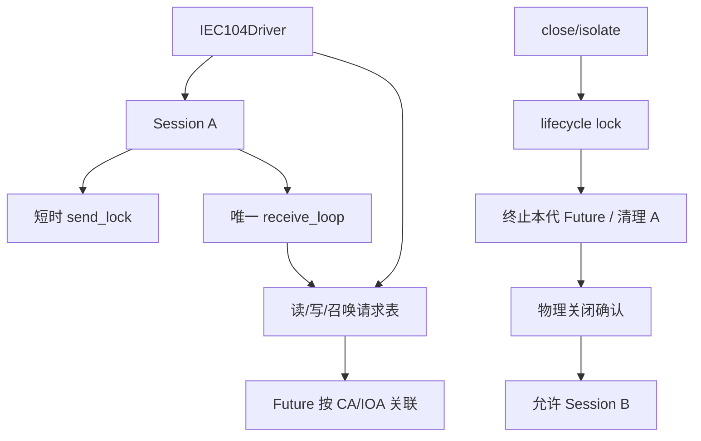
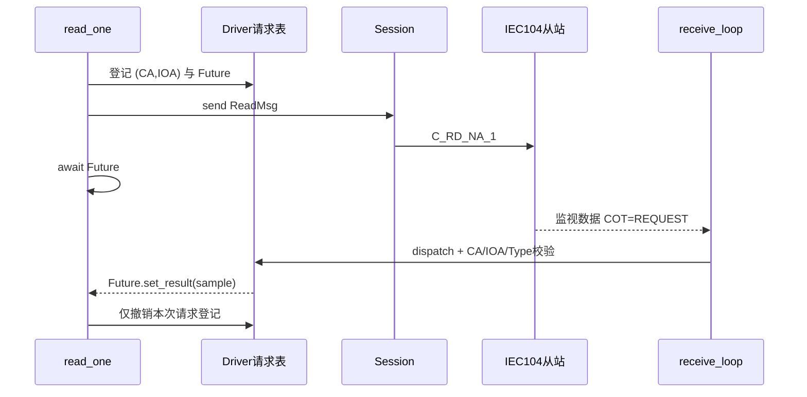
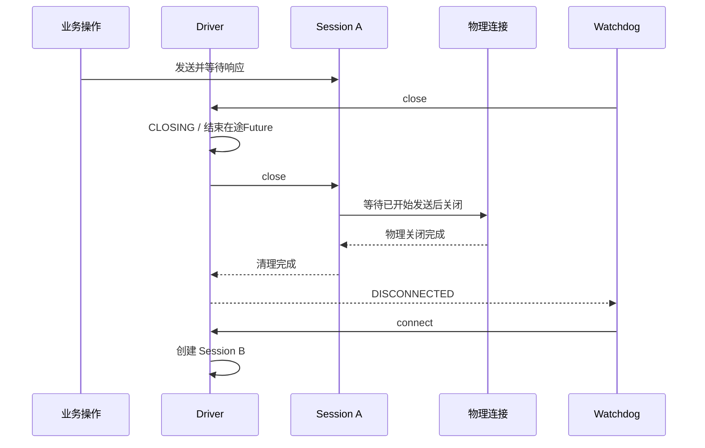

<h1 class="title">wind-hub IEC104 Adapter Session 生命周期与请求关联设计</h1>

<p class="subtitle">v0_1 · 20261027</p>

<style>
body {
  font-family: "Microsoft YaHei";
  font-size: 16px;
  line-height: 1.75;
  color: #24292f;
}
.title {
  font-family: "Microsoft YaHei";
  font-size: 32px;
  line-height: 1.30;
  font-weight: 700;
  text-align: center;
}
.subtitle {
  font-family: "Microsoft YaHei";
  font-size: 18px;
  line-height: 1.50;
  font-weight: 400;
  text-align: center;
}
h1 {
  font-family: "Microsoft YaHei";
  font-size: 28px;
  line-height: 1.40;
  font-weight: 700;
}
h2 {
  font-family: "Microsoft YaHei";
  font-size: 22px;
  line-height: 1.40;
  font-weight: 700;
}
h3 {
  font-family: "Microsoft YaHei";
  font-size: 18px;
  line-height: 1.50;
  font-weight: 700;
}
h4 {
  font-family: "Microsoft YaHei";
  font-size: 16px;
  line-height: 1.50;
  font-weight: 700;
}
p, li {
  font-family: "Microsoft YaHei";
  font-size: 16px;
  line-height: 1.75;
}
.figure-caption,
.formula-caption {
  font-family: "Microsoft YaHei";
  font-size: 14px;
  line-height: 1.50;
  font-weight: 600;
  text-align: center;
  margin: 0.65em 0 0.35em 0;
}
.table-caption {
  font-family: "Microsoft YaHei";
  font-size: 13px;
  line-height: 1.40;
  font-weight: 500;
  text-align: center;
  margin: 0.65em 0 0.35em 0;
}
.mermaid,
.mermaid text,
.mermaid .label {
  font-family: "Microsoft YaHei" !important;
  font-size: 14px !important;
  line-height: 1.20;
}
table {
  width: 100%;
  border-collapse: collapse;
  font-family: "Microsoft YaHei";
  font-size: 13px;
  line-height: 1.45;
}
table th,
table th p,
table th li {
  font-family: "Microsoft YaHei";
  font-size: 13px;
  line-height: 1.40;
  font-weight: 600;
}
table td,
table td p,
table td li {
  font-family: "Microsoft YaHei";
  font-size: 13px;
  line-height: 1.45;
  font-weight: 400;
}
table th,
table td {
  padding: 0.40em 0.60em;
  vertical-align: top;
}
code, pre {
  font-family: "Cascadia Code";
  font-size: 14px;
  line-height: 1.50;
}
p code, li code, td code {
  color: #24292f;
  background: #f3f4f6;
  padding: 0.08em 0.28em;
  border-radius: 3px;
}
pre {
  color: #c9d1d9;
  background: #0d1117;
  padding: 1em;
  border-radius: 6px;
  overflow-x: auto;
}
pre code {
  color: inherit;
  background: transparent;
  padding: 0;
}
.hljs-comment, .hljs-quote,
.token.comment, .token.prolog, .token.doctype, .token.cdata {
  color: #8b949e;
  font-style: italic;
}
.hljs-keyword, .hljs-selector-tag, .hljs-literal,
.token.keyword, .token.boolean { color: #ff7b72; }
.hljs-string, .hljs-doctag, .hljs-regexp,
.token.string, .token.char, .token.regex { color: #a5d6ff; }
.hljs-number, .token.number { color: #79c0ff; }
.hljs-title, .hljs-function, .token.function { color: #d2a8ff; }
.hljs-title.class_, .hljs-type, .hljs-built_in,
.token.class-name, .token.builtin { color: #ffa657; }
.hljs-variable, .hljs-attr, .hljs-property,
.token.variable, .token.property, .token.attr-name { color: #7ee787; }
.hljs-operator, .hljs-punctuation,
.token.operator, .token.punctuation { color: #c9d1d9; }
</style>

---

## 目录

1. [文档约定](#1-文档约定)  
2. [文档定位与使用方式](#2-文档定位与使用方式)  
3. [Session 所有权与生命周期](#3-session-所有权与生命周期)  
4. [请求关联与并发](#4-请求关联与并发)  
5. [关闭、超时与恢复](#5-关闭超时与恢复)  
6. [实现映射与验收条件](#6-实现映射与验收条件)  

---

# 1. 文档约定

本章是全文的固定排版与表达规范。文档修订、补充和派生版本均应遵守本章，不再根据个人习惯调整字体、字号、行距、图题、表题、公式或代码样式。

本文开头的 `<style>...</style>` 是 HTML `style` 元素，其中包含内部 CSS 样式表，本文简称为 **CSS 样式块**。第 1.1～1.4 节规定目标样式；CSS 样式块通过 `h1`、`h2`、`p`、`table`、`th`、`td`、`pre`、`code` 等选择器，将规范应用到 Markdown 渲染后生成的 HTML 元素。

## 1.1 字体约定

<p class="table-caption">表 1-1 文档字体与排版规范</p>

| 文档元素 | 字体 | 字号 | 行间距/行高 | 字重 | 对齐方式 |
|---|---|---:|---:|---:|---|
| 文档标题 | Microsoft YaHei | 32 px | 1.30 | 700 | 居中 |
| 文档副标题 | Microsoft YaHei | 18 px | 1.50 | 400 | 居中 |
| 一级标题 | Microsoft YaHei | 28 px | 1.40 | 700 | 左对齐 |
| 二级标题 | Microsoft YaHei | 22 px | 1.40 | 700 | 左对齐 |
| 三级标题 | Microsoft YaHei | 18 px | 1.50 | 700 | 左对齐 |
| 四级标题 | Microsoft YaHei | 16 px | 1.50 | 700 | 左对齐 |
| 正文 | Microsoft YaHei | 16 px | 1.75 | 400 | 左对齐 |
| 图题 | Microsoft YaHei | 14 px | 1.50 | 600 | 居中 |
| 图内文字 | Microsoft YaHei | 14 px | 1.20 | 400 | 按图形布局 |
| 表题 | Microsoft YaHei | 13 px | 1.40 | 500 | 居中 |
| 表头 | Microsoft YaHei | 13 px | 1.40 | 600 | 左对齐 |
| 表格正文 | Microsoft YaHei | 13 px | 1.45 | 400 | 左对齐 |
| 公式题 | Microsoft YaHei | 14 px | 1.50 | 600 | 居中 |
| 代码文字 | Cascadia Code | 14 px | 1.50 | 400 | 左对齐 |

以上规范已经通过本文开头的 CSS 样式块固定。其中，正文为 `16 px`；表题、表头和表格正文均为 `13 px`。表头字重为 `600`，低于标题字重；表格正文行高为 `1.45`，因此表格在字号、字重和行距上均明显弱于正文。英文业务对象、数据库对象和程序标识符仍按所在文本元素的字号排版，但使用行内代码形式，例如 `Asset`、`Connection`、`task_id`。

## 1.2 绘图约定

1. 上下文图、第 0 层及更深层 DFD、总体流程图和关系流程图统一使用 Mermaid。
2. 每一个 Mermaid 图都必须在 Mermaid 代码块第一行加入初始化配置，统一只设置 `useMaxWidth: true`。初始化配置格式为：

```text
%%{init: {"<Mermaid 图类型配置域>": {"useMaxWidth": true}}}%%
```

其中 `<Mermaid 图类型配置域>` 必须根据实际 Mermaid 图类型替换，不得固定写成 `flowchart`，也不得使用与实际图类型不匹配的配置域。

<p class="table-caption">表 1-2 Mermaid 图类型与初始化配置</p>

| Mermaid 图类型 | 图声明 | 第一行初始化配置 |
|---|---|---|
| Flowchart | `flowchart TB/LR/...` | `%%{init: {"flowchart": {"useMaxWidth": true}}}%%` |
| Sequence Diagram | `sequenceDiagram` | `%%{init: {"sequence": {"useMaxWidth": true}}}%%` |
| State Diagram | `stateDiagram-v2` | `%%{init: {"state": {"useMaxWidth": true}}}%%` |
| Class Diagram | `classDiagram` | `%%{init: {"class": {"useMaxWidth": true}}}%%` |
| ER Diagram | `erDiagram` | `%%{init: {"er": {"useMaxWidth": true}}}%%` |

若后续使用其他 Mermaid 图类型，也必须遵守同一规则：

```text
实际图类型
    ↓
确定该图类型对应的 Mermaid 配置域
    ↓
第一行写入：
%%{init: {"对应配置域": {"useMaxWidth": true}}}%%
```

不得额外加入 `wrap` 等非统一配置；如确有特殊需要，应在对应图的局部设计说明中单独论证。

3. 每张图必须有图编号和图题，编号采用“章节号-本章图序号”，例如“图 7-2”。
4. 图题必须使用普通图题样式，不得使用 Markdown 标题。统一写法为：

```html
<p class="figure-caption">图 7-2 图题</p>
```

## 1.3 公式约定

1. 行内公式使用单美元符号，例如 `$E_1$`。
2. 独立公式使用双美元符号，例如：

```text
$$
\mathrm{Entity}=E_1\land(E_2\lor E_3\lor E_4)\land E_5
$$
```

3. 正式公式不得放入代码块。
4. 不使用 `\[` 与 `\]` 作为公式定界符。
5. 变量下标统一写成 `E_1`、`R_1`；逻辑“与”和“或”统一写成 `\land`、`\lor`。
6. 公式必须使用 LaTeX，不使用普通文本模拟数学符号。
7. 需要编号的公式使用“式（章节号-本章公式序号）”，式题采用普通公式题样式：

```html
<p class="formula-caption">式（8-1）实体判断逻辑</p>
```

## 1.4 代码约定

1. 多行代码必须使用带语言标识的围栏代码块，例如 `python`、`sql`、`json`、`yaml`、`mermaid` 或 `text`。
2. 单个标识符、字段名、命令和短代码使用行内代码，例如 `PRIMARY KEY`、`Connection`。
3. 伪代码必须明确标记为 `text` 或在正文中说明“以下为伪代码”；不得使读者误认为它可以直接运行。
4. 代码块统一使用深色背景，颜色为 `#0D1117`；普通代码文字颜色为 `#C9D1D9`。
5. 语法高亮统一采用表 1-2 的配色。Markdown 渲染器应使用 Highlight.js 或 Prism 可识别的语言标识；渲染器不支持高亮时，至少保留代码背景色和普通代码文字颜色。

<p class="table-caption">表 1-2 代码语法高亮配色</p>

| 语法元素 | 颜色 | 十六进制 |
|---|---|---|
| 代码背景 | 深黑蓝 | `#0D1117` |
| 普通文字、运算符和标点 | 浅灰 | `#C9D1D9` |
| 注释 | 灰色 | `#8B949E` |
| 关键字和布尔值 | 红色 | `#FF7B72` |
| 字符串和正则表达式 | 浅蓝 | `#A5D6FF` |
| 数值 | 蓝色 | `#79C0FF` |
| 函数名 | 紫色 | `#D2A8FF` |
| 类型、类名和内置对象 | 橙色 | `#FFA657` |
| 变量、属性和字段 | 绿色 | `#7EE787` |

---

# 2. 文档定位与使用方式

## 2.1 适用对象

适用于 `wind-hub` IEC104 Driver 与 Session 生产实现、配置、Collector/Watchdog 调用方及验收。此文档专门修订原《IEC104 Adapter 全新技术设计书》v0_5 第 5.4、6.2、6.4、7.1～7.4 节的会话隔离与请求关联契约；其余协议能力与恢复边界以原设计为准。

## 2.2 目标

生命周期管理原则与 ADS 一致：操作持有一次取得的 Session；关闭必须确认旧物理连接释放后才可重连；旧会话响应不得交付新请求。IEC104 保留协议所需的统一 receive 循环与 Future 请求关联，禁止把业务响应等待纳入发送互斥锁。

---

# 3. Session 所有权与生命周期

Driver 独占一个 `_IEC104Session`；Session 独占底层 `hat.drivers.iec104.Connection`、唯一接收协程及发送/关闭任务。Driver 的生命周期锁仅串行 `connect/close/isolate`，不长期锁住业务等待。每次操作在开始时绑定 Session 实例；同一 Session 不复用，旧 Session 成功关闭前禁止创建新 Session。


<p class="figure-caption">图 3-1 会话与业务操作关系</p>

`Session.send()` 在发送门禁内检查自身 `closing/is_enabled`，无需由 Driver._send 重复检查 `self._session` 身份。发送锁只串行发送与物理关闭，不持锁等待业务响应。等待同点锁后，业务在登记请求前检查所绑定 Session 仍可用；旧实例不可被替换为新实例。接收回调应检查来源 Session，防止旧实例上送污染当前请求表。

# 4. 请求关联与并发

每次 `read_one()` 为 `(CA, IOA)` 建立 Future，先登记再发送 `ReadMsg`，唯一接收循环经 `_dispatch()/_data()` 按源 Session、`(CA, IOA)`、COT、Type ID 关联，调用 `Future.set_result(ProtocolSample)`。控制确认与召唤按各自的关联域与状态机匹配。不同点可并发，单点冲突以按键锁串行；总召按 CA 串行。


<p class="figure-caption">图 4-1 主动读取的响应匹配</p>

在途表清理必须比较对象身份：旧操作的 `finally` 只能移除其自身登记，不得误删重连后同键的新请求。发送完成不等于业务操作完成；Future 直到响应、拒绝、超时或关闭通知才终结。

# 5. 关闭、超时与恢复

关闭首先停止接受旧 Session 的新发送，对当前请求表的 Future 返回连接终止错误（控制结果未知时不得报告成功），再等待 Session 物理关闭与唯一接收协程收敛。连接清理失败进入 `FAULTED`，不得建立替代 Session。旧 Session 接收回调必须被当前 Session 身份门禁拒绝。


<p class="figure-caption">图 5-1 关闭与重连时序</p>

`read_timeout=2s`、`command_timeout=3s`（每阶段）、`interrogation_timeout=5s`（每 CA）与传输参数 `t1=5s` 分离；超时或取消且响应可能迟到时隔离本代 Session，避免后续同键读取错误关联。设备明确拒绝等可证明终态的错误无需无条件重连，此项仍须通过独立验收确认。Session 失效后的 Collector 业务任务恢复由 Watchdog/TaskRuntime 负责，不重发未确认控制命令。

# 6. 实现映射与验收条件

| 约束 | 责任位置 |
|---|---|
| 驱动生命周期仅有一个物理 Session | Driver.connect/close/_isolate |
| 旧 Session 不能向新 Session 发送 | Session.send 的关闭门禁 |
| 同一 Session 仅有一个接收循环 | Session._receive_loop |
| 响应匹配先验证会话来源 | Driver._dispatch |
| 同键请求串行、不同键允许并行 | Driver._locks/_station_locks |
| 关闭通知完成在途业务等待 | Driver._fail_all |
| 旧 Future 清理不影响新 Future | Driver 请求表对象身份判断 |
| 未确认资源关闭禁止重连 | Driver FAULTED/Session.close |

验收需覆盖：读取期间主动 close、读超时后 close/reconnect、同 CA 多点并发、同点串行、旧回调迟到、旧请求 finally 不删除新登记、执行阶段取消或拒绝、关闭失败 FAULTED、Watchdog 恢复及 10 Hz 监听负载。生产代码的 Ruff、类型检查、Import Linter 和自动测试由独立验收执行并据实记录。

---
