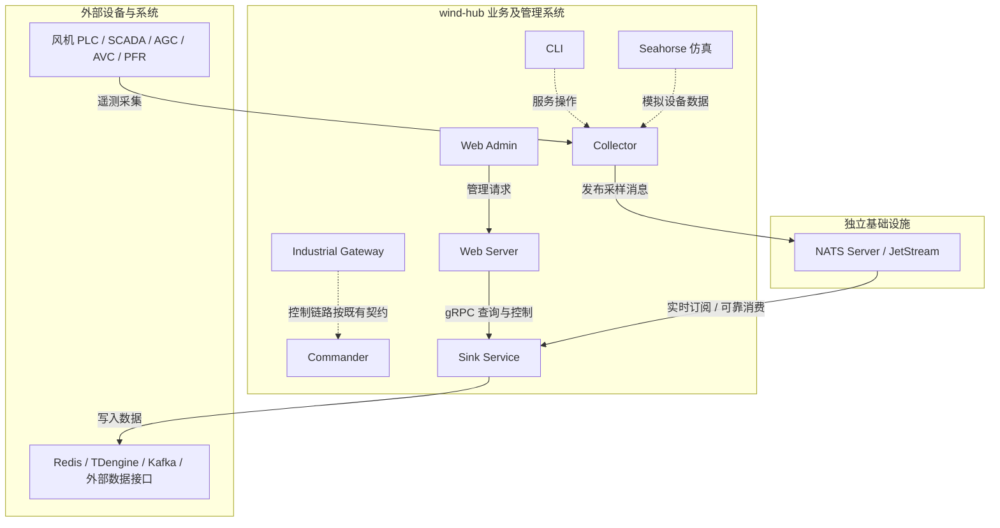
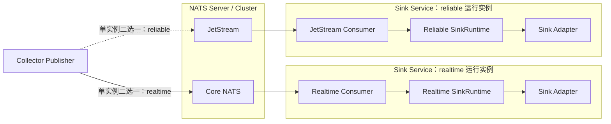
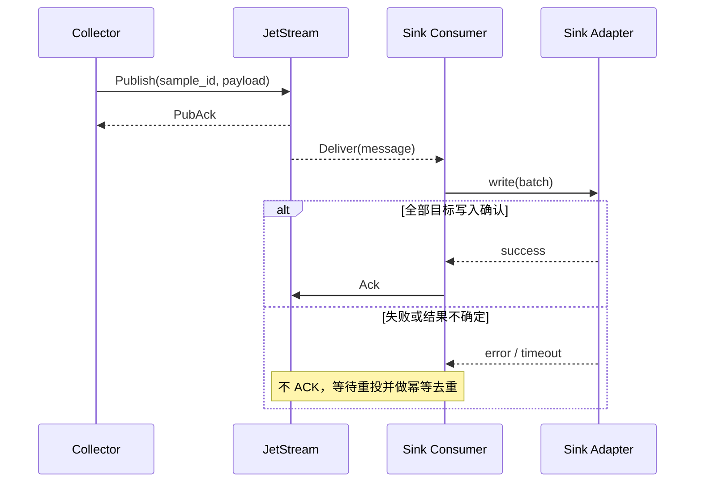

<h1 class="title">wind-hub 数据分发与 Sink Service 架构设计</h1>

<p class="subtitle">v0_4 · 20261028</p>

<style>
body {
  font-family: "Microsoft YaHei";
  font-size: 16px;
  line-height: 1.75;
  color: #24292f;
}
.title {
  font-family: "Microsoft YaHei";
  font-size: 32px;
  line-height: 1.30;
  font-weight: 700;
  text-align: center;
}
.subtitle {
  font-family: "Microsoft YaHei";
  font-size: 18px;
  line-height: 1.50;
  font-weight: 400;
  text-align: center;
}
h1 {
  font-family: "Microsoft YaHei";
  font-size: 28px;
  line-height: 1.40;
  font-weight: 700;
}
h2 {
  font-family: "Microsoft YaHei";
  font-size: 22px;
  line-height: 1.40;
  font-weight: 700;
}
h3 {
  font-family: "Microsoft YaHei";
  font-size: 18px;
  line-height: 1.50;
  font-weight: 700;
}
h4 {
  font-family: "Microsoft YaHei";
  font-size: 16px;
  line-height: 1.50;
  font-weight: 700;
}
p, li {
  font-family: "Microsoft YaHei";
  font-size: 16px;
  line-height: 1.75;
}
.figure-caption,
.formula-caption {
  font-family: "Microsoft YaHei";
  font-size: 14px;
  line-height: 1.50;
  font-weight: 600;
  text-align: center;
  margin: 0.65em 0 0.35em 0;
}
.table-caption {
  font-family: "Microsoft YaHei";
  font-size: 13px;
  line-height: 1.40;
  font-weight: 500;
  text-align: center;
  margin: 0.65em 0 0.35em 0;
}
.mermaid,
.mermaid text,
.mermaid .label {
  font-family: "Microsoft YaHei" !important;
  font-size: 14px !important;
  line-height: 1.20;
}
table {
  width: 100%;
  border-collapse: collapse;
  font-family: "Microsoft YaHei";
  font-size: 13px;
  line-height: 1.45;
}
table th,
table th p,
table th li {
  font-family: "Microsoft YaHei";
  font-size: 13px;
  line-height: 1.40;
  font-weight: 600;
}
table td,
table td p,
table td li {
  font-family: "Microsoft YaHei";
  font-size: 13px;
  line-height: 1.45;
  font-weight: 400;
}
table th,
table td {
  padding: 0.40em 0.60em;
  vertical-align: top;
}
code, pre {
  font-family: "Cascadia Code";
  font-size: 14px;
  line-height: 1.50;
}
p code, li code, td code {
  color: #24292f;
  background: #f3f4f6;
  padding: 0.08em 0.28em;
  border-radius: 3px;
}
pre {
  color: #c9d1d9;
  background: #0d1117;
  padding: 1em;
  border-radius: 6px;
  overflow-x: auto;
}
pre code {
  color: inherit;
  background: transparent;
  padding: 0;
}
.hljs-comment, .hljs-quote,
.token.comment, .token.prolog, .token.doctype, .token.cdata {
  color: #8b949e;
  font-style: italic;
}
.hljs-keyword, .hljs-selector-tag, .hljs-literal,
.token.keyword, .token.boolean { color: #ff7b72; }
.hljs-string, .hljs-doctag, .hljs-regexp,
.token.string, .token.char, .token.regex { color: #a5d6ff; }
.hljs-number, .token.number { color: #79c0ff; }
.hljs-title, .hljs-function, .token.function { color: #d2a8ff; }
.hljs-title.class_, .hljs-type, .hljs-built_in,
.token.class-name, .token.builtin { color: #ffa657; }
.hljs-variable, .hljs-attr, .hljs-property,
.token.variable, .token.property, .token.attr-name { color: #7ee787; }
.hljs-operator, .hljs-punctuation,
.token.operator, .token.punctuation { color: #c9d1d9; }
</style>

---

## 目录

1. [文档约定](#1-文档约定)  
2. [文档定位与使用方式](#2-文档定位与使用方式)  
3. [背景与设计目标](#3-背景与设计目标)  
4. [总体架构](#4-总体架构)  
5. [数据交付语义](#5-数据交付语义)  
6. [消息数据模型](#6-消息数据模型)  
7. [NATS 架构](#7-nats-架构)  
8. [背压与数据时效](#8-背压与数据时效)  
9. [Sink Service 设计](#9-sink-service-设计)  
10. [配置设计](#10-配置设计)  
11. [监控与控制接口](#11-监控与控制接口)  
12. [关键设计决策](#12-关键设计决策)  
13. [验证与验收标准](#13-验证与验收标准)  

---

# 1. 文档约定

本章是全文的固定排版与表达规范。文档修订、补充和派生版本均应遵守本章，不再根据个人习惯调整字体、字号、行距、图题、表题、公式或代码样式。

本文开头的 `<style>...</style>` 是 HTML `style` 元素，其中包含内部 CSS 样式表，本文简称为 **CSS 样式块**。第 1.1～1.4 节规定目标样式；CSS 样式块通过 `h1`、`h2`、`p`、`table`、`th`、`td`、`pre`、`code` 等选择器，将规范应用到 Markdown 渲染后生成的 HTML 元素。

## 1.1 字体约定

<p class="table-caption">表 1-1 文档字体与排版规范</p>

| 文档元素 | 字体 | 字号 | 行间距/行高 | 字重 | 对齐方式 |
|---|---|---:|---:|---:|---|
| 文档标题 | Microsoft YaHei | 32 px | 1.30 | 700 | 居中 |
| 文档副标题 | Microsoft YaHei | 18 px | 1.50 | 400 | 居中 |
| 一级标题 | Microsoft YaHei | 28 px | 1.40 | 700 | 左对齐 |
| 二级标题 | Microsoft YaHei | 22 px | 1.40 | 700 | 左对齐 |
| 三级标题 | Microsoft YaHei | 18 px | 1.50 | 700 | 左对齐 |
| 四级标题 | Microsoft YaHei | 16 px | 1.50 | 700 | 左对齐 |
| 正文 | Microsoft YaHei | 16 px | 1.75 | 400 | 左对齐 |
| 图题 | Microsoft YaHei | 14 px | 1.50 | 600 | 居中 |
| 图内文字 | Microsoft YaHei | 14 px | 1.20 | 400 | 按图形布局 |
| 表题 | Microsoft YaHei | 13 px | 1.40 | 500 | 居中 |
| 表头 | Microsoft YaHei | 13 px | 1.40 | 600 | 左对齐 |
| 表格正文 | Microsoft YaHei | 13 px | 1.45 | 400 | 左对齐 |
| 公式题 | Microsoft YaHei | 14 px | 1.50 | 600 | 居中 |
| 代码文字 | Cascadia Code | 14 px | 1.50 | 400 | 左对齐 |

以上规范已经通过本文开头的 CSS 样式块固定。其中，正文为 `16 px`；表题、表头和表格正文均为 `13 px`。表头字重为 `600`，低于标题字重；表格正文行高为 `1.45`，因此表格在字号、字重和行距上均明显弱于正文。英文业务对象、数据库对象和程序标识符仍按所在文本元素的字号排版，但使用行内代码形式，例如 `Asset`、`Connection`、`task_id`。

## 1.2 绘图约定

1. 上下文图、第 0 层及更深层 DFD、总体流程图和关系流程图统一使用 Mermaid。
2. 每一个 Mermaid 图都必须在 Mermaid 代码块第一行加入初始化配置，统一只设置 `useMaxWidth: true`。初始化配置格式为：

```text
%%{init: {"<Mermaid 图类型配置域>": {"useMaxWidth": true}}}%%
```

其中 `<Mermaid 图类型配置域>` 必须根据实际 Mermaid 图类型替换，不得固定写成 `flowchart`，也不得使用与实际图类型不匹配的配置域。

<p class="table-caption">表 1-2 Mermaid 图类型与初始化配置</p>

| Mermaid 图类型 | 图声明 | 第一行初始化配置 |
|---|---|---|
| Flowchart | `flowchart TB/LR/...` | `%%{init: {"flowchart": {"useMaxWidth": true}}}%%` |
| Sequence Diagram | `sequenceDiagram` | `%%{init: {"sequence": {"useMaxWidth": true}}}%%` |
| State Diagram | `stateDiagram-v2` | `%%{init: {"state": {"useMaxWidth": true}}}%%` |
| Class Diagram | `classDiagram` | `%%{init: {"class": {"useMaxWidth": true}}}%%` |
| ER Diagram | `erDiagram` | `%%{init: {"er": {"useMaxWidth": true}}}%%` |

若后续使用其他 Mermaid 图类型，也必须遵守同一规则：

```text
实际图类型
    ↓
确定该图类型对应的 Mermaid 配置域
    ↓
第一行写入：
%%{init: {"对应配置域": {"useMaxWidth": true}}}%%
```

不得额外加入 `wrap` 等非统一配置；如确有特殊需要，应在对应图的局部设计说明中单独论证。

3. 每张图必须有图编号和图题，编号采用“章节号-本章图序号”，例如“图 7-2”。
4. 图题必须使用普通图题样式，不得使用 Markdown 标题。统一写法为：

```html
<p class="figure-caption">图 7-2 图题</p>
```

## 1.3 公式约定

1. 行内公式使用单美元符号，例如 `$E_1$`。
2. 独立公式使用双美元符号，例如：

```text
$$
\mathrm{Entity}=E_1\land(E_2\lor E_3\lor E_4)\land E_5
$$
```

3. 正式公式不得放入代码块。
4. 不使用 `\[` 与 `\]` 作为公式定界符。
5. 变量下标统一写成 `E_1`、`R_1`；逻辑“与”和“或”统一写成 `\land`、`\lor`。
6. 公式必须使用 LaTeX，不使用普通文本模拟数学符号。
7. 需要编号的公式使用“式（章节号-本章公式序号）”，式题采用普通公式题样式：

```html
<p class="formula-caption">式（8-1）实体判断逻辑</p>
```

## 1.4 代码约定

1. 多行代码必须使用带语言标识的围栏代码块，例如 `python`、`sql`、`json`、`yaml`、`mermaid` 或 `text`。
2. 单个标识符、字段名、命令和短代码使用行内代码，例如 `PRIMARY KEY`、`Connection`。
3. 伪代码必须明确标记为 `text` 或在正文中说明“以下为伪代码”；不得使读者误认为它可以直接运行。
4. 代码块统一使用深色背景，颜色为 `#0D1117`；普通代码文字颜色为 `#C9D1D9`。
5. 语法高亮统一采用表 1-2 的配色。Markdown 渲染器应使用 Highlight.js 或 Prism 可识别的语言标识；渲染器不支持高亮时，至少保留代码背景色和普通代码文字颜色。

<p class="table-caption">表 1-2 代码语法高亮配色</p>

| 语法元素 | 颜色 | 十六进制 |
|---|---|---|
| 代码背景 | 深黑蓝 | `#0D1117` |
| 普通文字、运算符和标点 | 浅灰 | `#C9D1D9` |
| 注释 | 灰色 | `#8B949E` |
| 关键字和布尔值 | 红色 | `#FF7B72` |
| 字符串和正则表达式 | 浅蓝 | `#A5D6FF` |
| 数值 | 蓝色 | `#79C0FF` |
| 函数名 | 紫色 | `#D2A8FF` |
| 类型、类名和内置对象 | 橙色 | `#FFA657` |
| 变量、属性和字段 | 绿色 | `#7EE787` |

---

# 2. 文档定位与使用方式

## 2.1 适用对象

本文适用于 wind-hub 的架构设计、服务契约评审和后续详细设计，特别是 Collector 数据发布、NATS 消息基础设施、Sink Service 数据输出及 Web 管理接口。

文档范围为目标架构和行为契约，不包含现存代码迁移步骤、开发排期或测试分工。标注为“待定”的内容不得视为已批准实现。

**代码核对基准**：GitHub `luoshaozhuo/wind-hub`，分支 `refactor/ads-adapter-core-v06`，`f03d2ef5d70b7c66ed553eaac4a37607243645c0`（2026-10-28 读取）。

## 2.2 目标

确定完整系统的模块边界，定义 `realtime` 与 `reliable` 的消费者可感知语义，约束消息身份、时效、失败恢复、进程隔离、可选部署方式、配置及 Sink 控制接口；保持核心路径简单，将审计、复杂指标等横切能力延后并以非侵入方式扩展。

---

# 3. 背景与设计目标

## 3.1 背景

当前 `Collector` 通过 `SinkRuntime` 管理 Sink 注册表、每 Sink 队列、消费者、背压、Watchdog 及热更新；`Core` 保存 `SinkPort`、Redis、TDengine、Kafka、gRPC、Modbus 输出适配器。该实现可用，但采集与输出生命周期耦合，难以将多个 Collector 的产出独立分发给多个消费者。

目标架构以 NATS 实现采集与输出解耦，`Collector` 仅采集并发布消息，独立 `Sink Service` 负责消费和输出。实时和可靠消费者采用同一套服务代码，但在需要低延迟隔离时分别启动独立进程。NATS 服务由 systemd、容器编排等部署设施管理，不能由 Collector 启动。

## 3.2 目标与非目标

<p class="table-caption">表 3-1 目标与边界</p>

| 类型 | 内容 |
|---|---|
| 目标 | 最新值不会被误判为新鲜；全量数据尽可能不丢；Collector 与 Sink Service 独立运行；支持多个进程与未来集群；保持可观察和可控 |
| 性能目标 | 实时链路消息发布到被消费的 P99 延迟目标小于 10 ms，需在指定环境实测 |
| 非目标 | 不将 NATS 引入 Commander 控制闭环；不重设计 Protocol Adapter；不在本书描述源代码迁移 |
| 边界 | 控制、采集、输出数据各自遵循独立契约；可靠传输不等同于最终业务落库的绝对不丢 |

# 4. 总体架构

## 4.1 系统模块与外部关系

系统现有源码范围包括 `core`、`collector`、`commander`、`industrial_gateway`、`seahorse`、`web_server`、`web_admin`、`contracts`、`cli`；目标增设 `sink_service`，外部基础设施采用 NATS。下图是**目标容器视角**，箭头仅表示本次确定的交互；未画出的既有业务连接不代表被删除。



<p class="figure-caption">图 4-1 wind-hub 目标容器架构及 Sink 数据路径</p>

`Core` 是共享源代码能力，不是独立进程；`Contracts` 为跨模块接口契约，也不是部署单元。它们在职责表中说明，不应在容器图中误标为独立服务。

<p class="table-caption">表 4-1 模块职责边界</p>

| 模块 | 目标职责 | 与本设计关系 |
|---|---|---|
| Core | 共享点值模型、必要基础设施原语 | 不持有 Sink 专属 Port 与适配器 |
| Contracts | 稳定跨服务通信契约 | 放置共享 gRPC / 消息契约（具体归属待详细设计） |
| Collector | 设备采集、数据规范化、发布 | 不管理 Sink 实例及其输出队列 |
| Sink Service | 消息消费、目标写入、生命周期与对外管理 | SinkPort 和 Adapter 所有者；支持两种模式分别运行 |
| Commander | 控制指令处理与执行 | 不改变既有控制路径 |
| Industrial Gateway | 工业通信接口与外部系统对接 | 不因消息系统引入而重设计 |
| Seahorse | 模拟设备及电场行为 | 为采集和端到端验证提供数据源 |
| Web Server / Web Admin | 管理服务聚合 / 用户界面 | 通过 gRPC 监控控制 Sink |
| CLI | 运维入口 | 沿用既有应用模块边界 |
| NATS | 实时分发与 JetStream 可靠传递 | 独立部署，Collector 不启动 |

## 4.2 数据分发组件



<p class="figure-caption">图 4-2 两种交付模式的逻辑运行实例与数据路径</p>

图中的 Collector 两条发布箭头表示**互斥配置选择**：每个 Collector 实例只发布到一个 `delivery` 通道，并非同一实例同时发布两路。图中的两个 Sink 实例为**逻辑隔离单元**：均使用同一套 `sink_service` 代码与同一构建产物；部署时既可同进程采用独立异步任务，也可分别运行在不同进程或容器。图示并不意味着必须部署两个容器。`realtime` 的处理路径不等待 `reliable` 的消费、重试或写入确认。

同一 Collector 的一个采样只进入所选交付通道，同一通道可供多个 Sink 分别消费；不同 Collector 可分别配置不同 `delivery`。不得因重复订阅无意产生重复写入。NATS 不是业务路由规则的唯一来源；输出映射由 Sink 配置确定。

## 4.3 部署边界

部署方案支持三级配置，**不强制采用最重的隔离方式**：

<p class="table-caption">表 4-2 Sink Service 部署模式</p>

| 模式 | 运行方式 | 适用条件 |
|---|---|---|
| 默认模式 | 一个 Sink Service 进程，两个独立消费协程/任务 | 工作负载较轻、适配器 I/O 无事件循环阻塞时优先采用 |
| 延迟隔离模式 | 同一代码启动 `realtime`、`reliable` 两个进程 | 历史数据恢复、序列化或 I/O 对实时延迟产生可测影响时采用 |
| 资源隔离模式 | 两个独立容器，可分别配额或部署于不同主机 | 需要独立重启、资源治理、独立扩容或更严格的延迟目标时采用 |

无论采用哪种模式，NATS 均由 systemd、容器编排等部署系统独立启动；Collector 和 Sink Service 只连接 NATS，不负责启动它。独占监听端口（例如 Modbus TCP Server）只能由一个相应 Sink 实例持有。进程或容器隔离并不自动保证 P99 < 10 ms，应通过目标负载下的测量选择部署模式。

# 5. 数据交付语义

## 5.1 两类消费者需求

<p class="table-caption">表 5-1 交付模式契约</p>

| 项目 | `realtime` | `reliable` |
|---|---|---|
| 目的 | 获得最新且仍有效的点值 | 尽可能完整保留采样序列 |
| 基础实现 | Core NATS | NATS JetStream |
| 消费者离线 | 无历史追补保证 | 按保留策略恢复消费 |
| 旧样本 | 不得覆盖更新样本 | 不因“旧”而舍弃历史记录 |
| 失效 | 超过时效阈值标记 stale / invalid | 历史记录按原始时间保存 |
| 重复 | 可去重 / 丢弃 | 相同消息重投最终存储幂等；同主键冲突内容按目标 UPSERT 语义处理，不承诺首写不可变（见 6.2） |
| 故障 | 优先时效，允许丢失 | 失败可见，待确认消息可恢复 |

`delivery` 为 Collector 实例级配置，每个实例仅使用 `realtime` 或 `reliable` 一种通道。`realtime` 表示消费侧最新值语义，不表示 Core NATS 自动提供“最后值缓存”。应由相应 Sink 维护最新样本及有效性；消费者重启后如需快照，应另设计快照来源，不能假定 Core NATS 自动补发。

## 5.2 新旧与有效性

实时有效期由系统配置 `max_staleness_ms` 指定，Sink Service 根据采样时间判断，且在无新消息时也应主动/按读取时机判定失效。点值至少使用采样时间或可靠的单源顺序号进行新旧比较；单纯的消息到达顺序、发布时间均不能证明其新鲜性。同一实时测点仅允许一个权威采集来源；多源重复发布须在配置阶段拒绝。过期数据可以保留最后数值供界面展示，但必须显式标记失效。

## 5.3 可靠交付边界

发布方以 JetStream Publish Ack 确认消息进入消息系统；**NATS 发布失败期间允许采样丢失，不引入 Collector 本地持久化队列**。Collector 继续采集、持续报告发布故障并重试恢复；不得将未获得发布确认的数据记为成功。消费方仅在适配器确认写入成功后 ACK。发生超时、网络分区等不确定结果时允许重复投递，要求落地方具备幂等或去重策略。磁盘耗尽、消息超过保留上限、无法确认发布等情形不能宣称“绝对不丢”。

# 6. 消息数据模型

## 6.1 概念分离

**测点身份**：`wind_farm_id` + `device_id` + `point_id`（需明确 ID 的系统内唯一范围）；**采集来源**：`collector_id`、`task_id`（`collector_id` 必须可区分多个 Collector 实例）；**采样身份**：用于历史消息去重的 `sample_id`；**Sink 目标地址**：由每类输出适配器配置，不能与测点身份混为一谈。

任务 ID 和消息发送时间均不能替代测点身份。采样时间不能直接拼成 Redis 历史存储的海量独立 Key。

## 6.2 消息信封与身份契约

NATS 传输消息采用 **版本化单样本信封**：一条消息表达一个测点的一次采样，不把不同采样合成同一条消息。SinkPort 的 `write(batch)` 仍允许接收多个现成样本，但本架构不为凑批等待新消息。消息采用 UTF-8 JSON 作为 v1 互操作格式；序列化遵循跨进程的 `schema_version` 契约，不能直接传输 Python 对象。示例：

```json
{
  "schema_version": 1,
  "wind_farm_id": "WF001",
  "collector_id": "collector-a",
  "task_id": "task-power",
  "device_id": "WT001",
  "point_id": "active_power",
  "sample_id": "collector-a:run-7:1234",
  "value": 2350.5,
  "quality": "good",
  "sample_time": "2026-10-28T08:00:00.123Z",
  "receive_time": "2026-10-28T08:00:00.125Z",
  "publish_time": "2026-10-28T08:00:00.126Z",
  "max_staleness_ms": 500
}
```

必要字段：`schema_version`、`wind_farm_id`、`collector_id`、`task_id`、`device_id`、`point_id`、`sample_id`、`value`、`quality`、`sample_time`、`publish_time`；`receive_time` 可缺省，`max_staleness_ms` 仅实时模式必须携带。所有时间采用带时区的 UTC 时间戳，消息解析失败时不得写入业务目标；非有限浮点值必须使用约定的质量/空值语义，不允许非标准 JSON 数字。

**测点身份**是 `(wind_farm_id, device_id, point_id)`；**采样身份**是 `sample_id`，由 Collector 在采样形成时生成，建议采用 `collector_id + 启动唯一标识 + 进程内单调序号`，同一采样的有限发布重试复用原 ID，Collector 重启不得复用。`task_id`、`collector_id` 属于来源审计，不参与测点身份。`publish_time` 不能替代采样时间或采样身份。

**实时排序**：同一测点必须确定唯一权威采集来源；配置阶段禁止多个 Collector / Task 对同一实时测点并行成为权威发布者。Sink 按 `sample_time` 比较，不允许较旧样本覆盖较新样本；时间相同但 `sample_id` 不同视为顺序不可判定，拒绝覆盖并报告配置/数据异常。设备时间不可信时，应使用 Collector 接收时的 UTC 时间作为有效采样时间，同时保留原设备时间元数据（如有）；跨设备时钟同步与异常监测属于部署条件。

**历史去重与存储幂等契约**：Sink 以 `(ts, sample_id)` 作为历史存储幂等键，对 `sample_id` 建立目标侧幂等依据；JetStream 可将该 ID 作为 `Nats-Msg-Id` 用于 Broker 去重窗口内的发布去重，但不能替代消费侧永久或保留期内的去重保障。契约边界如下：

1. 上游同一 `sample_id` 对应的采样消息内容必须保持不变；有限发布重试与 JetStream 重投均复用原消息体。
2. 相同消息（相同 `(ts, sample_id)` 与相同内容）重复投递时，目标最终只保留一条记录且内容一致——这是 Sink Service 承诺的最终存储幂等。
3. 对相同 `(ts, sample_id)` 但内容不同的写入，目标数据库可能以 UPSERT 方式覆盖旧值；本架构**不承诺首写不可变**，也不为此新增去重数据库、状态机或读前检查逻辑。上游必须以「同 `sample_id` 内容不可变」规避该风险；任何绕过消息契约的同身份异值写入不属于受支持行为。
4. 消费侧 ACK 只能在适配器确认目标数据库写入成功之后发出；写入失败、超时或结果不确定时不 ACK，依赖 JetStream 重投，重投的相同消息按第 2 项幂等收敛。

TDengine 历史适配器使用 `(ts TIMESTAMP, sample_id VARCHAR(192) COMPOSITE KEY)` 复合主键（见 9.5），实测相同主键异值写入为 UPSERT 覆盖，恰为本契约第 3 项所述行为，不得宣称不可变存储。

## 6.3 输出地址与数据保留

Redis 最新值可以使用显式映射 Key `ems:power:001` 或配置前缀生成 Key；其数值新旧判定必须检查采样时间/顺序，拒绝迟到旧值。历史型目的地可以使用 Redis Stream 或 TDengine 历史表，而不能用覆盖型 Key 冒充全量历史。`delivery` 是对**数据消费与交付意图**的声明；各 Sink 对目标地址和存储能力必须进行约束校验。

# 7. NATS 架构

## 7.1 Subject、Stream 与消费者路由

同一 NATS Server / Cluster 同时承载 Core NATS 和 JetStream；每个 Collector 实例按 `system.yaml` 的唯一 `delivery` 模式发布。v1 采用固定 Subject 层级（标识符限制为不含 `.`、`*`、`>` 的非空安全 token，配置加载时验证）：

| 模式 | Subject 模式 | 说明 |
|---|---|---|
| realtime | `wh.rt.<wind_farm_id>.<collector_id>.<device_id>.<point_id>` | Core NATS，在线消费，不保留积压 |
| reliable | `wh.hist.<wind_farm_id>.<collector_id>.<device_id>.<point_id>` | JetStream 持久化流 |

`JetStream` 的历史 Stream 仅绑定 `wh.hist.>`，**不得绑定** `wh.rt.>`；实时 Subject 不进入历史 Stream。Stream 可以按规模与部署拓扑进一步物理分片，但不得改变 v1 的 Subject 和消息格式。每个 Sink 通过明确的订阅过滤规则选择风电场、Collector、设备和测点，不能不加筛选地订阅其他租户或风场。**Sink 输出映射仍以其 Source → Address 配置为最终依据**，Subject 只用于传输过滤，不隐含目标 Key / 寄存器地址。

每个实时 Sink 拥有独立订阅；多个实时 Sink 若都需要同一消息，应分别订阅，不能把它们放入同一个队列组抢消息。每个可靠 Sink 使用**独立、稳定且持久的 JetStream Consumer 名称**，由 Sink 唯一标识派生并含部署命名空间；恢复后沿用原消费进度。不同 Sink 不得共享同一 Durable Consumer 以免相互分摊消息。单个 Sink 横向扩容属于另外的分区/共享消费设计，不在 v1 自动开启。消费者过滤规则的更改须显式处理旧积压，不得静默丢弃。

NATS 是独立部署基础设施，Collector、Sink Service 均只连接、不负责启动。JetStream 副本数量、容量和最大保留时长由部署配置管理，保留上限造成的数据丢失必须告警，不能宣称端到端零丢失。

## 7.2 发布、确认与部分成功



<p class="figure-caption">图 7-1 JetStream 数据交付与确认时序</p>

`reliable` 发布以 JetStream `PubAck` 为成功边界；Collector 发布失败时继续采集，允许丢弃当前未确认采样，持续报告异常并重新建立发布能力，不创建本地持久化队列。对同一样本仅在仍保留该样本且处于受控有限重试阶段时复用 `sample_id`；进入后续采样不等待旧消息无限重试。

可靠消费以 **每条 NATS 消息对应一个样本** 为确认单元：目标写入确认为成功后 ACK；失败、超时或结果不确定则不 ACK，依赖 JetStream 重投。Sink Adapter 的 `write` 需遵守**全成功或抛错**契约；不能以部分写入成功返回。多样本调用若发生部分成功，整个调用视为不确定，涉及样本均不 ACK，重投时以 `sample_id` 幂等处理。禁止通过 ACK 丢弃失败消息。应有合理的 `AckWait`、重投和最大未确认量配置；若达到人工介入阈值必须告警并保留可恢复状态，而非静默终结。

已确认 JetStream 发布的消息仍受 Stream 保留期限、磁盘故障和复制策略制约；即使采用可靠交付，也不承诺绝对无损。共享 Stream 的消费进度不由单个 Sink 修改其他消费者的状态。

# 8. 背压与数据时效

## 8.1 实时模式

实时模式不补历史、不允许旧值覆盖新值。Sink 维持按测点的最近有效样本及其时间信息，处理时判断新旧，读取时再次判断是否超过 `max_staleness`。因此即便未收到新消息，旧值也不会一直显示为有效。低延迟通道只维持有限暂存，不依赖无限队列；慢消费者可以按最新值语义合并/丢弃中间状态。

## 8.2 可靠模式

JetStream 按配置约束容量、保留期限和待确认数量；消费者处理不过来时体现为积压增长。达到容量上限或 NATS 不可用时，发布端应报告失败并持续重试后续发布；**当前采样允许丢失**，不引入本地持久化、无限重试当前采样或采集任务阻塞。Sink 消费者仍须对已确认发布的消息执行成功写入后 ACK 与失败重投，不得静默跳过。

## 8.3 数据阈值建议

`max_staleness_ms` 是系统配置的实时点值有效期（毫秒），由 Sink Service 执行有效性判断；`max_age` 是消息系统保留期限，两者绝不等价。不设置统一的 `max_batch_wait`、`max_batch_size` 或后台批次调度器。实时消费收到消息应及时写入目标；可靠消费按 JetStream 消费及 ACK 契约处理。一次 `write(batch)` 可以携带多个现成点值，但不等待凑批。

# 9. Sink Service 设计

## 9.1 内部职责

`Sink Service` 作为可独立启动的服务，拥有 `SinkPort`、各 Sink Adapter、NATS Consumer、SinkRuntime 和 gRPC 管理入口；`Collector` 不引用 Sink Service 的代码。具体端口属于 `src/sink_service/application/port/`，实现位于该服务的 infrastructure 层。`Core` 保留共享 `PointValue` 等通用模型。

## 9.2 最小端口契约

建议基础接口只包含 `open()`、`write(batch)`、`close()`。此处 `write()` 指**一次实际批次提交且返回前获得适配器规定的完成确认**；`flush()` 不作为强制接口：NATS 负责可靠消息暂存，Sink Service 不再建立统一缓冲与批处理层。对于具有特殊内置缓冲的客户端，可在具体适配器内部完成确认，不把隐含“已写入只是本地缓冲”泄露给统一端口。

## 9.3 消费处理与可靠确认

`realtime` 消息接收后直接执行目标写入，避免为凑批引入额外等待；`reliable` 消息在写入成功后再 ACK。`write(batch)` 允许传入消息自身已有的多个点值，Adapter 也可使用目标系统原生批量写入 API，但 Sink Service 不建立跨消息聚合器、定时 Flush 或额外持久化缓冲。一次调用部分写入成功时，应保留失败/不确定语义，未经明确完成确认不 ACK 全部消息；幂等语义按 6.2 历史去重与存储幂等契约、TDengine 具体行为见 9.5。

## 9.4 资源与并发

同一 Sink 实例可以服务多个采集任务映射，但只有一个受控的写入消费执行路径或等效互斥机制；生命周期操作不能与写入并发破坏连接。多个进程访问 Redis、TDengine 等共享目标时依赖业务去重及目标系统一致性，不采用跨进程全局 asyncio 锁。Modbus TCP Server 独占同一监听地址和端口。

## 9.5 TDengine 历史适配器契约

TDengine 适配器经 taosAdapter REST SQL 写入，超级表以 `ts TIMESTAMP` 与 `sample_id VARCHAR(192) COMPOSITE KEY` 构成 `(ts, sample_id)` 复合主键，子表按测点身份哈希派生。存储语义遵循 6.2 的历史去重与存储幂等契约：相同消息重投最终一条；相同主键异值写入由数据库 UPSERT 覆盖，不承诺首写不可变，适配器不额外实现去重表或读前检查。

**版本兼容**：复合主键依赖支持 `VARCHAR COMPOSITE KEY` 的 TDengine 服务端。已验证版本为 TDengine Community **3.3.6.13**（`DESCRIBE` 中 `sample_id` 的 note 为 `COMPOSITE KEY`，`SERVER_VERSION()` 实证）；不支持该语法的旧版本（如 3.3.5.0）在 Sink `open()` 建表阶段即被服务端拒绝，适配器以 `SinkError` fail-closed 并提示校验服务端兼容性，绝不假成功。部署方必须提供兼容版本；错误信息不声称未经核实的具体最低版本号。

# 10. 配置设计

## 10.1 文件边界与有效期传递

`system.yaml` 是 **Collector 实例级** NATS 连接、单一 `delivery` 与实时 `max_staleness_ms` 的权威配置；`points.yaml` 管理设备测点，`tasks.yaml` 管理采集任务，`sinks.yaml` 管理 Sink 目标、订阅范围和 Source → Address 映射。`sinks.yaml` 不再重复定义 `delivery`，Sink Service 的运行模式由启动参数确定。

由于 Sink Service 不读取其他 Collector 的本地 `system.yaml`，**实时有效期由 Collector 随消息携带 `max_staleness_ms`，由 Sink Service 实施**；不得依赖两个服务共享文件或隐式默认值。Sink Service 必须验证有效期为正且在平台允许上限内；配置变更从新消息开始生效，旧缓存样本使用随该样本携带的有效期。有效期定义为从 `sample_time` 到消费端当前 UTC 时间的允许最大时长，且必须在无新消息时通过读时判断或失效事件对下游显式反映。时钟明显异常（未来时间、严重不同步）按无效处理并报告，不能无限延长有效性。

## 10.2 最小配置增量

系统级 Collector 配置示意（以实际项目的 `system.yaml` 结构为准，以下为目标逻辑结构，不代表当前解析器已支持）：

```yaml
messaging:
  backend: nats
  servers:
    - nats://127.0.0.1:4222
  delivery: realtime
  max_staleness_ms: 500
```

`delivery` 为 `realtime` 或 `reliable`，且一个 Collector 实例必须且只能选择一个。`max_staleness_ms` 是实时数据有效期，由 Sink Service 执行判定；可以在系统配置中调整，由 Collector 将数值放入每条 realtime 消息，Sink Service 按样本携带的有效期判断。对于可靠 Collector，`max_staleness_ms` 不参与历史消息的保留与丢弃判断。

Sink 配置仍专注目标与地址：

```yaml
sinks:
  redis_latest:
    type: redis
    enabled: true
    connection:
      host: 127.0.0.1
      port: 6379
      key_prefix: wind-hub
  history:
    type: tdengine
    enabled: true
    connection:
      host: 127.0.0.1
      port: 6041
      database: wind_hub
      password: replace-with-secret
```

这是配置职责示意，不表示所有 Sink 在同一个运行实例中都被启动。每个 Sink 必须与所在 Sink Service 的消费模式及目标数据能力匹配。具体 Sink 点映射沿用已有配置契约。

NATS 发布失败策略：允许丢弃本次未确认采样，Collector 继续采集、持续上报故障，并持续尝试恢复连接/发布；不在 Collector 中实现离线磁盘缓冲。

## 10.3 映射准则

数据 `source` 与物理 `address` 显式区分；Redis Key、TDengine 表与 Modbus 寄存器均由 Sink 映射定义。`realtime` Sink 使用最新值语义；`reliable` Sink 需具备满足历史交付目的的目标存储能力。与之不兼容的组合在配置阶段拒绝，避免静默降级。

# 11. 监控与控制接口

## 11.1 只读状态

Sink Service 对 Web Server 提供 gRPC 管理端口，Web Admin 通过 Web Server 查询。最小查询包括 `GetServiceStatus`、`ListSinks`、`GetSinkStatus`；状态覆盖服务运行、NATS 连接、各 Sink 是否运行、最近成功写入时间、失败原因及待消费数量（可获取时）。查询不触发业务写入。

## 11.2 控制能力

<p class="table-caption">表 11-1 Sink Service 管理操作</p>

| 操作 | 目标语义 |
|---|---|
| `StartSink` | 打开适配器、开始订阅/消费 |
| `StopSink` | 停止取得新消息、等待在途写入完成、关闭适配器 |
| `RestartSink` | 按先停后启顺序恢复服务 |
| `ClearSink` | 清理该 Sink 的待处理积压；不得误删其他消费者的共享 Stream 或既有业务数据 |

重复启停应幂等；用户主动停止的 Sink 不得被自动重连逻辑擅自启动。`ClearSink` 只清理指定可靠 Sink 自身的待消费进度：操作要求先停止该 Sink，并通过可审计的专属 Consumer 重建/重新定位机制，从执行清空时的 Stream 尾部开始消费（具体 NATS API 以实现时校验为准）；不删除共享 Stream 消息，不影响其他消费者，不清理目标端已写入数据。实时 Sink 无持久积压，`ClearSink` 只清除该 Sink 持有的当前值缓存并置为无有效值。操作结果必须返回本次被跳过的积压数量（若可获取），不能把 Clear 解释为目标数据库删除。

## 11.3 横切能力

本轮仅规定必要状态与控制契约。审计、链路追踪、复杂指标、告警策略作为后续非侵入式扩展，不混入数据消费和适配器生产路径。

# 12. 关键设计决策

<p class="table-caption">表 12-1 已确定与待定决策</p>

| 项目 | 结论 | 状态 |
|---|---|---|
| 消息中间件 | NATS；实时使用 Core NATS，可靠使用 JetStream | 已确定 |
| 启动管理 | 部署系统启动 NATS，Collector 不负责 | 已确定 |
| 服务划分 | Collector 只负责采集和发布，Sink Service 独立启动 | 已确定 |
| 代码边界 | SinkPort、Adapter、Runtime 属于 Sink Service | 已确定 |
| 配置 | `delivery`、可配置实时有效期及 NATS 连接放入 `system.yaml`；`sinks.yaml` 只描述目标和映射 | 已确定 |
| 交付语义 | 每 Collector 单一 delivery；realtime 优先最新有效，reliable 对已确认消息尽可能完整交付 | 已确定 |
| 消费与写入 | 不设置通用 BatchProcessor / 定时凑批；允许单次消息自带批次、Adapter 原生批量调用 | 已确定 |
| 运行隔离 | 默认单进程独立协程；按延迟/负载需要支持双进程或双容器 | 已确定 |
| SinkPort | 最小 `open/write/close`；`write` 全成功或抛错，不强制 `flush/health` | 已确定 |
| 多 Sink 消费 | 每 Sink 独立订阅/消费，可靠模式独立维护消费进度 | 已确定 |
| Stop / Clear | 停止保留可靠积压；清空仅作用于该 Sink 待处理消息 | 已确定 |
| Subject / Stream | `wh.rt.>` 与 `wh.hist.>` 隔离；每 Sink 独立订阅或 Durable Consumer；物理分片按部署扩展 | 已确定 |
| 消息唯一性 | 单点单样本；Collector 启动 ID 加单调序号；目标侧幂等，重投不生成新 ID | 已确定 |
| 历史幂等语义 | 幂等键 `(ts, sample_id)`；相同消息重投最终一条；同主键异值允许 UPSERT 覆盖，不承诺首写不可变；上游保证同 `sample_id` 内容不变；不新增去重存储 | 已确定 |
| TDengine 版本 | 要求支持 VARCHAR COMPOSITE KEY；已验证 Community 3.3.6.13；旧版 open fail-closed | 已确定 |
| NATS 故障/容量耗尽 | Collector 允许丢失未确认数据、持续报告并重试；不使用本地持久化 | 已确定 |
| 数据失效 | Collector 随消息携带可配置有效期；Sink Service 负责失效；同一实时测点单权威来源 | 已确定 |

# 13. 验证与验收标准

## 13.1 性能

分别在默认单进程、双进程及双容器（如采用）条件下，对同机和目标 LAN 测量实时链路从发布到 Sink Service 接收的 P50/P99，并施加历史恢复积压负载；P99 < 10 ms 为**目标指标**而非已验证能力。另行测量下游 Adapter 完成写入的端到端耗时，不能将两者混用。

## 13.2 正确性

验证每个 Collector 实例只发布到 system 配置选定的单一通道，且 Sink 可区分 `collector_id`。实时模式验证乱序、重复、迟到消息不会覆盖较新值；数据停止更新后过期状态能够及时对外暴露。可靠模式验证多进程并发、断线重连、重复投递、进程重启后的最终数据完整性和去重，验证 NATS 停机期间 Collector 持续采集、持续报告与重试，允许缺失未确认样本且不得错误报告投递成功。

## 13.3 服务治理与可操作性

分别启停 Collector、Sink Service、NATS，不产生隐式进程管理依赖；对单进程、双进程及双容器模式进行适用性验证，历史数据回放不得使实时链路延迟失控；多 Sink 相互隔离；`StopSink` 不被 Watchdog 自行撤销；`ClearSink` 不影响其他 Sink 的消息历史；Web 管理接口可读取实际运行状态。正式性能阈值、测试基准负载及集群节点故障矩阵留待详细设计。
